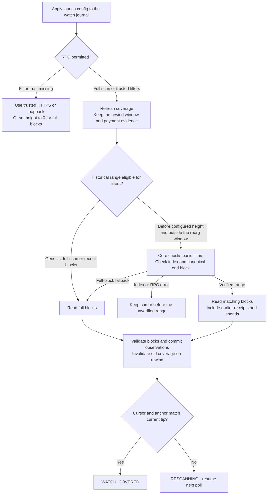

# Encrypted address requests and durable watch/rescan

Status: **CODE_IMPLEMENTED_QUALIFICATION_PENDING; Ready disabled**.
This increment adds a separate address delivery channel and a persistent
observer. The [registration workflow](ADDRESS_REGISTRATION.md) connects its
durable requests to existing FROST authority. Issuance qualification, Bitcoin
fee reserves and mint/spend approval remain separate.

## Independent delivery authority

`BitcoinAddressMessageBoard` is immutable and tied to one canonical
`BitcoinAddressRegistry`, graph, authorization and EVM chain. Any requester can
send from its own EVM account. A service must belong to that graph's existing
EVM_AUTH roster. This permits retail requests without granting transport actors
the threshold authority for registration, status changes, mint or Bitcoin spend.
The existing federation-only SPV transport remains separate.

REQUEST, ACK and STATUS use their own `SATOHSI_ADDRESS_HPKE_V1` context. Chain,
board domain, route, kind, sequence, sender/recipient, both key epochs and expiry
are authenticated associated data. The on-chain sender authenticates HPKE Base
messages; ciphertext alone is not sender authentication. Old registered public
keys and ciphertext remain readable. Services retain old private transport keys
for outstanding messages; a missing key stops the cursor instead of discarding
the message. Plaintext is saved only in the private local state directory.

The contract allows at most 4,096 ciphertext bytes, one REQUEST/ACK and 64 STATUS
messages per route, with a maximum one-day delivery TTL. Exact retransmission
retains the original bytes after expiry/key rotation. A new request is not
silently manufactured when an old delivery expires. Explicit `--delivery N`
requests a new delivery route for the same immutable intent.

The client writes the request outbox and its idempotency mapping atomically.
The service persists the complete intent, native descriptor, Bitcoin address
and **rescan-from-height-zero plan before queuing DURABLE ACK**. A crash between
those commits resumes the same receipt. A requester nonce cannot bind another
recipient/intent. Invalid messages are quarantined; accepted watch obligations
remain after delivery expiry or an EVM transport reorg.

ACK means durable receipt, not admission to a funded service. STATUS is an
authenticated hint, independently separated into registration, watch coverage
and issuance permission. The requester independently recomputes its descriptor
hash and rechecks canonical request/reply packets. A service's `READY`/`ready=true`
claim is rejected. Actual registration remains the existing `registerBatch`
under the unchanged EVM_AUTH quorum.

Ordinary REQUEST plaintext uses V2; a recipient choice adds its opening in V3.
Both use the same authenticated on-chain request ID, which commits
to the exact intent with a random salt. Registration reveals that opening so
every signer can verify the requester without transport secrets. Existing V1
deliveries remain watch/ACK compatible; they require an explicit V2 resend for
registration attestation. ACK/STATUS envelopes remain V1. V3 requires upgraded
endpoints and approving participants; an older service rejects this new profile
without issuing Ready.

## Operator commands

Use the private [configuration template](../config/address-service.example.json),
replace all example bindings and cap gas explicitly. Both endpoints use their
own identity, key files and directory. Retail request/poll commands need no
Bitcoin Core credentials: set `bitcoin_rpc`/`bitcoin_cookie` to `null` there.
The service's scan/status commands require its configured archival Core.

```sh
python -m signer_agent.address_transport keygen --epoch 1 --key-file /private/path/transport-1.json
python -m signer_agent.address_transport register-key --config /private/path/address.json --epoch 1

python -m signer_agent.address_transport prepare --config /private/path/requester.json \
  --recipient EVM_RECIPIENT --intent-file /private/path/deposit-intent.json
python -m signer_agent.address_transport request --config /private/path/requester.json \
  --intent-file /private/path/deposit-intent.json --service SERVICE_EVM_ADDRESS
python -m signer_agent.address_transport flush --config /private/path/requester.json

python -m signer_agent.address_transport serve-once --config /private/path/service.json
python -m signer_agent.address_transport flush --config /private/path/service.json
python -m signer_agent.address_transport scan --config /private/path/service.json
python -m signer_agent.address_transport flush --config /private/path/service.json

python -m signer_agent.address_transport poll --config /private/path/requester.json
python -m signer_agent.address_transport replies --config /private/path/requester.json
```

`prepare` displays the exact chain/network, pool/token, requester and recipient;
it saves a private intent draft and does not return a payable Ready address.
It also displays the selected [recipient profile](ADDRESS_DEPOSIT_REGISTRY.md#recipient-matrix).
Contract recipients require `recipient-preview` and its exact `--recipient-accept`
hash with `--recipient-file`; registration independently checks the selection
bound by the existing request nonce. The raw intent remains 382 bytes; V3 REQUEST
adds the choice opening inside ciphertext. V1/V2 remain valid for older ordinary
requests. `prepare` sends no public selection transaction. The opening becomes
public only with the existing DKG registration-intent publication; the driver
then materializes it on-chain before `registerBatch`.
`request` queues ciphertext; `flush` is the separate EVM send operation. A local
gas limit, per-transaction cost, total retained cost and publish-attempt cap
bound these sends. Durable signed transactions use the identity's existing
transaction journal. No automatic treasury payment or SPV job is created.
Gas reservations live beside the identity in `.address-costs.sqlite`, outside
watch backups; a new watch directory cannot reset used cost. Its per-board/identity
history is capped at 4,096 operations and is not silently rotated.
Its identity is bound to the separate transaction journal; missing/replaced cost
state requires recovery rather than an automatic zero budget.

## Observer and recovery

The observer covers configured Core's canonical chain from genesis in bounded
portions, round robin across descriptors. By default it scans full blocks.
It uses the pinned rust-bitcoin block codec to bind raw block hash/Merkle root,
parse transactions and match exact P2TR scripts. Bitcoin address encoding uses
that library as well. The observer
does not implement consensus/PoW or replace Core/SPV. Early payments, repeated
payments and same-block spends remain distinct outpoints; no OP_RETURN is needed.

Each full block or filter page commits its observations and cursor atomically
to SQLite WAL/FULL.
Original observations remain append-only. A bounded reorg atomically invalidates
coverage and rewinds the current projection and cursor using observations in the
disconnected blocks. A deeper reorg, missing/pruned history, disk budget or
resource limit produces backpressure or recovery. Status and reconciliation
check the coverage record, cursor and stored block hash together against the
current Core tip.

The profile caps 256 descriptors, 4,096 **live unspent** outputs per journal,
256 blocks per poll and 100 blocks of automatic reorg repair. The template reads
up to 16 full blocks per invocation. A full genesis rescan for each newly
admitted descriptor uses RPC bandwidth and CPU. The scan itself never requests
a paid proof.

### Working without a local Bitcoin node

Set `bitcoin_rpc` to the remote Bitcoin Core RPC HTTPS endpoint in the private
`ADDRESS_CONFIG` and `FEE_CONFIG`. Point `bitcoin_cookie` to a local private
file containing the endpoint's `username:password` and use permissions 0600.
The endpoint must expose Bitcoin Core RPC for the selected network, have full
block history and serve raw blocks by hash. A block explorer or a pruned RPC
cannot serve this workflow. Mainnet and testnet4 require a synced
`txindex=1`. Fee reconciliation also needs `scantxoutset` and transaction
lookups by txid.

| RPC available | Launch setting | Private service setting |
| --- | --- | --- |
| Archival HTTPS Core with full blocks | `"bitcoin_watch_start_height": "0"` | Omit `trust_remote_watch_filters` or set it to `false`. |
| Your team's trusted archival HTTPS Core with a synced basic filter index | Positive `bitcoin_watch_start_height` | Set `"trust_remote_watch_filters": true` for the exact `bitcoin_rpc` endpoint. |
| Your own Core or a trusted SSH/VPN tunnel to it | Positive `bitcoin_watch_start_height` | Use a numeric loopback endpoint, for example `http://127.0.0.1:8332` at the local end of the tunnel. |

Run the same scan commands below for all three choices. For an epoch worker that
passes the address service's RPC to the fee watcher, configure the same HTTPS
endpoint and explicit consent in both private configs. Each participant controls
this setting locally. The launch JSON contains the height and carries no RPC
credentials or consent.

Full-block mode validates raw block hashes, transaction Merkle roots and the
parent links. Bitcoin consensus and chain selection still rely on the configured
Core, including the network and checkpoint checks. The HTTPS filter mode also
trusts that operator to return all matches. Use it only for a Core you trust
with that result. The Core operator sees the queried scripts in filter mode.
[BIP 157](https://bips.dev/157/).

### Faster historical scan

Set `bitcoin_watch_start_height` in the launch wizard or public launch JSON.
A positive value sets the height from which the observer reads every block.
Before that height, the observer checks historical ranges using the selected
Core's basic block filter index. It reads and validates matching raw blocks,
including earlier receipts and spends. The genesis block and the blocks in
the normal reorg window are scanned in full.
[Bitcoin Core scanblocks](https://bitcoincore.org/en/doc/30.0.0/rpc/blockchain/scanblocks/) ·
[Basic filter contents](https://bips.dev/158/#block-filters).

Configure a numeric loopback or explicitly trusted HTTPS RPC as described above.
A positive height without an eligible endpoint gives
`ADDRESS_FILTER_LOCAL_CORE_REQUIRED`. Set the height to `"0"` to use full blocks.
Enable `blockfilterindex=1` and wait for the basic block filter index to report
`synced: true` in `getindexinfo`. Apply the launch config once for each observer
journal. Its EVM chain and Bitcoin network must match the service configuration.
For fee addresses use the V2 fee reserve configuration with `fee_watch_databases`.

```sh
python -m signer_agent.address_transport scan --config "$ADDRESS_CONFIG" \
  --launch-config "$LAUNCH_DIR/launch-config.json"
frost-signer bitcoin withdrawal-fee scan --config "$FEE_CONFIG" --watch "$FEE_WATCH" \
  --launch-config "$LAUNCH_DIR/launch-config.json"
```

Later scans and the epoch worker reuse the setting in the same journal. For a
new journal the default is `"0"`, which uses full blocks from genesis. To switch
an existing journal to full-block scans, apply a launch config with `"0"`;
scanning resumes at the stored cursor. The setting is local and does not enter
the invitation or the descriptor hash in the ACK.

On upgrade, run the updated scanner against each existing journal to refresh
coverage. The previous checked format (version 2) and older contiguous histories
resume at their cursor. Sparse histories from before the RPC trust check replay
from genesis with descriptors and append-only observations preserved. Status and
fee reconciliation wait for refreshed coverage. Upgrade the SDK and rebuild
its `frost-crypto` binary on each participant before resuming processes that
share the journal.

The observer checks a historical range at most 2,000 blocks at a time.
The final block must appear in the filter matches for a known script in
that block. It anchors the range to the configured Core's chain. If the candidate
set exceeds the per-poll block limit, the observer scans a bounded sequence
of full blocks. An unavailable index or incomplete filter response produces
`ADDRESS_FILTER_INDEX_REQUIRED` or `ADDRESS_FILTER_SCAN_INCOMPLETE` and leaves the
cursor at the unverified range. Retry after the index is ready, or apply `"0"`
to continue reading full blocks.



### Journal size and contract execution

Technical block hashes use a rolling window. Once caught up and trimmed, each
descriptor has at most 101 hashes. Between trims a poll can add at most 256
hashes, for a maximum of 357 per descriptor in normal operation. Old journals
release up to 4,096 obsolete hashes per descriptor poll. SQLite reuses those
pages. After taking a watch backup, stop processes using a large legacy journal
before running SQLite `VACUUM` if the file must shrink on disk. Allow temporary
space for the rewrite. [SQLite VACUUM](https://sqlite.org/lang_vacuum.html).

Descriptors, payment/spend observations and the canonical history of matching
outputs remain in SQLite. The live-output limit counts unspent outputs. Archive
growth follows actual matching events and the configured byte budget
(`max_archive_bytes`, 1 GiB in the address service example). The epoch archive
also applies `max_archive_records`. When those limits or inventory limits are
reached, SDK observation and automatic reconciliation can stop with a bounded
error. Keep the original watch backup and signer journals when recovering.

Contracts receive registrations, transaction proofs, operation-specific data
and reconciliation reports. The SQLite file and its scan hashes stay on the
observer. Registration checks at most eight intents
per call, and the fee and spend paths operate on the relevant outpoints or
batch. On-chain registries and receipts still grow with their own accepted
operations. SDK inventory limits apply when it enumerates those registries.

### Recovery and backup

```sh
python -m signer_agent.address_transport backup --config /private/path/service.json \
  --output /private/path/new-watch-backup.sqlite
python -m signer_agent.address_transport recover-binding --config /private/path/new-service.json \
  --intent-id INTENT_ID
python -m signer_agent.address_transport recover-range --config /private/path/new-service.json \
  --from-block START --to-block END
```

Recovery ranges cover at most 64 confirmed EVM blocks. Events locate records;
fresh canonical binding/descriptor/provenance validation authenticates them.
A new service can reconstruct registered descriptors from public registry bytes
without the previous server, transport key or an external URL. It starts a new
genesis rescan; it does not trust a backup's coverage flag. Unregistered private
requests require retained transport keys, private backup or a requester resend.
Backups preserve local watch evidence; they are not a signer-state or gas-budget
rollback mechanism. No command resets EOA, FROST nonce or spent journals.
Recipient eligibility is separate from historical custody. A changed runtime or
wallet owner profile reports `RECIPIENT_REVIEW_REQUIRED` for new mint, retaining
the exact registered intent, descriptor and watch/recovery obligation. Advanced
confirmation is recovered from the canonical immutable selection; a new UI or
relayer cannot replace it with a generic gas confirmation.

Remaining before Ready: qualified verifier/profile and registration workflow,
confirmed binding, complete watch coverage, qualified fee service and
reserve, custody reconciliation/incident integration, address SPV worker qualification
and recipient/old-epoch continuity. Observed spends are evidence; this component
does not classify an unexpected spend as theft or automatically clear/set the
Bitcoin signer's financial recovery pause.

The [address SPV worker](ADDRESS_SPV_WORKER.md) now connects registered intents
and bounded `spv-sync` scheduling to explicit worker V5 / transport V3 pins and
the existing opt-in admission/quote/payment pipeline.

[Current evidence](../ops/artifacts/zkspv/worker-integration/address-watch-client-report.json)
separates real HPKE/native/SQLite/contract logic from synthetic Core/EVM/DKG/SPV
fixtures. No actual Core acceptance, new ZK proof, public transfer or combined
Core/proving/transport/payment/FROST/consumer E2E was run for this increment.
