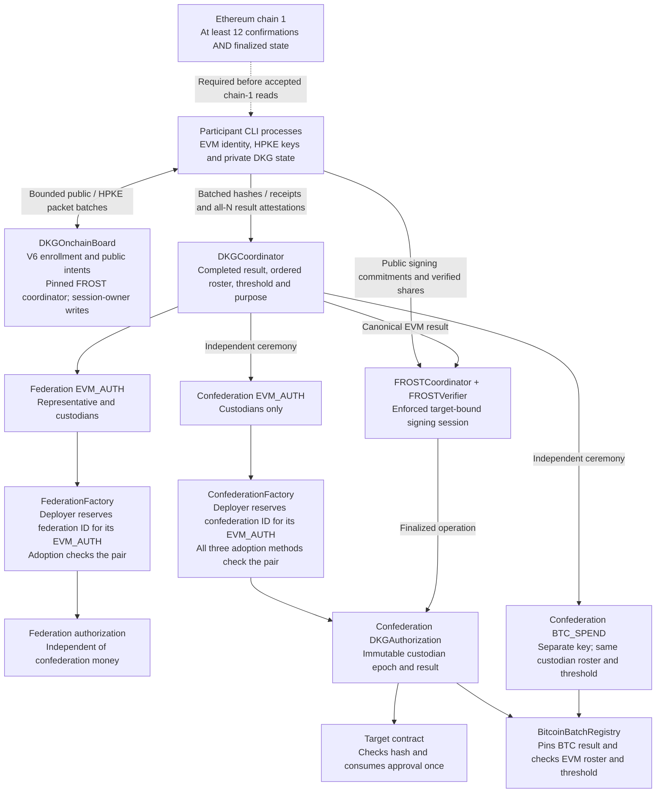
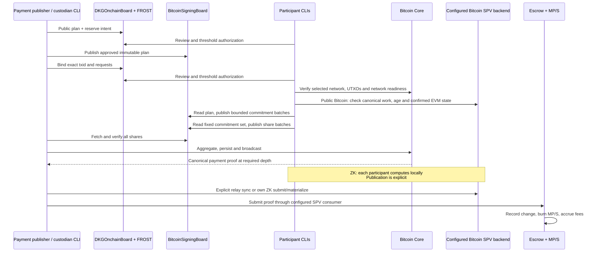
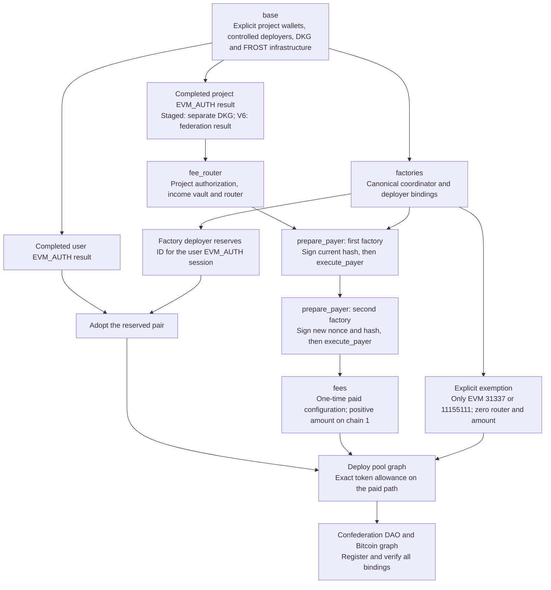
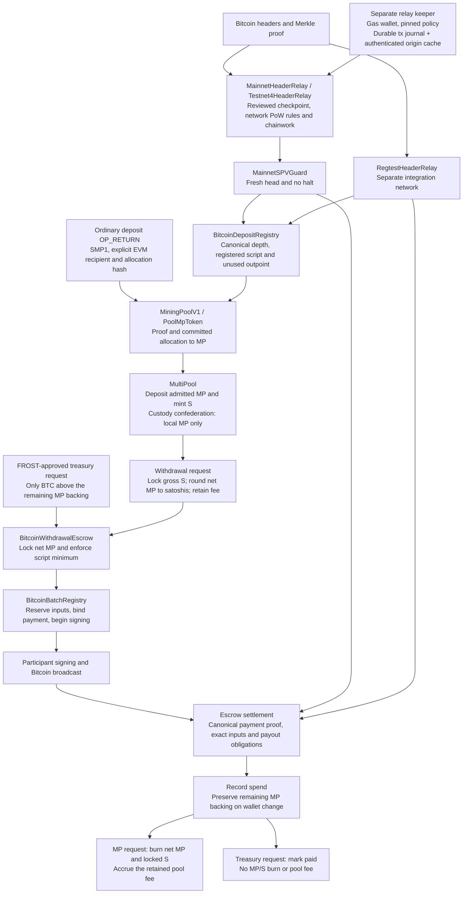
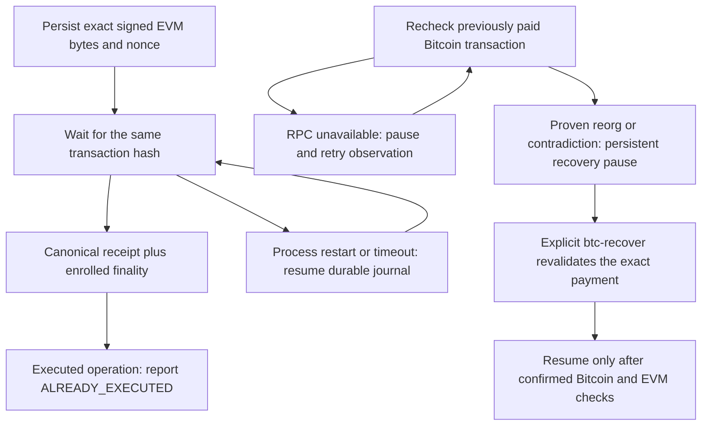
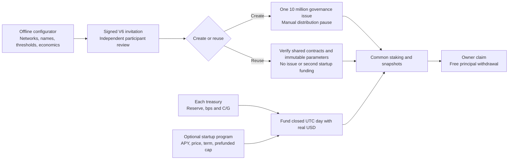
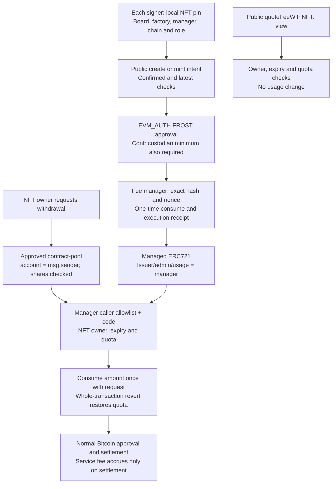
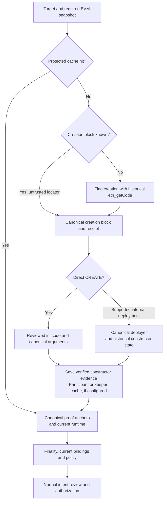

# Architecture

[Схемы: SVG/PNG и hashes текущих Mermaid-исходников](DIAGRAMS.md).

[Documentation Index](./README.md)

The current V6 implementation supports independent Ethereum
**mainnet / Sepolia / local** and Bitcoin **mainnet / testnet4 / regtest** selection.
See the [network matrix and automatic continuation](NETWORKS_AND_AUTOMATION.md).
Ethereum chain 1 always enforces paid factories, at least 12 confirmations plus
finalized state and explicit local transaction budgets. Public Bitcoin requires
a trusted checkpoint and own live Core. Policy V1 selects the network relay and
`MainnetSPVGuard`. Policy V2 selects `ZkBitcoinStateV2` / `ZkSpvAdapter` for
Bitcoin mainnet and `ZkBitcoinTestnet4StateV2` / `ZkTestnet4SpvAdapter` for
testnet4. These guests and contract bindings are distinct; regtest has no ZK backend.
The ZK production-path code and candidate address registry remain unqualified for
production activation. The [current code map and diagrams](ZK_SPV_ARCHITECTURE.md)
show worker funding, permanent archive, address statuses and the multi-request
suite. The [functional coverage audit](ZKSPV_FUNCTIONAL_COVERAGE.md) records the
canonical family root, durable observation/outbox, selected local-fence risk policy
and remaining private case bindings/qualified execution. See [family scope](BITCOIN_KEY_FAMILY.md)
and [observation risk](ZKSPV_OBSERVATION_HISTORY.md).
The [network-matrix acceptance](PARALLEL_NETWORKS_ACCEPTANCE.md)
and [26 October operations/RPC review](OPERATIONS_REVIEW_2026_10_26.md) record
their respective checks separately from the [previous V5 acceptance](ETHEREUM_MAINNET_ACCEPTANCE.md).
No public funded transaction is claimed by local acceptance.

The [participant distribution](DISTRIBUTION.md) contains code, the pinned guest
program and verification metadata. Ready ZK proofs, working inputs/journals and
caches remain local. Every ZK participant computes working transition proofs
using its own Core and worker directory. The worker defaults to local computation;
the designated publisher explicitly submits its own authenticated result. The
current local prover supports macOS arm64 and Linux/WSL2 x86-64. The
[Linux runbook](ZK_PROVER_LINUX.md) covers tool installation and mandatory
isolation probes. Full fresh-proof and physical WSL2 acceptance remain pending;
unsupported platforms such as Linux ARM64 full proving remain blocked.

The complete Bitcoin + ULR deployment uses `setup invite --system-policy`.
Its current [launch/data map and diagrams](LAUNCH_READINESS.md) show the common
10-million ULR issue, shared staking, per-confederation treasuries, candidates,
delegation and independently approved reuse. The diagrams below retain the
common Bitcoin infrastructure and the optional older DAO branch; the latter
is not the economic route selected by the ULR profile.

The current `bitcoin_custody.mode=custodians` profile has separate confederation
EVM and Bitcoin DKG epochs, both excluding federation representatives. A Bitcoin
handover between independent graphs is explicit and precedes cBTC issuance.
See [custody roles, transfer and recovery](BITCOIN_CUSTODY_TRANSFER.md) and the
[4 November native DKG/Core acceptance](../ops/artifacts/custody-transfer-20261104/README.md).
Current [diagram index, SVG/PNG exports and source hashes](DIAGRAMS.md)
are generated from the Mermaid blocks in the documentation; older diagram folders are snapshots.

For a joined operational and mathematical account, see
[FROST and ZK lifecycle](FROST_ZK_LIFECYCLE.md): role-specific DKG, VSS,
threshold Schnorr, durable nonces, independent proofs and Bitcoin settlement.

## DKG, transport and authorization

Participants start with the code and each other's EVM addresses. The operator
publishes one V6 invitation committing both independently selected networks through `DKGOnchainBoard`; the other participants
discover it from the operator address and independently inspect its policy and
contract creation provenance. Each participant enrolls an authenticated HPKE
transport key. Public commitments and encrypted recipient-specific DKG round-two
packets travel on chain. Private key packages and signing nonces remain local.
Invitation discovery scans the latest 8192 blocks by default and reports the
searched range. Older invitations require an explicit wider range. The returned
creation block can be supplied to the following setup commands; it locates the
constructor evidence and does not replace its verification.

This diagram shows the new custody profile. The board transports data; it does not authorize operations or validate DKG
ciphertext itself. Agents verify invitation signatures, transport authentication,
the transcript and canonical registry state. Every participant must complete the
initial DKG of each role they belong to. Later signing uses that role's threshold.
With Alice as representative and Bob/Carol as custodians, federation EVM is
3-of-3; confederation EVM and Bitcoin are independent 2-of-2 ceremonies.
Historical profiles without `bitcoin_custody` keep their original common roster,
including the representative; they are not upgraded by changing documentation.
Ethereum chain 1 fixes 24 hours per DKG phase (`phase_duration=86400`), matching the chain-1
coordinator; integration chains retain one-hour phases. Participants act
concurrently, with all three independent ceremonies created before their waits.
`flow dkg` advances applicable local roles, using separate secrets and bounded
batched publications. The representative skips the two custody roles with
`NOT_A_PARTICIPANT`. A phase ends when its checks pass; 24 hours is a deadline, not a
mandatory wait. Every network enforces the enrolled receipt depth, and chain 1
also requires finalized state. See
[first DKG](FIRST_DKG_ONCHAIN.md) and [DKG protocol](DKG_PROTOCOL_V1.md).

`DKGAuthorization` inherits `FROSTAuthorization` and additionally pins the completed
`EVM_AUTH` DKG ID and result. One shared `FROSTCoordinator` can host many groups;
each authorization instance accepts only its own immutable group and target-bound
operation. Any eligible participant can aggregate/finalize sufficient verified
shares; no signing leader holds the group secret.

`BitcoinSigningBoard` carries the immutable public payment plan, nonce commitments
and signature shares. The CLI publishes and reads these records, verifies the
approved plan and fixed signer subset, aggregates signatures, broadcasts to Core
and submits the payment proof. See [the payment runbook](BITCOIN_ONCHAIN_RUNBOOK.md)
and [the signing-board protocol](../web3/docs/bitcoin-signing-board.md). Public-Bitcoin V6
participants independently verify their own fully synchronized, unpruned Core and
txindex against the shared policy before enrollment. The pinned graph includes
the selected relay/guard or ZK state/adapter, checkpoint policy and EVM confirmation depth.

| Exchange | Current transport |
|---|---|
| Initial DKG, including the BTC wallet ceremony | Implemented on chain through `DKGOnchainBoard`; private directed DKG packets use HPKE. |
| EVM authorization signing | Implemented on chain through `FROSTCoordinator`; bootstrap intent discovery uses `DKGOnchainBoard`. |
| Signing an actual Bitcoin payment | Implemented through `BitcoinSigningBoard`; plan discovery and reserve/bind approval intents use `DKGOnchainBoard`. No participant file exchange is needed. |

The file-based `--package` path remains for compatibility. The on-chain path uses
strict V2 plans with the chain, board, wallet result, batch and selected signers
bound to the reservation hash. Private DKG shares use HPKE; Bitcoin nonce points
and signature shares are public protocol values, never secret nonces.

A participant can broadcast or settle using the public chain records and its own
local DKG state. In custody mode, bootstrap enables public-intent publication by
the completed custodian epoch once; the original operator is then unnecessary
for withdrawal proposals. This grants transport access, not approval authority
or permission to rewrite the invitation. Old boards retain operator publication.
New deployments bind `intentCoordinator` once before any public financial intent.
Only a permitted creator may publish into its existing FROST session, including
multipart fee intents. A representative or another custodian cannot poison a
different creator's session or preallocate future ids before that binding.

## Federation and confederation deployment

Each factory's deployer reserves the entity ID for its EVM_AUTH session.
An eligible caller can adopt after the canonical DKG completes and the pair
matches the reservation. Final deployment uses `deployFederation(...)` or
`deployConfederation(...)`. Legacy initiation is restricted to the factory
deployer on EVM chain IDs 31337 and 11155111. Legacy deployment is restricted
to those chains. The coordinator and verifier are fixed by the factory.

The bootstrap scheduler submits only explicitly independent deploy/call groups,
up to 8 steps, before a common finality barrier. Dependent outputs remain hidden
until all canonical receipts and postconditions pass. Per-identity nonce locking
and journals preserve exact signed bytes after interruption. FROST financial
intent review and custodian approvals remain explicit.

Controlled orchestrators and leaf deployers create the pool, share token,
authorization and fee contracts. The confederation additionally has a
`CustodianValidator`. Separate token/authorization leaves keep embedded creation
code within EVM size limits; all constructor arguments also count toward the
initcode limit. [Current sizes](CONTRACT_SIZE_AND_DEPLOYMENT.md) leave only
6 bytes of runtime headroom in `MultiPoolDeployer` in the 4 November custody build.

The DKG registrar controls ceremony creation. Factory reservation is a separate
action and does not confer membership in the reserved session.
[Shared factory workflow](FEDERATION_CONFEDERATION_SETUP.md#7-дополнительная-конфедерация-на-существующей-factory).

New custody deployments adopt the completed epoch with
`adoptCustodianConfederationDKG`: at least two custodians, threshold at least two
and `ceil(70% * custodians)`, with `threshold <= minCustodians <= custodians`.
Founders remain association metadata and hold no share of either monetary key.
Candidate status or vote delegation does not rotate either DKG epoch.

Historical non-custody confederations use one representative (`members[0]`) from each source federation,
or **all ordered members** when using `adoptConfederationFromFederation(...)`.
Founders and custodians are disjoint. With `f` founders, `c` custodians and
`n=f+c`, construction requires `c>=ceil(f/2)`, `t>=ceil(7n/10)`, `t>f` and
`t-f<=minCustodians<=c`. `minCustodians` is explicit. These formulas do not imply
unanimity for every roster with one or two founders. The Bitcoin result must
have the same ordered roster and threshold as the EVM authorization.

`exempt_all` combines base, factories and the explicit exemption; it creates no
project fee router. Anvil/Sepolia [generated bootstrap](BOOTSTRAP.md) uses this
exemption policy. V6 on Ethereum chain 1 follows the paid branch automatically;
its separate project authorization reuses the completed federation EVM result.
In this diagram, "Staged: separate DKG" refers to the Anvil/Sepolia legacy
manifest/package CLI. That separate ceremony path is not supported on chain 1;
the [staged runner](STAGED_DEPLOYMENT.md) can validate already completed results
and authorizations, while the full Ethereum mainnet ceremony/signing path is V6.
Project and confederation fee contracts remain distinct in both paths. Neither
base nor factory deployment alone creates user pools, the Bitcoin graph or DAO.

The Python staged runner checks canonical CREATE provenance, constructor arguments,
receipts, block identity and dependency bindings before reuse. Its public manifest
records confirmed progress. Direct Forge scripts check runtime/getters and require
independently trusted reused contracts. See [contract provenance](CONTRACT_PROVENANCE.md).

## Bitcoin deposits and proof-backed withdrawals

The current proof-only mint path is `BitcoinDepositRegistry` and
`MiningPoolV1` (the bootstrap path). Deposit proofs bind the receiving pool script, outpoint
and value; duplicate issuance is rejected. Ordinary deposits also require the exact
56-byte `SMP1 + explicit 20-byte EVM recipient + 32-byte allocation hash` in a
zero-value Bitcoin OP_RETURN output. The wallet output index is part of the hash;
it is distinct from the OP_RETURN output index. Coinbase can use the same SMP1
recipient binding; a present marker cannot be ignored. Only unmarked coinbase
rewards retain arbitrary explicit FROST-approved allocation. Both coinbase modes
require 100-block maturity; the legacy SMP1 mint path has at most 32 outputs. The candidate address path uses
`FUNDING_STRIPPED_100K_V1` and current custody/derivation fences; it is not enabled
by bootstrap or supported by the legacy signer. See [address registry](ADDRESS_DEPOSIT_REGISTRY.md).
MP units are `1e10` per satoshi.
The older `SimpleSPVContract` and `SimpleMiningPool*` examples remain a separate
path, including their Bitcoin redemption builder.

The following diagram shows the **ordinary local-custody policy V1 / regtest lifecycle**.
For the mainnet ZK backend and unactivated address candidate, use the separate
[backend and address diagrams](ZK_SPV_ARCHITECTURE.md).

The withdrawal fee equals gross shares minus rounded net MP. Zero net and values
below the explicit P2WPKH/P2TR minimum revert. Direct MP withdrawal skips S-token
accounting and requires an already integral satoshi amount. Pool approval only
prepares a withdrawal; Bitcoin signing/broadcast alone does not burn principal.
The payment proof triggers escrow settlement, MP burn, pool S burn and fee accrual
atomically. Miner fees and treasury withdrawals cannot consume remaining MP backing.
A treasury request has no MP token to burn; it uses the same input reservation,
Bitcoin signing and proof settlement flow. See [mint and treasury commands](BITCOIN_MINT_AND_TREASURY.md)
and [the relay keeper](RELAY_KEEPER_AND_GAS.md).

For external MP backed by a different Bitcoin key, the destination does not
accept that token through ordinary `addPool`/`deposit`. The immutable gateway
locks source MP, requests a source Bitcoin payment to the destination script,
waits for source settlement/burn, and verifies the exact destination output at
the enrolled SPV depth. Only then does it mint internal local MP and deposit it
for the fixed cBTC recipient. Both graphs use the same EVM chain. Their Bitcoin
keys, escrow and deposit registries are distinct. An unaccepted transfer output
is protected from treasury spending; ordinary mint cannot bypass the handover.
See the [transfer sequence and state machine](BITCOIN_CUSTODY_TRANSFER.md).

`DKGOnchainBoard` has an append-only intent index, so payment and DAO commands read
current state rather than scanning all historical board logs. Invitation discovery
and constructor verification have separate bounds; see
[contract verification and RPC history](#contract-verification-and-rpc-history).

Cancellation/refund is possible while pending or after an unsigned bound batch
is cancelled. Once signing starts there is no timeout-based unlock; approved
replacement transactions retain the original obligations and input reservations.
See [the complete lifecycle and state diagram](BITCOIN_WITHDRAWALS.md).

`MainnetHeaderRelay` verifies compact difficulty, PoW, retarget, MTP and future
time from an explicit trusted checkpoint. It stores valid side branches but
changes the head only for more cumulative work. A reorganization beyond the
configured bound permanently halts proof use. A fresh independently checked
checkpoint, header synchronization and monitoring remain operator dependencies;
the historical fixture checkpoint is not a deployment recommendation.
The V6 CLI derives relay and policy from the pinned graph. `dkg btc-network-status`
checks readiness; `dkg btc-relay` submits a bounded header batch through the durable
EVM journal; `flow relay` continues it periodically. `Testnet4HeaderRelay` adds
BIP94 minimum-difficulty, boundary timestamp and first-block retarget rules.
Synchronization returns `IN_PROGRESS` until the reviewed freshness/lag and EVM depth
are satisfied. Shorter but heavier branches are supported within the rollback limit.
`MainnetSPVGuard` also gates permissionless issuance and settlement on chain, so
those callers cannot bypass signer-side freshness checks. See
[mainnet setup](BITCOIN_MAINNET_RUNBOOK.md), [relay details](MAINNET_RELAY.md) and
[signer trust](BITCOIN_SIGNER_TRUST.md).

## Fees and DAO governance

There are two separate authorization and money flows:

| Flow | Authorization and destination |
|---|---|
| Factory deployment charge | Separate project authorization, vault and router. The Anvil/Sepolia staged CLI has an independent project DKG; Ethereum mainnet V6 reuses the federation EVM result. Both factories are authorized payers; `deployStakerBps=0` sends the entire fee to project treasury. It does not fund confederation DAO settlement. |
| Confederation pool fees | Pool `claimFees` releases accrued MP after authorization. A selected converter supplies real reward tokens to the DAO router; configured shares fund DAO streams and treasury. |

For the ULR profile, pool and deployment staker splits are zero. Converted USD
reaches the confederation treasury; the shared historical wallet + own-stake
snapshot determines its share of the daily payout above the immutable reserve R
(default USD 1000), at the configured payout bps (default 9000). The treasury
pays into the common `ULRStaking`, and each owner claims their own USD rewards.
A separate prefunded startup program may add USD rewards using an immutable
APY, reference price and UTC term; available funds cap every payout, with no arrears
or automatic reinvestment. Candidate registration and delegation do not transfer reward ownership. Shared
snapshots use the original system EVM_AUTH group; admission of a new Bitcoin
graph uses the original root group and the new confederation's separate quorum.
There is no legacy DAO rate controller, reserve settlement or BTC/USD feed in
this profile. See [ULR bootstrap](ULR_BOOTSTRAP.md) and [treasuries](ULR_TREASURIES.md).

The [launch mathematics](LAUNCH_MATHEMATICS.md) defines units, floor operations,
funding bounds and the assumptions behind snapshots. Display names are configurable;
asset identity remains chain ID and contract address.

The older, non-ULR DAO graph includes token, full-day staking, custodian-count rate controller,
non-executing stake-weighted decision board, BTC/USD TWAP, income vault and daily
settlement. The factory exposes its seven canonical addresses only after approved
registration and binding checks. Fee routers/adapters are additional configured
components. [Fee flow](FEE_FLOW.md) shows the two paths and their units.

Settlement reconciles funded sources with the approved report and requires a
legitimate price even when there are no LPs. An empty provider list sends the LP
allocation to immutable treasury; with neither eligible stakers nor LPs, both
distributable shares go there. Reserve rules and exact transfers remain enforced.
See [Custodian DAO](CUSTODIAN_DAO.md).

Pool/factory operations consume their own target-bound authorization hashes.
Operations protected by `CustodianValidator` also need its custodian approvals.
DAO rate and reserve-policy changes instead use the controller's snapshot and
`ceil(2N/3)` custodian votes. Stake and delegated DAO signer choices do not create
custodian votes. Changing the cryptographic roster or threshold requires a new
DKG epoch and new immutable deployments.

## Optional managed discount NFTs

After bootstrap, `frost-signer nft` uses the entity's existing EVM_AUTH DKG to
create a managed collection and mint an NFT to the exact approved recipient.
Confederations additionally require custodian minimum approvals. The manager
holds the ERC721 admin/minter/usage roles; authorization checks and consumes the
operation. Every signer uses its own NFT pin and public-board intent, rechecked
before nonce/share and cached delivery. This is separate from Bitcoin signing
and ZK proof generation. See [NFT commands and mathematics](NFT_CONFIGURATION.md).

An authorized pool is a trusted quota consumer; governance must not approve
arbitrary contracts that accept a caller-supplied victim account. EOA and
unapproved contracts cannot call the consuming method. An NFT discount does not
remove gas, miner fees or satoshi minima. Installing this SDK does not modify
old immutable manager/NFT contracts. Pool manager attachment is one-time; an
old manager requires a new pool/graph and an explicit continuity plan, not a
second `setFeeManager` call. No automatic NFT migration workflow is supplied.

## Contract verification and RPC history

Historical state and historical block data serve different purposes. An exact
direct CREATE can be authenticated using a known creation block, its canonical
successful receipt, reviewed initcode and current runtime. It does not need
`eth_getCode` at the creation block or the preceding block. Public locators from
discovery, DAO config and CLI flags remain untrusted until these checks pass.

Participant CLI stores verified evidence in `<state>.public-cache`; the relay
keeper uses `<identity>.relay-provenance.enc`, authenticated with a separate key
derived from its local gas identity. These caches survive process restarts.
Warm checks still read canonical headers, current code, finality and live bindings.
Public DAO config is not an authenticated cache and its evidence is replayed.

Every failed check stops the operation. The cache does not authorize a payment,
replace a Bitcoin observation, or shorten finality. Unknown creation blocks and
first checks of supported internal deployments may still need historical state;
canonical block headers and receipts remain necessary evidence.

| Task | Bounded path |
|---|---|
| Find a friend's invitation | `setup discover`: latest 8192 blocks; `--recent-blocks N` or `--from-block N` expands the range. Only explicit `--from-block 0` searches from genesis. |
| Continue setup from a found board | Pass its returned `block` as `--board-creation-block`; exact constructor and sender are still checked. |
| Start a relay keeper | `--relay-creation-block` avoids the initial state search; the protected cache avoids repeating it after restart. |
| Read a saved DAO config | Recheck the saved block/receipt/initcode; direct deployments need no creation-era state. |
| Read signing intents | `intentCount/intentSessions` indexes current board state; no full event-history scan. |

An empty bounded invitation scan reports `NOT_FOUND_IN_RANGE`, including its
exact block bounds. RPC failures, unavailable finality and reorg are errors,
not empty results. See [provenance requirements](CONTRACT_PROVENANCE.md),
[first DKG](FIRST_DKG_ONCHAIN.md) and [keeper operation](RELAY_KEEPER_AND_GAS.md).

## Client and operational boundaries

| Component | Responsibility |
|---|---|
| Signer CLI and Rust crypto helper | DKG, encrypted local packages, FROST computation and persistent nonce safety; independently inspect each signing intent. |
| Bootstrap / deployment journal | Explicit parameters, provenance, dependency order, confirmed receipts and safe resume. |
| DAO CLI | Canonical discovery, balances/staking/claims/votes; writes simulate unless explicitly broadcast. |
| Authenticated operations API | Durable idempotent operations and role policy; configured worker performs allowed actions. |
| Bitcoin worker | Explicit regtest/mainnet signing, broadcast, proofs and persistent reservations; recovery-required state stops automatic money actions. |

The repository includes the integration broadcaster and API. Production Bitcoin
agent policy, HSM custody, external oracle/
converter selection and operational monitoring still require separate work.
On-chain metadata is public; encryption covers private DKG packets, not amounts,
rosters or signing commitments. A cloned or rolled-back nonce journal remains
unsafe. Follow [signing persistence](SIGNING_PROTOCOL.md), [operations API](OPERATIONAL_API.md)
and the [current review's deployment limits](OPERATIONS_REVIEW_2026_10_26.md#границы-исправлений).
