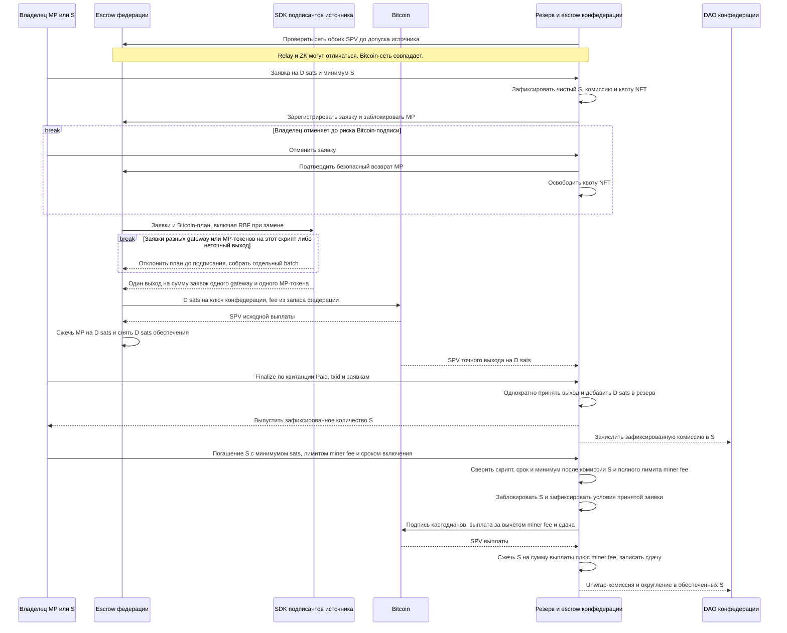
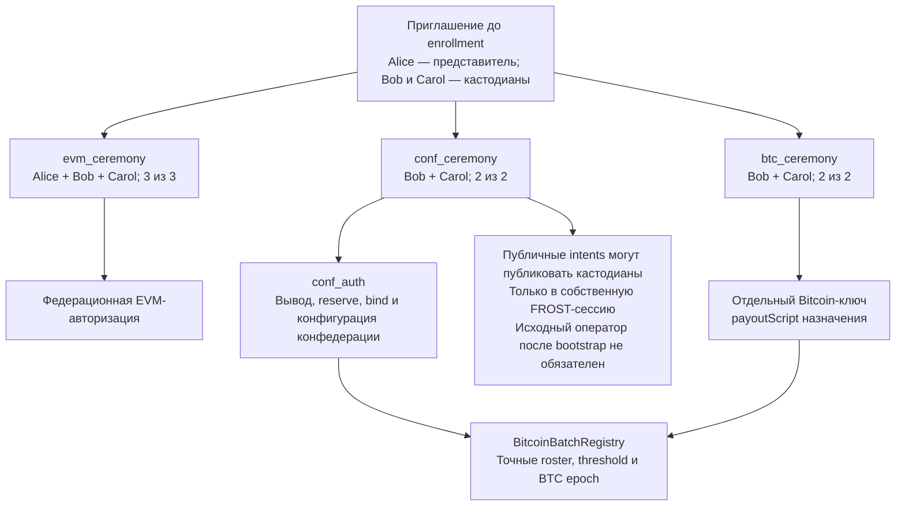
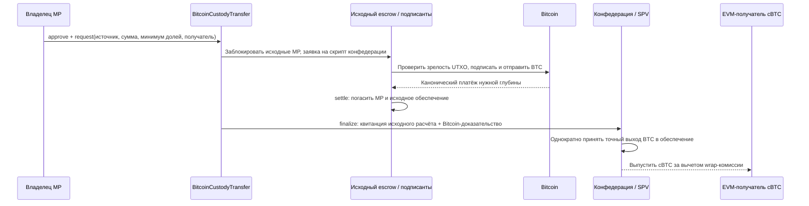

# Передача Bitcoin-обеспечения в конфедерацию

## Профиль V3 с прямым BTC-резервом

Для ULR policy V3 используются `BitcoinCustodyTransferV2` и
`ConfederationBitcoinReserve`. Федерация погашает свои MP и передаёт их
BTC-обеспечение в кошелёк конфедерации. Конфедерация принимает этот Bitcoin-выход
в резерв только после исходного расчёта. Она выпускает S непосредственно под
принятые BTC. На этапе вывода держатель погашает S из общего резерва конфедерации.

Перед допуском источника SDK подтверждает Bitcoin-сеть обеих сторон по
закреплённым SPV-контрактам. Gateway проверяет ту же связь. Разные backend
допустимы в одной Bitcoin-сети, например relay → ZK на testnet4. При несовпадении
сети или неизвестном происхождении источника MP не блокируются.
SPV pin определяет идентификатор сети. Каждый граф продолжает проверять
заголовки от собственного согласованного checkpoint. Сверка сетей не доказывает
историю заголовков до этих точек.

Фиксация выпуска и комиссии относится к gateway и резерву новой сборки.
Новые `approve` и `request` используйте с обновлённым графом. Для ранее
зарегистрированного gateway с поддерживаемым прежним runtime SDK сохраняет
`inspect`, `status`, `cancel` и `minimum`. Продолжать уже оплаченный
перенос через `finalize` можно после подтверждения Bitcoin-сети обеих сторон.
Старый gateway сохраняет правила своего байткода.



Вызвать `finalize` может любой исполнитель. Gateway требует исходную квитанцию
`Paid` и SPV назначения для того же `txid`.
При переносе V3 один выход на скрипт назначения покрывает полную сумму заявок
одного gateway и одного исходного MP-токена. Объединяйте только заявки с обоими
совпадающими параметрами. Заявки с другим MP-токеном или gateway и прочие выплаты
на тот же скрипт планируйте отдельным batch. SDK проверяет это при подготовке,
авторизации и перед выпуском подписей, включая подготовку RBF, если профиль
источника поддерживает замену.
При нарушении SDK возвращает `BTC_CUSTODY_OUTPUT_GROUP`.
Каждый `transfer_id` и каждый Bitcoin-выход (`txid:vout`) принимаются
один раз. Если `finalize` отклонён, например из-за незрелого SPV-доказательства,
изменение резерва и выпуск S откатываются вместе. Исходная завершённая выплата
остаётся `Paid` и служит основанием для повтора `finalize`. При подтверждении
RBF используется квитанция фактически рассчитанной версии. Ставка комиссии
и квота NFT уже учтены при создании заявки, поэтому смена тарифа,
передача или истечение NFT после этого не меняют распределение S.

Команды `custody-transfer` в разделах подготовки и действий владельца работают
с обоими профилями и определяют тип gateway по проверенному board. Для V3
задайте исходные федерации через `--bitcoin-custody-policy` и передайте ULR
policy V3 через `--ulr-policy` при подготовке приглашения. Источник и назначение
должны использовать одну EVM-сеть и одну Bitcoin-сеть. После `COMPLETED`
получатель распоряжается S сразу. В новой сборке для погашения сначала сверяйте
условия через `dao in-kind withdraw-quote`. В `dao in-kind withdraw` указывайте
минимум чистой выплаты, лимит miner fee по заявке и срок её включения в EVM.
Подписанты и escrow проверяют этот минимум и лимит для каждой заявки,
включая пересчёт при RBF. [Команды и расчёт S → BTC](CONFEDERATION_DAO_IN_KIND.md#btc-и-комиссия-майнеров).
Для прямого BTC-депозита получатель сначала фиксирует
комиссию для точного выхода. После оплаты нужны доказательство и распределение,
согласованное FROST. [Прямой депозит и фиксация комиссии](CONFEDERATION_DAO_IN_KIND.md#прямой-депозит-btc--s).

Если срок batch версии `5` истёк после начала FROST-подписания, выбранные
кастодианы могут допубликовать commitments и доли для того же платежа по
исходному board и batch. Этапы `btc-commit` и `btc-sign` с
`--resume-expired` требуют подтверждённый `Signing` и повторную проверку
escrow, точных входов, получателей и комиссии. Возврат S после начала
подписания заблокирован. [Команды и схема восстановления S → BTC](RECOVERY.md#expired-s-btc-recovery).

В сквозном тесте V3 с Anvil, Bitcoin Core 30.3 regtest и FROST федерация
передала 1 000 000 sats и оплатила 1 000 sats комиссии из своего остатка.
После сжигания MP конфедерация приняла выход и выпустила S на 1 000 000 sats.
Комиссия за выпуск составила 1 700 S в sat-эквиваленте. Повтор команды
вернул исходный хеш, повторное исполнение `finalize` было отклонено.
Кастодианы погасили весь S пользователя без участия представителей
федераций. Пользователь получил 995 003 sats, майнеры получили 1 000 sats,
а 3 997 sats сдачи обеспечили весь оставшийся S, находящийся в DAO.
[Сквозной тест](../tests/e2e/test_custody_transfer.py).

В сценарии `native-s-pass` покупатель оплатил NFT `0` за S на 1 000 sats.
При погашении со скидкой пользователь получил 995 153 sats, майнер —
1 000 sats, а 3 847 sats Bitcoin-сдачи остались обеспечением оставшегося S.
DAO получил S на 1 700 sats за выпуск, 1 000 sats за NFT и 1 147 sats за
погашение с округлением. Федерация отдельно оплатила 1 000 sats комиссии за
перенос из своего входа. Повтор запроса вывода сохранил единственное
списание газа EVM по receipt. Чужой кошелёк не смог расходовать лимит NFT.
После первой доли тест перевёл Anvil за дедлайн batch. Второй кастодиан
завершил подписание через `--resume-expired`, исходный платёж рассчитался
с той же комиссией 1 000 sats. Попытка возврата после `Signing` отклонена.
[Локальный сценарий с NFT](SYSTEM_TEST_MODES.md#отдельный-локальный-прогон-v3).

## Профиль BitcoinCustodyTransfer V1

[Индекс схем и архивы прежних профилей](DIAGRAMS.md).

Новый профиль `bitcoin_custody.mode=custodians` создаёт отдельные EVM и Bitcoin
DKG конфедерации **только между кастодианами**. Представитель федерации не
получает долю ни одного из этих ключей. Нужны как минимум два кастодиана;
порог задаётся явно, не ниже 70% их числа. `min_custodians` должен быть не ниже
этого порога. Изменение не применяется к прежним приглашениям и контрактам.
Состав фиксируется этой DKG-эпохой. Получение статуса кандидата, изменение ULR
или списка валидатора не выдаёт новую долю Bitcoin-ключа; для смены владельцев
ключа нужны новая церемония и отдельная передача обеспечения.

Реализация добавлена 4 ноября 2026 года. Сквозная проверка двух независимых
кошельков описана ниже; допуск в production и независимая квалификация SPV /
адресного verifier остаются отдельными условиями запуска.

Локальный сквозной тест с native FROST и Core 30.3 regtest прошёл: передано
1 000 000 сатоши, после wrap/unwrap-комиссий получателю выплачено 996 003 сатоши
с шестью подтверждениями. При выводе тест запрещает любые обращения к исходным
участникам и представителю федерации назначения. Полный scope и ограничения —
в [отчёте проверки](../ops/artifacts/custody-transfer-20261104/README.md).

Архивные схемы V1 от 4 ноября: [роли и DKG](../ops/artifacts/custody-completeness-20261104/diagrams/docs_BITCOIN_CUSTODY_TRANSFER_md_1.svg),
[передача BTC](../ops/artifacts/custody-completeness-20261104/diagrams/docs_BITCOIN_CUSTODY_TRANSFER_md_2.svg),
[состояния заявки](../ops/artifacts/custody-completeness-20261104/diagrams/docs_BITCOIN_CUSTODY_TRANSFER_md_3.svg).
Mermaid-блоки ниже — их исходники; PNG и manifest находятся
[в каталоге экспорта](../ops/artifacts/custody-completeness-20261104/diagrams/).

## Три церемонии и два независимых денежных ключа

| Роль | Пример состава | Порог примера | Для чего используется |
| --- | --- | --- | --- |
| `evm_ceremony` | Alice, Bob, Carol | 3 из 3 | Авторизация федерации и project scope |
| `conf_ceremony` | Bob, Carol | 2 из 2 | Денежные EVM-операции конфедерации |
| `btc_ceremony` | Bob, Carol | 2 из 2 | Подпись Bitcoin-транзакций кошелька конфедерации |



Bob и Carol имеют одинаковый порядок в двух custody-церемониях, но получают
разные доли разных ключей. В Bitcoin-плане их индексы — **1 и 2**, а не 2 и 3
из общего roster приглашения. `flow dkg` у Alice пропускает обе custody-роли
с `NOT_A_PARTICIPANT`; это нормальный результат. Enrollment может создать файлы
состояния для всех ролей, но наличие такого файла не означает долю ключа.
После DKG выполняйте `dkg verify` и signing-команды только для своих ролей.

## Кто хранит BTC

В одном bootstrap mining pool принимает BTC сразу на его `btc_ceremony`.
Новый профиль делает этот ключ ключом кастодианов конфедерации. Получение
локального MP и внесение его в пул не требует дополнительного Bitcoin-перевода:
обеспечение уже находится под нужным ключом.

MP другого графа, чьи BTC находятся под отдельным исходным ключом, нельзя
непосредственно добавить в защищённый пул конфедерации. Сначала
`BitcoinCustodyTransfer` проводит передачу BTC. Исходный escrow, токен и runtime
hashes исходных mining pool, deposit registry и batch registry фиксируются
**до enrollment**. При экспорте источника и перед допуском проверяются его
фактические SPV-привязки и совпадение Bitcoin-сети. Поддерживаются новые
тестовые развёртывания этой сборки;
подключение старого чужого runtime не разрешается совпадением ABI или имени.
В текущем публичном policy допускается до четырёх исходных графов, с учётом
лимита размера приглашения. Дополнительный источник требует нового deployment.

Федерация может отказать в **начальной передаче своих BTC**. Без исходной
подписи принудительно потратить их нельзя. Пользователь не получает cBTC до
завершения передачи; после завершения исходная федерация для вывода не нужна.

## Переход



При `request` ни cBTC, ни внутренние MP конфедерации не выпускаются. Исходные
MP находятся в исходном escrow. Комиссию Bitcoin-транзакции оплачивает
исходная казна отдельно от principal. Подписанты используют обычный
`btc-prepare → reserve → bind → commit → sign → broadcast → settle` своего
исходного графа. Они независимо проверяют доступность и зрелость входов;
для расходования coinbase клиент требует 101 подтверждение.

`finalize` разрешён любому исполнителю, но получатель и сумма фиксированы
заявкой. Он проверяет `Paid` исходной заявки, её включение в **конкретный
рассчитанный payment**, точный txid и скрипт назначения, а также каноническое
SPV-доказательство конфедерации с её глубиной, не менее 6. Обычный перевод BTC
без погашения исходных MP для этого пути недостаточен.

Принятый выход нельзя использовать для второго выпуска. Транзакции исходного
кошелька также не могут обойти передачу через обычный SMP1/address mint
конфедерации. Внутренние MP конфедерации выпускаются шлюзу и сразу вносятся
в её пул; cBTC выдаётся непосредственно получателю за вычетом wrap-комиссии.
Учёт нового обеспечения и выпуск выполняются атомарно одной EVM-транзакцией.
Исходные MP при этом уже погашены и в пул конфедерации не переходят.
Перенос использует собственные квитанции заявок и потребления выходов, не
сдвигает nonce обычного mint и не делает его подготовленные разрешения устаревшими.

```mermaid
stateDiagram-v2
    accTitle: Состояния заявки BitcoinCustodyTransfer
    accDescr: Gateway имеет Waiting, Completed и Cancelled; этапы Bitcoin signing и source Paid ещё не выпускают cBTC.
    [*] --> Waiting: approve и request
    state "Waiting: исходные MP заблокированы; cBTC нет" as Waiting
    state "Cancelled: исходные MP возвращены владельцу" as Cancelled
    state "Completed: BTC учтены; cBTC у получателя" as Completed
    Waiting --> Cancelled: refund разрешён исходным escrow до signing
    Waiting --> Completed: source Paid + точный выход + SPV + minShares
    Cancelled --> [*]
    Completed --> [*]
    note right of Waiting
        Source signing и source Paid сохраняют Waiting.
        После начала signing таймаут не даёт refund.
        Ошибка finalize откатывает только его изменения.
        Source Paid не откатывается вместе с finalize.
    end note
```



После `Completed` вывод cBTC — отдельная заявка пула/escrow назначения. Её
одобряют `conf_ceremony` и кастодианы, Bitcoin-транзакцию подписывает
`btc_ceremony` назначения. Оператор и подписанты исходного графа не нужны.

Если один Bitcoin-выход объединяет несколько заявок, `finalize` принимает
**все соответствующие заявки вместе**, и сумма должна точно равняться выходу.
Частичное принятие запрещено: иначе новый кошелёк мог бы потратить UTXO до
завершения переноса остальных владельцев. До финализации клиент подписанта
отклоняет использование непринятого выхода как свободных средств казны с
`BTC_UNACCEPTED_CUSTODY_TRANSFER`. Это действует и при независимой повторной
проверке плана перед выдачей подписи.

Минимум получаемых долей защищает пользователя от изменения wrap-комиссии.
Только владелец заявки может изменить этот минимум, получателя изменить нельзя.
При недостаточном количестве долей весь `finalize` откатывается, включая mint
и запись нового обеспечения; исходная подтверждённая выплата остаётся завершённой.

## Подготовка источников и участников

Команды одинаковы для macOS, Linux и Windows/WSL2. RPC и cookie остаются
локальными. Все файлы ниже публичные, кроме identity и журналов транзакций.
Вместо примера с двумя кастодианами согласуйте свой состав и порог до DKG.
`python ops/bootstrap_host.py build` вызывает
[`check_bitcoin_custody_spv_pins.py`](../ops/check_bitcoin_custody_spv_pins.py)
для сверки SPV pins с артефактами сборки.

1. Разверните исходный тестовый граф из той же сборки и экспортируйте его
   привязки, указав адрес его настоящего `MiningPoolV1`:

```sh
frost-signer custody-transfer source --rpc "$EVM_RPC" \
  --mining "$SOURCE_MINING" --confirmations "$EVM_CONFIRMATIONS" \
  --output "$LOCAL/source.json"
```

2. Создайте policy до приглашения конфедерации. Для первого запуска без
   внешних MP используйте `config/bitcoin-custody.example.json` с `sources: []`.
   Для приёма исходного MP включите экспортированный descriptor:

```sh
python - "$LOCAL/source.json" "$LOCAL/custody.json" <<'PY'
import json, pathlib, sys
source = json.loads(pathlib.Path(sys.argv[1]).read_text())
with pathlib.Path(sys.argv[2]).open('x') as output:
    json.dump(dict(version='1', mode='custodians', threshold='2', sources=[source]), output, indent=2)
    output.write('\n')
PY
```

3. Для V3 передайте `--bitcoin-custody-policy "$LOCAL/custody.json"` и
   `--ulr-policy "$LOCAL/ulr-policy.json"` команде `setup invite`. В прежнем
   полном профиле передайте custody policy команде `system-profile` и
   используйте полученный `--system-policy` для `setup invite`. Источник и
   назначение работают в одной EVM-сети и одной Bitcoin-сети. На одной
   Bitcoin-сети режимы relay и ZK можно сочетать. Перед допуском SDK и
   gateway проверяют фактические SPV-привязки. Старый источник с
   неподтверждаемой сетью требует поддерживаемого графа.
4. Первый адрес в `--participants` — представитель/начальный оператор;
   остальные — кастодианы. Верхний `--threshold` задаёт федерационный EVM DKG.
   `conf_ceremony` и `btc_ceremony` используют только оставшиеся адреса и
   отдельный `threshold` из custody policy. Это независимые DKG, а не
   исключение участника из уже рассчитанного ключа. `flow dkg` пропускает
   церемонии, в которых адрес не участвует.
5. Bootstrap связывает escrow, необратимо включает локальное обеспечение,
   регистрирует резерв V3 или допускает локальный MP в V1. Шлюз связывается
   с эмитентом назначения до первого выпуска. Кастодианы повторяют проверку policy и источников перед
   подписью, включая повторную отправку сохранённых долей подписи.
   Начальный оператор `BitcoinMintAdmission` — первый кастодиан, а не
   представитель федерации; роль впоследствии передаётся штатной пороговой
   процедурой admission. Доля Bitcoin-ключа из-за этого не передаётся.
6. Bootstrap также один раз делегирует публикацию **публичных** EVM intents
   кастодианам на `DKGOnchainBoard`. Это не даёт права одобрять операции:
   FROST-порог и отдельные кастодиальные одобрения сохраняются. После старта
   представитель/оператор не обязателен для публикации запросов вывода.
7. До первой финансовой публикации board неизменно связывается с настоящим
   FROST coordinator через `bindIntentCoordinator`. Пока binding отсутствует,
   запись intent запрещена. После него сессию должен уже создать именно
   отправитель публикации: ни исходный оператор, ни другой разрешённый кастодиан
   не могут занять чужой/future session ID. Правило действует также для
   `publishFeeIntent`, отдельных chunks и их commit. Чтение, проверка и
   исполнение уже опубликованной авторизованной операции остаются отдельными.

## Действия владельца в V1 и V3

Сначала независимо проверьте конфигурацию и её fingerprint:

```sh
frost-signer custody-transfer inspect --rpc "$EVM_RPC" --board "$DESTINATION_BOARD"
```

Подставьте возвращённый fingerprint в `FP`, индекс исходного графа в `SOURCE`
(нумерация с нуля), сумму в сатоши в `SATS`, минимальную сумму в целых токенах
с допустимой дробной частью в `MIN_SHARES` (cBTC для V1, S для V3).
`OWNER_IDENTITY` принадлежит владельцу исходных MP.
В новой сборке V3 контракт сравнивает минимум с чистым выпуском при создании запроса.
Согласованные количество S и протокольная комиссия фиксируются до блокировки
MP в исходном escrow. Подтверждённый `request` и `status` показывают их
в `net_shares` и `protocol_fee_s` в базовых единицах S.
Без `--send` команды только симулируются. Каждый `--id` уникален для одного
неизменяемого действия; повтор с тем же id возвращает сохранённую транзакцию.

```sh
frost-signer custody-transfer approve --rpc "$EVM_RPC" --board "$DESTINATION_BOARD" \
  --accept-fingerprint "$FP" --source "$SOURCE" --satoshis "$SATS" \
  --identity-file "$OWNER_IDENTITY" --state "$LOCAL/owner.sqlite" --id transfer-approve --send

frost-signer custody-transfer request --rpc "$EVM_RPC" --board "$DESTINATION_BOARD" \
  --accept-fingerprint "$FP" --source "$SOURCE" --satoshis "$SATS" \
  --minimum-shares "$MIN_SHARES" --recipient "$EVM_RECIPIENT" \
  --identity-file "$OWNER_IDENTITY" --state "$LOCAL/owner.sqlite" --id transfer-request --send
```

Сохраните `transfer_id` и `source_request`. Перед Bitcoin-подписью проверьте
состояние заявки. Для V3 запишите фиксированные `net_shares` и `protocol_fee_s`.

```sh
frost-signer custody-transfer status --rpc "$EVM_RPC" --board "$DESTINATION_BOARD" \
  --accept-fingerprint "$FP" --transfer-id "$TRANSFER_ID"
```

Подписанты исходного графа исполняют обычную Bitcoin-заявку с этим
`source_request`, затем подтверждают расчёт через исходный `btc-settle`.
Выход назначения использует скрипт из `inspect`. Для V3 при
`BTC_CUSTODY_OUTPUT_GROUP` включите заявки одного gateway и одного исходного
MP-токена в один точный выход. Другие заявки или выплаты на этот скрипт
вынесите в отдельный batch.

```sh
frost-signer custody-transfer finalize --rpc "$EVM_RPC" --board "$DESTINATION_BOARD" \
  --accept-fingerprint "$FP" --transfer-id "$TRANSFER_ID" --paid-batch "$PAID_BATCH" \
  --vout "$DESTINATION_VOUT" --bitcoin-rpc "$BTC_RPC" --bitcoin-cookie "$BTC_COOKIE" \
  --identity-file "$EXECUTOR_IDENTITY" --state "$LOCAL/executor.sqlite" --id transfer-finalize --send
```

При агрегированном выходе повторите `--transfer-id` для каждой заявки этого
выхода. `PAID_BATCH` — фактически подтверждённая версия, в том числе RBF-победитель;
исходный batch из `status` не обязательно победил. Команда получает Bitcoin
raw/merkle proof из собственного Core. Для ZK слой состояния предварительно
обновляет назначенный publisher со своим proof. Участники могут отдельно сверить
результат через публичный ZIP и свой EVM RPC. [Подготовка, расчёт и проверка ZIP](ZK_SPV_WORKER.md).

При `COMPLETED` cBTC в V1 или S в V3 поступают сразу на `EVM_RECIPIENT`.
Вывод идёт через пул/escrow конфедерации и подписывается только её кастодианами.
Исходные ключи, разрешения и участники для вывода не используются.

## Отмена, сбои и ограничения

`cancel --transfer-id ...` с теми же общими параметрами и identity владельца
возвращает исходные MP только до начала возможного Bitcoin-подписания.
Заявка, связанная с отменённым до подписания batch, также может быть возвращена.
После начала подписания таймаут не разрешает возврат. Старая подписанная
транзакция может подтвердиться позже. В V3 безопасная отмена освобождает
зарезервированную квоту NFT в той же транзакции, что и возврат MP.
`minimum --transfer-id ... --minimum-shares ...` доступна владельцу. В V3
указанный минимум ограничен обещанным `net_shares`; изменение минимума
сохраняет зафиксированное распределение S.

После временного сбоя между исходным `settle` и `finalize` исполнитель
продолжает `finalize` по той же заявке и точному Bitcoin-выходу. Повторное
исполнение защищено состоянием заявок, общим потреблением выхода и журналом
подписанных EVM-транзакций. Сохраняйте журнал и EOA nonce journal вместе.
Для in-flight заявок прежнего immutable-графа держите под рукой его исходную
сборку и пины того же релиза. После смены компилятора продолжайте settlement
с исходным окружением и проверенным Bitcoin-графом. [Совместимость артефактов](CONTRACT_SIZE_AND_DEPLOYMENT.md).

Проверка группировки реализована в SDK и действует для поддерживаемых
развёртываний исходного escrow. Уже оплаченный старый batch со смешанным
выходом требует отдельной процедуры восстановления custody и учёта. Если
номинал выхода не совпадает с допустимой группой заявок, сохраните
`transfer_id`, `paid-batch`, `txid:vout` и квитанции. Исходные MP к этому
моменту уже погашены. Для новой сборки V3 продолжайте расчёт по зафиксированному
выпуску, квитанции `Paid` и каноническому доказательству точного выхода
достаточной глубины. В прежних поддерживаемых профилях `minimum` может
учесть изменившуюся комиссию. При этом Bitcoin-выход остаётся прежним.

Реорганизация до принятия платежа блокирует `finalize`. После глубокой
реорганизации уже принятого платежа требуется остановка и явное восстановление
учёта: Bitcoin и EVM не имеют общего атомарного отката. Заявления о независимом
выводе относятся к наличию порога кастодианов и работающих Core/SPV/EVM, а не к
гарантии доступности при отказе самих кастодианов.

Приёмка требует двух разных ключей и фактического Bitcoin-перевода. Один общий
ключ, успешный bootstrap или тест переименования токенов сами по себе не
подтверждают передачу. Контрактные fixtures явно отделены от сквозного теста
`tests/e2e/test_custody_transfer.py` с настоящими Core и native FROST.
