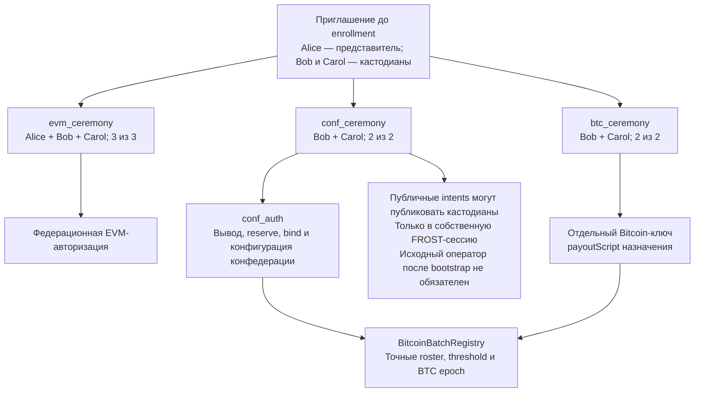
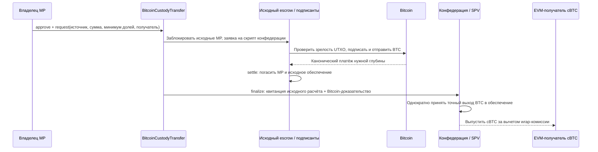

# Передача Bitcoin-обеспечения в конфедерацию

[Схемы: SVG/PNG и hashes текущих Mermaid-исходников](DIAGRAMS.md).

Новый профиль `bitcoin_custody.mode=custodians` создаёт отдельные EVM и Bitcoin
DKG конфедерации **только между кастодианами**. Представитель федерации не
получает долю ни одного из этих ключей. Нужны как минимум два кастодиана;
порог задаётся явно, не ниже 70% их числа. `min_custodians` должен быть не ниже
этого порога. Изменение не применяется к прежним приглашениям и контрактам.
Состав фиксируется этой DKG-эпохой. Получение статуса кандидата, изменение ULR
или списка валидатора не выдаёт новую долю Bitcoin-ключа; для смены владельцев
ключа нужны новая церемония и отдельная передача обеспечения.

Реализация добавлена 4 ноября 2026 года. Сквозная проверка двух независимых
кошельков описана ниже; допуск в production и независимая квалификация SPV /
адресного verifier остаются отдельными условиями запуска.

Локальный сквозной тест с native FROST и Core 30.3 regtest прошёл: передано
1 000 000 сатоши, после wrap/unwrap-комиссий получателю выплачено 996 003 сатоши
с шестью подтверждениями. При выводе тест запрещает любые обращения к исходным
участникам и представителю федерации назначения. Полный scope и ограничения —
в [отчёте проверки](../ops/artifacts/custody-transfer-20261104/README.md).

Готовые схемы: [роли и DKG](../ops/artifacts/custody-completeness-20261104/diagrams/docs_BITCOIN_CUSTODY_TRANSFER_md_1.svg),
[передача BTC](../ops/artifacts/custody-completeness-20261104/diagrams/docs_BITCOIN_CUSTODY_TRANSFER_md_2.svg),
[состояния заявки](../ops/artifacts/custody-completeness-20261104/diagrams/docs_BITCOIN_CUSTODY_TRANSFER_md_3.svg).
Mermaid-блоки ниже — их исходники; PNG и manifest находятся
[в каталоге экспорта](../ops/artifacts/custody-completeness-20261104/diagrams/).

## Три церемонии и два независимых денежных ключа

| Роль | Пример состава | Порог примера | Для чего используется |
| --- | --- | --- | --- |
| `evm_ceremony` | Alice, Bob, Carol | 3 из 3 | Авторизация федерации и project scope |
| `conf_ceremony` | Bob, Carol | 2 из 2 | Денежные EVM-операции конфедерации |
| `btc_ceremony` | Bob, Carol | 2 из 2 | Подпись Bitcoin-транзакций кошелька конфедерации |



Bob и Carol имеют одинаковый порядок в двух custody-церемониях, но получают
разные доли разных ключей. В Bitcoin-плане их индексы — **1 и 2**, а не 2 и 3
из общего roster приглашения. `flow dkg` у Alice пропускает обе custody-роли
с `NOT_A_PARTICIPANT`; это нормальный результат. Enrollment может создать файлы
состояния для всех ролей, но наличие такого файла не означает долю ключа.
После DKG выполняйте `dkg verify` и signing-команды только для своих ролей.

## Кто хранит BTC

В одном bootstrap mining pool принимает BTC сразу на его `btc_ceremony`.
Новый профиль делает этот ключ ключом кастодианов конфедерации. Получение
локального MP и внесение его в пул не требует дополнительного Bitcoin-перевода:
обеспечение уже находится под нужным ключом.

MP другого графа, чьи BTC находятся под отдельным исходным ключом, нельзя
непосредственно добавить в защищённый пул конфедерации. Сначала
`BitcoinCustodyTransfer` проводит передачу BTC. Исходный escrow, токен и runtime
hashes исходных mining pool, deposit registry и batch registry фиксируются
**до enrollment**. Поддерживаются новые тестовые развёртывания этой сборки;
подключение старого чужого runtime не разрешается совпадением ABI или имени.
В текущем публичном policy допускается до четырёх исходных графов, с учётом
лимита размера приглашения. Дополнительный источник требует нового deployment.

Федерация может отказать в **начальной передаче своих BTC**. Без исходной
подписи принудительно потратить их нельзя. Пользователь не получает cBTC до
завершения передачи; после завершения исходная федерация для вывода не нужна.

## Переход



При `request` ни cBTC, ни внутренние MP конфедерации не выпускаются. Исходные
MP находятся в исходном escrow. Комиссию Bitcoin-транзакции оплачивает
исходная казна отдельно от principal. Подписанты используют обычный
`btc-prepare → reserve → bind → commit → sign → broadcast → settle` своего
исходного графа. Они независимо проверяют доступность и зрелость входов;
для расходования coinbase клиент требует 101 подтверждение.

`finalize` разрешён любому исполнителю, но получатель и сумма фиксированы
заявкой. Он проверяет `Paid` исходной заявки, её включение в **конкретный
рассчитанный payment**, точный txid и скрипт назначения, а также каноническое
SPV-доказательство конфедерации с её глубиной, не менее 6. Обычный перевод BTC
без погашения исходных MP для этого пути недостаточен.

Принятый выход нельзя использовать для второго выпуска. Транзакции исходного
кошелька также не могут обойти передачу через обычный SMP1/address mint
конфедерации. Внутренние MP конфедерации выпускаются шлюзу и сразу вносятся
в её пул; cBTC выдаётся непосредственно получателю за вычетом wrap-комиссии.
Учёт нового обеспечения и выпуск выполняются атомарно одной EVM-транзакцией.
Исходные MP при этом уже погашены и в пул конфедерации не переходят.
Перенос использует собственные квитанции заявок и потребления выходов, не
сдвигает nonce обычного mint и не делает его подготовленные разрешения устаревшими.

```mermaid
stateDiagram-v2
    accTitle: Состояния заявки BitcoinCustodyTransfer
    accDescr: Gateway имеет Waiting, Completed и Cancelled; этапы Bitcoin signing и source Paid ещё не выпускают cBTC.
    [*] --> Waiting: approve и request
    state "Waiting: исходные MP заблокированы; cBTC нет" as Waiting
    state "Cancelled: исходные MP возвращены владельцу" as Cancelled
    state "Completed: BTC учтены; cBTC у получателя" as Completed
    Waiting --> Cancelled: refund разрешён исходным escrow до signing
    Waiting --> Completed: source Paid + точный выход + SPV + minShares
    Cancelled --> [*]
    Completed --> [*]
    note right of Waiting
        Source signing и source Paid сохраняют Waiting.
        После начала signing таймаут не даёт refund.
        Ошибка finalize откатывает только его изменения.
        Source Paid не откатывается вместе с finalize.
    end note
```



После `Completed` вывод cBTC — отдельная заявка пула/escrow назначения. Её
одобряют `conf_ceremony` и кастодианы, Bitcoin-транзакцию подписывает
`btc_ceremony` назначения. Оператор и подписанты исходного графа не нужны.

Если один Bitcoin-выход объединяет несколько заявок, `finalize` принимает
**все соответствующие заявки вместе**, и сумма должна точно равняться выходу.
Частичное принятие запрещено: иначе новый кошелёк мог бы потратить UTXO до
завершения переноса остальных владельцев. До финализации клиент подписанта
отклоняет использование непринятого выхода как свободных средств казны с
`BTC_UNACCEPTED_CUSTODY_TRANSFER`. Это действует и при независимой повторной
проверке плана перед выдачей подписи.

Минимум получаемых долей защищает пользователя от изменения wrap-комиссии.
Только владелец заявки может изменить этот минимум, получателя изменить нельзя.
При недостаточном количестве долей весь `finalize` откатывается, включая mint
и запись нового обеспечения; исходная подтверждённая выплата остаётся завершённой.

## Подготовка

Команды одинаковы для macOS, Linux и Windows/WSL2. RPC и cookie остаются
локальными. Все файлы ниже публичные, кроме identity и журналов транзакций.
Вместо примера с двумя кастодианами согласуйте свой состав и порог до DKG.

1. Разверните исходный тестовый граф из той же сборки и экспортируйте его
   привязки, указав адрес его настоящего `MiningPoolV1`:

```sh
frost-signer custody-transfer source --rpc "$EVM_RPC" \
  --mining "$SOURCE_MINING" --confirmations "$EVM_CONFIRMATIONS" \
  --output "$LOCAL/source.json"
```

2. Создайте policy до приглашения конфедерации. Для первого запуска без
   внешних MP используйте `config/bitcoin-custody.example.json` с `sources: []`.
   Для приёма исходного MP включите экспортированный descriptor:

```sh
python - "$LOCAL/source.json" "$LOCAL/custody.json" <<'PY'
import json, pathlib, sys
source = json.loads(pathlib.Path(sys.argv[1]).read_text())
with pathlib.Path(sys.argv[2]).open('x') as output:
    json.dump(dict(version='1', mode='custodians', threshold='2', sources=[source]), output, indent=2)
    output.write('\n')
PY
```

3. Передайте `--bitcoin-custody-policy "$LOCAL/custody.json"` команде
   `system-profile`, затем используйте полученный `--system-policy` для
   `setup invite`. Для прямого приглашения без общего system-policy доступен
   тот же `setup invite --bitcoin-custody-policy FILE`. Источники должны быть
   в той же EVM-сети. Bitcoin-сеть выбирается в приглашении назначения;
   перевод и доказательство должны относиться именно к ней.
4. Первый адрес в `--participants` — представитель/начальный оператор;
   остальные — кастодианы. Верхний `--threshold` задаёт федерационный EVM DKG.
   `conf_ceremony` и `btc_ceremony` используют только оставшиеся адреса и
   отдельный `threshold` из custody policy. Это независимые DKG, а не
   исключение участника из уже рассчитанного ключа. `flow dkg` пропускает
   церемонии, в которых адрес не участвует.
5. Bootstrap связывает escrow, необратимо включает локальное обеспечение до
   допуска первого MP, разворачивает шлюз и связывает его с mining pool до
   первого выпуска. Кастодианы повторяют проверку policy и источников перед
   подписью, включая повторную отправку сохранённых долей подписи.
   Начальный оператор `BitcoinMintAdmission` — первый кастодиан, а не
   представитель федерации; роль впоследствии передаётся штатной пороговой
   процедурой admission. Доля Bitcoin-ключа из-за этого не передаётся.
6. Bootstrap также один раз делегирует публикацию **публичных** EVM intents
   кастодианам на `DKGOnchainBoard`. Это не даёт права одобрять операции:
   FROST-порог и отдельные кастодиальные одобрения сохраняются. После старта
   представитель/оператор не обязателен для публикации запросов вывода.
7. До первой финансовой публикации board неизменно связывается с настоящим
   FROST coordinator через `bindIntentCoordinator`. Пока binding отсутствует,
   запись intent запрещена. После него сессию должен уже создать именно
   отправитель публикации: ни исходный оператор, ни другой разрешённый кастодиан
   не могут занять чужой/future session ID. Правило действует также для
   `publishFeeIntent`, отдельных chunks и их commit. Чтение, проверка и
   исполнение уже опубликованной авторизованной операции остаются отдельными.

## Действия владельца

Сначала независимо проверьте конфигурацию и её fingerprint:

```sh
frost-signer custody-transfer inspect --rpc "$EVM_RPC" --board "$DESTINATION_BOARD"
```

Подставьте возвращённый fingerprint в `FP`, индекс исходного графа в `SOURCE`
(нумерация с нуля), сумму в сатоши в `SATS`, минимальную сумму долей в обычных
единицах cBTC в `MIN_SHARES`. `OWNER_IDENTITY` принадлежит владельцу исходных MP.
Без `--send` команды только симулируются. Каждый `--id` уникален для одного
неизменяемого действия; повтор с тем же id возвращает сохранённую транзакцию.

```sh
frost-signer custody-transfer approve --rpc "$EVM_RPC" --board "$DESTINATION_BOARD" \
  --accept-fingerprint "$FP" --source "$SOURCE" --satoshis "$SATS" \
  --identity-file "$OWNER_IDENTITY" --state "$LOCAL/owner.sqlite" --id transfer-approve --send

frost-signer custody-transfer request --rpc "$EVM_RPC" --board "$DESTINATION_BOARD" \
  --accept-fingerprint "$FP" --source "$SOURCE" --satoshis "$SATS" \
  --minimum-shares "$MIN_SHARES" --recipient "$EVM_RECIPIENT" \
  --identity-file "$OWNER_IDENTITY" --state "$LOCAL/owner.sqlite" --id transfer-request --send
```

Сохраните `transfer_id` и `source_request`. Подписанты исходного графа исполняют
его обычную Bitcoin-заявку с этим `source_request`, затем подтверждают расчёт
через исходный `btc-settle`. Его выход назначения — скрипт из `inspect`.
Не отправляйте BTC на другой адрес вручную, сохраняя эту заявку незавершённой.

```sh
frost-signer custody-transfer status --rpc "$EVM_RPC" --board "$DESTINATION_BOARD" \
  --accept-fingerprint "$FP" --transfer-id "$TRANSFER_ID"

frost-signer custody-transfer finalize --rpc "$EVM_RPC" --board "$DESTINATION_BOARD" \
  --accept-fingerprint "$FP" --transfer-id "$TRANSFER_ID" --paid-batch "$PAID_BATCH" \
  --vout "$DESTINATION_VOUT" --bitcoin-rpc "$BTC_RPC" --bitcoin-cookie "$BTC_COOKIE" \
  --identity-file "$EXECUTOR_IDENTITY" --state "$LOCAL/executor.sqlite" --id transfer-finalize --send
```

При агрегированном выходе повторите `--transfer-id` для каждой заявки этого
выхода. `PAID_BATCH` — фактически подтверждённая версия, в том числе RBF-победитель;
исходный batch из `status` не обязательно победил. Команда получает Bitcoin
raw/merkle proof из собственного Core. Для ZK слой состояния предварительно
обновляется обычным worker-ом; каждый участник рассчитывает свои рабочие proofs.
Готовые proofs не включаются в поставку.

После `COMPLETED` cBTC находятся на `EVM_RECIPIENT`, отдельный claim не нужен.
Вывод идёт через пул/escrow конфедерации и подписывается только её кастодианами.
Исходные ключи, разрешения и участники для вывода не используются.

## Отмена, сбои и ограничения

`cancel --transfer-id ...` с теми же общими параметрами и identity владельца
возвращает исходные MP только до начала возможного Bitcoin-подписания.
Заявка, связанная с отменённым до подписания batch, также может быть возвращена.
После начала подписания таймаут не разрешает возврат: старая подписанная
транзакция может подтвердиться позже. Для изменения допустимого минимума
используйте `minimum --transfer-id ... --minimum-shares ...` от владельца.

Сбой между исходным `settle` и `finalize` не разрешает повторно выпустить
исходные MP. Исполнитель продолжает `finalize` по той же заявке. Повторное
исполнение защищено состоянием заявок, общим потреблением выхода и журналом
подписанных EVM-транзакций. Сохраняйте журнал и EOA nonce journal вместе.

Реорганизация до принятия платежа блокирует `finalize`. После глубокой
реорганизации уже принятого платежа требуется остановка и явное восстановление
учёта: Bitcoin и EVM не имеют общего атомарного отката. Заявления о независимом
выводе относятся к наличию порога кастодианов и работающих Core/SPV/EVM, а не к
гарантии доступности при отказе самих кастодианов.

Приёмка требует двух разных ключей и фактического Bitcoin-перевода. Один общий
ключ, успешный bootstrap или тест переименования токенов сами по себе не
подтверждают передачу. Контрактные fixtures явно отделены от сквозного теста
`tests/e2e/test_custody_transfer.py` с настоящими Core и native FROST.
