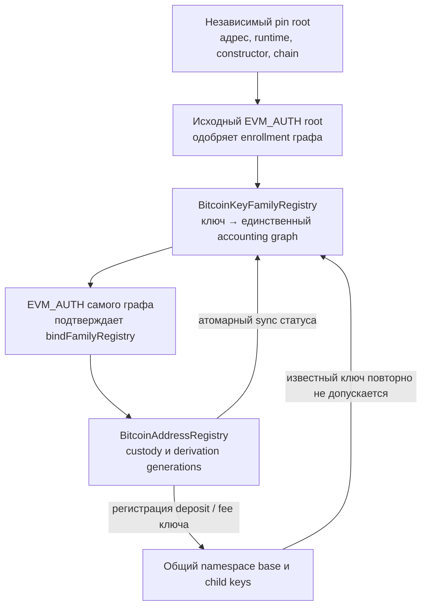

# Canonical Bitcoin key family

[Схемы: SVG/PNG и hashes текущих Mermaid-исходников](DIAGRAMS.md).

`BitcoinKeyFamilyRegistry` связывает нормализованный Bitcoin-ключ с одним исходным
accounting graph внутри независимо закреплённого EVM root. Семья не получает новый
учёт или новый статус при смене registry, DKG deployment, ceremony либо клиентского
journal. Это контур допуска проекта на одной EVM-сети; произвольные другие roots и
сети не объявляются частью этого контура.



У root нет метода очистки семьи, замены её accounting registry, переноса активов
или снятия terminal-флага. `issuanceClosed`, `COMPROMISED` и `REVOKED` сохраняются;
поколения не уменьшаются. При обычном изменении статуса граф и root обновляются
одной EVM-транзакцией. Вызов `sync` от чужого графа не принимается.

Deposit и WITHDRAWAL_FEE derived keys занимают тот же namespace, что и base key.
Известный дочерний ключ нельзя зарегистрировать как новый независимый parent.
Новая независимая семья с другим ключом может использовать другой canonical DKG,
но её допускает прежний root-кворум. Новая EVM_AUTH графа не заменяет этот кворум.
Ротация governance самого root сохраняет directory и допускается через прежнюю
EVM_AUTH к новому canonical authorization того же root DKG/coordinator.

## Bootstrap

Новый withdrawal policy V2 содержит `family_root` и `family_enrollment`.

| Конфигурация | Поведение |
|---|---|
| `family_root.version=create-1`, `creation_code_hash` | Первый root создаётся с `$conf_auth`; hash creation bytecode закреплён в enrollment policy |
| Полный root policy V1 + `ORIGINAL_AUTHORITY` | Проверяется существующий root; enroll возможен, если governance совпадает с исходной `$conf_auth` |
| Полный root policy V1 + `PRE_ENROLLED` | Bootstrap ждёт допуска нового графа прежним root-кворумом, затем его собственный кворум выполняет bind |

Порядок: создать registry/root → root enrollment → `bindFamilyRegistry` → обычный
`setAddressRegistry` → остальные consumer/fee bindings. До bind новый status-enabled
registry не разрешает monetary/private flows. Policy V1 сохраняется как legacy
формат, но не выдаёт новому незакреплённому графу Ready.

После создания первого root pending bootstrap manifest публикует
`withdrawal_fee.family_root_policy`. Его проверяют и закрепляют отдельно от
приглашения, до первой подписи enrollment. Для pin не нужны развёрнутый pool или
Bitcoin-транзакция:

```sh
PYTHONPATH=signer-agent python -m signer_agent.continuity_cli pin-root \
  --root-policy /srv/private/canonical-root.json \
  --identity-file /srv/private/participant-evm.json \
  --evm-rpc http://127.0.0.1:8545 --evm-confirmations 12
```

Pin хранится в `<identity>.bitcoin-family-root.json` и в исходном EOA journal;
при использовании signer state он также сохраняется в независимом spent journal.
Подмена, исчезновение одного экземпляра или новый пустой клиент не разрешают
автоматически выбрать другой root. Приглашение не устанавливает pin само.

Для отдельно развёрнутого нового графа прежний root-кворум готовит обычный
Bootstrap recipe; команда лишь сохраняет план:

```sh
PYTHONPATH=signer-agent python -m signer_agent.continuity_cli root-plan \
  --root-policy /srv/private/canonical-root.json \
  --auth-bundle /srv/private/original-root-auth.json \
  --registry-target 0xREPLACE_WITH_NEW_REGISTRY \
  --deadline REPLACE_WITH_UNIX_DEADLINE \
  --evm-rpc http://127.0.0.1:8545 --evm-confirmations 12 \
  --output /srv/private/reviewed-family-enrollment.json
```

Исполнение использует прежние `Bootstrap`, DKG board, FROST sessions и EOA nonce
lane. Подписи участников остаются внешним действием. Участник повторяет typed
review, constructor/DKG/result/roster/network/root проверки перед private nonce.
Новый deadline требует явно нового reviewable плана; работающий план его не обновляет.

## Receipts и границы

Точный сохранённый receipt проверяется до текущего governance nonce и permission
на новую работу. Root admission не добавляется в исторический settlement уже
подписанной выплаты: её inclusion/depth/Fresh/halt/accounting checks сохраняются.
Отдельно поддерживается однократное добавление root к тому же исходному графу
в локальном каталоге, с сохранением прежних terminal/generation фактов.

Это новый контрактный профиль. Уже развёрнутые старые immutable contracts не
получают новый код автоматически; для их receipts/обязательств сохраняют исходный
SDK/build, journals и graph. Автоматическое перемещение активов между графами
остаётся отдельной задачей C4. `QUALIFIED` и `FEE_QUALIFIED` не изменены.

Источники: [контракт](../web3/contracts/src/federation/BitcoinKeyFamilyRegistry.sol),
[SDK](../signer-agent/signer_agent/family_registry.py),
[bootstrap](../signer-agent/signer_agent/bootstrap_withdrawal_fee.py),
[карта покрытия](ZKSPV_FUNCTIONAL_COVERAGE.md).
