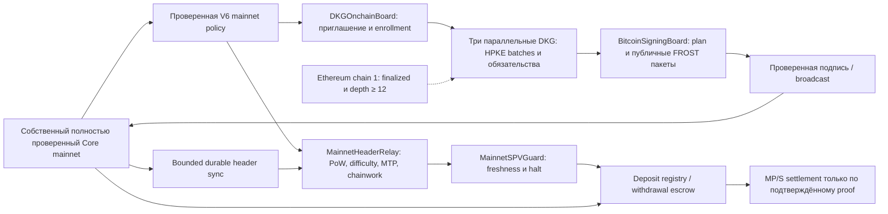

# Bitcoin mainnet: запуск через on-chain CLI

[Схемы: SVG/PNG и hashes текущих Mermaid-исходников](DIAGRAMS.md).

Новое приглашение V6 выбирает Bitcoin mainnet независимо от EVM
mainnet/Sepolia/local. См. [матрицу сетей](NETWORKS_AND_AUTOMATION.md); там же
приведены отдельные Core и checkpoint команды для **Bitcoin testnet4**.
Для Ethereum chain 1 выполните [пошаговую инструкцию](ETHEREUM_MAINNET_RUNBOOK.md):
платные фабрики, finalized Ethereum и локальные gas budgets обязательны.
Общие проверки Core, checkpoint, relay и Bitcoin-платежа описаны здесь.
Тестовая EVM-сеть не подходит для хранения значимых средств.

Сначала выполните установку одной версии кода и подготовку личных EVM identity
из [инструкции первой DKG](FIRST_DKG_ONCHAIN.md). Для mainnet используйте параметры
этой страницы вместо regtest integration-приглашения. Старое приглашение, regtest DKG,
registry или board нельзя переименовать в mainnet: нужен новый deployment и новые
церемонии. Друзья находят приглашение по известному адресу оператора; политика,
транспортные ключи, DKG и платёжные сообщения передаются через EVM. RPC, cookie,
ключи хранения и секретные доли остаются на компьютере каждого участника.

## 1. Собственный полностью проверенный Bitcoin Core

Каждому участнику нужен Bitcoin Core 30.3 с полной синхронизацией, непрореженной
историей и индексом транзакций. Пример запуска отдельного каталога:

```sh
BTC_DIR="$HOME/bitcoin-mainnet"
mkdir -m 700 "$BTC_DIR"
bitcoind -datadir="$BTC_DIR" -chain=main -server=1 -txindex=1 -prune=0 \
  -disablewallet=1 -daemon -rpcbind=127.0.0.1 -rpcallowip=127.0.0.1
BTC_RPC=http://127.0.0.1:8332
BTC_COOKIE="$BTC_DIR/.cookie"
bitcoin-cli -datadir="$BTC_DIR" getblockchaininfo
bitcoin-cli -datadir="$BTC_DIR" getindexinfo txindex
```

Дождитесь `chain=main`, `initialblockdownload=false`, `pruned=false`,
`blocks=headers`, `txindex.synced=true` и высоты индекса, равной высоте блоков.
CLI проверяет также genesis, время вершины, точные checkpoint/header/chainwork,
каноничность цепочки и reviewed-политику. Исторический узел с одними заголовками
эти проверки не проходит. Индексацию после включения `txindex` нужно закончить
до продолжения. Не отключайте проверки, чтобы ускорить первый запуск.

Cookie должен принадлежать текущему пользователю, быть обычным файлом без
симлинка/дополнительных hard links и без доступа других пользователей. Core
создаёт такой локальный cookie сам. Для удалённого RPC mainnet CLI требует HTTPS;
HTTP разрешён только для loopback. Перенаправления и прокси из окружения отключены,
чтобы они не получили cookie. Доверие к удалённому узлу всё равно остаётся у вас.

Поля RPC описаны в документации Bitcoin Core:
[getblockchaininfo](https://bitcoincore.org/en/doc/30.0.0/rpc/blockchain/getblockchaininfo/),
[getindexinfo](https://bitcoincore.org/en/doc/30.0.0/rpc/util/getindexinfo/),
[getblockheader](https://bitcoincore.org/en/doc/30.0.0/rpc/blockchain/getblockheader/).

## 2. Оператор готовит публичную политику checkpoint

Выберите реальный canonical checkpoint на границе периода сложности:
положительную высоту, кратную `2016`, достаточно глубоко за текущей вершиной.
CLI требует как минимум `max_reorg_depth` следующих блоков. Не используйте
историческую высоту `32256` из тестов как эксплуатационный пример: загрузка всех
последующих заголовков в EVM потребует большого числа транзакций.

```sh
CHECKPOINT_HEIGHT='<проверенная высота, кратная 2016>'
frost-signer bitcoin checkpoint --bitcoin-network mainnet \
  --bitcoin-rpc "$BTC_RPC" --bitcoin-cookie "$BTC_COOKIE" \
  --checkpoint-height "$CHECKPOINT_HEIGHT" \
  --max-reorg-depth 6 --max-tip-age-seconds 21600 \
  --max-relay-lag-blocks 2 --max-headers-per-sync 16 \
  > mainnet-policy.json
```

Команда только читает свой Core и выводит кандидат политики. До приглашения
проверьте checkpoint и cumulative chainwork по независимо синхронизированным
узлам. При enrollment каждый друг автоматически сверяет опубликованную политику
со своим Core; передавать `mainnet-policy.json` друзьям не требуется. Checkpoint
остаётся доверенной точкой отсчёта: relay не перепроверяет всю историю до него.

В примере явно выбраны rollback 6 блоков, возраст вершины до 6 часов, отставание
relay до 2 блоков и до 16 заголовков за один вызов. Это параметры примера,
не значения по умолчанию и не гарантия финальности. Более строгая свежесть может
останавливать работу во время необычно длинного интервала между блоками.

| Поле публичной политики | Формат и предел |
|---|---|
| `version`, `network`, `genesis_hash` | `"1"`, `"mainnet"`, точный mainnet genesis в display-порядке |
| `checkpoint_header` | 80 сырых байт заголовка, 160 lowercase hex символов |
| `checkpoint_height` | Десятичная строка, высота ≥ 2016 и кратна 2016 |
| `checkpoint_chainwork` | 32 байта cumulative work, lowercase hex в формате Core |
| `checkpoint_predecessors` | 10 полных заголовков перед checkpoint, по возрастанию высоты |
| `max_reorg_depth` | Десятичная строка 1–144 |
| `max_tip_age_seconds` | Десятичная строка 1–86400 секунд |
| `max_relay_lag_blocks` | Десятичная строка 0–144 |
| `max_headers_per_sync` | Десятичная строка 1–64 |

Ограничения 144/86400/144/64 ограничивают работу операционного клиента и расход
EVM-транзакций; они не меняют правила Bitcoin. В новой batched-транзакции клиент
отправляет не более `min(max_headers_per_sync, 16)` заголовков с проверкой gas
estimate и локального cap. Сохранённая pending-транзакция сохраняет исходные
raw bytes и nonce; её не пересобирают под новый размер. Дополнительные поля, скрытые
defaults, другой genesis, неверный PoW и несогласованные predecessor bytes
отклоняются. RPC URL и cookie не являются полями политики.

## 3. V6 приглашение и реальные внешние зависимости

Вместо mintable test USD и mock feed mainnet-профиль требует уже существующие
reward token и BTC/USD feed в выбранной EVM-сети. Проверьте адреса, runtime hashes,
issuer/admin/upgrade права, decimals токена и 8 decimals feed. Один hash proxy
не фиксирует его реализацию и не отменяет доверие к её администратору.

Выполните команду `setup invite` из первой DKG со всеми явными финансовыми
параметрами, добавив следующие аргументы:

```sh
  --bitcoin-network mainnet --bitcoin-policy mainnet-policy.json \
  --reward-token "$REWARD_TOKEN" --reward-token-code-hash "$REWARD_TOKEN_CODE_HASH" \
  --reward-token-decimals "$REWARD_TOKEN_DECIMALS" \
  --btc-usd-feed "$BTC_USD_FEED" --btc-usd-feed-code-hash "$BTC_USD_FEED_CODE_HASH" \
  --evm-confirmations "$EVM_CONFIRMATIONS"
```

Этот фрагмент дополняет `frost-signer setup invite`, а не является самостоятельной
командой. Все поля комиссии/минимумов/резерва/финансирования из первой DKG
остаются обязательными. На Anvil/Sepolia `EVM_CONFIRMATIONS` — выбранная глубина
квитанций EVM от 1 до 256 блоков; это число блоков, а не finalized checkpoint.
Ethereum mainnet chain 1 требует от 12 до 256 блоков **и** finalized state.
`setup inspect` покажет mode `backed` и version `6`.

`converter_funding` теперь переводится из собственного баланса оператора в
реальном внешнем reward token. Тестовый mint не вызывается. Баланс конвертера
должен увеличиться ровно на указанную сумму; токены с transfer fee и подобным
поведением не проходят эту проверку. `FundedFeeConverter` сохраняет публичную
фиксированную котировку `numerator/denominator`: это казначейский обмен с конечным
inventory, а не рыночный swap. Владелец конвертера может вывести inventory.
Проверьте выбранную котировку и финансирование отдельно.

V6 на Anvil/Sepolia сохраняет `integration_fee_exemption=true`: создаваемые
фабрики постоянно освобождены от DEPLOY fee. V6 на Ethereum mainnet требует
`integration_fee_exemption=false`, явные `deployment_fee.amount/treasury` и
автоматически выполняет две платные V1 операции. Для отдельно управляемой
проектной инфраструктуры доступен [staged deployment](STAGED_DEPLOYMENT.md).

Оператор публикует приглашение обычным `setup publish`. Каждый друг выполняет
`setup discover`, проверяет полный V6 invite и fingerprint. Поиск по умолчанию
ограничен последними 8192 блоками; для старого приглашения используйте
`--recent-blocks` либо `--from-block`, а `--from-block 0` явно просматривает всю
историю. `NOT_FOUND_IN_RANGE` относится только к возвращённому диапазону.
Сохраните поле `block` выбранного результата. С Ethereum mainnet или Sepolia
при первом вступлении нужен журнал на независимом томе. Для защиты от отката
обоих локальных томов подключите отдельный HTTPS-якорь по примеру.
Сохраните переменную `SATOSHIFI_NONCE_ANCHOR_CONFIG` в окружении подписанта.
[Настройка журнала и якоря](SIGNING_PROTOCOL.md#off-host-nonce-anchor).

```sh
export BOARD_BLOCK='<поле block выбранного результата discover>'
export NONCE_LEDGER_DIR='<абсолютный путь на отдельном томе>'
export SATOSHIFI_NONCE_ANCHOR_CONFIG='<абсолютный путь к личному JSON с правами 0600>'
install -d -m 700 "$NONCE_LEDGER_DIR"
frost-signer setup join-chain --board "$BOARD" --rpc "$RPC" \
  --board-creation-block "$BOARD_BLOCK" \
  --accept-fingerprint "$FINGERPRINT" --identity-file "$IDENTITY" \
  --directory "$PARTICIPANT_DIR" \
  --bitcoin-rpc "$BTC_RPC" --bitcoin-cookie "$BTC_COOKIE" \
  --nonce-ledger-dir "$NONCE_LEDGER_DIR" --nonce-anchor-config "$SATOSHIFI_NONCE_ANCHOR_CONFIG"
```

`--board-creation-block` также принимают `setup status`, `assemble-chain`,
`manifest-chain` и `pending`: он исключает поиск создания прямого board по старому
состоянию RPC, сохраняя проверку конструктора и канонической квитанции. Неверный
номер не принимается как подтверждение. Результат собственной проверки Core
обязателен до enrollment. Далее выполните `assemble-chain` и три DKG параллельно
через `flow dkg` по первой инструкции. Сообщения DKG передаются через board; секретные адресные пакеты зашифрованы HPKE.

## 4. Bootstrap, заполнение relay и проверка готовности

Оператор добавляет локальные параметры Core при `apply`, `resume` и `verify`:

```sh
frost-signer bootstrap apply --profile bootstrap.json --state bootstrap.sqlite \
  --identity-file "$IDENTITY" \
  --bitcoin-rpc "$BTC_RPC" --bitcoin-cookie "$BTC_COOKIE"
frost-signer bootstrap resume --profile bootstrap.json --state bootstrap.sqlite \
  --identity-file "$IDENTITY" \
  --bitcoin-rpc "$BTC_RPC" --bitcoin-cookie "$BTC_COOKIE"
frost-signer bootstrap verify --profile bootstrap.json --state bootstrap.sqlite \
  --bitcoin-rpc "$BTC_RPC" --bitcoin-cookie "$BTC_COOKIE"
```

Используйте фактическое имя профиля, полученное из `assemble-chain`. Обычные
остановки на DKG/FROST/custodian approvals проходят как раньше. Mainnet bootstrap
разворачивает `MainnetHeaderRelay` с подписанным checkpoint и
`MainnetSPVGuard(relay,max_tip_age_seconds)` перед deposit/withdrawal consumers.
Guard не даёт permissionless mint/settlement обойти on-chain проверку свежести
и состояния halt.

`AWAITING_BITCOIN_RELAY` означает, что bounded загрузка ещё не закончена или
ожидается требуемая глубина EVM-квитанции. Повторяйте `resume`: каждый вызов
добавляет не более `max_headers_per_sync` заголовков, сохраняя EVM journal.
`verify` только читает и не догружает заголовки. Успешная вчера проверка не даёт
постоянного разрешения: при каждом resume готовность проверяется заново.

После завершения bootstrap и трёх DKG проверьте весь deployment:

```sh
frost-signer doctor --profile bootstrap.json --state bootstrap.sqlite --json \
  --bitcoin-rpc "$BTC_RPC" --bitcoin-cookie "$BTC_COOKIE"
```

`doctor` только читает: сверяет enrolled-профиль V6, собственный Core, журнал
развёртывания, полный граф с relay/guard и завершение всех трёх DKG. Затем ещё раз
проверяет текущую готовность mainnet relay. Успех — `READY_MAINNET_PROTOCOL`
и код возврата `0`; отсутствие собственного Core, stale/halted relay или
незавершённая DKG дают `NOT_READY` и код `2`. Этот результат подтверждает
технические проверки протокола в момент вызова, а не готовность к хранению
значимых средств. Для regtest успешный статус остаётся `READY_INTEGRATION`.

Для непрерывного обслуживания используйте поставляемый
[`frost-relay-keeper` и пример systemd](RELAY_KEEPER_AND_GAS.md).
Укажите проверенные адрес/raw-runtime hash и `--relay-creation-block`: первый
запуск прямого relay проверит создание по блоку и receipt без старого состояния.
Keeper сохраняет аутентифицированные доказательства в
`<identity>.relay-provenance.enc`; перезапуск с тем же identity использует их и
повторно сверяет канонические якоря, текущий runtime и готовность сети.
Без кеша и номера блока поиск давнего создания всё ещё может требовать archive RPC.
Финальность, свежесть Bitcoin и предел отставания relay сохраняются.

Для разового обслуживания raw relay оператор может использовать:

```sh
frost-signer bitcoin relay --bitcoin-network mainnet \
  --bitcoin-policy mainnet-policy.json --bitcoin-rpc "$BTC_RPC" --bitcoin-cookie "$BTC_COOKIE" \
  --rpc "$RPC" --chain-id "$CHAIN_ID" --relay "$RAW_RELAY" \
  --evm-confirmations "$EVM_CONFIRMATIONS" \
  --identity-file "$IDENTITY" --state mainnet-relay.sqlite
```

`RAW_RELAY` — адрес `MainnetHeaderRelay`, не guard. `IN_PROGRESS` требует следующего
вызова; только `MAINNET_RELAY_READY` подтверждает готовность в момент проверки.
Операторская policy JSON остаётся локальной. Друзья используют закреплённый
registry и опубликованную V6 политику через DKG CLI. После закрепления registry
каждый участник может обслуживать relay без локальной копии policy JSON:

```sh
frost-signer dkg btc-network-status --board "$BOARD" --role btc_ceremony --rpc "$RPC" \
  --identity-file "$IDENTITY" --state "$PARTICIPANT_DIR/btc_ceremony.enc" \
  --password-file "$PARTICIPANT_DIR/password" \
  --bitcoin-rpc "$BTC_RPC" --bitcoin-cookie "$BTC_COOKIE"
frost-signer dkg btc-relay --board "$BOARD" --role btc_ceremony --rpc "$RPC" \
  --identity-file "$IDENTITY" --state "$PARTICIPANT_DIR/btc_ceremony.enc" \
  --password-file "$PARTICIPANT_DIR/password" \
  --bitcoin-rpc "$BTC_RPC" --bitcoin-cookie "$BTC_COOKIE"
```

Первая команда только проверяет готовность. Вторая отправляет bounded batch и
требует EVM gas своего identity; секретные Bitcoin nonce для неё не создаются.
Обе получают сеть, policy, raw relay, guard и EVM depth из pinned graph. Batch
платежа и адрес signing board для этих команд не нужны.



## 5. Bitcoin-платёж и остановки

После успешного bootstrap каждый участник закрепляет проверенный registry,
включая сеть, V6 policy, raw relay, guard, EVM depth и constructor provenance.
Далее используйте [платёжный цикл без файлов](BITCOIN_ONCHAIN_RUNBOOK.md):
`btc-prepare`, reserve/bind approvals, `btc-commit`, `btc-sign`, `btc-broadcast`,
`btc-settle`. Сеть берётся из принятого приглашения и закреплённого graph;
подмена regtest/mainnet отклоняется. Комиссия майнера, UTXO и deadline выбираются
для настоящей Bitcoin-сети, а не копируются из regtest-примера.

Поддерживайте relay актуальным до подписания и settlement. Подписанты сверяют
Core и relay, включая canonical hash/chainwork/возраст/отставание. Умеренная
реорганизация может быть догружена в пределах принятого лимита. `halted=true`,
расхождение checkpoint или chainwork, слишком глубокая реорганизация и потеря
подтверждения уже выполненного платежа требуют остановки и расследования.
У `MainnetHeaderRelay` нет администратора, смены checkpoint или функции unhalt;
после halt требуется отдельно спроектированная миграция с проверкой всех
обязательств. Повтор команды не снимает sticky recovery guard и не возвращает
автоматически уже сожжённые токены.

Старые immutable relay/board не получают новый код автоматически. Не используйте
новое имя сети для обхода проверки runtime или constructor provenance. Локальные
journals и секретное состояние нельзя клонировать между подписантами или
возвращать вместе к старому snapshot.

## Что проверено и чего эти проверки не доказывают

[Изолированная проверка Core30.3](../ops/artifacts/mainnet-policy-core-20261018.json)
воспроизвела 36 288 исторических заголовков mainnet и сравнила 4 043 записи
hash/bits/chainwork с исходными fixture Core29, включая две границы retarget.
Тот же production `check_core` отказал реальному header-only узлу с
`MAINNET_CORE_NOT_SYNCED`; время и проверки не подменялись. Скрипт повторения:

```sh
python ops/verify_mainnet_policy.py --bitcoind /absolute/path/to/bitcoin-30.3/bin/bitcoind \
  --output ops/artifacts/mainnet-policy-core-local.json
```

Эти проверки не являются переводом настоящих BTC и не доказывают готовность
продакшен-хранения. Остаются доверие к выбранному checkpoint, собственному Core
и EVM RPC, финальность EVM, права внешнего токена/feed, доступность конвертера,
безопасность компьютеров и риск полного отката state вместе с nonce journal.
Внешний аудит и репетиция аварийной миграции перед использованием значимых
активов остаются отдельными работами.
