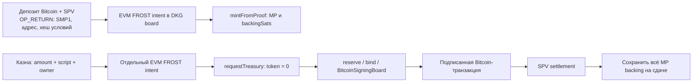

# Выпуск MP и выплаты из Bitcoin-казны

[Схемы: SVG/PNG и hashes текущих Mermaid-исходников](DIAGRAMS.md).

Команды ниже используют тот же проверенный deployment graph, DKG board и
`BitcoinSigningBoard`, что и [обычные Bitcoin-платежи](BITCOIN_ONCHAIN_RUNBOOK.md).
Они работают с выбранной в приглашении комбинацией Ethereum и Bitcoin сетей.
Доказательства загружаются из вашего Bitcoin Core; файлы между участниками не
передаются. На публичном Bitcoin relay должен быть синхронизирован, SPV guard
должен быть свежим. Ethereum finality/depth сохраняется.

Нужны завершённые DKG, bootstrap, локально проверенный и закреплённый registry,
созданный signing board и действующий keeper relay. Переменные `BOARD`,
`SIGNING_BOARD`, `EVM_RPC`, `BTC_RPC`, `BTC_COOKIE` задают публичные адреса и
локальные соединения. `IDENTITY`, `STATE`, `PASSWORD` у каждого участника свои:
state — файл `btc_ceremony.enc`, пароль — локальный файл с правами 0600.
`DEADLINE` — Unix timestamp в секундах в будущем, с запасом на все раунды
подписания и подтверждения выбранной EVM-сети. В custody-профиле Bitcoin proposal
публикует участник денежного ключа с разрешением `canPublishIntent`, а обычный
mint proposal — действующий `BitcoinMintAdmission.operator` (в начале первый
кастодиан). В старом профиле сохраняется оператор исходного DKG board.
Исполнить уже подписанный intent может другой участник.

Входящая [передача обеспечения](BITCOIN_CUSTODY_TRANSFER.md) имеет отдельный
маршрут: исходный `settle`/burn и destination SPV, затем `finalize` и выпуск cBTC.
Её нельзя провести как обычный fresh deposit или потратить до принятия как
свободную Bitcoin-казну. Перенос не сдвигает nonce обычной mint-заявки.

## Выпуск MP по подтверждённому депозиту

До отправки обычного Bitcoin-депозита плательщик фиксирует получателя в самой
Bitcoin-транзакции. Чистая публичная команда не требует RPC, identity или state:

```sh
frost-signer bitcoin deposit-commitment --chain-id "$EVM_CHAIN_ID" \
  --mining-pool "$MINING_POOL" --vout 0 \
  --recipient "$RECIPIENT" --amount "$MP_BASE_UNITS"
```

Результат содержит `data` (56 байт), `allocation_hash` (32 байта) и полный
`script` (`6a38` + `data`). Формат `data`: ASCII `SMP1` (4 байта), **Ethereum-адрес
получателя MP** (20 байт), затем `allocation_hash` (32 байта). Адрес явно записан
в OP_RETURN; обычный депозит имеет одного получателя. В
Bitcoin-транзакцию добавляют **нулевой выход OP_RETURN** с этими 56 байтами,
а платёж отправляют на общий wallet script. `--vout` означает индекс
**платёжного выхода wallet**, а не индекс OP_RETURN. При создании/финансировании
транзакции нельзя сдвинуть этот индекс: например, wallet output — 0, OP_RETURN — 1,
сдача плательщику — 2. До broadcast проверьте итоговую decoded transaction.
Поддерживается до 32 выходов в доказываемой транзакции, включая coinbase с
SMP1 или без него. Coinbase с большим числом выходов этот mint-путь не принимает.

Например, для Bitcoin Core wallet, который финансирует депозит, последовательность
ниже удерживает wallet vout на позиции 0. `CORE_CHAIN` — `main`, `testnet4` или
`regtest`, соответствующий приглашению. `DEPOSIT_BTC` — сумма в BTC без округления,
согласованная с `MP_BASE_UNITS`; `DEPOSIT_FEE_RATE` — выбранная вами fee rate в
sat/vB для **финансирующей** транзакции. Этот fee отдельно оплачивает плательщик.
Например, депозит `0.01000000` BTC равен `1000000` сатоши и
`10000000000000000` базовых единиц MP. Ниже используется Bash или Zsh с
активированным Python-окружением проекта; `bitcoin-cli` подключается к тому же
Core и сети, что и `BTC_RPC`.

```bash
BCLI=(bitcoin-cli -chain="$CORE_CHAIN" -datadir="$BTC_DATADIR" -rpcwallet="$LOCAL_BITCOIN_WALLET")
COMMITMENT="$(frost-signer bitcoin deposit-commitment --chain-id "$EVM_CHAIN_ID" \
  --mining-pool "$MINING_POOL" --vout 0 --recipient "$RECIPIENT" --amount "$MP_BASE_UNITS" \
  | python -c 'import json,sys; print(json.load(sys.stdin)["data"])')"
RAW="$("${BCLI[@]}" createrawtransaction '[]' \
  "[{\"$BTC_WALLET_ADDRESS\":$DEPOSIT_BTC},{\"data\":\"$COMMITMENT\"}]")"
FUNDED="$("${BCLI[@]}" fundrawtransaction "$RAW" \
  "{\"changePosition\":2,\"fee_rate\":$DEPOSIT_FEE_RATE}" \
  | python -c 'import json,sys; print(json.load(sys.stdin)["hex"])')"
SIGNED="$("${BCLI[@]}" signrawtransactionwithwallet "$FUNDED" \
  | python -c 'import json,sys; r=json.load(sys.stdin); assert r["complete"]; print(r["hex"])')"
"${BCLI[@]}" decoderawtransaction "$SIGNED"
```

Проверьте в результате позиции/суммы и соответствие `BTC_WALLET_ADDRESS` общему
DKG wallet, затем отправьте **эти же байты**:

```sh
DEPOSIT_TXID="$("${BCLI[@]}" sendrawtransaction "$SIGNED")"
DEPOSIT_VOUT=0
```

Коммитмент и txid публичны. Ключи кошелька остаются в Bitcoin Core; эти команды
не экспортируют приватные ключи и не требуют доступа к чужим локальным файлам.

Точное кодирование `allocation_hash`: `keccak256(abi.encode(keccak256("SATOHSI_DEPOSIT_ALLOCATION_V1"),
uint256(chainId), address(miningPool), uint32(vout), address[](recipients),
uint256[](amounts)))`. У обычного депозита оба массива содержат по одному элементу.
Суммы здесь в MP base units.
Контракт проверяет ту же привязку: другой получатель, сумма, пул, chain ID или
vout не пройдут даже при действительной FROST-авторизации. Подмена явного адреса
при сохранении прежнего хеша также отклоняется. Адрес получателя публичен уже
в Bitcoin OP_RETURN; адрес и сумма выпуска публичны в Ethereum. Приватные ключи,
DKG shares и nonce в OP_RETURN не записываются.

В coinbase тоже можно указать получателя: майнинговое ПО добавляет тот же
нулевой OP_RETURN `SMP1 + адрес + allocation_hash`, вычисленный для wallet vout
награды. Если coinbase содержит SMP1, адрес и хеш обязательны к проверке;
FROST не может игнорировать их и переназначить выплату. Если SMP1 есть, но ни
один payload не соответствует выбранному wallet vout и распределению, mint
отклоняется. Неверная длина или неканоническое кодирование data push с меткой
SMP1 также отклоняется, а не включает обходной режим.

Только настоящая coinbase с единственным null prevout **без SMP1** сохраняет
распределение награды по явно утверждённой FROST-политике. Любая coinbase
требует 100 подтверждений. SPV доказывает награду, но **не доказывает долю работы
каждого майнера**. Доверие к правильности распределения немаркированной награды
остаётся у порога.

Старые обычные депозиты без этого коммитмента новая версия автоматически не
выпускает. Нельзя задним числом добавить OP_RETURN в уже подтверждённую
транзакцию. Перед обновлением inventory таких outpoint нужно разобрать отдельно;
не переводите их автоматически в казну и не приписывайте произвольному адресу.
Контракты неизменяемы: ранее развёрнутые адреса не получают эту проверку от
одной замены клиентского кода.

После подтверждения оператор указывает Bitcoin txid в обычном отображаемом порядке байт, номер vout
и точное распределение. `--amount` — целое число базовых единиц MP: одному сатоши
соответствует `10000000000`. Один BTC — `1000000000000000000` единиц MP.
Для обычного депозита указывают ровно одного получателя из OP_RETURN. Для
coinbase-награды без SMP1 можно повторить `--recipient` и `--amount` в одинаковом порядке;
максимум — 64 получателя. Сумма должна точно совпасть с выбранным
Bitcoin-выходом. Coinbase требует не менее 100 подтверждений; обычный депозит —
глубину из deployment policy, не менее шести.

```sh
frost-signer dkg btc-mint-propose \
  --board "$BOARD" --signing-board "$SIGNING_BOARD" --role btc_ceremony \
  --rpc "$EVM_RPC" --bitcoin-rpc "$BTC_RPC" --bitcoin-cookie "$BTC_COOKIE" \
  --identity-file "$IDENTITY" --state "$STATE" --password-file "$PASSWORD" \
  --txid "$DEPOSIT_TXID" --vout "$DEPOSIT_VOUT" \
  --recipient "$RECIPIENT" --amount "$MP_BASE_UNITS" --deadline "$DEADLINE"
```

Команда возвращает `AWAITING_PARTICIPANTS`, номер session, роль EVM-церемонии
и typed intent. Участники читают intent командой `setup pending` из исходного
DKG board и проверяют txid, vout, получателей и суммы. Каждый запускает
`dkg sign-evm` со своим state указанной EVM-роли; выполняются обычные раунды
commit/share/finalize. Это отдельная EVM-авторизация выпуска, Bitcoin nonce здесь
не создаётся. Процедура подписания описана в [первом запуске](FIRST_DKG_ONCHAIN.md).

После финализации оператор либо другой участник выполняет те же аргументы с
`btc-mint-execute` вместо `btc-mint-propose`. Клиент ещё раз получает актуальное
доказательство из Core. Контракт атомарно проверяет SPV и отсутствие повторного
использования outpoint, затем выпускает MP и записывает хеш фактического
распределения. Повторная команда с теми же параметрами возвращает
`BTC_FUNDING_EXECUTED` без нового mint и новой транзакции. Другой получатель или
другая сумма для уже выпущенного outpoint дают `BTC_MINT_ALLOCATION_MISMATCH`.

## Вывод невыпущенных BTC казны

Обычная заявка MP погашает токены. Заявка казны разрешает вывести только
избыточные BTC и **не уменьшает** `backingSats` выпущенных MP. Создание такой
заявки требует отдельной FROST-авторизации с точными суммой, владельцем заявки
и Bitcoin script. Нулевой token в записи escrow обозначает заявку казны.

Клиент отдельно запрещает использовать ещё не выпущенный депозит с маркером
`SMP1` как казну или источник miner fee (`BTC_UNMINTED_COMMITTED_DEPOSIT`).
Сначала такой депозит нужно выпустить по адресу из OP_RETURN. Проверка выполняется
при подготовке плана и перед созданием Bitcoin nonce; неизвестные входы читаются
из локального Bitcoin Core. Уже учтённое MP-обеспечение и зарегистрированная сдача
не требуют этого дополнительного исторического запроса. Это правило клиента:
оно не отменяет полномочий пороговых держателей Bitcoin-ключа вне CLI.

```sh
frost-signer dkg btc-treasury-propose \
  --board "$BOARD" --signing-board "$SIGNING_BOARD" --role btc_ceremony \
  --rpc "$EVM_RPC" --bitcoin-rpc "$BTC_RPC" --bitcoin-cookie "$BTC_COOKIE" \
  --identity-file "$IDENTITY" --state "$STATE" --password-file "$PASSWORD" \
  --request-id "$TREASURY_REQUEST_ID" --treasury-owner "$TREASURY_OWNER" \
  --satoshis 400 --destination-script "$TREASURY_DESTINATION_SCRIPT" \
  --deadline "$DEADLINE"
```

`TREASURY_REQUEST_ID` — новый уникальный номер в namespace escrow.
`TREASURY_OWNER` — Ethereum-адрес, который сможет отменить ещё не подписанную
Bitcoin-заявку; он входит в подписываемые параметры. Отмена доступна в `Pending`,
а после `bind` — только если batch уже безопасно переведён в `Cancelled` до
начала Bitcoin-подписания. Если owner не указать, используется
локальная EVM identity, поэтому при исполнении с другой машины owner нужно
указывать явно. Owner не может изменить Bitcoin-получателя или сумму.

Участники подписывают опубликованный intent через `dkg sign-evm`. Затем
`btc-treasury-execute` с теми же аргументами создаёт запись и возвращает
`withdrawal_ref`. Дальнейшая последовательность полностью обычная:

1. `btc-prepare --input TXID:VOUT --withdrawal WITHDRAWAL_REF --fee ... --max-fee ...`.
2. `btc-propose/execute --operation reserve`, публикация plan, затем
   `btc-propose/execute --operation bind`; обе операции подписывают участники.
3. `btc-commit`, `btc-sign`, `btc-broadcast`, ожидание Bitcoin depth и `btc-settle`.

Имеющиеся 600 сатоши невыпущенной казны можно, например, вывести как 400 сатоши
на P2WPKH и 200 сатоши miner fee. Это работает, только если такая fee достаточна
для фактического размера транзакции и текущих правил mempool. Для другого
назначения/длины транзакции может потребоваться добавить ещё treasury input.
Минимумы выхода из приглашения сохраняются: по стандартному профилю 294 сатоши
для P2WPKH, 330 для P2TR. Небольшую сдачу нельзя молча списать в fee сверх явно
утверждённого бюджета.

При смешанных входах вся сумма `backingSats - погашенные MP в сатоши` остаётся
на wallet change. Treasury request не считается погашением MP. Клиент проверяет
это до Bitcoin nonce; контракт повторяет проверку при settlement. Вывод казны
не выпускает и не сжигает MP/S. Разрешённый по состоянию refund лишь отменяет
заявку казны, не переводя никаких ERC-20. После начала подписания обычный запрет
refund сохраняется. Нулевое `backingSats` само по себе не доказывает, что вход
принадлежит казне: он может быть ещё не выпущенным пользовательским депозитом.
Перед утверждением treasury payment участники должны проверить происхождение
входов и не назначать пользовательские средства казне автоматически.



## Что означает освобождение от комиссии

`integration_fee_exemption=true` относится только к **DEPLOY-комиссии фабрик**.
`wrap_fee_bps` и `unwrap_fee_bps` — отдельные финансовые условия подписанного
приглашения. Например, `wrap_fee_bps=17` удерживает 0,17% при обёртывании даже при
бесплатном развёртывании. Поле не может незаметно отменять согласованную комиссию
пользовательского пула.

Для тестового окружения без пользовательских комиссий задайте одновременно
`--wrap-fee-bps 0 --unwrap-fee-bps 0` при создании приглашения. Команда
`frost-signer setup status --board "$BOARD" --rpc "$EVM_RPC"` возвращает объект
`fees` с `exemption_scope=DEPLOY_ONLY`, ставками `wrap_bps`/`unwrap_bps` и
`user_fees_exempt`. Это условия исходного приглашения; после governance-изменения
ставок актуальные комиссии нужно читать у deployed `FederationFeeManager`.
Изменение ставок уже развёрнутой системы выполняется через штатную
FROST-авторизацию `FederationFeeManager.setFeeConfig`, с custodian approval для
конфедерации. Правка локального JSON не меняет on-chain ставки.

## Personal withdrawal fee sources

[BTC/MP/S credits, consent and refunds](WITHDRAWAL_FEE_SUBSIDY.md) add a separate owner fee tranche. Principal P remains fixed; MP/S burn only actual C×10^10, and external BTC returns use immutable owner claims. Donation/treasury credits and ordinary CS remain separate. Actual purpose qualification and the long combined contour remain pending.
## Automatic SMP1 wallet preparation

`bitcoin deposit` prepares a wallet-funded SMP1 PSBT, with no manual OP_RETURN,
allocation hash or output-index calculation. The supported client profile is
`SMP1_PSBT_V0_NATIVE_SEGWIT_V1`: Bitcoin Core **30.x** wallet RPC, PSBT v0,
P2WPKH or P2TR key-path inputs, one recipient and one fixed deposit output,
one zero-value SMP1 marker and optional wallet-owned change. It is a bounded
preparation profile, not a restriction on the existing general 100k stripped
funding parser or the low-level SMP1/coinbase mint routes.
Public-network Core checks retain the existing explicit checkpoint, archival,
synced txindex and fresh-tip requirements; this profile does not claim support
for a pruned/light wallet backend.

Copy `config/smp1-deposit.example.json` into a private file, select the actual
canonical mining pool from the deployment manifest, and set the wallet-scoped
RPC endpoint, cookie and local journal directory. The example zero pool address
deliberately fails validation. Endpoint credentials stay local. No wallet
migration, wallet unlock or private-key export is performed by these commands.
Ordinary recipient support means a nonzero, exactly selected address without
code at the checked EVM snapshots, excluding known graph sinks. This is not
proof of ownership or future code. The additive client also implements the
[recipient matrix](ADDRESS_DEPOSIT_REGISTRY.md#recipient-matrix): canonical
`RecipientWalletV1` and explicitly unverified advanced contract reception.
The low-level SMP1/coinbase contracts retain their existing rules; these additional
checks apply to the new wallet client and do not retroactively qualify old mints.

For a contract recipient, run `frost-signer bitcoin deposit recipient-preview
--config CONFIG --recipient ADDRESS --recipient-mode wallet-v1 --out CHOICE_FILE`
(or explicitly `advanced-contract`). Review chain/pool/token/recipient, runtime,
owner where applicable, and the risk text. Supply `--recipient-file CHOICE_FILE
--recipient-accept CONFIRMATION_HASH` to `prepare`. This review is separate from
the PSBT financial quote confirmation. The exact choice is retained in the quote
and rechecked before signing and broadcast. An altered code/profile stops the
new send; existing signed bytes and locks are retained for recovery.

```bash
# Generates a private quote/PSBT file and displays amount, recipient, networks,
# pool/token, exact fee, change, expiry, operation ID and confirmation hash.
frost-signer bitcoin deposit prepare --config owner-deposit.json \
  --recipient "$EVM_RECIPIENT" --amount-sats 100000 \
  --fee-rate-sat-vb 2 --max-fee-sats 2000 --out deposit-quote.json

frost-signer bitcoin deposit sign --config owner-deposit.json \
  --operation-id "$OPERATION_ID" --accept "$QUOTE_HASH"

# A separate explicit action submits only the checked, journalled signed bytes.
frost-signer bitcoin deposit broadcast --config owner-deposit.json \
  --operation-id "$OPERATION_ID" --accept "$QUOTE_HASH"

frost-signer bitcoin deposit status --config owner-deposit.json \
  --operation-id "$OPERATION_ID"

# External signer alternative: preserve the complete transaction and SMP1.
frost-signer bitcoin deposit export --config owner-deposit.json \
  --operation-id "$OPERATION_ID" --accept "$QUOTE_HASH" --out deposit.psbt
frost-signer bitcoin deposit import-signed --config owner-deposit.json \
  --operation-id "$OPERATION_ID" --accept "$QUOTE_HASH" --psbt-file signed.psbt

# Only positively unsigned, unexported preparation may release its own locks.
frost-signer bitcoin deposit cancel --config owner-deposit.json \
  --operation-id "$OPERATION_ID" --accept "$QUOTE_HASH"
```

The client authenticates the canonical pool/admission/common graph and checks
current custody generation, recipient and public-network SPV freshness. It
asks Core to fund an unsigned PSBT with a separate fee, verifies every selected
prevout's value/script against Core and rejects known consumed, wallet, reserved,
derived or fee-purpose custody sources. Coinbase *inputs* need 101 confirmations;
the resulting ordinary deposit output uses at least six confirmations for mint.
An MP child token is authenticated by its proven MiningPoolV1 constructor,
canonical CREATE nonce 1, runtime and reciprocal binding.

The returned output order is inspected locally. The client computes the actual
deposit `vout`, recomputes the SMP1 allocation and updates its marker before any
signature. The exact PSBT/unsigned transaction, input values, fee, change,
recipient and generation are retained in SQLite. Segwit-only inputs keep txid
stable across signing. Checks after signing/import and before broadcast reject
new inputs/outputs, changed amounts/commitments, unsafe sighashes or a different
transaction. Core's `testmempoolaccept` must also accept the final bytes and
agree on fee/vsize before sending. No automatic RBF, fee bump or replacement
transaction is created. A lost send response is recovered by exact txid and
checked intent, retaining the original signed envelope.

Preparation does not lock coins or sign. Before signing/export, selected UTXOs
are persistently locked through Core; foreign locks are never adopted/unlocked.
Use the same journal as the lock writer for this wallet while operations are
pending. Arbitrary manual unlock/relock by another wallet-RPC client is outside
this ownership model: Core exposes no owner tag or lock-history proof.
SQLite records `RESERVING` and `SIGNING_REQUESTED` before those RPCs. A crash
between a lock RPC and its durable acknowledgment remains a recovery stop:
the wallet lock API has no owner tag, so the client cannot infer ownership.
Do not delete/reset the journal to resolve it. Inspect the exact wallet locks
and retain the quote; manual operator reconciliation is required for this
ambiguous boundary. A signing timeout similarly retains potentially signed
inputs, but the exact PSBT can be exported and a checked signature imported.
Exported/partially signed transactions cannot be cancelled just by waiting.

A successful signing response containing no signatures is distinguished from
a timeout. It reports that PSBT/external signing or the registered address flow
is required; its positively unsigned reservation may be explicitly cancelled.
If the selected wallet cannot sign, use a supported external signer or the
existing address-request flow once that flow is qualified/Ready. Never remove
the commitment or redirect a pending payment as a fallback.

Status separates Bitcoin observation/confirmations, header/Fresh/root coverage,
mint admission/authorization and EVM finality. Header coverage alone does not
claim a verified inclusion proof. A successful BTC broadcast is not minted MP.
The returned `mint_request` carries the exact txid/vout/recipient/MP allocation
into the existing admission/proof consumer; a funding client does not acquire
the federation's mint authority. Minted allocations remain visible when the
Bitcoin RPC is unavailable. BTC fee reserve figures are on-chain claims with
reconciliation explicitly unknown to this owner client. No automatic S/CS
deposit or change to the second-layer owner is performed.

API references: [walletcreatefundedpsbt, Core 30.0](https://bitcoincore.org/en/doc/30.0.0/rpc/wallet/walletcreatefundedpsbt/),
[walletprocesspsbt](https://bitcoincore.org/en/doc/30.0.0/rpc/wallet/walletprocesspsbt/),
[persistent locks](https://bitcoincore.org/en/doc/30.0.0/rpc/wallet/lockunspent/),
[finalizepsbt](https://bitcoincore.org/en/doc/30.0.0/rpc/rawtransactions/finalizepsbt/) and
[testmempoolaccept](https://bitcoincore.org/en/doc/30.0.0/rpc/rawtransactions/testmempoolaccept/).
These versioned references describe the supported API; they do not qualify a
production deployment. Focused tests use real rust-bitcoin/SQLite and explicit
Core/EVM fixtures. A fresh live Core/proof/FROST/EVM/consumer run is deferred.
Focused evidence: `ops/artifacts/zkspv/worker-integration/smp1-wallet-preparation-report.json`.
