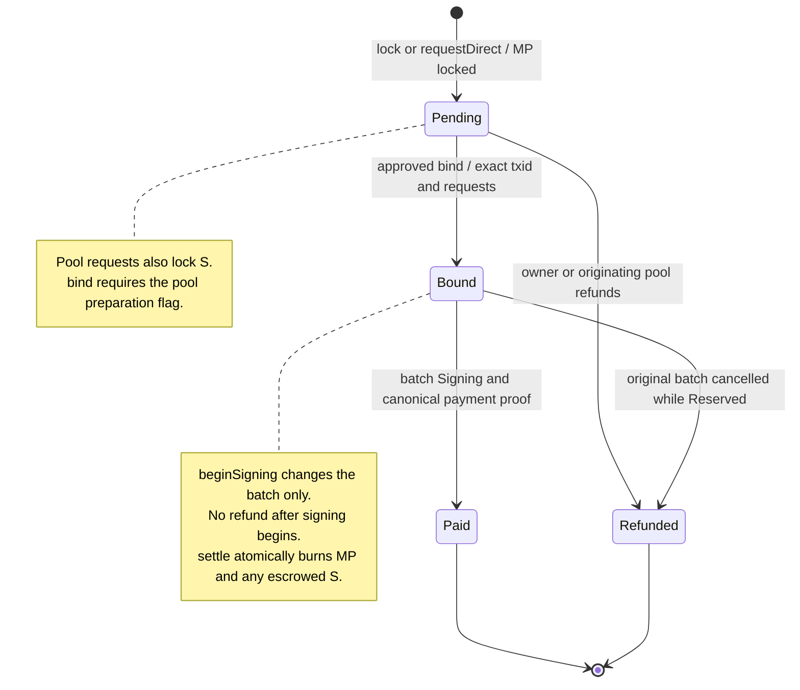

# Bitcoin withdrawal lifecycle v1

Новые конфедерации с ULR policy V3 погашают S из своего BTC-резерва. Комиссия
майнеров вычитается из BTC-выплаты, а комиссия протокола перечисляется DAO в S
после подтверждения выплаты. Ниже описан прежний профиль с выводом MP.
[Порядок и расчёт V3](CONFEDERATION_DAO_IN_KIND.md#btc-и-комиссия-майнеров).

[Схемы: SVG/PNG и hashes текущих Mermaid-исходников](DIAGRAMS.md).

V6 profiles use Bitcoin Core 30.3, FROST `BTC_SPEND` DKG,
P2TR wallet inputs, P2WPKH/P2TR destinations, SIGHASH_DEFAULT and RBF sequence.
The wallet key is the library's post-DKG Taproot output key; it is not tweaked a
second time. Participant processes independently query Core UTXO amount/script,
network and maturity and reproduce all sighashes. Limits: 16 inputs, 32 outputs.
V6 independently selects Anvil (31337), Sepolia (11155111) or Ethereum mainnet (1),
and Bitcoin regtest, testnet4 or mainnet. Ethereum mainnet requires paid factories
and finalized state for every Bitcoin choice.
Select a new invitation for that network; existing wallet policies cannot be
renamed. The [Bitcoin guide](BITCOIN_MAINNET_RUNBOOK.md) covers checkpoint, own
Core and relay maintenance; the [Ethereum guide](ETHEREUM_MAINNET_RUNBOOK.md)
covers V6 onboarding, asset funding, fees and finality. Network support does not
certify production custody.

Before the first nonce, every signer must [review and pin the canonical Bitcoin
registry](BITCOIN_SIGNER_TRUST.md). Existing state without that explicit local
binding fails closed with `BTC_REGISTRY_NOT_PINNED`. The `DKGOnchainBoard` procedure
discovers the executed binding on-chain and requires no shared deployment file.
This board already carries DKG messages and EVM authorization packets. The new
[`BitcoinSigningBoard`](../web3/docs/bitcoin-signing-board.md) is a separate
transport contract connected to the CLI. Its immutable V2 plan and public
commitment/share packets let all participants sign without exchanging files.
Follow the [step-by-step payment runbook](BITCOIN_ONCHAIN_RUNBOOK.md); `--package`
is only the retained legacy path. See the [separate crypto review](BITCOIN_ONCHAIN_SECURITY_REVIEW.md).

## Issuance

The local-MP custody profile uses independent custodian-only EVM/BTC epochs.
An external source MP reaches cBTC through
[`BitcoinCustodyTransfer`](BITCOIN_CUSTODY_TRANSFER.md): source Bitcoin payment
and MP burn, then exact destination output acceptance, then local MP/CS issuance.
This is distinct from the ordinary deposit mint described below. Source and
destination escrow/registries differ; the completed destination withdrawal does
not need the source participants or a federation representative. The gateway's
source graphs are fixed before enrollment and must be on the same EVM chain.

`RegtestHeaderRelay` pins Bitcoin regtest genesis, verifies proof of work at the
regtest target, parent links and median-time-past, and permanently disables test
helpers. It is an integration relay. V6 selects `MainnetHeaderRelay` or
`Testnet4HeaderRelay` for public Bitcoin PoW, network-specific difficulty/retarget,
MTP and cumulative-work selection from the reviewed checkpoint. The shared `MainnetSPVGuard` is the deposit/escrow SPV endpoint and blocks
stale or halted proof use on chain. The CLI additionally checks canonicality,
work and bounded lag against each participant's own validated Core.
`MiningPoolV1` creates its immutable PoolMpToken and binds its payout script to a
completed BTC_SPEND result. `BitcoinDepositRegistry` is shared by all registered
pools. Registration requires target-bound FROST; one wallet script belongs to one
registered pool.

The participant CLI now provides `btc-mint-propose` / `btc-mint-execute` and
threshold-approved surplus treasury requests. See the
[mint and treasury runbook](BITCOIN_MINT_AND_TREASURY.md) for exact steps and units.

`mintFromProof` consumes a target-bound allocation approval and checks raw
transaction txid, canonical block/depth, merkle inclusion, exact vout, script and
amount. Ordinary deposits also require the sender's zero-value OP_RETURN:
`SMP1` + one explicit 20-byte EVM recipient + a 32-byte allocation hash, bound to
the EVM chain, mining-pool address, wallet vout, recipient and exact MP amount.
Coinbase may carry the same SMP1 binding, which must then match. Only coinbase
without SMP1 retains threshold-selected allocation. Both modes require at least
100 confirmations; all mint transactions have at most 32 outputs. Distribution sums exactly
to `satoshis * 10^10`; there is no EOA mint entry point. Common outpoint consumption
prevents deposit/reward replay. Wallet spends and recorded change cannot be
presented again as new backing. The legacy demo mint/redemption paths remain in
the repository for compatibility and are excluded from this profile.

## Escrow and payment

Both multipools round net MP down to a whole satoshi before storing or hashing
any ordinary, metadata or NFT withdrawal request:
`net = floor(netBeforeRounding / 10^10) * 10^10` in MP base units. A zero result
reverts. The eventual fee is `shareAmount - net`, including the rounding remainder,
and is accrued only at settlement. Before signing, cancellation returns the full
locked share amount and accrues no fee.

The escrow constructor is now
`BitcoinWithdrawalEscrow(registry, relay, confirmations, minP2WPKHSats, minP2TRSats)`.
Both minima are explicit satoshi amounts with hard floors of
294 and 330 respectively; higher values are allowed. Bootstrap and the escrow
constructor reject lower values. Every lock route, including direct MP redemption,
requires a multiple of `10^10` MP base units and the applicable minimum; direct
requests are rejected rather than silently rounded. V3 and V4 invitations carry these
values through the bootstrap plan and verify the deployed getters. Mainnet V4
retains those fields and additionally commits Bitcoin/EVM readiness policy; its
constructor SPV argument is the freshness guard rather than the raw header relay.

1. A multipool request moves S into the pool's escrow and transfers net MP to
   BitcoinWithdrawalEscrow. Shares remain nontransferable outside pool-controlled
   escrow moves. TVL includes the explicitly tracked MP escrow. Direct MP
   redemption uses `requestDirect` and the same settlement contract. Only tokens
   whose pool DAO is registered in the common deposit registry are accepted.
2. `processWithdrawal` consumes FROST approval (and custodians for confederations)
   and marks the request prepared. It does not burn S/MP or accrue unwrap fees.
3. BitcoinBatchRegistry reserves exact outpoints under a plan hash. A second
   target-bound approval binds the escrow's request keys and exact transaction
   txid to this batch. Binding checks each pool request is prepared.
4. Before nonce publication, every signer verifies the bound transaction and
   request set, sums obligations sharing a script, checks destination totals,
   and calls `beginSigning`. The configured batch registry refuses signing an
   unbound payment. Nonces/shares are durably journaled before exposure.
5. The broadcaster persists signed bytes, checks Core's mempool acceptance and
   rebroadcasts those identical bytes on retry. Canonical confirmation checks
   transition a reorged payment to RECOVERY_REQUIRED and pause broadcasts.
6. `settle` verifies a canonical SPV proof at configured depth (minimum 6), exact
   committed txid and the complete ordered reserved input set. It aggregates all
   obligations with the same output script, so an output cannot satisfy each
   request independently. It records wallet change, burns held MP, then calls
   the originating pools to burn escrowed S, reduce TVL and accrue unwrap fees.
   All state and transfers are atomic. Replay is rejected.

MP amounts passed to the escrow lock or `requestDirect` must be whole satoshis;
the escrow rejects a sub-satoshi remainder. Pool requests may start with a
fractional `shareAmount`: the pool rounds the net payout down before hashing
the request and passing that payout to the escrow. The current policy charges miner fees to an independently funded
wallet treasury. Integration tests use a separate unminted treasury UTXO for the
fee, preserving principal backing. The signed plan enforces input = output + fee
and an explicit maximum fee. The escrow does not permit unapproved transaction
replacement; a different txid requires the separately approved version path below.

## Cancellation and recovery

An unbound request can be refunded once. A bound request can be refunded only
when its batch was safely cancelled in Reserved state. Once Signing begins,
time, mempool absence and RPC failure never authorize refunds. Pool rejection
and timeout cancellation both pass through the escrow's same guard. A signed
payment remains locked while an authorized replacement is prepared.

After settlement, an unavailable Bitcoin block or a same-chain observation
with insufficient depth returns `OBSERVATION_UNAVAILABLE`. The depth check
can report `BITCOIN_PAYMENT_DEPTH_PENDING`. Retry with the same batch, Bitcoin
txid and journal. The temporary pause clears after the SDK returns to the
required depth and verifies the exact payment proof. A conflicting canonical
hash at the original payment height triggers `RECOVERY_REQUIRED` and requires
explicit recovery. [Bitcoin payment recovery](RECOVERY.md#2-проверка-bitcoin-платежа-после-settlement).

On a ZK profile, a newer history root can require materialization of the same
payment header. If the EVM settlement has reverted, retry `dkg btc-settle`
with the same batch and journal after current-root materialization. The SDK
must verify a canonical final revert and simulate the same call before it
opens a new EVM attempt. [ZK call recovery](ZK_SPV_BOOTSTRAP.md#retry-after-a-proof-call-reverts).

The lower-level operator CLI uses a separate EVM identity for relaying; participant
FROST secrets never enter these commands. The following examples use regtest:

```sh
frost-signer bitcoin proof --bitcoin-rpc http://127.0.0.1:18443 --bitcoin-cookie /private/regtest/.cookie --txid TXID --state ops/btc.sqlite
frost-signer bitcoin relay --bitcoin-rpc http://127.0.0.1:18443 --bitcoin-cookie /private/regtest/.cookie --rpc http://127.0.0.1:8545 --relay RELAY --identity-file /private/operator.json --state ops/relay.sqlite
frost-signer bitcoin settle --bitcoin-rpc http://127.0.0.1:18443 --bitcoin-cookie /private/regtest/.cookie --rpc http://127.0.0.1:8545 --escrow ESCROW --batch BATCH --txid TXID --identity-file /private/operator.json --state ops/settlement.sqlite
```

`bitcoin broadcast --signed FILE --batch ID` and `bitcoin confirm --batch ID`
use the durable BitcoinWorker journal. Signing remains exclusively in the
participant `dkg btc-commit` / `dkg btc-sign` commands. For mainnet, the lower-level
operator commands additionally require explicit `--bitcoin-network mainnet`,
`--bitcoin-policy`, and `--evm-confirmations` for EVM-dependent actions. Participant
`dkg btc-relay` and `dkg btc-network-status` instead read policy and relay addresses
from the pinned on-chain graph; no policy file is exchanged between friends. See
the [mainnet runbook](BITCOIN_MAINNET_RUNBOOK.md).

`backingSats` additionally tracks principal per outpoint. Settlement consumes input
principal, subtracts exactly the MP burn, and assigns the remainder to verified
wallet change. It reverts if miner fees would consume principal. Signers check the
same equation before releasing a nonce. Reserved inputs cannot be minted, and
settlement permanently quarantines even previously unminted treasury inputs from
later issuance. Treasury surplus stays distinct from token-backed satoshis.

The diagram shows the actual **escrow request states**. Preparation is a pool
flag; `Signing` belongs to the batch registry, not to the escrow request.



The batch follows `Reserved -> Signing` or, for an original batch only,
`Reserved -> Cancelled`. It stays `Signing` after payment; the escrow's
`Payment.settled`, request states and `spentInputs` prevent replay. An approved
replacement creates a new batch version and never releases the original inputs.

`RECOVERY_REQUIRED` is a **local BitcoinWorker journal status**. The worker
pauses broadcasts when the canonical block hash at a recorded payment height
conflicts with its saved proof. A missing response or insufficient depth on the
same chain produces `OBSERVATION_UNAVAILABLE` and can clear after a successful
recheck. A failed initial broadcast leaves the saved bytes available for
retry. The escrow keeps the requests locked during these checks. Preserve the
worker and signer journals during recovery. A relayer can submit a valid
canonical proof directly to the escrow with a fresh and healthy SPV backend.


## Authorized fee replacement (17 October)

`BitcoinBatchRegistry.reserveReplacement(previous, id, planHash, deadline, op)`
requires a new target-bound FROST approval, a fresh batch ID and the same complete
ordered input set. Reservations remain owned by the original root batch; up to
16 versions are allowed. The earlier signed version remains valid and locked.
`BitcoinWithdrawalEscrow.bindReplacement(previous, id, txid, op)` requires another
approval and copies exactly the existing obligations. It cannot refund or replace
the recipients' escrowed claims.

Build the new plan with the same inputs/requests and a fee paid from treasury
change. Each participant verifies the new approved plan, unspent chain prevouts,
reserved root, output obligations and remaining backing. A new batch ID means
new Bitcoin nonce state and commitments. The old mempool transaction is allowed
to conflict with the replacement; that is why replacement checks chain UTXOs
without treating the known mempool spend as an on-chain spend.

Broadcast with `bitcoin broadcast --batch NEW --replaces OLD --signed NEW.json`
plus the usual Bitcoin RPC/cookie/state flags. The worker preserves both signed
transactions and links their logical family; an evicted predecessor reports
`REPLACED_PENDING`. Confirmation identifies the actual winning transaction.
Submit the proof to `settle` for that version's batch ID. A proof for either
approved conflicting version can close the original obligations exactly once;
spent-input and paid-request guards reject a second burn. No timeout refund is
introduced. A deep reorg after settlement still requires incident recovery.
