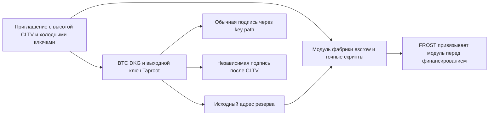
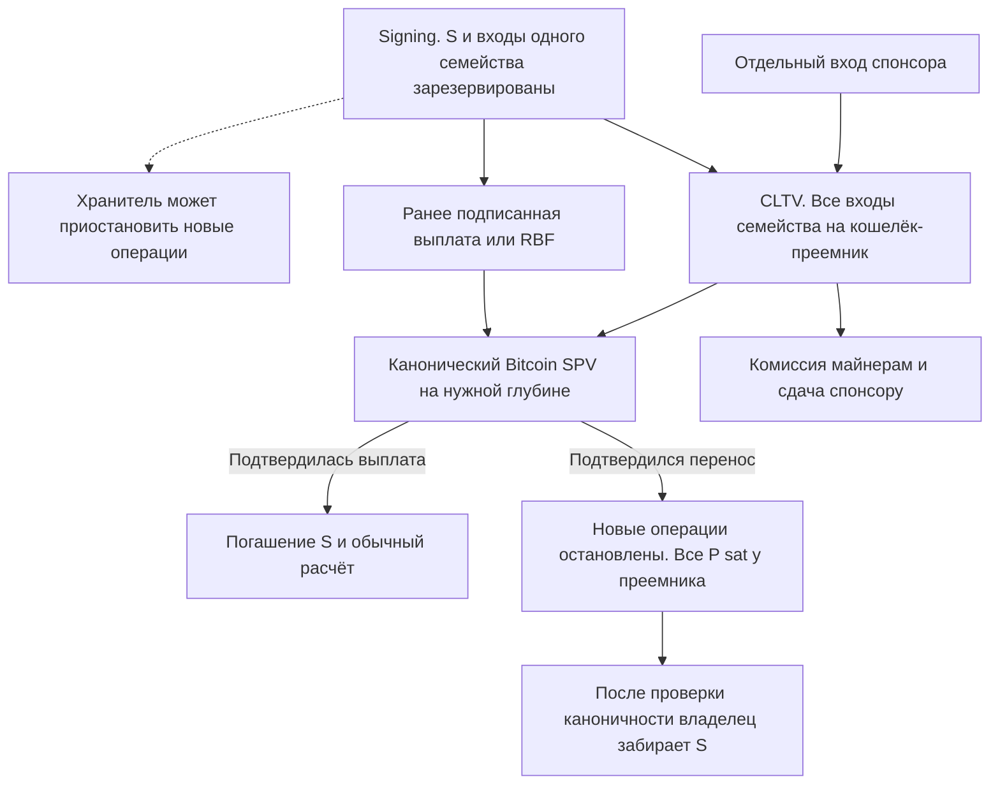
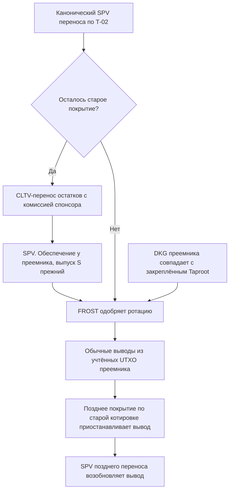

# Холодное восстановление вывода S → BTC

Профиль восстановления Т‑02 включается при развёртывании нового V3 с
обособленным Bitcoin-кошельком конфедерации. Профиль поддерживает relay и ZK.
Восстановление одного пакета сохраняет все учтённые сатоши его входов и
открывает исходным владельцам однократный возврат заблокированных S.

## Согласование до первого депозита

В конфигураторе добавьте объект `bitcoin_recovery` к конфигурации с
`income_model: "in-kind"`. При ручном запуске передайте этот объект отдельным
JSON-файлом в `frost-signer setup invite --bitcoin-recovery-policy FILE`
вместе с обычными параметрами V3. Каждое enrollment фиксирует условия.

| Поле | Значение |
| --- | --- |
| `height` | Высота CLTV в Bitcoin в виде десятичной строки. Для действующей эпохи выберите высоту впереди текущей цепи и согласуйте отсечку новых поступлений. При вершине на этой высоте восстановление может войти со следующего блока. |
| `threshold`, `keys` | Порог в виде строки, минимум два. 2–15 разных публичных x-only ключей, по 64 строчных hex-символа, отсортированных лексикографически. Доли или приватные ключи в приглашение не входят. |
| `successor_script` | Точный P2TR-скрипт кошелька-преемника в hex, начиная с `5120`. Проверьте возможность расхода из этого кошелька отдельно до приёма BTC. Проверка формы ключа сама по себе этого не доказывает. |
| `successor_dkg` | Для подготовленной ротации укажите объект `{"registry": "<checksum-адрес DKGCoordinator>", "wallet_id": "<64 hex без 0x>"}`. Bootstrap переиспользует этот координатор и проверяет завершённую церемонию преемника, её ключ, состав и порог. |
| `sponsor_script` | Другой P2TR-скрипт отдельно профинансированного Bitcoin-спонсора. Точно этот скрипт получает сдачу комиссии. |
| `max_fee_sats` | Положительный потолок miner fee на пакет в сатоши, десятичная строка. |
| `confirmations` | Глубина SPV в виде строки, не ниже минимальной глубины платежа в этом графе. |
| `pause_guardian` | Независимый EVM-адрес в checksum-формате. У него есть только право необратимо приостановить новые операции затронутой эпохи. |

В обычном key path используется Bitcoin DKG конфедерации. При включённом
профиле итоговый ключ коммитит Tapscript с CLTV и порогом холодных ключей.
Участники сверяют сохранённый `recovery_descriptor` в публичном
`dkg export --format public` с фактическим `payoutScript` резерва.
Для аварийного расхода каждый холодный участник использует собственный
кошелёк и сверяет тот же дескриптор, срок и назначения средств.
[BIP 341](https://bips.dev/341/) и
[BIP 65](https://github.com/bitcoin/bips/blob/master/bip-0065.mediawiki).

После регистрации скрипта исходного кошелька escrow создаёт модуль через
свою фабрику. FROST утверждает точный модуль и параметры до привязки
финансируемого резерва. Модуль обслуживает один зарегистрированный исходный
скрипт и заранее выбранного преемника того же S. Контракты хранят
запись о происхождении модуля из фабрики escrow.

Для штатного вывода после восстановления подготовьте преемника **до первого
депозита**. Координатор должен быть развёрнут оператором на выбранной EVM-сети
из того же артефакта `DKGCoordinator`. Примените отдельный bootstrap-план с одним
шагом `{"id":"dkg","kind":"deploy","artifact":"DKGCoordinator","args":[]}` и
согласованными `chain_id`, `bitcoin_network`, `mode` и `evm_confirmations`.
Если на тестовой сети нужен нестандартный `phase_duration`, настройте его до
первой церемонии.

Через `setup publish` и `setup join-chain` опубликуйте и подпишите отдельное
приглашение V6 для Bitcoin DKG преемника. Используйте те же сеть, оператора,
состав и порог кастодианов, новый ID развёртывания и отдельные каталоги
участников. Приглашение преемника выпускается без `bitcoin_recovery`.
Оператор сверяет результат read-only команды `dkg successor-create --board
"$SUCCESSOR_BOARD" --registry "$DKG" --rpc "$RPC"`. Повтор со своим
`--identity-file`, `--state`, `--accept-fingerprint` и `--send` связывает доску
преемника с координатором и открывает BTC DKG. Участники выполняют обычный
`dkg run-once --board "$SUCCESSOR_BOARD" --role btc_ceremony` со своими
локальными состояниями. После завершения скопируйте `completed.successor_script`
и `completed.successor_dkg` из `successor-create` в `bitcoin_recovery` основного
приглашения. Основной bootstrap сверяет совпадение этих параметров с цепочкой.
[Публикация, enrollment и DKG](FIRST_DKG_ONCHAIN.md).



## Действия при потере основного Bitcoin-кворума

Сначала прочитайте `frost-signer bitcoin recovery inspect --rpc "$EVM_RPC"
--board "$BOARD"` и сверьте `fingerprint`, адреса и политику с проведённым
cold start. Все последующие команды принимают те же `--rpc`, `--board` и
явный `--accept-fingerprint "$FINGERPRINT"`.

1. Если хранитель права паузы доступен, `bitcoin recovery pause --identity-file
   "$GUARDIAN" --state "$EVM_JOURNAL" --send` прекращает новые резервации и
   новые обычные подписи SDK. Старую уже подписанную выплату можно отправить
   и предъявить её SPV-доказательство.
   Прекратите выдачу инструкций для перевода на прежний адрес. Пауза блокирует
   новые котировки поступлений, а прежние оплаченные обязательства требуют учёта.
   Холодный кворум может начать перенос и без этой команды. При принятии
   доказательства переноса контракт сам ставит эпоху на паузу.
2. Спонсор предварительно финансирует отдельный P2TR-выход. После нужной
   глубины relayer регистрирует его вызовом `bitcoin recovery register-sponsor
   --txid TXID --vout N --identity-file "$RELAYER" --state "$EVM_JOURNAL"
   --send`. Для этого и дальнейших Bitcoin-действий укажите локальные
   `--bitcoin-rpc` и `--bitcoin-cookie`. Relay должен знать канонический
   блок. В ZK он должен быть материализован под текущим корнем.
3. `bitcoin recovery prepare --root ROOT --input TXID:VOUT ... --sponsor
   TXID:VOUT --internal-key HEX --fee-sats SAT --output recovery.json`
   собирает PSBT. Корень указывается без `0x`, выходы в порядке
   резервации. `internal_key` берётся из проверенного публичного
   `recovery_descriptor`. Каждый подписант сверяет точные входы, полный
   выход на преемника и отдельную комиссию по своему RPC. В файле
   `psbt_base64` используется стандартный PSBT. Bitcoin Core поддерживает
   частичную подпись через `walletprocesspsbt` с `DEFAULT` и
   `finalize=false`. Передаются только подписанные PSBT-пакеты.
4. `bitcoin recovery combine` с теми же параметрами пакета и отдельным
   `--partial-psbt FILE` для каждого участника и спонсора проверяет
   подписи и сохраняет raw hex в новый `--output`. Команды `verify` и
   `broadcast` принимают этот файл через `--signed-raw`. Последняя
   проверяет высоту CLTV и mempool policy текущего Core перед отправкой.
5. После заданной глубины любой relayer вызывает `bitcoin recovery settle
   --root ROOT --txid TXID --identity-file "$RELAYER" --state "$EVM_JOURNAL"
   --send`. Без `--send` команды Ethereum выполняют симуляцию. Владелец
   забирает S через `frost-signer dao in-kind cancel --withdrawal LOCAL_ID`
   с обычными параметрами manifest, RPC, identity, state и `--send`.
   Escrow снова проверяет каноничность и глубину доказательства в момент
   возврата. `inspect --root ROOT` показывает сохранённый txid и
   готовность SPV-доказательства. Для этой команды сохраняется штатная
   семидневная задержка от создания заявки.



Восстановление обязано потратить полный набор обеспечивающих входов корня
и перевести сумму `P` их учтённых сатоши на закреплённый скрипт. Комиссия
равна сумме входа спонсора минус его сдача. Реестр переносит покрытие без
нового выпуска S и помечает выход преемника уже учтённой сдачей. Успешная
обычная выплата закрывает путь восстановления этого семейства. Подтверждённый
перенос исключает расчёт всех прежних версий и открывает только возврат.
При исчезновении доказательства из канонической истории возврат блокируется.
То же восстановительное txid можно заново привязать к каноническому блоку
без повторного учёта. Глубокий реорг после возврата требует сверки инцидента.

## Ротация после переноса

До ротации обработайте зарезервированные пакеты по обычному сценарию выплаты
или восстановления. Для резервов, по которым ещё нельзя было начать подпись,
работает штатная отмена. Остальные учтённые UTXO старого скрипта переносите
пакетами по 1–16 входов. `bitcoin recovery inspect --backing-offset 0`
показывает страницу UTXO и `next_offset`. Для свободного старого входа
`original_script` равно `true`, а `reserved_root` пуст. Страницы отображают
снимок на указанном блоке. Перед подписью каждый участник сверяет текущие UTXO.

После подтверждения паузы старого кошелька применяйте для такого пакета
`prepare`, `combine`, `verify`, `broadcast` и
`settle` с `--idle` вместо `--root`. Тот же CLTV, спонсор и SPV-порог
проверяются для всего пакета. Реестр удаляет старые записи и добавляет этот
выход преемника как уже учтённое обеспечение. `--idle` не даёт права на возврат
S и отклоняет входы, закреплённые за заявкой на вывод.

Когда `old_backing_sats` равно `0` и SPV по выбранному восстановленному
семейству канонично, выполните на основной доске:

1. `bitcoin recovery rotate-plan --root "$RECOVERED_ROOT" --wallet-id
   "$SUCCESSOR_WALLET_ID" --intent rotate.json`. План связывает конкретный DKG
   преемника, семейство и txid переноса.
2. `bitcoin recovery rotate-propose --intent rotate.json --deadline "$DEADLINE"
   --identity-file "$PUBLISHER" --state "$EVM_JOURNAL" --send`. Порог
   действующей EVM-группы подписывает опубликованную сессию через `dkg sign-evm`
   с ролью `conf_ceremony` основной доски.
3. `bitcoin recovery rotate-execute --intent rotate.json --session "$SESSION"
   --identity-file "$RELAYER" --state "$EVM_JOURNAL" --send`. Команды
   восстановления принимают `--rpc`, `--board` и `--accept-fingerprint` как выше.
   Проверка `inspect` покажет назначенный `successor_wallet_id`, новый
   `active_script` и `withdrawals_paused: false` при готовом SPV.
4. Участники проверяют и закрепляют новый граф командами `dkg
   inspect-bitcoin-registry` и `dkg trust-bitcoin-registry` с `--board
   "$SUCCESSOR_BOARD" --recovery-board "$ORIGINAL_BOARD" --role btc_ceremony`.
   С этими же параметрами создайте `dkg btc-deploy-board` для нового ключа.
   Обычные Bitcoin-подписи идут через новый DKG и новую BitcoinSigningBoard.
   EVM-одобрения вывода остаются у исходной `conf_ceremony`.



Ротация сохраняет `totalBackingSats` и выпуск S. При обычном выводе с
преемника реестр погашает из покрытия ровно сумму погашенных S в сатоши,
учитывает сдачу один раз и помечает прежний выход израсходованным.
Указатели старых заявок сохраняются до их окончательного расчёта.

Старый шлюз сохраняет паузу новых котировок. Если оплаченная ранее котировка
добавит покрытие на старом адресе, новые выводы приостанавливаются до SPV
переноса остатка через `--idle`. Повторной ротации и нового выпуска S для этого
переноса не требуется.

В ZK проверяются заголовок переноса, зафиксированный при ротации, и заголовки
переносов, чьи выходы выбраны для расхода. При смене корня истории заново
материализуйте эти заголовки под текущим корнем. `inspect` показывает
`rotation_block`, а `inspect --migration-txid TXID` показывает `migration_block`.
Если транзакция попала в другой канонический блок, снова отправьте `settle`
с тем же txid и новым доказательством. До восстановления каноничности
соответствующий путь вывода закрыт. [Материализация ZK](ZK_SPV_WORKER.md).

## Граница профиля

Профиль покрывает потерю основного Bitcoin-кворума при доступных независимых
холодных ключах, спонсоре, работающем SPV и доступном кошельке-преемнике.
Стандартный CLTV ограничивает момент доступа к BTC. После его наступления
Bitcoin допускает расходы, подписанные холодным кворумом. Именно поэтому
каждый хранитель самостоятельно сверяет назначения. Ethereum допускает
возврат S только для доказанного переноса с полным покрытием.

Ротация должна поддерживаться байткодом развёрнутого графа. Прежний
Taproot-выход сохраняет своё исходное условие расхода. Если закреплённый
преемник не принадлежит завершённому совместимому DKG, SDK не может
назначить ему новые FROST-ключи. Ключи управления EVM остаются нужны для
одобрения ротации, а холодный кворум самостоятельно может переносить BTC.
Этот граф допускает одну ротацию. Штатный преемник использует обычный
Taproot key path. Его следующая аварийная миграция требует заранее
спроектированного маршрута восстановления для этого кошелька.

## Проверка

На свежем развёртывании контрактов тест `testColdStartFundingQuorumLossRefundThenRotationAndSuccessorPayment`
начинается с котировки SMP1 и выпуска S по доказательству депозита. После
начала подписи первоначальная Bitcoin-группа становится недоступной в
тестовой DKG. Контракт отклоняет возврат по таймеру и перенос с недостаточной
глубиной. После SPV он переносит 100 000 sat, возвращает S однократно, меняет
активный DKG и проводит обычный вывод с преемника. Получатель получает
39 450 sat, майнеры — 150 sat, а в реестре остаётся 60 400 sat обеспечения.

| Локальная проверка | Результат и граница проверки |
| --- | --- |
| Сквозной relay на Anvil и Bitcoin Core 30.3 | На свежих узлах `t02-relay` прошёл за 11 мин 37 с. После bootstrap и выпуска S через mint admission один участник старого Bitcoin-кворума стал недоступен. Холодный кворум перенёс 1 000 000 sat по CLTV, а спонсор оплатил 2 200 sat. После 12 подтверждений переноса прошли однократный возврат S и FROST-ротация. Новый вывод с преемника получил 6 подтверждений и был рассчитан по SPV. |
| Regtest relay | 21 контрактный тест. Реальный relay проверяет смоделированные Bitcoin-транзакции и заголовки. |
| ZK mainnet и ZK testnet4 | По 21 контрактному тесту на рабочих адаптерах. Они проверяют Merkle-доказательства по тестовому каноническому состоянию. |
| Bitcoin Core 30.3 regtest | Реальные подписи CLTV и спонсора переместили 2 000 000 sat. Независимый FROST-ключ преемника потратил этот UTXO, выплатив 999 000 sat получателю и 1 000 sat майнерам. |

В сквозном relay-прогоне владелец получил обратно 0,004 S после штатной
семидневной задержки, пройденной ускорением часов локального Anvil. При
новом выводе получателю поступило 398 080 sat, а майнерам — 1 000 sat.
Из покрытия один раз списано 399 080 sat. Остаток 600 920 sat совпал
с оставшимся выпуском S в пересчёте на сатоши.

Отдельно прошли 35 проверок состояния, адаптеров и верификатора ZK. На чистом
Anvil актуальный верификатор RISC Zero 3.1 отклонил архивный receipt прежней
версии, сохранив исходное состояние. Эта проверка выполняется независимо от
денежного пути Т‑02.

Новый Groth16 для пути Т‑02 не сформирован. Предварительная проверка prover
зафиксировала 568 143 872 байта свободного пространства при минимуме 8 ГиБ.
Параметры локальных узлов и сборки описаны в
[инструкции по локальному прогону V3](SYSTEM_TEST_MODES.md#отдельный-локальный-прогон-v3).

```sh
# Контракты Bitcoin relay
(cd web3 && forge test --match-contract BitcoinWithdrawalRecoveryRelayTest)

# Полный контрактный путь Т‑02 через оба ZK-адаптера
(cd rust/zkspv/state-adapter && FOUNDRY_PROFILE=recovery forge test \
  --match-contract 'BitcoinWithdrawalRecovery.*ZkAdapterTest')

# Обычная FROST-подпись и независимые подписи CLTV в Bitcoin Core regtest
pytest tests/e2e/test_bitcoin_cltv_wallet.py

# Развёртывание с CLTV и проверка привязки участником
pytest tests/e2e/test_bitcoin_recovery_bootstrap.py
pytest tests/e2e/test_bitcoin_successor_ceremony.py

# Полный Т‑02. Runner сам запускает свежий Anvil и Bitcoin Core regtest с txindex
python -m ops.system_modes run --mode t02-relay --output /absolute/new-t02-relay-run
```

Для полного Т‑02 лимит прогона по умолчанию составляет 1 800 секунд (30 минут).
На медленной машине задайте `--timeout-seconds 2700` и новый каталог вывода.
Этот параметр ограничивает время работы pytest. Сроки подписей и операций
протокола задаются отдельно. Команда запуска, результат и JUnit доступны по
[инструкции отдельного прогона](SYSTEM_TEST_MODES.md#полное-восстановление-т02-через-relay).
