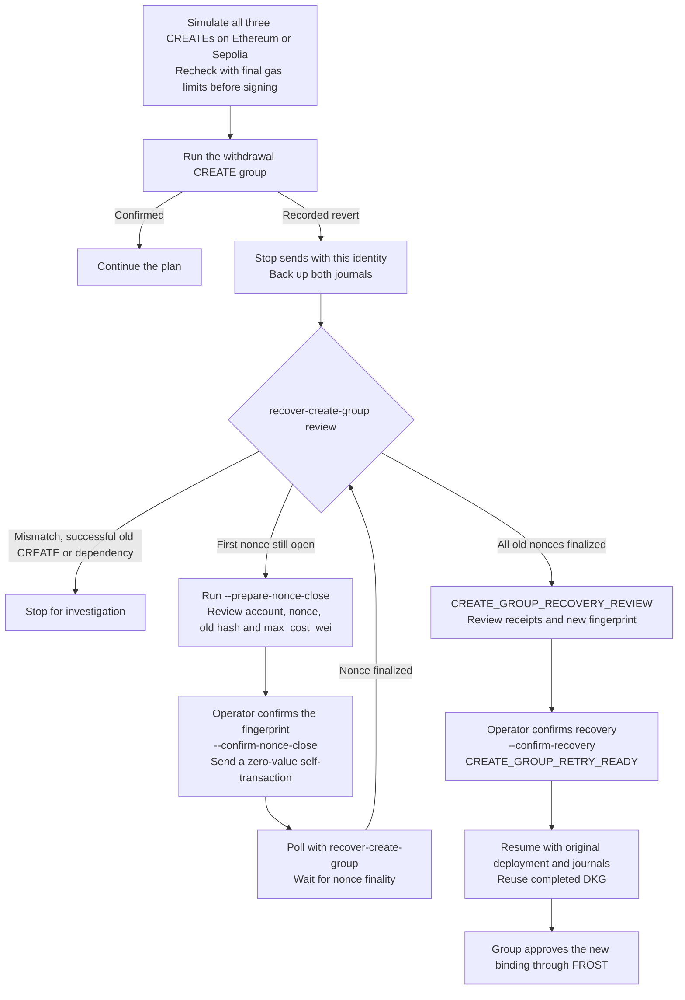

# Bootstrap: V6, independent Ethereum/Bitcoin networks and durable progress

[Холодный старт с нуля](COLD_START.md): единый порядок подготовки, ролей,
финансирования, DKG, relay/ZK, ручной рассылки и первого smoke.

Экономические параметры и формулы новой сборки: [конфигуратор](LAUNCH_CONFIGURATOR.md)
и [математическое описание](LAUNCH_MATHEMATICS.md).

[Единый конфигуратор запуска](LAUNCH_CONFIGURATOR.md): `frost-signer configure wizard`
выбирает сети, create/reuse, confirmations, имена токенов, пороги, комиссии и
дополнительный стартовый APY из собственного USD-бюджета.

Для `income_model=in-kind` конфигуратор выдаёт ULR policy V3. Она создаёт
переводимый S, BTC-резерв, свой стейкинг и DAO каждой конфедерации. Она
использует `setup invite --ulr-policy FILE` и отдельную custody policy.
Маршрут с общим стейкингом, конвертером и family/fee reserve ниже описывает
прежний профиль. [Bootstrap и эксплуатация V3](CONFEDERATION_DAO_IN_KIND.md).

The signed [ULR bootstrap profile](ULR_BOOTSTRAP.md) replaces the legacy per-confederation
CGOV economic graph with one fixed 10m governance-token issue, common staking/snapshots,
confederation treasuries, candidacy and delegated voting. Pass `setup invite --ulr-policy FILE`;
choose create/reuse and relay/ZK before enrollment. For the complete Bitcoin and
ULR graph use `system-profile` and `setup invite --system-policy FILE`: canonical
family, address registry/request board, incident/signing boards and fee reserve
are included in the same signed V6 profile. Sepolia + Bitcoin testnet4 supports relay or its distinct pinned ZK guest;
ZK regtest is unsupported. Existing profiles without `ulr` keep their policy.

Set all four issued ERC20 names/symbols before enrollment with
`system-profile --token-metadata FILE` (or `setup invite --token-metadata FILE`).
The file maps `governance`, `mining`, `federation_share`, `confederation_share`
to `{name, symbol}`. These values become signed V6 inputs, constructor arguments,
pre-signing checks and final manifest metadata. Shared-token `reuse` preserves
its exported `ulr.token`; renaming an existing token is rejected. See
[the schema and example](TOKENS.md#имена-и-тикеры-до-запуска).

New `system-profile` commands require `--bitcoin-custody-policy FILE`.
The `custodians` policy creates independent confederation EVM and Bitcoin DKG
epochs whose roster excludes the federation representative. The top-level
roster/threshold still defines the federation EVM epoch. At least two custodians
are required; both confederation epochs use the policy's explicit threshold
(at least 70% of custodians), and `min_custodians` must meet that threshold.
The initial operator drives bootstrap; custodians can subsequently publish
public monetary intents without that operator. Historical profiles without the
field retain their original roster. Editing a local profile does not upgrade
an enrolled invitation or deployed contract.

The policy may pin existing source federation graphs before enrollment.
Both gateway versions lock source MP in the original escrow. Source
settlement burns MP, and destination SPV verifies receipt of the backing.
`BitcoinCustodyTransferV2` then issues S against the accepted Bitcoin output.
The earlier `BitcoinCustodyTransfer` issues CS through local MP. See
[custody transfer and operator commands](BITCOIN_CUSTODY_TRANSFER.md).

First use with only participant addresses: [on-chain onboarding](FIRST_DKG_ONCHAIN.md).
All new invitations are V6. Choose `--ethereum-network mainnet|sepolia|local`
and `--bitcoin-network mainnet|testnet4|regtest` independently; see the
[network matrix and flow commands](NETWORKS_AND_AUTOMATION.md). The generated
on-chain profile publishes reviewable signing intents. Bitcoin public-network
policy is described in the [Bitcoin runbook](BITCOIN_MAINNET_RUNBOOK.md), and
Ethereum mainnet finality/fees in the [Ethereum runbook](ETHEREUM_MAINNET_RUNBOOK.md).

Commands:

```sh
frost-signer bootstrap plan --profile /path/public-bootstrap-input.json
frost-signer bootstrap apply --profile /path/public-bootstrap-input.json --state ops/deployments.sqlite --identity-file /private/operator.json --dry-run
frost-signer bootstrap apply --profile /path/public-bootstrap-input.json --state ops/deployments.sqlite --identity-file /private/operator.json
frost-signer bootstrap resume --deployment local-v1 --state ops/deployments.sqlite --identity-file /private/operator.json
frost-signer bootstrap verify --deployment local-v1 --state ops/deployments.sqlite
```

A profile with explicit `steps` runs those journaled steps. Without `steps`,
`bootstrap_plan.build` generates the network-specific graph. Required integration/regtest public inputs:
`deployment_id`, `mode: integration`, `chain_id` (string), `evm_rpc`,
`bitcoin_network: regtest`, `evm_confirmations` (string), `operator`, `treasury`,
`approval_deadline` (absolute EVM timestamp string), `federation_id`,
`confederation_id`, `min_p2wpkh_sats` (at least 294), `min_p2tr_sats` (at least 330), `min_custodians`
(decimal strings), the financial and Bitcoin policy below, and
`evm_ceremony`, `conf_ceremony`, `btc_ceremony` objects.
Each ceremony has `id` (0x bytes32), ordered `participants`, matching public
`transport_keys`, `threshold` and `epoch` (decimal strings). Generate transport
keys on the respective participant hosts first. The operator adopting a ceremony
must be a participant. In historical profiles without `bitcoin_custody`, the
confederation roster is the federation representative followed by custodians,
without duplicates. For that graph, `f=1`,
`c=n-1`, `t>=ceil(7*n/10)`, `t>1`, and `t-1<=min_custodians<=c`.
The BTC ceremony must have the same ordered roster and threshold as the
confederation authorization. With `bitcoin_custody`, both contain only the
custodians, excluding the first top-level participant (the representative).
The withdrawal minima are passed to the escrow
constructor in satoshi; `treasury` is passed to DAO settlement. None is inferred
from an operator address or replaced by a Python default.

All fields in this table are required in V6 and earlier V3/V4/V5 invitations and in a direct generated
bootstrap profile. The CLI names use hyphens, for example `--wrap-fee-bps`.
Integers are canonical decimal strings in JSON, with no sign, whitespace or
leading zeros; booleans are JSON booleans and explicit `true`/`false` CLI arguments.

| Field | Allowed value and effect |
|---|---|
| `wrap_fee_bps`, `unwrap_fee_bps` | 0..10000; initial fixed-percentage fees. 100 bps means 1%. The dynamic-fee fields are unused and zero in this profile. |
| `wrap_staker_bps` | 0..10000; share of both WRAP and UNWRAP receipts routed to DAO, with the remainder to treasury. |
| `deploy_staker_bps` | 0..10000; DAO share of DEPLOY receipts. Exempt factories in this graph do not generate these receipts. |
| `converter_numerator`, `converter_denominator` | 1..`2**256-1`; fixed inventory quote: `floor(input_MP_base_units * numerator / denominator)` reward-token base units. |
| `converter_funding` | 1..`2**256-1`; initial inventory in reward-token base units. Integration test USD has 6 decimals; backed profiles use the explicit external token decimals. |
| `dao_token_recipient` | Nonzero EVM address receiving the entire initial fixed governance-token supply; separate from operator and treasury. |
| `dao_use_reserve` | Boolean; initial reserve policy, subsequently governed by the DAO. |
| `integration_fee_exemption` | Anvil/Sepolia require explicit `true` and permanently exempt factories in the generated bootstrap. Ethereum chain 1 requires `false` and a positive `deployment_fee` policy; zero-fee exemption is forbidden there. |
| `bitcoin_confirmations` | 6..`2**32-1`; identical deposit and withdrawal proof depth. |

The [first-DKG command](FIRST_DKG_ONCHAIN.md#1-оператор-публикует-приглашение)
supplies every required argument with a clearly identified example policy.
No quote, commission share, funding amount, token recipient or reserve choice is
filled automatically. `FundedFeeConverter` always assigns inventory ownership to
its deploying operator; its constructor enforces this behavior. Integration inventory is mintable test USD. Backed mode transfers the operator’s external reward
token and checks the exact balance increase. Insufficient inventory makes conversion revert. The
controller's initial 120 ppm daily rate is fixed by the contract/specification;
later rate and reserve changes use DAO governance.

No participant key material belongs in this file. `evm_rpc` is local routing
configuration, not a shared ceremony input: keep profiles/journals private if that
URL contains provider credentials. V2–V6 on-chain invitations never include it;
`setup publish --rpc` and `setup assemble-chain --rpc` select it locally.

A new `setup invite` uses **V6 for any supported pair of networks**.
The builder also accepts historical V3/V4/V5 policy schemas on their original
network combinations. This is data-format compatibility, not a promise that a
V6 build can operate old deployed contracts: runtime/provenance checks still
require the original compatible build. Enrollments must commit the withdrawal minima, custodian,
Bitcoin depth and financial policy used by the constructors and funding call.
V1/V2 invitations remain readable and their
existing enrollments can still be inspected, assembled and signature-verified;
adding the new fields to such a local profile does not upgrade its signed policy.
The builder rejects that input with `BOOTSTRAP_REQUIRES_V3_INVITATION`. A directly
specified configuration without onboarding remains supported, with the same
explicit constructor inputs and value checks.
An incomplete V3/V4/V5/V6 invitation is rejected with `INVITATION_SCHEMA`;
adding fields requires a new invitation and fresh participant enrollments.

The generated graph deploys verifier/registry/coordinator, creates all
three independent DKG ceremonies before waiting for their completed results, renounces coordinator `ADMIN_ROLE` after the verified
registry binding, deploys and allowlists the real factory/deployer graph,
reserves `federation_id` for `evm_ceremony.id` and `confederation_id` for
`conf_ceremony.id` from the signed invitation, adopts completed
EVM_AUTH results, creates federation/confederation, and connects
the selected relay, common deposit registry, withdrawal escrow, proof-only mining pool,
MP, fee manager, governance registry, fixed-supply governance token, staking,
rate controller, historical TWAP, income vault, decisions, settlement and fee
conversion/router sources. DAO registration targets ConfederationFactory and
waits for both enforced FROST and custodians. Factory verification reads the
registered DAO graph. Direct target-bound operations remain available.

The account that deployed each factory makes its reservation. Bootstrap checks
both reservations on resume. Only the same ID and session can be replayed.
[Shared federation factory](FEDERATION_CONFEDERATION_SETUP.md#6-дополнительная-федерация-на-существующей-factory) ·
[Shared confederation factory](FEDERATION_CONFEDERATION_SETUP.md#7-дополнительная-конфедерация-на-существующей-factory).

### Withdrawal deployment and recovery

Before signing the three circular withdrawal CREATEs on Ethereum or Sepolia,
bootstrap simulates them together in order through `eth_simulateV1`, applies
the gas margin, then simulates the final gas envelopes. For post-Glamsterdam
Sepolia, set an explicit `SATOSHIFI_MAX_TX_GAS` for this group. The cap includes
execution and state gas. Set `SATOSHIFI_CREATE_SIMULATION_RPC` if the sending
provider lacks the method or caps the aggregate simulation too low. The
simulation endpoint must agree on chain ID and the canonical reference block.
It needs an RPC gas budget that covers all three CREATEs in one request.
[Geth RPC method](https://geth.ethereum.org/docs/interacting-with-geth/rpc/ns-eth#eth-simulatev1) ·
[State gas](https://eips.ethereum.org/EIPS/eip-8037).

Use the original profile, journal, identity and pinned Solidity artifacts when
recovering an existing deployment. Apply the SDK update to the original
deployment environment and keep that environment's Solidity artifacts.
Stop processes sharing the identity, back up
`bootstrap.sqlite` and the identity's `.evm-nonce.lock.sqlite`, then work with
the original files at their original paths. Start from a recorded withdrawal
revert in `resume`. The recovery command uses the EVM RPC in the saved profile.
Use `frost-signer --debug bootstrap recover-create-group` with the same local
arguments to capture sanitized error locations and numeric RPC codes in stderr.
[Sharing SDK diagnostics](PEER_TESTING.md#как-собрать-диагностику-sdk).

```sh
recover_withdrawal() {
  frost-signer bootstrap recover-create-group --deployment "$DEPLOYMENT_ID" \
    --state "$LOCAL/bootstrap.sqlite" --identity-file "$IDENTITY" "$@"
}
recover_withdrawal
```

The diagram follows the first unresolved nonce through operator review and
finality, then returns to the saved deployment and completed DKG.



The review checks both journals against the saved plan, the prior block
anchors and artifact pins, the original signed CREATEs, and their finalized
receipts and addresses. A successful old CREATE, later signed dependency,
or unrelated unresolved reservation on the same identity stops recovery.

1. If the result is `CREATE_GROUP_NONCES_NOT_FINALIZED`, set
   `SATOSHIFI_MAX_FEE_PER_GAS_WEI` and
   `SATOSHIFI_MAX_PRIORITY_FEE_PER_GAS_WEI` to positive decimal wei values,
   using the reported minimums for the first open nonce and allowing for
   the current base fee. Each fee field must exceed the old envelope by at least
   10% rounded up, with a minimum increase of one wei. For a legacy
   transaction both comparisons use its `gasPrice`.
   Run `recover_withdrawal --prepare-nonce-close`. Review the chain, operator,
   old hash, nonce, and maximum cost in `CREATE_GROUP_NONCE_CLOSE_REVIEW`.
2. Run `recover_withdrawal --confirm-nonce-close "$CLOSE_FINGERPRINT"` only
   after accepting those details. It sends a zero-value, empty-data
   self-transaction on the first unresolved nonce of this group. The account
   must have empty code. An unfamiliar pending transaction or a visible
   queued CREATE at a later nonce stops the command.
   The exact signed bytes are saved before sending. Poll with
   `recover_withdrawal` until the nonce is finalized. If the RPC response was
   lost, `CREATE_GROUP_NONCE_CLOSE_SEND_UNCERTAIN` retains the hash. Repeating
   the same confirmation resends only the saved bytes if the nonce is still
   eligible. If several nonces are open, review and confirm each in order
   after the preceding nonce is finalized.
   Review and pending statuses return exit code 2 and structured JSON.
3. At `CREATE_GROUP_RECOVERY_REVIEW`, verify the old CREATE outcomes and any
   nonce-close receipt. Use the new fingerprint with
   `recover_withdrawal --confirm-recovery "$RECOVERY_FINGERPRINT"`. At
   `CREATE_GROUP_RETRY_READY`, run the usual `bootstrap resume` with the same
   deployment ID, journal, identity, and applicable Bitcoin options. The
   group gets new addresses and nonces. Existing completed DKG steps are
   reused. The existing group approves the new escrow binding through FROST
   within the saved plan's approval window. If that window has expired,
   review the remaining approvals before continuing.

The recovered plan records its original operator and nonce journal. Before
signing again, resume revalidates the finalized evidence for the retired
nonces and stops if the RPC's pending nonce is lower. Share the bootstrap
manifest for review. It omits signed transaction bytes, which remain in the
private journals for exact replay.

For a standalone mined revert, acknowledge the consumed nonce with
`bootstrap acknowledge-revert --identity-file "$IDENTITY" --rpc "$RPC" --tx-hash "$TX_HASH"`.
Use the identity that sent the transaction. The command verifies the finalized
revert and confirms that the account consumed its nonce. The failed operation
remains failed in its source journal.

FROST callers check the session immediately before sending `finalizeSession`.
Two transactions can still enter a block together. If another signer finalized
the exact result, the losing signer can continue after its revert is final.
The SDK verifies the journal, the nonce and the identical on-chain message
and aggregate. A regular revert still requires the receipt and the acknowledgement
above. A retry of an executed operation returns `ALREADY_EXECUTED` after matching
the operation hash, target and signing epoch against the confirmed state.

For a historical FROST coordinator send with a missing source binding, use
the original private signer journal, typically `<identity file>.transactions.sqlite`.
The command verifies the exact signed transaction in that journal and the
coordinator's runtime at a canonical finalized block on public EVM chains.
It records the binding locally without sending a transaction. Then resume with
the original command, journal and DKG. Resume checks the session outcome.
For a still-pending coordinator call, the binding also allows a fee review.

```sh
frost-signer bootstrap bind-legacy-nonce --identity-file "$IDENTITY" \
  --rpc "$RPC" --tx-hash "$TX_HASH" --source-journal "$STATE"
```

For a successful receipt stopped by a postcondition read, use
`bootstrap recheck --deployment "$DEPLOYMENT_ID" --state "$LOCAL/bootstrap.sqlite" --step "$STEP_ID"`.
Then run `resume` to check the postconditions again.

### Replacing a pending EVM call

[Recovery diagrams for signers and operators](RECOVERY.md).

`EVM_PENDING_FEE_CAP_BELOW_BASE` on mainnet or Sepolia means the signed
transaction is waiting at its existing nonce. Use the original identity and
a synchronized RPC on the same chain to review the fee cap. Set the two EIP-1559 caps and the maximum
total cost in wei. The first command calculates `worst_case_wei` as the new gas
limit times the fee cap plus the value sent. It returns `EVM_REPLACEMENT_REVIEW`
and a fingerprint for those exact terms.

```sh
frost-signer bootstrap replace-pending --identity-file "$IDENTITY" --rpc "$RPC" \
  --tx-hash "$TX_HASH" --max-fee-per-gas-wei "$FEE_CAP_WEI" \
  --max-priority-fee-per-gas-wei "$TIP_CAP_WEI" --max-cost-wei "$MAX_COST_WEI"
```

Check the chain, sender, nonce, target, `data_hash` and `worst_case_wei`.
Repeat the command with the same arguments and
`--confirm-replacement "$REPLACEMENT_FINGERPRINT"` to sign and send.
Optional `--gas-limit` belongs in both commands. The SDK checks it against the
current estimate. On mainnet the original transaction uses the configured fee
and priority caps. For an increase, the operator normally needs to update both
`SATOSHIFI_MAX_FEE_PER_GAS_WEI` and `SATOSHIFI_MAX_PRIORITY_FEE_PER_GAS_WEI` in
the replacement shell. Keep `SATOSHIFI_MAX_TX_GAS` and the maximum total cost
within the approved budget. Each increase requires operator confirmation. The
replacement keeps the sender, chain, nonce, destination, call data, value and
access list. It reuses the existing DKG. The original and replacement hashes remain
in the journal. Resume the original command to follow the canonical receipt.
On mainnet and Sepolia the winning receipt needs both the configured
confirmation depth and consensus finality. Local chain ID `31337` uses the
configured depth. On `EVM_REPLACEMENT_SEND_UNCERTAIN` repeat `replace-pending`
with the same parameters and fingerprint to resend the saved candidate. A
different fee requires a new review and confirmation.

The command supports pending EIP-1559 FROST signer calls and eligible serial
calls journaled by the updated SDK. For other old calls without the original
fee opt-in, use manual acknowledgement if they ultimately revert. Grouped CREATE,
parallel calls and workers with their own budget ledger have separate recovery
paths. If the RPC pending nonce falls below an earlier replacement's reserved
nonce floor, a grouped bootstrap waits and reports the replacement hash.
On Sepolia, an older journal that recorded a winner before consensus finality
waits in `CONFIRMING` while the recorded block is still canonical.
If the winning transaction reverts, first resume the
original command to reconcile the receipt, then run `acknowledge-revert`.
This closes the nonce and leaves the operation failed. If gas estimation
stopped the call before signing, review the configured gas limit and retry
the original call.

`flow bootstrap` polls this same journal; `flow dkg` runs the applicable local
role states and skips custody roles for the representative. They preserve explicit `dkg sign-evm` intent review and separate custodian
approvals. For an existing saved plan, resume with `--deployment` and its journal
instead of rebuilding a changed `--profile`; a new runtime requires migration review.
New on-chain plans bind the board's immutable `intentCoordinator` after its DKG
registry, before ceremonies and financial publication. Full/partial intents can
only be written by a permitted creator into its own existing FROST session.

DKG and approval waits return partial public manifests and
`AWAITING_PARTICIPANTS` / `AWAITING_CUSTODIAN_APPROVALS`. They never report a
completed deployment. Use the manifest's registry/coordinator, ceremony inputs,
and stored operation hash/session to run the separate participant CLI processes.
All participants must see the exact public intent and independently reproduce its
on-chain helper hash. If the FROST threshold of verified shares was reached
before the deadline, the bootstrap can still wait for finalization after it.
Resume after finalization or custodian approval. The
builder deliberately does not own participant credentials or auto-approve.

Public read outputs and session IDs from receipt events are frozen in the journal.
A transaction's exact signed bytes and hash are durably committed before sending.
A separate per-identity nonce journal serializes signing across deployments.
Before a new signature, its latest confirmed success, completed recoveries
and unresolved reservations establish the minimum usable nonce.
Explicit independent groups of at most 8 deploy/call steps may broadcast before a
shared confirmation barrier. Dependent constructors and calls cannot consume
outputs until all receipts and postconditions in the group are verified.
A crash resumes the same transaction. A receipt with status zero stops the step.
If the RPC's pending nonce is below the saved lower bound or it cannot yet
confirm a saved block or receipt, the command returns `AWAITING_EVM_RPC`.
Use `--rpc` on `bootstrap resume` or `flow bootstrap` to select another
synchronized endpoint on the same chain. The SDK checks saved anchors with
the new endpoint and preserves the deployment and journals. A conflicting
canonical hash requires recovery. [RPC recovery](RECOVERY.md#5-отставание-rpc-участников).

Verified manifests include ABI
artifact hashes, runtime hashes, receipt block/hash, constructor outputs and
pending steps. Keep the journal and nonce journal together; do not run multiple
copies of an EVM identity with independent nonce journals.

V6 uses **integration** only for Bitcoin regtest on EVM Anvil/Sepolia, with labelled
test USD/feed and a prefunded fixed-price converter. Ethereum mainnet or public
Bitcoin selects **backed**, requiring external `reward_token` and `btc_usd_feed`
identities in the legacy DAO profile. The ULR profile needs only the external
`reward_token`; it has no BTC/USD feed or TWAP. Bitcoin mainnet/testnet4 additionally require `bitcoin_policy`:
checkpoint bytes/work/predecessors, reorg/freshness/lag bounds and header batch size.
Regtest rejects that policy. The operator passes local `--bitcoin-rpc` and
`--bitcoin-cookie` to public-Bitcoin apply/resume/verify. The selected
`MainnetHeaderRelay` or `Testnet4HeaderRelay` plus `MainnetSPVGuard` is synchronized
and checked before activating consumers. `AWAITING_BITCOIN_RELAY` is resumable;
stale/halt also blocks SPV acceptance on chain.

Anvil/Sepolia generated bootstrap explicitly exempts factories from DEPLOY fee.
Ethereum chain 1 requires `deployment_fee={amount,treasury}`,
`integration_fee_exemption=false`, at least 12 EVM confirmations and finalized
state. Chain 1 fixes `phase_duration="86400"` (24 hours per DKG phase).
Anvil and Sepolia default to 3600 seconds. For a fresh V6 deployment, the
configurator's `phase_duration` or `setup invite --phase-duration` accepts
3600–86400 seconds. The invitation commits the value and the registrar sets it
before the first V1 ceremony. Three ceremonies run concurrently. Each participant
uses bounded on-chain batches and still waits for full verified rounds and the
enrolled EVM depth. A complete round advances immediately: phase duration is a
deadline, not a mandatory sleep. Ethereum mainnet requires explicit `--deadline`;
no seven-day fallback is applied. Deployment fee is positive reward-token base
units, paid once per factory creation; funding must cover twice it plus converter inventory.
The project authorization, vault and router are separate from the confederation
DAO; automatic V6 reuses the completed federation `evm_ceremony` result. Two
sequential FROST `setPayer` operations precede one-time factory configuration,
exact token allowances and both paid creations. Project splits are 0/0, so 100%
of deployment revenue goes to the explicit project treasury. Existing immutable
factory fee settings cannot be silently changed. The separate project DKG via
[staged deployment](STAGED_DEPLOYMENT.md) uses the legacy manifest/package CLI on
Anvil/Sepolia; that ceremony path is not supported on chain 1. Ethereum mainnet
uses the V6 on-chain enrollment and signing path described above.
Nonexempt factories collect fees atomically with creation; a revert rolls back
both contracts and fees. Chain-1 sends also require local
`SATOSHIFI_MAX_FEE_PER_GAS_WEI`, `SATOSHIFI_MAX_PRIORITY_FEE_PER_GAS_WEI` and
`SATOSHIFI_MAX_TX_GAS` budgets; these are not invitation fields.
Bitcoin mainnet support does not establish production EVM custody readiness.
The [on-chain Bitcoin CLI](BITCOIN_ONCHAIN_RUNBOOK.md) now connects the signing
board, participants, relay and proof settlement; no additional packet channel is
required.

For governance, `GovernanceRegistry.register` verifies federation ID, authorization
and multipool getters and consumes a target-bound approval. Membership/threshold
proposals in the legacy governance wrapper remain signalling decisions; key
rotation requires a new completed ceremony and migration, not a UI rename.

The parameterized Foundry leaf script is
`web3/script/DeployFederationGovernance.s.sol`; it accepts federation ID,
authorization, pool and expected chain ID. Both this script and
`DeployCustodianDAO.s.sol` expose `registerExisting` to consume a completed
session and register an already deployed graph without another token deployment.
The CLI journal remains the recommended resumable path.

The [combined contour adapter](ZKSPV_CONTOUR.md#bootstrap-and-bitcoin-funding)
can execute/adopt this generated mainnet ZK graph one original unit at a time,
with private gas/cost caps and strict signed-byte recovery. Its explicit structural
mode returns `GRAPH_CONFIGURED_FRESHNESS_PENDING`; it does not replace the
normal bootstrap freshness checks or authorize monetary clients to bypass them.


## Canonical family root in the withdrawal profile

Withdrawal policy V2 explicitly selects `family_root` and `family_enrollment`.
The first root uses pinned creation code and original `$conf_auth`; participants
independently pin the pending manifest root before enrollment signatures. An
existing root requires original governance approval or `PRE_ENROLLED` admission,
followed by the new graph's own FROST bind. [Exact sequence and CLI](BITCOIN_KEY_FAMILY.md).
Root admission does not migrate accounting or enable derivation qualification.
