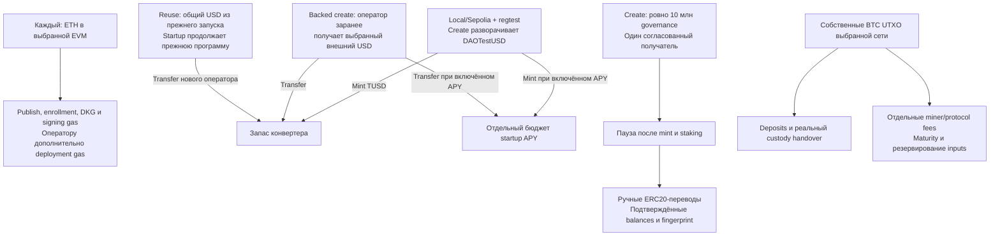
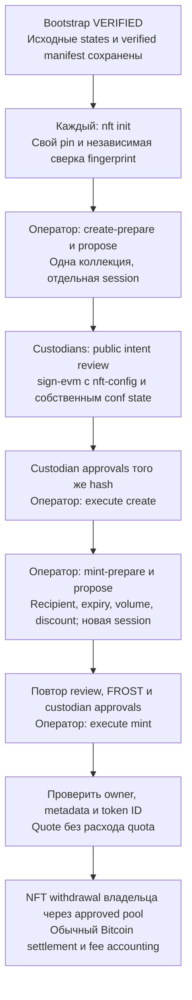
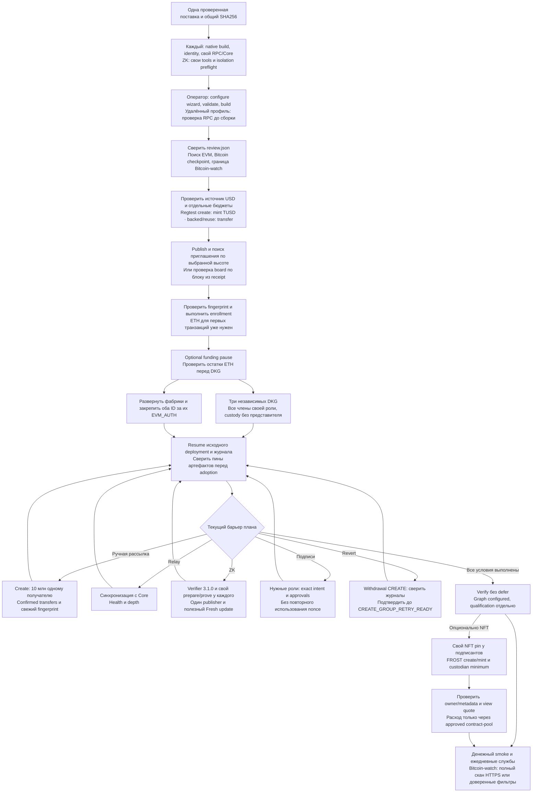

# Холодный старт: одна поставка, разные участники, один согласованный запуск

[Схемы: SVG/PNG и hashes текущих Mermaid-исходников](DIAGRAMS.md).

[Параметры федерации/конфедерации и новые группы](FEDERATION_CONFEDERATION_SETUP.md) ·
[NFT скидок: параметры, роли и требования](NFT_CONFIGURATION.md).

Актуализация от 12 ноября 2026. Это основной маршрут **нового** запуска из participant
archive на Linux, Windows/WSL2 и macOS. [Установка хоста](CROSS_PLATFORM_QUICKSTART.md)
содержит системные команды; [конфигуратор](LAUNCH_CONFIGURATOR.md) задаёт параметры;
[FROST/ZK lifecycle](FROST_ZK_LIFECYCLE.md) объясняет ключи, подписи и proofs;
[математика](LAUNCH_MATHEMATICS.md) — выплаты и их ограничения. Примеры ниже
выполняются в Bash на Linux/macOS/Ubuntu WSL2; личные пути и RPC сохраняются
между терминалами, Bash-массив `BTC_ARGS` создаётся заново после входа.

## 1. Выберите стенд до установки

| Стенд | Что нужно каждому | Что дополнительно согласовать |
| --- | --- | --- |
| Local EVM + Bitcoin regtest, relay | Свои локальные RPC/Core либо явно согласованный доступный тестовый стенд | Изолированная репетиция; localhost другого компьютера недоступен сам по себе |
| Sepolia + Bitcoin testnet4, relay | Sepolia RPC, доступ к архивному Core testnet4, тестовый ETH | Общие USD и checkpoint policy, тестовое BTC-финансирование |
| Sepolia + Bitcoin testnet4, ZK | Те же RPC и средства, свои tools RISC Zero 3.1.0, witness host и private worker directory | Новый testnet4 state/verifier, закреплённый guest, свой working proof у каждого |
| Ethereum/Bitcoin mainnet | Реальные активы, проверенные источники и отдельная процедура приёмки | Поддержка конфигурации не означает production qualification |

EVM и Bitcoin выбираются независимо. Relay поддерживает mainnet/testnet4/regtest;
ZK — mainnet/testnet4, разными pinned программами. ZK regtest не поддерживается.
Для нового общего токена выбирают `create`; `reuse` требует ранее проверенного
совместимого deployment, его reuse policy V2, root policy и исходного board.
`reuse` не является продолжением прерванного `create`: для продолжения служит
`bootstrap resume` с исходным deployment ID и журналом.

Для испытаний используйте отдельные deployment ID для relay и ZK и проходите
обе ветки с тестовыми средствами. Текущие результаты и условия приёмки
собраны в [карте готовности](LAUNCH_READINESS.md#ограничения-и-приёмка).

## 2. Что подготовить и кому

| Вход | Ответственный | Условие готовности |
| --- | --- | --- |
| Один participant archive и согласованный SHA256 | Все | Проверить общий hash до распаковки; не смешивать версии |
| Сборка SDK/FROST/Solidity и protocol source fingerprint | Каждый | Свой venv и native binaries; fingerprint совпал |
| Identity, private directory, journals, свой RPC/Core | Каждый | Адрес проверен; secrets не передаются оператору |
| Общий roster, role thresholds, сети и backend | Все | Оператор первый; роль представителя отделена от custody DKG |
| Один расчётный USD | Все | В `backed` согласовать адрес, runtime hash и decimals до invitation. В regtest `create` адрес появится при развёртывании |
| ETH для publish/enrollment/DKG/signing | Каждый, больше у оператора | В правильной EVM; optional funding pause не оплачивает enrollment |
| USD конвертера и отдельный startup budget | Bootstrap или оператор по схеме ниже | В `backed create` с APY пополнить кошелёк на обе суммы. В `reuse` оплатить запас нового конвертера |
| BTC для депозитов и miner/protocol fee reserves | Владельцы и соответствующие кошельки | Реальные UTXO выбранной сети, maturity и отдельные fees |
| H, minimum stake, reserve/bps, имена, комиссии | Все | Значения закреплены до enrollment |
| APY, reference price, будущий UTC start, срок | Все, если startup включён | Оставлено время на DKG, паузы и ZK catch-up; бюджет не обещает долг |
| NFT, если нужны | Все; оператор готовит выпуск, custodians одобряют | Отдельно согласовать name/symbol, owner, expiry, volume, discount и ETH на post-bootstrap create/mint |

[Права операторов, кастодианов, владельцев и relayers](CONTRACT_PERMISSIONS.md).

Распределение активов не автоматическое: SDK не получает ETH/BTC из faucet,
не рассылает governance и не продаёт BTC ради USD. При create весь выпуск
10 млн governance поступает одному согласованному адресу. Получатель рассылает
его вручную на специальной паузе; этот токен не нужен для самого DKG.
Получателю выпуска нужен ETH на ERC20-переводы, даже если он вне DKG roster.
На mainnet дополнительно учитываются явные factory deployment fees.



## 3. Каждый собирает свой хост

На Windows сначала установите WSL2 Ubuntu по
[инструкции](CROSS_PLATFORM_QUICKSTART.md#2-подготовка-windows). Все последующие
команды выполняются в Ubuntu; проект и state — в Linux home, не `/mnt/c`.
На Linux/macOS установите pinned Python/Rust/Foundry/Core по
[системному разделу](CROSS_PLATFORM_QUICKSTART.md#3-системные-зависимости).
Не переносите чужой `.venv`, `out`, private state или proof cache.
На macOS с отдельным Python используйте `python3.11 -m venv .venv`,
если системный `python3` не соответствует требуемой версии.

После проверки и распаковки одной поставки:

```bash
cd "$HOME/src/satoshify"
python3 -m venv .venv
source .venv/bin/activate
python ops/bootstrap_host.py build
python ops/bootstrap_host.py check --role signer
umask 077
export LOCAL="$HOME/.local/share/satoshifi/pilot-v1"
mkdir -p "$LOCAL"
chmod 700 "$LOCAL"
export IDENTITY="$LOCAL/identity.json"
python ops/bootstrap_host.py identity --identity-file "$IDENTITY" --generate
```

Генерация предназначена для **нового** собственного кошелька. Если identity уже
есть, сохраните её исходный путь и EOA journals; не генерируйте замену для resume.
Импорт своего кошелька и проверка адреса — в
[личной настройке](CROSS_PLATFORM_QUICKSTART.md#6-личные-файлы-каждого-участника).
Пополните ETH до первых EVM-транзакций. `READY_TO_CONFIGURE` означает готовность
локальных инструментов к настройке, а не готовность денежного deployment.

Для ZK каждый до enrollment устанавливает pinned tools и проходит
[isolation preflight](ZK_PROVER_LINUX.md). Поддерживаемые prover hosts:
Linux/WSL2 x86-64 и macOS arm64. Проверка опубликованного state не заменяет
свой prover. На публичном Bitcoin каждый проверяет подключение к
синхронизированному архивному Core с txindex и согласованной сетью.

## 4. Оператор готовит пакет запуска

Все заранее согласуют deployment ID; ниже `pilot-v1` — пример нового ID.
Значение вводится в wizard и затем не меняется в существующем journal.
Для `remote-sepolia-testnet4` задайте [локальные переменные RPC](LAUNCH_CONFIGURATOR.md#sepolia-и-bitcoin-testnet4-без-локальных-нод)
до команды `build`.

```bash
export DEPLOYMENT_ID=pilot-v1
export PARTICIPANT_DIR="$LOCAL/participant"
export LAUNCH_DIR="$LOCAL/launch-v1"
frost-signer configure wizard --output "$LOCAL/launch.json"
frost-signer configure validate --config "$LOCAL/launch.json"
frost-signer configure build --config "$LOCAL/launch.json" --output "$LAUNCH_DIR"
frost-signer setup inspect --invite "$LAUNCH_DIR/invitation.json"
```

В wizard укажите выбранные сети/backend, `deployment_id=pilot-v1`, create/reuse,
все адреса с оператором первым, пороги, имена четырёх ERC20, H/minimum stake,
reserve/bps, wrap/unwrap fees и optional startup. Public Bitcoin требует файла
собственной checkpoint policy; wizard просит внешний USD address/runtime/decimals.

| Граница | Как выбрать перед запуском |
| --- | --- |
| `evm_discovery_from_block` | Возьмите текущий блок выбранной EVM до публикации. Для уже опубликованного приглашения используйте его блок или более ранний. Пустое поле оставляет поиск в последних 8192 блоках. |
| Bitcoin checkpoint | Для mainnet/testnet4 подготовьте policy своим Core через `bitcoin checkpoint --checkpoint-height`. Выберите высоту, кратную 2016, до первых блоков, для которых понадобится proof. Оставьте запас до вершины. Для ZK это минимум 100 блоков. |
| `bitcoin_watch_start_height` | Для адресных сервисов выберите первый блок полного разбора. `"0"` разбирает историю целиком. Для положительной высоты нужен синхронизированный `blockfilterindex=1` и доступ к Core через loopback или явно доверенный HTTPS RPC. |

Сверьте три значения и Bitcoin checkpoint hash в `review.json`. В подписанное
приглашение входит Bitcoin checkpoint. Границы поиска приглашения и полного
разбора хранятся в `launch-config.json`.
[Стартовые высоты сетей](LAUNCH_CONFIGURATOR.md#стартовые-высоты-сетей).
Для `reuse` нужны экспортированные `ulr.reuse_policy` V2 и family root policy.
Кандидаты и делегаты не становятся DKG-подписантами автоматически.

Проверьте `review.json`, `launch-config.json`, `ulr-policy.json`, `system.json`
и `invitation.json`. Это публичные данные. Validate/build не запрашивают RPC,
не проверяют фактический баланс USD и не отправляют транзакций. Проверка live
USD и пополнение — отдельный шаг до подписей. Черновик не надо собирать вторым
ручным `setup invite`: дальнейшая работа использует **сгенерированный** invitation.
Build требует новый выходной каталог; для исправленного до enrollment draft
используйте новую версию каталога и новый review, не перезапись принятого bundle.

При `create` на local или Sepolia с regtest bootstrap разворачивает `DAOTestUSD`
и выпускает TUSD отдельно на конвертер и включённую startup-программу.
В `backed` (Ethereum mainnet или публичный Bitcoin) оператор заранее
финансирует свой кошелёк выбранным USD.
На local/Sepolia можно закрепить адрес и runtime hash заранее развёрнутого TUSD.
При `reuse` новый оператор пополняет свой конвертер общим USD. Governance и
startup-программа продолжают работать на уже созданных контрактах.
[Подготовка тестового USD](NETWORKS_AND_AUTOMATION.md#тестовый-usd-какие-режимы-и-как-настроить).

### Параметры организаций и отдельные NFT

Один wizard launch создаёт одну федерацию и одну конфедерацию. Их EVM/BTC
roster, пороги, имена ERC20 и fees задаются до enrollment; [таблица параметров](FEDERATION_CONFEDERATION_SETUP.md)
отличает эти поля от API отдельных factory workflows. H — порог кандидата,
а не требование иметь NFT или выдать H каждому начальному custodian.

NFT выдаёт service-fee discount с expiration и volume quota. Это отдельный
ERC721, а не FS/CS и не право подписи. Stock bootstrap не создаёт/не выдаёт
NFT и не принимает nft_* настройки в launch JSON. После завершения bootstrap
новый fee manager поддерживает `frost-signer nft`: локальный pin, FROST-approved
create/mint, дополнительные custodian approvals и read-only quote. Расход лимита
разрешён только одобренным contract-pools с проверкой владельца; полный порядок —
в [NFT runbook](NFT_CONFIGURATION.md). Полный пошаговый путь есть также
[ниже в этой инструкции](#nft-конфедерации-после-bootstrap-полный-порядок), после verify.

## 5. Публикация, независимый review и enrollment

Задайте на каждой машине свои `RPC`, `BTC_RPC`, `BTC_COOKIE`, `IDENTITY`,
`LOCAL`, `PARTICIPANT_DIR`; chain, подтверждения и deployment ID должны
совпасть с invitation. Для публичного Bitcoin cookies/credentials не копируются.
Для выбранного примера Sepolia/testnet4 (замените placeholder адреса и пути):

```bash
export RPC='<свой Sepolia RPC>'
export CHAIN_ID=11155111
export BITCOIN_NETWORK=testnet4
export EVM_CONFIRMATIONS=1
export BTC_RPC=http://127.0.0.1:48332
export BTC_COOKIE='<свой testnet4 datadir>/testnet4/.cookie'
export OPERATOR='<полный согласованный EVM-адрес оператора>'
export DEPLOYMENT_ID=pilot-v1
export PARTICIPANT_DIR="$LOCAL/participant"
BTC_ARGS=()
if [ "$BITCOIN_NETWORK" != regtest ]; then
  BTC_ARGS=(--bitcoin-rpc "$BTC_RPC" --bitcoin-cookie "$BTC_COOKIE")
fi
```

`IDENTITY` и `LOCAL` остаются из шага 3. Для другой пары сетей используйте её
RPC/Core и согласованные confirmations; Ethereum mainnet требует минимум 12
и finality. `WORKER_CONFIG` позднее указывает на ваш собственный worker JSON,
а не на незаполненный example.

Для запуска без локальных нод выберите `remote-sepolia-testnet4` на шаге 4
и задайте `RPC`, `BTC_RPC` и `BTC_COOKIE` до `configure build`. В примере
выше замените loopback на архивный HTTPS Core testnet4. После получения
пакета каждый участник проверяет собственные endpoints перед enrollment:

```bash
frost-signer configure check-rpc --config "$LAUNCH_CONFIG" --invite "$INVITATION"
```

Здесь `LAUNCH_CONFIG` и `INVITATION` — пути к полученным `launch-config.json`
и `invitation.json`. Используйте проверенные значения RPC в командах ниже.
[Настройка Infura, HTTPS Core и диагностика](LAUNCH_CONFIGURATOR.md#sepolia-и-bitcoin-testnet4-без-локальных-нод).

На **каждом mainnet-хосте** до первой отправки
задайте положительные десятичные лимиты: `SATOSHIFI_MAX_FEE_PER_GAS_WEI`,
`SATOSHIFI_MAX_PRIORITY_FEE_PER_GAS_WEI`, `SATOSHIFI_MAX_TX_GAS` (не более
16777216, priority не больше max fee). Значения выбирают из локального gas
budget, не копируют из тестового примера. [Точные команды и единицы](ETHEREUM_MAINNET_RUNBOOK.md#1-одинаковый-код-свои-ключи-и-узлы)
обязательны также для ULR/NFT на chain 1; без лимитов CLI отклоняет отправку.
На текущей Sepolia оператор также задаёт `SATOSHIFI_MAX_TX_GAS` для симуляции
и отправки группы withdrawal CREATE. [Лимит и порядок симуляции](BOOTSTRAP.md#withdrawal-deployment-and-recovery).
Оператор публикует уже проверенный invitation:

```bash
frost-signer setup publish --invite "$LAUNCH_DIR/invitation.json" --rpc "$RPC" \
  --identity-file "$IDENTITY" --state "$LOCAL/invitation.sqlite"
```

**Каждый, включая оператора**, независимо проверяет roster, threshold, обе сети,
economics, pins и происхождение board. Для поиска с настроенной высоты укажите
путь к полученному публичному `launch-config.json` в `LAUNCH_CONFIG`.

```bash
frost-signer setup discover --operator "$OPERATOR" --rpc "$RPC" \
  --launch-config "$LAUNCH_CONFIG"
```

При поиске без файла команда с одним `--operator` и `--rpc` проверит последние
8192 блока. Если оператор передал `board` и `block` из подтверждённого
`setup publish`, укажите их в `BOARD` и `BOARD_BLOCK` и проверьте board напрямую.

```bash
frost-signer setup status --board "$BOARD" --rpc "$RPC" \
  --board-creation-block "$BOARD_BLOCK"
```

Для enrollment используйте проверенный адрес, блок создания и fingerprint
согласованного приглашения. Команда проверяет fingerprint приглашения на board.

```bash
frost-signer setup join-chain --board "$BOARD" --rpc "$RPC" \
  --board-creation-block "$BOARD_BLOCK" --accept-fingerprint "$FINGERPRINT" \
  --identity-file "$IDENTITY" --directory "$PARTICIPANT_DIR" \
  "${BTC_ARGS[@]}"
```

Для regtest задайте `BITCOIN_NETWORK=regtest`: `BTC_ARGS` останется пустым.
У bootstrap regtest-профиля явные `--bitcoin-rpc`/`--bitcoin-cookie` отклоняются,
поэтому пустой массив сохраняйте также на apply/resume/verify. Для mainnet и
testnet4 массив содержит оба обязательных Core-аргумента. Отказ от review
или недоступный обязательный Core не обходят переходом к другой сети/identity.
Повтор join использует тот же каталог и transport keys.

## 6. Bootstrap, ETH-пауза и параллельный DKG

До `apply` задайте `PARTICIPANT_MIN_WEI` и `OPERATOR_MIN_WEI` из согласованного
funding budget. Это переменные с положительными десятичными wei-строками,
а не USD или ETH с дробной частью; operator minimum должен быть не меньше.
Оператор собирает профиль только после требуемых enrollments и изучает план:

```bash
frost-signer setup status --board "$BOARD" --rpc "$RPC"
frost-signer setup assemble-chain --board "$BOARD" --rpc "$RPC" \
  --board-creation-block "$BOARD_BLOCK" --output "$LOCAL/profile.json"
frost-signer bootstrap plan --profile "$LOCAL/profile.json" > "$LOCAL/plan.json"
frost-signer bootstrap apply --profile "$LOCAL/profile.json" --state "$LOCAL/bootstrap.sqlite" \
  --identity-file "$IDENTITY" "${BTC_ARGS[@]}" \
  --pause-for-funding --funding-min-wei "$PARTICIPANT_MIN_WEI" \
  --funding-operator-min-wei "$OPERATOR_MIN_WEI"
```

Два minima — заранее выбранные **положительные** ETH base units (wei);
operator minimum не меньше participant minimum. Это проверка согласованных
балансов, не оценка полного gas budget и не раздача ETH. Установите их до
`apply`; funding terms сохраняются в journal. После собственного review
подтверждённых funding balances оператор снимает только эту паузу:

```bash
frost-signer bootstrap resume --deployment "$DEPLOYMENT_ID" --state "$LOCAL/bootstrap.sqlite" \
  --identity-file "$IDENTITY" "${BTC_ARGS[@]}" \
  --funding-complete
```

Когда созданы нужные DKG, каждый повторяет у себя:

```bash
frost-signer flow dkg --once --board "$BOARD" --rpc "$RPC" \
  --identity-file "$IDENTITY" --directory "$PARTICIPANT_DIR" \
  "${BTC_ARGS[@]}"
```

Federation EVM включает представителя; confederation EVM и BTC — два разных
custodian-only DKG. Первоначальный DKG требует всех членов **своей роли**.
Представитель получает `NOT_A_PARTICIPANT` для custody-ролей; это ожидаемо,
не недостающая доля. Ошибка/expiry не лечится уменьшением roster в старом плане.
Поздняя подпись требует порог, а не повторную all-N ceremony.

В новой сборке три DKG с ID из приглашения открывает оператор, который
разворачивает `DKGCoordinator`. Реестр проверяет право создания до записи
roster. Для отдельной церемонии в этом реестре его `ceremonyRegistrar` может
назначить создателя на один свободный ID. Участники публикуют свои пакеты и
attestations по правилам roster. [Порядок делегирования](DKG_PROTOCOL_V1.md#ceremony-creation).

После развёртывания фабрик оператор закрепляет `federation_id` за
`evm_ceremony.id`, а `confederation_id` за `conf_ceremony.id` из приглашения.
Bootstrap выполняет оба шага по плану. Adoption проверяет закреплённую пару,
завершённый EVM_AUTH и допустимого инициатора. При `resume` используйте исходный
журнал. [Общая factory федераций](FEDERATION_CONFEDERATION_SETUP.md#6-дополнительная-федерация-на-существующей-factory) ·
[Общая factory конфедераций](FEDERATION_CONFEDERATION_SETUP.md#7-дополнительная-конфедерация-на-существующей-factory).

## 7. Проходите текущий барьер, сохраняя тот же запуск

После DKG оператор продолжает `bootstrap resume` с теми же deployment ID,
state, identity и Core. Участники продолжают свои роли и **явно** проверяют
`setup pending` перед `dkg sign-evm`. Конкретные команды pin исходного root,
проверки typed intent и signature shares приведены в
[разделах 11–12](CROSS_PLATFORM_QUICKSTART.md#11-общий-bitcoin-root-независимый-pin-на-каждом-устройстве).
Pin root не заменяет отдельный pin Bitcoin signer graph.
Сохраняйте исходные Solidity-артефакты вместе с журналом. Записи
`evm-v1:` проверяют ABI, creation/runtime bytecode и карты ссылок.
Legacy journal проверяет полный исходный JSON артефакта.

| Состояние / барьер | Кто действует | Что позволяет продолжить |
| --- | --- | --- |
| `PAUSED_FOR_FUNDING` | Оператор и владельцы ETH | Подтверждённые funding balances и явный `--funding-complete` |
| DKG in progress | Все участники соответствующей роли | Совпадающий completed result, не просто свой round-one |
| Root pin / FROST / custodian approval required | Нужные подписанты | Независимый pin, review точного target/helper/args и свои approvals |
| Bitcoin relay readiness | Keeper и подписанты | Relay/guard согласованы со своим Core, confirmations/health пройдены |
| `AWAITING_ZK_PROOF` / `AWAITING_BITCOIN_RELAY` при ZK | Каждый prover и выбранный publisher | Свои proofs и принятый useful update, удовлетворяющий Fresh |
| `PAUSED_FOR_ULR_DISTRIBUTION` | Получатель выпуска и оператор | Ручная рассылка, confirmed balances, свежий distribution fingerprint |
| `RECOVERY_REQUIRED` после revert withdrawal CREATE | Оператор | Сверить два журнала, закрыть открытые nonce по отдельному подтверждению, подтвердить recovery и продолжить с прежним DKG |
| `GRAPH_CONFIGURED_FRESHNESS_PENDING` | ZK участники | Конфигурация ещё не VERIFIED; завершить Fresh и verify без defer |
| `VERIFIED` | Все | Проверен граф; далее нужен фактический smoke нужных операций |

Порядок вывода барьеров определяется планом. Не снимайте «будущую» паузу
заранее и не считайте любой exit code 2 ожиданием: читайте `status`/код ошибки.
Для новой подписи переиспользование nonce запрещено; retry доставляет только
сохранённые bytes того же transcript. [Правила recovery](FROST_ZK_LIFECYCLE.md#5-nonce-и-восстановление--часть-протокола).

Если `flow bootstrap` остановился на withdrawal CREATE, используйте схему
и команды восстановления до следующего `resume`. Для диагностики запуска
соберите записи `DEBUG_ERROR` и сообщите SHA256 поставки.
[Восстановление withdrawal CREATE](BOOTSTRAP.md#withdrawal-deployment-and-recovery) ·
[Диагностика для коллег](PEER_TESTING.md#как-собрать-диагностику-sdk).

### Ручная рассылка governance

После create mint и общего staking bootstrap остановится автоматически.
Получатель вручную отправляет governance на согласованные адреса. Оператор
повторяет обычный resume, проверяет `distribution.participants`, wallet + own
stake и `transfers_confirmed=true`, затем использует **свежий** fingerprint:

```bash
frost-signer bootstrap resume --deployment "$DEPLOYMENT_ID" --state "$LOCAL/bootstrap.sqlite" \
  --identity-file "$IDENTITY" "${BTC_ARGS[@]}" \
  --ulr-distribution-complete --accept-ulr-distribution "$DISTRIBUTION_FINGERPRINT"
```

Здесь нет обязательной раздачи порога H каждому: H — условие кандидата,
а первоначальные роли уже закреплены DKG. В reuse пауза проверяет имеющийся
общий токен, нового выпуска нет. Старый fingerprint, pending transfers и
перезапуск не снимают паузу.

### ZK: первый state и собственный proof

Для нового стенда используйте state и verifier RISC Zero 3.1.0 с селектором
`0xe71e6620`. SDK проверяет их привязку до подписи. Существующий граф с
неизменяемым verifier 3.0.0 требует отдельной миграции.

По partial manifest настройте каждому собственный worker после появления
state address. Если worker/heartbeat требует ещё не созданных consumer addresses,
предусмотрен **явный** структурный этап `--defer-zk-freshness`; его порядок
описан в [initial state runbook](ZK_TESTNET4_SEPOLIA.md#4-initial-state-собственные-proofs-и-fresh-barrier).
Он не разрешает money calls и не делает checkpoint Fresh. Окончательный
`verify` всегда выполняется без defer. Для relay этот этап не применяется.

```bash
python -m signer_agent.zk_worker prepare --config "$WORKER_CONFIG"
python -m signer_agent.zk_worker prove --config "$WORKER_CONFIG"
# Только выбранный publisher после своего prove:
python -m signer_agent.zk_worker publish --config "$WORKER_CONFIG"
```

Каждый считает рабочий proof самостоятельно. Publisher отправляет один
подходящий transition; N-of-N набора proofs контракт не требует. На изменившийся
before state старый journal не публикуют как новый. Catch-up может требовать
нескольких proofs; после публикации проверяют Fresh, а не только receipt status.
Нельзя брать готовый proof из поставки или выдавать чужой cache за свой.

## 8. Verify и первый денежный smoke

После оставшихся подписей/барьеров:

```bash
frost-signer bootstrap verify --deployment "$DEPLOYMENT_ID" --state "$LOCAL/bootstrap.sqlite" \
  "${BTC_ARGS[@]}" > "$LOCAL/verified.json"
```

Для mainnet/testnet4 команда выше обязательно получает оба Core-аргумента
через `BTC_ARGS`; для regtest массив пуст. Продолжайте только при `status=VERIFIED`
в самом `verified.json`, не по факту появления файла после перенаправления stdout.

Сохраните verified manifest, публичные fingerprints, reuse/root policy и
исходный board. Каждый проверяет применимые к себе DKG-результаты и согласованный
граф. `VERIFIED`/`graph_configured=true` не означает `system.ready=true` или
production qualification.

| Smoke | Ожидаемое подтверждение |
| --- | --- |
| Stake / свободный unstake | Правильные governance address/decimals, min deposit и сохранение principal |
| Treasury snapshot → payout → claim | Полный исторический inventory, фактический USD и owner claim за закрытые UTC сутки |
| Startup, если включён | Separate budget, eligible day, ограниченная балансом выплата; после end — возврат по своим правилам |
| BTC deposit → MP | Свой Core, canonical inclusion, нужная maturity и правильный pool script |
| Внешний MP → cBTC | Реальный BTC handover, исходный burn/settlement и destination SPV acceptance до выдачи долей |
| cBTC withdrawal | Только собственные custodians назначения подписывают BTC; точные outputs и settlement |
| NFT, если включены | Выполнен полный порядок ниже: managed collection, отдельный mint, owner/metadata, quote без расхода; точный retry не выпускает второй NFT |

Ссылки на команды: [staking/treasury](ULR_TREASURIES.md),
[startup](LAUNCH_CONFIGURATOR.md#дополнительный-стартовый-apy),
[Bitcoin custody](BITCOIN_CUSTODY_TRANSFER.md), [withdrawal](BITCOIN_ONCHAIN_RUNBOOK.md).
Это обязательства тестового сценария, а не утверждение, что он уже выполнен
на новой машине. Stake, snapshot, APY и daily payout имеют разные UTC-веса и
окна; [формулы](LAUNCH_MATHEMATICS.md) не обещают мгновенный доход после deposit.

### NFT конфедерации после bootstrap: полный порядок

Этот этап выполняют **после `VERIFIED`**, если в стенде нужны скидочные NFT.
Bootstrap сам NFT не создаёт. Используется завершённый `conf_ceremony` EVM_AUTH,
без нового DKG, BTC-подписи или ZK proof. Оператор готовит и доставляет операции;
кастодианы отдельно проверяют intent, подписывают FROST и дают custodian approvals.
Представитель федерации без conf share не выполняет `sign-evm` этой роли.

До начала согласуйте collection name/symbol, получателя, expiration, volume и
скидку. Для NFT smoke используйте шаги 1–6 ниже; после каждого исполнения
дождитесь подтверждений согласно своему pin. Это **отдельная NFT policy**, она не добавляется ключами `nft_*` в
`launch.json` и не входит в прежний launch fingerprint. Каждый выпуск связывается
новым public intent и operationHash. Нужен дополнительный ETH для создания
коллекции, подписей, approvals и исполнения на кошельках соответствующих участников.

#### 1. Адреса из своего verified manifest и независимый pin

У каждого остаются свои `RPC`, `BOARD`, `CHAIN_ID`, `EVM_CONFIRMATIONS`, `LOCAL`,
`IDENTITY`, `PARTICIPANT_DIR` из предыдущих шагов. Получите публичный
`verified.json` оператора и сравните его deployment ID, chain, board и адреса
со своим согласованным запуском; файл не заменяет live-проверку `nft init`.
Оператор уже сохранил его в шаге 8. На новом полном конфедерационном стенде
адреса находятся в `manifest.contracts.confederations.address` и
`manifest.contracts.fee_manager.address`:

```bash
export NFT_FACTORY="$(python -c 'import json,os; v=json.load(open(os.path.join(os.environ["LOCAL"],"verified.json"))); assert v["status"]=="VERIFIED"; print(v["manifest"]["contracts"]["confederations"]["address"])')"
export NFT_MANAGER="$(python -c 'import json,os; v=json.load(open(os.path.join(os.environ["LOCAL"],"verified.json"))); assert v["status"]=="VERIFIED"; print(v["manifest"]["contracts"]["fee_manager"]["address"])')"

frost-signer nft init --rpc "$RPC" --board "$BOARD" --role conf_ceremony \
  --factory "$NFT_FACTORY" --manager "$NFT_MANAGER" --chain-id "$CHAIN_ID" \
  --confirmations "$EVM_CONFIRMATIONS" --output "$LOCAL/nft.json"
frost-signer nft status --rpc "$RPC" --config "$LOCAL/nft.json"
```

Каждый создаёт **свой** pin, проверяет выведенный fingerprint и сверяет его с
согласованными адресами по независимому каналу. Ожидаются `NFT_PIN_PREPARED`
и `NFT_MANAGER_STATUS`; перед первым create collection нулевая, managed=false.
Ненулевая уже существующая коллекция — повод проверить прежний выпуск, а не
сбрасывать pointer или заново выполнять create. Не копируйте чужой encrypted
state/password. Этот пример относится к conf manager; для отдельной федерации
нужны её собственные factory/manager bindings и `evm_ceremony`.

#### 2. Оператор готовит и публикует создание коллекции

Имена ниже — пример; замените их согласованными значениями до `create-prepare`.
Deadline вычисляется Python в Unix seconds, поэтому команды одинаковы на
Linux/macOS/WSL2. Один день — пример запаса, а не принудительный срок политики.

```bash
export NFT_NAME='Pilot Fee Discounts'
export NFT_SYMBOL=PFD
export NFT_ACTION=create
export NFT_INTENT="$LOCAL/nft-create.json"
export NFT_DEADLINE="$(python -c 'import time; print(int(time.time())+86400)')"

frost-signer nft create-prepare --rpc "$RPC" --config "$LOCAL/nft.json" \
  --name "$NFT_NAME" --symbol "$NFT_SYMBOL" --intent "$NFT_INTENT"
frost-signer nft propose --rpc "$RPC" --config "$LOCAL/nft.json" \
  --intent "$NFT_INTENT" --deadline "$NFT_DEADLINE" \
  --identity-file "$IDENTITY" --state "$LOCAL/nft-executor.sqlite" --send \
  > "$LOCAL/nft-create-session.json"
cat "$LOCAL/nft-create-session.json"
export NFT_SESSION="$(python -c 'import json,os; v=json.load(open(os.path.join(os.environ["LOCAL"],"nft-create-session.json"))); assert v["status"]=="AWAITING_PARTICIPANTS"; print(v["session"])')"
```

Ожидаются `NFT_OPERATION_PREPARED`, затем `AWAITING_PARTICIPANTS` и session ID.
До завершения операции не публикуйте другую NFT/governance-операцию этого
manager: у него общий operationNonce. Оператор сообщает кастодианам назначение
операции и ожидаемый session/hash; они читают сам intent через **свой RPC**.

#### 3. Каждый кастодиан читает intent, подписывает и одобряет

Для create задайте `NFT_ACTION=create`, для второго прохода mint — `mint`.
Работайте с последним ожидаемым NFT intent; если `setup pending` показывает
другую сессию или действие, остановитесь и сверьте публикацию с оператором.
Публичный JSON можно передавать, но чтение из board не требует его пересылки:

```bash
export NFT_ACTION="${NFT_ACTION:-create}"
export NFT_SUFFIX="${NFT_SUFFIX:-}"
export NFT_PENDING="$LOCAL/nft-$NFT_ACTION$NFT_SUFFIX-pending.json"
export NFT_INTENT="$LOCAL/nft-$NFT_ACTION$NFT_SUFFIX.json"
frost-signer setup pending --board "$BOARD" --rpc "$RPC" > "$NFT_PENDING"
python - <<'PY'
import json, os
from pathlib import Path
pending = json.loads(Path(os.environ['NFT_PENDING']).read_text())
pin = json.loads((Path(os.environ['LOCAL']) / 'nft.json').read_text())
intent = pending['intent']
helper = {'create': 'getCreateNFTModifierOperationHash', 'mint': 'getMintNFTOperationHash'}[os.environ['NFT_ACTION']]
assert pending['status'] == 'REVIEW_REQUIRED'
assert intent['artifact'] == 'FederationFeeManager' and intent['hash_method'] == helper
assert intent['target'] == pin['fee_manager'] and intent['role'] == 'conf_ceremony'
assert intent['session'] == pending['session']
print(json.dumps(intent, ensure_ascii=False, indent=2))
path = Path(os.environ['NFT_INTENT'])
if path.exists():
    assert json.loads(path.read_text()) == intent, 'Existing intent differs: review before changing files'
else:
    with path.open('x') as stream:
        json.dump(intent, stream, ensure_ascii=False, indent=2)
PY
export NFT_SESSION="$(python -c 'import json,os; print(json.load(open(os.environ["NFT_PENDING"]))["session"])')"
```

Прочитайте `hash_args`: при create это name/symbol; при mint — collection,
recipient, expiration, volumeLimit и discountBps. Сравните session/hash с
согласованной операцией и значения — с NFT policy. Извлечение JSON не является
одобрением. Затем каждый нужный кастодиан повторяет со **своей** identity/state:

```bash
frost-signer dkg sign-evm --rpc "$RPC" --board "$BOARD" --role conf_ceremony \
  --session "$NFT_SESSION" --nft-config "$LOCAL/nft.json" \
  --identity-file "$IDENTITY" --state "$PARTICIPANT_DIR/conf_ceremony.enc" \
  --password-file "$PARTICIPANT_DIR/password"
```

Повторяйте эту команду с исходной сессией, пока достаточный набор участников
не даст `finalized`. `committed` и `signed` ещё не означают финализацию.
Используйте существующий `conf_ceremony.enc`, а не новый пустой state.
После своего review кастодианы отдельно набирают минимум validator approvals:

```bash
frost-signer nft custodian-approve --rpc "$RPC" --config "$LOCAL/nft.json" \
  --intent "$NFT_INTENT" --identity-file "$IDENTITY" \
  --state "$LOCAL/nft-executor.sqlite" --send
```

Ожидается `VERIFIED`, при точном повторе — `ALREADY_APPROVED`.
Custodian approval не заменяет FROST share, и наоборот. Секреты не передаются
оператору; `nft-executor.sqlite` принадлежит identity текущего хоста.

#### 4. Оператор исполняет create и проверяет коллекцию

Оператор использует исходные `NFT_INTENT` и `NFT_SESSION` из своего шага 2.
Execute после finalized FROST и custodian minimum сначала авторизует операцию,
затем выполняет точный create; сам relayer не получает право произвольного mint.

```bash
frost-signer nft execute --rpc "$RPC" --config "$LOCAL/nft.json" \
  --intent "$NFT_INTENT" --session "$NFT_SESSION" \
  --identity-file "$IDENTITY" --state "$LOCAL/nft-executor.sqlite" --send
frost-signer nft status --rpc "$RPC" --config "$LOCAL/nft.json"
```

Ожидается `VERIFIED`, ненулевая collection и managed=true. Manager сам становится
admin/minter/usage коллекции; ручной `grantRole` или `setNFTModifier` не нужен.
При точном повторе execute ожидается `ALREADY_EXECUTED`, не вторая коллекция.

#### 5. Оператор готовит mint, затем повторяется тот же цикл

Задайте полный согласованный адрес владельца. Пример даёт 1000 целых MP/S
лимита в 18-decimal base units, 25% скидки на service fee и срок 30 дней.
Expiration и другие условия неизменяемы после выпуска; время согласуют до подписи.

```bash
export NFT_OWNER='<полный согласованный EVM-адрес владельца NFT>'
export NFT_VOLUME=1000000000000000000000
export NFT_DISCOUNT_BPS=2500
export NFT_EXPIRATION="$(python -c 'import time; print(int(time.time())+30*86400)')"
export NFT_ACTION=mint
export NFT_INTENT="$LOCAL/nft-mint.json"
export NFT_DEADLINE="$(python -c 'import time; print(int(time.time())+86400)')"

frost-signer nft mint-prepare --rpc "$RPC" --config "$LOCAL/nft.json" \
  --recipient "$NFT_OWNER" --expiration "$NFT_EXPIRATION" --volume "$NFT_VOLUME" \
  --discount-bps "$NFT_DISCOUNT_BPS" --intent "$NFT_INTENT"
frost-signer nft propose --rpc "$RPC" --config "$LOCAL/nft.json" \
  --intent "$NFT_INTENT" --deadline "$NFT_DEADLINE" \
  --identity-file "$IDENTITY" --state "$LOCAL/nft-executor.sqlite" --send \
  > "$LOCAL/nft-mint-session.json"
cat "$LOCAL/nft-mint-session.json"
export NFT_SESSION="$(python -c 'import json,os; v=json.load(open(os.path.join(os.environ["LOCAL"],"nft-mint-session.json"))); assert v["status"]=="AWAITING_PARTICIPANTS"; print(v["session"])')"
```

Теперь каждый кастодиан у себя выполняет `export NFT_ACTION=mint` и
`export NFT_SUFFIX=`, затем повторяет **шаг 3**, проверяя уже mint
helper и все пять arguments. Оператор выполняет команду execute из шага 4
с новым `NFT_INTENT`/`NFT_SESSION`. Ожидается `VERIFIED`. Create и mint имеют
разные operationHash, nonce и sessions; старую подпись нельзя использовать
для нового получателя или других условий.

#### 6. Проверка владельца, metadata и read-only quote

После mint оператор или участник с публичным `nft-mint.json` читает результат
через свой RPC. Скрипт ничего не подписывает и не отправляет:

```bash
python - <<'PY'
import json, os
from pathlib import Path
from web3 import Web3
from signer_agent.bootstrap import artifact
from signer_agent.evm_network import read_block
from signer_agent.nft_governance import load_pin, review, MINT
from signer_agent.onchain_transport import ceremony_bundle
local = Path(os.environ['LOCAL'])
pin = load_pin(local / 'nft.json')
intent_path = Path(os.environ.get('NFT_INTENT', str(local / 'nft-mint.json')))
intent = json.loads(intent_path.read_text())
assert intent['hash_method'] == MINT, 'Expected the exact mint intent'
w3 = Web3(Web3.HTTPProvider(os.environ['RPC']))
block = read_block(w3, int(pin['confirmations'])).number
bundle = ceremony_bundle(w3, pin['board'], pin['role'])
checked = review(w3, intent, bundle, block, pin)
assert checked['complete'], 'Mint has no exact confirmed execution receipt'
manager, op = checked['manager'], checked['operation_hash']
token = manager.functions.nftMintedTokenIds(op).call(block_identifier=block)
collection, owner, expiry, volume, discount = checked['arguments']
nft = w3.eth.contract(address=collection, abi=artifact('FederationNFTModifier')['abi'])
assert nft.functions.ownerOf(token).call(block_identifier=block).lower() == owner.lower()
meta = nft.functions.nftMetadata(token).call(block_identifier=block)
assert (meta[0], meta[1], meta[3], meta[4]) == (int(expiry), int(volume), int(discount), True)
result = dict(collection=collection, token_id=str(token), owner=owner, used_volume=str(meta[2]))
print(json.dumps(result, indent=2))
(local / 'nft-issued.json').write_text(json.dumps(result, indent=2) + '\n')
PY
export NFT_TOKEN_ID="$(python -c 'import json,os; print(json.load(open(os.path.join(os.environ["LOCAL"],"nft-issued.json")))["token_id"])')"
export NFT_OWNER="$(python -c 'import json,os; print(json.load(open(os.path.join(os.environ["LOCAL"],"nft-issued.json")))["owner"])')"
frost-signer nft quote --rpc "$RPC" --config "$LOCAL/nft.json" \
  --owner "$NFT_OWNER" --token-id "$NFT_TOKEN_ID" --amount 100000000000000000000
```

Token ID **0 допустим**. До первого использования used_volume должен быть 0;
quote возвращает `NFT_FEE_QUOTE`, fee_units и quota_consumed=false. Скидка 25%
уменьшает service fee на четверть, а не возвращает четверть amount. Для фактического
NFT withdrawal нужны свои S/shares, Bitcoin outputs и обычный платёжный путь:
квота расходуется при создании успешного request через одобренный pool владельца.
Прямой вызывающий адрес не может расходовать чужую quota. Поздняя отмена
успешного request квоту не восстанавливает; miner fee, gas и minima сохраняются.

Если FROST session истекла **до finalized**, прежний `propose` с тем же durable
ID не создаст новую сессию. Сохраните старые файлы/journals. Для ещё актуального
intent оператор задаёт новый будущий `NFT_DEADLINE` и вызывает `nft propose` с
`--id nft-reopen-2`, исходным `--intent` и тем же `--state`. Новая session
использует новые FROST nonces; старые не сбрасываются. Кастодианы перед шагом 3
задают `export NFT_SUFFIX=-reopen-2`, чтобы сохранить новый public intent в
отдельный файл, и проверяют новую session. После уже finalized используйте
original execute, если условия и nonce ещё актуальны. Если изменился nonce или
истёк срок самого NFT, нужен новый prepare с новыми именами файлов и новый
review; не редактируйте подписанный intent. ID повторного propose держите коротким
(например `nft-reopen-2`), чтобы служебные suffixes умещались в лимит executor.

Свой pin может требовать больше confirmations, чем invitation. Подписант читает
снимок и ждёт свои публикации на более строгой из этих глубин; значение ниже
enrollment не ослабляет правила. Это не меняет исходный fingerprint/roster.

Без `--send` propose/approve/execute только симулируют: это не прохождение этапа.
Для retry храните исходные intent/session и EOA journal; повтор execute после
успеха должен дать `ALREADY_EXECUTED`, без нового NFT. Не запускайте новый
create вместо recovery. Старый уже привязанный manager нельзя заменить setter:
обновление SDK не исправляет старый pool, нужен отдельный new-graph/continuity plan.




## 9. После перезагрузки и ежедневная работа

Откройте тот же Linux/WSL дистрибутив/checkout, активируйте тот же venv,
восстановите свои переменные и подключение к выбранному Core. Продолжайте исходные
participant/EOA/bootstrap journals. Не запускайте новый create вместо resume,
не откатывайте signer state вместе со spent journal и не клонируйте identity
между участниками. Сохраняйте весь participant/worker directory, включая
password, public cache, локальный proof key и completion records, приватно.

Bootstrap не запускает background scheduler. Назначьте ответственных за relay
keeper либо ZK useful updates/heartbeat, watch/archive, inventory snapshots,
treasury pay и **отдельный** startup pay. Treasury и startup оплачивают предыдущие
сутки по своим правилам; пропущенные keeper дни не создают автоматический долг.
При окончании бюджета APY останавливается, а не занимает USD из казны.

### Запуск Bitcoin-watch для адресных сервисов

Для наблюдения за депозитами подготовьте свой `ADDRESS_CONFIG`. Для fee-адресов
используйте `FEE_CONFIG` версии 2 и путь `FEE_WATCH` из его `fee_watch_databases`.
На машине наблюдателя укажите публичный `launch-config.json` в `LAUNCH_CONFIG`
и один раз передайте его при запуске каждой нужной команды.

```bash
python -m signer_agent.address_transport scan --config "$ADDRESS_CONFIG" \
  --launch-config "$LAUNCH_CONFIG"
frost-signer bitcoin withdrawal-fee scan --config "$FEE_CONFIG" --watch "$FEE_WATCH" \
  --launch-config "$LAUNCH_CONFIG"
```

Повторные запуски и epoch worker продолжают с сохранённой высоты и курсора.
Если у участника нет локальной ноды, укажите архивный Core по HTTPS и путь
к приватному файлу RPC-учётных данных в `ADDRESS_CONFIG` и `FEE_CONFIG`.
Для полного разбора выберите высоту `"0"`. Для ускоренного разбора через
проверенный узел команды явно включите `trust_remote_watch_filters: true` в
приватной конфигурации и проверьте индекс через `getindexinfo`. Совпадения до
заданной высоты проверяются по полным блокам и учитываются в журнале.
Дождитесь `WATCH_COVERED` на актуальной вершине для сверки адресного инвентаря.
При `ADDRESS_FILTER_INDEX_REQUIRED` дождитесь готовности индекса. Если Core
не вернул проверяемый диапазон, повторите сканирование с доступным индексом
или примените высоту `"0"` для полного разбора. При обновлении журнала сверка
инвентаря ждёт нового `WATCH_COVERED`. Хэши старых блоков удаляются порциями,
наблюдения о платежах и расходах сохраняются. [Настройка удалённого RPC,
размер журнала и восстановление](ADDRESS_REQUESTS_WATCH.md#working-without-a-local-bitcoin-node).

## 10. Схема холодного старта и границы проверки



Предыдущая [проверка инструкции и схем](../ops/artifacts/cold-start-docs-20261105/README.md)
сохраняет исходный snapshot. [Проверка холодного старта и NFT-команд от 5 ноября](../ops/artifacts/cold-start-nft-20261105/README.md)
охватывает инструкции для своего среза. Предыдущие локальные component,
create/reuse и native Core/FROST результаты имеют собственные snapshots.
Свежий testnet4 Groth16, полный публичный Sepolia/BTC цикл и физический WSL2
не подтверждаются одним обновлением инструкции. `QUALIFIED=false`,
`FEE_QUALIFIED=false`, `production_ready=false` сохраняются.


## 11. Дополнительные федерации и конфедерации

Для новой независимой полной группы с теми же governance/staking выбирают
новый launch ID и `reuse`, свои три DKG и новую factory/entity pair. Исходная
root-группа отдельно одобряет новый Bitcoin registry. Это не `resume` старой
группы и не добавление federation ID в уже существующую конфедерацию.

Добавление только федерации на существующей factory или создание новой
multi-federation confederation поддерживается отдельными V1 factory API;
готовый wizard не является универсальным orchestration для этих topology.
Для действующей confederation нет автоматического addFederation/смены её
исходного DKG epoch. Порядок, requirements, deployment fees и передача
обеспечения — в [runbook расширения](FEDERATION_CONFEDERATION_SETUP.md).
