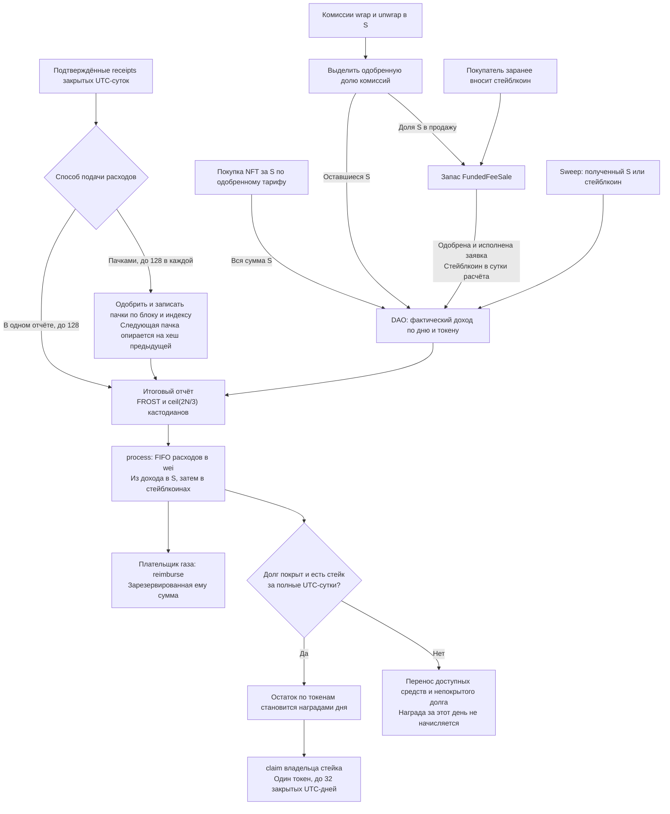
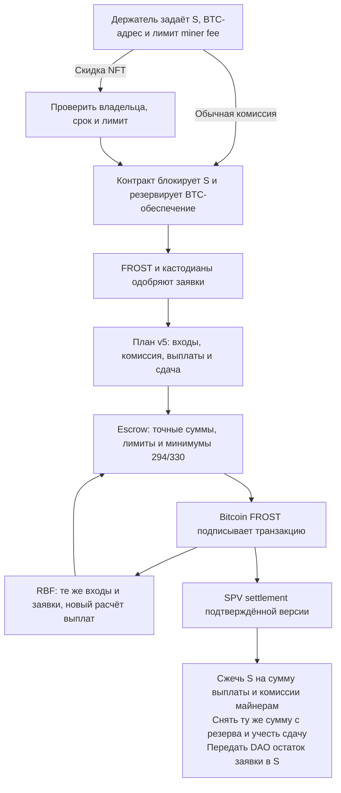
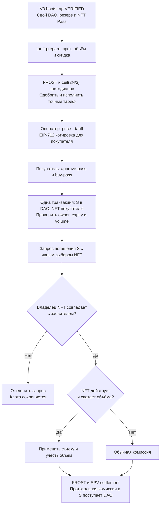

# Доход новых конфедераций в S и стейблкоинах

В конфигураторе выберите `income_model=in-kind` и задайте
`default_miner_fee_sats`. Результат содержит ULR policy V3 с этим лимитом и
порогом кандидата. Стенд с отдельными ключами кастодианов разворачивается
через обычные `setup` и `bootstrap apply/resume/verify`. Для ручной подготовки
приглашения передайте `--ulr-policy`, `--bitcoin-custody-policy` и
`--token-metadata`. [Пример policy](../config/ulr-in-kind.example.json) ·
[Холодный старт](COLD_START.md).

`create` выпускает 10 млн ULR одному получателю и ждёт подтверждения рассылки.
`reuse` использует адрес и хеш кода ULR и согласованного USD из
`manifest.ulr.reuse_policy`. У каждой новой конфедерации собственный контракт
стейкинга, поэтому её чистый доход получают её стейкеры. Стейк даёт право на
награду за полный день UTC. Вывод стейка свободный. Делегирование права голоса
через `setDAOSigner` оставляет награду владельцу стейка. Делегирование
действующему кастодиану без отдельного согласия привязано к его периоду
членства. После удаления право голоса возвращается владельцу. При повторном
включении кастодиана владелец заново назначает его делегатом. Делегирование по
отдельному подписанному согласию сохраняется до смены делегата владельцем.
Порог кандидатуры учитывает ULR на кошельке и собственный стейк в этой конфедерации.

Подписанный `bindDAOIncome` однократно привязывает DAO к пулу. По адресу
factory и ID конфедерации SDK находит зарегистрированный пул, затем читает
адреса DAO, стейкинга, DecisionBoard и NFT. Он проверяет их код и взаимные
привязки на одной подтверждённой высоте.

```bash
frost-signer dao in-kind discover --rpc "$RPC" --chain-id "$CHAIN_ID" \
  --factory "$CONFEDERATION_FACTORY" --confederation-id "$CONFEDERATION_ID"
```

В остальных командах `dao in-kind` этот набор адресных параметров можно
использовать вместо `--manifest`. Для локального Anvil задайте
`--confirmations 1`. Старый `getCustodianDAO` остаётся адресной книгой прежнего
профиля. Для V3 источником адресов служит `getConfederation(id).multiPool` →
`daoIncome()`.

Действующие конфедерации продолжают прежний путь. Профиль V3 развёртывает
свои pool, S, Bitcoin-резерв и escrow. Политика деплой-комиссии проекта и пулы федераций
используют существующие контракты. V3 использует отдельную ULR policy в
bootstrap. Опция `--system-policy` со старым fee reserve и адресным family
profile применяется к legacy-графам. Граф без квалификационного прогона
отражает `graph_configured=true` и `ready=false`.

Пакетный учёт расходов и возврат делегированных голосов при удалении
кастодиана входят в новый неизменяемый граф V3. Для ранее развёрнутого V3
используйте его SDK, артефакты и журналы. Подключение новой конфедерации
требует отдельного развёртывания. Перенос существующих обязательств требует
согласованной миграции.

## Приём и распределение

DAO учитывает четыре потока по дню и токену.



| Поток | Когда возникает доход |
| --- | --- |
| Wrap | При выпуске S под принятый Bitcoin-выход. Получатель получает S за вычетом комиссии. DAO учитывает S, оставшиеся после выделения согласованной доли в продажу |
| Unwrap | После SPV settlement. DAO учитывает остаток протокольной комиссии S после выделения доли в продажу |
| NFT | После покупки по котировке оператора DAO учитывает всю сумму в S в потоке `Pass` |
| Прямое поступление | При `sweep` фактически полученного S или одобренного стейблкоина, а также при учёте полученного стейблкоина в исполненной продаже |

S новых конфедераций имеет обычные ERC-20 transfer и allowance и представляет
требование к BTC-резерву конфедерации. Для обмена внешнего MP на S выполняется
перенос обеспечения через `BitcoinCustodyTransferV2`. При исходном settlement
федерация сжигает MP и уменьшает их обеспечение. При `finalize` конфедерация
проверяет исходный расчёт и Bitcoin-доказательство назначения, затем принимает
точный выход и выпускает S. При подготовке исходного batch SDK выделяет
заявкам одного gateway на скрипте назначения один точный выход. Другие
платежи на этот скрипт проводят отдельным batch.
[Последовательность передачи](BITCOIN_CUSTODY_TRANSFER.md#профиль-v3-с-прямым-btc-резервом).

Держатель подаёт на погашение свои S и указывает Bitcoin-адрес. BTC выплачиваются
из уже перенесённого резерва конфедерации, включая погашение S, полученных
переводом или как награда DAO. Заявка блокирует S и резервирует соответствующую
долю обеспечения до завершения Bitcoin FROST и SPV. Отмена по штатным правилам
возвращает S. В журнале сохраняется маршрут исходной транзакции для её повтора.

`ConfederationBitcoinReserve` выпускает S под принятые Bitcoin-выходы.
Для погашения укажите сумму S, Bitcoin-адрес и лимит комиссии майнеров.

```bash
frost-signer dao in-kind withdraw --rpc "$RPC" --manifest manifest.json \
  --amount "$S_BASE_UNITS" --script "$BTC_SCRIPT_HEX" --miner-fee-cap-sats 100 \
  --identity-file identity.json --state wallet.sqlite --id withdrawal-1 --send
```

`--amount` задаёт списание S в базовых единицах, включая комиссию протокола.
Далее проходит одобрение заявки, подготовка плана, Bitcoin FROST и SPV.
Исходящие BTC берутся из UTXO конфедерации. Escrow хранит заблокированные S
и сжигает погашенную сумму после подтверждения Bitcoin-выплаты. Остаток S,
составляющий протокольную комиссию, передаётся DAO.

Для закрытого дня:

```text
reimbursement_units = floor(owed_wei × asset_base_units_per_ETH / 10^18)
reward(owner, token, day) = floor(net_income(token, day) × eligible(owner, day) / totalEligible(day))
```

Сначала DAO резервирует возмещение старых расходов FIFO, затем расходов дня.
После S используются стейблкоины в порядке их включения FROST в список.
Непокрытый долг хранится в wei, курс применяется на день погашения из
подписанного отчёта. Расход считается один раз по хешу Ethereum-транзакции
в этом DAO. Курсы подтверждаются подписантами. Полная выплата закрывает
долг по округлённой котировке выбранного актива. При частичной выплате
эквивалент выплаченной суммы округляется вверх в wei, а остаток долга
сохраняется. Когда из остатка долга в расчёте нельзя получить ни одной
базовой единицы одобренного актива, контракт записывает `ExpenseRounding`.
Получатель забирает зарезервированное возмещение отдельным вызовом.
Для расходов учитываются receipt и порядковый номер транзакции в блоке.
Если расходов много, их записывают пачками по возрастанию номера блока и
индекса транзакции. Каждая пачка требует собственного одобрения FROST и
`ceil(2N/3)` действующих кастодианов. Она фиксирует текущий счётчик строк и
хеш предыдущей пачки. Итоговый отчёт закрепляет последний хеш, после чего
DAO начинает расчёт. Все расходы сохраняют исходные UTC-сутки receipt.
Расходы на деплой и DKG исключены. Транзакция обработки прошлого отчёта
может войти по фактическим суткам её receipt.

День без стейкеров переносит чистый доход по каждому активу. При непокрытом
долге средства остаются доступными для его погашения, а вознаграждение за день
не начисляется. Закрытые дни идут последовательно, включая дни без движения.
Резерв $1000, выплата 90% с поправкой на долю кастодианов, конвертер и
стартовый APY в этот профиль не входят. Для `claim` передайте один токен и до
32 уникальных дней по возрастанию. Неиспользованные остатки округления остаются
в эскроу наград. Если стейблкоин удерживает комиссию с перевода, sweep учитывает
приход по фактическому балансу, а claim выражен в сумме списания у DAO.

### Продажа доли новых S-комиссий

После bootstrap можно однократно подключить `FundedFeeSale` через одобряемую операцию
`ConfederationDAOIncome.setFeeSale`. Этот путь доступен графам V3,
развёрнутым с поддержкой продажи. Параметр доли хранится в связанном с DAO
контракте продажи. Без привязки или при нулевой доле новые S полностью
учитываются в DAO. До привязки кастодианы проверяют адрес стейблкоина и
начальную долю. FROST и кастодианы утверждают последующие изменения доли
для будущих поступлений.

При поступлении комиссии wrap или unwrap на сумму `A` в базовых единицах S
DAO передаёт в продажу `floor(A × sellBps / 10_000)` и учитывает оставшиеся
S. Оплата NFT учитывается целиком в `Pass`, прямые поступления через `sweep`
целиком в `Direct`. Уже учтённые средства сохраняют назначение, включая
зарезервированные возмещения и выплаты стейкерам. Запас продажи в S
исключён из доступного дохода DAO.

Покупатель заранее блокирует стейблкоин. Он должен отличаться от S и
входить в список одобренных активов этого DAO. После FROST и одобрений
`ceil(2N/3)` кастодианов сделка переводит покупателю точное количество
S из запаса продажи. DAO в той же транзакции принимает точную сумму
стейблкоина и учитывает её через `recordFeeSaleProceeds` как `Direct`
в UTC-дне исполнения. Повторный `sweep` видит уже учтённый баланс.
Заявка и поступление учитываются один раз.
Курс сделки фиксируется в одобренной заявке. Курс дневного отчёта
определяет последующее возмещение газа.
[Продажа комиссий и порядок для MP](FEE_FLOW.md#продажа-комиссий-s-и-mp).

## BTC и комиссия майнеров

```text
q   = 10^10 базовых единиц S на 1 sat
G_j = floor((locked_S_j − protocol_fee_j) / q)
F_j = locked_S_j − G_j × q
M   = сумма входов Bitcoin − сумма выходов Bitcoin
m_j = floor(M / k) + (j < M mod k ? 1 : 0)  # j начинается с 0
P_j = G_j − m_j
```

Для `k` заявок комиссия майнеров делится поровну, остаток в сатоши распределяется
по закреплённому порядку заявок. При одинаковом адресе чистые выплаты затем
суммируются по скрипту. Escrow проверяет точные суммы получателей, принадлежащую custody
сдачу, исходные UTXO, индивидуальный лимит и минимум **чистой** выплаты
294/330 sats. Подписант повторяет расчёт перед подписью. Доля miner fee выше
лимита или чистая выплата ниже минимума отклоняет план.
При доказанном settlement сгорает `G_j × 10^10`
единиц S, `F_j` переходит в DAO. Сумма выплат и miner fee равна
уменьшению BTC-резерва и сжигаемому S в sat-эквиваленте. У плана v5 максимум 32 заявки, 32 выхода с учётом
сдачи и 16 входов.
`dkg btc-prepare --previous BATCH_ID` готовит замену по тем же заявкам и UTXO.
Escrow проверяет повышенную комиссию и пересчитанные выплаты. Для расчёта
передайте batch той версии, которая получила нужную глубину подтверждений
в канонической Bitcoin-цепочке. Обязательства исполняются один раз.
[Вывод Bitcoin](BITCOIN_WITHDRAWALS.md).



## Обеспечение комиссий

Для переноса `D` sats расчёт федерации сжигает `D × q` базовых единиц MP и
снимает `D` sats с её реестра обеспечения. Источнику нужен свой запас BTC для
miner fee. Для исходного плана v4 с резервом комиссий заявка gateway использует
режим `NONE`, а комиссия покрывается по правилам источника. Номинал выхода
назначения равен `D` sats. Между исходным settlement и
`finalize` эти BTC уже в кошельке конфедерации и ещё не учтены в её резерве.

При `finalize` сумма заявок должна равняться номиналу принимаемого выхода.
Резерв конфедерации прибавляет `D` sats, а общий выпуск S возрастает ровно на
`D × q` базовых единиц. Пользователь получает `D × q − wrapFee`, DAO получает
`wrapFee`. Оба зачисления входят в общий выпуск под один Bitcoin-выход.
Для прямого депозита выпуск рассчитывается аналогично по принятому выходу.

При погашении резерв и выпуск S уменьшаются на `G_j` sats и `G_j × q` базовых
единиц соответственно. Из кошелька уходит `P_j + m_j = G_j` sats, а комиссия
протокола и округление `F_j` перечисляются DAO из уже заблокированных S.
BTC-сдача сохраняет обеспечение остальных S. Блокировка и разрешённая отмена
меняют доступный к погашению баланс. Общий выпуск S равен учтённому
BTC-резерву в сатоши, умноженному на `q`.

В контрактном тесте источник начинал с 10 000 sats обеспечения MP и 4 000 sats
свободных BTC. Конфедерация начинала со 100 000 sats обеспечения S.
MP и S в таблице приведены в sat-эквиваленте.

| Шаг | Учёт федерации | Учёт конфедерации | Платёж |
| --- | --- | --- | --- |
| Расчёт переноса 10 000 sats | Сожжено 10 000 MP, обеспечение 0, свободная сдача 3 500 sats | Выпуск и учтённый резерв ещё по 100 000 | 10 000 sats конфедерации, 500 sats майнерам из свободных BTC федерации |
| Приём переноса, wrap 1% | Выпуск MP и обеспечение 0 | Резерв и выпуск по 110 000, получателю 9 900 S, DAO 100 S | Однократно принят выход 10 000 sats |
| Погашение 5 000 S, unwrap 1% | Выпуск MP и обеспечение 0 | Резерв и выпуск по 105 050, DAO получает 50 S из заявки | Получателю 4 850 sats, майнерам 100 sats, новый выход сдачи конфедерации 5 050 sats |

В обоих кошельках сходятся входы и выходы. У федерации
`14 000 = 10 000 + 500 + 3 500` sats. У конфедерации по принятому выходу
`10 000 = 4 850 + 100 + 5 050` sats. Комиссии протокола в S остаются в
суммарном выпуске и обеспечены общим резервом.

ETH для отправки транзакции платит её отправитель. Проверяемая сумма расхода
равна `receipt.gasUsed × receipt.effectiveGasPrice`. DAO возмещает её
имеющимися S и стейблкоинами по курсу, утверждённому FROST. Контракт ограничивает
платёж доступным доходом. При нулевом доходе хранится долг в wei, при частичном
покрытии остаток переносится. Установленный процент комиссии сам по себе
не гарантирует покрытия расходов на Ethereum и положительной доходности.
Каноничность receipt проверяет SDK, экономическую обоснованность курса и
необходимость расхода подтверждают подписанты. Каждый хеш Ethereum-транзакции
попадает в расходы этого DAO только один раз. В V5 запись `cacheValue` не входит
в возмещаемые операции. Входы для погашения уже имеют номинал, сохранённый при
приёме обеспечения или расчёте сдачи.

Claim наград и возмещений переводит уже имеющиеся S или стейблкоины. Например,
в отдельном контрактном сценарии с прямым BTC-депозитом из 1 800 S
(в sat-эквиваленте) совокупных комиссий 600 получают в возмещение газа и 1 200
получают стейкеры. После переводов общий выпуск S и резерв остаются по
60 800 в sat-эквиваленте.

## NFT и эксплуатация



Для скидки на выпуск S при переносе MP на собственный адрес выберите
проездной командой `dao in-kind wrap-pass --nft ID --send`. Первый выпущенный NFT
имеет ID `0`. Настройку снимает `dao in-kind clear-wrap-pass --send` с теми
же параметрами подключения и локальной identity. `wrap --nft ID` выбирает
проездной перед созданием заявки. Gateway применяет скидку только если
владелец заявки и получатель S совпадают. Перенос в пользу другого адреса
и прямой BTC-депозит используют обычную комиссию и сохраняют остаток NFT.

При расчёте проверяются владелец, срок и доступный объём проездного. Если
владелец передал NFT после запроса, срок истёк или лимит исчерпан, действует
обычная комиссия. Допустимый минимум выпуска S задаётся через
`--minimum-s`. Если срок NFT может закончиться до Bitcoin settlement,
учтите обычную комиссию при выборе минимума. Более высокий минимум может
остановить `finalize` после оплаты исходного Bitcoin-перевода. Владелец
может изменить минимум командой `custody-transfer minimum` и повторить
`finalize` с той же квитанцией. Явный запрос вывода с чужим NFT
отклоняется до расходования его лимита. [Порядок действий при остановке](BITCOIN_CUSTODY_TRANSFER.md#отмена-сбои-и-ограничения).

FROST и `ceil(2N/3)` действующих кастодианов утверждают срок, скидку и
предельный объём тарифа. Оператор подписывает EIP-712 quote для конкретного
тарифа и покупателя. `priceDigest` привязывает котировку к S, цене, nonce, сроку,
контракту продажи и chain ID. Повтор, просроченная котировка, неверная подпись
и недостаточный allowance откатывают покупку целиком. Оплаченный тариф
чеканится в той же транзакции. Просроченный или исчерпанный проход оставляет
обычную комиссию, а попытка расходовать чужой NFT отклоняется.

`tariff-prepare` выдаёт `tariff_id`. После одобрения и исполнения intent
оператор указывает этот ID в `price --tariff`. Покупатель разрешает списание
S через `approve-pass`, затем передаёт файл котировки в `buy-pass --quote`.

`frost-signer dao in-kind --help` показывает команды кошелька, sweep,
закрытия отчёта, выплат, покупки и запроса вывода. Параметр `--manifest`
принимает целый проверенный bootstrap manifest. По умолчанию команды
симулируют транзакцию. Для отправки укажите `--send`, свой `--identity-file`,
журнал `--state` и ID операции `--id`. Для точного повтора сохраните ID.

`frost-signer dao-report --in-kind` принимает адрес `dao_income` через
`--settlement` и JSON с полями `day`, `transactions` и `units_per_eth`.
Суммы указываются строками в базовых единицах, ключи курсов — checksum-адреса
токенов из `rewardTokens()`. Список расходов содержит хеши успешных
Ethereum-транзакций этого DAO и дня. Курс равен количеству базовых единиц
на 1 ETH. SDK подтверждает каждую строку по receipt и каноническому блоку
и выпускает `--evidence` и `--intent`.

```bash
frost-signer dao-report --in-kind --rpc "$RPC" --settlement "$DAO_INCOME" \
  --inputs day-inputs.json --evidence day-evidence.json --intent day-intent.json
```

Единый отчёт с `transactions` принимает до 128 хешей. Для пакетной
подачи соберите хеши расходов закрытого дня, отсортируйте по номеру блока
и индексу транзакции и разбейте на файлы до 128 хешей каждый. Во входном
JSON пачки указываются `day` и `transactions`. Подготовьте первую пачку
следующей командой.

```bash
frost-signer dao-report --in-kind --stage-expenses --rpc "$RPC" --settlement "$DAO_INCOME" \
  --inputs expense-batch-01.json --evidence expense-evidence-01.json --intent expense-intent-01.json
```

Передайте intent отчёта или пачки команде `dao in-kind propose` с адресом `--board` и
`--deadline`. Кастодианы повторяют `dkg sign-evm` для сессии до статуса
`finalized`, затем вызывают `setup approve-custodian` для её точного
operation hash. Выполните одобренный intent через `dao in-kind execute --session`.
Перед подготовкой следующей пачки дождитесь подтверждения предыдущей.
`dao in-kind status` показывает `staged_expenses`, `staged_expense_position`
и `staged_expense_commitment`. SDK сверяет их при повторной проверке intent.
После последней пачки тем же способом утвердите итоговый отчёт за этот день
командой без `--stage-expenses`, с `"transactions": []` и курсами
`units_per_eth`. Если после подготовки отчёта добавили пачку, подготовьте
итоговый intent заново.

После исполнения итогового отчёта вызывайте `process`, пока `status` показывает
`processing=true`. За вызов обрабатывается до 32 долговых строк.

После расчёта отправитель подтверждённой транзакции получает возмещение
через `dao in-kind reimburse --token TOKEN`, а каждый стейкер забирает
начисленные токены через `dao in-kind claim --token TOKEN --days DAY` со
своей identity. Для отправки используйте `--send`, свой журнал и ID операции.
Сверьте разницу балансов с отчётом и сохраните тот же ID для повтора.

В локальной репетиции два стейкера внесли ULR в пропорции 1:3. В день взноса
доступный чистый доход перенёсся на следующий день, поскольку полный UTC-день
стейка ещё не прошёл. Из 1 000,000001 TUSD после возмещения 0,157640 TUSD
осталось 999,842361 TUSD. За следующий полный день стейкеры получили
249,960590 и 749,881770 TUSD, одна базовая единица осталась после округления.
Сумма возмещения зависит от фактического газа и согласованного курса.
[Тест чистой выплаты](../tests/e2e/test_in_kind_bootstrap.py) ·
[Отчёт локального прогона](../ops/artifacts/cold-start-local-20261121/summary.json).

Для голосования подготовьте `decision-prepare`, проведите его через
`propose` и `execute`, затем используйте `vote --owner` и `finalize`.
Вес голоса берётся с последнего полного UTC-дня. Голос подаёт адрес из
`getDAOSigner(owner)`. Кандидатуры из списка стейкинга принимаются через
`custodian-add-prepare` и обычное согласование FROST и текущих кастодианов.
Ротацию участников Bitcoin FROST проводят отдельной процедурой смены
custody-эпохи.
