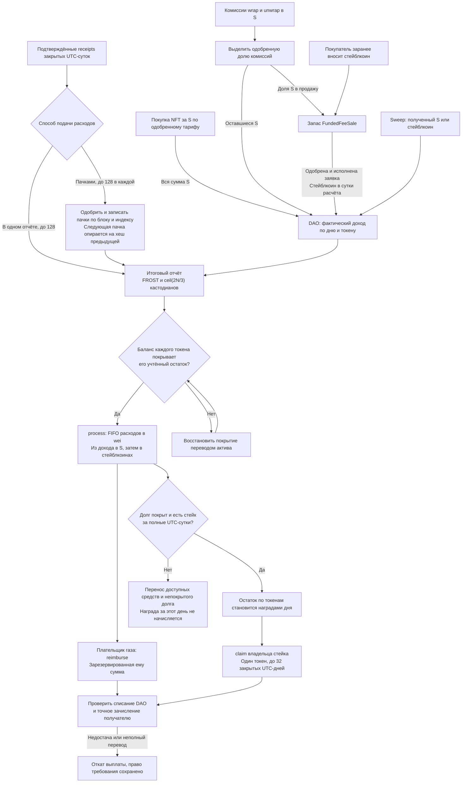
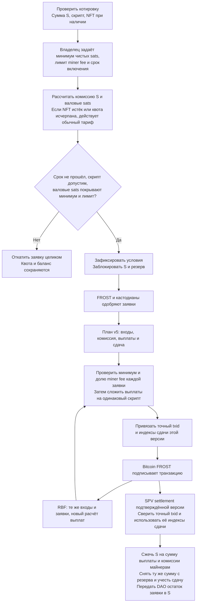
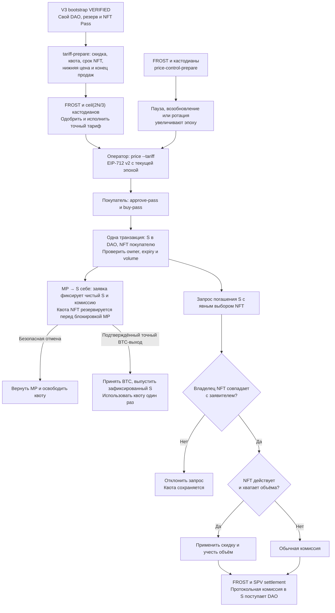
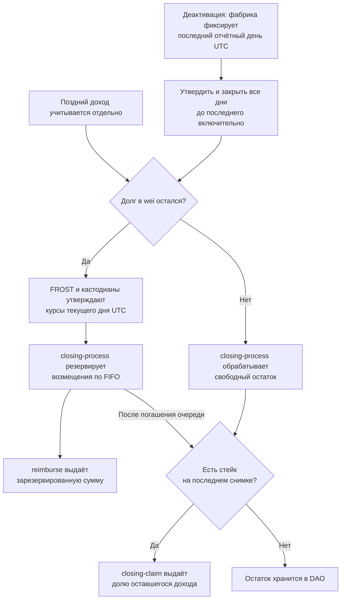
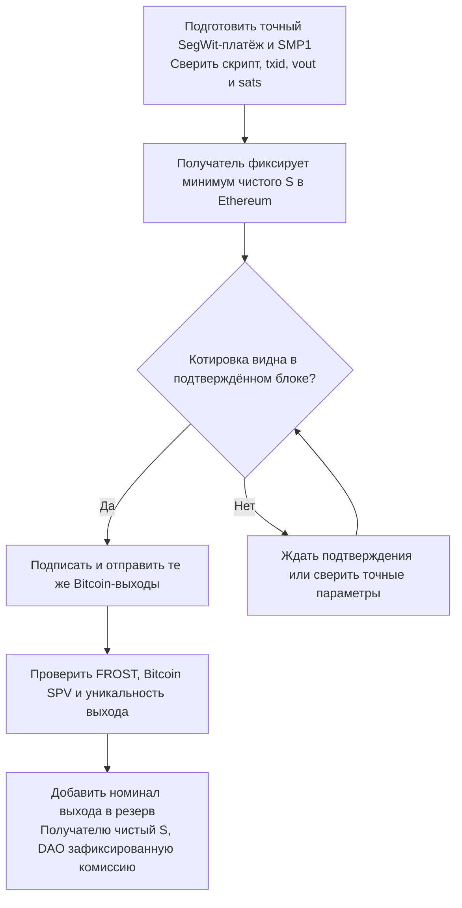

# Доход новых конфедераций в S и стейблкоинах

В конфигураторе выберите `income_model=in-kind` и задайте
`default_miner_fee_sats`. Результат содержит ULR policy V3 с этим лимитом и
порогом кандидата. Стенд с отдельными ключами кастодианов разворачивается
через обычные `setup` и `bootstrap apply/resume/verify`. Для ручной подготовки
приглашения передайте `--ulr-policy`, `--bitcoin-custody-policy` и
`--token-metadata`. [Пример policy](../config/ulr-in-kind.example.json) ·
[Холодный старт](COLD_START.md).

`create` выпускает 10 млн ULR одному получателю и ждёт подтверждения рассылки.
`reuse` использует адрес и хеш кода ULR и согласованного USD из
`manifest.ulr.reuse_policy`. У каждой новой конфедерации собственный контракт
стейкинга, поэтому её чистый доход получают её стейкеры. Стейк даёт право на
награду за полный день UTC. Вывод стейка свободный. Делегирование права голоса
через `setDAOSigner` оставляет награду владельцу стейка. Делегирование
действующему кастодиану без отдельного согласия привязано к его периоду
членства. После удаления право голоса возвращается владельцу. При повторном
включении кастодиана владелец заново назначает его делегатом. Делегирование по
отдельному подписанному согласию сохраняется до смены делегата владельцем.
Порог кандидатуры учитывает ULR на кошельке и собственный стейк в этой конфедерации.

Подписанный `bindDAOIncome` однократно привязывает DAO к пулу. По адресу
factory и ID конфедерации SDK находит зарегистрированный пул, затем читает
адреса DAO, стейкинга, DecisionBoard и NFT. Он проверяет их код и взаимные
привязки на одной подтверждённой высоте.

```bash
frost-signer dao in-kind discover --rpc "$RPC" --chain-id "$CHAIN_ID" \
  --factory "$CONFEDERATION_FACTORY" --confederation-id "$CONFEDERATION_ID"
```

В остальных командах `dao in-kind` этот набор адресных параметров можно
использовать вместо `--manifest`. Для локального Anvil задайте
`--confirmations 1`. Старый `getCustodianDAO` остаётся адресной книгой прежнего
профиля. Для V3 источником адресов служит `getConfederation(id).multiPool` →
`daoIncome()`.

Действующие конфедерации продолжают прежний путь. Профиль V3 развёртывает
свои pool, S, Bitcoin-резерв и escrow. Политика деплой-комиссии проекта и пулы федераций
используют существующие контракты. V3 использует отдельную ULR policy в
bootstrap. Опция `--system-policy` со старым fee reserve и адресным family
profile применяется к legacy-графам. Граф без квалификационного прогона
отражает `graph_configured=true` и `ready=false`.

Пакетный учёт расходов и возврат делегированных голосов при удалении
кастодиана входят в новый неизменяемый граф V3. Для ранее развёрнутого V3
используйте его SDK, артефакты и журналы. Подключение новой конфедерации
требует отдельного развёртывания. Перенос существующих обязательств требует
согласованной миграции.

Для нового V3 доступен [профиль CLTV-восстановления S → BTC](BITCOIN_WITHDRAWAL_RECOVERY.md).
Его параметры фиксируются в приглашении. В холодном режиме возврат после
Signing требует SPV-подтверждения переноса всех сатоши покрытия семейства
в закреплённый кошелёк того же S.

После деактивации конфедерации SDK проверяет прежние привязки и допускает
`claim`, `reimburse`, `unstake`, `cancel` и продолжение уже открытого расчёта
дня через `process`. При `cancel` контракт проверяет владельца и допустимую
фазу escrow. В новой сборке фабрика фиксирует день деактивации по UTC как
последний отчётный день, включительно. DAO привязан к фабрике при развёртывании.
Кастодианы могут подать ещё не открытые отчёты до этой даты, соблюдая
обычную последовательность, FROST и порог подписей. После неё контракт
отклоняет новые отчёты и пачки расходов. Команды нового стейка, новых
депозитов и выпуска NFT требуют активного графа.

## Приём и распределение

DAO учитывает четыре потока по дню и токену.



| Поток | Когда возникает доход |
| --- | --- |
| Wrap | При выпуске S под принятый Bitcoin-выход. Получатель получает S за вычетом комиссии. DAO учитывает S, оставшиеся после выделения согласованной доли в продажу |
| Unwrap | После SPV settlement. DAO учитывает остаток протокольной комиссии S после выделения доли в продажу |
| NFT | После покупки по котировке оператора DAO учитывает всю сумму в S в потоке `Pass` |
| Прямое поступление | При `sweep` фактически полученного S или одобренного стейблкоина, а также при учёте полученного стейблкоина в исполненной продаже |

S новых конфедераций имеет обычные ERC-20 transfer и allowance и представляет
требование к BTC-резерву конфедерации. Для обмена внешнего MP на S выполняется
перенос обеспечения через `BitcoinCustodyTransferV2`. При исходном settlement
федерация сжигает MP и уменьшает их обеспечение. При `finalize` конфедерация
проверяет исходный расчёт и Bitcoin-доказательство назначения, затем принимает
точный выход и выпускает S. При подготовке исходного batch SDK выделяет
заявкам одного gateway на скрипте назначения один точный выход. Другие
платежи на этот скрипт проводят отдельным batch.
[Последовательность передачи](BITCOIN_CUSTODY_TRANSFER.md#профиль-v3-с-прямым-btc-резервом).

Для закрытого дня:

```text
reimbursement_units = floor(owed_wei × asset_base_units_per_ETH / 10^18)
reward(owner, token, day) = floor(net_income(token, day) × eligible(owner, day) / totalEligible(day))
```

Сначала DAO резервирует возмещение старых расходов FIFO, затем расходов дня.
После S используются стейблкоины в порядке их включения FROST в список.
Непокрытый долг хранится в wei, курс применяется на день погашения из
подписанного отчёта. Расход считается один раз по хешу Ethereum-транзакции
в этом DAO. Курсы подтверждаются подписантами. Полная выплата закрывает
долг по округлённой котировке выбранного актива. При частичной выплате
эквивалент выплаченной суммы округляется вверх в wei, а остаток долга
сохраняется. Когда из остатка долга в расчёте нельзя получить ни одной
базовой единицы одобренного актива, контракт записывает `ExpenseRounding`.
Получатель забирает зарезервированное возмещение отдельным вызовом.
Для расходов учитываются receipt и порядковый номер транзакции в блоке.
Если расходов много, их записывают пачками по возрастанию номера блока и
индекса транзакции. Каждая пачка требует собственного одобрения FROST и
`ceil(2N/3)` действующих кастодианов. Она фиксирует текущий счётчик строк и
хеш предыдущей пачки. Итоговый отчёт закрепляет последний хеш, после чего
DAO начинает расчёт. Все расходы сохраняют исходные UTC-сутки receipt.
Расходы на деплой и DKG исключены. Транзакция обработки прошлого отчёта
может войти по фактическим суткам её receipt.

День без стейкеров переносит чистый доход по каждому активу. При непокрытом
долге средства остаются доступными для его погашения, а вознаграждение за день
не начисляется. Закрытые дни идут последовательно, включая дни без движения.
Резерв $1000, выплата 90% с поправкой на долю кастодианов, конвертер и
стартовый APY в этот профиль не входят. Для `claim` передайте один токен и до
32 уникальных дней по возрастанию. Неиспользованные остатки округления остаются
в эскроу наград.

Для рабочего запуска согласуйте список стабильных активов, их сеть, адрес,
реализацию и администратора обновлений. FROST и `ceil(2N/3)` кастодианов
одобряют добавление каждого стейблкоина. Для продажи комиссий выбирайте актив
с точным переводом и без отрицательного rebase или списания чужого баланса.
Прямой `sweep` учитывает фактически поступившую сумму. `claim` и
`claimReimbursement` сверяют точное списание с DAO и зачисление той же
суммы получателю. Неполный перевод откатывается вместе с изменением права
требования. Если эмитент меняет правила перевода, пересмотрите допуск актива.

`dao in-kind status` показывает `coverage` по каждому активу в его базовых
единицах. Если `balance < accounted`, `shortfall = accounted − balance`.
Пачки расходов, открытие и обработка дня ждут полного покрытия. Выплата по
пострадавшему токену сохраняет исходное право требования. Погасите дефицит
обычным переводом того же актива на DAO, затем повторите исходное действие.
Только превышение над `accounted` доступно для нового `sweep`.
Если эмитент блокирует восстановление баланса или `balanceOf`, расчёт следующих
UTC-дней может остаться приостановленным. Уже начисленные выплаты в других
покрытых токенах сохраняются.

### Продажа доли новых S-комиссий

После bootstrap можно однократно подключить `FundedFeeSale` через одобряемую операцию
`ConfederationDAOIncome.setFeeSale`. Этот путь доступен графам V3,
развёрнутым с поддержкой продажи. Параметр доли хранится в связанном с DAO
контракте продажи. Без привязки или при нулевой доле новые S полностью
учитываются в DAO. До привязки кастодианы проверяют адрес стейблкоина и
начальную долю. FROST и кастодианы утверждают последующие изменения доли
для будущих поступлений.

При поступлении комиссии wrap или unwrap на сумму `A` в базовых единицах S
DAO передаёт в продажу `floor(A × sellBps / 10_000)` и учитывает оставшиеся
S. Оплата NFT учитывается целиком в `Pass`, прямые поступления через `sweep`
целиком в `Direct`. Уже учтённые средства сохраняют назначение, включая
зарезервированные возмещения и выплаты стейкерам. Запас продажи в S
исключён из доступного дохода DAO.

Покупатель заранее блокирует стейблкоин. Он должен отличаться от S и
входить в список одобренных активов этого DAO. После FROST и одобрений
`ceil(2N/3)` кастодианов сделка переводит покупателю точное количество
S из запаса продажи. DAO в той же транзакции принимает точную сумму
стейблкоина и учитывает её через `recordFeeSaleProceeds` как `Direct`
в UTC-дне исполнения. Повторный `sweep` видит уже учтённый баланс.
Заявка и поступление учитываются один раз.
Курс сделки фиксируется в одобренной заявке. Курс дневного отчёта
определяет последующее возмещение газа.
[Продажа комиссий и порядок для MP](FEE_FLOW.md#продажа-комиссий-s-и-mp).

## BTC и комиссия майнеров

Держатель погашает свои S, в том числе полученные переводом или как награду DAO.
BTC выплачиваются из резерва конфедерации. Для новой сборки V3 сначала проверьте
условия своим RPC. Укажите выходной скрипт P2WPKH или P2TR, минимум чистой выплаты
и предел комиссии майнеров по одной заявке. Для скидки добавьте `--nft ID`
в обе команды.

```bash
frost-signer dao in-kind withdraw-quote --rpc "$RPC" --manifest "$VERIFIED" \
  --sender "$OWNER" --amount "$S_BASE_UNITS" --script "$BTC_SCRIPT_HEX" \
  --minimum-btc-sats "$MIN_BTC_SATS" --miner-fee-cap-sats "$MAX_FEE_SATS"
```

Котировка возвращает `status: QUOTED` и номер подтверждённого канонического
блока `block_number`. Проверьте
`gross_sats` после комиссии протокола и округления, `protocol_fee_s` в базовых
единицах S с округлением, `fee_cap_sats` после применения политики,
`script_minimum_sats` и выбранный `minimum_btc_sats`.
`max_miner_fee_share_sats` показывает запас до минимума, то есть разницу
между валовыми sats и выбранным минимумом с нижней границей 0.
`fee_cap_sats` ограничивает долю комиссии по заявке, а `payout_at_cap_sats`
показывает чистую выплату при списании всего лимита. Значение `fits: false`
указывает, что минимум ниже порога скрипта или валовые sats не покрывают
минимум и полный лимит.
Без `--minimum-btc-sats` только котировка подставляет порог скрипта. Котировка
читает состояние, сохраняет квоту NFT и оставляет S доступными владельцу.
Тариф и доступность скидки могут измениться к моменту включения транзакции.

```bash
frost-signer dao in-kind withdraw --rpc "$RPC" --manifest "$VERIFIED" \
  --amount "$S_BASE_UNITS" --script "$BTC_SCRIPT_HEX" \
  --minimum-btc-sats "$MIN_BTC_SATS" --miner-fee-cap-sats "$MAX_FEE_SATS" \
  --deadline "$REQUEST_DEADLINE" --identity-file identity.json \
  --state wallet.sqlite --id withdrawal-1 --send
```

`--amount` задаёт всё списание S в базовых единицах. `--minimum-btc-sats`
и `--deadline` обязательны. Минимум задаётся в sats после доли miner fee и
должен покрывать настроенный порог скрипта. При пропуске `--miner-fee-cap-sats`
контракт использует установленный лимит. Скрипт собственного BTC-резерва и
любой custody-скрипт, зарегистрированный в каноническом реестре escrow,
отклоняются при приёме заявки.

`--deadline` задаёт последний допустимый Unix timestamp блока EVM. Заявка
принимается в пределах `block.timestamp <= deadline`. Пул сверяет минимум
с расчётом на момент включения, включая обычный
тариф при истечении NFT или исчерпании квоты. При просрочке или недостаточном
расчётном остатке транзакция откатывается целиком. Балансы S, счётчик заявок,
резерв и квота NFT сохраняются. Точный повтор отправки использует тот же `--id`
и исходный `--state`. Хеш одобрения принятой заявки включает адрес владельца,
скрипт, суммы S, указанные минимум, предел комиссии и срок. Уже принятая заявка
проходит approvals, Bitcoin FROST, RBF при необходимости и SPV по зафиксированным
денежным условиям после окончания срока включения. Отмена до риска
Bitcoin-подписи возвращает S по действующим правилам escrow.

Эти условия действуют для новой сборки пула и escrow. Ранее развёрнутый
неизменяемый граф продолжает использовать свои SDK, артефакты и правила.

```text
q   = 10^10 базовых единиц S на 1 sat
G_j = floor((locked_S_j − protocol_fee_j) / q)
F_j = locked_S_j − G_j × q
C_j = выбранный или настроенный лимит miner fee в sats
L_j = минимум чистой выплаты в sats, выбранный владельцем
M   = сумма входов Bitcoin − сумма выходов Bitcoin
m_j = floor(M / k) + (j < M mod k ? 1 : 0)  # j начинается с 0
P_j = G_j − m_j
```

При включении заявки `L_j` должен достигать настроенного порога скрипта
(как минимум 294 sats для P2WPKH и 330 sats для P2TR). Пул требует
`G_j ≥ L_j + C_j`. Так `L_j` покрыт при любой допустимой доле комиссии,
включая полный `C_j`. Например, при `G_j = 4 950` и `C_j = 100` можно указать
`L_j = 4 850`. Минимум 4 851 при том же лимите отклоняется.

Для `k` заявок комиссия майнеров делится поровну, остаток в сатоши распределяется
по закреплённому порядку заявок. Для каждой заявки `m_j ≤ C_j` и `P_j ≥ L_j`.
Только после индивидуальной проверки выплаты одинаковым получателям
суммируются по скрипту. SDK повторяет проверку при подготовке плана, RBF и
перед подписью. Escrow проверяет её при привязке каждой версии плана и
закрепляет по индексам выходы сдачи. При SPV settlement проверяются точный
txid, исходные UTXO и комиссия. Реестр учитывает сдачу по индексам
подтверждённой версии. Поздняя регистрация скрипта выплаты сохраняет его
назначение при расчёте и RBF. Этот путь требует новой согласованной
сборки V3 escrow и реестра.
При доказанном settlement сгорает `G_j × 10^10`
единиц S, `F_j` переходит в DAO. Сумма выплат и miner fee равна
уменьшению BTC-резерва и сжигаемому S в sat-эквиваленте. У плана v5 максимум 32 заявки, 32 выхода с учётом
сдачи и 16 входов.
`dkg btc-prepare --previous BATCH_ID` готовит замену по тем же заявкам и UTXO.
Escrow проверяет повышенную комиссию и пересчитанные выплаты. Для расчёта
передайте batch той версии, которая получила нужную глубину подтверждений
в канонической Bitcoin-цепочке. Обязательства исполняются один раз.
[Вывод Bitcoin](BITCOIN_WITHDRAWALS.md).



## Обеспечение комиссий

Для переноса `D` sats расчёт федерации сжигает `D × q` базовых единиц MP и
снимает `D` sats с её реестра обеспечения. Источнику нужен свой запас BTC для
miner fee. Для исходного плана v4 с резервом комиссий заявка gateway использует
режим `NONE`, а комиссия покрывается по правилам источника. Номинал выхода
назначения равен `D` sats. Между исходным settlement и
`finalize` эти BTC уже в кошельке конфедерации и ещё не учтены в её резерве.

При `finalize` сумма заявок должна равняться номиналу принимаемого выхода.
Резерв конфедерации прибавляет `D` sats, а общий выпуск S возрастает ровно на
`D × q` базовых единиц. Пользователь получает `D × q − wrapFee`, DAO получает
`wrapFee`. Оба зачисления входят в общий выпуск под один Bitcoin-выход.
Для прямого депозита комиссия берётся из котировки конкретного Bitcoin-выхода.
[Фиксация комиссии до отправки BTC](#прямой-депозит-btc--s).

При погашении резерв и выпуск S уменьшаются на `G_j` sats и `G_j × q` базовых
единиц соответственно. Из кошелька уходит `P_j + m_j = G_j` sats, а комиссия
протокола и округление `F_j` перечисляются DAO из уже заблокированных S.
BTC-сдача сохраняет обеспечение остальных S. Блокировка и разрешённая отмена
меняют доступный к погашению баланс. Общий выпуск S равен учтённому
BTC-резерву в сатоши, умноженному на `q`.

В контрактном тесте источник начинал с 10 000 sats обеспечения MP и 4 000 sats
свободных BTC. Конфедерация начинала со 100 000 sats обеспечения S.
MP и S в таблице приведены в sat-эквиваленте.

| Шаг | Учёт федерации | Учёт конфедерации | Платёж |
| --- | --- | --- | --- |
| Расчёт переноса 10 000 sats | Сожжено 10 000 MP, обеспечение 0, свободная сдача 3 500 sats | Выпуск и учтённый резерв ещё по 100 000 | 10 000 sats конфедерации, 500 sats майнерам из свободных BTC федерации |
| Приём переноса, wrap 1% | Выпуск MP и обеспечение 0 | Резерв и выпуск по 110 000, получателю 9 900 S, DAO 100 S | Однократно принят выход 10 000 sats |
| Погашение 5 000 S, unwrap 1% | Выпуск MP и обеспечение 0 | Резерв и выпуск по 105 050, DAO получает 50 S из заявки | Получателю 4 850 sats, майнерам 100 sats, новый выход сдачи конфедерации 5 050 sats |

В обоих кошельках сходятся входы и выходы. У федерации
`14 000 = 10 000 + 500 + 3 500` sats. У конфедерации по принятому выходу
`10 000 = 4 850 + 100 + 5 050` sats. Комиссии протокола в S остаются в
суммарном выпуске и обеспечены общим резервом.

ETH для отправки транзакции платит её отправитель. Проверяемая сумма расхода
равна `receipt.gasUsed × receipt.effectiveGasPrice`. DAO возмещает её
имеющимися S и стейблкоинами по курсу, утверждённому FROST. Контракт ограничивает
платёж доступным доходом. При нулевом доходе хранится долг в wei, при частичном
покрытии остаток переносится. Установленный процент комиссии сам по себе
не гарантирует покрытия расходов на Ethereum и положительной доходности.
Каноничность receipt проверяет SDK, экономическую обоснованность курса и
необходимость расхода подтверждают подписанты. Каждый хеш Ethereum-транзакции
попадает в расходы этого DAO только один раз. В V5 запись `cacheValue` не входит
в возмещаемые операции. Входы для погашения уже имеют номинал, сохранённый при
приёме обеспечения или расчёте сдачи.

Claim наград и возмещений переводит уже имеющиеся S или стейблкоины. Например,
в отдельном контрактном сценарии с прямым BTC-депозитом из 1 800 S
(в sat-эквиваленте) совокупных комиссий 600 получают в возмещение газа и 1 200
получают стейкеры. После переводов общий выпуск S и резерв остаются по
60 800 в sat-эквиваленте.

## NFT и эксплуатация



При погашении S истёкший NFT или исчерпанная квота допускают обычный тариф
только если он покрывает заявленный минимум после полного лимита miner fee.
Чужой, несуществующий или деактивированный NFT отклоняется. Квота расходуется
лишь при успешном включении заявки со скидкой. Котировка и откат транзакции
сохраняют её.

Для скидки на выпуск S при переносе MP на собственный адрес выберите
проездной командой `dao in-kind wrap-pass --nft ID --send`. Первый выпущенный NFT
имеет ID `0`. Настройку снимает `dao in-kind clear-wrap-pass --send` с теми
же параметрами подключения и локальной identity. `wrap --nft ID` выбирает
проездной перед созданием заявки. Gateway применяет скидку только при
переносе владельцем на свой адрес. Перенос в пользу другого адреса и
прямой BTC-депозит используют обычную комиссию и сохраняют квоту NFT.

Владелец, срок и свободный объём проездного проверяются при создании заявки.
Допустимый минимум выпуска задаётся через `--minimum-s`. Если чистый выпуск
его покрывает, gateway фиксирует комиссию и чистое количество S, а квота
действующей скидки резервируется до Bitcoin-подписания. После заявки смена
тарифа, передача или истечение NFT сохраняют зафиксированное распределение S.
Подтверждённый Bitcoin-платёж расходует эту квоту один раз. При безопасном
возврате MP квота освобождается в той же EVM-транзакции. Явный запрос вывода
с чужим NFT отклоняется до расходования его лимита.
[Порядок отмены и восстановления](BITCOIN_CUSTODY_TRANSFER.md#отмена-сбои-и-ограничения).

При переносе `grossS = D × 10^10` в базовых единицах S, где `D` —
подтверждённое обеспечение в сатоши. Контракт увеличивает резерв на `D` и выпускает в сумме
`grossS = netS + feeS`. Эти значения фиксируются для заявки. Отдельная
Bitcoin-комиссия за перенос оплачивается исходной федерацией.

FROST и `ceil(2N/3)` действующих кастодианов утверждают срок NFT, скидку,
квоту, положительную `--minimum-price` в базовых единицах S и Unix-время
окончания продаж `--sales-until`. Оператор подписывает EIP-712 v2 для тарифа,
покупателя, цены S, nonce, срока, контракта, сети и текущей `priceEpoch`.
Цена должна покрывать минимум тарифа, а срок котировки укладываться в окно
продаж. Покупка атомарно переводит S в DAO и выпускает NFT. Повтор, неверная
подпись, истёкшая котировка или недостаточный allowance отклоняют покупку.

`price-control-prepare --price-signer ADDRESS --sales-paused true|false`
готовит замену ключа, паузу или возобновление. Операция проходит обычные
`propose` и `execute` с FROST и `ceil(2N/3)` кастодианов. Каждое изменение
повышает `priceEpoch`. Котировки прошлых эпох отклоняются, а выпущенные NFT
сохраняют скидку, срок и остаток квоты. `status` показывает `pass_pricing`.
Котировку подписывает владелец текущего `priceSigner`. При закрытии графа
поставьте продажи NFT на паузу отдельной FROST-операцией до деактивации.

`tariff-prepare` выдаёт `tariff_id`. После одобрения и исполнения intent
держатель текущего ключа цены указывает этот ID в `price --tariff`. Покупатель разрешает списание
S через `approve-pass`, затем передаёт файл котировки в `buy-pass --quote`.

Для нового тарифа укажите срок NFT в секундах, скидку в bps, квоту и цену в
базовых единицах S. `SALES_UNTIL` и `QUOTE_DEADLINE` задаются в Unix-секундах.

```bash
PASS_CONTEXT=(--rpc "$RPC" --manifest "$MANIFEST" --confirmations "$CONFIRMATIONS")
frost-signer dao in-kind tariff-prepare "${PASS_CONTEXT[@]}" \
  --duration "$PASS_SECONDS" --discount-bps "$DISCOUNT_BPS" --volume-limit "$VOLUME" \
  --minimum-price "$MIN_PRICE" --sales-until "$SALES_UNTIL" --output "$TARIFF_INTENT"
frost-signer dao in-kind price-control-prepare "${PASS_CONTEXT[@]}" \
  --price-signer "$NEXT_SIGNER" --sales-paused "$PAUSED" --output "$CONTROL_INTENT"
```

После исполнения нужного intent текущий ключ подписывает котировку. `TARIFF_ID`
берётся из `tariff-prepare`, а `QUOTE_NONCE` должен быть свободен у покупателя.

```bash
frost-signer dao in-kind price "${PASS_CONTEXT[@]}" --tariff "$TARIFF_ID" \
  --buyer "$BUYER" --amount "$PRICE" --nonce "$QUOTE_NONCE" --deadline "$QUOTE_DEADLINE" \
  --identity-file "$PRICE_IDENTITY" --output "$QUOTE_FILE"
```

`frost-signer dao in-kind --help` показывает команды кошелька, sweep,
закрытия отчёта, выплат, покупки и запроса вывода. Параметр `--manifest`
принимает целый проверенный bootstrap manifest. По умолчанию команды
симулируют транзакцию. Для отправки укажите `--send`, свой `--identity-file`,
журнал `--state` и ID операции `--id`. Для точного повтора сохраните ID.

`frost-signer dao-report --in-kind` принимает адрес `dao_income` через
`--settlement` и JSON с полями `day`, `transactions` и `units_per_eth`.
Суммы указываются строками в базовых единицах, ключи курсов — checksum-адреса
токенов из `rewardTokens()`. Список расходов содержит хеши успешных
Ethereum-транзакций этого DAO и дня. Курс равен количеству базовых единиц
на 1 ETH. SDK подтверждает каждую строку по receipt и каноническому блоку
и выпускает `--evidence` и `--intent`.

```bash
frost-signer dao-report --in-kind --rpc "$RPC" --settlement "$DAO_INCOME" \
  --inputs day-inputs.json --evidence day-evidence.json --intent day-intent.json
```

Единый отчёт с `transactions` принимает до 128 хешей. Для пакетной
подачи соберите хеши расходов закрытого дня, отсортируйте по номеру блока
и индексу транзакции и разбейте на файлы до 128 хешей каждый. Во входном
JSON пачки указываются `day` и `transactions`. Подготовьте первую пачку
следующей командой.

```bash
frost-signer dao-report --in-kind --stage-expenses --rpc "$RPC" --settlement "$DAO_INCOME" \
  --inputs expense-batch-01.json --evidence expense-evidence-01.json --intent expense-intent-01.json
```

Передайте intent отчёта или пачки команде `dao in-kind propose` с адресом `--board` и
`--deadline`. Кастодианы повторяют `dkg sign-evm` для сессии до статуса
`finalized`, затем вызывают `setup approve-custodian` для её точного
operation hash. Выполните одобренный intent через `dao in-kind execute --session`.
Перед подготовкой следующей пачки дождитесь подтверждения предыдущей.
`dao in-kind status` показывает `staged_expenses`, `staged_expense_position`
и `staged_expense_commitment`. SDK сверяет их при повторной проверке intent.
После последней пачки тем же способом утвердите итоговый отчёт за этот день
командой без `--stage-expenses`, с `"transactions": []` и курсами
`units_per_eth`. Если после подготовки отчёта добавили пачку, подготовьте
итоговый intent заново.

После исполнения итогового отчёта вызывайте `process`, пока `status` показывает
`processing=true`. За вызов обрабатывается до 32 долговых строк.

Для деактивированного DAO используйте `closing-status`. Он показывает
`last_day`, следующий отчётный день, очередь долгов и остатки по активам.
Дневные отчёты и пачки расходов по последний день включительно проходят
через обычные `dao-report`, `propose`, одобрение и `execute`. День деактивации
можно открыть после завершения этих UTC-суток. При расчёте ранее открытого дня
сохраняются его курсы и снимок.

Начиная со следующих UTC-суток, поздние поступления учитываются отдельно.
Неучтённый перевод можно принять через `closing-sweep --token TOKEN`.
После закрытия последнего отчётного дня FROST и кастодианы отдельно утверждают
курсы за те UTC-сутки, в которых будет зарезервировано возмещение по старым
долгам. Для подготовки используйте `closing-rates-prepare --rates rates.json
--output intent.json`. В файле укажите все одобренные активы по checksum-адресам
и их курс в базовых единицах на 1 ETH строками. Проведите intent через
`propose`, одобрение и `execute`. `closing_rates_day` показывает утверждённый
день в `closing-status`. Один набор курсов действует до конца текущих
UTC-суток и используется всеми пачками этого дня. При переносе выплаты на
следующий день нужен курс за новые сутки. `closing-process --rows N`
резервирует возмещение FIFO по этим курсам, а `reimburse` выдаёт уже
зарезервированную сумму. При пустой очереди долгов и после её погашения
`closing-process` пополняет начисление из остатка
держателям снимка за последний день. `closing-claim --token TOKEN`
выдаёт разницу между суммой по этому снимку и уже полученной частью.
Повторный вызов возможен после нового начисления. При пустом снимке
излишек остаётся на балансе DAO. Уже открытые `claim` и `reimburse`
сохраняют прежние суммы и условия. Старые неизменяемые конфигурации
используют обычные команды выхода для открытых обязательств.



После расчёта отправитель подтверждённой транзакции получает возмещение
через `dao in-kind reimburse --token TOKEN`, а каждый стейкер забирает
начисленные токены через `dao in-kind claim --token TOKEN --days DAY` со
своей identity. Для отправки используйте `--send`, свой журнал и ID операции.
Сверьте разницу балансов с отчётом и сохраните тот же ID для повтора.

В локальной репетиции два стейкера внесли ULR в пропорции 1:3. В день взноса
доступный чистый доход перенёсся на следующий день, поскольку полный UTC-день
стейка ещё не прошёл. Из 1 000,000001 TUSD после возмещения 0,157640 TUSD
осталось 999,842361 TUSD. За следующий полный день стейкеры получили
249,960590 и 749,881770 TUSD, одна базовая единица осталась после округления.
Сумма возмещения зависит от фактического газа и согласованного курса.
[Тест чистой выплаты](../tests/e2e/test_in_kind_bootstrap.py) ·
[Отчёт локального прогона](../ops/artifacts/cold-start-local-20261121/summary.json).

Для голосования подготовьте `decision-prepare`, проведите его через
`propose` и `execute`, затем используйте `vote --owner` и `finalize`.
Вес голоса берётся с последнего полного UTC-дня. Голос подаёт адрес из
`getDAOSigner(owner)`. Кандидатуры из списка стейкинга принимаются через
`custodian-add-prepare` и обычное согласование FROST и текущих кастодианов.
Ротацию участников Bitcoin FROST проводят отдельной процедурой смены
custody-эпохи.

## Прямой депозит BTC → S

Получатель сначала готовит точный Bitcoin-выход и фиксирует условия в
`ConfederationBitcoinReserve` после привязки резерва, DAO и менеджера
комиссий. После оплаты действуют зафиксированные
`fee_s` и `net_s` для этого выхода. Обычный депозит без совпадающей
котировки не выпускает S. Для федерационного BTC → MP и переноса MP → S
действуют их собственные правила.



1. Возьмите `RESERVE` и его `payoutScript` из проверенного графа V3. Выберите
   `VOUT` для выхода на этот скрипт, `RECIPIENT` в EVM и сумму `SATS`
   в сатоши. Для SMP1 создайте маркер по цепочке, резерву, выходу, получателю
   и номиналу `GROSS_S = SATS × 10^10`:

   ```bash
   frost-signer bitcoin deposit-commitment --chain-id "$CHAIN_ID" \
     --mining-pool "$RESERVE" --vout "$VOUT" --recipient "$RECIPIENT" --amount "$GROSS_S"
   ```

2. Соберите неподписанную транзакцию с входами native P2WPKH или P2TR,
   выходом на `payoutScript` и нулевым выходом с точным `script` из команды
   SMP1. Зафиксируйте входы, sequence, выходы, порядок выходов и locktime, включая
   сдачу. Убедитесь, что данные Bitcoin-кошелька дают именно выбранный
   `VOUT` и `SATS`. В PSBT с native SegWit подписи добавляют witness,
   поэтому txid подготовленной транзакции совпадает с txid подписанной.
   Возьмите `TXID` из `tx.txid` в результате `bitcoin-cli decodepsbt`,
   в обычном порядке отображения Bitcoin Core. Для CLI сохраните PSBT v0
   в Base64 в приватный файл `PSBT_FILE`. Поддержанный путь с PSBT
   использует последовательности входов без opt-in RBF. Для уже подписанной
   транзакции можно указать `--raw-tx-file` вместо `--psbt-file`.
3. Выберите минимальный чистый выпуск `MIN_NET_S` в базовых единицах S.
   Отправьте Ethereum-транзакцию identity получателя. Перед `--send` SDK
   проверяет точную транзакцию и Core UTXO, включая сеть и SMP1. Для
   предварительной проверки тарифа команду можно выполнить в режиме симуляции.

   ```bash
   frost-signer dao in-kind deposit-quote --manifest "$VERIFIED" --rpc "$RPC" \
     --txid "$TXID" --vout "$VOUT" --satoshis "$SATS" --minimum-s "$MIN_NET_S" \
     --psbt-file "$PSBT_FILE" --bitcoin-rpc "$BTC_RPC" --bitcoin-cookie "$BTC_COOKIE" \
     --sender "$RECIPIENT" --identity-file "$RECIPIENT_IDENTITY" --state "$LOCAL/deposits.sqlite" \
     --id "$QUOTE_ID" --send

   frost-signer dao in-kind deposit-quote-status --manifest "$VERIFIED" --rpc "$RPC" \
     --txid "$TXID" --vout "$VOUT" --satoshis "$SATS" --recipient "$RECIPIENT"
   ```

4. Дождитесь `VERIFIED` у отправки и `LOCKED` у проверки по своему RPC.
   Сверьте резерв, получателя, txid, vout, сумму и `net_s ≥ MIN_NET_S`.
   Подпишите Bitcoin-платёж, сохраните окончательный hex в приватный файл
   `FINAL_TX_FILE` и перед broadcast дождитесь `PREFLIGHT_VERIFIED`.
   Проверка сверяет форму окончательной транзакции, точные условия котировки
   и наличие входов. Подписанные bytes остаются локально.

   ```bash
   frost-signer dao in-kind deposit-preflight --manifest "$VERIFIED" --rpc "$RPC" \
     --txid "$TXID" --vout "$VOUT" --satoshis "$SATS" --recipient "$RECIPIENT" \
     --minimum-s "$MIN_NET_S" --raw-tx-file "$FINAL_TX_FILE" \
     --bitcoin-rpc "$BTC_RPC" --bitcoin-cookie "$BTC_COOKIE"
   ```

   Если кошелёк изменил транзакцию, для нового txid нужна подтверждённая
   котировка. При замене в mempool передайте `--previous-txid` вместе с
   `--raw-tx-file` в проверку новой котировки и в preflight. Для платежа
   с существующей котировкой состояние можно посмотреть через
   `deposit-quote-status` после broadcast.
5. После Bitcoin-зрелости подайте обычный запрос `btc-mint-propose` с тем же
   txid, vout, получателем и **валовой** суммой `GROSS_S`. Завершите
   FROST и исполнение по [процедуре Bitcoin Mint Admission](BITCOIN_MINT_ADMISSION.md).
   В relay и ZK контракт проверяет тот же выход, а SDK проверяет наличие
   котировки и перед запросом платной ZK-работы.

Ключ котировки включает txid, vout, Ethereum-адрес получателя и точное
число сатоши. Запись неизменна и бессрочна для этого выхода. Позднее
включение Bitcoin-транзакции сохраняет условия. Контракт проверяет
наличие котировки при выпуске. Порядок `LOCKED → broadcast` проверяется
кошельком и оператором, поскольку контракт видит Bitcoin-платёж по
последующему доказательству включения. Совпавшая котировка с нулевой
комиссией тоже действительна. Прямой депозит использует базовый тариф без
расхода NFT-квоты. Немаркированная coinbase-награда сохраняет прежний порядок
распределения FROST. Для маркированного coinbase действуют обычные условия
SMP1. При использовании производного адреса V3 котировка также обязательна.
Его производственный допуск остаётся отдельным условием.

При принятии выхода на `D` сатоши контракт добавляет к резерву `D` и
выпускает ровно `G = D × 10^10` базовых единиц S. Если в котировке
`F` единиц комиссии, получатель получает `G − F`, DAO получает `F`.
Запись котировки сама по себе не меняет резерв, выпуск или баланс DAO.
Уникальность принятия Bitcoin-выхода проверяет `BitcoinDepositRegistry`.
У ранее развёрнутого неизменяемого резерва действует ABI и тарифная логика
его исходной сборки. Проверяйте версию графа до подготовки нового платежа.

### Котировка для уже оплаченного выхода

Получатель зрелого прямого депозита может вызвать `dao in-kind
deposit-recovery-quote` с `--txid`, `--vout`, `--satoshis`, своим
`--minimum-s` и подключением к Bitcoin Core (`--bitcoin-rpc`,
`--bitcoin-cookie`). Для симуляции укажите `--sender`, для записи
используйте `--identity-file`, `--state`, `--id` и `--send`.
Минимум указывается в базовых единицах S. RPC должен возвращать
исходную транзакцию и её канонический блок, в том числе для старых выходов.

SDK проверяет сеть, глубину, незатраченный выход, точную сумму, скрипт
резерва и SMP1 получателя. Выходы зарегистрированного custody-переноса
идут по маршруту переноса. Если котировки ещё нет, получатель может
зафиксировать текущий базовый тариф при соблюдении своего минимума.
Ранее зафиксированная котировка сохраняется. Затем действуют обычные
проверки FROST и on-chain SPV для выпуска S.
