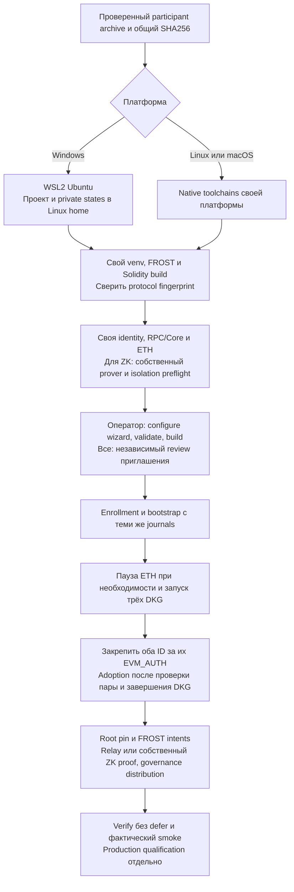

# Запуск с нуля: Linux, Windows/WSL2 и macOS, разные участники

[Схемы: SVG/PNG и hashes текущих Mermaid-исходников](DIAGRAMS.md).

[Параметры федерации/конфедерации и новые группы](FEDERATION_CONFEDERATION_SETUP.md) ·
[NFT скидок: параметры, роли и требования](NFT_CONFIGURATION.md).

**Начните с [единого маршрута холодного старта](COLD_START.md)**: там роли,
funding, конфигуратор, все bootstrap-барьеры и критерии первого smoke.
Эта страница содержит команды установки и подробные действия по этапам.
[FROST/ZK lifecycle](FROST_ZK_LIFECYCLE.md) связывает DKG, подписи и proofs.

Экономические параметры и формулы новой сборки: [конфигуратор](LAUNCH_CONFIGURATOR.md)
и [математическое описание](LAUNCH_MATHEMATICS.md).

[Единый конфигуратор запуска](LAUNCH_CONFIGURATOR.md): `frost-signer configure wizard`
выбирает сети, create/reuse, confirmations, имена токенов, пороги, комиссии и
дополнительный стартовый APY из собственного USD-бюджета.

Для ZK с тестовыми BTC используйте новый [порядок Bitcoin testnet4 + Sepolia](ZK_TESTNET4_SEPOLIA.md):
отдельные pinned guest/host, policy V2 и собственные proofs каждого участника.

Эта инструкция относится к **новому полному Bitcoin + ULR bootstrap**. Она не
мигрирует старый deployment и не включает production qualification. Сначала
проведите локальную репетицию, затем — совместный запуск в Sepolia. Одинаковый
результат сборки и разные RPC/личные ключи у участников — нормальная конфигурация.
Для коллег есть [короткий порядок начала тестов](PEER_TESTING.md) с точным
scope локальной Linux-проверки и отдельным smoke-требованием для Windows/WSL2.

## Карта холодной установки



## 1. Что запускается на какой машине

| Компонент | Ubuntu/Linux | Windows через WSL2 Ubuntu | macOS |
| --- | --- | --- | --- |
| Python SDK, native FROST, DKG, EVM/Bitcoin подписи | Да | Да, внутри WSL2 | Да |
| Bootstrap, ULR, relay keeper, Core regtest/testnet4 | Да | Да, внутри WSL2 | Да |
| Проверка публичного ZK state и работа подписанта с ним | Да | Да | Да |
| Локальный receipt/proof runner | x86-64, после установки pinned tools и isolation preflight | WSL2 x86-64, те же условия | arm64, прежний backend |
| Native Windows PowerShell без WSL | Не применяется | Не поддерживается этим релизом | Не применяется |

Это заявленные границы кода. Чистая установка Ubuntu 24.04 x86-64 проверена в
локальном Linux-контейнере под CPU-эмуляцией: [отчёт](../ops/artifacts/linux-portability-20261103/validation.json).
На физической Windows/WSL2-машине прогон ещё не выполнялся; после установки
завершите собственный короткий smoke. Linux/WSL2 x86-64 теперь используют
bubblewrap namespaces, seccomp и отдельные immutable tool pins. Установка,
Docker socket, реальные isolation probes и порядок всех ZK-стадий описаны в
[Linux ZK runbook](ZK_PROVER_LINUX.md). macOS arm64 сохраняет sandbox backend;
CLI/socket выбираются локально. Каждый участник сам считает рабочие proofs.
Проверка опубликованного state не заменяет собственный расчёт. Неподдерживаемые
платформы, включая Linux ARM64, блокируются при ZK enrollment.
Порт проверен по компонентам; полный fresh-proof прогон и физический WSL2 ещё
не подтверждены. Порядок поставки и расчёта: [инструкция](DISTRIBUTION.md).

Пример: Alice — оператор на Linux, Bob — Windows/WSL2, Carol — macOS. Каждый
держит собственные identity, три encrypted FROST-state, nonce/spent journals,
Core и RPC. Приглашение, enrollment и DKG-пакеты передаются через EVM board;
общая папка и передача секретных долей не нужны. Prover/keeper — отдельные роли,
их размещение не меняет roster и quorum подписантов.

## 2. Подготовка Windows

В **PowerShell от администратора**:

```powershell
wsl --install -d Ubuntu-24.04
wsl --update
wsl --list --verbose
```

Если установка потребовала перезагрузку, завершите её, затем откройте Ubuntu и
создайте Linux-пользователя. В `wsl --list --verbose` ожидается VERSION 2. При
необходимости: `wsl --set-version Ubuntu-24.04 2`. Дальше **все** команды идут
в терминале Ubuntu, включая Git, Python, Rust, Foundry и Core. Инструкции:
[Microsoft WSL](https://learn.microsoft.com/en-us/windows/wsl/install),
[Ubuntu WSL2](https://ubuntu.com/wsl/docs/stable/howto/install-ubuntu-wsl2/).

Репозиторий и секретные состояния храните в `/home/<linux-user>/...`, а не
`/mnt/c/...`, OneDrive или общей Windows-папке. Коду нужны Linux file locks,
права владельца, `chmod`, атомарный rename и SQLite journals. Windows `.exe`,
macOS-бинарники и скопированное чужое `.venv` внутри WSL не подходят.

## 3. Системные зависимости

Ubuntu 24.04 / WSL2 Ubuntu:

```bash
sudo apt-get update
sudo apt-get install -y git curl ca-certificates gnupg build-essential clang cmake pkg-config libssl-dev python3 python3-venv python3-dev
```

На macOS установите Xcode Command Line Tools (`xcode-select --install`) и
Python 3.11+ с `venv`; при использовании Homebrew — `brew install python@3.11 git cmake pkg-config`.

Установите [rustup](https://rust-lang.org/install) и
[Foundry](https://getfoundry.sh/introduction/installation/) официальными
способами. В Ubuntu/WSL2 или терминале macOS:

```bash
SETUP_TEMP=$(mktemp -d)
curl --proto '=https' --tlsv1.2 --fail --silent --show-error https://sh.rustup.rs --output "$SETUP_TEMP/rustup.sh"
sh "$SETUP_TEMP/rustup.sh" -y --profile minimal --default-toolchain 1.89.0
source "$HOME/.cargo/env"
curl --fail --location https://foundry.paradigm.xyz --output "$SETUP_TEMP/foundry.sh"
bash "$SETUP_TEMP/foundry.sh"
export PATH="$HOME/.cargo/bin:$HOME/.foundry/bin:$PATH"
```

Это установка личных build-инструментов. Затем закрепите версии:

```bash
rustup toolchain install 1.89.0 --profile minimal
export PATH="$HOME/.cargo/bin:$HOME/.foundry/bin:$PATH"
foundryup --install v1.8.5
rustc +1.89.0 --version
forge --version
anvil --version
```

Используем solc **0.8.30**, Osaka, optimizer/via-IR и remappings из
`web3/foundry.toml`. Не изменяйте эти параметры отдельно на одном компьютере.
Foundry скачивает соответствующий solc при первой сборке; нужен доступ к
интернету либо заранее проверенный бинарник, заданный `FOUNDRY_SOLC`.

## 4. Один и тот же код и сборка у каждого

Каждый получает одинаковый проверенный participant source archive по
[инструкции поставки](DISTRIBUTION.md). Он исключает готовые proofs, кэши,
секреты и архивы прежних запусков. Сверьте общий SHA256 через согласованный
канал до распаковки. Полный Git clone предназначен разработчику и содержит
исторические evidence; он не является поставкой участникам.
После проверки и распаковки архива в `$HOME/src/satoshify`:

```bash
cd "$HOME/src/satoshify"
python3 -m venv .venv
source .venv/bin/activate
python ops/bootstrap_host.py build
python ops/bootstrap_host.py check --role signer
```

На macOS с отдельным Python используйте `python3.11 -m venv .venv`.
`build` ставит закреплённые версии Python-пакетов из `requirements.lock`, editable
SDK, собирает FROST посредством `cargo +1.89.0 --locked`, собирает обычный Solidity
и ZK state-adapter, проверяет ABI/runtime hash tables. Он не создаёт identity, не запускает узлы и
не отправляет транзакций. `requirements.lock` фиксирует версии, но не содержит
hashes всех platform wheels. Не переносите `.venv`, native binaries или `out`
с другой ОС. Зависимости Solidity включены в репозиторий; `forge install` не нужен.

Ожидается `READY_TO_CONFIGURE`, а не production Ready. Сравните
`protocol_source_sha256` из `check` на всех машинах: значения должны совпасть.
Он не зависит от абсолютного пути клона и версии ОС; охватывает SDK, FROST source,
production Solidity и параметры/lockfiles. `.gitattributes` закрепляет LF для
исходников. Бинарные SHA256 на разных ОС могут различаться. Runtime/constructor
проверки контрактов продолжают выполняться на каждом компьютере независимо.

Каждый новый терминал начинает с `cd "$HOME/src/satoshify"` и
`source .venv/bin/activate`. Для сборки `--release` отдельно задайте абсолютный
`SATOHSI_CRYPTO_BIN`; обычный `build` создаёт ожидаемый debug-бинарник.

Проверка portable-подмножества SDK:

```bash
python -m pip install -e './signer-agent[test,evm-test]'
python -m ops.system_modes preflight --mode signer
python -m ops.system_modes run --mode signer --output "$HOME/satoshifi-test-signer-001"
```

Полная relay-репетиция после установки Core:

```bash
python -m ops.system_modes preflight --mode relay
python -m ops.system_modes run --mode relay --output "$HOME/satoshifi-test-relay-001"
```

`relay` не требует macOS prover. Он включает portable SDK, все Solidity-тесты,
полный create/reuse EVM bootstrap и regtest lifecycle. Это локальная репетиция;
узлы временные, кошельки искусственные. Она не проверяет доступность другого
физического компьютера. Подробнее о scope и отчётах — [режимы тестов](SYSTEM_TEST_MODES.md).

Начните с короткого `signer`. Полный `relay` может занимать несколько часов:
в нём много независимых сборок и развёртываний, три DKG на граф и отдельные
CLI-процессы участников. Один E2E-сценарий может десятки минут не печатать точку
pytest; это само по себе не означает зависание. Runner печатает начало слоя,
сохраняет `report.json` и его `command.log`; итоговый статус появляется после
завершения слоя. Для независимого повтора выбирайте конкретный `--mode` и новый
output-каталог.

Workflow `.github/workflows/local-acceptance.yml` готовит чистые Ubuntu/macOS
машины и запускает тот же `relay`-набор четырьмя отдельными заданиями: signer,
contracts, evm, bitcoin. Долгие проверки не удерживают короткие, а неудачный слой
можно повторить отдельно. Это конфигурация будущего CI-прогона;
наличие файла само по себе не означает, что CI уже выполнялся. WSL2 проверяется
на Windows-машине пользователя указанной выше командой, отдельного результата
Windows CI этот workflow не заявляет.

## 5. Core и собственный Bitcoin RPC

Для Sepolia + testnet4 можно использовать собственные удалённые RPC.
Каждый участник задаёт Infura Sepolia и архивный HTTPS Bitcoin Core со
своими учётными данными. Перед enrollment запустите `configure check-rpc`
с согласованным приглашением. Вариант подходит для relay и ZK.
[Настройка и команды для удалённых RPC](LAUNCH_CONFIGURATOR.md#sepolia-и-bitcoin-testnet4-без-локальных-нод).

Для тестового запуска скачайте **Bitcoin Core 30.3** с
[официальной страницы](https://bitcoincore.org/bin/bitcoin-core-30.3/).
Linux x86_64 / WSL x86_64: `x86_64-linux-gnu`; Linux ARM64: `aarch64-linux-gnu`;
macOS Apple Silicon: `arm64-apple-darwin`; macOS Intel: `x86_64-apple-darwin`.
Сверьте SHA256 архива с `SHA256SUMS` и проверьте подписи по
[инструкции Core](https://bitcoincore.org/en/download/). Распакуйте в личный
каталог, добавьте `bitcoin-30.3/bin` в PATH:

```bash
export PATH="$HOME/tools/bitcoin-30.3/bin:$PATH"
bitcoind -version -nosettings
bitcoin-cli -version
```

Для совместного **Sepolia + regtest** каждый подписант должен наблюдать один
и тот же regtest, а не свой независимый genesis-узел. Для первой DKG regtest
Core можно не подключать; для Bitcoin-платежей нужен согласованный изолированный
стенд и локальное безопасное подключение к его RPC. Не открывайте cookie RPC
наружу. Проще для разных компьютеров использовать **Sepolia + testnet4**:
у каждого свой независимо синхронизируемый Core одной публичной сети.

Запуск testnet4 в отдельном терминале каждого участника:

```bash
export BTC_DATA="$HOME/.local/share/satoshifi/core-testnet4"
mkdir -p "$BTC_DATA"
chmod 700 "$BTC_DATA"
bitcoind -testnet4 -datadir="$BTC_DATA" -server -txindex=1 -prune=0 -listen=0 -rpcbind=127.0.0.1 -rpcport=48332
```

Рабочий терминал:

```bash
export BTC_RPC=http://127.0.0.1:48332
export BTC_COOKIE="$HOME/.local/share/satoshifi/core-testnet4/testnet4/.cookie"
bitcoin-cli -testnet4 -datadir="$HOME/.local/share/satoshifi/core-testnet4" -rpcport=48332 getblockchaininfo
bitcoin-cli -testnet4 -datadir="$HOME/.local/share/satoshifi/core-testnet4" -rpcport=48332 getindexinfo
```

Дождитесь `chain=testnet4`, завершения initial block download и
`txindex.synced=true`. Для backed-профиля нужен непрореженный Core; пустой или
отстающий узел не допускается. Checkpoint policy оператор готовит из своего
Core по [testnet4-инструкции](NETWORKS_AND_AUTOMATION.md#bitcoin-testnet4),
остальные проверяют её по своим узлам. В приглашении должна быть одна и та же
policy; `BTC_RPC` и cookie у каждого свои и в приглашение не попадают.

## 6. Личные файлы каждого участника

В каждом Linux/macOS/WSL-терминале:

```bash
umask 077
export LOCAL="$HOME/.local/share/satoshifi/participant-001"
mkdir -p "$LOCAL"
chmod 700 "$LOCAL"
export IDENTITY="$LOCAL/identity.json"
export PARTICIPANT_DIR="$LOCAL/friends-v1"
python ops/bootstrap_host.py identity --identity-file "$IDENTITY" --generate
```

Последняя команда создаёт новый **собственный** EVM-кошелёк и печатает только
адрес/путь. Сохраните адрес как `ME` и пополните его тестовым ETH **в выбранной
EVM**, например Sepolia. Для существующего кошелька вместо `--generate`:

```bash
export ME='<свой полный checksum EVM-адрес>'
python ops/bootstrap_host.py identity --identity-file "$IDENTITY" --address "$ME"
```

Ключ вводится скрыто и проверяется на совпадение с `ME`; существующий файл не
перезаписывается. Это локальный файл ключа для текущего SDK, не подключение
MetaMask/hardware wallet. Не импортируйте кошелёк другого участника и не создавайте
второй независимый nonce/spent catalog для той же EOA. Если ключ уже используется
в системе, сохраняйте исходный identity path и журналы. EVM key и FROST share —
разные сущности; FROST-материал возникнет при DKG.

```bash
export RPC='<свой Sepolia RPC URL>'
export CHAIN_ID=11155111
export EVM_CONFIRMATIONS=1
python ops/bootstrap_host.py check --role signer --state-dir "$LOCAL"
```

В разных терминалах операторского компьютера используется тот же identity и
те же durable journals. RPC другого участника может отличаться, но chain ID
должен совпадать. `localhost` всегда означает текущую машину, а не Alice.

## 7. Общие параметры до приглашения

Все согласуют и независимо проверяют:

| Общие данные | Личные данные, не копируются между участниками |
| --- | --- |
| Reviewed commit и `protocol_source_sha256` | identity private key и его абсолютный путь |
| EVM сеть, число подтверждений, Bitcoin сеть/backend и checkpoint policy | EVM RPC credentials |
| Полный упорядоченный roster, threshold, min custodians | Core RPC endpoint и cookie |
| ULR create/reuse, единственный USD-токен, его runtime hash/decimals | encrypted states, password, nonce/spent journals |
| Wrap/unwrap fees, минимумы 294/330, converter quote/funding, fee caps | Каталоги keeper/worker и локальные лимиты расходов |
| Начальный получатель 10m ULR, treasury address и deployment ID | FROST signing nonce и транспортные секреты |

Пример ниже: три разных адреса, threshold 3, два первоначальных кастодиана.
Alice — оператор и первый участник, Bob/Carol — первоначальные кастодианы.
В этом bootstrap первый адрес представляет федерацию, остальные становятся
кастодианами. Укажите Alice первой, затем Bob и Carol в согласованном порядке;
этот порядок должен совпадать у всех участников. Выбор людей и адресов остаётся
за вашей группой.

## 8. Оператор: полный ULR + Bitcoin профиль

Основной путь новой сборки — `configure`, который создаёт единый согласованный
bundle. В нём задаются имена четырёх ERC20, create/reuse, обе сети, relay/ZK,
H/minimum stake, treasury reserve/bps, wrap/unwrap и optional prefunded APY.
Полные поля и ограничения — в [конфигураторе](LAUNCH_CONFIGURATOR.md).

```bash
export DEPLOYMENT_ID=friends-v1
export LAUNCH_DIR="$LOCAL/launch-v1"
frost-signer configure wizard --output "$LOCAL/launch.json"
frost-signer configure validate --config "$LOCAL/launch.json"
frost-signer configure build --config "$LOCAL/launch.json" --output "$LAUNCH_DIR"
frost-signer setup inspect --invite "$LAUNCH_DIR/invitation.json"
```

Введите тот же `deployment_id` в wizard; в последующих командах используется
`$DEPLOYMENT_ID`. Согласуйте весь roster с оператором первым и custodian-only
policy. `sources: []` позволяет прямые BTC-депозиты конфедерации; для внешнего
MP до enrollment добавьте проверенный source descriptor по
[инструкции custody](BITCOIN_CUSTODY_TRANSFER.md). У `reuse` должны быть
проверенные reuse policy V2 и family root policy совместимого deployment.

Для публичного Bitcoin сначала подготовьте свою checkpoint policy и общий
USD address/runtime hash/decimals. Оператор заранее получает USD для
конвертера и отдельно для startup (если включён). Тестовый USD разворачивается
по [инструкции](NETWORKS_AND_AUTOMATION.md#тестовый-usd-какие-режимы-и-как-настроить);
feed ULR-профилю не нужен. Quote/финансирование задаются с учётом decimals;
цена APY — отдельный immutable reference price. Не переносите адрес из чужого
acceptance-отчёта. При local/regtest создаётся явно тестовый USD.

ZK mainnet и **testnet4** имеют отдельные pinned guests; regtest ZK запрещён.
Каждый ZK-участник готовит собственные tools/Core/worker до enrollment.
Для testnet4/Sepolia используйте [ZK runbook](ZK_TESTNET4_SEPOLIA.md).
Включённый APY требует будущей даты с запасом на DKG, proof catch-up и паузы.
Прочитайте `review.json`, policy и invitation до публикации.

Оператор публикует ровно сгенерированное приглашение:

```bash
frost-signer setup publish --invite "$LAUNCH_DIR/invitation.json" --rpc "$RPC" \
  --identity-file "$IDENTITY" --state "$LOCAL/invitation.sqlite"
```

Отдельно повторять ручной `setup invite` для этого bundle не нужно. Низкоуровневые
`system-profile`/`setup invite` сохранены как альтернативный workflow в
[ULR bootstrap](ULR_BOOTSTRAP.md); не объединяйте независимо созданные profiles.
После enrollment изменение параметров означает новое согласованное приглашение,
а не правку принятого JSON или journals.

## 9. Каждый участник: найти board и присоединиться

Команды ниже выполняются в Bash. Выберите тот же Bitcoin network, что в
приглашении; пример — testnet4. Для regtest массив пуст: bootstrap отклоняет
публичные Core-аргументы в этом профиле. Для mainnet/testnet4 оба обязательны,
включая финальный `verify`. Создавайте массив снова после входа в терминал.

```bash
export BITCOIN_NETWORK=testnet4
BTC_ARGS=()
if [ "$BITCOIN_NETWORK" != regtest ]; then
  BTC_ARGS=(--bitcoin-rpc "$BTC_RPC" --bitcoin-cookie "$BTC_COOKIE")
fi
```

Alice тоже выполняет этот шаг со своей identity. В качестве `OPERATOR` каждый
устанавливает заранее известный полный адрес Alice:

```bash
export OPERATOR="$ALICE"
frost-signer setup discover --operator "$OPERATOR" --rpc "$RPC"
```

При наличии публичного launch config можно добавить `--launch-config "$LAUNCH_CONFIG"`.
Укажите путь к полученному `launch-config.json` в `LAUNCH_CONFIG`. SDK использует
его EVM-сеть и `evm_discovery_from_block` для поиска приглашения.
[Стартовые высоты сетей](LAUNCH_CONFIGURATOR.md#стартовые-высоты-сетей).

Из **своего** ответа выберите приглашение, проверьте полный roster, порог, две
сети, токены, fees, system policy, сроки, runtime/constructor происхождение.
Установите `BOARD`, `BOARD_BLOCK`, `FINGERPRINT` из этой записи:

```bash
frost-signer setup join-chain --board "$BOARD" --rpc "$RPC" --board-creation-block "$BOARD_BLOCK" \
  --accept-fingerprint "$FINGERPRINT" --identity-file "$IDENTITY" --directory "$PARTICIPANT_DIR" \
  "${BTC_ARGS[@]}"
```

При regtest `BTC_ARGS` пуст также на последующих apply/resume/verify. При testnet4 или
mainnet нужен собственный проверенный Core. Повтор использует прежние enrollment
и transport keys; не удаляйте каталог ради retry.

## 10. Оператор начинает, участники ведут DKG

Оператор:

```bash
frost-signer setup status --board "$BOARD" --rpc "$RPC"
frost-signer setup assemble-chain --board "$BOARD" --rpc "$RPC" --board-creation-block "$BOARD_BLOCK" --output "$LOCAL/profile.json"
frost-signer bootstrap plan --profile "$LOCAL/profile.json" > "$LOCAL/plan.json"
```

Оператор сверяет в `plan.json` два шага с подписанным приглашением.

| Шаг | ID из приглашения | EVM_AUTH-сессия из приглашения |
| --- | --- | --- |
| `reserve_federation_id` | `federation_id` | `sessions.evm_ceremony` |
| `reserve_confederation_id` | `confederation_id` | `sessions.conf_ceremony` |

В плане к hex-значению session добавляется префикс `0x`. В полном bootstrap
оператор развёртывает обе фабрики и резервирует эти пары
автоматически. При `resume` он использует исходный журнал. Для добавления
конфедерации на общей factory используйте отдельный порядок.
[Ручной запуск](FEDERATION_CONFEDERATION_SETUP.md#7-дополнительная-конфедерация-на-существующей-factory).

Для дополнительной паузы ETH перед DKG можно
добавить начальные `--pause-for-funding`, `--funding-min-wei` и
`--funding-operator-min-wei`, затем отдельно снять её `--funding-complete`.
[Параметры ETH-паузы](ULR_BOOTSTRAP.md#дополнительная-пауза-eth-перед-dkg).
Основная **пауза ULR после выпуска включена в новые планы автоматически** и
описана ниже в разделе 12.

После сверки плана оператор запускает bootstrap.

```bash
frost-signer bootstrap apply --profile "$LOCAL/profile.json" --state "$LOCAL/bootstrap.sqlite" \
  --identity-file "$IDENTITY" "${BTC_ARGS[@]}"
```

Когда три DKG находятся в
`IN_PROGRESS`, **каждый**, включая Alice, повторяет у себя:

```bash
frost-signer flow dkg --once --board "$BOARD" --rpc "$RPC" --identity-file "$IDENTITY" \
  --directory "$PARTICIPANT_DIR" "${BTC_ARGS[@]}"
```

Дождитесь `ACTIVE` для своих ролей и завершения всех трёх церемоний на board.
У Alice custody-роли имеют `NOT_A_PARTICIPANT`, она не проверяет и не подписывает
их долями федерации. Bob/Carol завершают все три свои роли. Exit code 2 на wait означает
состояние ожидания — читайте JSON; он также используется для ошибок. Не считайте
любой код 2 безусловным успехом. Все сообщения идут через board, round-2 packages
зашифрованы адресно. `--approve-all` не нужен.

Оператор продолжает прежний deployment:

```bash
frost-signer bootstrap resume --deployment "$DEPLOYMENT_ID" --state "$LOCAL/bootstrap.sqlite" \
  --identity-file "$IDENTITY" "${BTC_ARGS[@]}"
```

## 11. Общий Bitcoin root: независимый pin на каждом устройстве

При `CANONICAL_FAMILY_ROOT_PIN_REQUIRED`/ожидании первого family intent оператор
сохраняет `manifest.system.family_root_policy` из своего результата в публичный
`root-policy.json`. Каждый может проверить этот файл по **исходному** board:
CLI проверяет точный root constructor, исходного оператора, DKG и завершённый
результат группы, а не только присланный адрес/код.

```bash
frost-signer family-root inspect --rpc "$RPC" --board "$BOARD" --policy /path/to/root-policy.json
export ROOT_FINGERPRINT='<fingerprint из своего inspect>'
frost-signer family-root pin --rpc "$RPC" --board "$BOARD" --policy /path/to/root-policy.json \
  --identity-file "$IDENTITY" --accept-fingerprint "$ROOT_FINGERPRINT"
```

Ожидается `FAMILY_ROOT_PINNED`. Повтор того же pin допустим, замена существующего
запрещена. Он сохраняется рядом с identity и в исходном EOA journal. Приглашение
не устанавливает его автоматически. Эта локальная операция не заменяет отдельный
pin BitcoinBatchRegistry и не даёт права на смену общего root.

## 12. Участники явно подписывают настройку

Каждый читает:

```bash
frost-signer setup pending --board "$BOARD" --rpc "$RPC" --board-creation-block "$BOARD_BLOCK"
```

Из собственного результата берутся `ROLE=intent.role`, `SESSION=session`,
`OPERATION_HASH=intent.operation_hash`. Проверьте target, helper, все аргументы,
сеть и суммы. Для незавершённого intent каждый требуемый подписант повторяет:

```bash
frost-signer dkg sign-evm --board "$BOARD" --role "$ROLE" --rpc "$RPC" --session "$SESSION" \
  --identity-file "$IDENTITY" --state "$PARTICIPANT_DIR/$ROLE.enc" --password-file "$PARTICIPANT_DIR/password" \
  "${BTC_ARGS[@]}"
```

Сначала commitment, затем signing share; повторяйте тот же session до
`finalized`. `signed` ещё не означает завершение группы. Для bootstrap ULR pin
выводится из подписанного приглашения и точных конструкторов; последующие
ULR-операции требуют отдельного согласованного `--ulr-config`.

Когда оператор получает `AWAITING_CUSTODIAN_APPROVALS`, Bob и Carol после
завершения FROST и собственной проверки того же pending выполняют:

```bash
frost-signer setup approve-custodian --board "$BOARD" --rpc "$RPC" --session "$SESSION" \
  --operation-hash "$OPERATION_HASH" --identity-file "$IDENTITY" --state "$LOCAL/custodian.sqlite"
```

Для ULR-операций **после** bootstrap добавьте `--ulr-config /path/to/reviewed-ulr-pin.json`
также к `setup approve-custodian`. В bootstrap обе группы независимо выводят pin
из подписанного приглашения и конструкторов; ручной override обязан совпасть.

Оператор снова вызывает `bootstrap resume`. Проходите все опубликованные intent;
не заменяйте их готовым hash из сообщения. При `AWAITING_BITCOIN_RELAY` обслужите
relay своим keeper по [сетевой инструкции](NETWORKS_AND_AUTOMATION.md), затем
продолжите.

### Рассылка ULR после выпуска

При `PAUSED_FOR_ULR_DISTRIBUTION` токен уже существует, все 10 млн получил один
адрес из приглашения, но ULR-казначейство ещё не активировано. Получатель выпуска
вручную рассылает согласованные суммы через свой ERC-20 кошелёк; адрес токена —
`distribution.token`, decimals — 18. Ключ получателя никому не передаётся.

Оператор повторяет прежний `bootstrap resume`, проверяет
`distribution.participants` (wallet + own stake), `transfers_confirmed=true`
и берёт свежий `distribution.fingerprint` из собственного результата:

```bash
export DISTRIBUTION_FINGERPRINT='<проверенный distribution.fingerprint>'
frost-signer bootstrap resume --deployment "$DEPLOYMENT_ID" --state "$LOCAL/bootstrap.sqlite" \
  --identity-file "$IDENTITY" "${BTC_ARGS[@]}" \
  --ulr-distribution-complete --accept-ulr-distribution "$DISTRIBUTION_FINGERPRINT"
```

Обычный resume, verify или перезапуск паузу не снимают. Старый fingerprint,
чужой identity и преждевременное подтверждение отклоняются; pending-переводы
оставляют паузу. Рассылка не автоматическая, суммы не назначаются программой.
Для кандидата нужен wallet + own stake от H из launch config (default 200 000 ULR); это не обязательный минимум
всех действующих кастодианов. В `reuse` остановка использует существующий токен.
Подробности и сроки — [ULR-пауза](ULR_BOOTSTRAP.md#пауза-для-ручной-рассылки-ulr-после-выпуска).

После подтверждения пройдите оставшиеся FROST/custodian intents. Завершение:

```bash
frost-signer bootstrap verify --deployment "$DEPLOYMENT_ID" --state "$LOCAL/bootstrap.sqlite" \
  "${BTC_ARGS[@]}" > "$LOCAL/verified.json"
```

Ожидается `VERIFIED`, `system.graph_configured=true`, но `system.ready=false`
пока отсутствует отдельная qualification/приёмка. Число контрактов полного графа
зависит от профиля; ориентируйтесь на bindings и проверки полного плана.
Каждый проверяет применимые к нему роли из `evm_ceremony`, `conf_ceremony`, `btc_ceremony` через
`frost-signer dkg verify` с прежними board/state/password/RPC/Core аргументами.

## 13. Следующая конфедерация с другими людьми

Сохраните из первого verified manifest:
`ulr.reuse_policy`, `system.family_root_policy`, адрес **исходного** board.
Новые участники выполняют разделы 2–10 со **своими** identity, новым roster,
порогом и deployment ID. Если существующий человек входит снова, он сохраняет
исходный identity/EOA journal, а для нового приглашения создаёт новый participant
directory и три новые церемонии. Совпадение людей в двух группах не требуется.
Для этого SDK-пути сохраните Bitcoin-сеть исходной root-группы: смена сети уже
существующего проекта не является автоматической миграцией. Relay/ZK выбираются
в рамках поддерживаемого профиля этой сети до нового приглашения.

Новый оператор готовит профиль:

```bash
frost-signer system-profile --ulr-policy /path/to/reuse-policy.json \
  --bitcoin-custody-policy config/bitcoin-custody.example.json \
  --token-metadata "$LOCAL/token-metadata.json" \
  --family-root-policy /path/to/root-policy.json \
  --qualification-report rust/zkspv/derivation-qualification/qualification-report.json \
  --service-policy config/bitcoin-bootstrap-service-policy.example.json \
  --protocol-fee-cap-sats 100000 --max-vbytes 10000 --max-packet-bytes 1024 --output "$LOCAL/system-next.json"
```

Повторяются общий ULR, USD, staking и snapshots; новые независимые treasury,
address registry и authorization разворачиваются для новой конфедерации. ULR
повторно не выпускается. Каждый новый подписант закрепляет общий root через
`family-root inspect/pin`, указав **старый исходный board**.

`reuse` не раздаёт ULR новым людям. Для ненулевого веса дохода у кастодианов
новой конфедерации должны появиться собственные ULR: на кошельке или в их stake.
Их передаёт существующий держатель отдельной обычной операцией. Права управления
новой группы и её доля дохода — разные проверки; при нулевом ULR-весе её USD
остаются в её казне.

На `FAMILY_ENROLLMENT_REQUIRED` новые участники не могут одобрить включение
своего графа за старую root-authority. Исходный оператор, со своей прежней identity
и journal, готовит отдельный план:

```bash
frost-signer family-root enroll-prepare --rpc "$RPC" --board "$ORIGINAL_BOARD" \
  --policy /path/to/root-policy.json --identity-file "$ORIGINAL_IDENTITY" \
  --registry "$NEW_ADDRESS_REGISTRY" --deadline "$UNIX_DEADLINE" --output "$LOCAL/enroll-next.json"
frost-signer bootstrap apply --profile "$LOCAL/enroll-next.json" --state "$ORIGINAL_BOOTSTRAP_STATE" \
  --identity-file "$ORIGINAL_IDENTITY" "${BTC_ARGS[@]}"
```

`UNIX_DEADLINE` — будущее время Unix, не дальше 7 суток. Исходные участники читают
pending в `ORIGINAL_BOARD`, проверяют новый registry/ключевую семью и подписывают
исходным `conf_ceremony`. Исходный оператор делает `bootstrap resume` с
deployment ID **из подготовленного enrollment-плана**. Затем новый оператор
продолжает свой новый bootstrap, а новая группа подписывает binding своего графа.
Таким образом, два quorum независимы даже при совершенно разном составе людей.

Общий реестр ULR snapshots остаётся под исходной системной EVM_AUTH-группой.
Подключение новой казны одобряется управлением новой конфедерации, а ежедневный
общий снимок публикует исходная системная группа. Подключение новой конфедерации
не передаёт ей системное управление и не переводит доход/делегирование на другой
актив. Следуйте [ULR treasury runbook](ULR_TREASURIES.md).

## 14. После bootstrap: что включать отдельно

| Задача | Конфигурация и инструкция |
| --- | --- |
| Пин Bitcoin graph и адресная подпись | [Signer trust](BITCOIN_SIGNER_TRUST.md), [BASE/DERIVED signing](BITCOIN_ADDRESS_SIGNING.md); полный граф требует явного `--address-signing` |
| Выдача уникального адреса, watch и mint | [Address registry](ADDRESS_DEPOSIT_REGISTRY.md); request board, watch/service config, Core, beneficiary; production verifier должен пройти qualification |
| Relay keeper | [Networks](NETWORKS_AND_AUTOMATION.md); RPC/Core/cookie, выбранная policy, payer identity, журнал и gas budget |
| ZK worker и SPV service | [Worker](ZK_SPV_WORKER.md); native host/tool hashes, worker directory, consumer allowlist, budgets, source/policy pins |
| Вывод и miner fees | [Withdrawals](BITCOIN_WITHDRAWALS.md), [signing](BITCOIN_ONCHAIN_RUNBOOK.md); custody quorum, reserve, bind, signing board, fee reserve/personal fee funding |
| ULR stake/delegate/claim | [Staking](ULR_STAKING.md), [candidates/voting](ULR_CANDIDATES_AND_VOTING.md), [CLI](SYSTEM_TEST_MODES.md) |
| NFT коллекция и mint | [Полный порядок холодного старта](COLD_START.md#nft-конфедерации-после-bootstrap-полный-порядок): адреса из verified manifest, свой pin, create и mint с разными FROST sessions, custodian approvals, owner/metadata и read-only quote |
| Отдельный startup keeper | [Конфигуратор](LAUNCH_CONFIGURATOR.md); свой scheduler для pay за предыдущий UTC-день, отдельный USD-бюджет, immutable срок и refund |
| Снимок суток и выплата | [Treasuries](ULR_TREASURIES.md); archive EVM RPC, полный inventory владельцев/казн, системное FROST, затем ежедневный `pay` |

NFT не появляется от одного завершения bootstrap. Для нового conf fee manager
после `VERIFIED` пройдите [NFT-этап холодного старта](COLD_START.md#nft-конфедерации-после-bootstrap-полный-порядок)
на тех же Linux/macOS/WSL2 хостах. Нужен прежний `conf_ceremony.enc`, свой
`password` и `--nft-config` у каждого custodian-подписанта. Оператор без этой
роли не подписывает за кастодианов. Команды create/mint и проверки приведены
в самом холодном старте; BTC DKG и ZK proofs для выпуска ERC721 не требуются.

Bootstrap не запускает фоновые службы. План настраивает MP→USD converter с
явной котировкой и предварительным inventory; продажу BTC он не выполняет.
Казна для выплаты — фактический свободный баланс согласованного USD после
поступления средств по настроенному fee route или отдельного пополнения. Для
снимков нужен RPC с историческими данными на границе суток; если провайдер их
не даёт, выберите подходящий endpoint, сохранив те же identity/journals.

## 15. Повторный вход, ошибки и готовность

При перезагрузке откройте тот же Linux/WSL-дистрибутив, активируйте прежнее venv,
восстановите свои переменные и запустите Core/keeper. Продолжайте **resume** и те
же participant states. Храните вместе актуальные encrypted state, password,
identity, `<identity>.transactions.sqlite`, `<identity>.bitcoin-family-root.json`,
spent/continuity journals и bootstrap journals. Их нельзя откатывать старой
копией ради повторной подписи; используйте описанный recovery/rotation.
Сохраняйте каталог участника целиком, включая `.public-cache`, вместе с
согласованным состоянием journals; копия одного `.enc` не заменяет весь каталог.
Для ZK сохраняйте собственный worker directory, включая `.local-proof-key` и
completion records. Чужой cache и старые неподписанные результаты не принимаются
как собственный расчёт; после потери ключа нужен новый расчёт.

Если bootstrap остановился, используйте сохранённые deployment ID и журналы.
Для сбора диагностики добавьте `--debug` после `frost-signer` и сохраните
записи `DEBUG_ERROR` из stderr.
[Диагностика для коллег](PEER_TESTING.md#как-собрать-диагностику-sdk) ·
[Восстановление withdrawal CREATE](BOOTSTRAP.md#withdrawal-deployment-and-recovery).

| Ошибка | Действие |
| --- | --- |
| `PLATFORM_USE_WSL2` | Открыть Ubuntu WSL2 и установить Linux-инструменты внутри неё |
| `ZK_PARTICIPANT_LOCAL_PROVER_REQUIRED` | Для ZK нужен локальный prover у каждого: Linux/WSL2 x86-64 или macOS arm64; выполнить ZK_PROVER_LINUX.md |
| State permissions / lock | Перенести новый state в свой Linux home с 0700/0600; не копировать чужой state |
| Build/constructor mismatch | Сверить commit, source fingerprint, solc/Foundry/remappings; собрать заново, не отключать проверку |
| `BINDING_CHECK_FAILED` на шаге резервирования ID | Сверить EVM, адрес factory, исходный журнал и результат `reservedFederationSession` или `reservedConfederationSession`. При неверно закреплённой паре согласовать новый ID и DKG |
| Chain/network mismatch | Исправить собственный RPC/Core на сеть подписанного приглашения |
| `EVM_CONFIRMATIONS_PENDING` | Дождаться согласованной глубины/finality |
| `RECOVERY_REQUIRED` после revert withdrawal CREATE | Остановить процессы с этим EVM-кошельком и выполнить `bootstrap recover-create-group` с прежними ID, identity и журналами |
| `FAMILY_ROOT_PIN_REQUIRED` | Самостоятельно inspect/pin исходного root по исходному board |
| `FAMILY_ENROLLMENT_REQUIRED` | Исходная root-группа одобряет новый граф; новый quorum не заменяет её |
| Qualification/derivation fence | Положительный production address flow пока не разрешён; не менять флаг вручную |
| Недостаточно converter USD / gas | Пополнить правильный тестовый актив на нужном адресе, продолжить прежний journal |

Совместный запуск считается проверенным только после `VERIFIED`, завершения трёх role ceremonies и локальных
`dkg verify` применимых ролей каждого, совпадения публичных fingerprints и фактического прогона
нужных операций. Результаты локальных тестов и проверка инструкции не доказывают
уже состоявшийся запуск на трёх физических машинах или в публичной сети.
