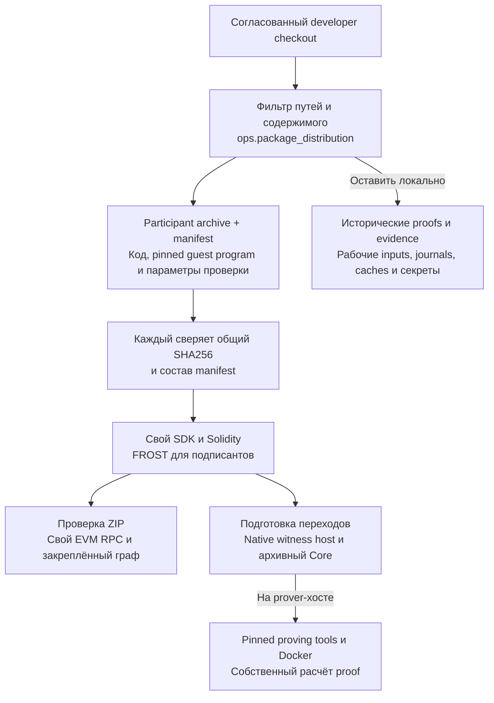
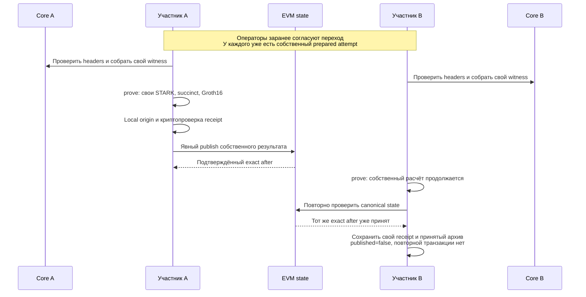
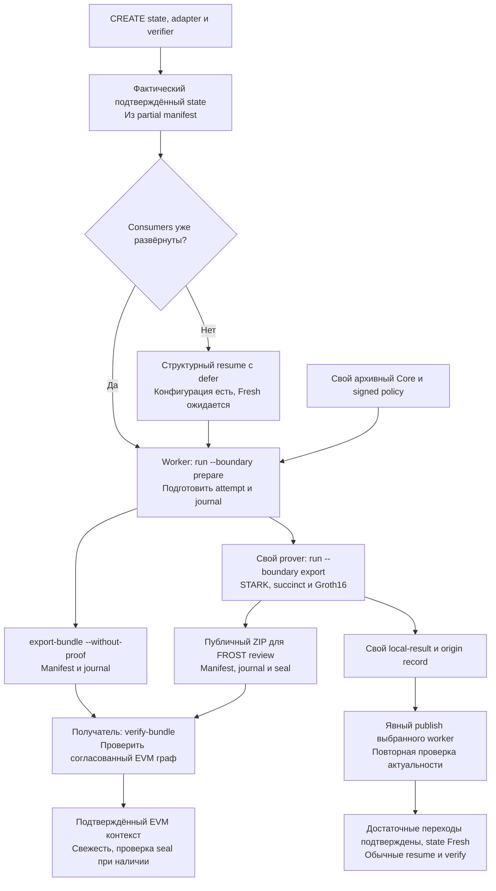
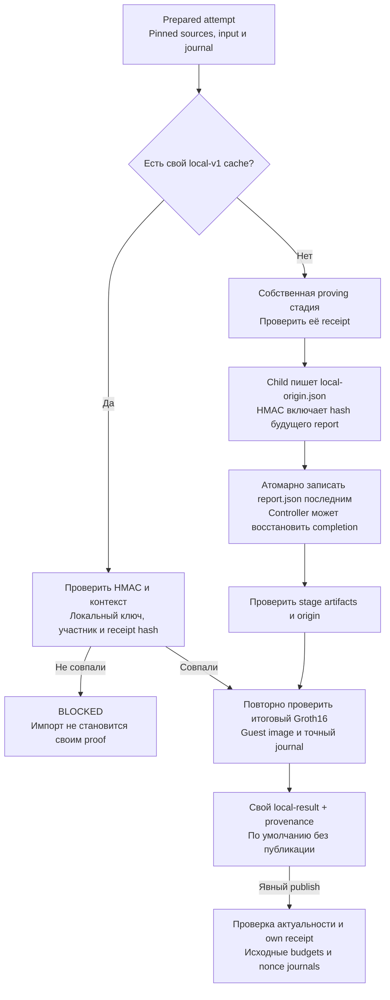

# Поставка без готовых ZK proofs и независимый расчёт

[Схемы: SVG/PNG и hashes текущих Mermaid-исходников](DIAGRAMS.md).

[Холодный старт с нуля](COLD_START.md): единый порядок подготовки, ролей,
финансирования, DKG, relay/ZK, ручной рассылки и первого smoke.

Экономические параметры и формулы новой сборки: [конфигуратор](LAUNCH_CONFIGURATOR.md)
и [математическое описание](LAUNCH_MATHEMATICS.md).

Участники получают единый исходный архив с кодом, программами и pins.
В него не входят receipts, seals, подготовленные inputs/journals рабочих
переходов, caches и приватное состояние. Отдельный публичный архив одного
перехода служит для независимой проверки после подготовки или proving.
Worker публикует результат собственного расчёта из своего рабочего каталога.
[Архив перехода и границы его применения](#публичный-архив-перехода).

Исходники guest/verifier, Cargo locks, контрольные image ID/хеши и неизменяемый
R0BF-код mainnet и testnet4 guests входят в код протокола. R0BF не содержит proof перехода;
его SHA256 проверяется при упаковке. Все участники используют один и тот же
guest image выбранной Bitcoin-сети. Static Bitcoin/test vectors не являются доказательствами рабочих
переходов и не подставляются вместо наблюдений собственного Core.

Схемы ниже описывают текущий код. [SVG, PNG и manifest](DIAGRAMS.md)
связаны с точными Mermaid-блоками этой страницы. Проверка поставки и локальных
сценариев не подтверждает fresh proving на всех физических хостах.

## Срез NFT governance и холодного старта от 5 ноября

Проверенный архив этого среза: `participant-source-20261105-cold-start-review.tar.gz`.
Защита ID церемоний DKG, федераций и конфедераций добавлена после его сборки. Для нового запуска
соберите архив из checkout с этими проверками по командам ниже.
[Права создания DKG](CONTRACT_PERMISSIONS.md#исправление-прав-создания-dkg).
Он включает [единый холодный старт](COLD_START.md) и сквозной [FROST/ZK сценарий](FROST_ZK_LIFECYCLE.md), содержит Mermaid-исходники и `ops/check_launch_math.py` для повторения
численных примеров без RPC. SHA256 каждого файла сохраняется в
`distribution-manifest.json`, SHA256 архива выводится командами упаковки
и проверки.
В архив также входят `frost-signer nft`, pin/review и регрессии выпуска/расхода
NFT. [Порядок create/mint](NFT_CONFIGURATION.md) выполняется после bootstrap;
конфигуратор не выдаёт NFT автоматически. Кодовая NFT-приёмка сохранена
в [отдельном отчёте](../ops/artifacts/nft-governance-20261105/README.md);
этот срез исправляет выбор confirmations подписанта, усиливает точную
проверку mint receipt в холодном старте и содержит регрессии этих случаев.
Developer SVG/PNG exports и исторические test reports не являются рабочими
proofs и хранятся отдельно. Старые архивы сохраняют прежние hashes.

## Собрать и проверить поставку



Из согласованного checkout оператор собирает новый архив:

```sh
python -m ops.package_distribution build --output /absolute/new/participant-source.tar.gz
python -m ops.package_distribution verify --archive /absolute/new/participant-source.tar.gz \
  --sha256 '<SHA256 из результата build, проверенный через согласованный канал>'
```

Сборка из распакованного архива включает модуль `configure check-rpc`. Для
удалённого профиля каждый участник проверяет свои RPC по публичному
приглашению до enrollment. [Инструкция для коллег](PEER_TESTING.md#sepolia-и-bitcoin-testnet4-без-локальных-нод).

Внутри находятся явный список файлов и SHA256 каждого файла. Проверка запрещает
proof-файлы, вложенные архивы, симлинки и изменения состава/байтов. Неизвестные
новые untracked sources добавляются только явным `--extra-source`; проверьте их
до выпуска. Для Testnet4 автоматически выбираются три точных имени
публичных примеров. Конфиги с удалёнными RPC URL или URL с учётными данными
отклоняются и при явном добавлении, и при проверке архива. Примеры используют
символические подстановки или локальные RPC без учётных данных.
`source_revision` и `worktree_snapshot` не утверждают, что
незакоммиченные изменения уже прошли независимый review.

`ops.prepare_release prepare` теперь по умолчанию создаёт такую поставку, без
зависимости от старых receipt-архивов. Прежний evidence-пакет доступен только
как **локальный review** через `prepare-review` / `verify-review`; это не
поставка участникам. Исторические архивы в developer checkout сохраняют свои
прошлые snapshots и не переносятся в participant package.

Полный `git clone` содержит историю и developer evidence. Для передачи
участникам используется проверенный participant archive. Перед распаковкой
сверьте его общий SHA256 независимо; после распаковки можно повторить
`python ops/package_distribution.py verify` тем же архивом/хешем.

## Сборка на каждом хосте

После распаковки следуйте [установке зависимостей](CROSS_PLATFORM_QUICKSTART.md).
Создайте собственный venv и личный постоянный каталог `$LOCAL` с правами 0700,
задав абсолютный путь в своём home. Затем:

```sh
python ops/bootstrap_host.py build
python ops/bootstrap_host.py check --role signer --state-dir "$LOCAL"
```

Собираются native FROST и оба Solidity-проекта: обычные контракты и отдельный
state-adapter. Платформенные build outputs не передаются между участниками.

Worker подготовки и proving использует witness host выбранной Bitcoin-сети.
Верификация публичного ZIP обращается к своему EVM RPC и закреплённому verifier.
Для mainnet witness host нужен полный upstream Citrea commit
`2ed54463bb7c4c3f1ff29dcd66d4b28c26fb63c8`. Его source archive должен иметь SHA256
`591197b7a10896859d873a757d53ae39edd541414702b17c15a82d3f4d0b12c6`.
Подготовка зависимостей выполняется заранее; только затем — offline build:

Скачайте архив по URL `archives[0].url` из
[`upstream-lock.json`](../ops/artifacts/zkspv/upstream-lock.json), сверьте полный
SHA256 выше до распаковки и распакуйте его в отдельный новый каталог.
`CITREA_ARCHIVE` — абсолютный путь архива; `CITREA_SOURCE` — его каталог
`citrea-2ed54463bb7c4c3f1ff29dcd66d4b28c26fb63c8`, без добавленных файлов.

```sh
python -m ops.zkspv.participant_build --source "$CITREA_SOURCE" --archive "$CITREA_ARCHIVE" \
  --output "$LOCAL/native-source"
cargo +1.89.0 fetch --locked --manifest-path "$LOCAL/native-source/worker-host/Cargo.toml"
python -m ops.zkspv.worker_build --prepared "$LOCAL/native-source" \
  --source-manifest "$LOCAL/native-source/prepared-source.json" \
  --cargo "$(rustup which --toolchain 1.89.0 cargo)" \
  --rustc "$(rustup which --toolchain 1.89.0 rustc)" --cargo-home "$HOME/.cargo" \
  --target "$LOCAL/native-target" --report "$LOCAL/host-build.json"
```

Подготовка проверяет полный upstream inventory и точные pinned Rust sources,
применяет разрешённое изменение verifier в новом дереве и не требует чужих
proofs или старого SDK snapshot. В worker config укажите собственные
`host_binary` и `host_sha256` из результата локальной сборки.

Для testnet4 используйте отдельную сборку host и guest.
[Сборка testnet4](ZK_TESTNET4_SEPOLIA.md).

На хосте полного proving установите R0VM, bridge и wrapper 3.1.0 по
[инструкции для Linux/WSL2 и macOS](ZK_PROVER_LINUX.md#2-локальная-воспроизводимая-сборка-tools).
Сохраните локальную запись сборки и загрузите закреплённый Groth16-образ.
При переходе с 3.0.3 создайте новый рабочий каталог и новый ZK-граф.
Старые неизменяемые verifier остаются у своих развёртываний. Рабочая
публикация принимает селектор `0xe71e6620`.

## Рабочий переход у каждого участника

При независимом расчёте на нескольких хостах у каждого worker свой identity,
Core, конфигурация, каталог и бюджеты. Согласуйте
chain ID, state contract, guest image и публичный before/after/journal одного
перехода. Private input каждый получает из собственного Core/архива. Proof bytes
разных запусков могут различаться; сравниваются проверенные публичные claims.

| Данные | Общие для выбранного перехода | Собственные у участника |
| --- | --- | --- |
| Контекст | EVM chain/state, Bitcoin policy/checkpoint, guest image, before/after | Свои RPC, Core и проверка каноничности |
| Исходники и tools | Согласованные sources, locks и проверяемые pins | Локальная сборка, пути установки и ресурсы |
| Расчёт | Проверяемый публичный journal/claim | Свой witness, receipt, stages и cache |
| Состояние процесса | Публичные подтверждения принятого state | Identity, `.local-proof-key`, бюджеты и nonce journals |



Этот вариант независимого расчёта не вводит proof quorum и не обеспечивает автоматический одновременный
старт всех участников. Подготовьте attempts до продвижения state выбранным
publisher. Сверка локальных результатов выполняется по публичному claim;
контракт не собирает аттестации всех вычислявших машин.

После регистрации собственной необходимости через `request`:

```sh
python -m signer_agent.zk_worker prepare --config "$WORKER_CONFIG"
python -m signer_agent.zk_worker prove --config "$WORKER_CONFIG"
```

`LOCAL_PROOF_COMPUTED` означает собственный расчёт и `published=false`.
Для одной итерации локального режима:

```sh
python -m signer_agent.zk_worker run --config "$WORKER_CONFIG" --boundary prove --once
```

Для непрерывной работы уберите `--once`. Локальный режим не опрашивает
on-chain transport и не отправляет ACK/STATUS; собственные requests добавляются
в local inbox через `request` или consumer hook с `--zk-worker-config`.
Полный transport/admission/status loop запускает только явно настроенный
publisher с `--boundary all`.

Если другой publisher уже отправил тот же подготовленный переход, это не
подменяет собственный расчёт существующего attempt. Неподготовленный пропущенный
исторический переход требует отдельного воспроизведения собственных входов;
импорт готового peer receipt не решает эту задачу. Контракт сам по себе не
считает, сколько физических компьютеров генерировало один proof.

Публикация — отдельная роль и явная команда выбранного publisher:

```sh
python -m signer_agent.zk_worker publish --config "$WORKER_CONFIG"
```

Она требует собственного результата этого worker, повторно проверяет receipt,
source/input bindings и актуальность state/Core. Для прежнего combined service
loop нужно явное `run --boundary all`; остальные участники его не запускают
вместо локального расчёта. Это сохраняет budgets, fee/nonce journals и recovery,
не создавая повторные платные транзакции из каждого независимого расчёта.

## Публичный архив перехода

Создайте ZK state на EVM до первого расчёта. Возьмите подтверждённый
`manifest.contracts.relay.address` при `AWAITING_BITCOIN_RELAY` с
`bitcoin.reason=AWAITING_ZK_PROOF`. Рабочий конфиг требует реальный consumer.
Для обычного нового CREATE выполните структурный `resume --defer-zk-freshness`
и получите адреса consumers. `GRAPH_CONFIGURED_FRESHNESS_PENDING` оставляет
денежный сценарий на паузе до Fresh. [Холодный старт](COLD_START.md#zk-первый-state-и-собственный-proof).

На машине со своим worker и pinned native helper можно запустить отдельную
подготовку. Она берёт запросы из локального inbox или heartbeat и фиксирует
подготовленный переход. Для тяжёлого расчёта используйте мощный ПК с
закреплённым локальным prover и экспортом ZIP.
Если подготовка и расчёт идут на разных машинах, каждая готовит свой attempt
из проверенных источников. ZIP служит проверке и не переносит полный witness
или рабочее состояние prover.



На машине с локально подготовленным attempt для разового вычисления и
экспорта используйте `--boundary export`. Для выгрузки результата выбранного
attempt повторно запустите `export-bundle --attempt ID`. Возьмите
`ATTEMPT_ID` из поля `proving_attempt_id` результата подготовки. Укажите разные
абсолютные пути в уже созданном каталоге вне приватного worker directory и
архива Bitcoin-истории. После записи нового файла возвращается
`ZK_BUNDLE_EXPORTED` с `published=false`. Сохраните `bundle_sha256`
для сверки у получателя. Копирование принятой Bitcoin-истории выполняется
отдельной командой резервирования `archive-backup`.

```sh
# Подготовка одной итерации без proving и публикации
frost-signer zk-worker run --config "$WORKER_CONFIG" \
  --boundary prepare --once
frost-signer zk-worker export-bundle --config "$WORKER_CONFIG" \
  --attempt "$ATTEMPT_ID" --without-proof --bundle-file "$PREPARED_ZIP"

# Расчёт и отдельный экспорт на машине prover
frost-signer zk-worker run --config "$PROVER_CONFIG" \
  --boundary export --bundle-file "$PUBLIC_ZIP"

# Получатель проверяет доказательство по своему закреплённому EVM графу
frost-signer zk-worker verify-bundle --config "$REVIEW_CONFIG" \
  --bundle-file "$PUBLIC_ZIP" --require-proof
```

В подготовленном архиве находятся `manifest.json` и `state.journal`
(1 216 байт). Архив с доказательством добавляет `groth16.seal` (260 байт).
Канонический ZIP без сжатия ограничен 8 192 байтами. Manifest фиксирует
контекст и хеши файлов. Witness `state.input`, локальные receipts и HMAC origin,
ключи, RPC-данные, кэши стадий, журналы транзакций и принятая Bitcoin-история
остаются в приватном worker directory.

Для `REVIEW_CONFIG` достаточно JSON с полями `version: "1"`, `chain_id`,
`evm_rpc`, `evm_confirmations`, `bitcoin_policy` и `zk_state`. Для проверки через
два независимых RPC добавьте `evm_witness_rpc`. Возьмите полную
политику из согласованного графа и свой EVM RPC, задайте файлу права `0600`.
Для архива подготовки опустите `--require-proof`. Проверка работает через
закреплённый EVM verifier без Bitcoin cookie, кошелька и prover.
`ZK_BUNDLE_PREPARATION_REVIEWED` означает проверку подготовленного
контекста. `ZK_BUNDLE_PROOF_VERIFIED` означает проверку seal для этого
journal. Читайте `onchain_state_relation` и `onchain_fresh` отдельно.
`MATCHES_PREDECESSOR` указывает совпадение с исходным commitment,
`ALREADY_ACCEPTED` — совпадение с результатом, `DIFFERENT_STATE` —
расхождение. `onchain_fresh` относится к проверенному подтверждённому блоку
EVM. При расхождении без остановки готовьте новый переход от подтверждённого
state. При `onchain_halted=true` разберите остановку по принятой политике.
`publication_authorized=false` отражает границу команды проверки.
Она не выдаёт локальное происхождение чужому результату. До финансовой
подписи сохраняются самостоятельные проверки FROST, включения транзакции,
актуальности состояния и политики выбранного развёртывания.
При одном расчёте публикует тот же worker на мощном ПК. Другой publisher
использует собственный локальный proof. После Fresh завершите обычные
`bootstrap resume` и `bootstrap verify` с исходным журналом оператора.
[Режимы worker](ZK_SPV_WORKER.md#worker-modes-and-transition-archives).

## Собственный cache и восстановление



Ветвь новой стадии повторяется для composite, succinct и Groth16. Незавершённый
report/running marker требует штатного recovery; схема не разрешает стирать
маркер и автоматически запускать вторую копию процесса.

Worker создаёт `.local-proof-key` с правами 0600 внутри приватного каталога 0700.
Записи HMAC связывают receipt/stage-report с этим local installation key,
публичным EVM-адресом участника, chain/state, guest image, input/journal и sources.
Ключ не является EVM/FROST signing key и не передаётся другим участникам.

Подписанный completion записывается дочерним stage runner перед финальным
completion-report. Это позволяет восстановиться после потери controller без
присвоения себе импортированного результата. Старый cache без таких записей
не принимается как свой; `local-v1` cache создаётся отдельно. Собственный
проверенный cache допускается при повторном запуске и проверяется заново.

Сохраняйте весь worker directory вместе с ключом и исходными journals. Потеря
ключа не разрешает переподписать чужой/старый cache; нужен новый собственный
расчёт. HMAC — защита от случайного импорта результатов, а не удалённая
аппаратная аттестация против владельца, изменившего свой компьютер или код.

## Платформы локального prover

Основной worker имеет backend для macOS arm64 и Linux/WSL2 x86-64.
[Linux ZK runbook](ZK_PROVER_LINUX.md) описывает локальную сборку pinned tools,
bubblewrap/seccomp, Docker и обязательные probes. Linux ARM64 пока не поддерживает
полный prover. На неподдерживаемой платформе публикация приглашения и `join-chain`
ZK-группы блокируются до работы с собственным ключом. Эти ограничения
enrollment относятся к участию в графе, отдельная проверка ZIP использует
EVM RPC. Публикация worker требует локального результата. Компонентные Linux-проверки не заменяют полный
fresh-proof прогон и физическую проверку WSL2.

Новый uncached proof требует не менее 8 GiB свободного места и фактически
достаточных CPU/RAM/времени. Эти изменения не квалифицируют новые платформы,
derivation или production deployment; `qualified=false` сохраняется.
