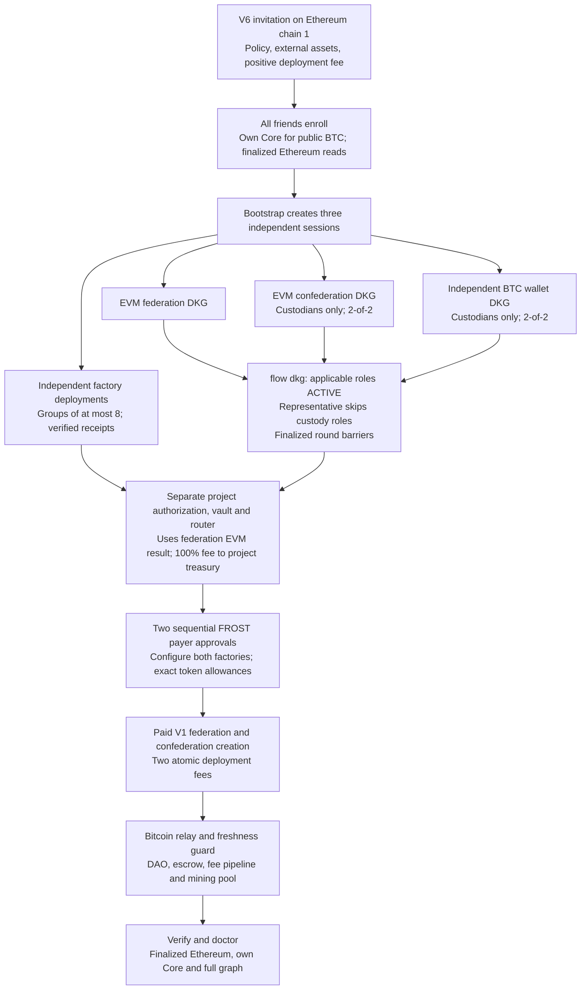

# Ethereum mainnet и Bitcoin mainnet: первый запуск с друзьями

[Схемы: SVG/PNG и hashes текущих Mermaid-исходников](DIAGRAMS.md).

Этот путь разворачивает контракты в **Ethereum mainnet, chain ID `1`**, а Bitcoin
кошелёк и SPV работают в **Bitcoin mainnet**. Используется новое приглашение
**V6**, `mode=backed`, платные фабрики и собственный Bitcoin Core каждого участника.
Все новые приглашения V6 поддерживают независимый выбор EVM и Bitcoin; здесь
показано сочетание двух mainnet. Для testnet4/regtest см. [матрицу сетей](NETWORKS_AND_AUTOMATION.md).

Ни один шаг инструкции не требует пересылки файлов между участниками. Известного
адреса оператора достаточно для обнаружения приглашения; roster, финансовая
политика, transport public keys, DKG и предложения операций читаются из Ethereum.
При этом каждому нужны свой кошелёк, ETH для газа, RPC и проверенный Bitcoin Core.
Локальные identity, cookie, ключ хранения, доли и журналы не публикуются.

## 1. Одинаковый код, свои ключи и узлы

Установите инструменты и соберите одну согласованную версию из
[подготовки первой DKG](FIRST_DKG_ONCHAIN.md#подготовка-каждого-компьютера).
Там же описан скрытый локальный импорт своего EVM-ключа с проверкой адреса и
правами файла `0600`. Не используйте публично известные Anvil-ключи.
Подготовьте отдельный каталог участника с правами `0700`.

Каждый задаёт собственные локальные значения:

```sh
export RPC='<свой Ethereum mainnet RPC>'
export CHAIN_ID=1
export ALICE='<известный полный адрес оператора Alice>'
export BOB='<известный полный адрес Bob>'
export CAROL='<известный полный адрес Carol>'
export ME='<собственный адрес из этого состава>'
export IDENTITY="$HOME/.local/share/satoshify/identity.json"
export PARTICIPANT_DIR="$HOME/.local/share/satoshify/friends-mainnet-v1"
test "$(cast chain-id --rpc-url "$RPC")" = 1
cast block finalized --rpc-url "$RPC"
cast balance "$ME" --rpc-url "$RPC"
export SATOSHIFI_MAX_FEE_PER_GAS_WEI='<свой положительный предел maxFeePerGas в wei>'
export SATOSHIFI_MAX_PRIORITY_FEE_PER_GAS_WEI='<свой положительный предел priority fee в wei>'
export SATOSHIFI_MAX_TX_GAS='<свой положительный предел gas, не более 16777216>'
```

Все три `SATOSHIFI_…` значения задаются **каждым отправителем локально** перед
любой mainnet-транзакцией. Они не публикуются в V6 и не выводятся из баланса
кошелька. Выберите достаточный бюджет после оценки газа; отказ по лимиту не
разрешает клиенту автоматически поднять его. `maxPriorityFeePerGas` не должен
превышать `maxFeePerGas`; `MAX_TX_GAS` ограничен 2²⁴.

Для новых Ethereum mainnet-транзакций общий Bootstrap, включая операции DAO CLI,
явно получает `eth_estimateGas` для блока `pending`, без fallback на `latest`,
и добавляет запас:
`gas = max(ceil(estimate × 130 / 100), estimate + 125000)`. Итог должен укладываться в
ваш `SATOSHIFI_MAX_TX_GAS`; иначе клиент возвращает
`ETHEREUM_TRANSACTION_GAS_LIMIT` **до подписи**, не отправляет транзакцию и не
увеличивает бюджет автоматически. Учитывайте запас при выборе cap. Повтор уже
подписанной транзакции из journal сохраняет прежние байты и nonce; обновление
клиента не увеличивает газ такой транзакции задним числом. Не сбрасывайте journal
или nonce для обхода отказа.

RPC должен поддерживать `finalized`, текущие `eth_call`/code, блоки и receipts
создания, ограниченные запросы logs для обнаружения приглашения, а также
`eth_estimateGas(..., "pending")` для новых транзакций. Прямой CREATE с известным
блоком проверяется без старого состояния; защищённый кеш участника и keeper
сокращает повторные проверки. Первое доказательство вложенного
authorization/validator и поиск неизвестного блока создания могут требовать
исторических `eth_call`/code. Выбирайте провайдера с учётом
[этих границ](CONTRACT_PROVENANCE.md). Неподдерживаемый pending
estimate останавливает отправку; клиент не заменяет его оценкой `latest`.
Chain ID сам по себе
не аутентифицирует провайдера: используйте собственный execution/consensus узел
либо независимо проверенный RPC. У mainnet нет тестового пополнения
`anvil_setBalance`; каждый участник оплачивает свои транзакции настоящим ETH.

На chain `1` клиент требует **как минимум 12 подтверждений и finalized-блок**.
Глубина и финальность применяются совместно; отсутствие `finalized` не включает
fallback на `latest`. Состояние с недостаточной финальностью означает ожидание,
а не повод уменьшить policy. Сохраняйте время для всех подтверждений при DKG.

Каждый поднимает полностью синхронизированный непрореженный Bitcoin Core с
`txindex`; выполните [разделы 1–2 Bitcoin mainnet runbook](BITCOIN_MAINNET_RUNBOOK.md#1-собственный-полностью-проверенный-bitcoin-core).
Оператор формирует `mainnet-policy.json`, остальные автоматически сверяют
опубликованный checkpoint/chainwork со своим Core. У каждого локально определены
`BTC_RPC` и `BTC_COOKIE`; их значения могут отличаться.

## 2. Проверенные внешние активы и бюджет

Ниже описан legacy DAO-профиль с BTC/USD feed и settlement. Для полного
ULR/system-профиля используйте [холодный старт](COLD_START.md): общий USD
проверяется и финансируется отдельно, но BTC/USD feed, rate controller,
TWAP и legacy settlement в этот маршрут не входят. Правила chain 1
о paid factories, finality и локальном gas budget сохраняются.

Оператор выбирает существующие Ethereum mainnet reward token и BTC/USD feed,
проверяет их адреса, runtime hashes, decimals и права управления/обновления.
Клиент сверяет runtime и decimals; это не аудит эмитента или proxy implementation.
Тестовые `DAOTestUSD` и `DAOMockFeed` запрещены. Feed должен иметь 8 decimals и
историю валидных раундов, достаточную для последующего дневного TWAP.
Запрет действует на chain 1 при **любом** выборе Bitcoin. Проверку с тестовыми
USD проводите на local/Sepolia: для regtest они создаются автоматически, для
публичного BTC явно подключаются по [инструкции тестовых активов](NETWORKS_AND_AUTOMATION.md#тестовый-usd-какие-режимы-и-как-настроить).

В V6 есть две различные комиссии:

| Политика | Получатель и единицы |
|---|---|
| `deployment_fee.amount` | Положительная сумма **минимальных единиц внешнего reward token** за каждое создание федерации и конфедерации. |
| `deployment_fee.treasury` | Проверенный ненулевой адрес проектной treasury. Через отдельный project router сюда поступает 100% этих двух комиссий. |
| `wrap_fee_bps`, `unwrap_fee_bps`, `wrap_staker_bps` | Комиссии пользовательского пула и доля дохода DAO; не подменяют deployment fee. |
| `converter_funding` | Inventory того же внешнего reward token для фиксированной котировки конвертера; это отдельный перевод. |

Оператору нужны как минимум **`2 × deployment_fee.amount + converter_funding`**
минимальных единиц reward token и ETH на развёртывание/настройку/relay. Каждому
другу нужен собственный ETH для enrollment, DKG и подписей. Фиксированной оценки
в ETH здесь нет: она зависит от фактического газа и числа заголовков от checkpoint.
Выберите недавний проверенный checkpoint и оцените полный план до broadcast.
`--dry-run` показывает план; он не гарантирует стоимость всех будущих операций.

`FundedFeeConverter` использует явную фиксированную дробную котировку, конечный
inventory и управляемое оператором изъятие liquidity. Он не становится рыночным
обменником из-за выбора mainnet. Выбирайте numerator, denominator и финансирование
как отдельную экономическую политику.
Конвертер доступен любому держателю настроенного input token, не только fee
pipeline. Если фиксированная котировка станет выгодной внешним держателям, они
могут выкупить reward inventory; закладывайте этот риск в финансирование и мониторинг.

## 3. Оператор создаёт и публикует V6-приглашение

Alice — представитель федерации, Bob и Carol — два кастодиана. В этом примере
федерационный EVM DKG имеет порог **3/3**, а отдельные conf-EVM и Bitcoin DKG —
**2/2**, только Bob/Carol. Минимум кастодианов **2**. Для другого состава
создайте другое приглашение, а не исправляйте опубликованный roster.

Сначала задайте проверенные значения переменных ниже. В приглашение не попадают
RPC/cookie; адреса, суммы, комиссии, checkpoint и сроки будут публичными.
`EVM_CONFIRMATIONS` — целое от 12 до 256. `APPROVAL_DEADLINE` — абсолютный Unix
timestamp с достаточным запасом на весь bootstrap. В V6 `--deadline` обязателен: без
него команда возвращает `ETHEREUM_MAINNET_DEADLINE_REQUIRED`; прежние семь суток
не подставляются. Три церемонии выполняются параллельно, каждая имеет по три 24-часовые фазы.
Это максимальные сроки, а не обязательное ожидание: фаза продвигается после
проверенных сообщений всех участников соответствующей роли. Прежняя оценка
bootstrap до custody increment составляла **38–40 часов**, плюс ручные
задержки и догоняющий relay. Задайте `APPROVAL_DEADLINE` с запасом на несколько
дней, например на семь суток от запланированного старта, проверив полученный
Unix timestamp перед публикацией. Не выбирайте суточный общий deadline.
Подробный расчёт и оценка платежей приведены в [разделе времени](NETWORKS_AND_AUTOMATION.md#расчётное-время-запуска-и-платежа).
Все денежные значения —
целые base units, без десятичных точек. Единицы и пределы остальных параметров
описаны в [bootstrap reference](BOOTSTRAP.md).

```sh
frost-signer setup invite --participants "$ALICE" "$BOB" "$CAROL" \
  --threshold 3 --min-custodians 2 \
  --bitcoin-custody-policy config/bitcoin-custody.example.json \
  --min-p2wpkh-sats "$MIN_P2WPKH_SATS" --min-p2tr-sats "$MIN_P2TR_SATS" \
  --treasury "$DAO_TREASURY" --bitcoin-confirmations "$BITCOIN_CONFIRMATIONS" \
  --wrap-fee-bps "$WRAP_FEE_BPS" --unwrap-fee-bps "$UNWRAP_FEE_BPS" \
  --wrap-staker-bps "$WRAP_STAKER_BPS" --deploy-staker-bps "$DEPLOY_STAKER_BPS" \
  --converter-numerator "$CONVERTER_NUMERATOR" --converter-denominator "$CONVERTER_DENOMINATOR" \
  --converter-funding "$CONVERTER_FUNDING" --dao-token-recipient "$DAO_TOKEN_RECIPIENT" \
  --dao-use-reserve "$DAO_USE_RESERVE" --integration-fee-exemption false \
  --ethereum-network mainnet --bitcoin-network mainnet --bitcoin-policy mainnet-policy.json \
  --reward-token "$REWARD_TOKEN" --reward-token-code-hash "$REWARD_TOKEN_CODE_HASH" \
  --reward-token-decimals "$REWARD_TOKEN_DECIMALS" \
  --btc-usd-feed "$BTC_USD_FEED" --btc-usd-feed-code-hash "$BTC_USD_FEED_CODE_HASH" \
  --evm-confirmations "$EVM_CONFIRMATIONS" \
  --deployment-fee-amount "$DEPLOYMENT_FEE_AMOUNT" \
  --deployment-fee-treasury "$PROJECT_TREASURY" \
  --deadline "$APPROVAL_DEADLINE" \
  --deployment-id friends-mainnet-v1 --output invitation.json
frost-signer setup inspect --invite invitation.json
frost-signer setup publish --invite invitation.json --rpc "$RPC" \
  --identity-file "$IDENTITY" --state invitation.sqlite
```

Перед `publish` проверьте `version=6`, `chain_id=1`, Bitcoin mainnet, все адреса,
обе treasury, token/feed, положительную deployment fee, `integration_fee_exemption=false`,
финальность, `phase_duration="86400"`, roster и сроки. Изменённое старое приглашение не становится V6: нужен новый
fingerprint и новые enrollment. Повтор с тем же journal продолжает ту же публикацию.

## 4. Каждый друг обнаруживает приглашение и вступает

Alice также выполняет эти действия как участник:

```sh
frost-signer setup discover --operator "$ALICE" --rpc "$RPC"
export BOARD='<board выбранного опубликованного приглашения>'
export BOARD_BLOCK='<поле block выбранного результата discover>'
export FINGERPRINT='<его проверенный fingerprint>'
frost-signer setup join-chain --board "$BOARD" --rpc "$RPC" \
  --board-creation-block "$BOARD_BLOCK" \
  --accept-fingerprint "$FINGERPRINT" --identity-file "$IDENTITY" \
  --directory "$PARTICIPANT_DIR" \
  --bitcoin-rpc "$BTC_RPC" --bitcoin-cookie "$BTC_COOKIE"
frost-signer setup status --board "$BOARD" --rpc "$RPC" \
  --board-creation-block "$BOARD_BLOCK"
```

`discover` по умолчанию проверяет последние **8192 блока**. Границы возвращаются
в `searched_from_block` / `searched_to_block`; `NOT_FOUND_IN_RANGE` не доказывает
отсутствие более старого приглашения. Для старого запуска расширьте диапазон через
`--recent-blocks` либо задайте `--from-block`; полный поиск включается явно
`--from-block 0`. `BOARD_BLOCK` берётся из выбранного on-chain результата, поэтому
дополнительный канал с Alice не нужен. Это необязательный указатель для следующих
setup-команд, а не доверенное доказательство: клиент проверяет receipt, initcode,
текущий runtime и каноничность блока. Неверный номер останавливает проверку. Если найдено
несколько board, выберите нужный deployment ID и проверьте **все** поля; не берите
первый автоматически. Друзьям не нужен локальный `mainnet-policy.json`: политика
входит в приглашение. Enrollment выполняется только после проверки собственного
Core и принятого fingerprint. Не пересоздавайте transport keys при ожидании финальности.

## 5. Bootstrap и три DKG через Ethereum

После подтверждённого enrollment всех троих только Alice собирает локальный профиль:

Инструкция относится к новому deployment текущей сборкой. V6 и batch endpoints
меняют runtime контрактов: это не автоматическое обновление старых V3–V5 board.
Сохранённый совместимый план продолжают через `--deployment` и исходный journal,
не пересобирая его из `--profile`. Если транзакции уже отправлены другой сборкой,
сохраните profile/journals и проведите отдельную проверку миграции; provenance
при несовпадающем bytecode остановит работу. Не редактируйте journal и не сбрасывайте nonce.

```sh
frost-signer setup assemble-chain --board "$BOARD" --rpc "$RPC" \
  --board-creation-block "$BOARD_BLOCK" --output profile.json
frost-signer bootstrap plan --profile profile.json
frost-signer bootstrap apply --profile profile.json --state bootstrap.sqlite \
  --identity-file "$IDENTITY" --dry-run \
  --bitcoin-rpc "$BTC_RPC" --bitcoin-cookie "$BTC_COOKIE"
frost-signer bootstrap apply --profile profile.json --state bootstrap.sqlite \
  --identity-file "$IDENTITY" \
  --bitcoin-rpc "$BTC_RPC" --bitcoin-cookie "$BTC_COOKIE"
```

Оператор сохраняет профиль и journals локально. `bootstrap plan` может содержать
его RPC URL; не публикуйте вывод с credential. `BROADCAST`/`CONFIRMING` требуют
ожидания Ethereum; `AWAITING_PARTICIPANTS` — действий участников;
`AWAITING_BITCOIN_RELAY` — продолжения bounded sync. Код выхода `2` при ожидании
не означает успешное завершение и не повод создавать новое deployment ID.

План создаёт все три независимые DKG. Каждый участник одновременно с операторским
bootstrap запускает один процесс для всех своих ролей:

```sh
frost-signer flow dkg --board "$BOARD" --rpc "$RPC" \
  --identity-file "$IDENTITY" --directory "$PARTICIPANT_DIR" \
  --bitcoin-rpc "$BTC_RPC" --bitcoin-cookie "$BTC_COOKIE" \
  --interval 5 --timeout 86400
```

Итог — `ACTIVE` для `evm_ceremony`, `conf_ceremony` и `btc_ceremony`.
Каждая роль использует отдельные случайные секреты и `.enc` файл. `flow` обходит
начатые роли за один опрос; ожидание раунда одной роли не блокирует другую.
Секретные адресные пакеты зашифрованы HPKE, публичные обязательства проверяются
всеми. Пороговая доля не появляется у оператора целиком.

На chain 1 каждая DKG-фаза имеет deadline через **24 часа** (`phase_duration=86400`),
на Anvil/Sepolia — через час. Полные проверенные раунды продвигаются немедленно
после необходимой финальности; ждать 24 часа не требуется. `FAILED`/`EXPIRED`
требует новой церемонии, состав не сокращается автоматически. Нет флага продления
фазы; CLI `--timeout` и общий `--deadline` её не меняют.

Сообщения одного отправителя объединяются в ограниченные батчи: до 16 пакетов и
16384 байт на `DKGOnchainBoard`, до N−1 hashes/receipts на registry. Одна церемония
3/2 требует 18 транзакций: 6 на каждого вместо 11. У каждой из трёх ролей своя
DKG; 18 не означает общий бюджет всего bootstrap. Проверки sender/context/session,
HPKE, полного round1/round2 и всех N attestations сохраняются. Каждое принятое
состояние chain 1 должно быть finalized и иметь выбранную глубину подтверждений.
Публикация раскрывает адреса, timing и размеры пакетов, но не приватные доли.

## 6. Подписи комиссий и настройки

Оператор продолжает один и тот же journal:

```sh
frost-signer flow bootstrap --profile profile.json --state bootstrap.sqlite \
  --identity-file "$IDENTITY" \
  --bitcoin-rpc "$BTC_RPC" --bitcoin-cookie "$BTC_COOKIE" \
  --interval 5 --timeout 604800
```

`flow bootstrap` ждёт подтверждений и продолжает разрешённые шаги. Он не
одобряет финансовые intents или custodian actions за участников. Каждый
независимо читает следующее предложение:

```sh
frost-signer setup pending --board "$BOARD" --rpc "$RPC"
```

Проверяйте target, method, hash args, сумму, treasury, сеть и nonce. Значения `ROLE`
и `SESSION` берутся из `intent.role` и `session` этого ответа, а не из сообщения друга.
После проверки выполняют только участники roster указанной роли: для
`evm_ceremony` Alice/Bob/Carol, для `conf_ceremony` только Bob/Carol:

```sh
export ROLE='<intent.role>'
export SESSION='<session>'
frost-signer dkg sign-evm --board "$BOARD" --role "$ROLE" --rpc "$RPC" \
  --session "$SESSION" --identity-file "$IDENTITY" \
  --state "$PARTICIPANT_DIR/$ROLE.enc" --password-file "$PARTICIPANT_DIR/password" \
  --bitcoin-rpc "$BTC_RPC" --bitcoin-cookie "$BTC_COOKIE"
```

Повтор нужен для commitment, затем share и завершения threshold-подписи.
Project router получает отдельные authorization и vault. Автоматический V6
bootstrap использует для project authorization уже завершённый `evm_ceremony`
result: это **тот же ключ/состав**, но отдельные contracts, target hashes и nonce.
Независимая четвёртая project DKG через legacy manifest/package CLI на chain `1`
не поддерживается. Процедура отдельной project DKG в
[staged deployment](STAGED_DEPLOYMENT.md) относится к Anvil/Sepolia.
Два `setPayer` подписываются последовательно: после первой операции nonce
изменяется, поэтому второй hash нельзя заранее считать тем же.

Далее bootstrap один раз задаёт положительную fee каждой фабрике, выдаёт точный
ERC-20 allowance и выполняет два платных V1 deployment. Каждая комиссия переводится
атомарно с созданием продукта; неудачная транзакция не удерживает комиссию.
Обе комиссии идут в `PROJECT_TREASURY`; confederation DAO имеет отдельный поток
wrap/unwrap и собственную treasury. Exemption на Ethereum mainnet запрещён.

При `AWAITING_CUSTODIAN_APPROVALS` Bob и Carol проверяют тот же intent, берут
`SESSION` и `OPERATION_HASH=intent.operation_hash`, затем каждый выполняет:

```sh
frost-signer setup approve-custodian --board "$BOARD" --rpc "$RPC" \
  --session "$SESSION" --operation-hash "$OPERATION_HASH" \
  --identity-file "$IDENTITY" --state "$PARTICIPANT_DIR/custodian.sqlite"
```

После подтверждений Alice продолжает `resume`. Не клонируйте журналы identity
между процессами и не создавайте новый nonce journal для обхода зависшей транзакции.

Последовательность ниже показывает именно автоматический V6 bootstrap:



Все связи на схеме — порядок зависимостей; ожидания DKG, подписей, Bitcoin headers
и finalized receipts могут останавливать текущую стадию без повторного deployment.

## 7. Проверка и первый платёж

Оператор выполняет:

```sh
frost-signer bootstrap verify --profile profile.json --state bootstrap.sqlite \
  --bitcoin-rpc "$BTC_RPC" --bitcoin-cookie "$BTC_COOKIE"
frost-signer doctor --profile profile.json --state bootstrap.sqlite --json \
  --bitcoin-rpc "$BTC_RPC" --bitcoin-cookie "$BTC_COOKIE"
```

`VERIFIED` и `READY_MAINNET_PROTOCOL` подтверждают технические проверки в момент
вызова. Они не подтверждают надёжность выбранного эмитента, oracle или хранения
ключей. Каждый друг также выполняет `dkg verify` только для своих ролей по первой
DKG-инструкции; участники Bitcoin-ключа затем закрепляют
[Bitcoin registry](BITCOIN_SIGNER_TRUST.md). Новый план содержит дополнительные
custody bindings: перед funded launch заново оцените именно его steps и лимиты,
не принимайте историческую оценку времени за гарантированный срок.

Полный платёж выполняется по [on-chain payment runbook](BITCOIN_ONCHAIN_RUNBOOK.md):
`btc-prepare` → reserve/bind intents → `btc-commit` → `btc-sign` → `btc-broadcast`
→ `btc-settle`. Для mainnet всегда передавайте свой Core. План и публичные FROST
пакеты находятся в `BitcoinSigningBoard`; отдельный канал или общий файл не нужен.
`flow payment` продолжает указанный batch, `flow relay` обслуживает заголовки;
примеры приведены в [инструкции автоматизации](NETWORKS_AND_AUTOMATION.md).
Одноразовые `dkg btc-network-status`/`dkg btc-relay` описаны в
[Bitcoin mainnet runbook](BITCOIN_MAINNET_RUNBOOK.md#4-bootstrap-заполнение-relay-и-проверка-готовности).

Настройте [DAO CLI](DAO_CLI.md) на ту же цепочку и принятый board. Funded daily
settlement требует валидной истории feed и фактически поступивших доходов; наличие
контрактов не создаёт доходы автоматически.

## 8. Скрипты, остановки и пределы проверки

Для отдельного развёртывания инфраструктуры используйте
[staged runner](STAGED_DEPLOYMENT.md): `chain_id=1`, confirmations не ниже 12,
собственные project wallets, явные token/treasury/fee и `INTEGRATION_FEE_EXEMPTION=false`.
`base` и `factories` сами по себе не создают пользовательский DAO или Bitcoin wallet.
Mainnet-скрипты принимают уже завершённые и проверенные DKG results/authorization;
они не добавляют отдельную mainnet project ceremony. Полный поддерживаемый запуск
и on-chain подписи участников выполняются через V6 bootstrap выше.
Отдельные Forge leaf scripts запускайте через `ops/ethereum_rpc_budget.py`,
как показано в [разделе mainnet leaf scripts](STAGED_DEPLOYMENT.md#отдельные-forge-leaf-scripts-на-ethereum-mainnet):
лимиты проверяются на фактически подписанной транзакции до отправки.
Перед broadcast нужны симуляция, размерные проверки и подтверждённая provenance
повторно используемых contracts. Не применяйте `.local.example.json` как готовую
mainnet-конфигурацию; его публично известные адреса относятся к тестовому стенду.

Потеря финальности/receipt, stale или halted Bitcoin relay, глубокая реорганизация,
несогласованные UTXO и sticky recovery требуют остановки. Повторная команда не
отменяет recovery guard. On-chain mint/burn после глубокой Bitcoin-реорганизации
не откатываются автоматически. Требуются резерв и отдельно проверенный план миграции.

Локальные тесты с chain ID `1` проверяют mainnet-кодовые ветви, но не являются
транзакциями в публичной Ethereum-сети. Исторические Bitcoin headers и моделируемые
Core-ответы не заменяют реальную mainnet-выплату. Текущий статус полного прогона
указан в [V6 acceptance](PARALLEL_NETWORKS_ACCEPTANCE.md). Исторические результаты
сохранены в [Ethereum V5 acceptance](ETHEREUM_MAINNET_ACCEPTANCE.md)
и [предыдущем Bitcoin mainnet отчёте](BITCOIN_MAINNET_ACCEPTANCE.md).
Отдельно описаны [риски хранения и SPV](BITCOIN_MAINNET_SECURITY_REVIEW.md). Независимого внешнего
аудита этим bootstrap не добавлено.
