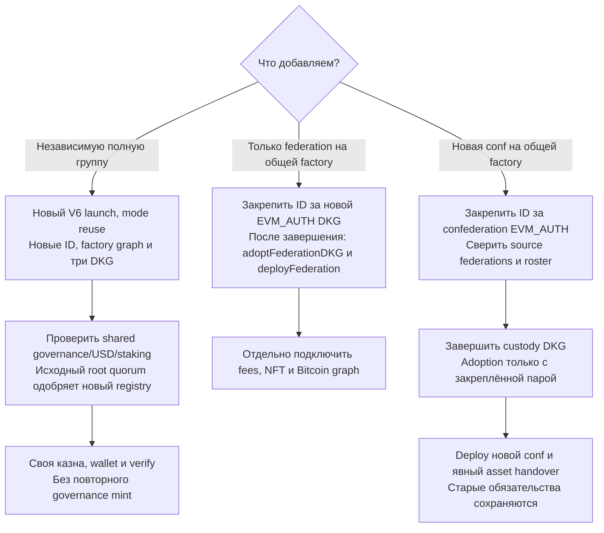

# Федерация и конфедерация: параметры, требования и расширение системы

[Схемы: SVG/PNG и hashes текущих Mermaid-исходников](DIAGRAMS.md).

Актуализация: 5 ноября 2026. [Холодный старт](COLD_START.md) ·
[Конфигуратор](LAUNCH_CONFIGURATOR.md) · [NFT скидок](NFT_CONFIGURATION.md) ·
[FROST и ZK](FROST_ZK_LIFECYCLE.md).

## 1. Что создаёт текущий bootstrap

Один новый полный launch создаёт **одну федерацию и одну конфедерацию** с
собственными factory/deployer, DKG и Bitcoin consumer graph. В штатном
конфигураторе ID выводятся из `deployment_id`: `<id>-fed` и `<id>-conf`.
Имя ERC20-долей задаётся отдельно; совпадение тикеров не объединяет организации.
Идентификатор уникален внутри конкретной factory, поэтому полный адресный
контекст — `chainId + factory address + entity ID`.

`deployment_mode=create/reuse` относится к общим governance/USD/staking/snapshots
и optional startup. Это **не** выбор «создать или импортировать существующую
федерацию». В reuse новый launch всё равно создаёт свою пару и свои фабрики;
импортируются согласованные общие корни и policy канонического Bitcoin root.

## 2. Параметры перед enrollment

| Объект | Поля конфигурации / источник | Что задают |
| --- | --- | --- |
| Общий launch | `deployment_id`, `ethereum_network`, `bitcoin_network`, `bitcoin_backend` | Namespace, chain и relay/ZK profile |
| Федерация | `participants`, оператор первым; `threshold` | Упорядоченные члены federation EVM_AUTH и порог |
| Конфедерация | `participants[1:]`, `custody_threshold`, `min_custodians` | Custodian-only EVM_AUTH, отдельный BTC_SPEND и минимум approvals |
| Доли федерации | `token_metadata.federation_share.name/symbol` | Имя/тикер FS ERC20; не название NFT |
| Доли конфедерации | `token_metadata.confederation_share.name/symbol` | Имя/тикер CS/cBTC ERC20 |
| Governance и MP | `token_metadata.governance`, `token_metadata.mining` | Две другие ERC20-роли |
| Казна и USD | `treasury`, `reward_token.address/runtime_hash/decimals` | Начальный адрес treasury и единый payout asset; fee route связывается планом |
| Комиссии | `wrap_fee_bps`, `unwrap_fee_bps`, converter numerator/denominator/funding | Service fee и отдельная фактически финансируемая MP→USD конверсия |
| Стейкинг | `economics.candidate_threshold`, `minimum_stake`, reserve/bps, startup | Общие immutable пороги, дневная казна и дополнительный prefunded APY |
| Bitcoin custody | `custody_sources`, policy file, confirmations | Разрешённые исходные escrow/MP descriptors и SPV/depth |
| NFT | Отдельный ERC721 и его roles/metadata | В текущий launch JSON не входят; см. отдельный runbook |

Диалог: `frost-signer configure wizard`. Проверка и сборка:

```sh
frost-signer configure validate --config "$LOCAL/launch.json"
frost-signer configure build --config "$LOCAL/launch.json" --output "$LOCAL/launch-v1"
frost-signer setup inspect --invite "$LOCAL/launch-v1/invitation.json"
```

Произвольные `nft_*` или `federation_ids` поля в этот JSON добавлять нельзя:
schema проверяет точный набор ключей. `custody_sources` заполняется публичными
descriptors по [custody runbook](BITCOIN_CUSTODY_TRANSFER.md); пустой список
допускает прямые депозиты, но не обмен внешнего MP. Начальные metadata кастодианов
план генерирует как `custodian-N`, pubkey `0x02`, `isInstitutional=true`.
Эти поля не являются проверкой лицензии, личности или реальной BTC public share;
рабочие Bitcoin public shares получаются в отдельном DKG.

Factory config оставляет `spvConfirmationDepth=0`; это не отключает SPV и
не заменяет глубину consumers. Читайте фактические `depth()` deposit registry /
withdrawal escrow и enrolled Bitcoin policy. В launch задаётся fixed-percentage
fee; raw fee manager также имеет dynamic branch и отдельные approved setters,
но wizard не создаёт произвольную dynamic fee policy.

## 3. Требования к составу и порогам

Для **V6 custody-профиля конфигуратора**, пусть `N` — длина participants,
`C=N−1` — кастодианы, `t_F` — federation threshold,
`t_C` — custody threshold, `k` — min custodians:

```text
3 ≤ N ≤ 16;  2 ≤ C ≤ 15
ceil(0.7 N) ≤ t_F ≤ N,  t_F > 1
max(2, ceil(0.7 C)) ≤ t_C ≤ C
t_C ≤ k ≤ C
conf EVM roster = BTC roster = participants[1:]  # ключи разные
```

Порядок и индексы не переставляют после enrollment. Адреса уникальные и ненулевые.
Первый участник — представитель федерации; он не получает долю custody-ключей.
При первоначальном DKG требуется каждый член своей роли, а после completion
подписывает достаточный порог. Формулы — ограничения **этого профиля**, не
универсальный закон всех raw factory API.

Примеры:

| Представители / кастодианы | Federation EVM | Conf EVM и BTC | Custodian approvals |
| --- | --- | --- | --- |
| 1 + 2 | 3-of-3 | Два отдельных 2-of-2 | 2 |
| 1 + 4 | Минимум 4-of-5 | Два отдельных минимум 3-of-4 | 3 или 4 |

H (default 200000 wallet + own stake) определяет доступность **кандидата**
после tracked nomination. Он не заменяет эти quorum и не является обязательным
балансом каждого начального custodian в bootstrap. NFT не требуется ни для
создания федерации, ни для DKG, кандидатуры, Bitcoin-подписи или claim.

Порог и roster уже завершённого DKG закреплены в authorization. Изменение
активного списка `CustodianValidator` не пересоздаёт его ключ. Делегированные
stake-голоса также не повышают число custodian approvals.

## 4. Кто разрешает создание и изменения

| Действие | Фактическая граница разрешения |
| --- | --- |
| Публикация/присоединение V6 | Своя EVM identity, проверенный fingerprint и provenance |
| Резервирование ID федерации или конфедерации | `feeSetupAuthority()` соответствующей factory один раз связывает ID с конкретной DKG |
| V1 factory adoption | Закреплённая пара ID и DKG, completed EVM_AUTH на **каноническом registry** этой factory, допустимый инициатор и проверка roster/threshold |
| `deployFederation` / `deployConfederation` | Deployment initiator либо разрешённый участник; complete DKG, одноразовость и deployment fee policy |
| Изменения fee manager, pool bindings, deactivation | Target-bound FROST approval; у confederation также требуемые custodian approvals |
| Управляемые NFT create/mint | Fee manager исполняет точный FROST-approved вызов, в conf также custodian minimum; issuer/admin/usage остаются у manager |

Создание нового entity на raw factory не является вызовом произвольного
FROST-approved admin action: его собственные проверки перечислены выше.
V6 дополнительно связывает параметры/имена в invitation и signer review.
На Ethereum mainnet factory deployment fee обязателен; вызывающий заранее
имеет выбранный USD и точный allowance. У новой factory сначала одноразово
настраивается fee policy её `feeSetupAuthority`, а project router должен
принять эту factory как payer. Штатный bootstrap делает эти шаги по плану.
Local/Sepolia могут использовать явный integration fee exemption.

## 5. Дополнительная независимая федерация: рекомендуемый полный путь

Если нужна следующая группа со своим Bitcoin-кошельком, но общим governance
и стейкингом, используйте **новый полный launch в reuse**:

1. Получите verified manifest исходной группы, `ulr.reuse_policy` V2,
   `system.family_root_policy`, исходный board и независимые pins.
2. Новая группа выбирает новый deployment ID, свои identity/roster и пороги,
   сети, имена MP/FS/CS, treasury reserve/bps и funding. Общие governance,
   USD, staking thresholds и startup parameters должны совпасть с reuse policy.
3. Каждый готовит хост/Core; при ZK каждый готовит свой prover. Повторно
   участвующий человек сохраняет исходную identity/EOA journals, но заводит
   отдельный participant directory для нового invitation и DKG.
4. Оператор проходит wizard в режиме `reuse`, задаёт файлы reuse/root policy,
   проверяет bundle и публикует новое invitation. Все независимо review/join.
5. Пройдите ETH pause, три собственных DKG, pin **исходного** root,
   target-bound FROST/custodian approvals и distribution pause существующего токена.
6. Исходная root-группа отдельно одобряет enrollment нового Bitcoin registry.
   Новый quorum не может подписать вместо неё. Это не передача BTC и не выдача
   shares её ключа новым участникам.
7. Пройдите relay health либо собственные ZK proofs/Fresh, завершите verify
   и фактический smoke. Новый launch добавляет свою казну/voting/pipeline;
   нового governance issue, общего staking или повторного startup funding нет.
8. Для daily snapshot объедините проверенные treasury descriptors в общий
   системный pin; исходная snapshot authority и полнота inventory сохраняются.

```sh
frost-signer configure wizard --output "$LOCAL/next-launch.json"
frost-signer configure validate --config "$LOCAL/next-launch.json"
frost-signer configure build --config "$LOCAL/next-launch.json" --output "$LOCAL/next-launch-v1"
frost-signer setup inspect --invite "$LOCAL/next-launch-v1/invitation.json"
```

В wizard явно выберите reuse и новый ID. Далее используются команды
[холодного старта](COLD_START.md), с новыми participant/bootstrap journals,
а не `resume` прежней группы. Для внешнего MP заранее включите проверенный
source descriptor; cBTC выдаётся только после фактического BTC handover.

## 6. Дополнительная федерация на существующей factory

Factory поддерживает много федераций, но у `configure/bootstrap` нет отдельной
команды «добавить только федерацию на эту factory». Нельзя подменить адрес
`federations` в уже подписанном bootstrap, чтобы получить такой режим.
Это отдельный V1 factory workflow со своим orchestration и review:

| Шаг | Контракт / обязательное условие |
| --- | --- |
| `reserveFederationId(sessionId,newFederationId)` | Адрес из `feeSetupAuthority()` закрепляет ID за конкретной DKG в этой factory. Это можно сделать до завершения DKG. |
| Новая federation ceremony | Completed `EVM_AUTH` в DKG registry этой factory. На новом реестре создаёт `ceremonyRegistrar` или назначенный им создатель на этот ID |
| `adoptFederationDKG(sessionId,newFederationId)` | Точное совпадение с резервом, неиспользованный session, вызывающий участник результата |
| Deployment fee | Проверить configured policy; при платном пути allowance в правильном reward asset |
| `deployFederation(sessionId,shareName,shareSymbol)` | Инициатор/участник, тот же completed result, повторный deploy отклоняется |
| Проверка результата | `getFederation(newId)`, authorization/result/roster, shares, pool, активность и provenance |
| Подключение возможностей | Fee manager/NFT, Bitcoin graph, pools, canonical-root admission и сервисы — отдельные действия, не следствие одной factory записи |

Сверьте `reservedFederationSession(newFederationId)` перед adoption. Повтор
резервирования той же пары допустим. Подменить session или закрепить за ним
второй ID нельзя. Если зарезервированная церемония прервана, согласуйте новый
ID и новый session. Полный bootstrap резервирует пару из приглашения сам.

Для ручного расширения передайте согласованные значения администратору factory.
`FACTORY_ACCOUNT` обозначает его локальную зашифрованную учётную запись Foundry.

```bash
cast call "$FEDERATION_FACTORY" 'feeSetupAuthority()(address)' --rpc-url "$RPC"
cast send "$FEDERATION_FACTORY" 'reserveFederationId(bytes32,string)' \
  "$DKG_SESSION_ID" "$FEDERATION_ID" --rpc-url "$RPC" --account "$FACTORY_ACCOUNT"
cast call "$FEDERATION_FACTORY" 'reservedFederationSession(string)(bytes32)' \
  "$FEDERATION_ID" --rpc-url "$RPC"
```

Дождитесь согласованной глубины подтверждений. Затем участник завершённой DKG
выполняет adoption. Для старых factory действуют правила их bytecode.

Этот сценарий добавляет федерацию в существующую factory. Legacy-метод
`initiateFederationDKG` доступен владельцу namespace на local/Sepolia для
свободных ID. Mainnet использует V1. Raw federation adoption использует параметры
completed DKG и не добавляет сам по себе 70%-ограничение V6 invitation.
[Как делегировать создание DKG на конкретный ID](DKG_PROTOCOL_V1.md#ceremony-creation).

## 7. Дополнительная конфедерация на существующей factory

Согласуйте ID новой конфедерации и её EVM_AUTH session ID. Адрес из
`feeSetupAuthority()` общей `ConfederationFactory` закрепляет эту пару.
Это можно сделать до завершения DKG. Bitcoin DKG проходит отдельно.

```bash
cast call "$CONFEDERATION_FACTORY" 'feeSetupAuthority()(address)' --rpc-url "$RPC"
cast send "$CONFEDERATION_FACTORY" 'reserveConfederationId(bytes32,string)' \
  "$CONF_EVM_SESSION_ID" "$CONFEDERATION_ID" --rpc-url "$RPC" --account "$FACTORY_ACCOUNT"
cast call "$CONFEDERATION_FACTORY" 'reservedConfederationSession(string)(bytes32)' \
  "$CONFEDERATION_ID" --rpc-url "$RPC"
```

Дождитесь согласованной глубины подтверждений и сверьте пару. Она обязательна
для `adoptConfederationDKG`, `adoptConfederationFromFederation` и
`adoptCustodianConfederationDKG`. После adoption инициатор или участник
выполняет `deployConfederation` с действующей fee policy. Полный bootstrap
сам резервирует пару из приглашения и проверяет её при `resume`.

Повтор той же пары допустим. При прерванной зарезервированной церемонии
согласуйте новый ID и session. Legacy `initiateConfederation` на local/Sepolia
доступен адресу из `feeSetupAuthority()` для свободных ID и отклоняет
зарезервированные сессии. Обновлённое правило действует на новой factory.

### Несколько федераций в конфедерации

`ConfederationFactory.adoptCustodianConfederationDKG` может создать **новую**
конфедерацию с несколькими активными federation IDs из своей `federationFactory`.
Требуются уникальные непустые IDs (до 16), активные source entities, отдельный
completed custody EVM_AUTH и соответствующий roster/threshold. Представители
этих федераций сохраняются как association metadata; они не входят в custody
signer roster. Raw factory допускает 2–16 custodians, порог не ниже 70% и
`threshold ≤ minCustodians ≤ custodianCount`; это шире wizard с одним представителем.

Готовый wizard/bootstrap сейчас принимает одну generated federation на launch,
а не произвольный список существующих federation IDs. Multi-federation factory
formation — отдельный workflow. Автоматического `addFederation` в уже созданную
конфедерацию и изменения её исходного DKG epoch в этой factory нет.
Новая ассоциация/ключ требует нового согласованного formation/deployment;
перенос активов и сохранение старых обязательств выполняются явно.



## 8. Источники и границы

[FederationFactory](../web3/contracts/src/federation/FederationFactory.sol),
[ConfederationFactory](../web3/contracts/src/federation/ConfederationFactory.sol),
[V6 admission](../signer-agent/signer_agent/onboarding.py),
[custody policy](../signer-agent/signer_agent/bootstrap_custody.py),
[generated plan](../signer-agent/signer_agent/bootstrap_plan.py).
NFT не является admission-требованием этих API. Возможность factory API
не означает готовый CLI для всех topology. Исторический [отчёт проверки](../ops/artifacts/entity-setup-docs-20261105/README.md)
описывает состояние до NFT-исправлений. Текущий [NFT runbook](NFT_CONFIGURATION.md)
содержит CLI create/mint, независимый pin, защиту quota и новые регрессии;
production qualification остаётся отдельной приёмкой.
