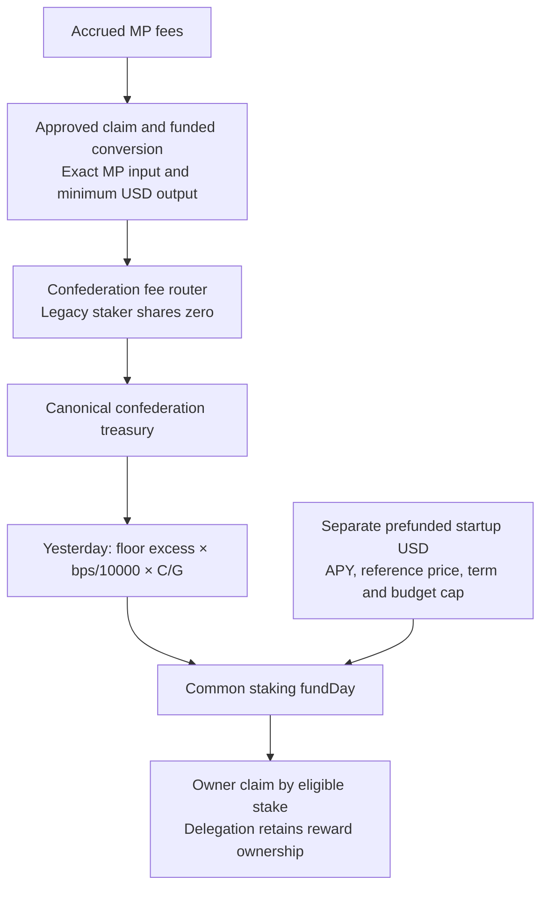
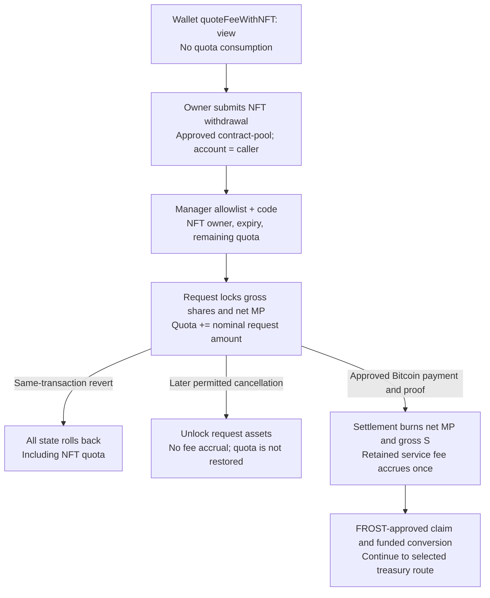
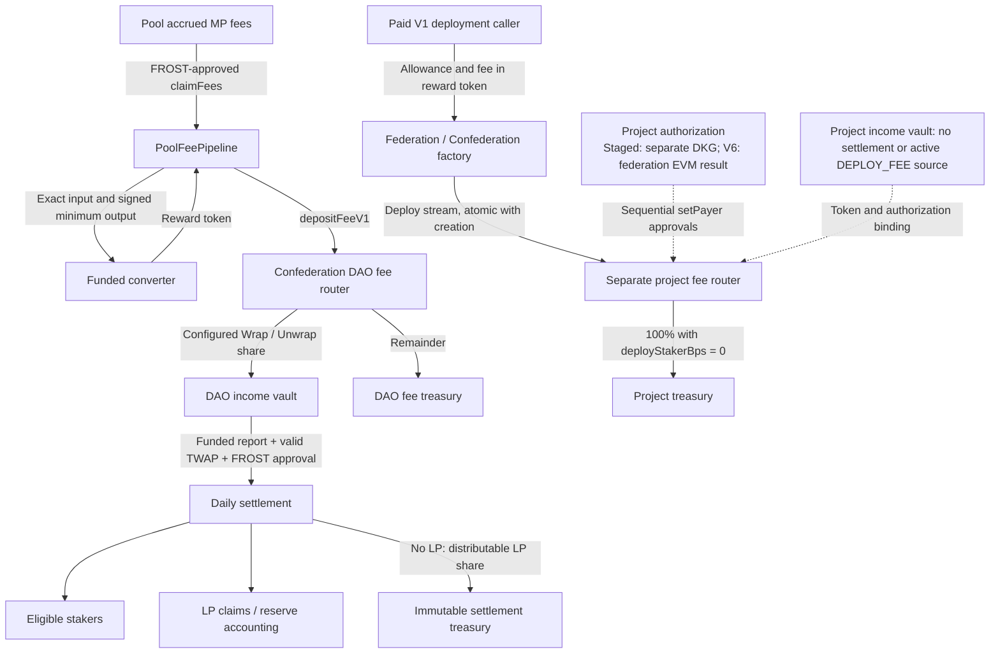

# Funded fees and project deployment fees

[Схемы: SVG/PNG и hashes текущих Mermaid-исходников](DIAGRAMS.md).

[Параметры федерации/конфедерации и новые группы](FEDERATION_CONFEDERATION_SETUP.md) ·
[NFT скидок: параметры, роли и требования](NFT_CONFIGURATION.md).

Managed discount NFTs are created and minted through typed fee-manager FROST
operations, with additional custodian approvals for confederations. Public
`quoteFeeWithNFT` is read-only. Only governance-authorized contract collectors
can call consuming `calculateFeeWithNFT`; canonical pools bind the account to
their caller and check NFT ownership. A governance-approved pool is a trusted
quota consumer. A discount changes the service fee, not BTC miner fees or gas.

The opt-in [ULR treasury route](ULR_TREASURIES.md) sends realized confederation
fees to `ULRConfederationTreasury` after sequential FROST-approved router changes:
set the old fee shares to zero, then redirect its treasury. The common daily
custodian snapshot weights wallet plus personal staked ULR. Each enrolled treasury
pays `floor(max(balance - R, 0) * bps * confederationULR / (10000 * systemULR))` to
`ULRStaking` once for yesterday's UTC day. Remaining funds stay in treasury.
The existing claim/conversion pipeline is reused; historical vault/LP/staker
obligations remain in the original system. The project deployment-fee route
below retains its separately approved policy.

The [ULR bootstrap profile](ULR_BOOTSTRAP.md) deploys this route directly with
zero legacy shares and the confederation treasury as recipient. It does not need
the two router migration operations above or a legacy daily settlement contract.

Reserve R and payout bps are immutable launch parameters (defaults: USD 1000,
9000 bps). Optional startup APY uses a separate prefunded USD balance and adds
funds to the same staking day; it does not spend converter inventory or treasury
funds automatically. See [exact units, rounding and invariants](LAUNCH_MATHEMATICS.md).

NFT quota and collected fees change at different stages:

The following diagram documents the legacy DAO route alongside the separate
project deployment-fee route; the ULR route is shown above.

The user-confederation DAO fee flow and the project deployment-fee flow use
separate authorization contracts, vaults and routers. In the Anvil/Sepolia staged
CLI the project has its own DKG epoch; Ethereum mainnet V6 reuses the federation
`evm_ceremony` result in its separate project authorization. "Staged: separate DKG"
in the diagram refers to that test-EVM legacy manifest/package path; it does not
promise a fourth mainnet ceremony:

## Pool fees to the DAO

`PoolFeePipeline.route` executes the complete transaction:

1. Consume its own target-bound FROST operation specifying pool, stream, amount,
   UTC day, minimum output and deadline.
2. Call the pool's independently authorized `claimFees` with recipient fixed to
   the pipeline. Claims transfer actual accrued MP and reduce tracked TVL;
   confederation claims additionally require custodians.
3. Approve exactly the input amount to the configured converter, convert, and
   zero the allowance. `FundedFeeConverter` is an explicit fixed
   treasury quote: it holds real reward-token liquidity and never mints. An
   exhausted treasury, wrong amount, expired deadline or minimum failure reverts
   the whole claim and restores all consumed approvals/accounting.
   Conversion is also callable directly by any holder of the configured input
   token. This inventory is not reserved exclusively for the fee pipeline:
   an attractive stale fixed quote can let other holders exhaust reward liquidity.
4. Deposit the received reward token into CustodianDAOFeeRouter using the explicit
   `FeeStream { Wrap, Unwrap, Deploy }` interface. The router allocates configured
   basis points to DAO income and transfers the remainder to treasury. Limited
   allowances are cleared after funding. The DAO share is never assumed to equal
   gross protocol revenue.

Wrap fees accrue on exact MP deposits. Unwrap fees accrue only after proven
Bitcoin settlement and S/MP burn. A cancelled request accrues no unwrap fee.
Fee-manager notification failures remain retryable; reporting does not transfer
funds and cannot double accrual.

IncomeVault records WRAP_FEE, UNWRAP_FEE and DEPLOY_FEE separately by source. For
ABI compatibility, `dayWrapFeeIncome` and DayReport's `stakerWrapFeeIncome`
represent the **sum of wrap and unwrap operational fees**. The independent
`dayUnwrapFeeIncome` identifies the unwrap component; `dayDeployFeeIncome` is
strictly deployment revenue. No conversion maps legacy `isWrap=false` from a
multipool into DEPLOY. The old router boolean method retains its original
wrap/deploy semantics; new integrations use `depositFeeV1` exclusively.

## Project deployment fees

Factories configure their fee policy once. A nonexempt V1 deployment transfers
reward tokens from the caller and routes the Deploy fee in the same EVM
transaction as product creation. Failure rolls back the entire deployment and
fee. The [staged deployment](STAGED_DEPLOYMENT.md) creates a separate project
EVM_AUTH authorization, income vault and router. It requires explicit
`DEPLOY_STAKER_BPS=0`, so the entire fee goes to `PROJECT_TREASURY`; no project
settlement or active vault `DEPLOY_FEE` source is installed. Each factory's
`setPayer` approval is prepared and executed before preparing the next hash,
because the router increments its operation nonce. V6 Ethereum mainnet bootstrap
automates that paid sequence with a separate project authorization bound to its
completed federation EVM result, project split 0/0, exact factory allowances and
positive fees. The invitation commits fee amount and project treasury. Both
factory creations cost one fee each; converter funding is a separate transfer.

V3/V4 integration bootstrap explicitly chooses a zero-fee exemption;
this flag is visible and restricted to chain IDs 31337 and 11155111. Exemption
is not automatic on Sepolia. A paid test needs newly configured factories with
`exemption=false`; an exempt factory cannot be switched later. Paid deployments
of both factory types passed local integration tests. The public Sepolia paid
scenario has not been executed; see the [current review](UPGRADE_REVIEW_2026_10_18.md).

## Legacy DAO settlement and explicit financial policy

The DAO keeps its existing 10,000,000-token fixed supply, 120 ppm/day starting
rate, ceil(2N/3) snapshot voting, future-day reserve decisions, full-day stake
eligibility, ordered funded settlement and non-debt deficit accounting. Historical
TWAP still requires a complete validated round sequence. Day settlement consumes
exact recorded source income, funds staking, and prevents duplicate claims.
The local USD/feed are integration fixtures. V6 with either public Bitcoin or
Ethereum mainnet uses external token/feed identities, while retaining an explicit
fixed treasury quote and finite inventory. On Sepolia/local these may explicitly
refer to test USD/feed; Ethereum mainnet rejects the packaged test components.
Neither profile selection nor code hashes certify economic backing or oracle safety.

An empty LP list is valid: the distributable LP share goes to the immutable
settlement treasury in the same transaction. With no eligible stakers either,
their share goes there as well. No LP means the prior reserve is not drawn down;
legitimate price history is still required. The invitation and CLI require
explicit fee shares, converter ratio/funding, treasury, reserve policy and
exemption; these are checked against the deployment rather than supplied as
hidden bootstrap defaults.

The local converter deployer is its explicit treasury: `withdrawLiquidity` recovers
received MP or unused reward inventory. Received MP can then use the same direct
proof-settlement redemption path; it is not permanently trapped in the converter.
