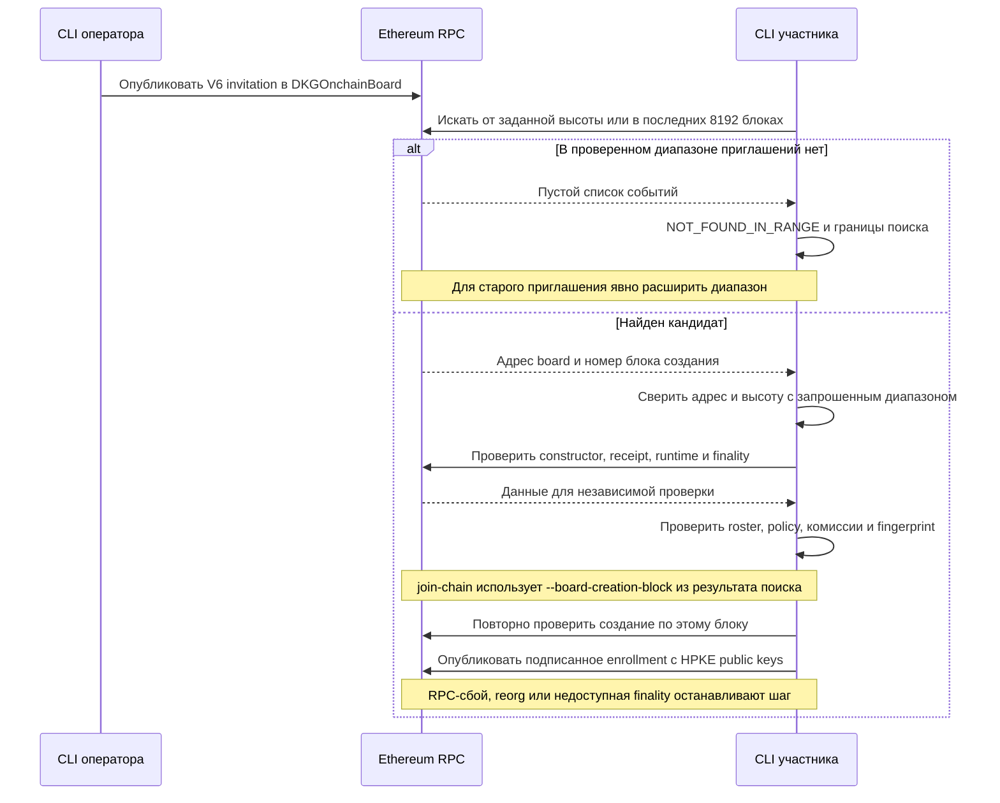

# Первый запуск: код и адреса друзей

[Схемы: SVG/PNG и hashes текущих Mermaid-исходников](DIAGRAMS.md).

Эта страница показывает новое приглашение **V6** для EVM Anvil/Sepolia и Bitcoin
regtest. Выбор Ethereum и Bitcoin независим: поддержаны все девять сочетаний
Ethereum mainnet/Sepolia/local × Bitcoin mainnet/testnet4/regtest; обязательные
параметры приведены в [матрице сетей и автоматизации](NETWORKS_AND_AUTOMATION.md).
Для публичного Bitcoin используйте [mainnet policy](BITCOIN_MAINNET_RUNBOOK.md)
или [testnet4 policy](NETWORKS_AND_AUTOMATION.md#bitcoin-testnet4); для Ethereum
chain 1 — [mainnet-инструкцию](ETHEREUM_MAINNET_RUNBOOK.md).
Нужны доступ к выбранному EVM RPC, собственный EVM-кошелёк каждого участника и
тестовый ETH для газа. Адрес друга не позволяет подписывать за него.
Все сообщения между участниками этого bootstrap передаются **через EVM**.
HTTP relay, общий диск, пересылка manifest/долей в мессенджере не требуются.

Для полного продукта с общим ULR используйте
[пошаговый system bootstrap](CROSS_PLATFORM_QUICKSTART.md#8-оператор-полный-ulr--bitcoin-профиль).
Пример ниже сохраняет отдельную прежнюю DAO-экономику, но новое приглашение
уже выбирает `bitcoin_custody`: две денежные DKG конфедерации без представителя.
Состав ключей и передача внешнего обеспечения показаны в
[custody runbook](BITCOIN_CUSTODY_TRANSFER.md). Старое приглашение без этого поля
сохраняет прежние 3-of-3; оно не меняется вместе с этой инструкцией.

Открыты: приглашение, состав группы, порог, транспортные public keys, публичные
DKG-обязательства, квитанции и параметры операций. Адресные round-2 packages
публикуются как HPKE ciphertext; расшифровывает их только получатель своим
локальным транспортным ключом. Ни SecretPackage, ни итоговая signing share,
ни секретные nonce не публикуются. Контракт не способен проверять смысл
шифротекста: это обязанность локального агента и библиотеки FROST.

Этот bootstrap разворачивает интеграционный стенд: Bitcoin regtest, тестовый
USD-токен/feed/converter и явное начальное освобождение фабрик от комиссии.
Этот regtest integration-профиль не является запуском с обеспечением реальными BTC. `mode=backed`
используется для Ethereum mainnet либо публичного Bitcoin; внешние token/feed и
проверки сети зависят от выбранного сочетания.
Освобождение постоянно для этих фабрик: настройка комиссии одноразовая.
Платный сценарий требует отдельной фабрики с исходной настройкой fee/router;
команды ниже не переключают уже созданную освобождённую фабрику на платную.

## Подготовка каждого компьютера

Поддерживаемый терминал — macOS/Linux (на Windows используйте Linux/WSL).
Каждому нужен доступ на чтение закрытого репозитория: владелец заранее добавляет
друзей в collaborators, либо предоставляет всем одну и ту же проверенную копию кода.
Сам GitHub-доступ не даёт доступа к кошелькам.

Установите Git, Python 3.11+ с `venv`, C/C++ build tools, затем:

- [Rust через rustup](https://rust-lang.org/tools/install/): `rustup toolchain install 1.89.0 --profile minimal`.
- [Foundry](https://getfoundry.sh/introduction/installation/): после установки `foundryup` выполните `foundryup --install v1.8.5`. Добавьте `$HOME/.foundry/bin` в PATH.
- Для локального стенда и полного acceptance скачайте **Bitcoin Core 30.3** из
  [архива релиза](https://bitcoincore.org/bin/bitcoin-core-30.3/), выбрав свою ОС/архитектуру;
  проверьте SHA256SUMS и подписи по [инструкции Core](https://bitcoincore.org/en/download/).
  Добавьте распакованный каталог `bitcoin-30.3/bin` в PATH. Для DKG с Bitcoin regtest
  Core не нужен; enrollment с Bitcoin mainnet/testnet4 требует собственный проверенный Core.

```sh
git clone https://github.com/mrShizo/satoshify.git
cd satoshify
git rev-parse HEAD
rustup override set 1.89.0
python3.11 -m venv .venv
.venv/bin/pip install -r signer-agent/requirements.lock
.venv/bin/pip install --no-deps -e './signer-agent[test]'
source .venv/bin/activate
cargo build --locked --manifest-path frost-crypto/Cargo.toml
forge build --root web3
python ops/generate_abis.py --check
frost-signer setup --help
forge --version
anvil --version
rustc --version
```

Все используют один commit и настройки компилятора из `web3/foundry.toml`
(solc 0.8.30); зависимости Solidity уже в репозитории, `forge install` не нужен.
Автоопределение remappings выключено: абсолютный путь к клону не должен попадать
в metadata и менять runtime. `BOARD_BUILD_MISMATCH`/`REGISTRY_BUILD_MISMATCH`
не обходят отключением проверки: сверьте commit и настройки сборки. При переходе
со старой сборки с абсолютными remappings начните новый deployment/board.
Сборка с нуля занимает несколько минут. Новому терминалу снова нужны `cd satoshify`
и `source .venv/bin/activate`. Не переносите `.env`, `out`, `cache` или состояния
участников из чужого checkout. Все дальнейшие команды выполняются из корня клона.
При обновлении существующего checkout на эту версию выполните
`forge build --root web3 --force`: test USD/feed перемещены в отдельные файлы,
и старый build cache может оставить одноимённые артефакты. Для нового V6
bootstrap все заново подписывают полное приглашение с явной финансовой политикой;
не дополняйте уже подписанный JSON вручную.

Клиент проверяет также [происхождение контрактов](CONTRACT_PROVENANCE.md):
точный конструктор board, приглашение/состав, адрес создателя и конструктор
DKGCoordinator. RPC должен предоставлять блоки и квитанции с момента deployment.
Исторический код требуется при поиске неизвестного блока создания и при первой
проверке вложенных конструкторов; direct CREATE с известным блоком проверяется
без старого состояния. Недоступное необходимое доказательство или изменившийся
блок останавливают вход в DKG; `--from-block` не отменяет эти проверки.

Для друзей на разных компьютерах выбирайте одну сеть **Sepolia**, chain ID 11155111.
Каждый самостоятельно получает доступ к её RPC и тестовый ETH на **свой** адрес.
Без RPC/газа транзакции невозможны; одни публичные адреса не заменяют собственные
ключи кошельков. RPC URL у каждого может быть свой. Не используйте ключи Anvil
в Sepolia. Для репетиции на одном компьютере сначала запустите локальные узлы
по разделу «Постоянный локальный стенд» ниже и укажите chain ID 31337.

Задайте переменные в каждом терминале, заменив значения в угловых скобках.
Для примера из трёх друзей назначьте Alice оператором по общему правилу:
наименьший числовой EVM-адрес из трёх, затем Bob и Carol по возрастанию. Так выбор
оператора и порядка не требует отдельного сообщения. Сравнивайте адреса целиком.

```sh
export RPC='<свой RPC выбранной сети>'
export CHAIN_ID=11155111
export EVM_CONFIRMATIONS=12
export ALICE='<адрес Alice>'
export BOB='<адрес Bob>'
export CAROL='<адрес Carol>'
export TREASURY="$ALICE"  # явная политика примера; каждый проверяет её в приглашении
export ME='<свой адрес из этих трёх>'
export IDENTITY="$HOME/.local/share/satoshify/identity.json"
export PARTICIPANT_DIR="$HOME/.local/share/satoshify/friends-v1"
```

Только для локального Anvil после запуска узлов задайте `RPC=http://127.0.0.1:8545`
и `CHAIN_ID=31337`, `EVM_CONFIRMATIONS=1`. На этой изолированной сети можно выдать каждому своему адресу
100 тестовых ETH, предварительно проверив сеть:

```sh
test "$(cast chain-id --rpc-url "$RPC")" = 31337 && \
  cast rpc anvil_setBalance "$ME" 0x56bc75e2d63100000 --rpc-url "$RPC"
cast balance "$ME" --rpc-url "$RPC"
```

Для Sepolia используется обычное пополнение тестовым ETH; административного
`anvil_setBalance` там нет.

Alice — оператор и представитель федерации; Bob и Carol — кастодианы
конфедерации. `evm_ceremony` федерации использует **3 из 3**.
Отдельные `conf_ceremony` и `btc_ceremony` используют **2 из 2**, только Bob и
Carol; это два разных ключа. Минимум кастодианов — **2**. Alice участвует
только в федерационной роли. Bitcoin-индексы Bob/Carol — **1/2** в их собственной
церемонии. Policy берётся из `config/bitcoin-custody.example.json` до enrollment.
Для другого состава создайте новое приглашение.

У каждого должен быть собственный identity JSON с полем `private_key` и правами
0600. Для импорта **своего существующего** EVM-ключа используйте локальный скрытый
ввод ниже: он проверяет соответствие `$ME`, не печатает ключ и не перезаписывает
существующий файл. Ключ не вводится в argv или историю команд.

```sh
python - <<'PYCODE'
import getpass, json, os
from pathlib import Path
from eth_account import Account
from web3 import Web3
from signer_agent.dkg import atomic_private
path = Path(os.environ['IDENTITY'])
path.parent.mkdir(mode=0o700, parents=True, exist_ok=True)
key = getpass.getpass('Свой EVM private key (скрытый ввод): ').strip()
account = Account.from_key(key)
if account.address != Web3.to_checksum_address(os.environ['ME']):
    raise SystemExit('Адрес ключа не совпадает с ME')
atomic_private(path, json.dumps({'private_key': account.key.hex()}).encode())
print('Сохранён локальный кошелёк:', account.address)
PYCODE
```

Файл не передают оператору. `join-chain` отдельно создаёт случайный ключ хранения
и три зашифрованных состояния FROST. `PARTICIPANT_DIR` должен быть новым либо
каталогом именно этого участника/приглашения с правами 0700.

## 1. Оператор публикует приглашение

```sh
frost-signer setup invite --participants "$ALICE" "$BOB" "$CAROL" \
  --threshold 3 --min-custodians 2 \
  --bitcoin-custody-policy config/bitcoin-custody.example.json \
  --min-p2wpkh-sats 294 --min-p2tr-sats 330 --treasury "$TREASURY" \
  --bitcoin-confirmations 6 \
  --wrap-fee-bps 100 --unwrap-fee-bps 100 \
  --wrap-staker-bps 2500 --deploy-staker-bps 5000 \
  --converter-numerator 1 --converter-denominator 10000000000 \
  --converter-funding 1000000000 --dao-token-recipient "$ALICE" \
  --dao-use-reserve false --integration-fee-exemption true \
  --chain-id "$CHAIN_ID" --bitcoin-network regtest --evm-confirmations "$EVM_CONFIRMATIONS" \
  --deployment-id friends-v1 --output invitation.json
frost-signer setup inspect --invite invitation.json
frost-signer setup publish --invite invitation.json --rpc "$RPC" \
  --identity-file "$IDENTITY" --state invitation.sqlite
```

Числа выше — явно выбранная политика **этого тестового примера**, а не значения
по умолчанию. До публикации оператор выбирает политику; каждый друг проверяет её
в найденном on-chain приглашении до enrollment. Пропуск любого из этих параметров
останавливает `invite` и генерацию bootstrap-плана.

| Параметр | Значение и единицы |
|---|---|
| `wrap_fee_bps`, `unwrap_fee_bps` | Комиссии wrap/unwrap, 0–10000 bps; 100 bps = 1%. Bootstrap использует фиксированный процент. |
| `wrap_staker_bps` | Доля поступившей комиссии wrap **и unwrap**, направляемая в DAO; 2500 bps = 25%, остаток получает treasury. |
| `deploy_staker_bps` | Доля DEPLOY-комиссии в DAO; 5000 bps = 50%. В освобождённых фабриках этого примера такая комиссия не возникает. |
| `converter_numerator`, `converter_denominator` | Положительные целые `uint256`. Тестовый обмен выдаёт `floor(MP_base_units × numerator / denominator)` минимальных единиц USD. Это выбранная котировка, не рыночный курс. |
| `converter_funding` | Положительное число минимальных единиц тестового USD, первоначально выделяемых конвертеру. У USD 6 decimals: 1000000000 = 1000 test USD. При исчерпании средств обмен отклоняется. |
| `dao_token_recipient` | Ненулевой адрес получателя всего фиксированного начального выпуска governance token. В примере это Alice; адрес указывается отдельно от treasury. |
| `dao_use_reserve` | Явное `true`/`false`: начальная политика использования резерва DAO. Позднее её можно изменить через governance. |
| `integration_fee_exemption` | Для этого bootstrap обязательно явное `true`: одноразовое постоянное освобождение двух создаваемых фабрик от DEPLOY-комиссии. Платный deployment описан в [отдельных стадиях](STAGED_DEPLOYMENT.md). |
| `bitcoin_confirmations` | Одинаковое число подтверждений для deposit registry и withdrawal escrow; целое от 6 до 4294967295. |
| `bitcoin_custody` | Version 1, mode `custodians`, отдельный threshold `2`, `sources: []`. Для внешнего MP сначала закрепить descriptor исходного графа; пустой список не разрешает внешний перенос. |

Числовые поля приглашения записаны десятичными строками без знака, пробелов
и ведущих нулей; булевы — JSON `true`/`false`. Положительные суммы и минимумы
не превышают `uint256`. Выбранные minima 294/330 задаются в сатоши. Параметры
конвертера относятся только к интеграционному стенду: его inventory контролирует
создавший контракт оператор, что зафиксировано самим конструктором. Финансирование
идёт из mintable test USD, не из реальных долларовых резервов.

Публикацию выполняет только Alice; она также выполняет enrollment и DKG как
обычный участник. Новое приглашение V6 **не содержит RPC URL**: `--rpc`
передаётся локально в `publish`, а `assemble-chain` использует RPC того, кто его
запускает. V6 фиксирует обе сети, минимумы, кастодианов, confirmation depth и всю
финансовую политику. Старые подписанные приглашения не меняются автоматически:
смена полей требует нового fingerprint и enrollment. Добавление полей только в
локальный профиль не делает их подписанной policy. Неполная схема отвергается
с `INVITATION_SCHEMA`; legacy V1/V2 не подходят для нового generated bootstrap.

Приглашение фиксирует сеть, порядок/индексы, treasury, порог, три новых
случайных session ID, protocol version, epoch, часовой лимит каждой DKG-фазы и
общий срок bootstrap approvals. По умолчанию последний срок — семь суток.
При необходимости `invite --deadline` задаёт абсолютный Unix timestamp.

Повтор `publish` с тем же journal не создаёт второй board. Любые изменения
приглашения после публикации требуют нового deployment ID и нового согласия.

## 2. Каждый друг самостоятельно находит приглашение

```sh
frost-signer setup discover --operator "$ALICE" --rpc "$RPC"
```

Если RPC требует фильтр по адресу, добавьте `--board "$BOARD"`. Если он
ограничивает число блоков на запрос, задайте `--log-page-size 10` и узкий
диапазон через `--recent-blocks` или `--from-block`. Когда известны board
и блок создания, можно сразу выполнить `setup status` с
`--board` и `--board-creation-block`.



Команда ищет события оператора, проверяет точный runtime из локальной сборки,
оператора контракта и сеть. По умолчанию поиск ограничен последними **8192 блоками**.
При несовпадении адреса `--board` или диапазона SDK возвращает
`DISCOVERY_EVENT_SCOPE`. Кэш подтверждённого конструктора также сверяет явно
переданный блок создания.
Передайте `--launch-config "$LAUNCH_CONFIG"`, чтобы применить высоту
`evm_discovery_from_block` из конфигуратора. Подтверждённый `setup publish`
возвращает `board` и `block` для прямой проверки по блоку создания.
Результат показывает точные границы диапазона; `NOT_FOUND_IN_RANGE` не означает
отсутствия более старого приглашения. Для него расширьте окно через
`--recent-blocks 65536` или задайте `--from-block`. Полный поиск от genesis
включается явно: `--from-block 0`. На Sepolia он может занять много RPC-запросов;
подходящий `--from-block`
можно взять из общедоступной истории транзакций Alice в той же сети. Если поиск
неполон или RPC ограничивает диапазоны логов, это не означает отсутствия board.
Если приглашений несколько, выберите нужный deployment ID. Не выбирайте первое
автоматически. Проверьте показанные адреса, порог, treasury, получателя governance
token, комиссии/доли, котировку и сумму финансирования, reserve/exemption,
Bitcoin depth, назначение и сроки.
`$BOARD`, `$BOARD_BLOCK` (поле `block`) и `$FINGERPRINT` берутся из этого on-chain
чтения; пересылать их не нужно. В `join-chain`, `status`, `pending`, `assemble-chain`
и `manifest-chain` можно добавить `--board-creation-block "$BOARD_BLOCK"`: клиент
проверит создание по известному блоку, сохраняя все проверки конструктора.

После проверки установите локально `BOARD`, `BOARD_BLOCK` и `FINGERPRINT` из выбранного элемента
массива `invitations` (не из чужого сообщения):

```sh
export BOARD='<поле board>'
export BOARD_BLOCK='<число из поля block>'
export FINGERPRINT='<поле fingerprint>'
frost-signer setup join-chain --board "$BOARD" --rpc "$RPC" \
  --board-creation-block "$BOARD_BLOCK" \
  --accept-fingerprint "$FINGERPRINT" \
  --identity-file "$IDENTITY" --directory "$PARTICIPANT_DIR"
```

Подписанное enrollment связывает собственный адрес и три транспортных public
key с точными байтами приглашения. Публикуется с собственного EVM-адреса.
Неполный набор, замена ключа, неверная подпись или несовпадающий roster отвергаются.
Retry использует уже созданные ключи. Локальный `enrollment.json` публичный;
передавать его не нужно, поскольку запись находится в board.

## 3. Оператор запускает bootstrap

Оператор проверяет регистрацию всех троих по EVM; остальные видят тот же статус:

```sh
frost-signer setup status --board "$BOARD" --rpc "$RPC" --board-creation-block "$BOARD_BLOCK"
```

Когда все значения `enrolled` равны `true`, **только оператор** выполняет:

```sh
frost-signer setup assemble-chain --board "$BOARD" --rpc "$RPC" --board-creation-block "$BOARD_BLOCK" --output profile.json
frost-signer bootstrap plan --profile profile.json
```

`profile.json` и journals остаются у оператора. Если его RPC содержит ключ
провайдера, не публикуйте эти локальные файлы и вывод `bootstrap plan`.

В новом плане `reserve_federation_id` связывает `federation_id` с
`evm_ceremony.id`, а `reserve_confederation_id` связывает `confederation_id`
с `conf_ceremony.id`. Оператор выполняет оба шага автоматически через bootstrap.
После подтверждения привязок и завершения DKG план выполняет adoption.
[Резервирование на общей factory](FEDERATION_CONFEDERATION_SETUP.md#7-дополнительная-конфедерация-на-существующей-factory).

После сверки пар с приглашением оператор запускает план.

```sh
frost-signer bootstrap apply --profile profile.json --state bootstrap.sqlite \
  --identity-file "$IDENTITY"
```

`bootstrap apply/resume` возвращает код 2 при ожидании — это штатная пауза,
а не завершение установки. Статус `AWAITING_PARTICIPANTS` означает ожидание
DKG/подписей. При `BROADCAST`/`CONFIRMING` дождитесь блоков и повторите `resume`;
собранный Sepolia-профиль требует 12 подтверждений транзакций bootstrap.
Registry разворачивается и однократно привязывается к board. Оператор не получает
локальные ключи друзей и не завершает DKG за них.

## 4. Каждый участник выполняет свою часть DKG

План создаёт **все три независимые церемонии**, затем ожидает их завершения.
Не ждите окончания одной роли перед запуском другой. В отдельном терминале
оператор продолжает тот же bootstrap:

```sh
frost-signer flow bootstrap --profile profile.json --state bootstrap.sqlite \
  --identity-file "$IDENTITY" --interval 5 --timeout 86400
```

Каждый, включая оператора, запускает один процесс на своём компьютере:

```sh
frost-signer flow dkg --board "$BOARD" --rpc "$RPC" \
  --identity-file "$IDENTITY" --directory "$PARTICIPANT_DIR" \
  --interval 5 --timeout 86400
frost-signer setup status --board "$BOARD" --rpc "$RPC" --board-creation-block "$BOARD_BLOCK"
```

Процесс поочерёдно продвигает свои начатые роли; итог — `ACTIVE` для каждой
применимой роли. У Alice две custody-роли имеют `NOT_A_PARTICIPANT`; это штатно.
`NOT_STARTED` означает ожидание bootstrap. При `WAITING_DKG_RPC` сохраните
тот же state и дождитесь подтверждённого блока. При `EXPIRED` SDK показывает
`DKG_REVIEW_REQUIRED` с причиной и отпечатком подтверждения. Фазу сверяйте
через `setup status`.
Действительно прекращённая или проваленная церемония требует нового ID.
У каждого остаются три разных `.enc` файла в каталоге enrollment.
`--once` выполняет один опрос, повтор с прежними файлами безопасен. Timeout CLI
не меняет deadline контракта. Подробности — [flow и batching](NETWORKS_AND_AUTOMATION.md).
Для публичного Bitcoin передавайте свой Core RPC/cookie обоим процессам.

Round1 вместе с привязкой transport key публикуется одним батчем; HPKE round2 —
батчами до 16 пакетов/16384 байт. Hashes и проверенные receipts также объединены.
В одной церемонии 3/2 нужно 18 транзакций: 6 на каждого вместо 11, с прежними
проверками полного раунда и finality. Три роли выполняют отдельные церемонии;
18 — не общий бюджет трёх DKG. Финансовые FROST-предложения и custodian approvals ниже
каждый по-прежнему проверяет и подписывает явно; `flow bootstrap` их не одобряет.

До part1 агент проверяет enrollment, свой адрес, локальный transport key,
каноническую сборку registry, manifest и опорный block hash. До part2 сверяет
весь round1 с on-chain hashes. Перед attestation проверяет все public shares.
Registry и board читаются на одном подтверждённом блоке за раунд. Отставание
RPC переводит команду в ожидание. Если SDK обнаружил проверяемое расхождение,
он возвращает `DKG_REVIEW_REQUIRED` перед транзакцией, которая прервёт
церемонию. [Порядок явного подтверждения](RECOVERY.md#5-отставание-rpc-участников).

В этом локальном профиле каждая фаза длится час по времени EVM. При пропаже
участника состав не уменьшается. После подтверждённого on-chain timeout или
abort создайте новую церемонию с новым ID и новыми локальными секретами.

## 5. Подписи настройки также без пересылки файлов

Оператор:

```sh
frost-signer bootstrap resume --deployment friends-v1 --state bootstrap.sqlite \
  --identity-file "$IDENTITY"
```

Участник получает точные параметры следующей операции из EVM (он может
периодически выполнять эту команду самостоятельно, без сигнала от оператора):

```sh
frost-signer setup pending --board "$BOARD" --rpc "$RPC" --board-creation-block "$BOARD_BLOCK"
```

Проверьте `target`, `artifact`, `hash_method`, все `hash_args`, сумму/получателя,
сеть и session ID. При `NO_SIGNING_INTENT` ждите оператора. `pending` показывает
последнее предложение, в том числе уже исполненное: не воспринимайте повторный
вывод как новую операцию. Оператор публикует предложение, но не одобряет его за вас.
Значения `ROLE` и `SESSION` берутся из `intent.role` и `session` ответа `pending`:

```sh
export ROLE='<intent.role>'
export SESSION='<session>'
```

Для `evm_ceremony` signing выполняют **Alice, Bob и Carol**. Для
`conf_ceremony` — только **Bob и Carol**, с отдельным custody-порогом 2.
Перед командой убедитесь, что ваш адрес входит в roster именно `ROLE`;
федерационный представитель не подписывает операции конфедерации:

```sh
frost-signer dkg sign-evm --board "$BOARD" --role "$ROLE" --rpc "$RPC" \
  --session "$SESSION" --identity-file "$IDENTITY" \
  --state "$PARTICIPANT_DIR/$ROLE.enc" \
  --password-file "$PARTICIPANT_DIR/password"
```

Сначала каждый публикует nonce commitment, затем повтор команды создаёт share
для зафиксированного подмножества. Агент независимо вызывает helper у target;
готовый присланный hash сам по себе не считается одобрением параметров.
Продолжайте ту же команду с тем же `SESSION` после подтверждений до `finalized`.
Ответ `signed` означает публикацию своей share, а не завершение всей подписи.
Клиент сверяет intent и данные подписи на одном подтверждённом блоке. После
receipt своей share он выбирает новый подтверждённый блок и повторно сверяет
привязку сессии перед автофинализацией. Если нужные данные ещё не видны, повтор
продолжает ту же сессию с сохранёнными nonce и shares.
`--approve-all` в этот путь не входит.

## Операционные ограничения

Перед первым Bitcoin-платежом каждый участник Bitcoin-ключа дополнительно выполняет
[проверку и локальную привязку BitcoinBatchRegistry](BITCOIN_SIGNER_TRUST.md).
Адрес обнаруживается по исполненному одобрению в том же board; отдельный канал
передачи файлов не нужен. Без этой привязки `btc-commit`/`btc-sign` завершаются
с `BTC_REGISTRY_NOT_PINNED` до создания nonce.

EVM-транзакции требуют газа. Публичные пакеты и ciphertext постоянно видны в
цепочке; HPKE скрывает содержимое адресных пакетов, а не состав участников,
время или размеры сообщений. Потеря транспортного секрета до завершения DKG
не восстанавливается из board. Утечка такого секрета может раскрыть архивные
входящие пакеты, поэтому храните весь participant-каталог как ключевой материал.

Полный платёж с настоящим Bitcoin Core проверяется на локальном regtest;
остальные сетевые ветви проверяются локальной [матрицей V6](PARALLEL_NETWORKS_ACCEPTANCE.md).
Публичная Sepolia и разные физические хосты требуют собственных RPC, тестового
ETH и проверки принятой политики подтверждений.
Успешный тест независимых процессов не доказывает организационную изоляцию.
Старые резервные копии signer-state и spent journal нельзя восстанавливать вместе
для продолжения signing: необходим актуальный независимый журнал либо ротация.

Когда bootstrap ждёт `AWAITING_CUSTODIAN_APPROVALS`, нужный кастодиан после
проверки того же `setup pending` берёт `SESSION` из `session`, а
`OPERATION_HASH` из `intent.operation_hash` и выполняет (в этом примере Bob и Carol):

```sh
export OPERATION_HASH='<intent.operation_hash>'
frost-signer setup approve-custodian --board "$BOARD" --rpc "$RPC" \
  --session "$SESSION" --operation-hash "$OPERATION_HASH" \
  --identity-file "$IDENTITY" --state "$PARTICIPANT_DIR/custodian.sqlite"
```

Если кастодиан пришёл раньше подписантов, `FROST_APPROVAL_REQUIRED` означает
ожидание завершения FROST; повторите после обновления состояния, не меняя hash.
Команда заново вычисляет helper hash, проверяет завершённое FROST-одобрение,
привязку registry/authorization/validator и собственное членство. Повтор не
добавляет голос или транзакцию. После необходимых голосов оператор продолжает
`bootstrap resume` до `VERIFIED`. Заключительная проверка оператора:

```sh
frost-signer bootstrap verify --deployment friends-v1 --state bootstrap.sqlite
```

Ожидается `VERIFIED`, код выхода 0 и полный manifest контрактов выбранного профиля.
Каждый проверяет только собственные DKG-роли, не экспортируя секреты:

```sh
ROLES=(evm_ceremony conf_ceremony btc_ceremony)
if [ "$ME" = "$ALICE" ]; then ROLES=(evm_ceremony); fi
for ROLE in "${ROLES[@]}"; do
  frost-signer dkg verify --board "$BOARD" --role "$ROLE" --rpc "$RPC" \
    --identity-file "$IDENTITY" --state "$PARTICIPANT_DIR/$ROLE.enc" \
    --password-file "$PARTICIPANT_DIR/password"
done
```

Каждый ответ — `VERIFIED`; в `setup status` все три церемонии — `COMPLETED`.
Сохраните локальные каталоги участников и актуальные journals: Git-клон их
не содержит и восстановить долю из публичных сообщений нельзя.

Далее каждый на своём компьютере настраивает [пользовательский DAO CLI](DAO_CLI.md):
`frost-signer dao init --board "$BOARD" --chain-id "$CHAIN_ID" --rpc "$RPC" --output dao.json`.
Фабрика и зарегистрированный DAO обнаруживаются по опубликованному on-chain
предложению регистрации; общий manifest или отдельный канал обмена не нужен.
Стейкинг, signer delegation и голосования описаны в этой инструкции отдельно от DKG.

## Постоянный локальный стенд

Для собственной сети на одном компьютере, отдельно от disposable acceptance:

```sh
.venv/bin/python ops/local_nodes.py --directory "$HOME/.local/share/satoshify/local-nodes"
```

Команда работает в foreground, публикует только публичные RPC endpoints и путь
к локальному Bitcoin cookie, сохраняет данные Anvil/Core между запусками и
останавливает свои дочерние процессы по Ctrl-C. RPC слушают loopback. Для друзей
на разных компьютерах используйте общий доступный EVM RPC выбранной тестовой
сети; сам обмен DKG остаётся on-chain. Не открывайте тестовый Anvil с известными
предустановленными ключами в интернет.

После завершения bootstrap:

```sh
frost-signer doctor --profile profile.json --state bootstrap.sqlite \
  --bitcoin-rpc http://127.0.0.1:18443 \
  --bitcoin-cookie "$HOME/.local/share/satoshify/local-nodes/bitcoin/regtest/.cookie" --json
```

Операционный API запускается отдельно с собственным RBAC policy. Он не получает
доступа к каталогам участников. Bitcoin signing требует доступного каждому
подписанту Bitcoin RPC для независимой проверки prevouts; EVM-сообщение с готовым
sighash эту проверку не заменяет.

Следующий шаг — [Bitcoin-платёж через CLI и on-chain boards](BITCOIN_ONCHAIN_RUNBOOK.md):
публикация плана, reserve/bind approvals, commitments, shares, отправка в Core и
settlement с MP/S burn. План и пакеты участников передаются через цепочку;
локальные identity, пароль, state и nonce journal остаются у каждого участника.

## Повторить полный тест из собственного клона

После установки инструментов и активации `.venv`:

```sh
python ops/local_acceptance.py --junitxml /tmp/satoshify-lifecycle.xml
```

Runner сам создаёт временные Anvil/Core, выполняет все Rust/Solidity/Python/E2E
тесты и останавливает только свои узлы. Сквозной bootstrap-тест использует
установленный `frost-signer`, три отдельных рабочих каталога и три варианта
локального RPC. Он проходит discover → enroll → три DKG → подписи → approvals →
verify через CLI и проверяет отсутствие секрета RPC в on-chain приглашении.
Отдельный `test_bitcoin_onchain.py` продолжает эту первую DKG двумя платежами
P2WPKH/P2TR, проверяет отсутствие обмена файлами и секретов в публичных пакетах.
Это репетиция на одном хосте, не доказательство доступности вашего Sepolia RPC,
баланса кошельков или успешного запуска на разных физических компьютерах.
