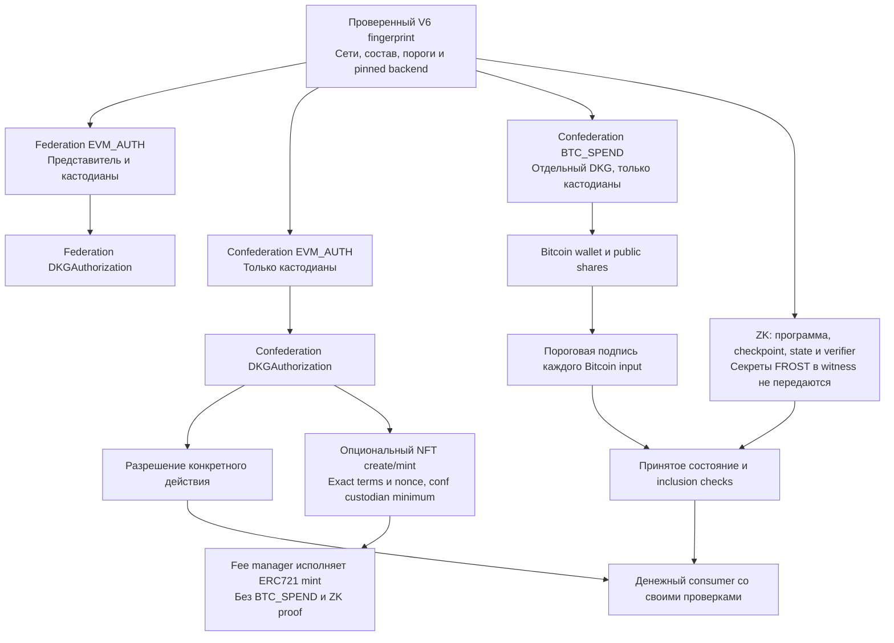
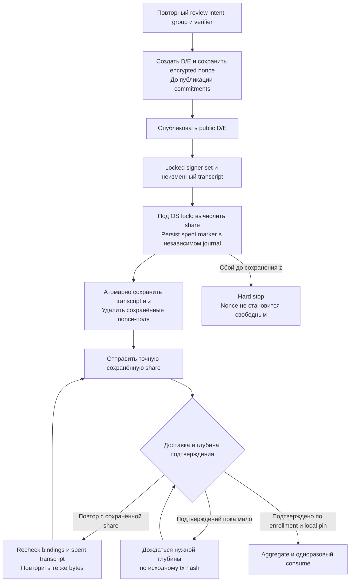
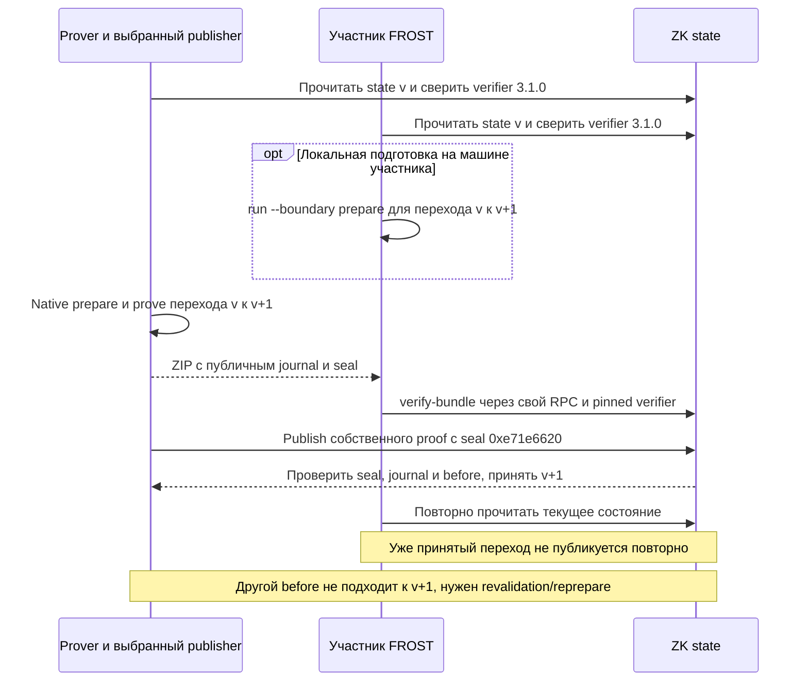
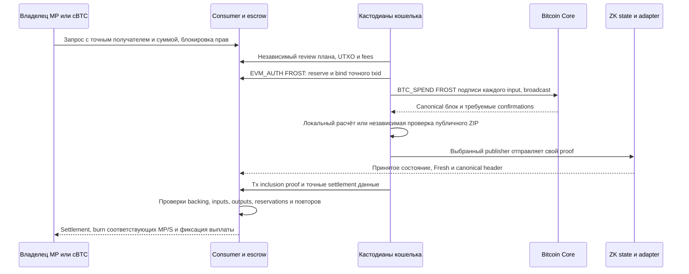

# FROST и ZK: от первого DKG до Bitcoin settlement

[Схемы: SVG/PNG и hashes текущих Mermaid-исходников](DIAGRAMS.md).

[Холодный старт с нуля](COLD_START.md): единый порядок подготовки, ролей,
финансирования, DKG, relay/ZK, ручной рассылки и первого smoke.

Актуализация от 21 ноября 2026. [Конфигуратор](LAUNCH_CONFIGURATOR.md) ·
[Математика экономики](LAUNCH_MATHEMATICS.md) · [Архитектура](ARCHITECTURE.md).

Mermaid-исходники находятся на этой странице; [SVG/PNG и source hashes](DIAGRAMS.md)
проверены отдельно от исторических схем.

Здесь собран сквозной сценарий текущего Bitcoin + governance bootstrap.
FROST определяет, кто согласовал действие и подписал Bitcoin-транзакцию.
ZK-SPV подтверждает допустимость перехода состояния Bitcoin headers для
закреплённой программы. Для конкретной денежной операции нужны также её
проверки включения, глубины, обеспечения, получателя и одноразового исполнения.

## 1. Что согласуют до первого секрета

Один V6 fingerprint связывает состав, порядок участников, пороги, выбранные
сети, backend, token metadata и экономику. Public Bitcoin требует собственного
Core, checkpoint policy и pins. Для ZK mainnet и testnet4 используются разные
guest image; regtest ZK не поддерживается. Источники, ABI и constructor
provenance проверяются до участия в DKG и позднее до подписания.

EVM identity участника, HPKE transport key, секретная DKG share и локальный
ключ происхождения ZK proof — разные ключи с разными задачами. EVM identity
оплачивает gas и аутентифицирует публикации; она не заменяет долю группового
ключа. Оператор не получает остальные секреты для запуска bootstrap.

До DKG bootstrap проверяет ETH для газа у нужных участников и может ждать
финансирования. Governance-токены для самой DKG не требуются. После выпуска
10 млн на согласованный адрес и создания общего staking есть отдельная пауза
ручной рассылки; она не создаёт shares и не меняет roster уже завершённых DKG.
Стартовый APY следует назначить достаточно поздно для этих пауз и ZK catch-up.

| Церемония нового custody-профиля | Состав | Назначение результата |
| --- | --- | --- |
| Federation `evm_ceremony`, `EVM_AUTH` | Представитель и кастодианы | Федерационные разрешения; системные действия по их привязкам |
| Confederation `conf_ceremony`, `EVM_AUTH` | Только кастодианы | Денежные разрешения конфедерации |
| Confederation `btc_ceremony`, `BTC_SPEND` | Только кастодианы | Отдельный Bitcoin wallet key |

В примере Alice/Bob/Carol федерация — 3-of-3, а конфедерационные EVM и BTC —
две независимые 2-of-2 церемонии Bob/Carol. Одинаковый roster не означает
один ключ. Для разных кошельков федерации и конфедерации нужны их собственные
результаты. Старые приглашения без custody policy не приобретают эту изоляцию
от обновления SDK. Новая конфедерация в `reuse` проводит собственные DKG,
хотя использует общие governance/staking/snapshots и канонический Bitcoin root.



Опциональный [NFT workflow](NFT_CONFIGURATION.md) использует существующий
EVM_AUTH, независимый pin и public intent. Это отдельные create/mint операции,
а не Bitcoin-платёж: его выпуску не нужны BTC_SPEND подпись или ZK proof.
Для использования скидки в BTC withdrawal все обычные денежные проверки сохраняются.

## 2. Как DKG создаёт общий ключ

Математическая модель ниже объясняет VSS; точные suite, serialization, HPKE
поля и преобразования зафиксированы в [DKG protocol V1](DKG_PROTOCOL_V1.md)
и pinned `frost-secp256k1-tr 2.2.0`. Это не инструкция реализовать DKG заново.
Работа ведётся над secp256k1, с генератором `G` и порядком группы `q`.

Для N участников и порога t участник i выбирает случайный полином степени
не более t−1 над `F_q`:

```text
f_i(X) = a_i0 + a_i1 X + ... + a_i,t−1 X^(t−1)
C_ik = a_ik G
s_ij = f_i(j)
получатель j проверяет: s_ij G = Σ_k j^k C_ik
x_j = Σ_i s_ij
P_j = x_j G;  P_raw = Σ_i C_i0
```

Public coefficient commitments позволяют проверить полученную долю, не раскрывая
полином. Направленные `s_ij` передаются в HPKE-конвертах, а публичные round-one
packages и привязки сообщений идут через EVM board. Для полного round two
нужно `N(N−1)` направленных конвертов; при N=3 это 6, при N=2 — 2.
Собственная доля учитывается локально и не посылается самому себе.

Новая V1 ceremony ограничена `2 ≤ t ≤ N ≤ 16`. Завершение требует attestation
всех N участников **данной роли** одного result/transcript, а последующая
подпись — t участников. Если один участник DKG не завершил свою роль, уменьшить
N и принять старый transcript нельзя: нужна новая ceremony. На chain 1 срок
фазы 86400 секунд, на интеграционных цепях 3600; успешные фазы не ждут конца
таймера. [Порядок запуска](FIRST_DKG_ONCHAIN.md) учитывает одновременную работу
участников и независимых ролей.

Registry проверяет форматы, immutable hashes, receipts и согласованный результат,
но не выполняет все полиномиальные VSS-проверки в EVM. Каждый участник обязан
сделать их локально перед attestation. Публикация ciphertext не доказывает его
корректность для получателя.

Pinned library применяет group normalization и no-script-tree TapTweak.
Дальнейшие формулы подписи используют **финальные** согласованные shares и
group key после этих преобразований, а не `P_raw`. Преобразуются полные
KeyPackage/PublicKeyPackage; нельзя отдельно сделать even-Y каждой public share.
BTC использует `rawtr(final group X)` / `OP_1 PUSH32 <X>`; повторный Taproot
tweak через `tr(final group X)` изменит кошелёк.

## 3. Из t долей получается одна Schnorr-подпись

Это схема уравнений реализованного EVM signing adapter. Описание общего
двухраундового FROST — в [RFC 9591](https://www.rfc-editor.org/rfc/rfc9591.html).
Сам RFC не определяет используемый здесь DKG; EVM adapter сохраняет проектные
Keccak transcript/binding-factor domains и не является побайтовой заменой
стандартного library signing transcript. BTC использует отдельный стандартный
ZF signing path. См. [точный signing protocol](SIGNING_PROTOCOL.md).

Для выбранного множества S используются **исходные DKG-индексы**, без
перенумерации выбранного подмножества. Lagrange coefficients:

```text
λ_i = ∏(j ∈ S, j ≠ i) j / (j − i)  mod q
Σ(i ∈ S) λ_i x_i = x;   Σ(i ∈ S) λ_i P_i = P
```

Например, индексы `{1,3}`, линейный полином `f(X)=7+11X`:
`x_1=18`, `x_3=40`, `λ_1=3/2`, `λ_3=−1/2` над `F_q`;
`(3/2)18−(1/2)40=7`. Это искусственный публичный пример, не рабочие ключи.
Он показывает, почему нельзя заменить индексы `{1,3}` на `{1,2}`.

Каждый подписант создаёт два одноразовых scalar nonce `d_i,e_i` и публикует
только точки `D_i=d_iG`, `E_i=e_iG`. Transcript связывает chain, coordinator,
session, group key, message и упорядоченный набор commitments. Из него
выводится `ρ_i`; нулевой rho в EVM adapter заменяется на 1.

```text
R_i = D_i + ρ_i E_i;    R_raw = Σ R_i
ε = +1 при even-Y R_raw, иначе −1;   R = ε R_raw
c = taggedSHA256("BIP0340/challenge", R.x || P.x || message) mod q
z_i = ε(d_i + ρ_i e_i) + c λ_i x_i  mod q
проверка доли: z_i G = ε R_i + c λ_i P_i
z = Σ z_i mod q
```

Суммирование проверок долей даёт:

```text
zG = εΣR_i + cΣλ_iP_i = R + cP
```

Это уравнение финальной [BIP340-подписи](https://github.com/bitcoin/bips/blob/master/bip-0340.mediawiki)
`R.x || z`, с even-Y нормализацией. Для данного корректного набора t shares
не требуется собирать x в одном процессе. Это алгебраическая корректность,
а не самостоятельное доказательство стойкости реализации или безопасности
при компрометации t участников. Участники одного набора могут сорвать сессию;
порог гарантирует возможность подписи только при наличии t согласных и
доступных подписантов.

Исходники уравнений: [Python public math](../signer-agent/signer_agent/frost_math.py),
[Rust secret adapter](../frost-crypto/src/main.rs),
[Solidity coordinator](../web3/contracts/src/FROSTCoordinator.sol).
Две [публичные signing vectors](../tests/vectors/signing-v1.json) покрывают обе
чётности aggregate nonce; [SigningGolden](../web3/test/SigningGolden.t.sol)
проверяет их через настоящий coordinator/verifier.

## 4. Подпись должна разрешать именно нужное действие

В EVM подписывается operation hash, а не текст из чужого UI:

```text
m = keccak256(abi.encode(
    "SATOHSI_FROST_AUTHORIZATION_V1", chainId, authorizationAddress,
    target, selector, paramsHash, operationNonce))
```

Подписант самостоятельно вызывает hash helper целевого контракта и сверяет
typed intent, DKG result, roster, threshold, target и canonical verifier.
Message не обязан быть hash ZK seal: его параметры определяет конкретный
target helper. ZK dependencies дополнительно проверяются в согласованном
consumer graph, включая происхождение state/verifier. Подпись произвольного
предоставленного hash не заменяет эту проверку смысла.

`DKGAuthorization` принимает только свой завершённый `EVM_AUTH` result и
checked-share session с canonical verifier. Успешный aggregate даёт approval;
целевой контракт сам проверяет и однократно потребляет его при исполнении.
Relayer может доставить разрешение, но не изменить target или получить право
произвольного расходования. Там, где требуется `CustodianValidator`, действуют
и его отдельные approvals. Делегированные stake-голоса не увеличивают число
custodian approvals и не создают DKG shares.

Подмена казны/verifier или constructor binding отклоняется клиентом до нового
nonce/share и при cached retry. При переходе к новому roster/threshold нужны
новый DKG и совместимый deployment graph; старый ключ не меняется голосованием
и не становится ключом новой конфедерации из-за `reuse` общего staking.

## 5. Nonce и восстановление — часть протокола



В упрощённой однократной Schnorr-схеме `z=k+cx`. Повтор одного k для двух
разных challenges раскрывает `x=(z_1−z_2)/(c_1−c_2) mod q`, если знаменатель
не ноль. Для двухnonce FROST уравнение сложнее, но безопасного разрешения
переиспользовать пару после сбоя нет. Transaction revert, timeout или отсутствие
ACK не восстанавливают nonce. Разрешена повторная доставка сохранённой share
с тем же transcript; новый session/message требует новых nonce.
Более глубокий локальный NFT/ULR pin увеличивает ожидание подтверждений
исходной EVM-транзакции. Журнал сохраняет исходные calldata, hash и nonce.

Откат encrypted state при актуальном spent journal обнаруживается. Совместный
откат обоих к старому snapshot не решён одним локальным журналом; OS lock
также не синхронизирует клонированные состояния на разных компьютерах.
Нужны отдельная процедура восстановления/монотонное хранилище либо ротация.
Обещания безопасно восстановить весь signer из произвольного старого backup нет.

## 6. Что именно доказывает ZK-SPV

Для pinned программы с image ID I и публичного журнала J проверяется:

```text
Verify_pinnedVerifier(seal, I, SHA256(J)) = true
```

Смысл [RISC Zero receipt](https://dev.risczero.com/api/zkvm/receipts) — проверяемое
выполнение определённой программы с её public output. В этом профиле журнал
описывает переход Bitcoin header state. Успешная проверка proof сама по себе
не доказывает, что вызывающий владеет BTC или получил согласие кастодианов.
Witness этой программы не содержит секретных FROST shares.
Proof подтверждает выполнение выбранной программы, включая её возможные ошибки;
правильность самой реализации правил и исходных pins требует отдельной проверки.

Общий смысл перехода:

```text
witness = новые headers и требуемый контекст предыдущего состояния
guest(witness) -> journal J с before/after state и time summary
digest = SHA256(точных J bytes)
```

Guest проверяет поддерживаемые header/PoW/difficulty/MTP/branch/reorg правила.
Для target T вклад корректного header в chainwork:
`work(T)=floor(2^256/(T+1))`; накопленная work складывается без молчаливого
переполнения, ветка становится canonical при строго большей work согласно
программе. Это header validation, а не повторное исполнение всех Bitcoin
скриптов и всех блоковых UTXO-переходов. Исходный checkpoint и work до него
остаются доверенным начальным якорем. Testnet4 имеет собственные правила
сложности и отдельную pinned программу.
Формула block work соответствует [Bitcoin Core GetBlockProof](https://github.com/bitcoin/bitcoin/blob/v30.3/src/chain.cpp#L115).

Контракт проверяет не только seal: `chainId`, собственный `stateAddress`,
`checkpointDescriptor` и **полное before state** должны совпасть с текущим
deployment. В state V2 journal имеет 1216 bytes, Groth16 seal — 260 bytes.
State создаёт свой canonical verifier child; verifier address и code hash
не выбираются произвольным publisher. После успешной проверки journal
валидируется и только затем записывается after state. Здесь нет FROST fallback
для замены не прошедшего proof или административного checkpoint reset.

Источники: [mainnet state](../rust/zkspv/state-adapter/contracts/ZkBitcoinStateV2.sol),
[mainnet journal validation](../web3/contracts/src/core/BitcoinTransitionV2.sol),
[testnet4 state](../rust/zkspv/state-adapter/contracts/ZkBitcoinTestnet4StateV2.sol),
[testnet4 journal validation](../rust/zkspv/state-adapter/contracts/BitcoinTestnet4TransitionV2.sol).
Fresh после checkpoint остаётся false до полезного принятого update; далее
нужны age/tip bounds. Точный predicate — в [математике](LAUNCH_MATHEMATICS.md).

Не смешивайте три доказательства:

| Доказательство | Что проверяет |
| --- | --- |
| zkVM receipt / Groth16 seal | Выполнение pinned header-transition программы и её journal |
| Header-history membership | Принадлежность header текущему принятому history root; для materialization используется отдельная ветвь siblings |
| Bitcoin tx Merkle branch | Включение txid в Merkle root конкретного canonical Bitcoin-блока |

Consumer дополнительно проверяет confirmations/maturity и точные денежные
условия. Fresh не является доказательством включения конкретной транзакции.
Материализация header не разрешает повторный mint одного outpoint.

## 7. Подготовка, расчёт и независимая проверка ZK

Воркеры готовят переход по своим данным Core и закреплённому before state.
Участник может независимо рассчитать proof или проверить публичный ZIP с
доказательством, рассчитанным на выделенной машине. Отправитель использует
`run --boundary export` или `export-bundle`, получатель — `verify-bundle
--require-proof` со своими RPC и пинами. Для непрерывной подготовки переходов
без proving работает `run --boundary prepare`. Рабочие файлы в ZIP ограничены
публичным journal и seal с манифестом. Поставка исходников по-прежнему идёт
отдельно и исключает рабочие доказательства и архивы. Static R0BF — код программы.
В новом графе state закрепляет verifier RISC Zero 3.1.0. Перед подписью
SDK сверяет привязку state/adapter/verifier, а при публикации принимает seal
с селектором `0xe71e6620`. Исторические seals 3.0.3 отклоняются.
[Установка и изоляция prover](ZK_PROVER_LINUX.md).

Локальное происхождение в [LocalProofs](../signer-agent/signer_agent/zk_local_proofs.py)
связывает участника, chain/state scope, image, inputs/journal/source hashes и
receipt hash через HMAC приватного installation key. Это клиентский контроль
своего cache, **не удалённая аппаратная attestation** и не доказательство миру,
какой физический компьютер выполнил prover. Он не заменяет криптографическую
проверку receipt и не превращает ZK в t-of-N protocol.

Один выбранный publisher явно отправляет свой локально рассчитанный transition
proof. Другие участники сверяют тот же закреплённый state и verifier через
свои RPC. Проверка архива не даёт разрешения на публикацию или FROST-подпись и
не записывает полученный seal в локальный authenticated cache.
[Режимы запуска и ZIP](ZK_SPV_WORKER.md).



Если конкурентный update продвинул state, старый journal не становится
доказательством нового перехода. Можно завершить локальный расчёт уже
зафиксированного attempt, но публикация stale before запрещена. Если принят
ровно проверенный переход, worker распознаёт завершение; если другой —
перечитывает state/Core и готовит согласованный новый attempt. При сомнении
в отправленной EVM-транзакции сначала восстанавливается её durable receipt,
а не создаётся другая транзакция с подменёнными данными.

Команды для уже привязанного собственного worker config:

```sh
python -m signer_agent.zk_worker prepare --config "$WORKER_CONFIG"
python -m signer_agent.zk_worker prove --config "$WORKER_CONFIG"
# Только выбранный publisher, после собственного расчёта и проверки:
python -m signer_agent.zk_worker publish --config "$WORKER_CONFIG"
```

`run` по умолчанию ограничен локальным prove; публикация требует явного выбора.
Setup tools, роли участников и catch-up — в [testnet4/Sepolia инструкции](ZK_TESTNET4_SEPOLIA.md)
и [Linux/WSL2 prover runbook](ZK_PROVER_LINUX.md). В relay-профиле transition
zkVM proof не используется: вместо него синхронизируются relay/guard со своим
Core; FROST и денежные проверки сохраняются.

## 8. Полный вывод BTC и переход федерация → конфедерация



До подписи нового BTC-платежа проверяется уже доступное состояние backend;
proof включения **будущей** транзакции появляется только после broadcast и
подтверждений. EVM_AUTH signature, BTC signature и Groth16 seal относятся к
разным сообщениям и не подменяют друг друга. В relay-профиле на соответствующем
шаге выполняется relay sync и обычная inclusion-проверка.

При обмене внешнего MP исходная федерация переводит BTC под ключ конфедерации
и погашает MP по доказательству выплаты. Конфедерация проверяет этот расчёт и
доказательство поступления BTC. В ULR policy V3 она напрямую выпускает S под
принятый выход. В прежнем профиле выпуск cBTC использует локальные MP и
`depositFor`. Платёж при погашении S или cBTC подписывают кастодианы
конфедерации своим BTC_SPEND ключом. [Bitcoin custody transfer](BITCOIN_CUSTODY_TRANSFER.md).

Governance stake/unstake, owner claim, permissionless treasury payout по уже
утверждённому snapshot и prefunded startup pay не требуют нового BTC signing
или нового ZK proof сами по себе. Публикация snapshot и управление связями
используют свои согласованные FROST/custodian approvals.

## 9. Сбои и границы гарантии

| Ситуация | Требуемое поведение |
| --- | --- |
| DKG не завершён всеми участниками роли | Не принимать неполный result; после expiry новый ceremony |
| Подменены treasury/verifier/target/pins | Остановиться до нового nonce/share и при cached retry |
| Nonce помечен spent, но share не сохранена | Hard stop; не «освобождать» nonce |
| Share/транзакция сохранена, доставка неизвестна | Восстановить исходный transcript/raw/nonce и receipt; повтор только тех же bytes |
| Proof имеет другой image/network/state/checkpoint | Отказ до принятия transition |
| Текущее before state изменилось | Revalidate/reprepare, без переписывания старого journal |
| Backend stale | Не создавать новую денежную подпись через обход Fresh/health |
| Глубокий reorg приводит к permanent halt | Сохранить отдельную halt-транзакцию; не откатывать её вместе с failed money call |
| Приняты headers, но нет точного tx inclusion/backing | Не mint/settle только на основании Fresh |
| Нет quorum или участник отключился | Ожидание/явная новая сессия; ZK не создаёт отсутствующую FROST share |

Это описание реализованного пути, не заявление о production qualification.
Нужны корректные pins и исходный checkpoint, честные локальные проверки DKG,
защищённое хранение shares/nonce journals и предпосылки криптографии.
Сговор порогового набора не устраняется ZK; корректный proof не обеспечивает
доступность кастодианов. SPV не доказывает абсолютную финальность Bitcoin.

Публичный [отчёт дополнения](../ops/artifacts/frost-zk-docs-20261105/README.md)
разделяет свежие локальные проверки и исторический E2E. Полный новый
testnet4 Groth16/Sepolia monetary cycle и физический Windows/WSL2 здесь
не подтверждены; `QUALIFIED=false`, `FEE_QUALIFIED=false`, `production_ready=false`.
