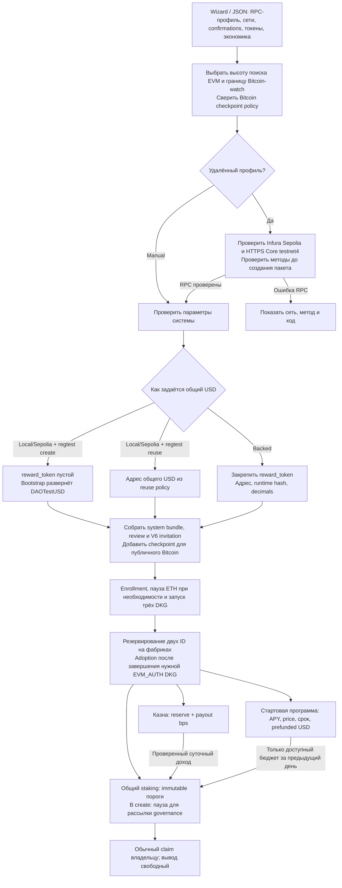

# Конфигуратор запуска: сети, токены, стейкинг и стартовые выплаты

[Схемы: SVG/PNG и hashes текущих Mermaid-исходников](DIAGRAMS.md).

[Параметры федерации/конфедерации и новые группы](FEDERATION_CONFEDERATION_SETUP.md) ·
[NFT скидок: параметры, роли и требования](NFT_CONFIGURATION.md).

NFT не добавляется неизвестными полями в launch JSON. После завершения bootstrap
используйте `frost-signer nft` для FROST-approved создания коллекции и mint.
Каждый подписант независимо фиксирует NFT pin; условия выпуска входят в public intent.

[Холодный старт с нуля](COLD_START.md): единый порядок подготовки, ролей,
финансирования, DKG, relay/ZK, ручной рассылки и первого smoke.

[Сквозной сценарий FROST и ZK](FROST_ZK_LIFECYCLE.md): отдельные DKG,
уравнения подписи и proof, nonce recovery, гонки публикаций и Bitcoin settlement.

[Математическое описание](LAUNCH_MATHEMATICS.md): единицы, точное округление,
границы выплат, UTC-учёт, APY и предпосылки безопасности.

`frost-signer configure` готовит публичный JSON, policy, полный system bundle и
приглашение V6 на Linux, macOS и Windows/WSL2. Профиль `manual` собирается
offline. Профиль `remote-sepolia-testnet4` проверяет RPC перед сборкой. Публикация,
enrollment, DKG и возобновляемый bootstrap выполняются обычными командами.

## Начать без изменения кода

Установите зависимости и соберите контракты по
[общей инструкции](CROSS_PLATFORM_QUICKSTART.md). На Windows команды выполняются
в Ubuntu WSL2, проект и личные состояния хранятся в Linux home.
Для `remote-sepolia-testnet4` задайте [локальные переменные RPC](#sepolia-и-bitcoin-testnet4-без-локальных-нод)
до команды `build`.

```sh
source .venv/bin/activate
python ops/bootstrap_host.py build
python ops/generate_abis.py --check --zk
frost-signer configure wizard --output "$LOCAL/launch.json"
frost-signer configure validate --config "$LOCAL/launch.json"
frost-signer configure build --config "$LOCAL/launch.json" --output "$LOCAL/launch-v1"
frost-signer setup inspect --invite "$LOCAL/launch-v1/invitation.json"
```

Для автоматизации вместо диалога создайте шаблон:

```sh
frost-signer configure init --output "$LOCAL/launch.json"
```

Заполните JSON и выполните те же validate/build. `init` сохраняет черновик;
он не утверждает, что адреса, публичный checkpoint или финансирование готовы.
`validate` требует все входы приглашения, `build` дополнительно проверяет их
существующими валидаторами system/onboarding. Ошибка не оставляет частично
готовый выходной каталог. Существующие файлы/каталоги не перезаписываются.

Результат содержит `launch-config.json`, `ulr-policy.json`, `token-metadata.json`,
`bitcoin-custody.json`, `system.json`, `invitation.json`, `review.json`, а для
публичной Bitcoin-сети также `bitcoin-policy.json`. Review не является аудитом
или разрешением production-активации. Все входы invitation входят в fingerprint.
Изменение параметров после подписи требует нового приглашения и enrollment.

## Sepolia и Bitcoin testnet4 без локальных нод

В `configure wizard` выберите `remote-sepolia-testnet4`. При настройке JSON
задайте `"rpc_profile": "remote-sepolia-testnet4"`, `"ethereum_network": "sepolia"`
и `"bitcoin_network": "testnet4"`. Выберите `relay` или `zk-state-v2` в
`bitcoin_backend` и заполните остальные поля, включая согласованный checkpoint
и адрес USD-токена на Sepolia.

На каждой машине, включая оператора, задайте свои переменные в shell:

```bash
read -r -s -p 'Infura API key: ' INFURA_API_KEY
echo
export RPC="https://sepolia.infura.io/v3/$INFURA_API_KEY"
unset INFURA_API_KEY
export BTC_RPC='https://testnet4.example.org/'
export BTC_COOKIE="$LOCAL/testnet4-rpc.auth"
```

`BTC_COOKIE` — абсолютный путь к личному файлу `username:password` с правами
`0600`, выданному администратором архивного Bitcoin Core testnet4. Если
используется Core за HTTPS-прокси, прокси должен пропускать методы из проверки.
Нужен синхронизированный `txindex=1`. Для ускоренного watch с положительной
`bitcoin_watch_start_height` нужен также синхронизированный `blockfilterindex=1`.
Доверие к отрицательным результатам фильтров каждый явно задаёт в своём
приватном конфиге наблюдателя. [Настройка Bitcoin-watch](ADDRESS_REQUESTS_WATCH.md#working-without-a-local-bitcoin-node).

Для исходного checkpoint можно использовать тот же удалённый Core в
`frost-signer bitcoin checkpoint --bitcoin-network testnet4 --bitcoin-rpc "$BTC_RPC" --bitcoin-cookie "$BTC_COOKIE"`
с согласованными параметрами высоты и глубины. [Полная команда и выбор высоты](ZK_TESTNET4_SEPOLIA.md#2-core-и-свежий-checkpoint).

Оператор проверяет свой RPC и собирает пакет:

```bash
frost-signer configure validate --config "$LOCAL/launch.json"
frost-signer configure build --config "$LOCAL/launch.json" --output "$LAUNCH_DIR"
```

`validate` проверяет структуру offline. `build` запускает проверку RPC до
создания выходного каталога. Успешный `review.json` содержит статус
`RPC_CHECKED_INPUTS_PREPARED` и список проверенных методов. URL, API-ключ и
файл авторизации остаются локальными. Для отдельной проверки до сборки
используйте `frost-signer configure check-rpc --config "$LOCAL/launch.json"`.

Участник получает `launch-config.json` и `invitation.json`, задаёт свои
`RPC`, `BTC_RPC`, `BTC_COOKIE` и перед enrollment запускает:

```bash
frost-signer configure check-rpc --config "$LAUNCH_CONFIG" --invite "$INVITATION"
```

`--invite` берёт checkpoint из общего приглашения. Исходный путь к policy
с машины оператора участнику не требуется. На успехе статус
`LAUNCH_RPC_CHECKED`. Ошибка `LAUNCH_RPC_PREFLIGHT_FAILED` показывает сеть,
метод, причину и, если доступны, числовые коды HTTP и JSON-RPC.

- Sepolia проверяется по chain ID, данным подтверждённого блока, логам,
  pending nonce, оценке газа и `eth_simulateV1` для последовательных CREATE.
  Если задан `SATOSHIFI_CREATE_SIMULATION_RPC`, проверка сверяет его цепь
  и блок с Infura и запускает симуляцию через этот endpoint.
- Bitcoin проверяется по testnet4 genesis, checkpoint, синхронизации и
  доступности исторического блока, транзакции и SPV proof. Для сверки резерва
  проверяется `scantxoutset`, для ускоренного watch выполняется `scanblocks`
  на одном блоке. Проба `scantxoutset` использует заведомо ошибочный descriptor,
  который Core отклоняет до обхода UTXO.
- Методы публикации получают заведомо невалидные байты без подписи. Результат
  подтверждает доступность методов и текущую цепь. Рабочие proofs в ZK-профиле
  каждый участник по-прежнему считает на своём хосте.

Bitcoin endpoint Infura предоставляет чтение и не подходит для полного
профиля. Sepolia endpoint Infura настраивается отдельно.
[Список endpoint Infura](https://docs.infura.io/get-started/endpoints/) ·
[Bitcoin JSON-RPC Infura](https://docs.infura.io/reference/bitcoin/json-rpc-methods/).
Локальный диапазон поиска EVM-приглашения можно уточнять в любой момент.

## Выбор сетей и режима

| Параметр | Варианты |
| --- | --- |
| EVM | Ethereum mainnet `1`, Sepolia `11155111`, local `31337` |
| Bitcoin relay | mainnet, testnet4, regtest |
| Bitcoin ZK | mainnet или testnet4, отдельные pinned guests; regtest запрещён |
| Общие governance/staking/snapshots | `create` — один выпуск 10 млн; `reuse` — уже проверенные общие адреса |

На local/Sepolia с regtest оставьте `reward_token` пустым. `Create` развернёт
TUSD и выпустит бюджет конвертера и включённого APY. В `reuse` оператор
оплачивает запас нового конвертера в общем USD. Для `backed` заранее закрепите
USD по адресу, runtime hash и decimals и подготовьте баланс оператора. На
local/Sepolia с публичным Bitcoin можно закрепить заранее развёрнутый TUSD.
[Подготовка USD и схема выбора сети](NETWORKS_AND_AUTOMATION.md#тестовый-usd-какие-режимы-и-как-настроить).

Для [testnet4 + Sepolia ZK](ZK_TESTNET4_SEPOLIA.md) передайте свежий checkpoint
policy собственного Core через `bitcoin_policy_file`. V1 checkpoint можно
преобразовать в V2 прямо при build; конфигуратор выбирает image по сети и
связывает его с `<deployment_id>-conf`. Готовый V2 policy обязан уже совпадать
с выбранной сетью, backend и confederation ID. Подмены verifier/provider нет.
Готовые рабочие proofs не создаются и не включаются в поставку; каждый участник
вычисляет их самостоятельно.

`reuse_policy_file` должен содержать `ulr.reuse_policy` V2 из проверенного
bootstrap manifest, сохранённый отдельным JSON. `family_root_policy_file`
содержит сохранённую политику канонического Bitcoin root. Пороги общего
стейкинга и параметры общей стартовой программы должны совпасть с исходным
развёртыванием. Резерв/процент новой конфедерационной казны могут отличаться.
При reuse нет второго выпуска, нового стейкинга или повторного финансирования
стартовой программы. Заданные имена общего токена сверяются с импортированным
контрактом перед транзакциями и подписями.

Новые immutable constructor parameters требуют новой согласованной сборки.
Старые уже развёрнутые контракты этим конфигуратором не перенастраиваются:
reuse допускается только для контрактов совместимой версии и проверенного runtime.
Не смешивайте источники, ABI, артефакты, pins и приглашения разных поставок.

## Подтверждения и Bitcoin maturity

### Стартовые высоты сетей

| Что запускается | Где задать старт | Что пропускается |
| --- | --- | --- |
| Поиск приглашения в Ethereum mainnet, Sepolia или local | `evm_discovery_from_block` в wizard или launch JSON | Блоки до заданной высоты в `setup discover --launch-config` |
| Bitcoin mainnet/testnet4 relay или ZK | `bitcoin checkpoint --checkpoint-height`, затем путь к policy в `bitcoin_policy_file` | Заголовки до checkpoint для relay и начального ZK-перехода, кроме контекста самого checkpoint |
| Bitcoin regtest | Начальный relay создаётся штатным локальным bootstrap | Публичный checkpoint не применяется |
| Bitcoin-watch депозитов и fee-адресов | `bitcoin_watch_start_height` в wizard или launch JSON | При положительной высоте доверенный Core проверяет ранние блоки по компактным фильтрам. SDK разбирает совпадения и блоки для проверки границ диапазона |

`evm_discovery_from_block` задаётся десятичной строкой. `null` оставляет последние
8192 блока, `"0"` запрашивает всю историю. Для нового запуска возьмите номер
текущего блока своего EVM RPC до публикации приглашения. Для уже опубликованного
приглашения начните не позже блока публикации. SDK сверяет chain ID из launch
config с RPC и отклоняет высоту выше tip. Введённая высота ограничивает только
поиск событий. Полученный board по-прежнему проходит проверку происхождения,
конструктора и каноничности.

```sh
frost-signer setup discover --operator "$OPERATOR" --rpc "$RPC" \
  --launch-config "$LAUNCH_DIR/launch-config.json"
```

Если оператор передал `board` и `block` из результата `setup publish`, можно
сразу проверить их через `setup status --board "$BOARD" --board-creation-block "$BOARD_BLOCK" --rpc "$RPC"`.
Флаги `--from-block` и `--recent-blocks` доступны при отдельном поиске.
У read-only `frost-signer index` свой `--from-block` и свой журнал. Используйте
высоту первого интересующего события или более раннюю. При смене диапазона
или набора адресов создайте отдельный индекс. Для legacy `frost-signer watch`
поле `FROST_DEPLOYMENT_BLOCK` в локальном окружении задаёт блок создания
конкретного FROSTCoordinator. Оно применяется при поиске сессий этого контракта.

Для Bitcoin выберите проверенную своим Core высоту, кратную 2016, ниже первых
депозитов и выплат, для которых понадобится proof. Учитывайте запас до tip
для reorg. Для ZK он составляет 100 блоков. Checkpoint включает заголовок,
накопленную работу и 10 предшественников. После `validate` и `build` сверяйте
`bitcoin_checkpoint_height`, `bitcoin_checkpoint_hash` и `evm_discovery_from_block`.
Высота и контекст Bitcoin входят в подписанное приглашение. Каждый участник
сверяет их со своим Core. [Команды для relay](NETWORKS_AND_AUTOMATION.md) ·
[Команды для ZK testnet4](ZK_TESTNET4_SEPOLIA.md#2-core-и-свежий-checkpoint).

Дальнейшие ZK-переходы начинаются от принятого состояния. Первичная синхронизация
самого Core выполняется отдельно.

`bitcoin_watch_start_height` задаётся строкой. По умолчанию `"0"` выбирает полный
разбор с genesis. Для ускорения укажите текущую высоту или более раннюю.
Старые диапазоны всё равно проверяются компактными фильтрами. Подходящие
блоки разбираются и сохраняются в том же журнале. Последние блоки в пределах
окна reorg читаются целиком. Значение выводится в `review.json` и применяется
к локальному наблюдателю через `scan --launch-config`. Для этого режима
Core должен иметь готовый `blockfilterindex=1`. Укажите числовой loopback RPC
или проверенный HTTPS RPC с `trust_remote_watch_filters: true` в приватной
конфигурации наблюдателя. Архивный HTTPS RPC без доверия к фильтрам работает при
высоте `"0"`. [Запуск для депозитов и fee-адресов](ADDRESS_REQUESTS_WATCH.md#working-without-a-local-bitcoin-node).

### Глубина подтверждений

Для нового V6-запуска в Sepolia или local поле `phase_duration` задаёт
длительность фазы DKG в секундах. Допустимы строки от `"3600"` до
`"86400"`. Пустое поле оставляет один час. Значение закрепляется в
приглашении и в новом DKG registry перед открытием церемоний.

`bitcoin_confirmations` — требуемая глубина подтверждения обычной Bitcoin
операции, минимум 6. Она попадает в конструкторы deposits/escrow и подписанную
политику. `evm_confirmations` выбирается отдельно: минимум 1 для Sepolia/local
и 12 для Ethereum mainnet с прежней проверкой finality.

Текущий coinbase mint имеет отдельный порог 100 подтверждений, независимо
от `bitcoin_confirmations`. Общий клиентский выбор coinbase inputs требует 101;
fee ingress — `max(101, bitcoin_confirmations)` для coinbase и
`max(6, bitcoin_confirmations)` для обычного funding. `review.json` разделяет
эти величины. При обычной глубине 144 coinbase mint всё ещё проверяет 100,
а fee ingress — 144. Это описание существующих проверок, не изменение consensus.
Testnet4 сохраняет maturity; local/regtest ускоряет блоки, а не уменьшает порог.
Точные определения высот и числа подтверждений — в [математике](LAUNCH_MATHEMATICS.md#bitcoin-подтверждения-maturity-и-fresh--разные-проверки).

## Названия и единицы

`token_metadata` задаёт name/symbol четырёх выпускаемых ERC20:
`governance`, `mining`, `federation_share`, `confederation_share`.
Названия native BTC/ETH и уже существующего USD-стейблкоина остаются свойствами
выбранных активов. Governance имеет 18 decimals и единый выпуск 10 млн.

Порог/взнос задаются строками в целых governance-токенах с дробной частью до
18 знаков, USD-цены/бюджеты — строками USD с точностью выбранного stablecoin.
Суммы, которые нельзя точно выразить в base units, отклоняются без округления.
Проценты задаются целыми basis points: `100 = 1%`, `1000 = 10%`, `9000 = 90%`.

```json
{
  "candidate_threshold": "500000",
  "minimum_stake": "100",
  "treasury_reserve_usd": "500",
  "treasury_payout_bps": "7500",
  "startup": {
    "enabled": true,
    "apy_bps": "1000",
    "unit_price_usd": "1",
    "duration_days": "30",
    "start_day": "<номер будущего дня UTC>",
    "budget_usd": "1000"
  }
}
```

Это только блок `economics`, не полный launch config. Диалог принимает дату
старта `YYYY-MM-DD` и сам переводит её в номер UTC-дня. Не используйте буквальный
placeholder из примера. Учтите время enrollment/DKG, подтверждений, пауз и сборки
proofs: развёртывание стартовой программы после её даты старта отклоняется.

## Пороги стейкинга и доход от казны

`minimum_stake` ограничивает размер одного нового взноса. Вывод остаётся
свободным, включая вывод суммы меньше минимального взноса. Условия полных UTC
суток и обычный `claim` сохранены.

`candidate_threshold` применяется к wallet + собственному stake и к включению
неактивных держателей в custodian snapshots. Кандидат не получает роль или долю
DKG автоматически. Действующие кастодианы ниже порога сохраняют фактический вес
до отдельного удаления. Делегирование голоса не переводит stake и reward.

`treasury_reserve_usd` и `treasury_payout_bps` закрепляются в каждой новой казне.
Суточная выплата из её фактического свободного USD-баланса:

`max(balance − reserve, 0) × payout_bps / 10000 × confederation_ULR / system_ULR`.

Округление выполняется один раз вниз. Доли строятся по прежним проверяемым
историческим snapshots wallet + own stake. Неиспользованный баланс остаётся в
казне. Wrap/unwrap fees задаются отдельно как `wrap_fee_bps` / `unwrap_fee_bps`;
legacy splits остаются нулевыми, весь реализованный доход сначала поступает в казну.
По умолчанию сохранены порог 200 000, минимальный взнос 1 wei, резерв $1000,
доля выплат 90%, стартовый APY отключён.

## Дополнительный стартовый APY

`ULRStartupRewards` — отдельный заранее финансируемый контракт. У него нет
прав mint, изменения ставки/цены/срока или изъятия средств из staking/казны.
Конструктор закрепляет staking, выбранный USD, APY, reference price одного
целого governance-токена, первый UTC-день, срок и получателя возврата.

Идеальная суточная ставка: `daily_rate = (1 + APY)^(1/365) − 1`.
Конструктор вычисляет integer-ставку binary search по возведению в степень
с округлениями каждого mulDiv. Это не точный вещественный корень и не всегда
его floor; [точный алгоритм и численный пример](LAUNCH_MATHEMATICS.md#prefunded-apy-идеальная-ставка-и-точный-integer-алгоритм)
фиксируют контрактный результат. APY предполагает ежедневное реинвестирование
по согласованной reference price. Выплачиваемые USD автоматически не
реинвестируются, рыночная цена токена не отслеживается. Поэтому фактическая
доходность отдельного пользователя может отличаться от указанного APY.

После полного дня любой участник может выполнить `payDay` только за предыдущие
сутки. Запрошенная сумма считается от eligible stake и reference price; реально
перечисляется не больше оставшегося бюджета. При нехватке остаток распределяется
пропорционально, при нулевом бюджете выплата нулевая. Неоплаченный остаток не
становится долгом; пополнение не создаёт задним числом награды за пропущенные
или уже обработанные дни. Повтор за тот же день не платит второй раз.
Пропущенные keeper дни истекают — запускать его нужно ежедневно.

Средства идут в общий `ULRStaking.fundDay`, складываются с доходом казны и
забираются прежним `claim`. Финансирование не выдаёт funder право голосовать
stake другого пользователя. Для backed-профилей USD переводится оператором;
local integration использует явно тестовый mint. Reuse не финансирует программу
заново. Деньги на converter и на стартовую программу — отдельные суммы.

Последний день `endDay−1` оплачивается на `endDay`; возврат разрешён только
при `today > endDay`. Поздний `payDay` за более старые сутки отклоняется,
даже если это повтор уже обработанного дня.
После завершения последнего окна выплаты неиспользованный USD возвращается
только на immutable `refundRecipient` (оператор первоначального запуска).
Возврат не затрагивает rewards, уже поступившие в staking и ожидающие claim.

```sh
frost-signer startup-rewards status --rpc "$RPC" --chain-id "$CHAIN_ID" \
  --evm-confirmations "$EVM_CONFIRMATIONS" --program "$STARTUP_REWARDS"
# Сначала симуляция: identity применяется только для определения sender.
frost-signer startup-rewards pay --rpc "$RPC" --chain-id "$CHAIN_ID" \
  --evm-confirmations "$EVM_CONFIRMATIONS" --program "$STARTUP_REWARDS" \
  --day "$YESTERDAY_UTC_DAY" --identity-file "$IDENTITY"
# Явная отправка с собственным durable ID:
frost-signer startup-rewards pay --rpc "$RPC" --chain-id "$CHAIN_ID" \
  --evm-confirmations "$EVM_CONFIRMATIONS" --program "$STARTUP_REWARDS" \
  --day "$YESTERDAY_UTC_DAY" --identity-file "$IDENTITY" \
  --state "$LOCAL/startup-ops.sqlite" --id "startup-$YESTERDAY_UTC_DAY" --send
```

Команда `refund` принимает те же network/program/identity/state/id/send поля.
По умолчанию она тоже выполняет симуляцию. Для автоматизации вызывайте pay после
завершения UTC-дня из собственного scheduler и отслеживайте failures; это не
заменяет keeper snapshots/платежей конфедерационных казначейств.

## Следующие действия участников

После независимой проверки `invitation.json` продолжайте
[публикацию, enrollment и bootstrap](CROSS_PLATFORM_QUICKSTART.md).
Из `deployment_id` конфигуратор формирует `<deployment_id>-fed` и
`<deployment_id>-conf`. Проверьте оба ID в приглашении до enrollment.
План резервирует их за соответствующими EVM_AUTH-сессиями до adoption.
Сохраняются пауза ETH до DKG и отдельная пауза после выпуска governance для
ручной рассылки. Для повторов используйте исходное приглашение и журнал.
Для ZK сохраняются реальные
proof/Fresh barriers, custody transfer до cBTC и отдельный кастодиальный BTC DKG.


