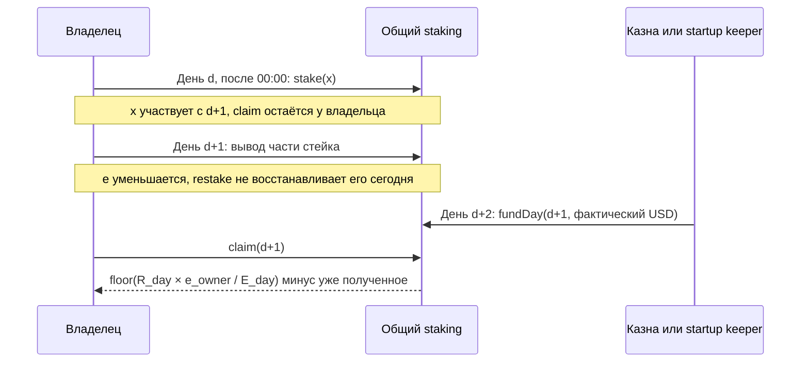

# Математика запуска, стейкинга и обеспечения

[Схемы: SVG/PNG и hashes текущих Mermaid-исходников](DIAGRAMS.md).

Актуализация: 5 ноября 2026. [Конфигуратор](LAUNCH_CONFIGURATOR.md) ·
[Стейкинг](ULR_STAKING.md) · [Казны](ULR_TREASURIES.md) ·
[Кандидаты и голоса](ULR_CANDIDATES_AND_VOTING.md) · [Bitcoin custody](BITCOIN_CUSTODY_TRANSFER.md).

Это описание текущего алгоритма и его предпосылок, а не доказательство
безопасности всей системы. Локальные проверки не заменяют независимый аудит,
реальные proofs участников, проверку inventory и квалификацию платформ.

## Единицы и параметры

Все расчёты контрактов целочисленные. `floor` означает округление вниз.
`W = 10^18`; governance supply `S = 10 000 000 × W`. Названия четырёх
выпускаемых ERC20 выбираются до enrollment; имя не меняет decimals или смысл
актива. Актив определяется сетью и адресом, BTC — ещё и wallet graph.

| Символ | Значение и единицы |
| --- | --- |
| `H`, `m` | Порог кандидата и минимальный **новый взнос**, в governance base units; `0 < H,m ≤ S` |
| `u` | Decimals единого USD-стейблкоина, `0 ≤ u ≤ 18` |
| `R`, `b` | Резерв казны в USD base units и доля выплаты в bps; `0 ≤ b ≤ 10000` |
| `d` | UTC-день: `floor(EVM timestamp / 86400)` |
| `e_i(d)`, `E_d` | Участвующий стейк владельца и сумма по владельцам, governance base units |
| `p`, `a` | Фиксированная USD reference price за один целый governance-токен и годовой APY в bps |

Строка USD `"2"` при `u=6` означает `2 000 000` base units. Входные суммы
переводятся **точно**: лишняя точность, float и экспоненциальная запись
отклоняются, а не округляются. `100 bps = 1%`. Default: `H=200000W`, `m=1`,
`R=1000×10^u`, `b=9000`; стартовая программа отключена. Это значения по
умолчанию, а не универсальные константы нового deployment.

Конфигуратор ограничивает суммы `<2^128`, а включённую программу —
`1 ≤ a ≤ 100000` и сроком 1–3650 дней. Конструкторы независимо проверяют
свои ограничения. Программа создаётся до первого дня, с положительной ценой
и неизменяемым получателем возврата. `reuse` проверяет совместимость общих
параметров и не повторяет выпуск или финансирование.

## Комиссии, конвертация и сатоши

Для fixed-percentage wrap/unwrap из launch config, при сумме `x` и ставке
`f` bps в текущем `FederationFeeManager`:

```text
fee = floor(x × f / 10000)
net = x − fee
```

При wrap из локального MP получатель получает `net` долей (обе единицы
18-decimal). При unwrap сначала вычитается комиссия, затем net MP округляется
вниз до целого сатоши: `mpOut=floor(net/10^10)×10^10`, поскольку один BTC
равен `10^8` sat и `10^18` MP base units. Это ещё одно отдельное округление,
не часть формулы казны. NFT discount и dynamic fee имеют другие ветки расчёта;
эта формула относится к выбранному fixed-percentage профилю без скидки.
При `x=100W`, `f=100` комиссия равна `W`, net — `99W`.

Конвертер выдаёт реальный reward token из своего внесённого запаса по
согласованному отношению numerator/denominator в **base units**. Результат
конверсии, цена governance для APY и доля казны — разные параметры. Комиссия
в MP не становится USD автоматически от одного вычисления процента.
Начальный запас конвертера не является бюджетом `ULRStartupRewards`.
Точно: `usdOut=floor(mpIn×numerator/denominator)`; выплата требует реального
USD на конвертере. При 6 decimals USD и отношении `1/10^10` один целый MP
даёт `10^8` raw USD, то есть $100; это тестовая согласованная цена,
а не автоматически полученный рыночный курс BTC.

Bitcoin withdrawal escrow не допускает настройки минимума ниже 294 sat
для P2WPKH и 330 sat для P2TR; конкретный запуск может задать больше.
Это нижние границы поддерживаемой политики, а не гарантия достаточности
для произвольного текущего feerate: нужен отдельный запас на miner/protocol
fee и проверка итоговых outputs. Газ ETH оплачивается отдельно.
Источники: [fee manager](../web3/contracts/src/federation/FederationFeeManager.sol),
[multipool](../web3/contracts/src/federation/ConfederationMultiPool.sol),
[конвертер](../web3/contracts/src/federation/FundedFeeConverter.sol),
[withdrawal escrow](../web3/contracts/src/federation/BitcoinWithdrawalEscrow.sol).

## Два разных вида веса

Экономический snapshot берётся на последнем подтверждённом EVM-блоке перед
следующей границей UTC. Для владельца `i`:

```text
w_i = wallet_i(snapshotBlock) + ownStake_i(snapshotBlock)
D   = {i : w_i ≥ H} ∪ {i : i входит в действующий состав и w_i > 0}
G   = Σ(i ∈ D) w_i
C_j = Σ(i ∈ D и i действующий кастодиан конфедерации j) w_i
```

В `D` каждый адрес встречается один раз. Адреса staking, самого токена и нулевой
адрес исключены. Перевод `x` в staking меняет `(wallet, ownStake)` на
`(wallet−x, ownStake+x)`, поэтому сохраняет `w_i`. Делегирование не меняет
ни одну из этих величин. При фиксированном supply и обычном ERC20 учёте
`G ≤ S`, `0 ≤ C_j ≤ G`: капитал не считается одновременно на staking-адресе
и ещё раз у его вкладчиков.

Кандидаты и другие крупные держатели входят в **знаменатель** до назначения;
в числитель конфедерации входят её действующие кастодианы. Действующий
кастодиан ниже `H` сохраняет положительный фактический вес до удаления.
Один адрес может быть кастодианом нескольких конфедераций: поэтому
`Σ_j C_j` может превышать `G`. Сумма долей разных казн не обязана быть 100%.

Оценка `floor(S/H)` ограничивает число владельцев с весом **от порога**.
Снимок дополнительно включает действующих кастодианов с положительным весом
ниже порога. SDK ограничивает inventory после добавления действующих
кастодианов 4096 адресами, а список казн — 64 контрактами.

Подписанты проверяют исторический выпуск `S = 10 000 000 ULR` и добавляют в
inventory `I` всех действующих кастодианов закреплённых валидаторов. Обозначим
`B_token` баланс на адресе самого токена, `B_staking` баланс на адресе
стейкинга и `A` учтённый `totalStaked` на том же историческом блоке.

```text
U = S − B_token − (B_staking − A)
Q = U − Σ(i ∈ I) w_i
0 ≤ Q < H
```

Разность `B_staking − A` исключает ULR без владельца, учтённого в стейкинге.
При неотрицательных весах любой адрес за пределами `I` имеет вес не выше
`Q`, следовательно, строго ниже `H`. Действующие кастодианы уже включены
в `I`, поэтому остаток не может скрыть ни одну строку экономического снимка.
Вывод зависит от канонического исторического блока и полноты закреплённого
списка казн. Контракт проверяет структуру, границы и FROST-attestation
результата, а исторические балансы и roster независимо пересчитывает SDK
каждого подписанта. [Подготовка дневного снимка](ULR_TREASURIES.md#общий-снимок-ulr).

Для наград и stake-weighted голосований используется другой вес — `e_i(d)`.
Кошелёк вне staking в этот вес не входит.

## UTC, вывод и участвующий стейк

Пусть `t_d=86400d`, `B_i(d)` — баланс по checkpoint строго **до** `t_d`,
`A_i(d)` — допустимые пополнения ровно в `t_d`, `W_i(d)` — выведенная
участвующая часть. Тогда реализация считает:

```text
e_i(d) = B_i(d) + A_i(d) − W_i(d)
E_d    = Σ_i e_i(d)
```

Пополнения после 00:00 участвуют со следующих суток. Существующее исключение:
пополнения ровно в 00:00 участвуют в текущих, пока в этот timestamp ещё не
было вывода. После первого вывода дальнейший restake в тот же 00:00 не
восстанавливает вес. Если после вывода текущий баланс равен `s'`, новый вес
`e'_i=min(e_i,s')`: сначала выводится ещё не участвовавшая часть. Поэтому
`0 ≤ e_i ≤ stakedBalance_i` для текущего дня, а последовательность withdraw /
restake не создаёт дополнительную дневную награду. Вывод свободный; `m`
ограничивает только новый deposit.

Прошлые завершённые дни не меняются от сегодняшнего вывода. Для будущих дней
и дней до `firstEligibleDay` вес равен нулю. При обычном развёртывании
`firstEligibleDay=ceil(deploymentTimestamp/86400)`; ровно в 00:00 это текущий день.



## Выплата из одной казны

`T` — фактический свободный баланс выбранного USD **в момент settlement**,
а не историческая выручка и не сумма BTC/MP/ETH. Для предыдущего дня:

```text
P_j(d) = floor((T − R) × C_j × b / (G × 10000)),
         если T > R, C_j > 0, G > 0 и E_d > 0;
P_j(d) = 0 иначе.
```

В коде это один `Math.mulDiv`; промежуточное округление доли не применяется.
Из `C_j ≤ G` и `b ≤ 10000` следует `0 ≤ P_j ≤ T−R` при `T>R`.
После **этой выплаты** казна сохраняет минимум `R`. Это не запрет иных
расходов: отдельный авторизованный FROST/custodian spend может уменьшить
баланс ниже `R`. Уже выплаченный USD находится в staking, а не в свободной казне.

При defaults: `T=$11000`, `C/G=600000/1000000` дают `$5400`, остаток `$5600`.
На следующий день без притока и изменения долей: `$2484`, остаток `$3116`.
При `R=$500`, `b=7500` тот же первоначальный баланс даёт `$4725`, остаток `$6275`.

Без притока/расходов, с постоянной долей, обозначим превышение `x_n=T_n−R`
и `α=(b/10000)(C/G)`. Идеальный вещественный расчёт:
`x_(n+1)=(1−α)x_n`, `x_n=(1−α)^n x_0`. Реально
`x_(n+1)=x_n−floor(αx_n) ≥ (1−α)x_n`: возможен остаток округления.
Сумма таких выплат не превышает первоначального превышения. При `α=0`
выплат нет; при `α=1` всё превышение выплачивается за один день.
Следовательно, этот механизм сам по себе не обещает фиксированный APY.

Новая выплата разрешена за предыдущий UTC-день, один раз. При `T ≤ R` или
округлении суммы до нуля день остаётся открыт до следующего 00:00 UTC.
Пополнение в этом окне позволяет пересчитать сумму по тому же снимку.
Положительная выплата и зафиксированный ноль из-за веса или eligible stake
закрывают день. Повтор закрытого расчёта возвращает сохранённое `paid`.
После полуночи пропущенный день истекает, остаток участвует в расчёте следующих суток.

## Prefunded APY: идеальная ставка и точный integer алгоритм

Идеальная суточная ставка при ежедневном реинвестировании:

```text
r_ideal = (1 + a/10000)^(1/365) − 1
(1 + r_ideal)^365 = 1 + a/10000
```

Контракт не вычисляет вещественный корень. Он вычисляет `F(k)` возведением
`(W+k)/W` в степень 365 методом последовательного возведения в квадрат,
**округляя каждый mulDiv вниз**:

```python
def annual_factor(k):
    result, base, exponent = W, W + k, 365
    while exponent:
        if exponent & 1:
            result = result * base // W
        exponent >>= 1
        if exponent:
            base = base * base // W
    return result
```

`target=W+aW/10000`. Binary search между `0` и `floor(aW/10000/365)+1`
находит максимальное `k` с `F(k)≤target`; записывается `dailyRateWad=k`.
Монотонность следует из монотонности умножения неотрицательных чисел и floor;
интервал сокращается до соседних integer значений. Для разрешённого диапазона
верхняя граница проверена воспроизводимым перебором всех 100000 целых bps в
[численных проверках](../ops/artifacts/launch-docs-math-20261105/README.md).
Из-за округлений `F` это **не** тождественно `floor(W*r_ideal)` и не является
обещанием абсолютно точного вещественного APY. Формула корня объясняет
экономический смысл; integer алгоритм определяет контрактный результат.
Например, при `a=1234` значение `k=318844795860516` на единицу больше floor
идеального корня в WAD; расхождение с самим идеалом около `0.468422` WAD-unit
(одна WAD-unit ставки равна `10^-18`). Это воспроизводимый пример различия.

При `a=1000` (10%) контракт получает `k=261157876067812`.
За день запрос и реальная выплата вычисляются двумя отдельными floor:

```text
V_d = floor(E_d × p / W)              # USD base units
A_d = floor(V_d × k / W)              # запрошенный дополнительный USD
B_d = min(A_d, programUsdBalance)     # реально внесённый USD
```

Например, `E_d=1000W`, `p=$2`, `u=6`: запрос `522315` base units,
то есть `$0.522315`. При неизменном стейке за 30 обработанных дней —
`$15.669450`, а не обещание 10% дохода за 30 дней. Референсная цена immutable,
не является рыночным oracle; полученный USD автоматически не покупает и
не стейкает governance-токены. Без реинвестирования идеальная годовая
линейная доходность при неизменной цене — `365*r_ideal`, а не `a/10000`.

При бюджете `$1` в этом примере: день 1 `$0.522315`, день 2 `$0.477685`,
дальше ноль. Невыплаченная часть не становится долгом, проценты на неё не
начисляются. Дополнительные поступления увеличивают только доступный баланс;
нет catch-up за пропущенные или уже обработанные дни. Для любого префикса
выплаты не превышают реально внесённый бюджет за вычетом возвратов.

Кампания действует на `[startDay,endDay)`, `endDay=startDay+duration`.
`payDay(d)` требует `today=d+1`, даже для повтора. Повтор в том же допустимом
окне не переводит деньги второй раз; старый день позднее **revert**, в отличие
от treasury replay. Последний день `endDay−1` оплачивается на `endDay`.
`refundUnused` разрешён только при `today>endDay`, на immutable recipient.
Возврат не касается средств, уже переданных в staking. Вызвать pay/refund
может любой адрес, но произвольно выбрать получателя невозможно.

## Общий claim и сохранение обязательств

Пусть `R_d` — сумма фактически поступившего через `fundDay` USD от всех казн,
стартовой программы и добровольных плательщиков. При `E_d>0`:

```text
Q_i(d) = floor(R_d × e_i(d) / E_d)
claimable_i(d) = Q_i(d) − alreadyClaimed_i(d)
L = totalFundedRewards − totalClaimedRewards
```

Для закрытого дня `e_i,E_d` неизменны, `R_d` может только расти. Поэтому
`Q_i` не убывает, поздние доплаты сохраняют право на разницу, а порядок claim
не меняет итоговое право. Поскольку `Σe_i=E_d`, `Σfloor(R_de_i/E_d)≤R_d`.
Выплаты не превышают финансирование; остаток округления входит в `L` и
не имеет отдельного механизма sweep. Например, один raw USD на двух равных
владельцев даёт каждому ноль и одну raw единицу обязательства в escrow.

Для обычных токенов без fee/rebase и с точными переводами:
`rewardToken.balanceOf(staking) ≥ L`, `gov.balanceOf(staking) ≥ totalStaked`.
Равенство может нарушаться вверх из-за прямых ERC20-переводов: они не создают
ни reward, ни stake. Безопасность этих балансов зависит также от поведения
внешнего токена, его proxy/admin и фактической платёжеспособности USD-эмитента.

При `e_A:e_B=100:300`, поступлении `$400` Алиса получает `$100`.
После ещё `$800` её право `$300`, доплата `$200`; Боб получает `$900`.
Делегат не может забрать эти средства: `claim` платит владельцу `msg.sender`.

## Голосование и право подписи

Кандидат: tracked nomination и текущий `wallet+ownStake≥H`.
Назначение требует отдельной авторизации действующего состава. Ни nomination,
ни делегирование не создают FROST/DKG shares и не повышают число approvals.
Для решения board фиксирует предыдущий день и `E_d` при создании; текущий
валидный делегат выбирается при голосе, с проверкой поколения членства.
Ключ повторного использования голоса — `(decision, owner)`, а не delegate.

```text
participation = for + against + abstain
passed = participation × 10000 ≥ E_d × quorumBps AND for > against
```

Каждый владелец добавляет ровно `e_i(d)` один раз; поэтому participation
не превышает `E_d`, даже если сменить представителя. Результат не исполняет
казначейские или Bitcoin операции: у них собственные разрешения.

## Bitcoin: подтверждения, maturity и Fresh — разные проверки

Для блока высоты `h` и принятой вершины `tip` число подтверждений
`c=tip−h+1` только если блок canonical. Обычная mint-глубина `δ≥6`
задаётся конфигурацией. Текущий `BitcoinDepositRegistry` проверяет для
coinbase **100**, отдельно от `δ`: повышение `δ` выше 100 не повышает этот
coinbase-mint порог. Не следует описывать его как `max(100,δ)`.

| Путь | Порог текущего кода |
| --- | --- |
| Обычный deposit/mint | `c≥δ` и canonical inclusion |
| Coinbase deposit/mint | `c≥100` и canonical inclusion |
| Общий клиентский выбор BTC inputs | Coinbase `c≥101`; обычный input `c≥1`; дальнейший consumer имеет свои проверки |
| Withdrawal fee ingress | `c≥max(101,δ)` для coinbase, `c≥max(6,δ)` для обычного funding |
| Межкошельковый custody transfer | Не coinbase; реальный исходный платёж и глубина consumer назначения |

Bitcoin consensus требует `spendHeight−coinbaseHeight≥100`. При включении
расхода в следующий блок это соответствует `c≥100` у наблюдаемой вершины.
Клиентский порог 101 здесь — дополнительный консервативный запас проекта,
а не другая consensus-константа. Mint при 100 не означает, что клиент уже
выберет этот coinbase input для расходования. См. [Bitcoin Core maturity](https://github.com/bitcoin/bitcoin/blob/v30.3/src/consensus/consensus.h)
и [проверку inputs](https://github.com/bitcoin/bitcoin/blob/v30.3/src/consensus/tx_verify.cpp).
Ожидаемое время подтверждений не гарантировано и не является wall-clock deadline.
Testnet4 меняет правила сложности/времени по [BIP94](https://github.com/bitcoin/bips/blob/master/bip-0094.mediawiki),
но не отменяет maturity.

Для ZK `Fresh` в state V2 означает:

```text
Fresh = NOT halted AND hasUsefulUpdate
        AND withinAge(lastUsefulAcceptedAt, maxStateAge)
        AND withinAge(canonicalTipTime, maxTipLag)
withinAge(t,limit) = (evmNow ≤ t) OR (evmNow − t ≤ limit)
```

Это точный age predicate, а не требование `tipTime≤evmNow`: временные границы
валидируются также при приёме перехода. Checkpoint без полезного update не
Fresh; пустой update не продлевает полезную свежесть. Нужны собственный proof,
правильные network/image/verifier/state bindings, canonical inclusion и
глубина consumer. Один Fresh не доказывает достаточность обеспечения, правильность
получателя, резервирование UTXO или согласие подписантов.

Внешний MP даёт cBTC только после фактического BTC-перевода, исходного
settlement/burn и SPV-приёма назначения. Конфедерация расходует BTC отдельным
кастодиальным ключом без представителя федерации. Стартовый USD-бюджет не
заменяет BTC-обеспечение и не финансирует его автоматически.

## Криптографическая цепочка FROST и ZK

[Полное описание FROST → ZK → settlement](FROST_ZK_LIFECYCLE.md) дополняет
экономические формулы: DKG/VSS, интерполяция shares, Schnorr-подпись,
one-time nonce, proof statement и гонки публикаций.

Ключевые равенства для финальных нормализованных FROST shares:

```text
Σ λ_i P_i = P
z_i G = ε R_i + c λ_i P_i
zG = Σ z_iG = R + cP
```

Первое выражает интерполяцию исходных DKG-индексов, второе — проверку каждой
доли, третье — корректность aggregate Schnorr-подписи. Message в EVM связан
с chain, authorization, target, selector, params и operation nonce. Bitcoin
подписывает отдельные BIP341 input sighashes своим BTC_SPEND ключом.

ZK проверяет другое утверждение:

```text
Verify(seal, pinnedImageId, SHA256(journal)) = true
journal.beforeState = текущему принятому state
journal.chainId/stateAddress/checkpoint = deployment bindings
```

Это не ZK-доказательство наличия t подписантов и не разрешение произвольной
денежной операции. Конкретный consumer проверяет и свои FROST/custodian
разрешения, где они требуются, и inclusion/maturity/backing/one-time условия.
Каждый участник считает свой working proof по операционной политике, но EVM
принимает один корректный transition, а не N-of-N набор proofs. Локальный HMAC
происхождения не является публичной attestation вычислителя.

## Проверяемость и границы

Источники: [staking](../web3/contracts/src/staking/ULRStaking.sol),
[snapshots](../web3/contracts/src/staking/ULRCustodianSnapshots.sol),
[treasury](../web3/contracts/src/staking/ULRConfederationTreasury.sol),
[startup](../web3/contracts/src/staking/ULRStartupRewards.sol),
[decision board](../web3/contracts/src/federation/CustodianDAODecisionBoard.sol),
[mint registry](../web3/contracts/src/federation/BitcoinDepositRegistry.sol),
[ZK state](../rust/zkspv/state-adapter/contracts/ZkBitcoinStateV2.sol).
Численные примеры и независимый Decimal reference воспроизводятся
[скриптом и отчётом](../ops/artifacts/launch-docs-math-20261105/README.md).
Историческая [функциональная приёмка](../ops/artifacts/launch-configurator-20261105/README.md)
содержит 921 Solidity, 3436 SDK/ops и create/reuse E2E; это отдельный запуск,
не новый полный прогон от изменения документации. Fresh testnet4 Groth16,
полный публичный Sepolia BTC-цикл и физический WSL2 здесь не подтверждены.
`QUALIFIED`, `FEE_QUALIFIED`, `production_ready` остаются false.


Повторить численные примеры из распакованной поставки без RPC и зависимостей:

```sh
python3 ops/check_launch_math.py
```

[Скрипт проверки](../ops/check_launch_math.py) использует только стандартную
библиотеку Python. Decimal reference имеет 90 значащих цифр для девяти
выбранных ставок; exhaustive-проверка всех 100000 bps относится только к
верхней границе integer binary search. Она не является перебором всех
состояний стейкинга или формальным доказательством контрактов.
