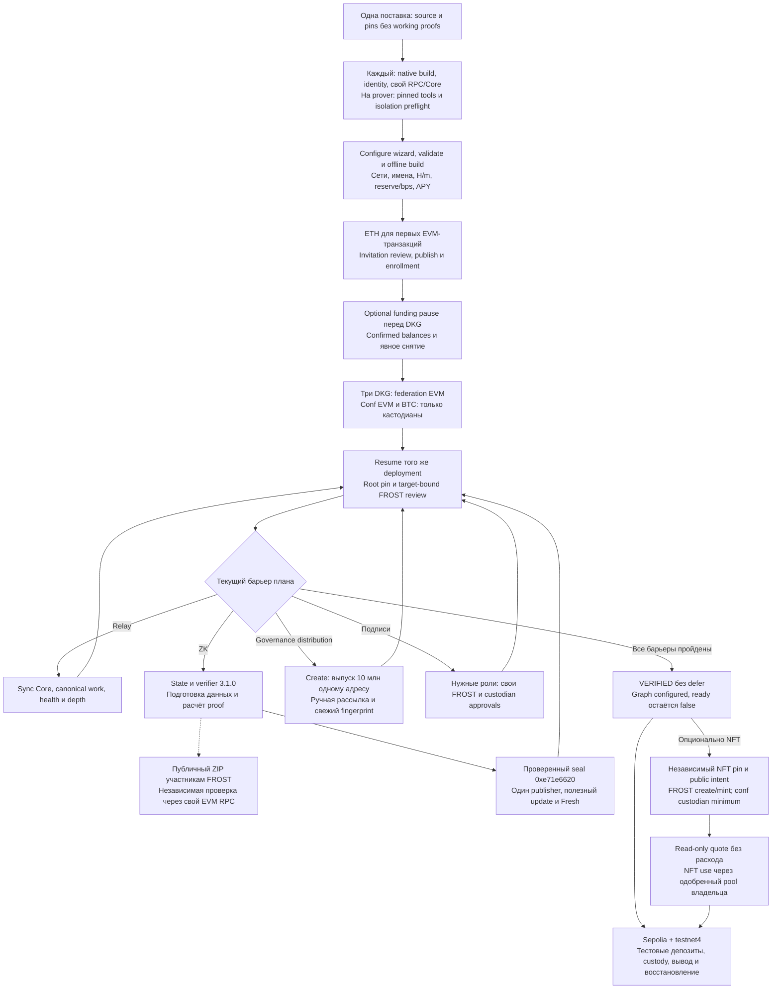
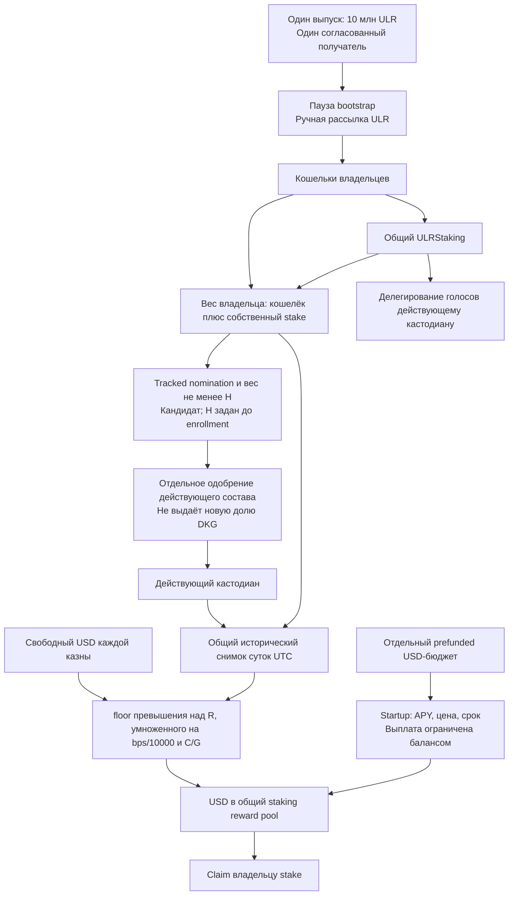
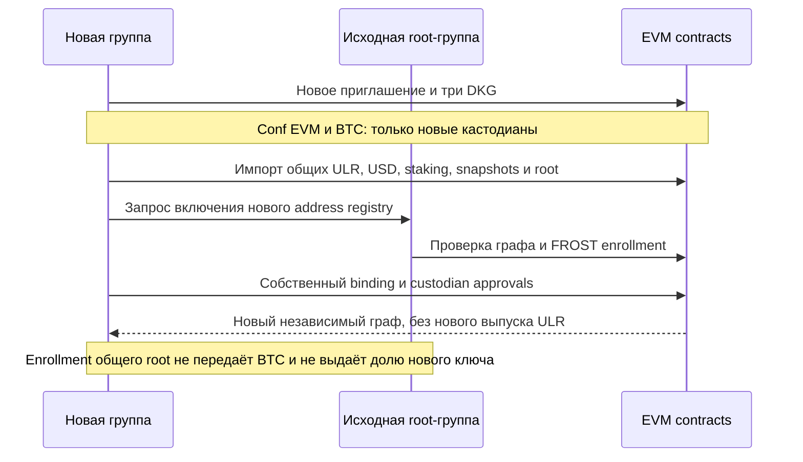

# Готовность к запуску: код, схемы и входные данные

[Схемы: SVG/PNG и hashes текущих Mermaid-исходников](DIAGRAMS.md).

## Промышленный тест на Sepolia и Bitcoin testnet4

Соберите проверяемую поставку из текущих исходников. Каждый участник задаёт
свой архивный HTTPS Bitcoin RPC и Sepolia RPC и проходит `configure check-rpc`.
Для relay выполните новый холодный старт, паузы финансирования, депозиты,
перенос custody, вывод и восстановление при остановке подписанта. Используйте
отдельный deployment ID для каждого режима и тестовые активы.

Для ZK используются SDK и неизменяемый verifier RISC Zero 3.1.0 с селектором
`0xe71e6620`. Для теста после обновления создайте граф с новым state и
verifier. Переход с уже используемого графа 3.0.0 требует отдельной миграции. Каждый
участник устанавливает собственные инструменты, считает свежий proof и
проверяет receipt. Выбранный publisher отправляет proof в новый тестовый граф.
Результаты архивных proofs 3.0.3 остаются историческими. Публичный прогон и
измерения на целевых Linux/WSL2 входят в приёмку. [Установка prover](ZK_PROVER_LINUX.md)
· [Advisory RISC Zero](https://github.com/risc0/risc0-ethereum/security/advisories/GHSA-mm6c-35cm-g4x2).

Для возобновления bootstrap сохраняйте профиль, SQLite-журналы, ключевые
эпохи и исходный комплект Solidity-артефактов. Новые записи закрепляют ABI,
точный creation/runtime bytecode и места ссылок, поэтому изменение source maps
при эквивалентной сборке не останавливает resume. Старые журналы сохраняют
проверку своего исходного полного хеша.

### Ограничения и приёмка

| Область | Ограничение и проверка перед запуском |
| --- | --- |
| Сети и RPC | Relay поддерживает regtest, testnet4 и mainnet. ZK поддерживает отдельные профили testnet4 и mainnet. Для удалённого стенда каждый участник до enrollment проверяет свой Sepolia RPC и архивный Bitcoin Core HTTPS RPC с `txindex`. Bitcoin RPC требует действующий сертификат на указанный адрес с публичной цепочкой `certifi`. Участникам нужны подтверждённые тестовые ETH для газа, тестовые BTC для денежных сценариев и согласованные USD-бюджеты. [Инструкция для коллег](PEER_TESTING.md#как-sdk-проверяет-https-для-bitcoin-rpc) |
| Bitcoin | Платёжный план on-chain поддерживает до 16 входов, 32 заявок и 32 выходов вместе со сдачей. Минимум получателю 294 sats для P2WPKH и 330 sats для P2TR. Для ZK предел перехода 64 headers, предел reorg 100 блоков. Глубина денежного подтверждения и Fresh проверяются отдельно. [Вывод в V3](CONFEDERATION_DAO_IN_KIND.md#btc-и-комиссия-майнеров) · [Математика Bitcoin](LAUNCH_MATHEMATICS.md#bitcoin-подтверждения-maturity-и-fresh--разные-проверки) |
| ZK prover | macOS arm64 или Linux/WSL2 x86-64, Groth16 в pinned контейнере linux/amd64. Свободное место от 8 GiB для preflight. Измерьте время, RAM и пиковое место на свежем proof каждого участника. [Установка и изоляция](ZK_PROVER_LINUX.md) |
| Дневной отчёт DAO V3 | Для закрытого UTC-дня сверить подтверждённые поступления S или одобренных стейблкоинов, реальные расходы и чистые выплаты по полному стейку дня. FROST и approvals кастодианов утверждают отчёт. [Учёт V3](CONFEDERATION_DAO_IN_KIND.md#приём-и-распределение) |
| Дневной снимок ULR прежнего профиля | До 4096 адресов вместе с действующими кастодианами. В pin до 64 казн. Новый реестр допускает до 64 однократных активаций системным FROST после регистрации. Состав проверяется на UTC-срезе. Новый intent до 16 KiB публикуется целиком, до 4 MiB через привязку SHA-256. Остаток неучтённого выпуска должен быть строго меньше порога. SDK проверяет нижнюю границу газа. Проверьте полный gas исполнения при целевом составе. [Казначейства](ULR_TREASURIES.md) |
| Operational API | HTTP готовит запрос в рамках политики. Локальный исполнитель сверяет deployment и artifact и использует сохранённый журнал. Для повторяющегося ключа укажите deployment. При переносе состояния сохраните также файл `<state>.api-execution.sqlite`. [Operational API](OPERATIONAL_API.md) |
| Возобновление | Используйте тот же deployment ID и журнал. При зависшем nonce сначала сверяются журнал, on-chain nonce и receipts, а закрытие nonce требует отдельного решения оператора. Для legacy journal сохраните оригинальный комплект артефактов. [Восстановление bootstrap](BOOTSTRAP.md#withdrawal-deployment-and-recovery) |
| Разная высота RPC | У каждого участника свой RPC. Он ждёт нужной высоты и глубины общего якоря перед продолжением. Для смены EVM RPC на том же журнале используйте локальный override `--rpc` и дождитесь проверки сохранённых якорей. [Восстановление при отставании RPC](RECOVERY.md#5-отставание-rpc-участников) |
| Допуск средств | `graph_configured` подтверждает конфигурацию. `ready`, `QUALIFIED`, `FEE_QUALIFIED` и `production_ready` требуют отдельных проверок. Для испытаний используйте testnet4 BTC и Sepolia ETH. |

Решение о допуске реальных средств требует отдельной проверки FROST/HPKE
из-за транзитивного `crypto-bigint 0.5.5` и прогона ротации ключей.
Удаление роли само по себе не отзывает существующую DKG share. [RustSec RUSTSEC-2026-0387](https://rustsec.org/advisories/RUSTSEC-2026-0387.html).

[Холодный старт с нуля](COLD_START.md): единый порядок подготовки, ролей,
финансирования, DKG, relay/ZK, ручной рассылки и первого smoke.

[Сквозной сценарий FROST и ZK](FROST_ZK_LIFECYCLE.md): отдельные DKG,
уравнения подписи и proof, nonce recovery, гонки публикаций и Bitcoin settlement.

[Математическое описание](LAUNCH_MATHEMATICS.md): единицы, точное округление,
границы выплат, UTC-учёт, APY и предпосылки безопасности.

[Запуск с нуля](CROSS_PLATFORM_QUICKSTART.md) · [Тестовые режимы](SYSTEM_TEST_MODES.md) ·
[Полный bootstrap](ULR_BOOTSTRAP.md).

Обновление 4 ноября: [отдельные ключи кастодианов и передача BTC](BITCOIN_CUSTODY_TRANSFER.md).
В новой custody policy представитель исключён из денежных EVM/BTC DKG;
внешний MP меняется на cBTC только после фактического исходного платежа,
погашения MP и SPV-приёма назначения. Старые приглашения не мигрируют.
Повторная проверка закрыла старые operator-only ограничения публикации
и запись intent/chunks в чужие или будущие FROST-сессии. Результаты,
команды и границы — в [тестовом runbook](SYSTEM_TEST_MODES.md#проверка-custody-от-4-ноября-2026).
`graph_configured=true` по-прежнему не означает `ready=true`.

[Поставка SDK](DISTRIBUTION.md) исключает готовые receipts и seals, inputs,
journals и локальные caches. Для рабочих переходов участники могут готовить
данные и считать proof локально либо сверять публичный ZIP от выделенного
prover-хоста. [Режимы ZK-воркера](ZK_SPV_WORKER.md).
Прежние acceptance-отчёты ниже относятся к своим исходным snapshots.

Эта карта относится к новому `--system-policy` Bitcoin + ULR deployment.
Готовность исходников и шаблонов не означает, что уже выбраны участники, RPC,
живые адреса контрактов и финансирование. Файлы `*.example.json` являются
шаблонами; локальные тестовые адреса из acceptance-отчётов не становятся
адресами будущего запуска.

## Порядок запуска



Для ZK первая полезная публикация нужна на барьере Bitcoin readiness, до
обычного consumer deployment. Явный структурный этап `--defer-zk-freshness`
допускает подготовку consumer/heartbeat graph; он не разрешает денежные операции
и не заменяет окончательный verify без defer. Личный worker и initial heartbeat настраиваются
после появления адреса state; checkpoint сам по себе не Fresh. Для следующих
переходов тот же publisher использует свой локальный proof. Участники могут
сверить переходы по публичным ZIP или своим расчётам.

Linux, macOS и Ubuntu внутри Windows/WSL2 используют один SDK и протокол.
Локальный ZK prover реализован для macOS arm64 и Linux/WSL2 x86-64. Для relay
выбираются Bitcoin mainnet/testnet4/regtest; ZK выбирает отдельный pinned guest mainnet или testnet4; regtest ZK запрещён.
EVM выбирается независимо: 1, 11155111 или 31337. `graph_configured=true`
не переключает `ready` или `QUALIFIED`.
Каждый ZK-участник устанавливает свои tools и проходит isolation preflight
по [Linux ZK runbook](ZK_PROVER_LINUX.md). Неподдерживаемая платформа блокируется
при ZK enrollment. Компонентные проверки Linux прошли; полный fresh-proof
и физический WSL2 прогон остаются отдельной приёмкой.

## Экономический граф ULR

Схема ниже относится к прежнему профилю с общей казной и стейкингом. V3
сохраняет общий выпуск ULR и ведёт стейкинг и отчёт каждой конфедерации
отдельно. [Схема и формулы V3](CONFEDERATION_DAO_IN_KIND.md#приём-и-распределение).



Снимок включает всех держателей от H (default 200 000 ULR) и действующих кастодианов с
меньшим положительным остатком; один владелец учитывается в системном
знаменателе один раз. Собственный stake не уменьшает вес. Делегирование меняет
голосование, все награды сохраняются у владельца. Внесённый после 00:00 stake участвует
со следующих суток UTC (особый случай ровно 00:00 — в математике); свободный вывод и отдельный claim сохраняются.
Точная формула, округление и полнота inventory описаны в
[казначейском runbook](ULR_TREASURIES.md).

## Повторное использование с другими участниками

V3 импортирует общие ULR и USD из проверенного manifest. У новой группы
свои DKG, S, резерв и стейкинг. Схема ниже показывает дополнительное
подключение к общему Bitcoin family root в прежнем полном профиле.



Новая группа не получает полномочия исходной root-authority или общей
snapshot-authority. Она использует свои identity, encrypted states и journals.
Для ненулевой доли дохода её кастодианам нужны собственные ULR; `reuse` их не
раздаёт. Порядок действий исходной и новой групп приведён в
[разделе о второй конфедерации](CROSS_PLATFORM_QUICKSTART.md#13-следующая-конфедерация-с-другими-людьми).

## Форматы и источники данных

Уточнения исходного ТЗ, принятые в ходе работы:

| Вопрос | Принятая конфигурация |
| --- | --- |
| Статус от согласованного H | Кандидат по кошельку + собственному stake; включение в действующий состав требует отдельного одобрения |
| Вес дохода | В V3 чистый доход DAO распределяется по полнодневному стейку своей конфедерации. В прежнем профиле доля казны использует веса держателей от H и действующих кастодианов с меньшим положительным весом |
| Казна и остаток | В V3 расчёт использует фактически полученные S и стейблкоины после возмещения расходов. В прежнем профиле R и невыплаченная часть свободного USD остаются в казне |
| Выбор SPV | Relay или ZK выбирается при развёртывании в рамках поддерживаемых сетей |
| Выпуск MP | Проверка Bitcoin-доказательства и отдельное FROST-одобрение сохраняются |
| Делегирование | Голоса направляются действующему кастодиану; stake и награды принадлежат владельцу |
| Денежные ключи конфедерации | Отдельные EVM/BTC DKG только кастодианов; кандидат/делегат не получает долю ключа автоматически |
| MP → S между графами | После исходного платежа и погашения MP конфедерация принимает точный выход и выпускает S. BTC при погашении S платит конфедерация. Прежний профиль использует cBTC через локальный MP |
| NFT | В V3 FROST и кастодианы утверждают тариф, оператор подписывает цену, покупатель платит S и получает проездной. В прежнем профиле используются FROST create/mint и read-only quote |

Эти уточнения заменяют соответствующие первоначальные формулировки об
автоматическом составе кастодианов, обязательном ZK и оценке любых активов казны
в долларах. Казна USD и Bitcoin UTXO/reserve для miner fees — разные учёты.
Исторический снимок фиксирует момент баланса; отдельный минимальный срок владения
или исключение займа на границе суток этим профилем не вводятся.

Версионные правила проверяются исполняемыми SDK validators, а не только
синтаксисом JSON. Они повторно проверяются при подготовке, подписи и исполнении.

| Данные | Формат и источник | Что подставить для запуска |
| --- | --- | --- |
| Полный системный профиль | Version 1; `bootstrap_system.bundle`; `system-bootstrap-*.example.json` | Сгенерировать `system-profile` из собственной сборки и согласованных policy |
| Отдельные ключи конфедерации | `bitcoin_custody`, `conf_ceremony` и `btc_ceremony` только кастодианов | До enrollment выбрать порог, источники и runtime hashes; старые профили не обновляются |
| Передача BTC под новый ключ | `BitcoinCustodyTransferV2` в V3, `BitcoinCustodyTransfer` в прежнем профиле | Исходный расчёт с погашением MP, канонический выход назначения и выпуск S или cBTC. [Порядок передачи](BITCOIN_CUSTODY_TRANSFER.md) |
| Имена токенов | `token_metadata` с `name` / `symbol`, `token-metadata.example.json` | Задать до enrollment, для reuse закрепить общий токен из verified manifest |
| ULR create/reuse | ULR policy V3 для `income_model=in-kind` | Первый create либо `manifest.ulr.reuse_policy` реального verified manifest |
| Bitcoin backend | Relay policy V1 либо ZK policy V2; network validators | Собственный checkpoint/Core; для ZK — реальные state/adapter bindings |
| Приглашение и три ceremony | V6; `onboarding.validate_invite` и проверенные enrollments | Сети, адреса, порядок, threshold, custodian minimum, сроки и расходы |
| Bitcoin family root прежнего профиля | `create-1` или pin из исходного verified manifest | Исходный board, authority и независимо проверенный fingerprint |
| ULR treasury pin прежнего профиля | Version 1, `ulr_treasury.load_pin` | Реальные staking/snapshots/treasuries, chain ID и confirmations |
| NFT | В V3 проверенные адреса DAO и продажи проездных из verified manifest либо discovery | Для V3 утвердить тариф и подписать цену. Для прежнего create/mint подготовить свой NFT pin через `nft init` |
| Дневной отчёт V3 | `dao-report --in-kind`, подтверждённые receipts и согласованные курсы | Закрытые UTC-сутки, активы в base units, хеши расходов и соответствующий evidence |
| Дневной inventory прежнего профиля | `ulr-snapshot-inputs.example.json`, `snapshot_arguments` | Предыдущие сутки, последний исторический блок, полный inventory и evidence hash |
| Snapshot evidence | Version 4 для новых снимков; SDK проверяет точный исторический хеш v3 для незавершённых intent | Формирует SDK по архивному RPC с проверкой полноты по выпуску. Используйте фактические сутки и исторический блок |
| ZK worker и contour | `zkspv-*.example.json`; соответствующие `load_config`/`validate_spec`/plan builders | Личные пути, host hash, actual consumers, лимиты, запросы и согласованные bindings |
| Старый single-share service | `signer-agent/.env.example` | Это отдельный прежний сервис; новые DKG shares туда не вставляются |

`system-profile` пересчитывает commitments из текущего production artifact,
публичного qualification report и service policy. Commitments шаблонов
проверяются относительно сборки. Публичный report с qualification pending
сохраняет этот статус после хеширования.

## Что должен подготовить оператор и каждый участник

| Уровень | Обязательные данные |
| --- | --- |
| Общие | Согласованная версия/fingerprint; две сети и backend; упорядоченный roster и thresholds; deployment ID; получатель выпуска ULR; treasury; финансовые параметры и лимиты |
| Каждый хост | Свои EVM RPC и gas; identity; каталог 0700; прежний EOA journal; свои Core RPC/cookie для публичного Bitcoin; собственные DKG states и password |
| Sepolia + testnet4 | Синхронизированный непрореженный Core с txindex через loopback или удалённый HTTPS, общая checkpoint policy, тестовые ETH и BTC, согласованный USD с runtime hash и decimals. Конвертер финансируется в прежнем профиле |
| После bootstrap | Проверенные адреса, pin на каждом хосте и обслуживающие процессы. В V3 ежедневно подготовить отчёт по поступлениям и расходам. В прежнем профиле подготовить inventory и архивный EVM RPC для snapshot/pay |
| Новый ZK proof | macOS arm64 или Linux/WSL2 x86-64; isolation preflight; точные tool/container/guest pins; собственный bound contour plan; приватные worker/service inputs; минимум 8 GiB свободного диска и фактический ресурсный бюджет prover |

RPC credentials, ключи, journals и nonce-пакеты не являются общими данными.
Файлы создаются на собственном хосте; оператор не заполняет их чужими ключами.
На Windows храните их в Linux home WSL2.
Для удалённых RPC каждый участник выполняет `configure check-rpc` со своим
доступом и согласованным приглашением до enrollment.
[Порядок проверки для коллег](PEER_TESTING.md#sepolia-и-bitcoin-testnet4-без-локальных-нод).

## Статус проверки

В предыдущем аудите локально прошли **3 707 тестов SDK и 964 теста Solidity**.
Один опциональный тест SDK требует установленного `signer-agent[evm-test]`.
Проверены отставание RPC на общей ветке, продолжение после синхронизации,
подтверждённое расхождение хешей и возобновление с исходными журналами.
Локальные сценарии Anvil провели DKG и FROST с порогами 2 из 3 и 3 из 5.
[Восстановление при отставании RPC](RECOVERY.md#5-отставание-rpc-участников) ·
[Тесты наблюдения ZK](../signer-agent/tests/test_zk_observations.py) ·
[Тесты снимков ULR](../web3/test/ULRTreasury.t.sol).

Локальная проверка API на Anvil подтвердила разделение ключей по deployment,
повтор без нового nonce и восстановление исполнения из старого журнала.
Проверки старых казначейств ULR покрыли полноту снимка, совместимость с
ожидающим evidence v3 и привязку большого intent к SHA-256. На локальном
HTTPS проверены цепочка, срок и имя сертификата Bitcoin RPC до отправки
cookie. [Схемы проверенных сценариев](DIAGRAMS.md).

Локальный relay-прогон V3 на Anvil прошёл паузы ETH-финансирования и ручной
рассылки ULR. `create` подтвердил 176 шагов, `reuse` с другим составом 174.
Оба графа получили `VERIFIED`. Второй использовал те же ULR и USD и получил
отдельный стейкинг. [Тесты bootstrap V3](../tests/e2e/test_in_kind_bootstrap.py) ·
[Отчёт холодного старта](../ops/artifacts/cold-start-local-20261121/summary.json).

Сквозной прогон на Anvil и Bitcoin Core regtest перевёл 1 000 000 sats,
погасил MP и выпустил S. Кастодианы утвердили тариф NFT, оператор подписал
цену для покупателя, покупатель приобрёл NFT за S в эквиваленте 1 000 sats.
Проверены повтор покупки и отклонение использования чужого NFT. При скидке
50% на комиссию протокола владелец получил 995 153 sats. Майнеры получили
по 1 000 sats за исходную передачу и за погашение. Остаток выпуска S полностью
обеспечили 3 847 sats сдачи, а повтор `finalize` сохранил выпуск неизменным.
Вывод подписали кастодианы конфедерации. [Тест перевода и выхода](../tests/e2e/test_custody_transfer.py).

В отдельной репетиции дневного DAO-расчёта поступило 1 000,000001 TUSD.
Канонический receipt и курс дали 0,157640 TUSD возмещения, а два стейкера
со стейками 1:3 получили 249,960590 и 749,881770 TUSD. Осталась одна базовая
единица округления. В день внесения стейка доход перенесён, право на claim
возникло после следующего полного UTC-дня. Суммы возмещения зависят от газа
и курса конкретного прогона. [Тест дневного claim](../tests/e2e/test_in_kind_bootstrap.py) ·
[Расчёт V3](CONFEDERATION_DAO_IN_KIND.md#приём-и-распределение).

В проверке RPC участники видели EVM-высоты 19, 13 и 10. При отставании
`verify` и `resume` вернули `AWAITING_EVM_RPC`. На Bitcoin regtest высоты
114, 112 и 109 давали разную глубину выплаты. Отстающие наблюдатели ждали
подтверждений и высоты watch. После синхронизации проверки продолжились по
тем же журналам, без повторной отправки проверенных EVM-транзакций.
[Отчёт холодного старта](../ops/artifacts/cold-start-local-20261121/summary.json).

В предыдущей компонентной проверке прошли 30 тестов ZK state/adapter,
124 целевых SDK-теста и три интеграции с Anvil. Проверены графы mainnet и
testnet4, подготовка native witness и отказ активного verifier 3.1.0 принимать
старый seal. Preflight проверяет версию собранных артефактов и наличие
локального каталога proof, когда он задан для теста.

Структурная проверка ZK на локальном Anvil с chain ID 11155111 и историческими
testnet4 заголовками завершила три DKG, развернула 49 контрактов и подготовила
native witness. Для witness использован ранее собранный бинарник с проверенным
SHA-256. Обычный resume вернул `AWAITING_ZK_PROOF`. Preflight обнаружил около
1,93 GiB свободного места при минимуме 8 GiB и отсутствие закреплённых
инструментов prover. Свежий Groth16 receipt, публичный create/reuse
на Sepolia/testnet4 и физические Linux/WSL2 остаются в приёмке.
[Структурный тест](../tests/e2e/test_zk_testnet4_e2e.py) ·
[Отчёт холодного старта](../ops/artifacts/cold-start-local-20261121/summary.json).
[Тестовые режимы](SYSTEM_TEST_MODES.md) · [Результаты предыдущей проверки безопасности](SECURITY_LOGIC_REVIEW_2026_11_03.md#повторная-проверка-12-ноября-2026).

Актуализация 5 ноября: [конфигуратор и полная функциональная приёмка](../ops/artifacts/launch-configurator-20261105/README.md)
фиксируют 921 Solidity, 3436 SDK/ops, create/reuse, отдельный startup claim и refund.
[Проверка математического среза](../ops/artifacts/launch-docs-math-20261105/README.md)
сохраняет свои формулы и source hashes. [Текущая сверка документации](../ops/artifacts/docs-consistency-20261105/README.md)
проверяет соответствие схем/API коду, команды и новую поставку. Это не новый публичный
запуск и не подтверждение fresh testnet4 Groth16 или физического WSL2.
Предыдущие отчёты ниже сохраняют свои даты и границы.


Предыдущий [прогон custody-профиля](../ops/artifacts/custody-transfer-20261104/README.md)
подтвердил 908 контрактных тестов, 3344 разных SDK/ops-проверки, полный
create/reuse с другим roster и настоящую Core 30.3 regtest-передачу между двумя
native FROST-кошельками. Вывод назначения выполнен без исходных участников и
представителя федерации назначения. Это локальная проверка relay/regtest;
fresh ZK и физические Linux/WSL2 для этого изменения не подтверждены.

[Предыдущая проверка исходников, конфигураций, CLI и схем](../ops/artifacts/launch-readiness-20261103-final/validation.json)
хранится отдельно от [предыдущих протокольных прогонов](../ops/artifacts/portable-system-v1/validation.json).
Схемы выше экспортируются из тех же Mermaid sources и проверяются локальным
renderer без внешних запросов. Формальная JSON-проверка шаблона не подтверждает
наличие контракта или полноту historical inventory.
Предыдущий полный SDK-прогон: **3027 passed**. Проверены 113
CLI-примеров для 55 команд и 25 Mermaid-схем текущих архитектурных документов;
три новые схемы дополнительно осмотрены визуально. Эти результаты относятся к
локальной проверке, а не к состоявшемуся запуску с внешними участниками.
Изменения независимого proving отдельно проверены в
[новом отчёте](../ops/artifacts/independent-proving-20261103/validation.json):
3123 SDK/packaging/release tests и финальные 148 профильных тестов. Настоящий
исторический receipt проверен с отказом принять его за собственный proof.
Подготовка sources из распакованной поставки проверена без готовых proofs;
fresh proving и полная холодная сборка proving tools остаются неподтверждёнными.
Актуальные экспорты порядка запуска, экономики ULR и сценария reuse указаны
в [индексе схем](DIAGRAMS.md). Экспорты в предыдущих отчётах относятся к их срезам.

Повторить audit из собранного checkout можно командой:

```sh
python -m ops.audit_launch_readiness --output /absolute/new-launch-audit
```

Для проверки SVG из этой команды передайте `--diagrams` с manifest локального
рендера одной страницы `docs/LAUNCH_READINESS.md`.

Audit читает публичные файлы и вызывает только CLI `--help`; примеры отправки
транзакций не исполняются. Для проверки на другой машине задайте в PATH её
собственные native tools. CLI option-проверка не заменяет семантические
проверки реальных addresses, Core, балансов и подписанных профилей.

Чистая сборка Ubuntu 24.04 x86-64, 487 portable SDK-тестов, native Rust и
Core regtest smoke подтверждены в локальном Linux-контейнере под CPU-эмуляцией:
[отчёт платформ](../ops/artifacts/linux-portability-20261103/validation.json),
[начало тестов для коллег](PEER_TESTING.md). Физическая Windows/WSL2-машина,
полный чистый Bitcoin E2E-набор после последних изменений harness и новый
monetary ZK contour пока не подтверждены. Текущая
машина также должна пройти ресурсный preflight; нехватка места не обходится.
Production qualification, измерения и независимая приёмка остаются отдельными
требованиями. `qualified=false` сохраняется.
