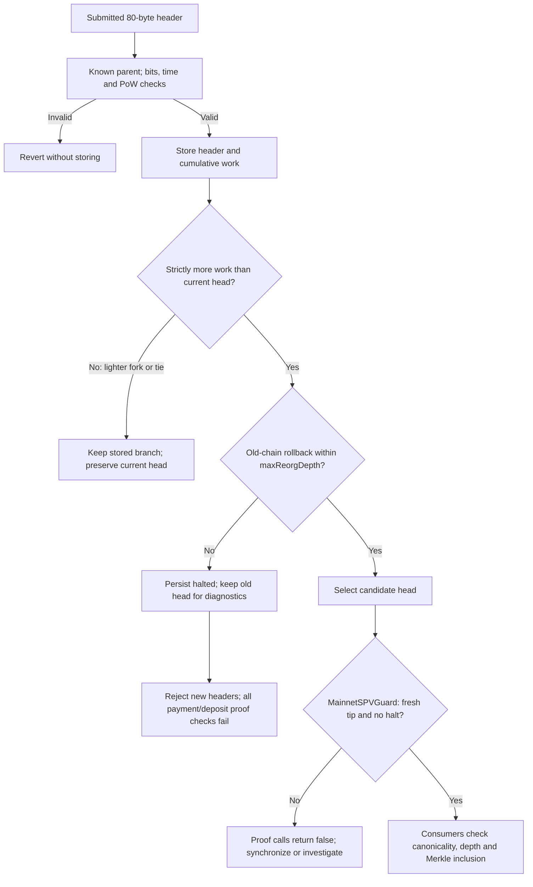

# Bitcoin mainnet header relay

[Схемы: SVG/PNG и hashes текущих Mermaid-исходников](DIAGRAMS.md).

`web3/contracts/src/federation/MainnetHeaderRelay.sol` validates Bitcoin mainnet
headers from an immutable trusted checkpoint. The EVM network does not select the Bitcoin network: this
contract can be deployed on Sepolia and still validates Bitcoin mainnet headers.
V6 also selects `Testnet4HeaderRelay` for testnet4 and `RegtestHeaderRelay` for regtest.

The V6 `backed` profile connects onboarding, registry pinning, Bitcoin signing,
broadcast/proofs and bounded header synchronization to this relay. It also deploys
`MainnetSPVGuard` as the deposit/escrow SPV endpoint, enforcing freshness and halt
for permissionless proof consumers. See the [mainnet CLI runbook](BITCOIN_MAINNET_RUNBOOK.md).
V6 bootstrap independently selects Anvil/Sepolia or [Ethereum mainnet](ETHEREUM_MAINNET_RUNBOOK.md)
with its paid factories and finalized state. Network support
is not production-custody approval. The packaged
[`frost-relay-keeper`](RELAY_KEEPER_AND_GAS.md) provides bounded synchronization,
durable transaction retries and a systemd example. Operators must run and monitor
it continuously and retain a reviewed recovery procedure. The historical contract/consumer
tests below do not demonstrate a funded live mainnet withdrawal or public Sepolia
deployment.

The leaf script `DeployMainnetHeaderRelay.s.sol` also deploys
`MainnetSPVGuard`. Its explicit `MAX_REORG_DEPTH` must be 1–144 and
`MAX_TIP_AGE_SECONDS` 1–86400. Deposit/escrow consumers use the returned guard
address; header submission targets the raw relay. See the complete
[script environment table](STAGED_DEPLOYMENT.md#bitcoin-mainnet-header-relay).

## Explicit deployment inputs

Constructor arguments, in order:

1. `bytes rawCheckpoint`: exactly 80 serialized header bytes.
2. `uint64 checkpointHeight`: at least 10 and divisible by 2016.
3. `uint256 checkpointChainWork`: cumulative work **including** the checkpoint.
4. `bytes[] precedingHeaders`: exactly ten 80-byte headers, oldest first,
   from `checkpointHeight - 10` through `checkpointHeight - 1`.
5. `uint64 maxReorgDepth`: positive; the original contract acceptance uses **100**.
   The V4 CLI requires an explicit reviewed value in its operational range 1–144.

There is no default checkpoint, network inference, administrator, checkpoint
replacement, test mutation method, or recovery entry point. All eleven serialized
headers must be continuously hash-linked. The checkpoint's compact target and PoW
are validated, and its supplied cumulative work must cover its own block work.
Earlier cumulative work and the checkpoint's contextual difficulty are trusted
inputs; ten preceding headers cannot reconstruct the preceding period's retarget.
The ten preceding headers provide MTP timestamps only. They are not proof targets
and cannot be used as parents of newly submitted headers below the checkpoint.

**Do not use the historical test checkpoint at height 32256 with real funds.**
Choose a recent period boundary from independently verified Bitcoin Core data,
including its exact chainwork and ten predecessors. Before registering active
deposit/withdrawal consumers, submit the remaining headers and compare the relay's
head, height and chainwork with your independently synchronized Bitcoin node.
An old checkpoint has historical difficulty; a private branch above it can be
cheap to mine while the relay has not yet received the actual heavier chain.
The relay selects the heaviest branch submitted to it. It does not discover the
network tip, enforce freshness, or run a keeper. Continue submitting headers and
monitoring lag and halt status after deployment. This is an operating requirement
of the trusted-checkpoint design, not a new automatic recovery mechanism.

The V6 profile supplies the operational layer: own Core mainnet genesis,
complete block synchronization, txindex, unpruned history, exact checkpoint/work,
fresh tip, canonical relay work and bounded lag. `dkg btc-network-status` checks
that readiness from the pinned graph; `dkg btc-relay` uses durable EVM transactions
to submit at most the reviewed `max_headers_per_sync`, then checks the confirmed
EVM snapshot. Pending/stale progress returns `IN_PROGRESS`; a permanent relay
halt stops synchronization. Checkpoint generation is read-only through
`bitcoin checkpoint`. No policy defaults are inferred from the remote node.

The standalone keeper stores authenticated creation evidence in
`<identity>.relay-provenance.enc`, so restarting with the same gas identity does
not repeat creation discovery. Supply `--relay-creation-block` on the first run
when that block is known: for a direct CREATE, current runtime plus canonical
receipt and exact initcode establish provenance without historical EVM state.
The block number is an untrusted locator; an incorrect one fails verification.
The keeper still checks canonical anchors, runtime, Core readiness and relay
policy. Without the cache or block locator, finding an old deployment can still
require historical code. See [RPC requirements](CONTRACT_PROVENANCE.md).

`MainnetSPVGuard(relay,maxTipAgeSeconds)` delegates the proof interface only while
the underlying relay is not halted and its tip timestamp is recent relative to
EVM time. Deposit registry and escrow point to this guard in V4. The raw relay
continues to store and select headers unchanged. The guard cannot prove that the
latest global heaviest chain has been submitted; keepers and independent Core
comparisons remain necessary. The CLI additionally rejects a tip too far in the
future and checks the configured EVM receipt depth.

For a supported constructor payload, dynamic lengths are fixed by validation.
In the historical Solidity 0.8.30 / Osaka / via-IR / optimizer-runs=1 build,
the current measured runtime is **5,903 bytes**, creation code **7,947 bytes**,
constructor arguments **1,920 bytes**, and actual initcode **9,867 bytes**; see the
[26 October size report](../ops/artifacts/operations-final-20261026.contract-sizes.json). These fit EIP-170 and
EIP-3860 without changing either limit. Rebuild when code or dependencies change.

## Bitcoin arithmetic and byte order

Block hashes, transaction IDs, Merkle roots, and proof siblings are the raw
SHA256d digest bytes, matching `BitcoinTxParser` and the existing deposit/escrow
interfaces. Explorer/RPC display hashes are the reverse of those bytes. Only the
PoW comparison interprets a digest as a little-endian integer. Equality is valid:
`hash <= target`.

The mainnet limit is the full Core value
`00000000ffffffffffffffffffffffffffffffffffffffffffffffffffffffff`.
It is distinct from decoding its compact representation `1d00ffff`. The relay
rejects zero, negative and overflowing compact targets before applying that limit.
`TargetsHelper` decoding and block-work arithmetic remain network independent;
for example `207fffff` is still a valid regtest target for existing consumers.

New headers must use the parent's exact `bits` within a period. At a boundary,
the relay looks up that branch's first header of the preceding period and uses
the preceding last header's timestamp. This is exactly **2015 intervals**.
Timestamp subtraction is signed before the Core quarter/four-times clamp.
The new target is floored, capped by the full limit, and converted with Core's
`GetCompact` rules, including small targets and the mantissa sign-bit carry.

Block work is `floor(2^256 / (target + 1))`, evaluated with the complement identity
used by Core. Cumulative additions are checked: overflow reverts the whole call.
The timestamp must be strictly greater than branch-specific 11-header MTP and at
most `block.timestamp + 7200`. The future-time equality boundary is accepted.

Primary consensus references are pinned to Bitcoin Core 29.0, commit
`f490f5562d4b20857ef8d042c050763795fd43da`:

- [Compact encoding/decoding](https://github.com/bitcoin/bitcoin/blob/f490f5562d4b20857ef8d042c050763795fd43da/src/arith_uint256.cpp)
- [Difficulty, retarget and PoW](https://github.com/bitcoin/bitcoin/blob/f490f5562d4b20857ef8d042c050763795fd43da/src/pow.cpp)
- [Block work](https://github.com/bitcoin/bitcoin/blob/f490f5562d4b20857ef8d042c050763795fd43da/src/chain.cpp)
- [Median time past](https://github.com/bitcoin/bitcoin/blob/f490f5562d4b20857ef8d042c050763795fd43da/src/chain.h)
- [Mainnet consensus parameters](https://github.com/bitcoin/bitcoin/blob/f490f5562d4b20857ef8d042c050763795fd43da/src/kernel/chainparams.cpp)
- [Official release tag object](https://api.github.com/repos/bitcoin/bitcoin/git/tags/be613e616f499adaf841042de54bdc8e5e885328)

## Canonicality and bounded reorganization

All valid headers are retained, including branches with less or equal work. Equal
work preserves the current head. A strictly heavier candidate is compared with
the current head through their common ancestor. Rollback depth is the number of
removed old-chain headers, not candidate-tail length or height difference.

Each node has binary-lifting ancestor pointers. A height lookup needs at most 64
steps. The common-ancestor search uses at most 64 levels after height alignment.
The `height2hash(uint64)` getter derives canonical heights from the selected head;
there is no mutable per-height cache that could retain a removed tail. Selecting
a shorter heavier chain therefore immediately returns zero for all heights above
the new head, without walking or rewriting either tail. Head selection and halt
detection do not depend on an unbounded linear branch traversal.

For a rollback greater than `maxReorgDepth`, the valid candidate is stored,
`halted` is written, and `RelayHalted` is emitted. The call returns successfully,
preserving the halt. The previous selected head and its derived height mapping
remain readable for diagnostics. Subsequent `addBlockHeader` calls revert.
`getBlockStatus` always returns `(false, 0)` and `checkTxInclusion` returns `false`
after halt, so the real deposit registry cannot authorize a mint and escrow
cannot settle. No DAO-settlement pause or post-signing refund right is added.



The halt path is permanent for this instance; there is no administrator reset.
It stops future proof acceptance, not previously executed mint or burn operations.

Before halt, canonical confirmations include the queried block itself. Merkle
inclusion is a separate check from canonicality: consumers must check both.
Proofs are limited to 32 siblings and require `index < 2^siblings.length`.
An unknown block, bad proof or invalid proof dimensions returns false.

## Stored real-mainnet fixtures

The fixtures in `web3/test/fixtures/mainnet` contain 4,043 headers at heights
**32246–36288**, including ten MTP-only predecessors, the checkpoint at 32256,
and 4,032 subsequent headers across two actual difficulty changes:

| Height | Purpose | bits | Display hash |
|---|---|---|---|
| 32256 | Checkpoint | `1d00d86a` | `000000004f2886a170adb7204cb0c7a824217dd24d11a74423d564c4e0904967` |
| 34272 | First subsequent retarget | `1d00c428` | `000000002732d387256b57cabdcb17767e3d30e220ea73f844b1907c0b5919ea` |
| 36288 | Second subsequent retarget | `1d00be71` | `0000000040514b192e6ca247d83388bf11cb1d5e980610ae2c6324cbb0594b32` |

`manifest.json` records the expected anchor chainwork and timestamps, source
provenance, source archive checksum, exact Core commit, and file checksums.
`headers-32246-36288.bin` is the consecutive 80-byte serialized-header stream.
`expected-32246-36288.bin` stores one 68-byte Core-verified record per header:
32 display-order hash bytes, 32 unsigned big-endian chainwork bytes, and four
big-endian bits bytes. Both streams start at height 32246.

`headers-genesis-36288.bin.gz` provides the complete genesis-to-final-header prefix
needed for independent offline Core verification. The original source is
[DFINITY's Core-exported fixture](https://download.dfinity.systems/testdata/mainnet_headers_800k.json.gz),
whose provenance and SHA-256 are specified in its
[primary manifest](https://github.com/dfinity/ic/blob/master/MODULE.bazel):
`fb58cd3c0e2efe298eeb96751ae2276e938b39e2f1d9760ea47a9f3a8288d214`.
The fixture was independently checked by an official Bitcoin Core 29.0 binary:
all headers 1–36288 passed `submitheader`, and every test record was compared with
`getblockheader(hash, true)`. The node had no Bitcoin peers or wallet and used the
mainnet consensus configuration.

`checkpoint-coinbase.json` contains the historical checkpoint coinbase obtained
from Blockstream's public Esplora endpoint. Its raw transaction hashes to the
checkpoint's Merkle root, and its output is exercised by the real deposit
registry and `PoolMpToken` minting integration test.

## Reproduce checks

From `web3` with the pinned compiler available:

```bash
forge test --match-contract 'TargetsHelperTest|MainnetHeaderRelayTest|MainnetRelayIntegrationTest' -vv
```

These tests need no live RPC or network. The fixture read permission is scoped to
`./test/fixtures`. The multi-thousand-header simulations periodically reset only
the test driver's aggregate gas budget to represent separate transactions; every
real `addBlockHeader` call remains metered and explicitly capped at 1,000,000 gas.
No production bytecode-size or gas limit is increased.

To independently revalidate the committed bytes with an installed official Core
29.0 binary, run from the repository root:

```bash
python ops/verify_mainnet_headers.py --bitcoind /absolute/path/to/bitcoin-29.0/bin/bitcoind
```

This starts and stops a temporary local mainnet node with peer networking disabled,
submits the committed genesis prefix, and compares all records. To rebuild from
the checksum-pinned original source archive, add
`--source-json-gz /path/to/mainnet_headers_800k.json.gz --write`.

For an additional replay with **exactly Core30.3.0**, preserving the Core29.0
manifest and all fixture bytes, run:

```bash
python ops/verify_mainnet_headers_current.py \
  --bitcoind /absolute/path/to/bitcoin-30.3/bin/bitcoind \
  --output ops/artifacts/upgrade-mainnet-fixtures-20261018.json
```

This wrapper checks the exact RPC-reported version, omits only the legacy
`-upnp`/`-natpmp` flags removed in Core30, and retains a fresh temporary data
directory, disabled peers/wallets and loopback-only RPC. It validates fixture
checksums before starting Core, replays every header, and compares every expected
hash/bits/chainwork record plus all timestamp/MTP anchors. The separate JSON
report records both verifier versions and the locally used binary's SHA-256;
it does not attest that binary's source commit or release signature. Install and
verify the official binary separately. The wrapper cannot write its report into
the canonical fixture directory. [Recorded Core30.3 revalidation](../ops/artifacts/upgrade-mainnet-fixtures-20261018.json)
is evidence for the historical sequence, not evidence of current synchronization
or a live mainnet withdrawal. A separate
[real Core30.3 live-policy test](../ops/artifacts/mainnet-policy-core-20261018.json)
replays the same headers and confirms that the unmodified mainnet CLI policy
rejects that unsynchronized header-only node without clock or policy overrides.

The test suite covers compact arithmetic, real retargets and chainwork, malformed
checkpoints/ancestors, invalid PoW/bits, exact time boundaries, duplicate headers,
checked overflow, wire-order proofs, shorter/heavier forks, accepted rollback 100,
and persistent halt at 101. The 8,192-header competing-tail test measured **822,947
gas including candidate-header storage**, below its 1,000,000-gas assertion.

Reorganization and payment-root boundary simulations live exclusively in
`test/MainnetRelayFixture.sol`. They do not introduce any production PoW override.
The real checkpoint coinbase deposit/mint uses the actual production relay. The
escrow settlement/halt test uses production escrow, deposit registry and token
logic, with test-only batch authorization and a synthetic payment Merkle root;
it does not claim that its unsigned payment was mined on Bitcoin mainnet.
