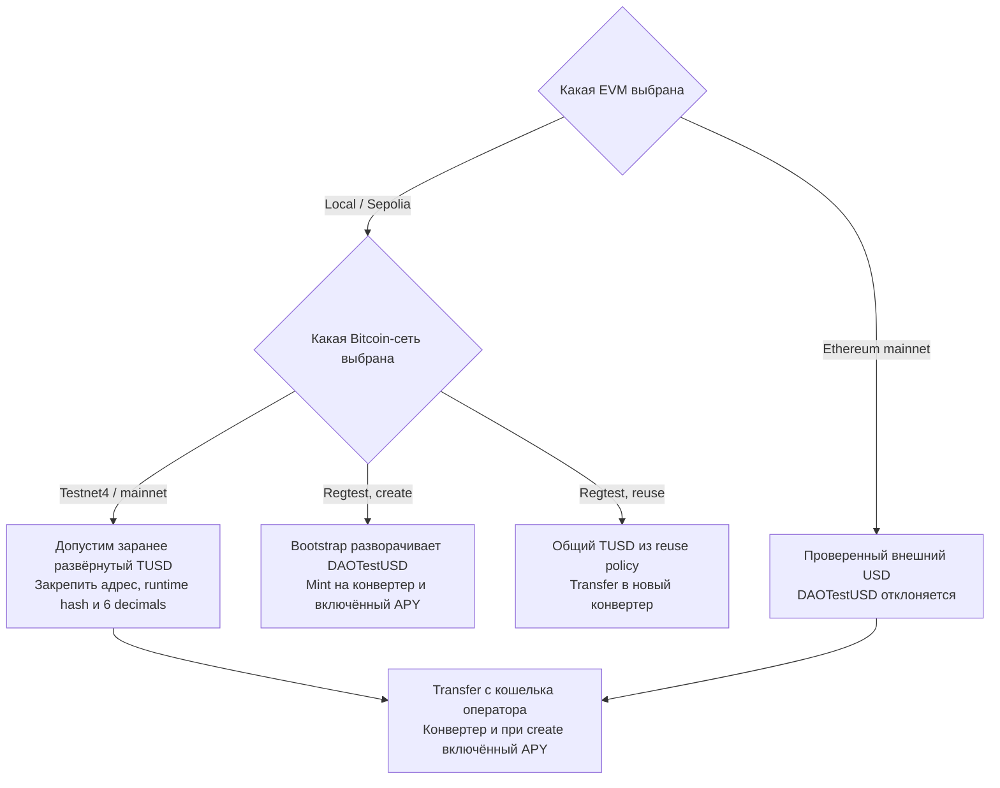

# Сети V6 и автоматическое продолжение операций

Новое `setup invite` всегда создаёт **V6**. Сначала выберите две независимые сети:
`--ethereum-network mainnet|sepolia|local` и
`--bitcoin-network mainnet|testnet4|regtest`. Legacy `--chain-id` сохраняется;
если передать оба EVM-параметра, они должны обозначать одну сеть.
RPC каждого участника должен соответствовать выбранной сети.

В экономических колонках ниже `token/feed` описывает legacy DAO-профиль.
Полный [ULR/system bootstrap](ULR_BOOTSTRAP.md) использует общий USD, staking
и казны без BTC/USD feed, TWAP, rate controller и legacy settlement.
Сетевые требования, paid factories и finality остаются теми же.

| Ethereum | Bitcoin regtest | Bitcoin testnet4 | Bitcoin mainnet |
|---|---|---|---|
| Local, chain 31337 | Integration, test token/feed, exempt factories | Backed, external token/feed, exempt factories | Backed, external token/feed, exempt factories |
| Sepolia, chain 11155111 | Integration, test token/feed, exempt factories | Backed, external token/feed, exempt factories | Backed, external token/feed, exempt factories |
| Mainnet, chain 1 | Backed, external token/feed, paid factories | Backed, external token/feed, paid factories | Backed, external token/feed, paid factories |

`backed` обозначает способ финансирования и проверки профиля; он не превращает
regtest/testnet4 BTC в настоящие BTC. Ethereum mainnet всегда требует положительной
deployment fee, `integration_fee_exemption=false`, внешних активов, явного
`--deadline`, локальных gas/fee caps и не менее **12 подтверждений вместе с finalized**.
На остальных EVM новый invite по умолчанию задаёт 1 подтверждение; выберите
`--evm-confirmations` явно для своей сети. Пример Sepolia в первой инструкции задаёт 12.
`mode` CLI выводит из выбранных сетей, не из RPC URL.

Новые транзакции bootstrap/DAO получают запас газа на изменение состояния между
оценкой и включением: `max(ceil(estimate × 130 / 100), estimate + 125000)` во всех
трёх EVM. На chain 1 итог дополнительно обязан уложиться в локальный budget и
лимит транзакции; CLI не увеличивает заданный budget. Уже подписанные транзакции
при восстановлении не пересобираются. Запас gas limit не означает расход всего
этого газа, но кошельку нужен баланс для допустимой максимальной стоимости.

Матрица означает совместимость, а не одинаковые гарантии безопасности. В паре
Bitcoin mainnet + Sepolia/local используются реальные BTC, но управление остаётся
на выбранной тестовой EVM. `READY_MAINNET_PROTOCOL` у `doctor` может означать,
что только одна из двух сетей — mainnet; смотрите поля обеих сетей и `scope`.
Этот статус подтверждает проверки протокола, а не готовность к хранению реальных средств.

Bitcoin mainnet и testnet4 требуют публичной checkpoint policy и собственного
полностью синхронизированного, непрореженного Core с готовым `txindex` у каждого
участника. Regtest не принимает `--bitcoin-policy`. Внешний reward token нужен,
когда Ethereum — mainnet **или** Bitcoin — mainnet/testnet4; BTC/USD feed нужен
дополнительно только legacy DAO-профилю, не ULR/system route. Deployment fee
задаётся только для Ethereum mainnet; его test token/mock feed запрещены при
любом выборе Bitcoin.

Начните с [первой DKG](FIRST_DKG_ONCHAIN.md); для Ethereum mainnet выполните
[дополнительные шаги](ETHEREUM_MAINNET_RUNBOOK.md). Mainnet Bitcoin policy и
границы доверия описаны в [Bitcoin runbook](BITCOIN_MAINNET_RUNBOOK.md).

## Подготовка выбранной пары без запуска

[Профиль подготовки и пакет review](PRODUCTION_PREPARATION.md) позволяют выбрать
две сети независимо и явно задать `relay` либо `zk-state-v2`. Для mainnet Bitcoin
и testnet4 доступны оба backend с разными pinned guests; для regtest — relay.
Пакет содержит 15 отдельных
шаблонов; authority/checkpoint/budget не переносятся между парами автоматически.
Это подготовительные входы, не готовое приглашение или deployment. Пользователь
выбрал новую связку; отсутствие обязательств ещё нужно подтвердить inventory.

## Тестовый USD: какие режимы и как настроить

`DAOTestUSD` — необеспеченный тестовый ERC-20 с 6 decimals и открытым `mint`;
`DAOMockFeed` имеет 8 decimals, и любой адрес может менять его rounds. Эти
компоненты пригодны для проверки проводок, а не для определения стоимости денег.
В режиме `backed` конвертер расходует заранее внесённый inventory; это название
не означает, что выбранный reward token обеспечен долларами.

| Выбранная EVM | Bitcoin | Как подключить тестовый USD в ULR-bootstrap |
|---|---|---|
| Local или Sepolia | Regtest | В `create` bootstrap разворачивает `DAOTestUSD` и выпускает TUSD на конвертер и включённый startup APY. В `reuse` новый оператор пополняет свой конвертер переводом в уже общем TUSD. |
| Local или Sepolia | Testnet4 или mainnet | Заранее разверните `DAOTestUSD` и закрепите адрес, runtime hash и `decimals=6`. Оператор финансирует конвертер переводом. В `create` он отдельно финансирует включённый startup APY. |
| Ethereum mainnet | Любая из трёх Bitcoin-сетей | Требуются проверенный внешний USD-токен и ETH для газа. `DAOTestUSD` запрещён. |



Таким образом, тестовый USD доступен во всех **шести** сочетаниях с local/Sepolia.
Он не заменяет ETH для газа и не делает Bitcoin mainnet монеты тестовыми.
Для проверки без реальных BTC выбирайте testnet4 либо regtest.

Для local/Sepolia + публичного Bitcoin выполните следующие шаги **до** `configure build`.
Команды запускаются из корня репозитория. Используйте отдельный тестовый EVM-кошелёк;
параметры приватного ключа в командную строку не передаются.

1. Задайте RPC выбранной тестовой EVM и проверьте chain ID. Импорт в Foundry
   нужен один раз; ключ и пароль вводятся в интерактивном скрытом запросе:

   ```sh
   export RPC='<свой Sepolia или local RPC>'
   export TEST_ACCOUNT='satoshify-test'
   export OPERATOR='<адрес оператора из приглашения>'
   TEST_CHAIN_ID=$(cast chain-id --rpc-url "$RPC") || exit 1
   case "$TEST_CHAIN_ID" in 31337|11155111) ;; *) exit 1 ;; esac
   cast wallet import "$TEST_ACCOUNT" --interactive
   ```

2. Разверните `DAOTestUSD` и запишите адрес из `Deployed to`:

   ```sh
   forge create --root web3 contracts/src/demo/DAOTestUSD.sol:DAOTestUSD \
     --rpc-url "$RPC" --account "$TEST_ACCOUNT" --broadcast
   export REWARD_TOKEN='<адрес развёрнутого DAOTestUSD>'
   ```

3. После выбранной глубины подтверждений проверьте runtime и decimals. Runtime
   должен совпасть с локальными artifacts этой сборки; непустой код сам по себе
   не доказывает происхождение контракта:

   ```sh
   TOKEN_RUNTIME=$(cast code "$REWARD_TOKEN" --rpc-url "$RPC") || exit 1
   test -n "$TOKEN_RUNTIME" && test "$TOKEN_RUNTIME" != 0x || exit 1
   test "$TOKEN_RUNTIME" = "$(forge inspect --root web3 DAOTestUSD deployedBytecode)" || exit 1
   export REWARD_TOKEN_CODE_HASH=$(cast keccak "$TOKEN_RUNTIME")
   cast call "$REWARD_TOKEN" 'decimals()(uint8)' --rpc-url "$RPC"
   export REWARD_TOKEN_DECIMALS=6
   ```

   Ожидаемый ответ — `6`. CLI повторно проверяет закреплённый код и
   decimals на подтверждённом состоянии при bootstrap.

4. Явно выберите количество тестовых USD в минимальных единицах: один тестовый
   USD равен `1000000`. Выпустите оператору сумму для конвертера и, при `create`
   с включённым startup APY, отдельный бюджет программы:

   ```sh
   export TEST_USD_MINT_BASE_UNITS='<целое количество минимальных единиц>'
   cast send "$REWARD_TOKEN" 'mint(address,uint256)' \
     "$OPERATOR" "$TEST_USD_MINT_BASE_UNITS" --rpc-url "$RPC" --account "$TEST_ACCOUNT"
   cast call "$REWARD_TOKEN" 'balanceOf(address)(uint256)' "$OPERATOR" --rpc-url "$RPC"
   ```

5. Заполните `reward_token` в wizard или launch JSON. Укажите `address`,
   `runtime_hash` и `decimals` (строка `6`). Задайте `converter_funding_usd` и
   `economics.startup.budget_usd` в USD. Выберите Bitcoin policy для своей сети
   и запустите `configure build`. ULR-приглашение использует фиксированную
   котировку конвертера. `--btc-usd-feed` в нём отклоняется.

Для local/Sepolia + regtest оставьте `reward_token` пустым. Адрес TUSD появится
в результате `create`. При `reuse` используйте закреплённый общий TUSD и
пополните баланс нового оператора для его конвертера до запуска.

В прежнем DAO bootstrap без ULR для regtest создаётся также `DAOMockFeed`.
Для публичного Bitcoin этот профиль требует отдельный заранее развёрнутый
feed с `decimals=8` и его runtime hash через `--btc-usd-feed` и
`--btc-usd-feed-code-hash`. Дневной TWAP требует истории закрытого дня.
[Инструкция тестового feed](STAGED_DEPLOYMENT.md#тестовые-usdfeed-и-явная-история-дня).

## Bitcoin testnet4

Запустите отдельный Core 30.3; это публичная Bitcoin testnet4, не устаревшая testnet3:

```sh
BTC_DIR="$HOME/bitcoin-testnet4"
mkdir -m 700 "$BTC_DIR"
bitcoind -datadir="$BTC_DIR" -chain=testnet4 -server=1 -txindex=1 -prune=0 \
  -disablewallet=1 -daemon -rpcbind=127.0.0.1 -rpcallowip=127.0.0.1
export BTC_RPC=http://127.0.0.1:48332
export BTC_COOKIE="$BTC_DIR/testnet4/.cookie"
bitcoin-cli -datadir="$BTC_DIR" -chain=testnet4 getblockchaininfo
bitcoin-cli -datadir="$BTC_DIR" -chain=testnet4 getindexinfo txindex
```

Дождитесь `chain=testnet4`, `initialblockdownload=false`, `pruned=false`,
`blocks=headers`, готового `txindex` и свежей вершины. Оператор выбирает проверенный
checkpoint на высоте ≥2016, кратной 2016, с достаточным запасом последующих блоков:

```sh
frost-signer bitcoin checkpoint --bitcoin-network testnet4 \
  --bitcoin-rpc "$BTC_RPC" --bitcoin-cookie "$BTC_COOKIE" \
  --checkpoint-height "$CHECKPOINT_HEIGHT" \
  --max-reorg-depth 6 --max-tip-age-seconds 21600 \
  --max-relay-lag-blocks 2 --max-headers-per-sync 16 > testnet4-policy.json
```

До публикации проверьте checkpoint и cumulative chainwork. Policy имеет тот же
формат, что mainnet, с `network=testnet4` и genesis
`00000000da84f2bafbbc53dee25a72ae507ff4914b867c565be350b0da8bf043`.
Каждый друг сверяет её со своим Core при enrollment; файл друзьям не передаётся.
В конфигураторе укажите `bitcoin_network=testnet4`, `bitcoin_policy_file` с путём
к `testnet4-policy.json` и закреплённый `reward_token`. Выберите EVM независимо.
Порядок публикации описан в [холодном старте](COLD_START.md). В прежнем DAO-профиле
через `setup invite` передаются `--bitcoin-network testnet4`, `--bitcoin-policy`,
внешний reward token и BTC/USD feed. [Bootstrap reference](BOOTSTRAP.md).

`Testnet4HeaderRelay` применяет правила BIP94: минимальную сложность только
после строгого интервала более 20 минут, возврат к предыдущей неминимальной
сложности, retarget от первого блока периода и ограничение timestamp на границе
периода. PoW, MTP, cumulative work, reorg и freshness gate сохраняются.
Старые machine codes `MAINNET_*` используются и для testnet4; ориентируйтесь
также на закреплённое поле сети, а не на префикс кода.

## Один процесс DKG у каждого друга

После enrollment оператор запускает bootstrap. План создаёт все три независимые
церемонии. Он развёртывает фабрики и закрепляет в них ID федерации и конфедерации
за соответствующими EVM_AUTH. При возобновлении bootstrap сверяет записанные
пары. Когда церемонии начались, каждый друг, включая оператора, запускает:

```sh
frost-signer flow dkg --board "$BOARD" --rpc "$RPC" \
  --identity-file "$IDENTITY" --directory "$PARTICIPANT_DIR" \
  --interval 5 --timeout 86400
```

Для Bitcoin mainnet/testnet4 добавьте `--bitcoin-rpc "$BTC_RPC" --bitcoin-cookie "$BTC_COOKIE"`.
Команда по очереди продвигает каждую начатую роль за один опрос; ожидание одного
пакета не блокирует остальные церемонии. Файлы `evm_ceremony.enc`,
`conf_ceremony.enc`, `btc_ceremony.enc` и общий локальный `password` берутся из
каталога, созданного `join-chain`. Транспортные ключи и секреты трёх ролей различны.
Успех — `ACTIVE` для своих применимых ролей. `NOT_STARTED` означает ожидание bootstrap;
`FAILED`/`EXPIRED` — остановку с необходимостью новой церемонии.

В новом `bitcoin_custody` профиле общий roster используется только для
`evm_ceremony`. `conf_ceremony` и `btc_ceremony` создают независимые ключи только
кастодианов с порогом custody policy. У представителя `flow dkg` пропускает эти
две роли: `NOT_A_PARTICIPANT` не является ошибкой. Итоговый `ACTIVE` относится
к его применимым ролям, а не к наличию трёх signing shares. В прежнем профиле
без custody policy действуют прежние общие состав и порог.

Контракты принимают батчи только одного отправителя. `DKGOnchainBoard` ограничивает
их 16 пакетами и суммой payload до 16384 байт. Клиент фиксирует HPKE ciphertext
до публикации, сортирует получателей по roster и детерминированно разбивает
пакеты по размеру. Registry принимает батч share hashes, затем отдельный батч
проверенных receipts вместе с собственной public key share. Транспорт и registry
вызываются самим участником: board не подменяет `msg.sender`.
Для одной церемонии 3/2 получается 18 транзакций: 6 на участника вместо 11.
Это не суммарная стоимость всех трёх ролей: каждая роль проходит отдельную DKG;
большой набор пакетов может потребовать дополнительных транспортных батчей. Барьеры проверки
полного round1, round2, финальности и всех N attestations остаются обязательными.

## Оператор продолжает bootstrap

Просмотрите план и dry run по основной инструкции, затем:

```sh
frost-signer flow bootstrap --profile profile.json --state bootstrap.sqlite \
  --identity-file "$IDENTITY" --interval 5 --timeout 604800
```

Для публичного Bitcoin добавьте свой Core RPC/cookie. Оператор может держать
`flow bootstrap` и свой `flow dkg` в разных терминалах с одним **исходным**
identity-файлом; общий nonce lock/journal сериализует подписи. Не копируйте этот
identity в разные каталоги, обходя lock. Зависимые операции ждут подтверждённых
результатов. Только явно размеченные независимые группы до 8 шагов могут
отправляться до общего барьера finality. При ошибке receipt, reorg или несовпадении
postcondition барьер остаётся закрытым.

`flow` не подписывает новые финансовые предложения автоматически. Каждый читает
`setup pending`, проверяет intent и явно выполняет `dkg sign-evm`; кастодианы
отдельно вызывают `setup approve-custodian`. Операторский процесс продолжит план
после этих подтверждений. Статус `VERIFIED` означает завершение bootstrap.

## Расчётное время запуска и платежа

Это историческая оценка последовательных ожиданий плана **до custody increment
4 ноября**, а не измерение в
публичной сети. Предполагаются уже синхронизированные узлы, достаточная комиссия,
готовые внешние активы, три участника онлайн и немедленная проверка каждого
финансового предложения. Сборка, первоначальная синхронизация Core, ожидание людей
и догоняющий relay добавляются отдельно.

Новые custody bindings, ULR-пауза рассылки и двухграфовая передача BTC добавляют
свои шаги. Оцените фактический новый план и обе стороны transfer отдельно;
следующая таблица не является измерением или обещанием срока для нового профиля.

Для расчёта взяты слот Ethereum около 12 секунд и его текущая финальность около
15 минут; на chain 1 наш клиент ждёт и выбранную глубину, и `finalized`.
На тестовой EVM 12 подтверждений дают ориентир около 2,4 минуты на зависимый
шаг, одно подтверждение — около одного слота. Это разные политики безопасности;
режим с одним подтверждением приведён только как тестовая конфигурация.
Источники: [слоты Ethereum](https://ethereum.org/developers/docs/consensus-mechanisms/pos/),
[текущая финальность Ethereum](https://ethereum.org/roadmap/single-slot-finality/).

| Сценарий | Расчётное время без ожидания людей и догоняющего relay |
|---|---|
| Полный новый bootstrap на Ethereum mainnet | Около **38–40 часов**; начатая поздно DKG может добавить ещё около 1,5 часа. |
| Полный bootstrap на Sepolia, 12 подтверждений | Около **5–6 часов**. |
| Полный bootstrap на Sepolia, одно подтверждение | Около **30 минут плюс накладные расходы**. |
| Local EVM | Зависит от фактического интервала майнинга и выбранной глубины; automine не моделирует скорость публичной сети. |
| Новый платёж: reserve/plan/bind ещё не выполнены, обе сети mainnet | Около **6 часов и больше**, если relay нужна одна новая группа. |
| Уже подготовленный и подтверждённый batch, обе сети mainnet | Около **2 часов 15 минут и больше** от старта `flow payment` до settlement, если relay нужна одна новая группа. |
| Новый платёж, Sepolia с 12 подтверждениями + публичный BTC | Условно около **1 часа 50 минут**, если шесть BTC подтверждений занимают час и relay нужна одна группа. |
| Уже подготовленный batch, Sepolia с 12 подтверждениями + публичный BTC | При тех же допущениях около **1 часа 15 минут**. |

Почему полный bootstrap всё ещё долог: на chain 1 план содержит 127 операторских
транзакций, сведённых группами в 107 последовательных ожиданий. Ещё 15 FROST
авторизаций требуют примерно по три зависимых публикации: получается около
152 ожиданий. Приглашение и enrollment добавляют около двух: вместе с нулём–пятью
неперекрытыми custodian ожиданиями это **154–159**, или около 38,5–39,75 часа.
Custodian подтверждения могут перекрываться с операторским `authorizeOperation`
после завершённой FROST-подписи. Три DKG идут
параллельно и обычно перекрываются с развёртыванием фабрик; поздний запуск добавляет
до шести ожиданий. Для local/Sepolia базовый расчёт — 131 ожидание с публичным BTC
или 132 с regtest; с приглашением и custodian подтверждениями для публичного BTC
это **133–138** до поздней DKG и других задержек.

Расчёт платежа предполагает уже созданный signing board, зрелые UTXO и готовые
withdrawal requests; создание этих объектов добавляет отдельные шаги.
Для платежа с новой подготовкой до Bitcoin broadcast остаётся примерно 18
зависимых EVM-ожиданий. Для уже закреплённого и одобренного batch — примерно три.
Затем нужны выбранные Bitcoin confirmations (для публичного BTC минимум шесть),
relay и ещё одно подтверждённое EVM settlement. Шесть Bitcoin mainnet подтверждений
дают в среднем около часа, но интервалы случайны, а низкая комиссия увеличивает
ожидание включения. Testnet4 не даёт гарантированного срока; в regtest блоки
создаются явно. Оценки Sepolia получены подстановкой 2,4 минуты вместо
15 минут на EVM-ожидание: `18 × 2,4 + 60 + 2 × 2,4 = 108` минут
для новой подготовки и `3 × 2,4 + 60 + 2 × 2,4 = 72` минуты для
готового batch. Это условный расчёт, не измеренный срок Testnet4. [Подтверждения Bitcoin](https://bitcoin.org/en/faq#why-do-i-have-to-wait-for-confirmation).

Догоняющий relay может добавить **часы или сутки**. Новая транзакция вмещает не
более 16 заголовков; при меньшем лимите policy — ещё меньше. Для backlog `B`
нижний ориентир — `ceil(B / 16)` отдельных ожиданий подтверждения. При 15 минутах
на mainnet ожидание и среднем приросте Bitcoin примерно на 1,5 блока за это время
скорость сокращения backlog составляет около 14,5 блока на группу. Например,
2015 заголовков от последней границы retarget дают около **35 дополнительных
часов** синхронизации. Реальное время зависит от начального checkpoint,
gas/fee caps, интервалов блоков и доступности keeper. Уменьшение backlog за счёт
недавнего допустимого проверенного checkpoint и постоянного `flow relay` полезнее
повторного догоняющего запуска перед каждым платежом.

Параллельность убирает лишнюю последовательность трёх DKG и независимых deploy,
а батчи уменьшают число транзакций. Она не сокращает финальность и не отменяет
проверку финансовых intents. Для mainnet bootstrap задавайте CLI timeout не меньше
`172800` секунд; при публичном Bitcoin и ручных подписях используйте запас,
например `604800` секунд. Задавайте явный абсолютный `--deadline` с запасом
на весь запуск, relay и ручные действия — например не раньше семи суток от
запланированного старта. `86400` секунд недостаточно для
непрерывного полного запуска по этой оценке. Timeout можно безопасно продолжить
тем же journal; истёкшее on-chain разрешение так не продлевается. DKG-фазы
продвигаются после проверок сразу, их 24-часовой mainnet лимит не является паузой.

## Продолжение конкретного Bitcoin-платежа и relay

Сначала выполните создание плана, reserve/bind и их явные подписи по
[платёжной инструкции](BITCOIN_ONCHAIN_RUNBOOK.md). Зафиксируйте выбранные
`SIGNING_BOARD` и `BATCH`. Каждый участник выбранного signer subset запускает:

```sh
frost-signer flow payment --actor signer --board "$BOARD" --rpc "$RPC" \
  --identity-file "$IDENTITY" --state "$PARTICIPANT_DIR/btc_ceremony.enc" \
  --password-file "$PARTICIPANT_DIR/password" \
  --signing-board "$SIGNING_BOARD" --batch "$BATCH" \
  --bitcoin-rpc "$BTC_RPC" --bitcoin-cookie "$BTC_COOKIE" \
  --interval 5 --timeout 86400
```

Это явное разрешение подписать **один указанный batch**. Команда публикует
сохранённые commitments всех входов, ждёт полный фиксированный набор и отправляет
signature shares батчами. Secret nonces и приватные доли ключа не выходят из локального состояния.
Оператор (или другой участник с активным BTC state) выполняет ту же команду с
`--actor operator`: сборка, broadcast и settlement продолжаются до proof нужной
глубины. `SIGNED` заканчивает signer flow; `PAID`/`BTC_PAYMENT_SETTLED` — operator flow.
Regtest-блоки нужно майнить явно; `flow` не создаёт их сам.

Для отдельного процесса без DKG-долей используйте поставляемый
[`frost-relay-keeper`](RELAY_KEEPER_AND_GAS.md). Он сохраняет защищённый кеш
проверенного происхождения между перезапусками; `--relay-creation-block`
исключает поиск создания прямого relay по историческому состоянию при первом
старте. Для запуска от существующего participant state доступен `flow relay`:

```sh
frost-signer flow relay --board "$BOARD" --rpc "$RPC" \
  --identity-file "$IDENTITY" --state "$PARTICIPANT_DIR/btc_ceremony.enc" \
  --password-file "$PARTICIPANT_DIR/password" \
  --bitcoin-rpc "$BTC_RPC" --bitcoin-cookie "$BTC_COOKIE" \
  --interval 30 --timeout 604800
```

Relay публикует группы заголовков через durable transaction journal. Policy
допускает `max_headers_per_sync` до 64, но текущий клиент ограничивает каждую
новую транзакцию `min(policy.max_headers_per_sync, 16)` заголовками ещё до
резервирования nonce. Gas estimate с запасом и локальный cap остаются обязательными:
расход зависит от высоты и структуры ancestry. Уже сохранённая pending-транзакция
возобновляется с прежними raw bytes и nonce; новый предел не пересобирает её.
Даже после достижения tip процесс опрашивает Core до timeout. Для
одного опроса любой `flow` принимает `--once`. `--interval` — 1..300 секунд,
`--timeout` — 1..604800 секунд; это время работы CLI, оно не продлевает DKG-фазы
или on-chain deadlines. Вывод — JSON-строки при изменении состояния; код 2 означает
незавершённое ожидание/timeout. Перезапуск с прежними файлами продолжает те же
подписанные байты. Опасные ошибки требуют разбора, а не автоматического reset.

## Обновление существующего развёртывания

Эта инструкция предназначена для **нового deployment одной сборкой**. V6 и batch
endpoints меняют runtime контрактов; проверка происхождения старого board/registry
новой сборкой завершится отказом. Это не миграция live-контрактов. Не правьте
опубликованное приглашение или journal и не регенерируйте план поверх отправленных
транзакций. Для продолжения совместимого сохранённого плана используйте
`--deployment` с исходным journal, без пересборки `--profile`; смена сборки или
контрактов требует отдельного плана миграции и проверки receipts.
Поддержка форматов V1–V5 означает совместимость данных и проверок их исходной
политики, а не совместимость старых контрактов с V6 runtime. Новая команда
`setup invite` создаёт V6; старый deployment продолжайте его исходной сборкой.
