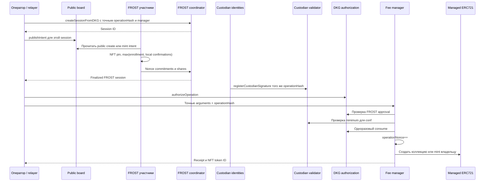
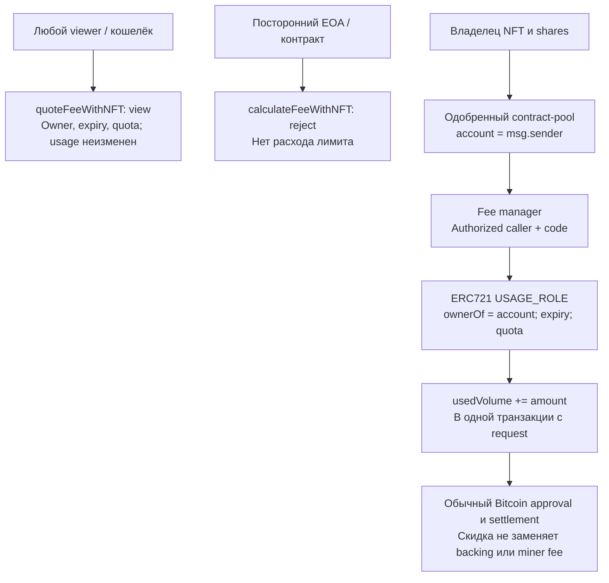

# NFT скидок: выпуск через FROST и защита лимита

[Схемы: SVG/PNG и hashes текущих Mermaid-исходников](DIAGRAMS.md).

Актуализация: 5 ноября 2026. [Параметры организаций](FEDERATION_CONFEDERATION_SETUP.md) ·
[Холодный старт](COLD_START.md) · [Комиссии](FEE_FLOW.md) · [Токены](TOKENS.md).

`FederationNFTModifier` — ERC721, уменьшающий service fee. Он не даёт DKG share,
членство, custodian status или stake reward. Новый `FederationFeeManager` создаёт
коллекцию и выпускает NFT по отдельным FROST-одобрениям; в конфедерации дополнительно
нужен минимум custodian approvals. Команды `frost-signer nft` выполняют этот путь
после завершения bootstrap. Поля `nft_*` в launch JSON не добавлены.

## 1. Параметры и права

| Параметр | Правило управляемого выпуска |
| --- | --- |
| Collection name / symbol | Одобряются в `createNFTModifier`; CLI принимает 1–128 UTF-8 bytes на каждое поле; setters нет |
| Issuer / admin | Сам fee manager получает DEFAULT_ADMIN_ROLE, MINTER_ROLE и USAGE_ROLE; EOA и authorization не получают mint rights |
| Collection | `mintNFT` принимает именно текущий `nftModifier()` и включает его адрес в подписываемый hash |
| Recipient | Ненулевой owner ERC721, явно включён в hash |
| Expiration | Unix seconds, строго позже времени исполнения mint; `0` не означает «навсегда» |
| Volume limit | Положительное число в base units MP/S; это номинал операций, не USD, fee или число операций |
| Discount | 0–10000 bps; 2500 = скидка 25% на service fee |
| Used volume | Сначала 0, затем увеличивается на полный amount успешного NFT request |

У NFT нет setter срока/скидки/лимита, цены продажи, supply cap, IPFS/tokenURI,
KYC или требования governance-баланса. Transfer ERC721 передаёт оставшийся
лимит и исходный срок; usage не обнуляется. `burnExpired` доступен любому после
expiry. Сама низкоуровневая `mint` проверяет MINTER_ROLE и discount; более строгие
проверки срока и положительного лимита выполняет управляемый `mintNFT`.

### Что именно подписывается

Для создания `paramsHash = keccak256(abi.encode(name,symbol))`.
Для mint `paramsHash = keccak256(abi.encode(collection,to,expiration,volumeLimit,discountBps))`.
Оба hash helper используют:

```text
operationHash = keccak256(abi.encode(
  "SATOHSI_FROST_AUTHORIZATION_V1", chainId, authorization,
  feeManager, methodSelector, paramsHash, operationNonce
))
```

Подмена manager, сети, authorization, метода, коллекции, получателя или условий
не сохраняет одобрение. Manager проверяет точный hash, FROST approval и custodian
minimum, затем атомарно потребляет approval и увеличивает nonce. Любая ошибка
откатывает и mint, и nonce, и consume. Повторный вызов старой операции не выпускает
второй NFT. CLI сверяет `nftOperationReceipts` и возвращает `ALREADY_EXECUTED`
для точного повтора; token ID 0 — допустимый первый NFT, а не признак отсутствия.

Один manager имеет общий operationNonce для всех governance actions. Готовьте
следующую операцию после исполнения предыдущей. При конкурирующих намерениях
с одним nonce одно исполнение делает остальные устаревшими: нужно новое review
и новая FROST session. Смена параметров не является retry старой подписи.

## 2. Независимая проверка участниками

Каждый участник создаёт свой публичный `nft.json` pin, сверяя адреса factory,
manager и board с согласованным deployment. `init` проверяет canonical runtime,
creation provenance, factory record, DKG epoch, authorization/coordinator/verifier
и custodian validator. Адреса и fingerprint сравнивают по независимому каналу.
Переданный оператором файл сам по себе не является независимым подтверждением.

Новый CLI поддерживает canonical factory и manager, непосредственно развёрнутые
оператором принятой invitation, и коллекции `createNFTModifier` этого manager.
Это штатный post-bootstrap путь для conf fee manager. Для федерации используйте
`evm_ceremony`, её factory и привязанный к ней manager; нулевая factory-привязка
не считается готовой fee system. Internal deployment через старый FeeSystemDeployer
и произвольные внешние коллекции не принимаются этим CLI автоматически.

Для create/mint участник обязан читать public intent из board и передать
`--nft-config` при `dkg sign-evm`. File-only `--package` не заменяет этот review.
Pin и полный intent проверяются на confirmed snapshot и latest перед nonce,
share и отправкой сохранённого share. Изменение public intent, чужой manager,
неуправляемая коллекция, другой issuer или неправильный hash останавливают
подписание до приватной операции. Обычные typed fee-manager settings сохраняют
совместимость; raw hash без typed intent не разрешает NFT mint.



Все изменения исполнения входят в одну EVM-транзакцию. FROST использует существующий EVM_AUTH
DKG, отдельный NFT DKG не нужен. Bitcoin BTC_SPEND ключ и ZK prover не участвуют
в выпуске этого ERC721.

## 3. Команды после bootstrap

Ниже POSIX shell для Linux/macOS/WSL2. Значения `RPC`, `BOARD`, `FACTORY`,
`MANAGER`, `CHAIN_ID`, `CONFIRMATIONS`, `IDENTITY`, `LOCAL`, `PARTICIPANT_DIR`
берут из собственного проверенного запуска. Для примера роль `conf_ceremony`.
Каждый участник использует свою identity/state/password; секреты не пересылаются.
На Ethereum mainnet минимум 12 EVM confirmations, на Sepolia/local — 1 либо
больше согласно invitation. Deadline и expiry задаются Unix seconds с запасом
на подтверждения и участие всех подписантов.

```bash
frost-signer nft init --rpc "$RPC" --board "$BOARD" --role conf_ceremony \
  --factory "$FACTORY" --manager "$MANAGER" --chain-id "$CHAIN_ID" \
  --confirmations "$CONFIRMATIONS" --output "$LOCAL/nft.json"
frost-signer nft status --rpc "$RPC" --config "$LOCAL/nft.json"

frost-signer nft create-prepare --rpc "$RPC" --config "$LOCAL/nft.json" \
  --name 'Pilot Fee Discounts' --symbol PFD --intent "$LOCAL/nft-create.json"
frost-signer nft propose --rpc "$RPC" --config "$LOCAL/nft.json" \
  --intent "$LOCAL/nft-create.json" --deadline "$DEADLINE" \
  --identity-file "$IDENTITY" --state "$LOCAL/nft-executor.sqlite" --send
```

`propose` возвращает session ID. Публикует оператор board или ранее одобренный
publisher. Все участники подписывают со своих машин, повторяя команду до
финализации сессии. Используйте уже созданный при bootstrap state этой роли:
`conf_ceremony.enc`, а для federation — `evm_ceremony.enc`.

```bash
frost-signer dkg sign-evm --rpc "$RPC" --board "$BOARD" --role conf_ceremony \
  --session "$SESSION" --nft-config "$LOCAL/nft.json" \
  --identity-file "$IDENTITY" --state "$PARTICIPANT_DIR/conf_ceremony.enc" \
  --password-file "$PARTICIPANT_DIR/password"
```

Каждый необходимый custodian отдельно одобряет тот же intent. Публичный intent
можно передать как JSON; pin и проверка его контекста остаются локальными:

```bash
frost-signer nft custodian-approve --rpc "$RPC" --config "$LOCAL/nft.json" \
  --intent "$LOCAL/nft-create.json" --identity-file "$IDENTITY" \
  --state "$LOCAL/nft-executor.sqlite" --send
frost-signer nft execute --rpc "$RPC" --config "$LOCAL/nft.json" \
  --intent "$LOCAL/nft-create.json" --session "$SESSION" \
  --identity-file "$IDENTITY" --state "$LOCAL/nft-executor.sqlite" --send
```

Для federation без validator этап `custodian-approve` пропускается. После create
проверьте `status`, затем подготовьте mint, например 1000 целых 18-decimal MP
лимита и 25% скидки:

```bash
frost-signer nft mint-prepare --rpc "$RPC" --config "$LOCAL/nft.json" \
  --recipient "$NFT_OWNER" --expiration "$EXPIRATION" \
  --volume 1000000000000000000000 --discount-bps 2500 \
  --intent "$LOCAL/nft-mint.json"
```

Для `nft-mint.json` повторите propose → sign-evm → custodian-approve → execute
с **новой** session. На manager проверьте `nftMintedTokenIds(operationHash)`,
в коллекции — `ownerOf(tokenId)` и `nftMetadata(tokenId)`. Execute может доставить
любой relayer: права определяются подписью, получатель уже связан hash.
Команды propose/approve/execute без `--send` только симулируют; укажите собственную
identity либо `--sender`. Отправка требует `--identity-file` и durable `--state`.
При повторе сохраняйте тот же state и исходный intent; новый intent не затирает
существующий файл.

## 4. Кто может расходовать лимит

Публичный `quoteFeeWithNFT` — `view`: при подключённой коллекции проверяет owner,
срок и оставшийся объём, но не меняет usage. Если `nftModifier()` равен нулю,
возвращается обычная комиссия без NFT-скидки и проверки tokenId. CLI/кошелёк
используют его для предварительного расчёта:

```bash
frost-signer nft quote --rpc "$RPC" --config "$LOCAL/nft.json" \
  --owner "$NFT_OWNER" --token-id "$TOKEN_ID" --amount 100000000000000000000
```

Consuming `calculateFeeWithNFT` принимает только адрес с code и
`authorizedFeeCollectors[caller] == true`, одобренный governance через
`setFeeCollector`. EOA, включая ошибочно включённый в allowlist, и посторонний
контракт отклоняются до вызова NFT. В штатном bootstrap нужный pool уже
авторизуется; при отдельном подключении проверьте это явно. Право USAGE_ROLE
в управляемой коллекции принадлежит только manager.

Одобренный pool связывает account со своим `msg.sender`, проверяет его shares
и вызывает `useDiscountFor` через manager. Поэтому чужой tokenId не даёт
ни скидку, ни возможность сжечь квоту владельца. ERC721 approval оператору
не заменяет владение в этом пути. При передаче NFT прежний owner теряет право
использования. Governance-approved pool — доверенная граница: нельзя включать
произвольный контракт, который позволяет подставить чужой account. Allowlist
не доказывает корректность такого контракта. Для внешних коллекций также отдельно
проверяют всех USAGE_ROLE/admin holders; штатный CLI не обходит managed-проверку.



## 5. Математика и момент расхода

Для fixed fee и dynamic fee соответственно:

```text
baseFixed   = min(amount, floor(amount × feeBps / 10000))
baseDynamic = min(amount, dynamicMinFee + floor(amount × coeffBps / 10000))
actualFee   = floor(baseFee × (10000 − discountBps) / 10000)
net         = amount − actualFee
withdrawalMp = floor(net / 10^10) × 10^10
```

Каждый floor отдельный. При amount=100 MP, rate=100 bps (1%) и discount=2500 bps
(25%) комиссия 1 MP уменьшается до 0.75 MP, net=99.25 MP. Лимит 1000 MP расходуется
на 100 MP, остаётся 900 MP. Один satoshi = `10^10` base units 18-decimal MP/S;
не передавайте целые satoshi или USD как volume без пересчёта.

Инвариант: сначала `used=0`, а consume допускается только при
`amount <= volumeLimit − used`. После `used' = used + amount <= volumeLimit`.
Quote выполняет ту же проверку без присваивания. Отсюда запрос чужого account,
expired NFT, превышение квоты или неавторизованный caller не увеличивает usage;
проверка разности также не переполняется на `used + amount`. Арифметика fee
остаётся checked Solidity: непредставимый расчёт отклоняется, не оборачивается.

Расход записывается при создании NFT withdrawal request. Revert всей транзакции
откатывает usage; поздняя отмена уже успешного request не восстанавливает его.
100% NFT discount обнуляет service fee, но не ETH gas, Bitcoin miner fee,
SPV funding, rounding или minimum outputs. Обычный deposit автоматически NFT
не применяет. Подробнее: [математика запуска](LAUNCH_MATHEMATICS.md).

## 6. Совместимость и проверка

Старые развёрнутые manager/NFT неизменяемы: обновление SDK не исправляет их код.
Для теста с нуля используйте новый bootstrap. Уже подключённый manager нельзя
заменить вызовом `setFeeManager`: оба pool-контракта разрешают эту привязку
только один раз. Для старого manager нужен новый pool/graph и отдельный план
переноса с сохранением обязательств; автоматического upgrade/migration CLI нет.
Смена коллекции через governance нового manager не обновляет код старого.
Чужую коллекцию или старый manager новый NFT CLI автоматически не принимает.
FeeSystemDeployer теперь передаёт admin/minter manager, а не неисполняющему
произвольные calls authorization. Это исправление роли само по себе не заменяет
проверяемый CLI-путь create/mint и привязку внешней legacy коллекции.

[Контрактные регрессии](../web3/test/NFTGovernance.t.sol),
[политика подписанта](../signer-agent/tests/test_nft_governance.py),
[private/retry boundaries](../signer-agent/tests/test_signing_target_substitution.py),
[реальные процессы DKG/FROST](../tests/e2e/test_nft_governance.py),
[rounding/revert](../web3/test/WithdrawalRounding.t.sol).
Актуальный scope и результаты: [отчёт NFT governance](../ops/artifacts/nft-governance-20261105/README.md).
Исторический [отчёт до исправлений](../ops/artifacts/entity-setup-docs-20261105/README.md)
описывает прежние ограничения. Локальные NFT-тесты не являются production
qualification или проверкой публичного Bitcoin/ZK денежного цикла.

### Более строгие confirmations и истёкшая session

Для чтения signing session и подтверждения публикаций SDK берёт максимум
глубины enrollment и локальных NFT/ULR pins. При повышении глубины SDK ждёт
подтверждения той же транзакции из прежнего durable journal. Новые nonce и
подпись для ожидания не требуются. Для истёкшей до finalized session нужен
новый `nft propose --id nft-reopen-2` с будущим deadline, исходным intent и
прежним durable state. Сохраняйте старые intents/nonces/journals; публичный
intent новой session записывайте отдельно. Изменённые expiry/params или stale
nonce требуют нового prepare/review. Уже finalized approval не заменяют новой
подписью только из-за наступления старого deadline.
