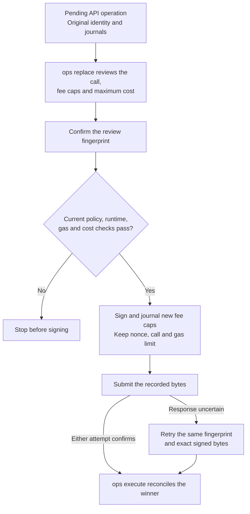
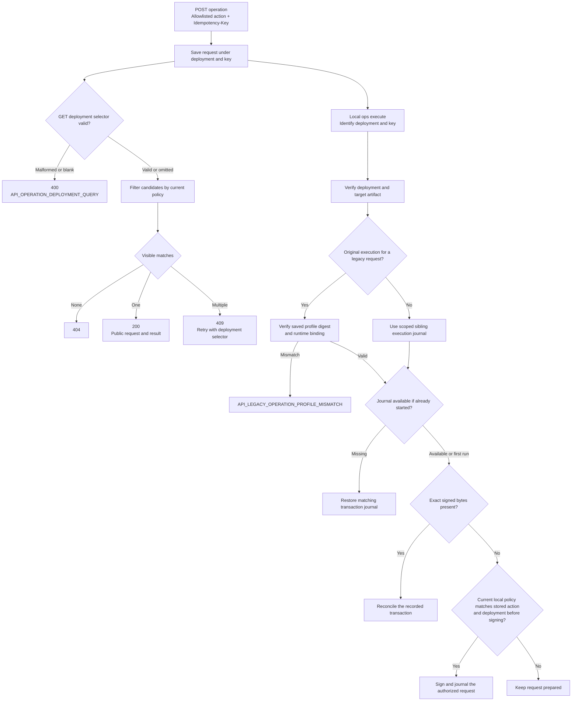

# Operational API v1

The API is a separate loopback process, without a participant keystore or EVM identity. Start with:

```sh
frost-signer api --policy config/api-policy.json --state ops/deployments.sqlite --port 8787
```

The policy contains `principals` (`sha256` of a high-entropy bearer token; `role`: reader/operator/admin), `deployments` (journal IDs), `actions`, and `views`. Keep the policy locally controlled. The service binds only 127.0.0.1; remote access requires an authenticated TLS reverse proxy or SSH tunnel. Do not expose the HTTP listener directly.

The loopback HTTP server permits 16 concurrent handlers, a 128 KiB request
including up to 64 KiB of POST body, and a ten-second deadline for reading the
request. Saturation returns HTTP 503 where a response can be sent. A reverse
proxy can enforce per-client connection and rate limits.

`GET /health` is public. Other paths require `Authorization: Bearer …`. `GET /readiness` verifies recorded deployment receipts, their canonical block hashes, runtime code hashes and configured binding/role checks. `GET /metrics` returns operation counts by status. `/v1/operations`, `/v1/deployments`, and named `/v1/views/{name}` expose public state. Configure named views for DKG results, signing status, pool information, fee balances, withdrawal states, DAO reports, proposals and claimable balances. Each view includes EVM chain and Bitcoin network context; configure `units` with token address and decimals for financial getters.

For backed Bitcoin relay or ZK profiles, pass the process its local
`--bitcoin-rpc "$BTC_RPC"` and `--bitcoin-cookie "$BTC_COOKIE"`. The same
options apply to `ops view` and `ops execute`. Use `--rpc "$EVM_RPC"` to
choose an EVM endpoint for the process. Readiness and named views check the
same Bitcoin freshness as the deployment. RPC credentials and cookie paths
stay in local configuration.

The HTTP process shares each verification result across readiness, metrics and
named views for up to 15 seconds. Readiness exposes `age_seconds` per deployment.
Views expose `deployment_check_age_seconds` and still report the exact EVM
block used for the read. The API starts one verification refresh at a time.
A concurrent request that needs a refresh receives HTTP 503 with
`API_VERIFICATION_IN_PROGRESS`. The CLI `ops view` and `ops execute` verify
the graph directly. `ops execute` can run the audited EVM exits with Bitcoin
RPC unavailable. This covers claims and unstaking in `ULRStaking` and
`CustodianDAOStaking`, `ConfederationDAOStake.unstake`, and
`ConfederationDAOIncome.claim` or `claimReimbursement`. The SDK verifies the
original deployment's EVM journal, canonical receipts, and exact target
runtime. Other actions, named views, and readiness use the full graph checks.

A write request only prepares an operation. An allowlisted action maps to a
deployment, contract, artifact, and method. Supply ABI integers as decimal
strings, including values inside arrays and tuples.

```json
{"action":"claim_dao","args":[["20742"]]}
```

`POST /v1/operations` requires the operator or admin role and an
`Idempotency-Key`. The action selects the deployment. An identical retry in
that deployment returns the same operation, including its current status.
A changed payload with the same key in that deployment returns HTTP 409
with `IDEMPOTENCY_CONFLICT`. Each deployment can use the same key independently.
The request body limit is 64 KiB.

`GET /v1/operations/ID` applies the current deployment and action allowlists
before resolving the key. The saved action specification must match the current
policy exactly. When multiple visible operations share the key, the response is
HTTP 409 with `API_OPERATION_DEPLOYMENT_REQUIRED`. Retry with
`?deployment=DEPLOYMENT_ID`, URL-encoded as needed. An invalid or blank selector
returns HTTP 400 with `API_OPERATION_DEPLOYMENT_QUERY`. A lookup with no visible
match returns HTTP 404.

A separate local operator executes a prepared operation. Use
`--deployment DEPLOYMENT_ID` with `status`, `receipt`, `execute` or `replace` to select its record.
Before signing, the worker rechecks the current API policy. New API
transactions can be reconciled through `ops receipt` and `ops execute`.

```sh
frost-signer ops execute --deployment DEPLOYMENT_ID --id CLAIM_ID \
  --state ops/deployments.sqlite --identity-file /private/operator.json \
  --policy config/api-policy.json
frost-signer ops status --deployment DEPLOYMENT_ID --id CLAIM_ID \
  --state ops/deployments.sqlite
frost-signer ops receipt --deployment DEPLOYMENT_ID --id CLAIM_ID \
  --state ops/deployments.sqlite --rpc "$EVM_RPC"
```

Use the operator's private `0600` EVM identity file. The worker verifies the
deployment and checks that the target's verified artifact matches the prepared
action. The contract enforces any required FROST authorization and custodian
signatures. Before signing an unsigned operation, the worker reloads the
current local policy and requires the exact stored action and deployment.
After revocation an unsigned record stays prepared. A signed request can
reconcile its existing transaction using its recovery journal. The worker
serializes execution and status updates for each
deployment and key. When another worker holds the operation lock, check its
status after it finishes. If execution returns `AWAITING_EVM_RPC`, wait for
the receipt, confirmed block or pending nonce. You can repeat `ops execute`
with `--rpc "$EVM_RPC"` on a synchronized endpoint of the same chain.
Keep the identity, deployment, key and journals. The SDK rechecks the saved
anchors and retains signed transactions. Review `RECOVERY_REQUIRED` before
retrying the same operation. [RPC recovery](RECOVERY.md#5-отставание-rpc-участников).

## Replace the fee caps of a pending API operation

Use the original identity and journals. Run `ops replace` with the current
local policy, both fee caps and an explicit maximum total cost in wei. The
first command returns a fingerprint and the reviewed call, fees and budget.

```sh
frost-signer ops replace --deployment "$DEPLOYMENT" --id "$OPERATION_ID" \
  --state ops/deployments.sqlite --identity-file "$IDENTITY" \
  --policy config/api-policy.json --rpc "$EVM_RPC" \
  --max-fee-per-gas-wei "$MAX_FEE" --max-priority-fee-per-gas-wei "$TIP" \
  --max-cost-wei "$MAX_COST"
```

Repeat the same command with `--confirm-replacement "$FINGERPRINT"` to sign
and submit. The worker binds the replacement to the original API request,
deployment, journaled signer and call. It retains the same nonce, calldata,
target, value, access list and gas limit. Only the two EIP-1559 fee caps change.
It checks the target runtime, gas estimate, balance and maximum cost, then
reloads the current action and deployment policy before signing. A revoked or
changed action cannot create a replacement. API entries use this dedicated
command; the generic `transaction replace` cannot authorize them.

Original and replacement hashes remain in the original identity nonce journal.
If submission is uncertain, repeat the confirmation with the same fingerprint
to use the saved signed bytes. Either attempt can be mined. Run `ops execute`
on the same operation to reconcile the winner after confirmation. The EVM-only
`ops receipt` observes the transaction currently recorded in the execution
journal and can follow the replacement after reconciliation.



## Receipts and journals

`ops receipt` needs the original local state and an EVM RPC. It loads the
exact signed call from the execution journal and checks its hash, target,
calldata, runtime code and canonical confirmed receipt. It reports
`RECEIPT_CONFIRMED`, `RECEIPT_REVERTED` or a waiting state. It sends no
transaction and leaves execution and nonce journals in place. Use
`ops execute` to reconcile normal execution once its full dependencies are ready.

Request and response schemas are in [openapi.json](openapi.json).

API request IDs, status and events live in dedicated SQLite tables. A key that
matches a deployment or bootstrap step ID can coexist with it in the same
`--state` file. New executions use the sibling
`<state filename>.api-execution.sqlite` for transaction recovery and share the
identity's existing nonce lock. Include both databases in operator backups.
If an execution has already started and its transaction journal is missing,
restore the matching backup before retrying. The worker reports
`API_OPERATION_EXECUTION_JOURNAL_MISSING` before any new transaction can be sent.

Before upgrading, stop processes using the old SDK and back up the journal.
Starting the upgraded API or running `frost-signer ops status --state JOURNAL --id ID`
moves old API requests that still reside in the bootstrap tables along with their
events in one SQLite transaction. The migration preserves client IDs and status.
When a legacy request has an existing execution in the original journal, the
worker verifies the saved profile digest and its runtime binding before resuming
the same transaction and nonce. On `API_LEGACY_OPERATION_PROFILE_MISMATCH`,
reconcile the original journal and deployment before retrying. A new scoped
request always uses its own recovery record in the sibling execution journal.



The journal is **private recovery state**, not a public export: bootstrap profiles
can contain RPC access credentials, and pending steps contain signed transactions
that can be broadcast. Keep the database and backups local. The client creates
the database and SQLite sidecars with mode `0600`, creates new containing
directories with mode `0700`, and rejects symlinks, hard links and directories
writable by other users. Existing database permissions are tightened on open.
Do not store journals directly in shared directories such as `/tmp`.

HTTP responses use a public projection. Operation listings and status reads
include only actions whose saved specification still matches the policy and whose
deployment is allowlisted. Bootstrap internals are not operation endpoints;
deployment manifests expose step status and transaction/block hashes, without
profiles, raw signed transactions or internal requests. Actions and named views
must also belong to an allowlisted deployment. All authenticated readers of one
API policy share this public scope; use separate instances/policies for separate
reader groups.

`frost-signer index --rpc URL --chain-id ID --state JOURNAL --addresses ADDRESS ...
--from-block HEIGHT --confirmations DEPTH` spends up to 100 block positions per
run on confirmed forward indexing and rollback combined. A missing or
insufficiently confirmed checkpoint returns `AWAITING_EVM_RPC` with the saved
index intact. On chain ID 1 the index also respects Ethereum finality.
It retains orphaned logs with `canonical=0` only after observing a different
hash. A bounded reorg pass returns `RECOVERY_REQUIRED`. The index retries a
concurrent checkpoint change on the next run. `GET /v1/events` exposes
the latest 200 public log records for the chain/address pairs in the allowlisted
deployment manifests; `topics`/`data` decode with the generated ABI.

The deployment `READY` response describes contract/journal integrity. Financial
operations still have their own guards: funded converter inventory, finalized
historical price evidence, a closed UTC day, participant/custodian approval, and
Bitcoin proof depth. Configure corresponding named views so operators can see
which prerequisite blocks the next action. A zero-fee integration bootstrap is
explicitly visible in both factory getters and its manifest steps.

## CLI preparation, simulation and public reads

```sh
frost-signer ops prepare --policy config/api-policy.json --state ops/deployments.sqlite --id UNIQUE_ID --params request.json
frost-signer ops execute --policy config/api-policy.json --state ops/deployments.sqlite --id UNIQUE_ID --dry-run --sender OPERATOR_ADDRESS
frost-signer ops execute --policy config/api-policy.json --state ops/deployments.sqlite --id UNIQUE_ID --identity-file /private/operator.json
frost-signer ops view --policy config/api-policy.json --state ops/deployments.sqlite --view withdrawal --params args.json
```

`request.json` is the same `{action,args}` body accepted by HTTP; `args.json` is an
ABI argument array, for example `["1"]` for withdrawal ID 1. Simulation uses
`eth_call` and gas estimation with the supplied public sender, sends no transaction
and does not consume the operation. A failed simulation must be resolved before
execution. `ops status` reads the same journal from CLI.

`GET /v1/actions` returns the allowlisted action names, ABI input schemas and
named reads. `GET /v1/deployments/{id}` returns the recorded public manifest,
including an incomplete bootstrap's waiting state. For a view explicitly marked
`parameters: true`, append URL-encoded `?args=["1"]`; other views keep fixed
arguments. Reads include the observed EVM block number/hash and check that it is
still canonical. Methods must be `view` or `pure`. `units` can contain token and
decimals metadata, with manifest references such as `$mp`.

The example policy covers DKG results, signatures, pool lists/details, withdrawals,
fee counters and helper hashes, Bitcoin batches/payments, DAO days and proposals.
It exposes preparation actions for issuance, withdrawal, reservation, payment,
fee sync/routing and DAO settlement/claim. Each caller still needs the respective
on-chain permissions; the example has no enabled bearer principal.

`/metrics` also evaluates policy `metrics` entries through allowlisted reads. The
example exposes converter inventory, the next DAO day and pending wrap/unwrap fee
reports. Unavailable reads return `METRIC_UNAVAILABLE`; they are never reported
as zero. The index CLI returns confirmed checkpoint lag on each pass.
