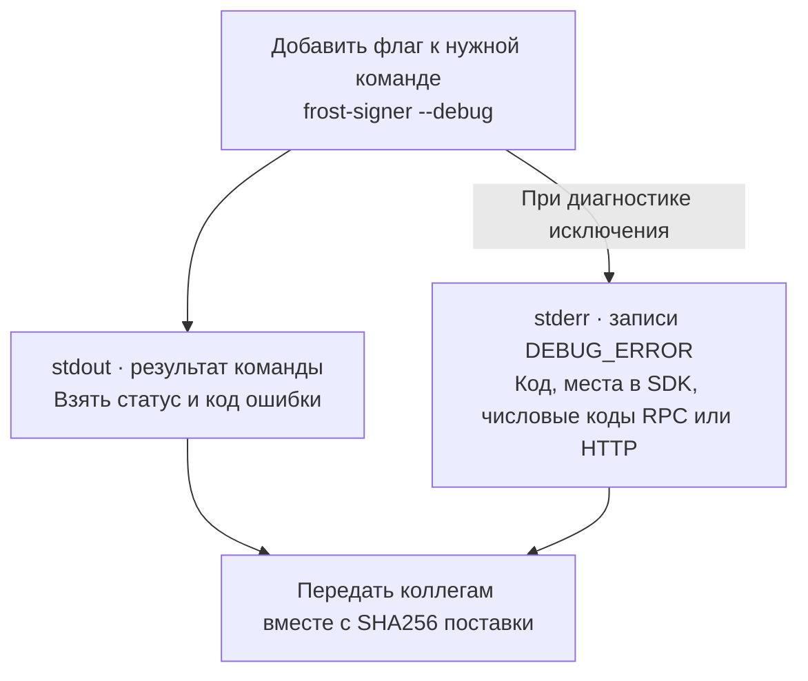
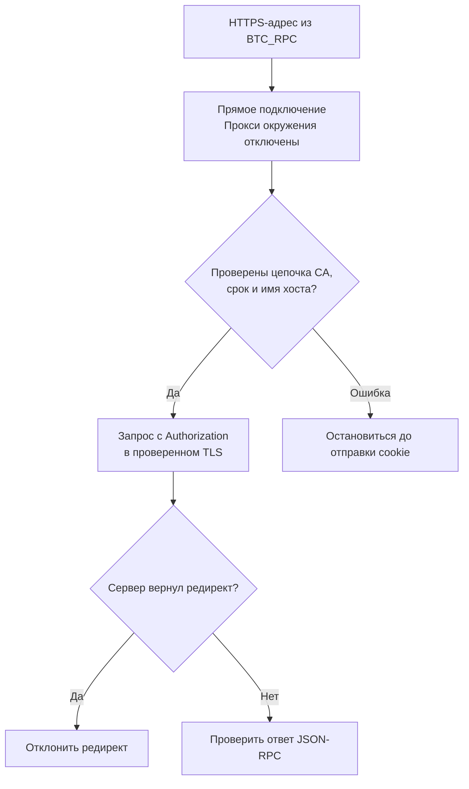

# Коллегам: начало тестов на Linux и Windows/WSL2

[Параметры федерации/конфедерации и новые группы](FEDERATION_CONFEDERATION_SETUP.md) ·
[NFT скидок: параметры, роли и требования](NFT_CONFIGURATION.md).

[Холодный старт с нуля](COLD_START.md): единый порядок подготовки, ролей,
финансирования, DKG, relay/ZK, ручной рассылки и первого smoke.

Экономические параметры и формулы новой сборки: [конфигуратор](LAUNCH_CONFIGURATOR.md)
и [математическое описание](LAUNCH_MATHEMATICS.md).

[Единый конфигуратор запуска](LAUNCH_CONFIGURATOR.md): `frost-signer configure wizard`
выбирает сети, create/reuse, confirmations, имена токенов, пороги, комиссии и
дополнительный стартовый APY из собственного USD-бюджета.

Для ZK с тестовыми BTC используйте новый [порядок Bitcoin testnet4 + Sepolia](ZK_TESTNET4_SEPOLIA.md):
отдельные pinned guest/host и policy V2. Режимы подготовки, локального расчёта,
экспорта и публикации выбираются независимо. [Команды ZK worker](ZK_SPV_WORKER.md#worker-modes-and-transition-archives).
Для совместных испытаний создайте отдельные deployment ID для relay и ZK.
На хостах, где проверяете полный ZK proving, пройдите preflight и зафиксируйте
время, RAM и пиковое место. [Ограничения и критерии приёмки](LAUNCH_READINESS.md#ограничения-и-приёмка).

Используйте один проверенный participant archive и его SHA256. Код участники
не редактируют: меняются только личные конфиги, RPC и пути к состояниям.
Подробная [установка с нуля](CROSS_PLATFORM_QUICKSTART.md) и
[состав поставки](DISTRIBUTION.md) описаны отдельно.

## Sepolia и Bitcoin testnet4 без локальных нод

Оператор выбирает `remote-sepolia-testnet4` в конфигураторе и передаёт
`launch-config.json` и `invitation.json`. Каждый участник задаёт свой Infura
Sepolia URL в `RPC`, адрес архивного Bitcoin Core testnet4 в `BTC_RPC` и
абсолютный путь к своему файлу авторизации в `BTC_COOKIE`. Перед enrollment
проверьте оба соединения:

```bash
frost-signer configure check-rpc --config "$LAUNCH_CONFIG" --invite "$INVITATION"
```

При `LAUNCH_RPC_CHECKED` продолжайте с review и enrollment. Если проверка
остановилась, для диагностики передайте `network`, `method`, `reason` и
числовой код из ответа. [Пример настройки и требования к RPC](LAUNCH_CONFIGURATOR.md#sepolia-и-bitcoin-testnet4-без-локальных-нод).

Для `BTC_RPC` нужен адрес `https://` с именем хоста или IP-адресом из
сертификата сервера. [Как SDK проверяет HTTPS для Bitcoin RPC](#как-sdk-проверяет-https-для-bitcoin-rpc).

## Если RPC одного из участников отстаёт

У соседей могут быть разные вершины EVM и Bitcoin testnet4. Достаточная
глубина и хеш нужного блока проверяются на стороне каждого участника.
`LAUNCH_RPC_CHECKED` подтверждает preflight на момент проверки. В работе
состояние сети сверяется повторно перед подписью и отправкой.

1. Перед установкой обновлённого SDK остановите локальные процессы и
   скопируйте их приватные журналы и состояние подписанта. Сохраните identity,
   deployment ID, DKG, batch и txid.
2. При `WAITING_DKG_RPC` или `AWAITING_EVM_RPC` дождитесь нужного EVM-блока
   или повторите исходную команду с проверенным `--rpc` той же сети. Для
   `bootstrap resume` и `flow bootstrap` сохраните исходный deployment ID,
   `--state` и identity. Для `ops execute` сохраните тот же deployment и ключ
   операции. Статус ожидания не требует закрытия nonce или нового DKG.
3. При `WAITING_BITCOIN_RPC`, `BITCOIN_PAYMENT_DEPTH_PENDING` или
   `ZK_OBSERVATION_CORE_BEHIND` дождитесь, когда Core testnet4 сможет
   подтвердить сохранённую вершину, хеш и требуемую глубину. Продолжите
   теми же локальными журналами. Для диагностики сравните высоты, хеш блока
   на одной высоте, chainwork, подтверждения и статус `txindex`.
4. Если два наблюдения дают разные канонические хеши на одной высоте,
   приостановите новые подписи и отправки по затронутой операции. Сверьте
   сохранённый блок на проверенных RPC. Для реорганизации оплаченного
   Bitcoin-платежа используйте процедуру `btc-recover`.

Передавайте коллегам только коды и публичные данные блока или операции.
[Разбор статусов и схема](RECOVERY.md#5-отставание-rpc-участников).

## Если bootstrap остановился на withdrawal-пачке

Оператор останавливает процессы с тем же EVM-кошельком и делает резервные
копии журнала bootstrap и журнала nonce. Для восстановления нужны исходный
deployment ID, прежние пути к журналам, прежний ключ и исходная сборка Solidity.
На Sepolia нужен RPC для симуляции всех трёх CREATE одним `eth_simulateV1`.

1. `bootstrap recover-create-group` сверяет журналы и каноническое состояние.
2. Если nonce свободен или занят известным старым CREATE, оператор задаёт
   два лимита комиссии в wei и выполняет `--prepare-nonce-close`. Проверяет
   сеть, адрес, nonce, хеш исходного CREATE и `max_cost_wei`. Только
   `--confirm-nonce-close` с этим fingerprint разрешает отправку.
3. После финальности команда выдаёт отдельный fingerprint для
   `--confirm-recovery`. На `CREATE_GROUP_RETRY_READY` продолжают через
   `bootstrap resume` с прежним ID. Завершённый DKG сохраняется. Для
   привязки нового Credits к escrow группа подтверждает новый FROST intent.

Команды, переменные комиссии и статусы приведены в
[инструкции по восстановлению bootstrap](BOOTSTRAP.md#withdrawal-deployment-and-recovery).

## Как собрать диагностику SDK

[Схемы восстановления SDK](RECOVERY.md).

Кастодиан продолжает с прежними identity, DKG и журналом. При повторе
`dkg sign-evm` или `setup approve-custodian` статус `ALREADY_EXECUTED` означает,
что SDK подтвердил исполнение точной операции и проверил привязки повторной
сессии. После временного сбоя Core повторите команду с тем же batch. После
подтверждённого конфликта канонического блока выплаты используйте `btc-recover`
с исходным batch. При временном недоборе глубины дождитесь повторной проверки
этого платежа. Для непривязанного исторического вызова FROST-координатора
сначала выполните `bootstrap bind-legacy-nonce` с исходным приватным журналом,
затем повторите исходную команду. Для отдельного EVM revert команда
`bootstrap acknowledge-revert` проверяет финальный receipt и nonce.
[Bitcoin recovery](BITCOIN_ONCHAIN_RUNBOOK.md) · [EVM recovery](BOOTSTRAP.md#withdrawal-deployment-and-recovery).

Для ожидающей EIP-1559 транзакции SDK показывает причину и хеш. Если fee cap
ниже base fee, отправитель может согласовать новые лимиты через
`bootstrap replace-pending` и продолжить с исходным журналом. При
`EVM_REPLACEMENT_SEND_UNCERTAIN` повторите `replace-pending` с теми же
лимитами и подтверждённым fingerprint. Возобновите исходную команду, чтобы
сверить победивший receipt. Для mainnet и Sepolia SDK ждёт и заданную
глубину, и consensus finality.
[Подготовка и подтверждение замены](BOOTSTRAP.md#replacing-a-pending-evm-call).

Добавьте `--debug` после `frost-signer`. Пример ниже проверяет журналы
восстановления без отправки транзакций.

```sh
frost-signer --debug bootstrap recover-create-group \
  --deployment "$DEPLOYMENT_ID" --state "$LOCAL/bootstrap.sqlite" \
  --identity-file "$IDENTITY" 2>sdk-debug.jsonl
```

Результат команды остаётся в stdout, код завершения сохраняется. При ошибке
stdout содержит поля `code` для автоматизации и `message` для оператора. При
диагностике исключения SDK пишет в stderr строку JSON со статусом
`DEBUG_ERROR`, кодом ошибки, модулем, функцией и номером строки. При наличии
SDK указывает причины ошибки и числовые коды HTTP или JSON-RPC. Ошибка разбора
аргументов даёт `INVALID_CLI_ARGUMENTS`. Обычное ожидание может завершить
команду без диагностической строки.

Для разбора сбоя передайте коллегам строки `DEBUG_ERROR` из файла, статус и
код результата, а также SHA256 поставки. SDK исключает из этих диагностических
записей аргументы, локальные пути, текст исключения и содержимое RPC-запросов
и ответов. Флаг действует в `frost-signer`, включая команды, вызванные через
`flow`. Файлы identity, cookie Bitcoin Core и журналы nonce храните локально.



## Как SDK проверяет HTTPS для Bitcoin RPC

SDK подключается к указанному серверу напрямую и игнорирует прокси из
переменных окружения. Цепочка сертификатов проверяется по публичным корням
`certifi` из поставки. SDK также проверяет срок действия сертификата и
соответствие имени хоста или IP-адреса из `BTC_RPC` сертификату сервера.
Установка `SSL_CERT_FILE` оставляет выбор корней за `certifi`. Частный CA и
самоподписанный сертификат без публичной цепочки приведут к ошибке проверки.

Содержимое файла `BTC_COOKIE` передаётся в заголовке `Authorization` только
после успешной проверки TLS. При ответе с редиректом SDK прерывает запрос.
Ошибка TLS проявляется в `configure check-rpc` как `RPC_METHOD_CHECK` на
первом Bitcoin-методе `getblockchaininfo`. Проверьте адрес, срок действия и
полную цепочку сертификатов на стороне провайдера. Передавайте коллегам
только поля диагностики, указанные выше.



## Текущая поставка и порядок проверки

Для нового стенда соберите одну поставку из checkout с защитой ID DKG, федераций и конфедераций
и раздайте участникам её проверенный SHA256. Сверяйте ABI, runtime и приглашение
по этой же версии. [Сборка архива](DISTRIBUTION.md#собрать-и-проверить-поставку) ·
[Права создания DKG](CONTRACT_PERMISSIONS.md#исправление-прав-создания-dkg).
Границы проверок — в [обновлении проверки безопасности](SECURITY_LOGIC_REVIEW_2026_11_03.md#повторная-проверка-12-ноября-2026);
предыдущий [NFT DKG/FROST прогон](../ops/artifacts/nft-governance-20261105/README.md)
сохранён отдельно. Новый прогон проверяет также локальный pin глубже invitation
и read-only mint smoke непосредственно из холодного старта.
[Единый индекс SVG/PNG](DIAGRAMS.md) связывает изображения с текущими исходниками.

1. Соберите хост по общей инструкции и проверьте fingerprint приглашения.
2. Проверьте сети, USD-актив/decimals и имена, H/m, комиссии, резерв/bps.
3. При включённом APY согласуйте reference price, бюджет, будущую дату и срок;
   отдельно внесите USD конвертера и программы.
4. Проверьте ETH funding до DKG и ручную рассылку governance на отдельной паузе.
5. Настройте ежедневные snapshots, treasury pay и отдельный startup pay.
6. Сравните [численные примеры](LAUNCH_MATHEMATICS.md), проверьте claim и возврат.
7. Для NFT отдельно согласуйте collection/recipient/expiry/quota/discount, каждый
   создайте свой pin, выполните [create/mint через FROST](NFT_CONFIGURATION.md),
   проверьте owner/metadata, quote без расхода и отказ для чужого tokenId.

Эти действия не подтверждают физический WSL2 или свежий публичный ZK-цикл:
для них сохраняются отдельные acceptance-барьеры. Готовых рабочих proofs нет.

## Историческая поставка с отдельным Bitcoin DKG, 4 ноября

Для режима, в котором исходная федерация не участвует в последующем выводе
cBTC, 4 ноября использовалась поставка `participant-source-20261104-custody-docs-tests.tar.gz`
и её sidecar SHA256. Устаревший архив от 3 ноября, описанный ниже, этого режима
не содержит. Не смешивайте код, ABI, runtime pins и приглашения разных поставок.

Повторная проверка также исправила публикацию BTC treasury/gas/address/fee
intents кастодианами и проверки отдельного roster в адресном пути. Исходный
архив `participant-source-20261104-custody.tar.gz` сохраняется как прежний
проверенный снимок, но этих исправлений и обновлённых инструкций в нём нет.
В том прогоне все участники использовали один docs-tests archive и его SHA256.
Он обновляет инструкции и регрессии предыдущей reviewed поставки; протокольные
исходники и fingerprint сохранены. [Результаты и точный состав](../ops/artifacts/custody-docs-tests-20261104/README.md).
Локально прошли 912 Solidity и 3372 SDK/ops-теста. На Core подтверждены перенос
1 000 000 сатоши, вывод 996 003 сатоши и выплата 400 сатоши из казны без участия
исходной федерации и представителя назначения. Create/reuse проверен с другими
участниками и именами токенов. Эти E2E выполнены на том же протокольном коде
в предыдущем completeness-прогоне; текущий срез добавляет документацию и тесты.
Границы повторной проверки — в
[отчёте полноты](../ops/artifacts/custody-completeness-20261104/README.md).
Новый `DKGOnchainBoard` также запрещает чужие и ещё не созданные session IDs,
включая частичные fee intents, и требует pin FROST coordinator до первой записи.
Его runtime изменился: для нового совместного теста поднимайте новый стенд
из одной поставки. Уже развёрнутый board не обновляется заменой SDK;
старые deployment/nonce journals сохраняют и продолжают их исходной сборкой.

В новом system-profile обязателен `--bitcoin-custody-policy FILE`:
[пример политики](../config/bitcoin-custody.example.json) и
[полная инструкция переноса BTC](BITCOIN_CUSTODY_TRANSFER.md). Первый участник
общего roster — представитель федерации; отдельные EVM/BTC DKG конфедерации
выполняют остальные участники. Для трёх участников пример задаёт 2-of-2
кастодианов. Это два отдельных денежных DKG, а не делегирование готового ключа.
Приглашение фиксирует состав, порог и разрешённые исходные контракты до DKG.

Сначала разворачивается исходный кошелёк, затем экспортируется его публичный
descriptor командой `custody-transfer source`. Descriptor включается в
`sources` политики новой конфедерации. Пустой список оставляет только прямые
BTC-депозиты. После `custody-transfer request` исходные MP заблокированы.
Выполните Bitcoin-выплату, исходное погашение MP и `finalize` с требуемой SPV
глубиной. Для V3 проверьте выпуск S и резерв по одному и тому же выходу
`txid:vout`, затем погасите S из BTC-кошелька конфедерации. В прежнем профиле
`finalize` выдаёт cBTC через локальный MP.
[Проверка сумм и комиссий V3](CONFEDERATION_DAO_IN_KIND.md#обеспечение-комиссий).

Локальные результаты этого изменения и ограничения проверки сохраняются в
[отчёте отдельного DKG](../ops/artifacts/custody-transfer-20261104/README.md).
Они не заменяют fresh proof выбранного ZK backend и smoke на физической WSL2.
Participant source archive содержит код и pins. Публичный архив отдельного
ZK-перехода формируют после подготовки или proving и проверяют отдельно от
поставки. [Состав публичного архива](DISTRIBUTION.md#публичный-архив-перехода).

## Историческая проверка поставки с настраиваемыми именами

Архив `participant-source-20261103-token-metadata.tar.gz` из revision `757df18`
с SHA256 `b37b9a73251908ca80934fb9ddd48e5ea0b46ea447335dafb168afeed211a7eb`
проверен из чистой распаковки на macOS и в Ubuntu 24.04 x86-64 под CPU-эмуляцией.
У каждой среды свой venv и заново собранные FROST/оба Solidity-проекта. Все
3500 файлов поставки остались без изменений. Имена задавались отдельным
`--token-metadata FILE`: **AURA, ABTC, AFED, ACON**.

На обеих платформах прошли 518 signer-тестов и 24 Rust-теста; отдельный генератор
qualification vectors штатно ignored. Linux также прошёл 52 metadata-теста и
два EVM-теста: выпуск Aurora с паузой рассылки и независимые DKG/FROST-процессы.
macOS выполнил полный create/reuse с другим roster, approve/stake/unstake и
три проверки ручной рассылки/подтверждений/reorg. Код для запуска не исправлялся.
Физический WSL2 этим прогоном не заменяется: выполните короткий smoke ниже.

Оба хоста получили одинаковые system-policy JSON и source fingerprint
`ce8b2dd66a8bf80cdef64a5f414b4da27c27636b931e91d5e97263a242b4ffc7`.
[Точный scope, конфиги и результаты](../ops/artifacts/fresh-distribution-launch-20261103/README.md).
Проверенный архив сохраняет исходный SHA256; отчёт публикуется отдельно от поставки.

## Что проверяем

| Среда | Доступный путь | Граница проверки |
| --- | --- | --- |
| Ubuntu 24.04, x86-64 | Локальные relay/ULR/FROST тесты | Чистая сборка и portable signer tests прошли в Linux-контейнере; CPU x86-64 эмулируется на Mac ARM64 |
| Windows с Ubuntu 24.04 в WSL2 | Те же Linux-команды | Нужен собственный smoke-прогон на WSL2; локальный Linux-контейнер его не заменяет |
| Native Windows PowerShell | Только установка/вход в WSL2 | Сам signer запускается внутри Ubuntu |
| ZK prover на Linux/WSL2 x86-64 | Backend реализован; установить tools и пройти probes | Компоненты проверены локально; полный fresh proof и физический WSL2 ещё не подтверждены |

Наличие CI workflow для Ubuntu не означает, что незакоммиченная версия уже
прошла удалённый CI. Состояние локальной проверки фиксируется в
[отчёте платформ](../ops/artifacts/linux-portability-20261103/validation.json).
Это проверка возможности начать тесты, а не production qualification.

Локально подтверждены: сборка обоих Solidity-проектов, ABI/runtime checks,
совпадение source fingerprint с macOS, 487 portable SDK-тестов без skips/failures,
24 native Rust-теста и actual Core 30.3 regtest-платёж на P2WPKH/P2TR с шестью
подтверждениями. Отдельный генератор qualification vectors в Rust помечен ignored.
Четыре EVM E2E также прошли: реальные независимые DKG/FROST-процессы,
HTTP executor/retry и relay recovery с историческими mainnet/testnet4 fixtures.
Полный `relay`-набор и физическая Windows/WSL2-машина этим срезом не подтверждены.
Этот исторический baseline предшествует ZK-порту. Текущая подготовка всех
рабочих ZK-стадий описана в [Linux prover runbook](ZK_PROVER_LINUX.md),
а её отдельные проверки — в [отчёте переноса](../ops/artifacts/zk-linux-port-20261103/validation.json).

## Подготовить машину

На Windows выполните установку из [раздела WSL2](CROSS_PLATFORM_QUICKSTART.md#2-подготовка-windows).
`wsl --list --verbose` должен показывать VERSION 2. После этого все команды
ниже выполняются в Ubuntu. Проект, venv и состояния хранятся в Linux home,
например `~/src/satoshify`, а не в `/mnt/c`, OneDrive или общей Windows-папке.
Это соответствует [рекомендациям Microsoft по файловым системам WSL](https://learn.microsoft.com/en-us/windows/wsl/interop).

Установите зависимости и закреплённые версии по
[общей инструкции](CROSS_PLATFORM_QUICKSTART.md#3-системные-зависимости):
Python 3.11+, Rust 1.89.0, Foundry 1.8.5, solc 0.8.39. Для Bitcoin-тестов
нужен Core 30.3. Бинарники другой ОС и чужой `.venv` не переносятся.
Для холодной установки оставьте запас свободного диска сверх минимальных
порогов тестового runner: зависимости, toolchains и Solidity builds требуют
дополнительного места. Проверочному контейнеру были выделены 2 CPU и 6 GiB RAM;
холодная via-IR компиляция заняла несколько минут. Эмуляция x86-64 не даёт
оценки скорости на компьютере коллеги.

После сверки SHA256 и распаковки source archive:

```sh
cd "$HOME/src/satoshify"
python3 -m venv .venv
source .venv/bin/activate
python ops/bootstrap_host.py build
python -m pip install --no-build-isolation -e './signer-agent[test,evm-test]'
```

`build` сам собирает FROST и оба Solidity-проекта, затем проверяет ABI и runtime
hash tables. Он не создаёт рабочую identity и не отправляет публичных транзакций.
Ошибку сборки или pin mismatch нужно исправлять в общей поставке; участник не
подменяет ожидаемые hashes своими результатами.

## Обязательная короткая проверка каждого хоста

```sh
set -euo pipefail
source .venv/bin/activate
PEER_TEST_ROOT=$(mktemp -d "$HOME/satoshifi-tests-XXXXXX")
python ops/bootstrap_host.py check --role signer --state-dir "$PEER_TEST_ROOT" \
  > "$PEER_TEST_ROOT/host-check.json"
cargo +1.89.0 test --locked --manifest-path frost-crypto/Cargo.toml
python -m ops.system_modes preflight --mode signer
python -m ops.system_modes run --mode signer --output "$PEER_TEST_ROOT/signer"
```

В `host-check.json` ожидается `READY_TO_CONFIGURE`; в `signer/report.json` —
`PASSED`, без failed/skipped cases. На согласованной версии
`protocol_source_sha256` у всех одинаковый. Точное значение сохраняется в
отчёте платформ; оно не зависит от имени Linux-пользователя и пути установки.
SHA256 нативных исполняемых файлов на разных ОС может различаться.

Для повторного тестового прогона создайте новый `PEER_TEST_ROOT`: runner
не перезаписывает старые отчёты. Это относится к искусственным локальным
тестам; рабочие signing/nonce/budget journals продолжаются штатным resume.

## Дальнейшие тесты

После установки Core 30.3 и успешной короткой проверки:

```sh
python -m ops.system_modes preflight --mode relay
python -m ops.system_modes run --mode relay --output "$PEER_TEST_ROOT/relay"
```

`relay` включает signer, Solidity, полный create/reuse bootstrap и Core regtest
lifecycle. Полный набор может занимать часы. Слой печатает `RUN ...`, затем
пишет ход работы в `command.log`; отсутствие новой точки pytest не является
диагностикой зависания. Отдельно можно выбрать `--mode contracts`, `evm` или
`bitcoin`, каждый раз указав новый output directory. Scope слоёв и ограничения
описаны в [режимах тестирования](SYSTEM_TEST_MODES.md).

Локальные Anvil/Core используют искусственные средства и loopback RPC.
Публичный совместный Sepolia/testnet4 запуск — следующий этап: сначала нужны
общие сети, roster/threshold, USD token/runtime и собственные funded identities
по [общей инструкции](CROSS_PLATFORM_QUICKSTART.md#7-общие-параметры-до-приглашения).
Тестовые identities не становятся рабочими ключами группы.

## Что сверить между участниками

Перед началом совместной репетиции сравните archive SHA256,
`protocol_source_sha256`, версии инструментов и выбранный backend/сети.
Для подтверждения нового хоста достаточно передать публичные
`host-check.json`, `report.json`, JUnit `pytest.xml` и описание ОС/WSL version.
Приватные identity, `.enc`, `.local-proof-key`, Core cookies и содержимое
test/worker state directories в отчёт не копируются.

Если короткий тест завершился `BLOCKED`, `FAILED` или `INCOMPLETE`, сохраняйте
отчёт и соответствующий `command.log`. Не обходите отказ редактированием
qualification flags, исходников или contract pins. Для WSL отдельно укажите,
что использован Linux home и WSL VERSION 2.
