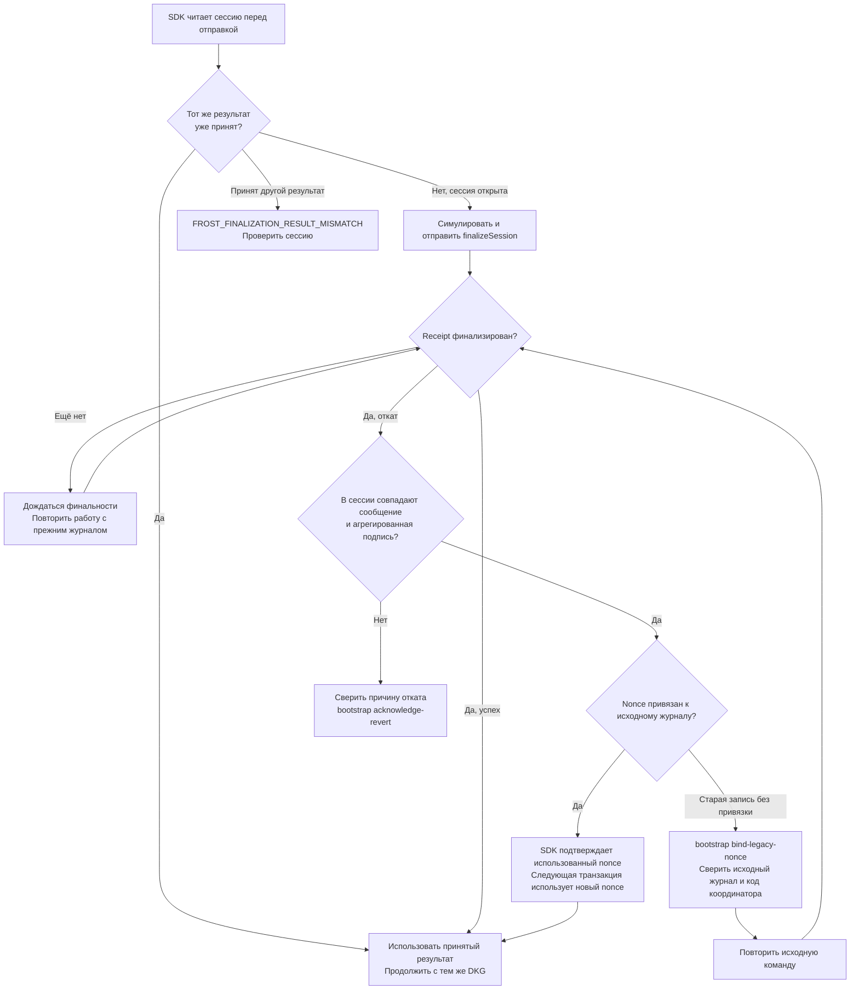
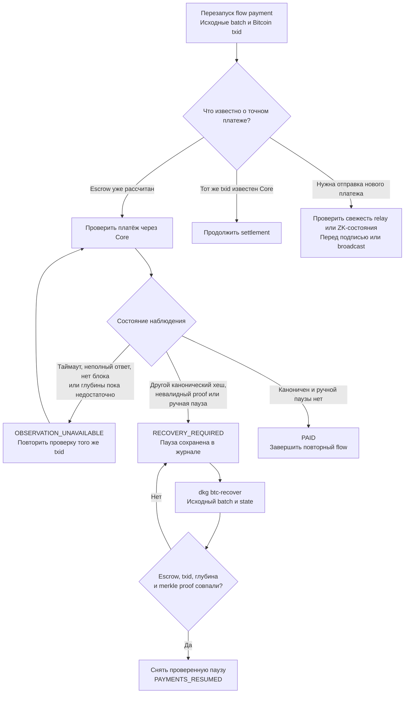
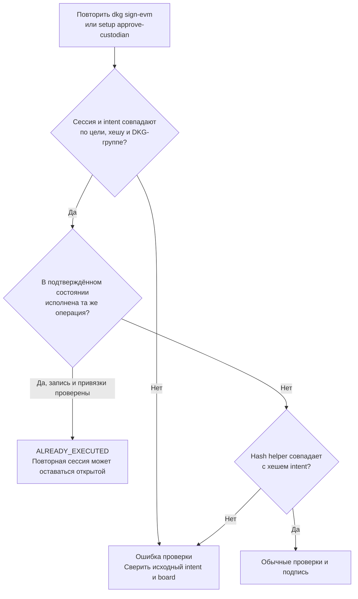
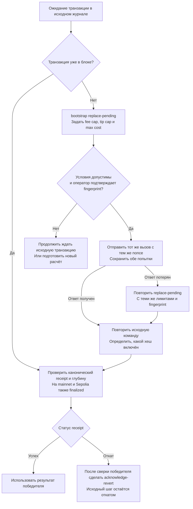
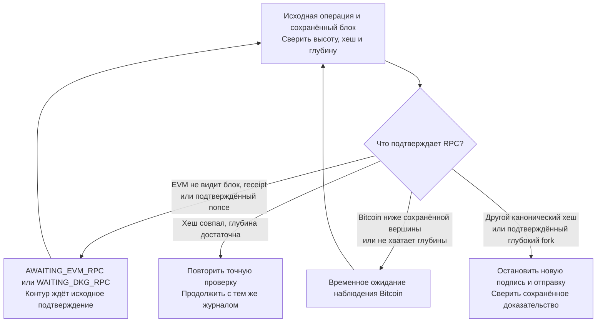

# Восстановление работы SDK

Начинайте с тех же identity, board, DKG и локальных журналов, которыми
пользовались при отправке. Для Bitcoin сохраните исходные batch и txid.
Перед обновлением SDK остановите процессы, пишущие в журналы, и сохраните
резервные копии журнала операции, журнала EVM nonce и состояния подписанта.
Состояние смотрите в `status`, причину в `reason` или `code`, пояснение в
`message`. Для диагностики включите `--debug` и передайте только записи
`DEBUG_ERROR`. [Диагностика SDK](PEER_TESTING.md#как-собрать-диагностику-sdk).

Экспорты SVG и PNG доступны в GitHub и полном checkout. В participant archive
схемы доступны как блоки Mermaid на этой странице.

| Что наблюдаете | Действие | Схема |
| --- | --- | --- |
| Два участника отправили `finalizeSession` | Повторите работу с той же сессией и журналом. Если в старом журнале отсутствует привязка, выполните `bootstrap bind-legacy-nonce`. | [SVG](../ops/artifacts/sdk-recovery-20261121/diagrams/docs_RECOVERY_md_1.svg) · [PNG](../ops/artifacts/sdk-recovery-20261121/diagrams/png/docs_RECOVERY_md_1.png) |
| Core временно не подтверждает наблюдение выплаты | При `OBSERVATION_UNAVAILABLE` повторите проверку исходного batch. При `RECOVERY_REQUIRED` проверьте цепочку и выполните `dkg btc-recover`. | [SVG](../ops/artifacts/rpc-lag-20261121/diagrams/docs_RECOVERY_md_2.svg) · [PNG](../ops/artifacts/rpc-lag-20261121/diagrams/png/docs_RECOVERY_md_2.png) |
| Повтор уже исполненной операции | При `ALREADY_EXECUTED` перейдите к следующему шагу. При ошибке привязки или `OPERATION_PARAMETERS_MISMATCH` сверяйте исходный intent и board. | [SVG](../ops/artifacts/sdk-recovery-20261121/diagrams/docs_RECOVERY_md_3.svg) · [PNG](../ops/artifacts/sdk-recovery-20261121/diagrams/png/docs_RECOVERY_md_3.png) |
| `EVM_PENDING_FEE_CAP_BELOW_BASE` | Дождитесь снижения base fee или подготовьте `bootstrap replace-pending` для исходной транзакции. | [SVG](../ops/artifacts/sdk-recovery-20261121/diagrams/docs_RECOVERY_md_4.svg) · [PNG](../ops/artifacts/sdk-recovery-20261121/diagrams/png/docs_RECOVERY_md_4.png) |
| RPC участника отстаёт | Дождитесь требуемой глубины и повторите исходную команду. Для EVM можно указать проверенный RPC той же сети. | [SVG](../ops/artifacts/rpc-lag-20261121/diagrams/docs_RECOVERY_md_5.svg) · [PNG](../ops/artifacts/rpc-lag-20261121/diagrams/png/docs_RECOVERY_md_5.png) |

## 1. Гонка finalizeSession



Если откат успел попасть в журнал, следующая отправка с той же identity
сначала сверяет этот nonce. До финальности отката SDK может вернуть
`TRANSACTION_PENDING` с причиной `FROST_FINALIZATION_REVERT_AWAITING_FINALITY`.
При совпадении результата исходная операция сохраняет отметку об откате, а
nonce становится закрытым.

Для исторического вызова FROST-координатора без привязки nonce укажите
существующий `$STATE`, исходный приватный журнал подписанта, обычно
`<identity file>.transactions.sqlite`. Команда сверяет точную подписанную
транзакцию с записью в этом журнале и проверяет байткод координатора по
каноническому финализированному блоку на публичной EVM. Она записывает
привязку локально, без отправки транзакции. Затем повторите исходную команду
с тем же DKG. При откате `finalizeSession` повтор проверяет результат самой
сессии. Для ещё ожидающего вызова привязка также позволяет проверить
допустимость замены комиссии. SDK сообщает `EVM_LEGACY_NONCE_SOURCE_REQUIRED`,
если нужна такая привязка, и `EVM_LEGACY_NONCE_BOUND` после её проверки.

```sh
frost-signer bootstrap bind-legacy-nonce --identity-file "$IDENTITY" \
  --rpc "$RPC" --tx-hash "$TX_HASH" --source-journal "$STATE"
```

Для отдельного финализированного отката используйте локальную identity
отправителя. Эта команда подтверждает использованный nonce и оставляет
отметку об откате в журнале операции.

```sh
frost-signer bootstrap acknowledge-revert --identity-file "$IDENTITY" \
  --rpc "$RPC" --tx-hash "$TX_HASH"
```

[Восстановление EVM и отдельная процедура withdrawal CREATE](BOOTSTRAP.md#withdrawal-deployment-and-recovery).

## 2. Проверка Bitcoin-платежа после settlement



Один ответ Core `-5`, отсутствие блока на нужной высоте и недобор
подтверждений ведут к `OBSERVATION_UNAVAILABLE`. Если тот же блок виден,
но ещё не набрал глубину, причина может быть `BITCOIN_PAYMENT_DEPTH_PENDING`.
Дождитесь достаточной глубины и повторите проверку. SDK снимает временную
паузу после повторной проверки точного платежа и Merkle proof. Если RPC
возвращает другой канонический хеш на высоте исходного блока выплаты,
SDK сохраняет ручную паузу.
Запись паузы меняется атомарно. Ответ от проверки, начатой до её установки,
не может стереть более свежую паузу.

Старая пауза без классификации также требует `btc-recover`. Команда сверяет
точный оплаченный txid в каноническом EVM escrow и независимо проверяет его
через Core. Перед следующей подписью или broadcast нового платежа SDK снова
проверяет свежесть relay или ZK-состояния согласно профилю.
`PAYMENTS_NOT_PAUSED` означает, что локальной паузы нет. Для исполнения
команды используйте `btc()` из инструкции и исходный `BATCH`.

```sh
btc btc-recover --signing-board "$SIGNING_BOARD" --batch "$BATCH"
```

[Настройка `btc()` и порядок Bitcoin-расчёта](BITCOIN_ONCHAIN_RUNBOOK.md).

## 3. Повтор исполненной EVM операции



Проверка сравнивает точный хеш операции, контракт и DKG-группу в подтверждённом
состоянии. Для ULR `setup approve-custodian` также сверяет запись об
использованной авторизации на точной цели и предусмотренное для этого вида
операции подтверждение в контракте. Поэтому подтверждённая
операция возвращает `ALREADY_EXECUTED`, даже если повторную сессию не
финализировали. Можно перейти к следующему шагу без нового FROST nonce.
[Обычный порядок `sign-evm`](BITCOIN_ONCHAIN_RUNBOOK.md#4-одобрить-reserve-и-опубликовать-план).

## 4. Замена ожидающей EIP-1559 транзакции



На этапе `EVM_REPLACEMENT_REVIEW` сравните сеть, sender, nonce, target,
`data_hash` и `worst_case_wei`. Повторите команду с теми же лимитами и
`--confirm-replacement`. При `EVM_REPLACEMENT_SEND_UNCERTAIN` повтор с тем же
fingerprint использует уже сохранённую подписанную транзакцию. При изменении
лимитов подготовьте новый fingerprint. Статус `EVM_PENDING_FEE_CAP_BELOW_BASE`
применяется на mainnet и Sepolia. На mainnet исходная транзакция использует
заданные лимиты комиссии. Для повышения оператор обычно обновляет
`SATOSHIFI_MAX_FEE_PER_GAS_WEI` и `SATOSHIFI_MAX_PRIORITY_FEE_PER_GAS_WEI`
в той же оболочке, сохраняя лимит газа и общий бюджет. Каждую замену оператор
подтверждает отдельно. Замена использует тот же DKG.

На mainnet и Sepolia SDK сверяет заданную глубину и финальность EVM. На
локальном стенде с chain ID `31337` применяется заданная глубина. Если замена
попала в блок и откатилась, сначала возобновите исходную команду для сверки
канонического receipt. Затем подтвердите использованный nonce командой
`bootstrap acknowledge-revert`. Статус исходного шага остаётся откатом.
Для CREATE и параллельных групп используйте процедуру восстановления bootstrap.
Если подписи ещё нет и отклонена сама оценка газа, сверьте лимит и повторите
исходную команду.

[Подготовка и подтверждение замены](BOOTSTRAP.md#replacing-a-pending-evm-call).

## 5. Отставание RPC участников



- `bootstrap`, `ops execute` и `dkg sign-evm` возвращают `AWAITING_EVM_RPC`
  при отставании нужных данных EVM. `dkg run-once` возвращает `WAITING_DKG_RPC`, пока
  RPC не видит сохранённый подтверждённый блок. Несовпадение известного хеша
  вызывает `EVM_REORG_RECOVERY_REQUIRED` или `DKG_ANCHOR_REORG`. Сверьте
  сохранённый блок перед продолжением.
- Перед новой EVM-подписью SDK сверяет последнюю успешную транзакцию адреса,
  завершённые операции восстановления и открытые резервирования в журнале nonce.
  Если `pending` nonce RPC ниже проверенной нижней границы, новая подпись ждёт.
  Уже зарезервированный nonce остаётся связанным с исходными байтами.
- При `DKG_REVIEW_REQUIRED` сверьте фазу, причину и подтверждённый хеш.
  Если решение оператора действительно состоит в прекращении церемонии,
  повторите исходный `dkg run-once` с `--confirm-abort FINGERPRINT` из
  поля `confirm_abort`. Используйте тот же bundle и состояние. `flow dkg`
  возвращает этот результат для затронутой роли и останавливает опрос.
  Если в FROST-сессии к дедлайну собран порог проверенных долей, bootstrap
  продолжает ждать финализации. После дедлайна новых долей контракт не принимает.
- Bitcoin-watch сообщает `WAITING_BITCOIN_RPC`, если текущая вершина ниже
  сохранённого курсора и наблюдаемые хеши на общей высоте не противоречат друг
  другу либо общего блока в локальном окне нет. Курсор и сведения о расходах
  сохраняются. ZK worker сообщает `ZK_OBSERVATION_CORE_BEHIND` при меньшем
  chainwork или другой вершине с тем же chainwork. Ранее подтверждённый
  глубокий reorg требует отдельного разбора.
- Для временно недоступной транзакции отдельная задача ZK worker ждёт с
  увеличивающейся паузой. Остальные задачи и heartbeat могут продолжиться.
  Через совместимый SPV transport ожидание передаётся как
  `OBSERVATION_UNAVAILABLE`.

Для смены отстающего EVM RPC повторите исходную команду с `--rpc`.
`bootstrap resume` работает с теми же deployment ID, состоянием и identity.
SDK сверяет сеть и сохранённые привязки операции с данными нового RPC.

```sh
frost-signer bootstrap resume --deployment "$DEPLOYMENT_ID" --state "$STATE" \
  --identity-file "$IDENTITY" --rpc "$EVM_RPC" \
  --bitcoin-rpc "$BTC_RPC" --bitcoin-cookie "$BTC_COOKIE"
```

`flow bootstrap`, `ops execute` и `dkg` также принимают локальный `--rpc`. Сохраните тот же
ключ операции или сессию DKG. Для возврата к ZK mint или settlement после
финализированного отката используйте повтор с актуальной материализацией.
[Восстановление ZK-вызова](ZK_SPV_BOOTSTRAP.md#retry-after-a-proof-call-reverts).

Если контур ZK временно не видит уже подтверждённый receipt, он сообщает
`WAITING` с причиной `EVM_RECEIPT_PENDING`. Если провайдер ещё не видит
сохранённый якорь, контур может сообщить `EVM_RPC_BEHIND`.
Принятый результат остаётся в журнале, зависимые этапы ждут, а независимые
задачи могут продолжиться. [Поведение контроллера](ZKSPV_CONTOUR.md).
