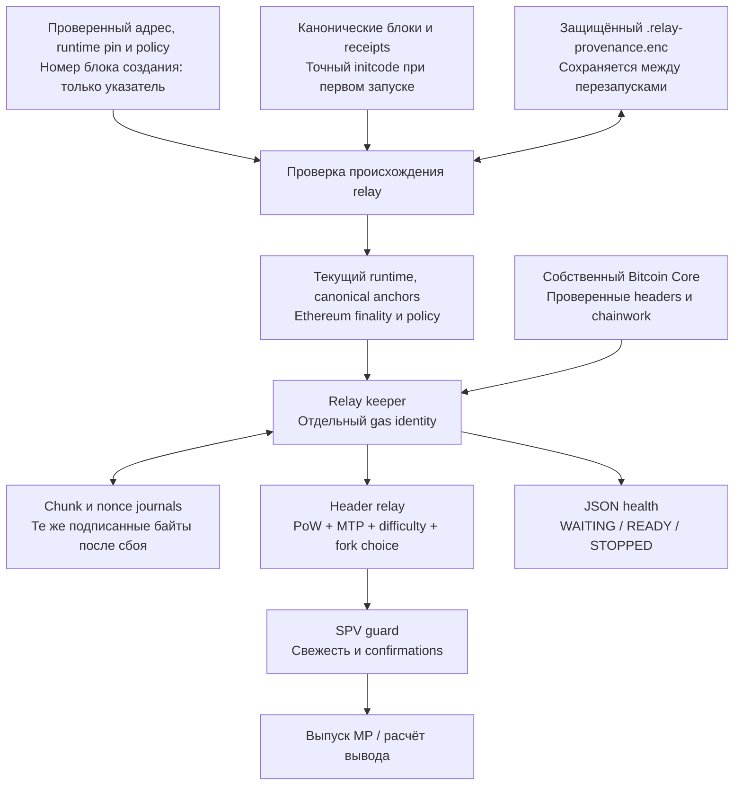

# Relay keeper и фактический газ

[Схемы: SVG/PNG и hashes текущих Mermaid-исходников](DIAGRAMS.md).

Для Bitcoin mainnet и testnet4 в поставку входит
`frost-relay-keeper`. Он поддерживает relay после bootstrap, независимо от
участников DKG. Без свежих заголовков SPV guard останавливает выпуск MP и расчёт
выводов. Порог подписей, Bitcoin confirmations и Ethereum finality keeper не меняет.

## Подготовка keeper

1. Установите проект по [инструкции первого запуска](FIRST_DKG_ONCHAIN.md).
   Для обновления окружения запустите `python ops/bootstrap_host.py build` из
   корня репозитория. Команда проверит хеши зависимостей и установит
   актуальную версию `frost-relay-keeper`.
2. Выделите keeper отдельный EVM-адрес и пополните его ETH для газа. Импортируйте
   его ключ в локальный `identity.json` с правами 0600, по инструкции скрытого
   ввода в [первом запуске](FIRST_DKG_ONCHAIN.md). Каталог — 0700.
   У keeper нет DKG share, Bitcoin private key или права разрешать выводы.
3. Из проверенного deployment возьмите адрес **header relay**, `runtime_hash`
   этого контракта и исходный `bitcoin-policy.json`. Это именно header relay,
   а не `MainnetSPVGuard`. Не формируйте pin по адресу из непроверенного сообщения.
   Каждый оператор независимо сравнивает checkpoint с собственным Bitcoin Core.
4. Подключите полностью проверяющий Bitcoin Core выбранной сети с `txindex=1`.
   Используйте его текущий cookie с правами 0600. Cookie должен принадлежать UID,
   под которым работает keeper: клиент проверяет владельца, а не только возможность
   чтения. Запустите Core и keeper под одним выделенным системным пользователем
   либо выделите keeper отдельный Core под его UID. Core должен быть синхронизирован;
   тестовые исторические адаптеры из E2E в рабочем процессе запрещены.
5. Для Ethereum chain 1 задайте пределы расходов, как в
   [mainnet runbook](ETHEREUM_MAINNET_RUNBOOK.md). `SATOSHIFI_MAX_TX_GAS` — предел
   **одной** транзакции, максимум 16777216. `max_headers_per_sync` — верхний предел
   из исходной политики; свежий chunk дополнительно ограничен 16 заголовками.

Keeper сохраняет проверенное происхождение в `<identity>.relay-provenance.enc`.
Файл зашифрован и аутентифицирован отдельным ключом, производным от локальной
gas identity. После перезапуска проверяются текущий runtime и canonical anchors;
поиск блока создания, старые состояния и повторное чтение receipt не нужны.
При смене gas identity прежний кеш не расшифруется: используйте отдельный файл
новой identity и заново проверьте происхождение. Это не журнал nonce.

Для первого запуска возьмите номер блока создания relay из deployment manifest
и задайте `--relay-creation-block`. Этот публичный номер служит только указателем:
keeper проверяет успешный canonical receipt, точный initcode с аргументами policy
и текущий runtime. Для штатного direct CREATE запросы исторического состояния
тогда не нужны даже на первом запуске. Блок с транзакцией и квитанция всё ещё
должны быть доступны. Если номер неизвестен, флаг можно опустить: первоначальный
поиск блока по старому `eth_getCode` может потребовать archive RPC. Один runtime
hash или указанный номер блока не заменяет доказательство происхождения.

Проверка одного прохода, без DKG state/password:

```sh
export SATOSHIFI_KEEPER_EVM_RPC="$ETH_RPC_URL"
export SATOSHIFI_KEEPER_BITCOIN_RPC="$BITCOIN_RPC_URL"
frost-relay-keeper \
  --chain-id "$EVM_CHAIN_ID" --evm-confirmations "$EVM_CONFIRMATIONS" \
  --relay "$HEADER_RELAY" --relay-code-hash "$HEADER_RELAY_RUNTIME_HASH" \
  --relay-creation-block "$HEADER_RELAY_CREATION_BLOCK" \
  --bitcoin-policy bitcoin-policy.json --bitcoin-cookie "$BITCOIN_COOKIE" \
  --identity-file "$KEEPER_IDENTITY" --once
```

`EVM_CHAIN_ID` выбирается независимо от Bitcoin: `1`, `11155111` или `31337`.
Bitcoin mainnet/testnet4 берётся из проверенного policy. На chain 1 нужны не менее
12 confirmations **и** finalized block; на остальных сетях глубину задаёт оператор.
Regtest остаётся в существующей команде `flow relay`; новый keeper обслуживает
две публичные Bitcoin-сети, где нужен непрерывный production relay.

Для постоянной работы уберите `--once`, добавьте `--interval 30 --max-backoff 300`.
По умолчанию процесс работает до SIGINT/SIGTERM; `--timeout` задаёт ограничение
в секундах для ручного запуска. Каждый проход печатает JSON health record.
`MAINNET_RELAY_READY` означает выполненную проверку свежести, а не отсутствие
будущих эксплуатационных расходов.

Пример Linux-службы: [satoshifi-relay-keeper.service.example](../ops/satoshifi-relay-keeper.service.example).
Перед установкой замените адрес, runtime hash и пути. Создайте отдельного системного
пользователя и каталоги. В `/etc/satoshifi/relay-keeper.env` с правами 0600 поместите
две переменные RPC выше и три Ethereum gas-budget переменные из mainnet runbook.
Указанный в примере `User=satoshifi-relay` должен также владеть cookie Core:
запустите соответствующий Core под этим UID либо согласованно измените пользователя
службы. Group/ACL-доступ к cookie другого владельца не пройдёт проверку клиента.
Не расширяйте права cookie; он должен оставаться 0600. Команды установки службы
зависят от ОС; пример рассчитан на systemd.

## Сбои и перезапуск

- Временный сетевой сбой, HTTP 429/502/503/504, несинхронизированный Core или
  отсутствие finality дают `WAITING` с безопасным кодом и повтор с backoff.
  URL, API key, cookie и текст ответа RPC не печатаются.
- Pending EVM transaction остаётся в прежнем журнале и повторяется с тем же hash,
  nonce и подписанными байтами. Рестарт процесса не создаёт новую операцию.
- Cookie читается заново на каждом проходе, поэтому рестарт Core с ротацией
  cookie не требует копирования секрета или пересоздания keeper. Краткое отсутствие
  cookie и Core `-28` (warming up) повторяются с backoff. Неверные права существующего
  cookie или HTTP 401/403 требуют исправления конфигурации. В диагностику попадают
  только числовые `rpc_error_code`/`http_status`, без текста удалённой ошибки.
- `MAINNET_RELAY_HALTED`, недопустимая реорганизация, несовпадение runtime/policy
  дают `STOPPED`, exit 78. Пример systemd **не** перезапускает эту ошибку бесконечно.
  Нужна проверка причины; keeper не сбрасывает halt, checkpoint или историю.
- `--once`: exit 0 означает READY, exit 2 — работа/ожидание, exit 78 — ошибка,
  требующая разбора. Таймаут также возвращает 2, сохраняя pending transaction.

Храните и резервируйте рядом с keeper identity файлы `.relay-provenance.enc`,
`.relay-provenance.enc.lock`, `.relay-chunks.sqlite`, `.relay-transactions.sqlite`,
`.evm-nonce.lock.sqlite` и связанные журналы SQLite.
Не удаляйте их для «лечения» pending nonce. Для независимого резервного keeper
используйте другой gas identity; точные уже известные headers принимаются идемпотентно.

## Газ развёртывания

46–56 млн газа за набор контрактов нельзя сравнивать с лимитом 16777216 как одну
величину. Первый показатель может быть **суммой нескольких транзакций**, второй
ограничивает каждую отдельно ([EIP-7825](https://eips.ethereum.org/EIPS/eip-7825)).
Текущие staged scripts отправляют отдельные leaf
deployments; mainnet RPC budget gate проверяет фактические подписанные gas limits
до отправки. Если какая-либо конкретная операция превышает предел, она должна быть
разделена по архитектуре; повышение лимита сверх 16777216 не является обходом.

Локальное воспроизведение на chain 1 / Osaka, этапы `base` + `factories`:
33 transactions, суммарно **48 438 680 gasUsed**, максимум одной транзакции
**5 372 179 gasUsed** (`MultiPoolDeployer`), максимальный подписанный gas limit
**6 983 832**. Это расходы только этих двух стадий, не полного bootstrap с DKG,
созданием пулов и DAO. Публичный mainnet для измерения не использовался.

Для собственного staged deployment получите итог по реальным финальным receipts:

```sh
python ops/deployment_gas.py --manifest deployment-manifest.json > deployment-gas.json
```

RPC читается из `ETH_RPC_URL` или `--rpc`. Отчёт показывает `total_gas_used`,
`maximum_transaction_gas_used`, `maximum_transaction_gas_limit`, фактически
оплаченную сумму wei и каждую транзакцию, включая reverted. Неокончательные или
неканонические receipts не считаются подтверждёнными расходами. Это read-only
команда; она ничего не подписывает и не публикует calldata/credentials.

Gas report тестового Solidity harness и газ исполняемого Forge script не равны
сумме receipts: это другие границы измерения, где могут быть fixture setup,
прогретое storage, несколько CREATE, установка runtime code и отдельные broadcast
transactions. Для утверждения «в шесть раз» нужны сравниваемые tx hashes и точная
команда оценки; фиксированного коэффициента пересчёта нет.

## Рост стоимости заголовков

Предыдущий relay записывал таблицу из `log2(числа заголовков)` ancestor pointers
для каждого нового блока. Новый relay хранит **один** skip pointer на header,
используя checkpoint-relative вариант алгоритма
[Bitcoin Core GetSkipHeight/GetAncestor](https://github.com/bitcoin/bitcoin/blob/v30.0/src/chain.cpp).
Поиск предка и fork point сохраняется; проверка PoW, difficulty, MTP, cumulative
work и deep-reorg halt остаётся обязательной. Число записей storage не растёт с
историей. Число чтений может различаться на skip/retarget границах: это не обещание
одинакового газа каждого header.

Регрессия отдельно охлаждает storage перед вызовом: для веток на высотах
31/127/1023/4095/8191 после checkpoint новый header записывает 6 слотов
(включая счётчик test harness), расходует 163541–174848 газа в этой изолированной
проверке хранения. Полная PoW/MTP операция стоит иначе. Cold deep-reorg halt после
8192 headers укладывается в прежний предел теста 1 млн газа. Измерения выполняются
на локальном EVM, без расходов в mainnet.

Изменение storage требует нового deployment relay. Уже развёрнутый immutable
контракт автоматически не обновится. Его migration/checkpoint и bindings нужно
отдельно проверить; нельзя подменять адрес в старом подписанном приглашении.


