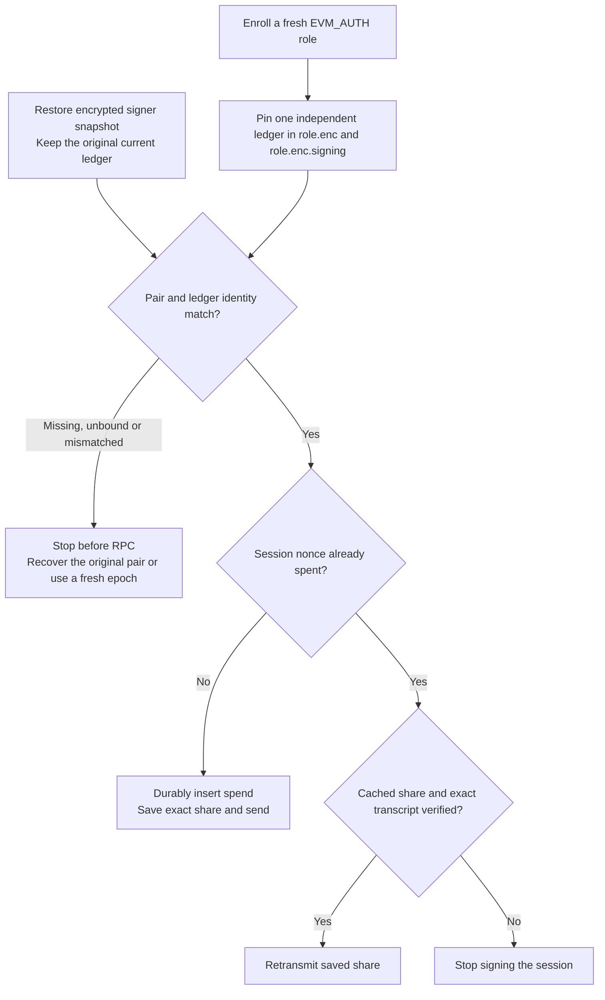
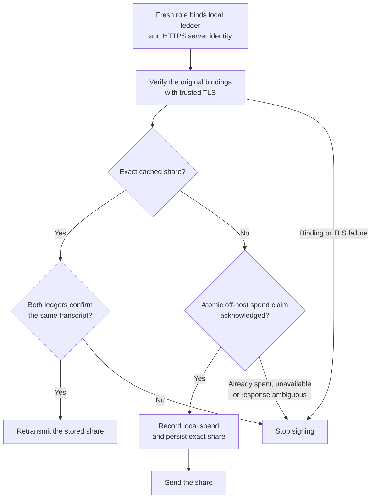

# Signing and nonce persistence

[FROST → ZK → settlement](FROST_ZK_LIFECYCLE.md) joins this nonce protocol to
the DKG equations, target-bound EVM approval, separate Bitcoin input signing,
local proof generation and consumer checks. It also documents concurrent proof
publication and the difference between local provenance and public verification.

EVM retains `SATOHSI_FROST_NONCE_TRANSCRIPT_V1` and
`SATOHSI_FROST_BINDING_FACTOR_V1`. It does not substitute library-standard binding factors.
The Rust `evm_share_v1` adapter computes secret scalar arithmetic with k256; Python computes
public transcript/rho/challenge/Lagrange values. The common `tests/vectors/signing-v1.json` fixtures freeze the transcript, public
commitments, binding factors, original-index Lagrange coefficients, challenge,
partial scalars and final signature for both nonce parities. Python recomputes the
public values; Rust checks its scalar adapter and k256 BIP340 verification;
`SigningGolden.t.sol` submits the exact commitments/scalars to the actual
coordinator and canonical verifier. Coincurve supplies another independent final
BIP340 check. These artificial fixtures complement the real subprocess DKG tests.

`createSessionFromDKG` loads threshold, full roster and public shares automatically.
Commitments freeze at threshold, and original DKG indexes are retained. `DKGAuthorization`
rejects a legacy session or another DKG result even when its group key matches. Final
aggregation is checked independently with coincurve BIP340 before EVM submission.

`frost-signer dkg sign-evm --board ADDRESS --role conf_ceremony --session ID`
reads the typed intent and coordinator from the canonical DKG board. Each signer
uses its own RPC, identity and encrypted state. The lower-level compatibility path
accepts a manifest, `--coordinator`, `--session`, and `--package intent.json`.
Both paths require explicit local approval.
The intent contains chain_id (string), target, operation_hash, an allowlisted artifact name,
hash_method and hash_args. The participant calls the target hash helper itself and checks
its result against the signing session. This is not an automated spending-limit policy;
automated spending-limit policies remain an operator concern. The operations API
and resumable factory workflow prepare intents but do not approve them for participants.
The legacy CLI's approve-all option is not used by this profile.

Before nonce generation, scalar-share computation and every cached-share retry,
the same signing guards recheck the coordinator's canonical `FROSTVerifier`,
its exact constructor binding, the typed treasury policy and the public intent.
Verifier checks run at the confirmed read snapshot and at the current block;
session-specific verifier overrides are rejected. ABI compatibility alone is
insufficient, including for the lower-level signer: its coordinator and verifier
must match the locally reviewed artifacts and creation provenance.

ULR and gas treasury intents keep their reviewed context throughout these
checks. A runtime mismatch for that context is fatal and cannot be classified
as an unrelated target and skipped. Treasury addresses remain bound to the
participant's ULR pin or the enrolled gas registry/epoch/roster. ULR bootstrap
confederation fee-router/board review is mandatory from the signed enrollment;
removing the `ulr_treasury` label cannot route an intent around those checks.
ULR bootstrap fee-pipeline approval also reviews its enrolled ZK consumer path, including the
Groth16 verifier's exact constructor-child address. A different contract with
the same verifier code is not a substitute for that child.

Managed NFT create/mint requires an independently enrolled `--nft-config` pin
and a public-board intent. The signer binds the factory record, manager,
EVM_AUTH epoch, authorization and validator, then checks the exact collection,
recipient, expiry, volume and discount. Confirmed/latest review repeats before
every nonce/share/cached delivery boundary. Removing the typed context or
switching to a raw hash cannot bypass it. See [NFT commands and quota boundaries](NFT_CONFIGURATION.md).

These checks preserve nonce/spent journals. A rejected retry does not generate
replacement nonces or authorize a new operation. Regression coverage includes
`test_signing_target_substitution.py`, real local-EVM verifier substitutions,
and rejection of a foreign gas treasury before FROST commitments are submitted.
Initial Bitcoin address-registry binding also authenticates the derivation
verifier's runtime, canonical constructor and declared runtime hash at the
confirmed and current blocks before private work or cached-share export.
This identity check does not grant derivation qualification.
For Bitcoin reserve, bind and RBF, the strict public plan is mandatory for
enrolled roles and public EVM. A board intent and a local file have the same
plan checks. Review binds the exact operation arguments, target and hash, then
rechecks the plan before private nonce work and before returning a cached share.
The legacy file fixture without a plan is limited to unenrolled local Anvil.
Legacy automatic or interactive approvals through `watch`, `run-once` or
`decide approve` are limited to local Anvil. On public EVM, use typed
`dkg sign-evm`.

Nonce sequence:

1. Persist encrypted nonce pair before exposing commitments.
2. Compute/verify z locally while holding an exclusive OS file lock.
3. Persist a spent marker in a FULL-synchronous SQLite journal.
4. Persist exact transcript, z and spent state atomically; erase stored nonce fields.
5. Only then transmit z. Retry checks the independent journal identity and exact
   spent transcript before transmitting the saved z again.

A crash between steps 3 and 4 blocks the session. A reverted or dropped transaction
leaves the nonce spent. The current journal detects an older copy of encrypted state.

### Independent nonce ledger

Ethereum mainnet and Bitcoin mainnet paired with public EVM require the
independent ledger at enrollment and before signing. For a new deployment
or a managed new key epoch, place the spent ledger on a
separately managed local volume outside the signer state directory. Create a
private `0700` directory owned by the signer. Pass its absolute path as
`--nonce-ledger-dir` to `frost-signer setup join-chain` or `setup join` so each
ceremony has a separate ledger. For each EVM_AUTH role (`evm_ceremony` and
`conf_ceremony`), enrollment pins the same ledger path and identity in both
`<role>.enc` and `<role>.enc.signing`. `dkg sign-evm` checks that pair before
contacting RPC and uses `<role>.enc.signing` with the verified ledger throughout
the signing round. `btc_ceremony` uses its own state and ledger. The participant
CLI accepts `--nonce-ledger` as an explicit assertion of the expected path.
For a local continuous test, the service accepts `SIGNER_NONCE_LEDGER` for
its state.

When preparing a fresh EVM_AUTH role manually, initialize the pair before
transport setup, enrollment, or signing. For a fresh BTC_SPEND state, use
`nonce-ledger-init` without `--evm-auth`.

```sh
frost-signer dkg nonce-ledger-init --evm-auth --state "$ROLE_STATE" \
  --password-file "$PASSWORD_FILE" --nonce-ledger "$INDEPENDENT_LEDGER"
```

Keep the original independent ledger current while restoring a signer state
snapshot. A recorded spend blocks recomputation from an older nonce state.
The signer can retransmit a cached share for its exact transcript once the
original ledger confirms that spend. Keep one live signer per role and exclude
the independent volume from state snapshot rollback. The next section adds a
guard outside both local snapshots.

A guarded role with a missing or legacy `.signing` file returns
`EVM_NONCE_LEDGER_NOT_BOUND_RECOVERY_REQUIRED`. A different ledger path or
identity returns `NONCE_LEDGER_MISMATCH_RECOVERY_REQUIRED`. A missing or
unavailable ledger also stops signing. Exact retries of guarded enrollment and
initialization verify the existing pair. If the original guarded `.signing`
file and current ledger cannot be recovered, follow the approved retirement
and fresh key epoch procedure. Initialization requires fresh state and a new
ledger path. An older `.signing` file with its own independent ledger can still
use its original verified ledger when the DKG role has no independent ledger.
The adjacent-journal format remains available for unguarded local rehearsals.
Adopt independent protection for that format in a fresh key epoch.
These steps concern FROST signing nonces. EVM transaction nonce recovery still
uses the original `<identity-file>.transactions.sqlite` lane described in the
[SDK recovery guide](RECOVERY.md).



### Off-host nonce anchor

For a fresh role, an off-host anchor protects against restoring both local
volumes from the same old snapshot. Keep the encrypted state, independent local
ledger and off-host database under separate snapshot policies. A local copy of
the participant uses the same anchor credentials and immutable binding as the
original role. The anchor accepts only one spend per ledger and session even when
the copies cannot share a file lock. Keep one active participant in normal operation.

On another host, create a private `0700` state directory and a `0600` policy
file containing a JSON object that maps each participant's random 64-character
hex namespace to the SHA-256 hash of its separate 64-character hex bearer token.
Hash the ASCII token without its trailing newline. Give each participant the
token through a private channel and keep it out of the server policy. Run:

```sh
frost-signer nonce-anchor --state "$ANCHOR_DIRECTORY/nonce.sqlite" \
  --policy "$ANCHOR_DIRECTORY/principals.json" --port 8791
```

The service binds to loopback. Serve `/v1/nonce-anchor` through a trusted HTTPS
reverse proxy forwarding `Authorization`. Keep both the raw token and request
body out of proxy logs. Review the `server_id` reported by the anchor during
startup over an authenticated channel. Create a private `0600` client config:

```json
{
  "version": "1",
  "url": "https://anchor.example.org/v1/nonce-anchor",
  "server_id": "<64 lowercase hex characters from anchor startup>",
  "participant": "<64 lowercase hex characters assigned to this participant>",
  "token_file": "/absolute/path/to/private/anchor-token"
}
```

Use `--nonce-anchor-config "$ANCHOR_CONFIG"` alongside `--nonce-ledger-dir`
when enrolling, or alongside `--nonce-ledger` when running `dkg nonce-ledger-init`.
Only a fresh state can bind the anchor. For later `dkg` signing commands pass
the same config explicitly, or set `SATOSHIFI_NONCE_ANCHOR_CONFIG` to its private
path. The encrypted role and its EVM companion pin the HTTPS address, server
identity and participant namespace. Credentials are read locally and cannot be
embedded in the URL. TLS verification is mandatory and redirects are rejected.
The guarded files use encrypted state version 2 so an older SDK refuses to open
them rather than bypassing the anchor.

The signer sends only the local ledger identity and hashes of the local session
and expected transcript. The anchor commits its insertion before the signer
persists or transmits the share. Retransmitting a saved share requires a read-only
match of the original transcript at both ledgers. After an ambiguous response
to a claim the signer stops. If the cache lacks the saved share and the anchor
already records the spend, use a fresh signing session after reconciling the
old one. A remote database rollback with the same server identity is outside
this guarantee. Preserve its current history and use a fresh key epoch when
current nonce history cannot be proven.



BTC uses ZF standard signing with a separate BTC_SPEND KeyPackage, BIP341 SIGHASH_DEFAULT,
no annex and no second tweak. A persisted batch/transcript binds each input's nonce.
Before any BTC commitment, the participant must explicitly [inspect and pin the
canonical registry graph](BITCOIN_SIGNER_TRUST.md). Payment plans cannot select a
different approval authority. V2 plans bind chain, Bitcoin board, wallet result,
batch and a fixed threshold subset. The public plan, commitments and signature
shares travel through `BitcoinSigningBoard`; private DKG packets retain HPKE.
Completely cached Bitcoin packets can be delivered again after the deadline or
spending the inputs, with unchanged transcript/journal checks and no new nonce or
signature calculation. Regtest permits that exact cached delivery without Core.
Mainnet retains the own-Core and pinned relay health gates even for cached delivery.
Incomplete caches retain all first-sign checks.

The network is committed by the accepted invitation and pinned graph: regtest V3
and mainnet V4 are distinct deployments. Mainnet requires a fully validated,
unpruned Core with synced txindex, exact genesis/checkpoint/chainwork agreement,
a fresh canonical relay at the selected EVM confirmation depth and the correct
`MainnetSPVGuard`. A stale or halted relay does not authorize a new signature.
`dkg btc-network-status` reads readiness and `dkg btc-relay` performs bounded,
journaled synchronization without creating private nonce material. The
[mainnet runbook](BITCOIN_MAINNET_RUNBOOK.md) gives the full commands. See the [payment runbook](BITCOIN_ONCHAIN_RUNBOOK.md),
[Bitcoin withdrawals](BITCOIN_WITHDRAWALS.md) and
[separate security review](BITCOIN_ONCHAIN_SECURITY_REVIEW.md).
