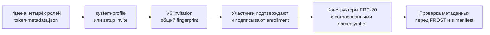
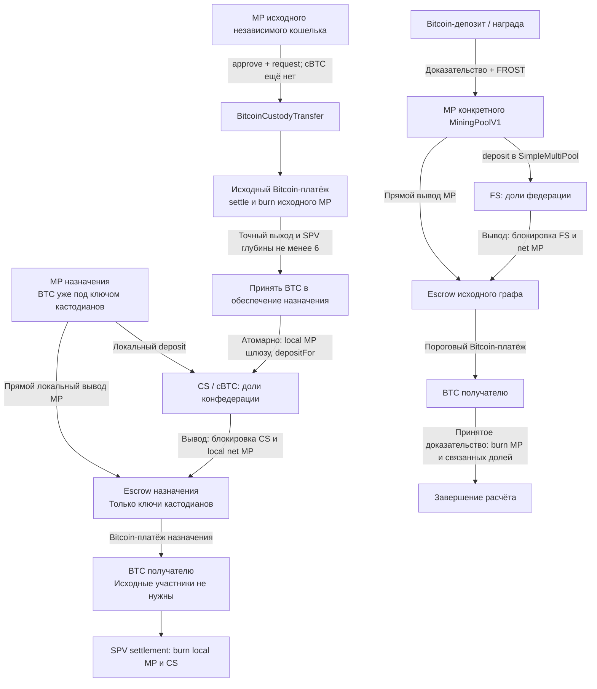
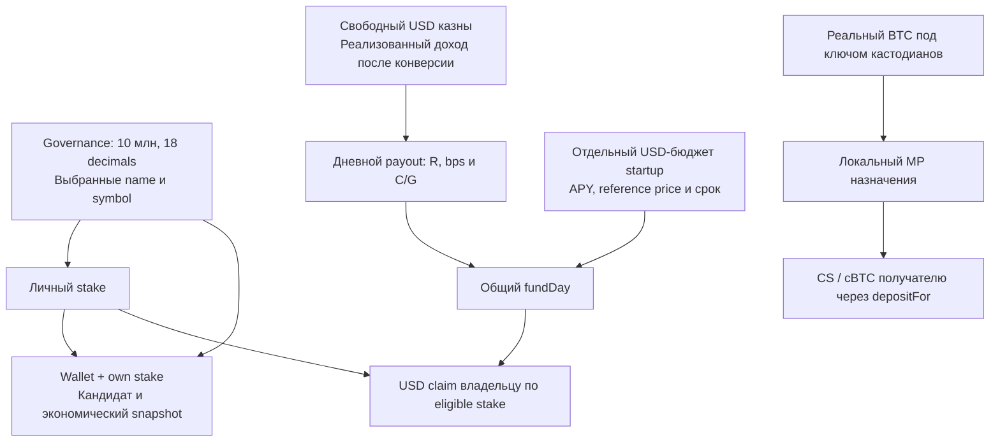

# Токены: где используются и откуда берутся

[Индекс схем](DIAGRAMS.md).

[Параметры федерации/конфедерации и новые группы](FEDERATION_CONFEDERATION_SETUP.md) ·
[NFT скидок: параметры, роли и требования](NFT_CONFIGURATION.md).

[Математическое описание](LAUNCH_MATHEMATICS.md): единицы, точное округление,
границы выплат, UTC-учёт, APY и предпосылки безопасности.

В новой сборке пороги и экономические проценты задаются до enrollment через
[конфигуратор запуска](LAUNCH_CONFIGURATOR.md). Значения 200 000 / $1000 / 90%
ниже описывают прежние значения по умолчанию; фактические immutable параметры
читайте из согласованной политики и контрактов.

[Индекс документации](README.md). Экономический профиль обновлён 5 ноября 2026 года.
Для новых конфедераций с ULR policy V3 действуют следующие правила.

| Актив | Роль в V3 |
|---|---|
| MP федерации | Выпускается исходным `MiningPoolV1`. При переносе обеспечения исходный escrow сжигает MP после подтверждённой Bitcoin-выплаты под ключ конфедерации. |
| S конфедерации | Переводимый ERC-20 `ConfederationShareV2`. Выпускается по принятому Bitcoin-выходу в соотношении `10^10` базовых единиц на сатоши. Держатель погашает S из BTC-резерва конфедерации. |
| ULR и награды | `create` выпускает общие ULR, `reuse` подключает их к отдельному стейкингу новой конфедерации. DAO получает комиссии в S и может принимать одобренные стейблкоины. |

Адрес S определяет `ConfederationFactory.getConfederation(id).shareToken`
или `ConfederationPoolV2.shareToken()`. Своя запись резерва доступна через
`ConfederationPoolV2.bitcoinReserve()`, её общий BTC-баланс обеспечения
через `deposits().totalBackingSats()` в сатоши. Погашение S не требует
локального MP. [Маршрут и расчёт MP → S → BTC](CONFEDERATION_DAO_IN_KIND.md).

## Карта активов прежних профилей

Общий [ULR staking](ULR_STAKING.md) использует один выбранный 10-миллионный
ULR-токен и один payout-стейблкоин для всех подключённых конфедераций. Их
[казначейский маршрут](ULR_TREASURIES.md) считает долю по историческому ULR
на кошельках плюс личному стейку. [Профиль ULR bootstrap](ULR_BOOTSTRAP.md)
создаёт эту общую систему и подключает следующие конфедерации через `reuse`;
legacy bootstrap ниже по-прежнему создаёт собственный `CGOV` на конфедерацию.

| Актив | Где находится и используется | Откуда появляется у пользователя |
|---|---|---|
| BTC | Выбранная Bitcoin-сеть; UTXO общего порогового кошелька и зарегистрированные адреса | Внешний Bitcoin-депозит или награда майнинга; при выводе — Bitcoin-платёж пользователю |
| MP (символ задаётся в конфигурации) | ERC-20 `PoolMpToken` отдельного `MiningPoolV1` в выбранной EVM-сети | Пул выпускает по принятому доказательству Bitcoin-депозита/награды и точному FROST-разрешению |
| Доля федерации, S-token (роль FS) | ERC-20 `MultiPoolShareToken`, управляется `SimpleMultiPool` | Пользователь вносит разрешённый MP в пул федерации; получает доли за вычетом wrap-комиссии |
| Доля конфедерации, S-token (роль CS) | ERC-20 `ConfederationToken`, управляется `ConfederationMultiPool` | Пользователь вносит разрешённый MP прямо в пул конфедерации; получает доли за вычетом wrap-комиссии |
| Governance-токен DAO (`CGOV` по умолчанию) | ERC-20 `CustodianDAOToken`; кошелёк владельца и `CustodianDAOStaking` | При создании контракта весь фиксированный выпуск поступает `dao_token_recipient`; далее распределяется переводами |
| Валюта выплат DAO (`rewardToken`) | Конвертер, fee router, income vault, settlement, staking; выплаты стейкерам, LP и treasury | Реальные поступления комиссий/дохода; конвертер выдаёт её из заранее внесённого запаса |
| Тестовый USD (`TUSD`) | `DAOTestUSD` для интеграционного профиля на Anvil/Sepolia | Открытая функция `mint`; это тестовый актив без обеспечения, 6 decimals |
| NFT скидки | ERC-721 `FederationNFTModifier`, подключаемый к fee manager | Управляемые create/mint через fee manager с FROST approval; срок, объём и скидка связаны подписью |
| ETH | Нативный баланс выбранной EVM-сети | Внешнее пополнение; оплачивает EVM gas и может финансировать gas treasury |

`MP` и `S-token` — названия типов. У каждого пула свой адрес MP, у каждой
федерации/конфедерации свой адрес долей. Один тикер не делает контракты одним
активом. Для идентификации нужны EVM chain ID и адрес контракта; для BTC —
выбранная Bitcoin-сеть и соответствующий wallet/address graph.

## Имена и тикеры до запуска

Оператор задаёт `name` и `symbol` до публикации приглашения. Скопируйте
[`token-metadata.example.json`](../config/token-metadata.example.json) в свой
публичный конфигурационный каталог и замените четыре пары:

```json
{
  "governance": {"name": "Project Governance", "symbol": "PGOV"},
  "mining": {"name": "Project Mining", "symbol": "PMIN"},
  "federation_share": {"name": "Project Federation Shares", "symbol": "PFS"},
  "confederation_share": {"name": "Project Confederation Shares", "symbol": "PCS"}
}
```

Для полного графа добавьте `--token-metadata /path/to/token-metadata.json` к
`frost-signer system-profile`; результат содержит `token_metadata`. Затем
передайте его через `setup invite --system-policy FILE`. Можно заранее изменить
`token_metadata` прямо в системном JSON. Для отдельного экономического или
legacy-профиля передайте `setup invite --token-metadata FILE` вместе с остальными
аргументами. При двух источниках метаданные должны полностью совпасть.
Полная команда приведена в [общем runbook](CROSS_PLATFORM_QUICKSTART.md#8-оператор-полный-ulr--bitcoin-профиль).

| Роль в JSON | Контракт | Значения при отсутствии настройки |
| --- | --- | --- |
| `governance` | `CustodianDAOToken`, общий staking и кандидаты | `ULR` / `ULR` в общем профиле; `Custodian Governance` / `CGOV` в legacy |
| `mining` | `PoolMpToken` внутри `MiningPoolV1` | `Integration MP` / `IMP` |
| `federation_share` | `MultiPoolShareToken` федерации | `Federation Shares` / `FS` |
| `confederation_share` | `ConfederationShareV2` в V3 или `ConfederationToken` прежнего профиля | `Confederation Shares` / `CS` |

Примеры полного системного профиля содержат редактируемые `Project …` /
`PGOV`, `PMIN`, `PFS`, `PCS`. Если `system-profile` вызван без файла имён,
он явно записывает прежние значения из таблицы. Старые приглашения и сохранённые
планы без этого поля продолжают работать со своей прежней конфигурацией.

Каждая из четырёх ролей обязательна в `token_metadata`; лишние роли и поля
отклоняются. `name` — непустая печатная Unicode-строка до **128 UTF-8 байт**, без
пробелов по краям и управляющих символов. `symbol` — **1–32 ASCII-символа**:
первая буква или цифра, далее буквы, цифры, `.`, `_`, `-`; регистр сохраняется.
Повторяющиеся тикеры разрешены, поскольку актив определяется сетью и адресом.



Изменение имён после enrollment требует нового приглашения и согласования
участников. При `reuse` общий governance-токен уже существует: экспортированный
`ulr.reuse_policy.token` сохраняет его имя и символ. В V3 имя S берётся из
`confederation_share`, а метаданные `mining` используются прежними профилями
при выпуске MP. Конфликт имён общего токена отклоняется.
Метаданные также проверяются по фактическим контрактам; проверка адресов,
происхождения, runtime hash и полномочий выполняется прежним механизмом.
Текущие контракты не имеют функции переименования после развёртывания.

В названиях команд, полей и схем `ULR`, `MP`, `FS`, `CS` обозначают протокольные
роли. Настройка name/symbol не меняет выпуск 10 млн, 18 decimals, пороги
кандидатов, доли дохода, голосование, Bitcoin-номинал или ограничения переводов.

Внешний USD-стейблкоин выбирается прежними `--reward-token`, code hash и decimals;
его метаданные принадлежат существующему контракту. `DAOTestUSD` имеет имя
`Test USD` и символ `TUSD`. На local и Sepolia его можно закрепить как внешний
reward token для публичной Bitcoin-сети. BTC и ETH определяются выбранными сетями.

## MP: представление Bitcoin в EVM

[`MiningPoolV1`](../web3/contracts/src/federation/MiningPoolV1.sol) создаёт
[`PoolMpToken`](../web3/contracts/src/tokens/PoolMpToken.sol) в своём конструкторе.
При создании контракта MP ещё не выпускаются. Начальные роли управления
MP принадлежат самому mining pool; текущий `MiningPoolV1` выпускает их через
`mintFromProof`, `mintFromProofV2` или `mintFromAddressProof`.

Для выпуска требуются принятое Bitcoin-доказательство, проверки общего
`BitcoinDepositRegistry`, точное разрешение FROST и совпадение распределения с
подтверждённой суммой. Обычный SMP1-депозит связывает EVM-получателя и сумму с
Bitcoin-транзакцией. Coinbase без SMP1 использует порогово одобренное
распределение награды; адресный путь проверяет получателя через зарегистрированный
mint claim. Профиль адресного выпуска и его ограничения описаны отдельно в
[address registry](ADDRESS_DEPOSIT_REGISTRY.md).

MP имеет 18 decimals, Bitcoin учитывается в сатоши:

```text
MP base units = принятые сатоши × 10^10
1 BTC = 100 000 000 сатоши = 1 целый MP = 10^18 MP base units
0.01 BTC = 1 000 000 сатоши = 0.01 MP
```

Это правило номинального выпуска. Для вывода необходимы доступный Bitcoin,
пороговая подпись, выполнение условий escrow и доказательство платежа.
`MiningPoolV1` создаёт MP с `restrictTransfer=false`: пользователь может
перевести MP либо внести их в поддерживающий этот MP мультипул.

Подробности: [выпуск MP и treasury](BITCOIN_MINT_AND_TREASURY.md),
[mint admission](BITCOIN_MINT_ADMISSION.md),
[Bitcoin lifecycle](BITCOIN_WITHDRAWALS.md).

## FS и CS: два отдельных пула долей в прежнем профиле

При создании федерации фабрика через deployer создаёт `SimpleMultiPool` и
[`MultiPoolShareToken`](../web3/contracts/src/tokens/MultiPoolShareToken.sol).
Для конфедерации создаются `ConfederationMultiPool` и
[`ConfederationToken`](../web3/contracts/src/tokens/ConfederationToken.sol).
Создание этих контрактов само по себе долей пользователям не выдаёт.

Оба мультипула принимают MP через `deposit(mpToken, mpAmount)` после допуска
конкретного MP. Текущий расчёт использует одинаковые 18-decimal единицы:

```text
полученные доли = внесённый MP − wrap-комиссия в единицах MP
```

При внесении MP остаётся на балансе выбранного мультипула, а пользователь
получает его FS или CS. Пул отдельно учитывает долю пользователя по исходному
MP через `userPoolBalances` / `getUserPoolBalance`; вывод проверяет доступную
долю именно по выбранному MP. Это не свободный обмен любого исходного MP
на любой другой актив из общего списка пулов.

Схема прежнего профиля с локальным MP в конфедерации.



В custody-профиле конфедерация принимает напрямую только **свой локальный MP**;
внешний MP проходит маршрут передачи обеспечения на схеме. В текущей реализации нет маршрута
`FS → CS`: `FS` нельзя свободно передать в другой пул. Оба контракта долей
запрещают обычные переводы между кошельками; допускаются mint, burn и
контролируемые пулом перемещения в escrow и обратно.

Стандартный bootstrap добавляет созданный MP в `conf_pool`; созданный пул
федерации требует отдельного допуска MP, чтобы принимать такой депозит.
Наличие созданного `FS`-контракта ещё не означает наличие выпущенных FS.

В одном bootstrap BTC изначально поступают на ключ `btc_ceremony`
с составом и порогом **конфедерации**: `BitcoinBatchRegistry` связан с
`conf_auth`, а `MiningPoolV1.payoutScript` получен из этого Bitcoin DKG.
Второй исходный Bitcoin-кошелёк этот одиночный deployment не создаёт.
Для передачи между двумя независимо развёрнутыми графами предназначен шлюз
ниже. Сам `deposit` перемещает
только MP и выпускает доли; он не доказывает передачу Bitcoin-обеспечения.
Допуск постороннего MP через `addPool` не является такой передачей.

Новый профиль `bitcoin_custody.mode=custodians` исключает представителя
федерации из обоих DKG конфедерации (EVM и Bitcoin). Для MP под независимым
исходным Bitcoin-ключом применяется `BitcoinCustodyTransfer`: исходные MP
блокируются и погашаются после платежа, точный выход принимается в обеспечение
конфедерации после SPV-проверки, затем CS/cBTC выпускается получателю.
Внутренний MP конфедерации обеспечивает учёт и дальнейший вывод; исходный
MP в её пул напрямую не допускается. Команды, ограничения и проверки описаны в
[Bitcoin custody transfer](BITCOIN_CUSTODY_TRANSFER.md).

При запросе Bitcoin-вывода доли блокируются, net MP переводится в escrow.
`processWithdrawal` подготавливает запрос. После принятого доказательства
Bitcoin-платежа сжигаются net MP и соответствующие заблокированные доли,
а unwrap-комиссия учитывается в MP. Отмена допустимого неподписанного запроса
возвращает заблокированные активы. MP можно погасить и напрямую через
`requestDirect`, без предварительного получения FS/CS.
Правила округления, дополнительные личные комиссии и возвраты см. в
[Bitcoin lifecycle](BITCOIN_WITHDRAWALS.md) и
[withdrawal fee subsidy](WITHDRAWAL_FEE_SUBSIDY.md).
В личном fee-профиле режим `S` использует доли допущенного `SimpleMultiPool`
и соответствующий MP; CS источником оплаты в этом режиме не является.

## Governance-токен DAO и валюта дохода

[`CustodianDAOToken`](../web3/contracts/src/tokens/CustodianDAOToken.sol)
однократно выпускает **10 000 000 целых токенов с 18 decimals** получателю
развёртывания. Дополнительной функции mint нет. Получатель распределяет выпуск
обычными ERC-20 переводами. Bitcoin-депозит и получение CS автоматически этот
токен не выдают.

В `CustodianDAOStaking` пользователь вносит governance-токен DAO. Стейк
хранится в учёте контракта; отдельный ERC-20 токен-квитанция не создаётся.
Возврат стейка возвращает governance-токен. Вознаграждение выплачивается в
другом, настроенном `rewardToken`, после реально профинансированного дневного
расчёта. Владение governance-токеном или его стейкинг не назначает пользователя
кастодианом и не выдаёт долю приватного ключа FROST.

Источники `rewardToken`:

1. Реализованные wrap/unwrap-комиссии: мультипул удерживает MP;
   `PoolFeePipeline` забирает одобренную сумму и меняет её через
   `FundedFeeConverter` на reward token из заранее внесённого запаса.
2. `CustodianDAOFeeRouter` переводит настроенную долю поступившей валюты в
   `CustodianDAOIncomeVault`, остаток — в treasury.
3. Отдельно настроенные источники дохода и адаптеры передают реально
   полученную валюту выплат в income vault.
4. Дневной settlement распределяет поступления между стейкерами, LP,
   резервом и treasury по установленным правилам.

Конвертер не создаёт reward token; он обменивает MP на существующий запас
по явно заданному коэффициенту. Счётчик комиссий сам по себе не пополняет
USD-баланс DAO. Плата за развёртывание через отдельный project router целиком
идёт project treasury и не означает автоматического дохода пользовательского DAO.

В профиле `integration` bootstrap создаёт
[`DAOTestUSD`](../web3/contracts/src/demo/DAOTestUSD.sol): `TUSD`, 6 decimals,
открытый тестовый mint. В профиле `backed` используется внешний `reward_token`
из приглашения и существующая ликвидность. `backed` выбирается при Ethereum
mainnet **или** публичной Bitcoin-сети, включая testnet4; на тестовой EVM внешний
контракт всё ещё может быть явно выбранным тестовым активом. На Ethereum
mainnet упакованный `DAOTestUSD` запрещён. Имя `TUSD` в интеграции относится
именно к локальному тестовому контракту проекта.

Текущий дневной расчёт требует reward token, представляющий один USD за целый
токен, с decimals не более 18. Конкретный тикер внешнего актива не фиксирован.
LP здесь — получатели по весам ликвидности в дневном отчёте; отдельный
универсальный LP-токен эта схема не выпускает. При подключении внешнего
ERC-4626/Silo vault его share-токены выпускает внешний vault и держит адаптер.

Подробности: [Custodian DAO](CUSTODIAN_DAO.md), [DAO CLI](DAO_CLI.md),
[движение комиссий](FEE_FLOW.md).

## NFT и служебные балансы

Для service-fee NFT смотрите [отдельную policy и требования](NFT_CONFIGURATION.md).
Collection name/symbol, minter/admin, expiry/quota/discount не входят в текущий
конфигуратор. Новый post-bootstrap `frost-signer nft` выполняет create/mint после
независимого pin/review и FROST-одобрения; в конфедерации нужны также custodian approvals.


[`FederationNFTModifier`](../web3/contracts/src/tokens/FederationNFTModifier.sol)
даёт скидку в пределах срока и лимита объёма. Управляемая коллекция имеет
admin/minter/usage у fee manager; authorization проверяет подпись, а manager
исполняет конкретный `mintNFT`. Bitcoin-депозит или создание конфедерации NFT
автоматически не выдаёт. Quote — view; расходовать quota могут только одобренные
contract-pools, связывающие account с владельцем, вызвавшим pool.

ETH оплачивает EVM-транзакции; оплата SPV-заданий через
`SPVServicePaymentRegistry.fundRequest` также передаёт нативную валюту в gas
treasury. Bitcoin miner fee оплачивается BTC по выбранной
схеме резервов/личных комиссий. Записи gas treasury, оплаты SPV-заданий,
withdrawal fee credits и fee reserve — учёт средств и обязательств, а не новые
пользовательские ERC-20 токены. DKG и выдача роли кастодиана токены не выпускают.

Старые `SimpleMiningPool*` / `ApiMiningPool` примеры и отдельный
`MultiPoolERC20Staking` сохраняются в репозитории. Их правила не заменяют
описанный путь `MiningPoolV1` / `CustodianDAOStaking`; generic staking использует
настроенные stake/reward ERC-20 и не определяет новый обязательный токен системы.

## Где проверить адреса

- MP: `MiningPoolV1.mpToken()`; привязанный mining pool: `PoolMpToken.poolDAO()`.
- FS: `FederationFactory.getFederation(id).shareToken` и `SimpleMultiPool.getShareToken()`.
- CS: `ConfederationFactory.getConfederation(id).shareToken` и `ConfederationMultiPool.getShareToken()`.
- DAO: `ConfederationFactory.getCustodianDAO(id).token`; в зарегистрированном
  staking — `stakeToken()` и `rewardToken()`.
- NFT: `nftModifier()` подключённого fee manager; адрес может быть нулевым,
  если NFT-модификатор не настроен.
- Для каждого ERC-20 сверить `name()`, `symbol()`, `decimals()` и `totalSupply()`
  в выбранной EVM-сети. Тикер из таблицы не заменяет проверку адреса.

## Governance и USD-награды в прежнем ULR-профиле

В ULR-профиле общий governance-токен имеет один выпуск 10 млн и 18 decimals;
`ULR` — историческое имя роли. Названия задаются до подписания. `create`
выпускает токен на один адрес с паузой рассылки; `reuse` не создаёт новый выпуск.
Доход общего staking выплачивается в одном выбранном USD-активе. Конвертер,
казна, BTC-обеспечение и prefunded startup — отдельные балансы.



USD-награда не выпускает MP/cBTC и не заменяет их BTC-обеспечение. Reference
price APY не обещает обмен governance на USD. Переименование токена не меняет
его разрешения, обеспечение, контрактный адрес или Bitcoin wallet graph.
