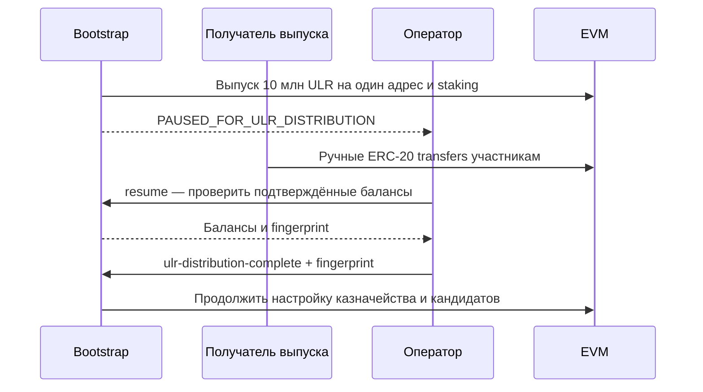

# Единый bootstrap ULR

[Схемы: SVG/PNG и hashes текущих Mermaid-исходников](DIAGRAMS.md).

[Параметры федерации/конфедерации и новые группы](FEDERATION_CONFEDERATION_SETUP.md) ·
[NFT скидок: параметры, роли и требования](NFT_CONFIGURATION.md).

[Холодный старт с нуля](COLD_START.md): единый порядок подготовки, ролей,
финансирования, DKG, relay/ZK, ручной рассылки и первого smoke.

[Сквозной сценарий FROST и ZK](FROST_ZK_LIFECYCLE.md): отдельные DKG,
уравнения подписи и proof, nonce recovery, гонки публикаций и Bitcoin settlement.

[Математическое описание](LAUNCH_MATHEMATICS.md): единицы, точное округление,
границы выплат, UTC-учёт, APY и предпосылки безопасности.

[Единый конфигуратор запуска](LAUNCH_CONFIGURATOR.md): `frost-signer configure wizard`
выбирает сети, create/reuse, confirmations, имена токенов, пороги, комиссии и
дополнительный стартовый APY из собственного USD-бюджета.

Профиль `ulr` объединяет фиксированный выпуск **10 000 000 ULR**, общий
`ULRStaking`, общий реестр снимков, казну каждой конфедерации, кандидатов и
делегирование. Это опция V6-приглашения; без неё сохраняется прежний CGOV-профиль.
`ULR` здесь обозначает роль общего токена. Его имя и тикер, имя MP и обоих
токенов долей выбираются до enrollment через `token_metadata`;
[формат и ограничения](TOKENS.md#имена-и-тикеры-до-запуска).
Новые контракты разворачиваются обычным `bootstrap apply/resume/verify` или
`flow bootstrap`. Уже развёрнутые контракты автоматически не мигрируют.

Для полного Bitcoin + ULR графа используйте **`setup invite --system-policy FILE`**.
Он включает экономический профиль ULR и Bitcoin-профиль версии 2 с canonical
family root, адресным реестром, request/watch transport board, incident board,
Bitcoin signing board, fee reserve и withdrawal fee contracts. Эти компоненты
строятся одним journal, с прежними FROST-одобрениями и локальным pin каждого
подписанта. Старый `--ulr-policy` остаётся только экономическим профилем.

Новый `system-profile` также требует `--bitcoin-custody-policy FILE`.
Первый участник приглашения — представитель федерации; остальные создают
отдельные `conf_ceremony` и `btc_ceremony`, с custody threshold из policy.
В примере из трёх участников это федерационный EVM 3/3 и два независимых
денежных ключа 2/2. Кандидатство, стейкинг и делегирование не выдают доли этих
ключей. Для внешнего MP заранее включите pinned source descriptor в policy:
[полная схема передачи](BITCOIN_CUSTODY_TRANSFER.md). Обычный `deposit` не
переводит BTC из чужого кошелька.

## Подготовка полного профиля и тестнет

До запуска скопируйте `config/token-metadata.example.json` в
`/private/token-metadata.json` (либо свой абсолютный путь) и задайте имена и
символы проекта. Это публичные данные, одинаковые у всех участников.

```sh
frost-signer system-profile \
  --ulr-policy config/ulr-bootstrap-create.example.json \
  --bitcoin-custody-policy config/bitcoin-custody.example.json \
  --token-metadata /private/token-metadata.json \
  --qualification-report rust/zkspv/derivation-qualification/qualification-report.json \
  --service-policy config/bitcoin-bootstrap-service-policy.example.json \
  --protocol-fee-cap-sats 100000 --max-vbytes 10000 --max-packet-bytes 1024 \
  --output /private/system-bootstrap.json
```

Команда фиксирует source-set fingerprint локальной сборки verifier, hash точного
публичного отчёта, service policy и creation code canonical root. Файл не
перезаписывается. Исторический отчёт в примере явно остаётся неквалифицированным:
его commitment не включает `QUALIFIED` и не даёт право на активацию. Для другого
профиля/квалификации укажите свой проверенный отчёт. Публичные примеры текущей
сборки: [relay/testnet](../config/system-bootstrap-testnet.example.json) и
[ZK](../config/system-bootstrap-zk.example.json); при изменении сборки готовьте
файл заново той же командой.

К обычным параметрам `setup invite` добавьте:

```sh
--ethereum-network sepolia --bitcoin-network testnet4 \
--bitcoin-policy /private/testnet4-checkpoint-policy.json \
--system-policy /private/system-bootstrap.json
```

Bitcoin policy получается из собственного Core testnet4, как в
[сетевом runbook](NETWORKS_AND_AUTOMATION.md). Для backed-профиля укажите также
`--reward-token`, `--reward-token-code-hash` и `--reward-token-decimals`: в Sepolia
это выбранный тестовый USD-токен, заранее развёрнутый и пополненный у оператора
для финансирования конвертера. BTC/USD feed не нужен. Вместе с `--system-policy`
нельзя передавать отдельные `--ulr-policy` или `--withdrawal-fee-policy`.

| EVM | Bitcoin | Backend |
| --- | --- | --- |
| local / Sepolia / mainnet | regtest | relay |
| local / Sepolia / mainnet | testnet4 | relay или отдельный `zk-state-v2` |
| local / Sepolia / mainnet | mainnet | relay или `zk-state-v2` |

EVM и Bitcoin выбираются независимо: 9 пар сетей, 15 комбинаций с backend.
Bitcoin mainnet и testnet4 имеют отдельные ZK guests; regtest ZK не поддерживается.
Bitcoin mainnet ZK guest нельзя применять к testnet4/regtest; несовместимость отклоняется до отправки транзакций.
Публичные Bitcoin-профили не включают test helpers. Для EVM mainnet сохраняются
платные фабрики и минимум 12 EVM-подтверждений; выбор Bitcoin testnet не ослабляет
эти правила. Минимумы вывода проверяются и Python, и escrow: **не ниже 294 сатоши
для P2WPKH и 330 для P2TR**. Более высокие значения разрешены.

При `ulr.mode=reuse` передайте подготовке `--family-root-policy FILE` с существующим
canonical Bitcoin root. По умолчанию используется `PRE_ENROLLED`: исходная
root-authority должна отдельно одобрить включение нового адресного реестра,
после чего bootstrap продолжит wait. Новый DKG не подменяет исходную власть.
Независимый pin root на каждом устройстве остаётся обязательным. Создание новой
Bitcoin family по умолчанию при повторном использовании ULR отклоняется.

Проверенный manifest содержит `system.graph_configured` и адреса для address
transport, Bitcoin signing и fee graph. `system.ready` остаётся `false` до
отдельной квалификации/эксплуатационной приёмки: развёртывание не активирует
неквалифицированный verifier и не запускает фоновые сервисы.

## Первая конфедерация

Для отдельного экономического профиля к `setup invite` из
[первого DKG](FIRST_DKG_ONCHAIN.md) можно добавить:

```sh
--ulr-policy config/ulr-bootstrap-create.example.json
```

Для mainnet Bitcoin с ZK используйте
[`ulr-bootstrap-zk.example.json`](../config/ulr-bootstrap-zk.example.json).
`bitcoin_backend` принимает `relay` или `zk-state-v2`. Он обязан совпадать с
выбранной `--bitcoin-policy`: версия 1 для relay, версия 2 с `zk_spv` для ZK.
Профиль Bitcoin по-прежнему получают из собственного Core согласно
[Bitcoin runbook](BITCOIN_MAINNET_RUNBOOK.md). Relay доступен для всех трёх
Bitcoin-сетей; `zk-state-v2` — для mainnet и testnet4 с отдельными guests.
Для [testnet4 + Sepolia](ZK_TESTNET4_SEPOLIA.md) выберите новый testnet4 policy/host.
Ethereum-сеть выбирается отдельно. Несовпадение профилей останавливает построение плана; отката на другой
backend нет. Выпуск MP сохраняет Bitcoin-проверку и отдельное FROST-одобрение.

Финансовые параметры приглашения:

| Параметр | Значение в профиле ULR |
| --- | --- |
| `--dao-token-recipient` | Получатель всего первоначального выпуска ULR; прежнее имя CLI-параметра сохранено |
| `--wrap-staker-bps` | `0` |
| `--deploy-staker-bps` | `0` |
| `--dao-use-reserve` | `false`; старый rate controller не создаётся |
| `--reward-token`, `--reward-token-code-hash`, `--reward-token-decimals` | Один реальный USD-стейблкоин в backed-профиле |
| `--btc-usd-feed` и `--btc-usd-feed-code-hash` | Не передавать: расчёт использует фактический баланс стейблкоина |
| `--converter-numerator`, `--converter-denominator`, `--converter-funding` | Явная котировка и предварительное финансирование конвертера |

Остальные Bitcoin-, FROST- и fee-параметры остаются обязательными, как в
[справочнике bootstrap](BOOTSTRAP.md). Для local/regtest создаётся один тестовый
mintable USD; он не является настоящим долларовым обеспечением. В backed-профиле
bootstrap переводит уже имеющийся стейблкоин оператора в конвертер.

После подписания приглашения участниками:

```sh
frost-signer bootstrap plan --profile /private/bootstrap.json > /private/plan.json
frost-signer bootstrap apply --profile /private/bootstrap.json \
  --state /private/deployments.sqlite --identity-file /private/operator.json
frost-signer bootstrap resume --deployment "$DEPLOYMENT_ID" \
  --state /private/deployments.sqlite --identity-file /private/operator.json
frost-signer bootstrap verify --deployment "$DEPLOYMENT_ID" \
  --state /private/deployments.sqlite > /private/verified.json
```

Для mainnet/testnet4 Bitcoin добавьте обычные `--bitcoin-rpc` и `--bitcoin-cookie`.
Сохраните тот же deployment ID, journal и EOA identity для повторных запусков:
подписанные транзакции восстанавливаются, выполненный выпуск не повторяется.
Новый `create` с новым journal/ID создаёт отдельный токен; это не способ подключать
следующие конфедерации. Глобального запрета на выпуск других ERC-20 нет: систему
определяют общие адреса, принятые в подписанном приглашении.

### Пауза для ручной рассылки ULR после выпуска

Новые ULR-планы **автоматически** останавливаются на
`PAUSED_FOR_ULR_DISTRIBUTION`. В `create` это происходит после выпуска всех
10 млн ULR на один согласованный адрес и создания общего staking, до создания
snapshots/казначейства и открытия ULR-сессий авторизации. DKG уже завершён.
В `reuse` та же пауза происходит после проверки общих корней; нового выпуска нет.

Получатель первоначального выпуска вручную отправляет ULR со своего кошелька
нужным участникам. Bootstrap не выбирает суммы, не подписывает эти переводы и
не получает ключ получателя. Адрес ERC-20 для добавления в кошелёк —
`distribution.token`, decimals — 18. При заданных именах `distribution.token_metadata`
показывает согласованные name/symbol и входит в fingerprint паузы. ETH для газа такого перевода нужен отправителю.
Суммы согласуйте заранее; порог H из согласованной политики — порог баланса кандидата,
а не автоматическое распределение или назначение кастодианом.

Обычный `resume`, перезапуск и `verify` не снимают паузу и не повторяют выпуск.
Пока она стоит, можно выполнить рассылку и затем снова вызвать:

```sh
frost-signer bootstrap resume --deployment "$DEPLOYMENT_ID" \
  --state /private/deployments.sqlite --identity-file /private/operator.json
```

`distribution.participants` показывает подтверждённый wallet, собственный stake,
их сумму и соответствие порогу H (default 200 000 ULR). `pending` показывает ещё не
подтверждённые изменения. Нужна принятая в приглашении глубина подтверждений;
`transfers_confirmed` должен быть `true`. Нулевые балансы не блокируют bootstrap
сами по себе: суммы определяет оператор, а действующие кастодианы могут иметь
остаток ниже кандидатского порога.

Оператор проверяет суммы и копирует **свежий** `distribution.fingerprint` из
своего результата. Затем отдельно подтверждает именно это распределение:

```sh
export DISTRIBUTION_FINGERPRINT='<distribution.fingerprint из собственного resume>'
frost-signer bootstrap resume --deployment "$DEPLOYMENT_ID" \
  --state /private/deployments.sqlite --identity-file /private/operator.json \
  --ulr-distribution-complete --accept-ulr-distribution "$DISTRIBUTION_FINGERPRINT"
```

Для публичного Bitcoin добавьте прежние Core-аргументы. Уполномочен оператор
bootstrap; получатель токенов может быть другим человеком. Подтверждение до
достижения паузы отклоняется. Если после просмотра изменились wallet/stake-балансы,
старый fingerprint отклоняется: сначала снова посмотрите результат. Пока есть
неподтверждённые переводы, пауза сохраняется. После подтверждения продолжаются
обычные FROST/custodian approvals казначейства и кандидатов.



Пауза локальна прежнему journal и deployment ID. Она не продлевает общий
`approval_deadline`; завершайте процедуру до его истечения. Если срок истёк
после выпуска, сохраняйте журнал и уже выпущенные корни: повторный `create`
с новым ID создаст другой токен. Старые сохранённые планы не переписываются
автоматически новой версией кода.

Если получатель выпуска — сам оператор, завершите его ручные переводы до
подтверждения распределения. Во время продолжения bootstrap используйте один
отправитель с этим EOA: сторонний wallet не разделяет локальный nonce journal.
ULR не замораживаются паузой; после release владельцы продолжают распоряжаться
ими, а последующие операции проверяют свои текущие условия отдельно.

<a id="пауза-для-рассылки-монет"></a>

### Дополнительная пауза ETH перед DKG

До `join-chain` каждому участнику уже нужен ETH для публикации enrollment.
Оператор публикует приглашение, участники получают ETH и выполняют вход;
DKG-таймеров на этом этапе ещё нет. После сборки профиля первый `bootstrap apply`
с `--pause-for-funding --funding-min-wei "$PARTICIPANT_MIN_WEI"
--funding-operator-min-wei "$OPERATOR_MIN_WEI"` устанавливает дополнительную паузу `PAUSED_FOR_FUNDING` **до первой
транзакции bootstrap**. Её нужно включить на первом запуске; уже начатую DKG
она не приостанавливает. Запрос паузы после подписанных/выполненных шагов отклоняется.

Задайте `PARTICIPANT_MIN_WEI` и `OPERATOR_MIN_WEI` положительными целыми числами
в wei. Первый порог относится к каждому участнику, второй — к оператору и должен
быть не ниже первого. Это ваши согласованные резервы газа, а не автоматический
расчёт стоимости всех будущих транзакций. Оператор оплачивает deployments,
остальные участники — enrollment, DKG и подписи; бюджет зависит от сети, состава
и цен газа. Пополняйте собственные адреса через выбранный кошелёк/faucet.

Обычный `bootstrap resume`, `verify` и перезапуск процесса показывают ту же паузу.
В JSON `funding.participants` указаны адреса, пороги, подтверждённые и pending
ETH-балансы. Пока хотя бы один баланс ниже порога, продолжение блокируется.
Даже если все пополнены, необходимо отдельное действие **исходного оператора**:

```sh
frost-signer bootstrap resume --deployment "$DEPLOYMENT_ID" \
  --state /private/deployments.sqlite --identity-file /private/operator.json \
  --funding-complete
```

Если пополнение ещё не набрало принятую глубину подтверждений либо pending
транзакции уже расходуют необходимый резерв, результат остаётся
`PAUSED_FOR_FUNDING`. Проверяется канонический блок; reorg не разрешает продолжение.
`flow bootstrap` поддерживает те же начальные флаги и может опрашивать состояние
паузы; снять её можно отдельным `bootstrap resume --funding-complete`.
Используйте тот же journal и deployment ID. Один operator identity ведёт один
постоянный nonce journal; не запускайте независимые копии этого identity на
разных компьютерах. Для одного encrypted DKG-state работает один worker;
дубликат при занятой блокировке получает отказ и не создаёт вторую транзакцию.

Пауза локальна операторскому journal. Участники видят `NOT_STARTED` до создания
церемоний. Срок `approval_deadline` приглашения продолжает действовать во время
паузы; при его истечении требуется новое согласованное приглашение. После
начала DKG действуют обычные сроки фаз: 1 час для local/Sepolia и 1 сутки для
Ethereum mainnet. Пауза не продлевает уже начатую фазу.

| Актив | Что требуется при старте |
| --- | --- |
| ETH выбранной EVM-сети | У каждого — газ для enrollment/DKG/подписей; у оператора дополнительно deployments; эти балансы проверяет funding-пауза |
| ULR | Весь выпуск идёт на один адрес из приглашения; для DKG другим ULR не нужны; будущий кандидат требует H wallet + own stake |
| Выбранный USD-стейблкоин | В backed/reuse-профиле оператор заранее финансирует converter и применимые fees; проверьте отдельно, пауза автоматически проверяет ETH |
| Local test USD | Создаётся и финансируется интеграционным bootstrap; это fixture, не реальное долларовое обеспечение |
| BTC/test BTC | Для одного DKG не нужны; для последующих Bitcoin-операций нужны собственные funding UTXO/Core по выбранному профилю |

Достаточный баланс на момент снятия паузы не резервирует ETH в кошельке.
Последующие внешние траты или изменение газа могут потребовать нового пополнения;
клиенты продолжают проверять и журналировать каждую транзакцию отдельно.

## Что создаёт и связывает план

1. Создаёт один `CustodianDAOToken("ULR", "ULR", recipient)` с фиксированными
   10 млн и без функции дополнительного выпуска; один `ULRStaking(token, USD)`.
2. Создаёт `ULRCustodianSnapshots(staking, fed_auth)`. Первая EVM_AUTH-группа
   системы подписывает общие исторические снимки; ключ новой конфедерации при
   подключении не заменяет эту группу.
3. Для конфедерации создаёт `ULRConfederationTreasury(factory, id, snapshots, reserve, payoutBps)`.
   До подключения fee router фиксирует точный адрес казны в реестре с
   одобрениями FROST конфедерации и минимального кворума её кастодианов.
   Актуальный `deposit` сверяет регистрацию и активность конфедерации
   до списания payout-токена.
   После деактивации новая казна поддерживает отдельный, точно одобренный
   [вывод остатка](ULR_TREASURIES.md#вывод-остатка-после-деактивации).
4. Через те же два одобрения привязывает `validator.candidateStaking` к общему
   стейкингу. Создаёт `ULRConfederationVoting` и advisory decision board.
   Первый stake добавляет номинацию; кандидат с wallet + собственным stake от
   H ULR (default 200 000) может быть принят отдельным одобрением. Действующий состав при
   запуске сохраняется, даже если у его участников пока нет ULR.
5. Создаёт конвертер и `PoolFeePipeline`, авторизует его плательщиком fee router.
   Router с долями 0/0 переводит **100% реально конвертированных комиссий** в казну.
   Служебный income vault предоставляет router интерфейс USD/auth; старые
   settlement, rate controller, TWAP и регистрация legacy CustodianDAO не нужны.

После регистрации в новом общем реестре системная EVM_AUTH-группа один раз
активирует казну для дневных снимков. Для `reuse` эту операцию подписывает
исходная системная группа, указанная в импортированном реестре. Активация
выполняется после bootstrap. Состав закрытых суток определяется по прежнему
UTC-срезу. Для ранее развёрнутого совместимого реестра SDK восстанавливает
состав по историческим событиям регистрации. [Порядок активации и расчёта](ULR_TREASURIES.md#ежедневный-запуск).

Делегирование выбирается самим владельцем после stake. Получателем голосов
может быть действующий кастодиан соответствующей конфедерации; ULR и claim
остаются у владельца. Bootstrap не делегирует голоса пользователей за них.
Плата за создание федерации/конфедерации по-прежнему идёт в проектную казну.

Участники подписывают три новых bootstrap-intent обычной `dkg sign-evm` через
исходный on-chain board. Pin выводится из **подписанного** приглашения и проверенных
конструкторов; ручной `--ulr-config` для этого этапа не требуется. Если его передать,
он должен точно совпасть с выведенным pin. Проверки повторяются перед приватной
работой и экспортом подписи. Проверяются выпуск, общий reward, происхождение
контрактов, DKG-группа, конкретная конфедерация и котировка конвертера.

## Следующие конфедерации

Полный launch в режиме `reuse` развёртывает свои фабрики и закрепляет новые
ID федерации и конфедерации за их EVM_AUTH-сессиями. Из исходного запуска
используются согласованные общие контракты и политики. Для отдельной
федерации или конфедерации на уже развёрнутой общей factory применяется
[ручной порядок резервирования и adoption](FEDERATION_CONFEDERATION_SETUP.md).


Успешный результат содержит `manifest.ulr.status = "ULR_GRAPH_READY"`,
`manifest.ulr.pin` и `manifest.ulr.reuse_policy`. Этот статус подтверждает
связанный граф, регистрацию точного адреса казны и fee pipeline. Перед ручным
пополнением получите `enrolled: true` и `active: true` из `ulr-treasury status`.
Активацию для дневных снимков выполните отдельно.
[Проверка перед пополнением](ULR_TREASURIES.md#проверка-регистрации-перед-пополнением).
Сохраните `reuse_policy` отдельным
JSON и передайте его в `setup invite --ulr-policy` следующей конфедерации. При
необходимости выберите её Bitcoin backend в этом JSON и согласованную Bitcoin
policy **до** подписания нового приглашения.

Для полного графа используйте этот JSON в `system-profile --ulr-policy`, добавив
существующий Bitcoin `--family-root-policy`; затем передайте итоговый файл через
`setup invite --system-policy`. Общие ULR/staking/snapshots повторно не создаются.

`reuse` фиксирует адреса и runtime hashes ULR, USD, staking и snapshots. Bootstrap
проверяет их до отправки транзакций, не разворачивает и не выпускает новый ULR,
не создаёт новый USD или стейкинг. Он добавляет казну, привязку кандидатов,
голосование и fee pipeline новой конфедерации. Даже локальный конвертер в `reuse`
финансируется переводом существующего USD оператора, а не новым mint.

`manifest.ulr.pin` содержит казну текущего deployment. Для общего ежедневного
снимка объедините `treasuries` из проверенных manifest всех подключённых
конфедераций в один системный pin и раздайте его участникам исходной системной
EVM_AUTH-группы. Адреса staking/snapshots/chain должны совпасть. Команда
`snapshot-roster` сверяет этот pin с составом на последний блок отчётного дня.
При использовании прежнего реестра внесите в pin проверенную казну каждой
новой factory до расчёта. По событиям регистрации SDK отбирает казны только
в рамках factory с таким подтверждением. Системная группа независимо
проверяет исторические веса держателей.

## Ежедневная работа

Для изолированной проверки bootstrap, повторного подключения и остальных режимов
используйте [общий runner и матрицу тестов](SYSTEM_TEST_MODES.md).

Bootstrap создаёт и связывает граф. Ежедневный снимок и вызов выплаты выполняются
существующим [ULR CLI](ULR_TREASURIES.md): системная группа подписывает общий снимок
на последнем блоке завершённых суток UTC, затем любой keeper вызывает `pay` для
каждой казны. Самого фонового keeper/scheduler этот профиль не запускает.

```text
выплата = floor(max(баланс USD − R, 0) × bps × ULR конфедерации / (10000 × ULR системы))
```

Числитель — wallet + собственный stake действующих кастодианов конфедерации.
Знаменатель включает всех держателей от H (default 200 000 ULR) и меньшие положительные
остатки действующих кастодианов. BTC/MP сначала конвертируются; резерв R (default $1000),
не выплаченная по bps и доле часть остаётся в казне. Полученный доход
идёт в общий стейкинг; правило полных суток UTC, свободный вывод и owner claim
сохраняются. Повторный `payDay` возвращает прежний receipt без второй выплаты.

`ULR_GRAPH_READY` подтверждает связность экономического графа. Это не завершение
квалификации реального Core/FROST/Groth16-контура; его проверка остаётся отложенной,
а production qualification ZK/address-компонентов — отдельной работой.


При включённом startup используйте отдельный ежедневный `startup-rewards pay`:
он вносит доступный USD-бюджет за предыдущие сутки в тот же `fundDay`.
Окна оплаты, отсутствие долга и возврат после `endDay` описаны в
[конфигураторе](LAUNCH_CONFIGURATOR.md). Эта задача scheduler не заменяет
системный snapshot или выплаты отдельных казн. Для повторов сохраняйте
исходные operation ID и журналы. До deployment проверьте, что выбранная
дата старта оставляет время на enrollment, DKG, финансирование и ручную рассылку.
