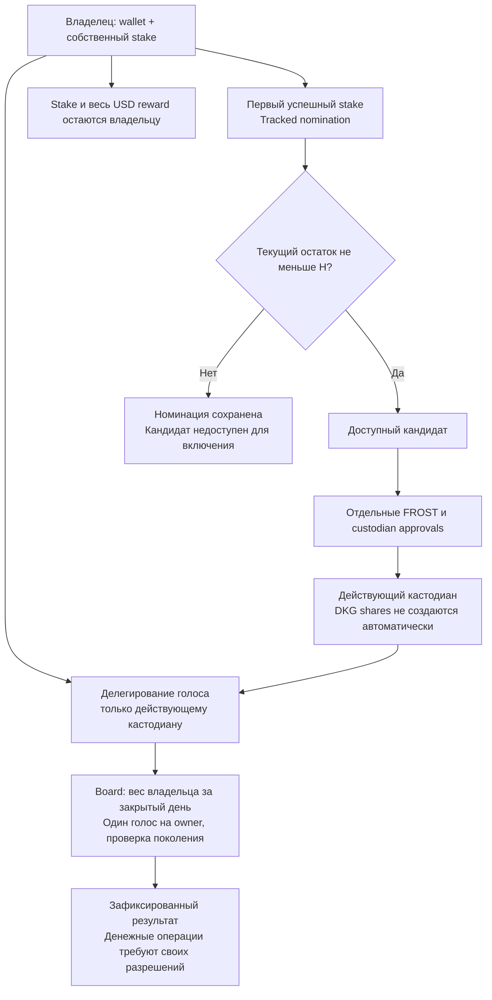

# Кандидаты в кастодианы и делегирование голосов ULR

[Схемы: SVG/PNG и hashes текущих Mermaid-исходников](DIAGRAMS.md).

[Математическое описание](LAUNCH_MATHEMATICS.md): единицы, точное округление,
границы выплат, UTC-учёт, APY и предпосылки безопасности.

В новой сборке пороги и экономические проценты задаются до enrollment через
[конфигуратор запуска](LAUNCH_CONFIGURATOR.md). Значения 200 000 / $1000 / 90%
ниже описывают прежние значения по умолчанию; фактические immutable параметры
читайте из согласованной политики и контрактов.

[Индекс](README.md) · [Стейкинг](ULR_STAKING.md) · [Казначейства](ULR_TREASURIES.md).

После уточнения требований стейкинг формирует **кандидатов**, а не автоматически
назначает действующих кастодианов. Порог кандидата — immutable `H` (default 200 000 ULR) суммарно на
кошельке и в собственном стейке. Владельцы могут делегировать голоса действующему
кастодиану, сохраняя весь свой пропорциональный reward и контроль над стейком.

## Кандидат и действующий кастодиан

При первом успешном `stake` адрес заносится в историю номинаций общего
`ULRStaking`. `isCustodianCandidate(owner)` проверяет текущие
`ULR.balanceOf(owner) + stakedBalance(owner)` и порог `H=CUSTODIAN_THRESHOLD`. Маленький стейк
тоже может зарегистрировать номинацию; в доступные кандидаты адрес попадёт только
при достижении общего порога. Само владение токенами без первого `stake` адрес
не номинирует. Выплаты вознаграждения в USD-токене в вес ULR не включаются.

Например, при default H=200 000: 150 000 ULR на кошельке плюс 50 000 в стейкинге дают кандидатуру.
При этом личный вес в голосовании стейкеров и доля reward считаются по 50 000
участвующих застейканных ULR, с обычными правилами полных суток UTC.

Переводы ULR на кошельке немедленно меняют результат проверки, даже без keeper
или повторного stake. При снижении ниже порога адрес исчезает из доступных
кандидатов, а уже подготовленное включение в состав не может выполниться до
восстановления порога. Unstake переводит ULR обратно на кошелёк, поэтому сам по
себе не уменьшает суммарное владение. При повторных stake номинации не дублируются.

`getCustodianCandidates(offset, limit)` просматривает не более 100 исторических
номинаций за вызов и возвращает подходящие адреса плюс `nextOffset`. Это курсор
просмотра, а не число найденных кандидатов: пустая страница не означает конец.
Конец — `nextOffset == candidateNomineeCount()`. Исторические номинации не дают
права подписи и не являются гарантированным полным inventory всех держателей ULR.

Конфедерация один раз связывает свой `CustodianValidator` с общим стейкингом
через `bindCandidateStaking`. Нужны точное FROST-одобрение и текущий custodian
threshold. Источник нельзя заменить повторным вызовом. После подключения:

- `getCustodians()` возвращает только действующий состав;
- `validator.getCustodianCandidates(offset, limit)` исключает из кандидатов
  уже действующих кастодианов этой конфедерации;
- `addCustodian` проверяет кандидата непосредственно перед включением и сохраняет
  оба одобрения: FROST плюс подписи действующих кастодианов;
- кандидат не может подписывать custodian approvals, пока его не включили;
- снижение баланса после включения не удаляет действующего кастодиана автоматически:
  для удаления остаётся отдельное одобренное `removeCustodian`.

Это уточнённая кандидатская модель. Она заменяет первоначальное предложение
ТЗ об автоматическом назначении любого держателя 200 000 ULR. Порог проверяется
по текущим остаткам; минимальный срок владения или блокировка ULR здесь не введены.
Включение всегда требует независимого решения существующих органов конфедерации.
Включение не меняет состав FROST DKG и не выдаёт новые приватные доли.

В экономическом снимке сохраняются все держатели от H, независимо
от принятия в состав. Для уже действующего кастодиана с меньшим остатком
используется фактическое положительное владение. SDK читает действующие roster
всех казн общего pin на том же историческом блоке и автоматически добавляет
таких участников в снимок. Один владелец учитывается в общем знаменателе один раз.
Эта политика не увеличивает голос или доход выбранного делегата: ULR остаются
капиталом владельца. Подробности и лимиты — в [казначейском runbook](ULR_TREASURIES.md).

## Делегирование голоса, стейк и reward

`setVotingDelegate(validator, custodian)` вызывается владельцем и действует
только для указанного validator/конфедерации. Другая конфедерация может иметь
другого представителя. Получатель должен быть действующим кастодианом, а его
validator — связан с этим общим ULR staking. Кандидату, ещё не включённому в
состав, делегировать нельзя. Нулевой адрес или собственный адрес отменяет выбор.

Кастодиан получает право голосовать за владельца в голосованиях стейкеров.
Он не получает ULR, не может вызвать чужой `unstake` или `claim`, менять чужое
делегирование либо направить reward на другой адрес. Начисления по-прежнему
учитываются в `dayReward`, `eligibleStake` и `claimedReward` владельца.
Комиссии за делегирование нет. Claim остаётся отдельным действием владельца.

Удалённый кастодиан немедленно перестаёт быть представителем: право голоса
возвращается владельцу. Повторное включение того же адреса не возрождает старый
выбор — проверяется поколение членства. Владелец может явно делегировать заново.

Один кастодиан может голосовать за нескольких владельцев. Каждый владелец
учитывается один раз в одном решении. Уже отданный голос нельзя повторить после
смены/отмены делегирования. Число custodian approvals от этого не растёт:
для FROST/custodian авторизации сохраняется одна подпись действующего кастодиана.
Чужие делегированные ULR не становятся его собственным капиталом и не увеличивают
его долю в казначейском snapshot.

## Голосования стейкеров

`ULRConfederationVoting` — неизменяемый адаптер общего стейкинга к существующему
`CustodianDAODecisionBoard`. Он закрепляет один validator и передаёт:

- вес владельца/общий вес за завершённые сутки из ULR staking;
- текущего допустимого представителя именно этой конфедерации.

Создание решения требует FROST конфедерации. Snapshot веса берётся за последние
завершённые сутки UTC; внесение новых ULR не увеличивает вес уже созданного решения.
Делегат выбирается на момент голоса. Владелец может отозвать выбор до голосования
и проголосовать сам. Сроки, quorum, выбор for/against/abstain и защита от повторов
сохраняют правила исходного decision board.

Результат такого решения записывается в board и сам не выполняет произвольные
операции с казной, составом кастодианов, конфигурацией или Bitcoin. Для этих
операций остаются их собственные FROST/custodian одобрения.

## Схема статусов и полномочий



Снижение ниже H выключает доступность кандидата, но не удаляет уже действующего
кастодиана. Его положительный фактический вес остаётся в экономическом snapshot.
Для board `participation × 10000 ≥ totalWeight × quorumBps` и `for > against`;
воздержавшиеся учитываются в quorum. Голос не выдаёт право на Bitcoin-подпись.

## Подключение и команды

Используются существующий [ULR pin](../config/ulr-treasury.example.json), canonical
treasury и собственные EOA/FROST journals. Приватные ключи и nonce journals не
переносятся в публичные intent-файлы.

Сначала подготовьте одобрение источника кандидатов:

```sh
frost-signer ulr-treasury candidate-bind-prepare --rpc "$RPC_URL" --config "$ULR_CONFIG" \
  --treasury "$TREASURY" --bundle "$CONF_BUNDLE" --intent /private/candidate-binding.json
```

Затем выполните обычный [propose → подписи → execute](ULR_TREASURIES.md).
Участники используют `dkg sign-evm --ulr-config FILE`. Кастодианы одобряют тот же
hash через `registerCustodianSignature`. Подключение увеличивает management nonce;
ранее подготовленные, но ещё не выполненные management intents нужно подготовить
заново. Выполненные исторические операции сохраняют свои receipts и поколения.

Список кандидатов и включение выбранного адреса:

```sh
frost-signer ulr-treasury candidates --rpc "$RPC_URL" --config "$ULR_CONFIG" \
  --treasury "$TREASURY" --offset 0 --limit 100
frost-signer ulr-treasury candidate-admit-prepare --rpc "$RPC_URL" --config "$ULR_CONFIG" \
  --treasury "$TREASURY" --candidate "$CANDIDATE" --bundle "$CONF_BUNDLE" \
  --intent /private/candidate-admission.json
# propose → FROST + custodian подписи → execute
```

`candidate-remove-prepare` аналогично готовит удаление действующего кастодиана.
CLI повторяет проверку кандидата перед приватным подписанием и различает
потреблённое разрешение и точный receipt выполненной операции.

Для board после подключения источника выполните симуляцию:

```sh
forge script --root web3 script/DeployULRVoting.s.sol:DeployULRVoting --rpc-url "$RPC_URL"
```

Нужны `EXPECTED_CHAIN_ID`, `PRIVATE_KEY`, `ULR_TREASURY`, `ULR_TREASURY_CODE_HASH`.
Скрипт проверяет enrollment казны и связь validator → staking; выводит адреса
адаптера и decision board. `--broadcast` публикует их после review. Это отдельное
расширение; старые DAO boards и их обязательства не заменяются автоматически.

Владелец делегирует голос и забирает reward своими отдельными транзакциями:

```sh
frost-signer ulr-treasury delegate --rpc "$RPC_URL" --config "$ULR_CONFIG" \
  --treasury "$TREASURY" --custodian "$WORKING_CUSTODIAN" \
  --identity-file "$OWNER_IDENTITY" --state /private/owner-eoa.sqlite --id delegate-1 --send
frost-signer ulr-treasury claim --rpc "$RPC_URL" --config "$ULR_CONFIG" \
  --days "$DAY" --identity-file "$OWNER_IDENTITY" \
  --state /private/owner-eoa.sqlite --id claim-1 --send
```

`undelegate` отменяет выбор. Для каждого нового действия нужен отдельный `--id`;
тот же ID используется только для повтора исходной транзакции. Это относится
и к повторному claim после поздней доплаты за те же сутки. Без `--send` и с
`--sender` операции симулируются. Claim не требует доступности validator,
активности конфедерации или публикации нового custodian snapshot.

Создание голосования:

```sh
frost-signer ulr-treasury voting-prepare --rpc "$RPC_URL" --config "$ULR_CONFIG" \
  --treasury "$TREASURY" --decision-board "$ULR_BOARD" --bundle "$CONF_BUNDLE" \
  --metadata-uri "$URI" --content-hash "$CONTENT_HASH" --duration 86400 \
  --quorum-bps 5000 --intent /private/decision.json
# propose → подписи → execute
```

Представитель отдаёт отдельный голос за каждого делегировавшего владельца:

```sh
frost-signer ulr-treasury vote --rpc "$RPC_URL" --config "$ULR_CONFIG" \
  --treasury "$TREASURY" --decision-board "$ULR_BOARD" --decision "$DECISION_ID" \
  --owner "$OWNER" --choice for --identity-file "$CUSTODIAN_IDENTITY" \
  --state /private/custodian-eoa.sqlite --id decision-1-owner-1 --send
```

## Совместимость и принятые решения ТЗ

Неподключённый `CustodianValidator` сохраняет прежний режим. Установленные
контракты не обновляются этим кодом: новые методы требуют нового проверенного
deployment; перенос старых обязательств и полномочий не реализуется подменой
адреса. [Профиль ULR bootstrap](ULR_BOOTSTRAP.md) разворачивает и связывает общий
ULR-граф для новых конфедераций; режим `reuse` подключает следующие конфедерации
к тем же ULR, USD, staking и snapshots.

Relay или ZK-SPV выбирается профилем при развёртывании. Выпуск MP сохраняет
проверку Bitcoin-доказательства контрактом и отдельное FROST-одобрение; права
кандидата или делегата эти проверки не обходят. Для Bitcoin-вывода по-прежнему
нужны исходные reserve/bind и групповая Bitcoin-подпись.

## Проверка изменений

Основной срез кандидатуры и делегирования прошёл **884 обычных Solidity-теста
в 68 suites**, без failures/skips. Environment-зависимые тесты запускались
по одному в отдельном процессе, остальные — по suite, в отдельном out/cache.
При полном прогоне отключалась dynamic test linking; compiler 0.8.30,
optimizer runs 1, via IR, Osaka и EVM-ограничения сохранены.

После последнего уточнения экономического фильтра проверены **51 ULR Solidity
test** и **395 focused Python tests**, без failures/errors/skips. Это отдельная
финальная регрессия изменённого snapshot; полный 884-test snapshot относится
к предшествующему экономическому фильтру. Его результаты не переименованы
в полный прогон финального состояния.

[Отчёт и source hashes](../ops/artifacts/ulr-candidates-v1/validation.json)
разделяют оба среза. Проверяются реальные локальные переводы reward, отдельность
principal, делегирование по конфедерациям, его отзыв/потеря после удаления,
защита от двойного голоса, кандидатский порог и admission, точные management
receipts, включение нижепорогового действующего кастодиана и полный локальный
treasury inventory. FROST finalization/crypto и часть внешних factory/RPC/provenance
границ в focused tests используют явно указанные fixtures.

Прямой запуск финального набора:

```sh
forge test --root web3 --match-path 'test/ULR*.t.sol' -vv
PYTHONPATH=signer-agent python -m pytest signer-agent/tests/test_ulr_treasury.py -q
python ops/generate_abis.py --check
```

Публичные транзакции, перенос живых обязательств и новый Core/Groth16 контур
для этого изменения не выполнялись.
