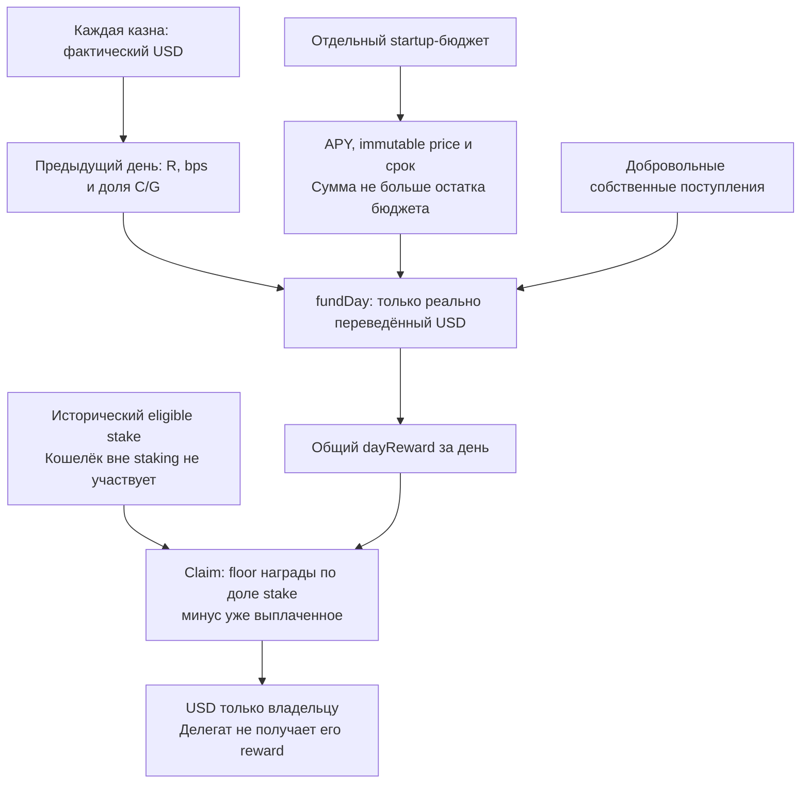

# Общий стейкинг ULR

[Схемы: SVG/PNG и hashes текущих Mermaid-исходников](DIAGRAMS.md).

[Математическое описание](LAUNCH_MATHEMATICS.md): единицы, точное округление,
границы выплат, UTC-учёт, APY и предпосылки безопасности.

[Индекс](README.md). Актуализация 5 ноября 2026. [Формулы и инварианты](LAUNCH_MATHEMATICS.md).

`ULRStaking` принимает один выбранный ULR и платит доход в одном неизменяемом
USD-стейблкоине. Один адрес контракта можно использовать для поступлений от всех
конфедераций в той же EVM-сети. Контракт не выпускает ULR; при развёртывании
передаётся адрес уже существующего токена. `CustodianDAOToken` поддерживает выпуск
ровно 10 000 000 единиц; name/symbol задаются до enrollment в конфигураторе. [ULR bootstrap](ULR_BOOTSTRAP.md)
создаёт весь граф единой процедурой; следующие конфедерации используют `reuse`.

Исходники: [контракт](../web3/contracts/src/staking/ULRStaking.sol),
[скрипт развёртывания](../web3/script/DeployULRStaking.s.sol),
[денежные проверки](../web3/test/ULRStaking.t.sol).

## Стейк и право на доход

[Кандидаты и делегирование](ULR_CANDIDATES_AND_VOTING.md): первый stake
регистрирует номинацию; общий остаток от `CUSTODIAN_THRESHOLD` даёт право быть кандидатом (по умолчанию 200 000 ULR).
Делегирование голоса действующему кастодиану сохраняет reward у владельца.

- На контракте ULR пользователь разрешает стейкингу перевод через `approve(staking, amount)`,
  затем вызывает `stake(amount)`. Минимальный взнос закреплён в `minimumStakeAmount`
  при развёртывании (по умолчанию 1 wei); срока блокировки нет.
- `unstake(amount)` возвращает ULR владельцу без ожидания расчёта дохода.
- Учёт ведётся по полным суткам UTC, `day = floor(timestamp / 86400)`.
  Пополнение после 00:00 начинает участвовать со следующих суток. Сохранено
  существующее исключение: внесение ровно в 00:00 участвует в текущих сутках.
- При выводе сначала исключается новый стейк, который ещё не участвует в этих
  сутках; затем уменьшается участвующий стейк. Повторное внесение не восстанавливает
  уже потерянное право за текущий день, включая операции ровно в 00:00.
- История завершённых суток сохраняется. Вывод ULR не отменяет право на доход
  за прошлые сутки, в том числе при позднем поступлении денег.

`stakedBalance(owner)` показывает текущий стейк, `totalStaked()` — общий.
`eligibleStake(owner, day)` и `totalEligibleStake(day)` показывают участвующие
остатки. Будущие сутки возвращают ноль; незавершённые сутки ещё могут измениться.
Стейкинг не назначает действующих кастодианов автоматически и не меняет FROST.
Для голосований стейкеров доступно отдельное делегирование по конфедерациям.

## Два источника дневных наград



Открытый `fundDay` допускает поздние доплаты, а казна и startup имеют свои
ограниченные дневные окна. Начисление startup не переносит упущенные дни.
APY не гарантирует доход при исчерпании бюджета; treasury не обещает ставку.

## Поступления от нескольких конфедераций

Плательщик делает `rewardToken.approve(staking, amount)` и вызывает
`fundDay(day, amount)` за завершённые сутки. Контракт списывает только токены
самого вызывающего, проверяет точное поступление и увеличивает `dayReward(day)`.
Допустимы несколько плательщиков, повторные поступления и поздние доплаты.
`sourceDayFunding(day, payer)` и событие `DayFunded` сохраняют фактический источник.

Поступления открыты: любой адрес может добровольно внести собственные средства.
Адрес плательщика не объявляется автоматически зарегистрированной конфедерацией.
Стейкинг не имеет администратора, произвольного изъятия средств, изменяемого
reward token или полномочий списывать чужую казну.

Если участвующий стейк за день равен нулю, `fundDay` отклоняется атомарно:
средства остаются у плательщика. Перенос такой суммы или иное использование
должны быть определены в казначейской политике. Нулевое поступление не требуется.
Обычный перевод ERC-20 прямо на адрес стейкинга не начисляет награды и не создаёт
стейк; нужно использовать соответствующую функцию. Функции возврата ошибочных
прямых переводов нет.

## Claim и поздние доплаты

Для завершённого дня:

```text
entitlement(owner, day) = floor(
    dayReward(day) × eligibleStake(owner, day) / dayEligibleTotal(day)
)
claimable(owner, day) = entitlement(owner, day) − claimedReward(owner, day)
```

`claim(days)` переводит доход только вызывающему владельцу. Список должен
содержать 1–32 завершённых дня, строго по возрастанию без повторов.
`claimableReward(owner, days)` считает доступную выплату для такого же списка.
Повторный claim без новых поступлений возвращает ноль. Claim до первого
поступления не закрывает право на будущую выплату.

Пример: у Алисы 100 участвующих ULR, у Боба 300. Первая конфедерация внесла $400:
Алиса получает $100. После поступления ещё $800 её совокупное право составляет
$300, поэтому следующий claim доплатит $200. Боб может получить свои $900 одним
вызовом. Порядок claim не меняет конечное распределение.

Расчёт использует единицы payout-токена и округление вниз; `Math.mulDiv`
избегает промежуточного переполнения произведения. Остатки округления остаются
в reward escrow. `rewardLiability()` равен `totalFundedRewards − totalClaimedRewards`
и включает эти остатки. Токены ULR учитываются отдельно от валюты выплат.
Проверка покрытия относится к неизменяемому токену наград в общем стейкинге.
Обновлённый `ULRStaking` после `fundDay` и положительного `claim` требует,
чтобы его фактический остаток этого токена покрывал `rewardLiability()`.
При дефиците откат сохраняет начисления и право на последующую выплату.
Восстановить покрытие можно прямым переводом недостающего стейблкоина,
такой перевод оставляет дневные начисления прежними. `unstake` возвращает
сам ULR из отдельного баланса и доступен при нехватке стейблкоина.
Это правило начинает действовать в сборке с обновлённым контрактом.
Для подтверждённых позиций на известной предыдущей сборке SDK сохраняет
`wallet`, `claim` и `unstake` после сверки кода и развёртывания.
Открытие нового стейка через SDK требует текущую сборку.
Оба актива должны иметь обычную балансовую модель без rebasing и комиссии за
перевод; входящие и исходящие переводы проверяются на точную сумму.

## Граница казначейской интеграции

Стейкинг распределяет **фактически перечисленный доход**.
[Казначейская интеграция](ULR_TREASURIES.md) реализована отдельными контрактами
`ULRCustodianSnapshots` и `ULRConfederationTreasury`. Казна хранит общий payout-
стейблкоин; BTC/MP сначала конвертируются в него вне дневного расчёта.

```text
payout(confederation, day) =
    floor(max(treasuryUsd − reserveFloor, 0) × payoutBps × custodianShare / 10000)
```

`custodianShare` — ULR кастодианов конфедерации / ULR всех кастодианов системы.
Вес владельца — кошелёк плюс собственный стейк на последнем EVM-блоке завершённых
суток. Общий снимок утверждается FROST; исторические балансы и составы клиент
пересчитывает до подписания. Полнота исходного inventory остаётся attestation.
Экономический снимок включает всех держателей от `H=CUSTODIAN_THRESHOLD` и
действующих кастодианов с любым положительным остатком. Порог кандидата `H`
закрепляется при запуске; по умолчанию это 200 000 целых governance-токенов. Авторизация `CustodianValidator` не меняется автоматически
этим экономическим расчётом.

Каждая конфедерация подключает одну каноническую казну с FROST и одобрениями
кастодианов. Выплата относится к предыдущим суткам UTC и выполняется один раз.
При нулевом участвующем стейке деньги остаются в казне; резерв, не выплаченная
по bps и доле часть тоже остаются там (defaults: $1000 и 90% выплаты). Пропущенные сутки не
пересчитываются многократно по текущему балансу. У стейкинга при этом сохраняются
независимые добровольные поступления и поздние доплаты.

Старый `CustodianDAODailySettlement` и его bootstrap остаются отдельной схемой.
Новый контракт не зарегистрирован в `ConfederationFactory.getCustodianDAO`:
та запись проверяет старые зависимости validator/controller/settlement.
Существующий DAO CLI не переключается на ULR автоматически. Новый
`frost-signer ulr-treasury` готовит общий снимок, подключение казны и переключение
fee router, публикует typed FROST intents, выполняет одобренные операции и дневную
выплату. Единый ULR bootstrap создаёт и подключает этот граф; отдельное подключение
совместимой казны выполняется workflow из runbook.

## Развёртывание на выбранной EVM-сети

Скрипт использует уже существующий ULR и не выпускает ещё 10 млн. До запуска
нужно закрепить канонические адреса ULR и общего payout-токена для всех
подключаемых конфедераций. Выбор USD-актива и его свойства проверяет оператор;
контракт не подтверждает привязку цены к доллару. Runtime hash прокси сам по
себе не закрепляет его реализацию и будущие изменения.

Обязательные переменные окружения:

```text
EXPECTED_CHAIN_ID
PRIVATE_KEY
ULR_TOKEN
ULR_TOKEN_CODE_HASH
ULR_REWARD_TOKEN
ULR_REWARD_TOKEN_CODE_HASH
```

Скрипт проверяет сеть, наличие разных контрактов, оба runtime hash, 18 decimals
и supply 10 000 000 для ULR, а также не более 18 decimals для reward token.
Из корня репозитория сначала выполняется симуляция:

```sh
forge script --root web3 script/DeployULRStaking.s.sol:DeployULRStaking \
  --rpc-url "$RPC_URL"
```

После review результатов добавление `--broadcast` публикует контракт.
Каждый новый broadcast создаёт новый стейкинг; после успешного развёртывания
сохраните его адрес и используйте его для всех источников. Автоматического
выбора сети, реестра канонического адреса, bridge между EVM-сетями или миграции
старого стейка нет. Публичное развёртывание в этом изменении не выполнялось.

## Проверка

```sh
forge test --root web3 --match-path test/ULRStaking.t.sol -vv
```

Набор проверяет несколько источников, позднее финансирование после claim/unstake,
UTC-границы, сохранение principal и обязательств, округление при разных порядках
claim, ошибки перевода, ограничения batch и параметры deploy-скрипта.
Локальный запуск 2 ноября: **21 passed, 0 failed, 0 skipped**; включённый fuzz-тест
выполнил 256 прогонов. Использованы сохранённые `forge`/`solc` из
`ops/.local-tools/acceptance-20261102`, compiler 0.8.30 и настройки `web3/foundry.toml`.
Runtime `ULRStaking` — 6054 bytes, initcode с двумя адресами — 6525 bytes;
проверка размеров всех 130 скомпилированных project contracts прошла.
Эти числа относятся к первоначальному стейкингу. Дополнительная приёмка
казначейских контрактов и SDK описана в [runbook](ULR_TREASURIES.md).
Публичное подключение реальных казначейств ещё не выполнялось.


Параметры новой сборки и дополнительная prefunded-программа стартового APY
описаны в [конфигураторе](LAUNCH_CONFIGURATOR.md). Доход казны и стартовые выплаты
складываются в обычном claim. Старые развёртывания не перенастраиваются.
