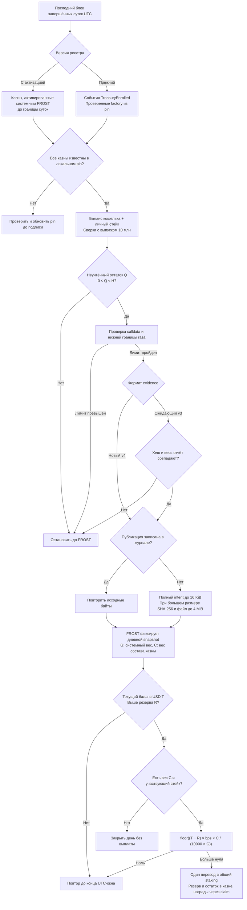

# Казначейства конфедераций и дневной доход ULR

[Схемы: SVG/PNG и hashes текущих Mermaid-исходников](DIAGRAMS.md).

[Математическое описание](LAUNCH_MATHEMATICS.md): единицы, точное округление,
границы выплат, UTC-учёт, APY и предпосылки безопасности.

В новой сборке пороги и экономические проценты задаются до enrollment через
[конфигуратор запуска](LAUNCH_CONFIGURATOR.md). Значения 200 000 / $1000 / 90%
ниже описывают прежние значения по умолчанию; фактические immutable параметры
читайте из согласованной политики и контрактов.

[Индекс](README.md) · [Стейкинг](ULR_STAKING.md) · [Комиссии](FEE_FLOW.md).
Реализация: 2 ноября 2026. Публичное развёртывание и перевод средств не выполнялись.

[Единый ULR bootstrap](ULR_BOOTSTRAP.md) создаёт новый граф с выпуском 10 млн,
общим стейкингом, казной, кандидатами и делегированием. Ниже также сохранён
порядок отдельного подключения уже проверенных контрактов и ежедневной работы.

Этот порядок относится к общему стейкингу и USD-казначействам ULR policy V1/V2.
В policy V3 стейкинг и выплаты ведёт отдельный DAO конфедерации.
[Экономика V3](CONFEDERATION_DAO_IN_KIND.md).

## Принятая политика

Казна — фактический свободный баланс одного USD-стейблкоина на контракте
`ULRConfederationTreasury`. Это тот же payout-токен, что у общего `ULRStaking`.
BTC, MP, ETH, обеспечение обёрток, gas treasury и уже начисленные пользователям
награды в этот баланс не включаются. Доход в другом активе сначала реализуется
и переводится в этот стейблкоин.

Для предыдущих завершённых суток UTC контракт считает:

```text
R = reserveFloor (USD base units; default 1000 × 10^rewardTokenDecimals)
b = payoutBps (default 9000)
T = rewardToken.balanceOf(treasury) в момент выплаты
C = сумма весов действующих кастодианов конфедерации в дневном снимке
G = сумма весов всех владельцев, включённых в системный дневной снимок

paid = floor((T − R) × C × b / (G × 10000)), если T > R, C > 0, G > 0
paid = 0, если эти условия не выполнены или нет участвующего стейка за день
```

Округление выполняется один раз, в минимальных единицах payout-токена.
После выплаты в казне остаются резерв R, доля превышения вне bps и часть,
не распределённая из-за доли конфедерации. Отдельного получателя этих остатков нет.
Остаток участвует в следующем дневном расчёте; это распределение баланса сверх
порога, а не только новых поступлений за день.

Пример для defaults R=$1000, b=9000: казна $11 000; кастодианы конфедерации владеют 600 000 ULR из системного
1 000 000. Выплата: $10 000 × 90% × 60% = $5 400; в казне останется $5 600.
При неизменной доле и без новых поступлений следующая выплата — $2 484.

## Границы расчёта и авторизации



`0 ≤ C ≤ G` обеспечивает выплату не больше превышения над резервом.
Подписанты проверяют полноту экономического состава через остаток выпуска и
исторические roster. Контракт принимает FROST-attestation этих наблюдений.
Пересечение roster нескольких
конфедераций допустимо: сумма их долей не обязана быть единицей.
Резерв ограничивает этот payout, а не любой отдельно одобренный operational spend.
Дополнительный APY из другой программы не входит в свободный баланс казны.

## Общий снимок ULR

`ULRCustodianSnapshots` закрепляет один неизменяемый снимок за сутки для всех
подключённых конфедераций. Источник снимка — последний канонический EVM-блок
перед следующими 00:00 UTC. Клиент проверяет timestamp этого и следующего блока,
а также их каноничность; текущие/latest балансы не заменяют исторические.

Вес владельца:

```text
ULR.balanceOf(owner, snapshotBlock)
  + ULRStaking.stakedBalance(owner, snapshotBlock)
```

В экономический снимок входят все владельцы с весом не менее `H` (default 200 000 ULR),
включая кандидатов и держателей, ещё не включённых в действующий состав.
Дополнительно учитываются действующие кастодианы с любым положительным остатком,
даже ниже порога. Стейкинг
как держатель всех пользовательских токенов исключён из списка. Собственный
стейк засчитывается владельцу один раз. Суммарный вес не превышает общий выпуск
10 млн ULR. Снимок поддерживает до 4096 владельцев; число положительных строк
не выводится из деления выпуска на порог H. Действующие кастодианы ниже порога
не исключаются ради лимита 50. Превышение технической границы 4096 отклоняется
без усечения участников или изменения знаменателя.
Это не изменяет существующие права и списки `CustodianValidator`.

Для каждой действующей на срезе конфедерации клиент читает `getCustodians()`
на этом историческом блоке.
Состав казн определяется на UTC-срезе. В обновлённом реестре это все казны,
активированные системным FROST к концу дня. `publishDay` сверяет размер списка
и проверяет активность каждого уникального scope на эти сутки. Активация после
полуночи попадёт в снимок новых суток. Локальный pin подтверждает доверие к
найденным привязкам. Если ему неизвестна активная казна, SDK выдаёт
`ULR_TREASURY_PIN_BEHIND` до подписи. При деактивации конфедерации её scope
остаётся в составе реестра и входит в лимит 64 активаций. Если
конфедерация уже деактивирована на срезе, её вес в отчёте равен нулю.
Остальные казны могут завершить расчёт. Собственный `payDay` деактивированной
конфедерации отклоняется, если выплата за день ещё не зафиксирована.

Для прежнего неизменяемого реестра SDK восстанавливает состав по каноническим
`TreasuryEnrolled` от блока создания до блока снимка. В расчёт попадают
записи проверенных factory из согласованного pin. Архивный RPC должен
предоставлять полную историю логов. `snapshot-roster` показывает
`missing_from_pin` для выявленных, но ещё не закреплённых казн. На прежнем
реестре factory без проверенной казны в pin отсутствует и в этом списке.
Системный кворум заранее сверяет доверенный manifest новой factory и добавляет
её казну в общий pin. Действующие участники
добавляются в inventory автоматически по этим roster, даже если их нет в
исходном списке держателей. Для нижепорогового положительного веса контракт
требует включение владельца хотя бы в один подписанный список индексов действующего состава.
Нулевой остаток даёт нулевой вес. Это проверка структуры FROST-attestation;
историческую принадлежность по-прежнему независимо проверяет SDK.
Из общего списка формируются отсортированные индексы её кастодианов. В ABI это
`bytes custodianIndices`: каждый индекс занимает два байта uint16 big endian,
например индексы 0 и 300 кодируются как `0x0000012c`. Нечётная длина, дубликаты,
обратный порядок и индексы вне списка владельцев отклоняются. Контракт сам суммирует
веса по индексам; все конфедерации получают один общий знаменатель. Один
кастодиан может входить в несколько конфедераций: его вес учитывается в каждой
из соответствующих независимых казн, а в системном знаменателе — один раз.

В snapshot входят block number/hash, hash точного evidence-файла, отсортированные
владельцы/веса и отсортированные scope/custodianIndices/rosterHash конфедераций. Всё это
связано target-bound FROST hash и nonce. После публикации снимок нельзя заменить.

SDK ограничивает переданный inventory и его объединение с действующими
кастодианами 4096 адресами. Отчёт включает до 64 казн. Оба предела применяются
к одному отчёту. Вхождения владельца в несколько конфедераций увеличивают
calldata. SDK отклоняет intent до FROST, если нижняя граница
`21_000 + 10 × (zeroBytes + 4 × nonzeroBytes)` достигает меньшего из
`16_777_216` и `block.gasLimit`. Это проверка calldata. Для крупного состава
измерьте полный gas исполнения на целевой тестовой сети. SDK evidence
использует версию 4. Ожидающий снимок с evidence v3 можно довести до публикации,
если историческая сверка выпуска прошла и SDK воспроизвёл весь исходный отчёт
с прежним SHA-256. Уже опубликованный снимок сверяется с неизменяемым
commitment в контракте. [EIP-7623](https://eips.ethereum.org/EIPS/eip-7623) ·
[EIP-7825](https://eips.ethereum.org/EIPS/eip-7825).

SDK распознаёт предыдущий реестр без `activateTreasury` с форматом
`custodianIndices` по закреплённому runtime и проверяет его создание.
Для такого реестра действует восстановление состава по логам. Переход с
ещё более старой uint64-маски требует нового `ULRCustodianSnapshots`
и обновлённого ABI. Опубликованные снимки и привязки существующих казн
сохраняются в своих контрактах.

Подписанты сверяют исторические балансы с фиксированным выпуском канонического
токена. Из выпуска исключаются токены на адресе самого токена и излишек на
адресе стейкинга сверх `totalStaked`. Из остатка вычитается сумма проверенных
кошельков и личных стейков. Неразобранный остаток должен быть от нуля до
`CUSTODIAN_THRESHOLD` строго снизу. Тогда вес любого пропущенного держателя
меньше порога. Действующие кастодианы автоматически добавляются из закреплённых
валидаторов. Участники подписывают общий результат FROST. Историческую
каноничность проверяют через архивный RPC.
Недоступный архивный state блокирует подготовку и подпись; fallback на latest нет.
Снимок не устанавливает срок владения ULR и не исключает заём вокруг границы суток.

## Подключение одной казны на конфедерацию

Scope определяется как `keccak256(abi.encode(chainId, factory, confederationId))`.
Общий registry хранит одну казну для scope. `enrollTreasury` требует FROST
конфедерации и её текущий custodian threshold. Проверяются активная конфедерация,
общий staking и обратные factory/id/registry bindings. Само развёртывание ещё не
включает выплаты. Подмена казны или migration существующих обязательств этой
функцией не допускается.

Снимки публикует выбранная общая `ULR_SNAPSHOT_AUTHORIZATION`, привязанная к
существующему завершённому EVM DKG. Её адрес и общий registry должны быть отдельно
проверены всеми подключаемыми конфедерациями. Общая authority не получает
полномочий произвольно списывать их казны. Операционный `spend` доступен только
по точному FROST + custodian одобрению своей конфедерации, с nonce и deadline.
Порог R (default $1000) ограничивает дивиденды; утверждённые операционные расходы могут
снизить остаток ниже него, после чего дивидендов нет до пополнения.

## Развёртывание

Сначала развёртывается/выбирается один [ULRStaking](ULR_STAKING.md). Затем один
общий registry и отдельная казна каждой конфедерации. Скрипты проверяют chain ID,
явные runtime hashes и привязку к общему staking. Из корня репозитория:

```sh
forge script --root web3 script/DeployULRTreasury.s.sol:DeployULRCustodianSnapshots \
  --rpc-url "$RPC_URL"
forge script --root web3 script/DeployULRTreasury.s.sol:DeployULRTreasury \
  --rpc-url "$RPC_URL"
```

Для registry нужны `EXPECTED_CHAIN_ID`, `PRIVATE_KEY`, `ULR_STAKING`,
`ULR_STAKING_CODE_HASH`, `ULR_SNAPSHOT_AUTHORIZATION`,
`ULR_SNAPSHOT_AUTHORIZATION_CODE_HASH`. Для казны — `EXPECTED_CHAIN_ID`,
`PRIVATE_KEY`, `CONFEDERATION_FACTORY`, `CONFEDERATION_FACTORY_CODE_HASH`,
`CONFEDERATION_ID`, `ULR_STAKING`, `ULR_SNAPSHOTS`, `ULR_SNAPSHOTS_CODE_HASH`.
После review симуляции добавляется `--broadcast`. Повторный broadcast создаёт
новый контракт, поэтому сохраните полученные адреса до продолжения.

Заполните [локальный pin](../config/ulr-treasury.example.json) реальными адресами.
Mainnet требует не менее 12 EVM-подтверждений и finalized RPC. Исходные EOA
journals, budgets и FROST nonce/spent journals остаются прежними; сбрасывать их
для подключения казны нельзя. Payout-токен должен иметь обычную балансовую
модель и не более 18 decimals; привязка его цены к USD остаётся внешним условием.

## Одобрение и переключение комиссий

```sh
frost-signer ulr-treasury enroll-prepare --rpc "$RPC_URL" --config "$ULR_CONFIG" \
  --treasury "$TREASURY" --bundle "$CONF_BUNDLE" --intent /private/enroll.json
```

Для каждого подготовленного intent участник с `canPublishIntent` публикует
enforced session и exact typed intent. В custody-профиле это может быть
кастодиан, без исходного представителя; старый board требует своего оператора:

```sh
frost-signer ulr-treasury propose --rpc "$RPC_URL" --config "$ULR_CONFIG" \
  --bundle "$CONF_BUNDLE" --intent /private/enroll.json --deadline "$DEADLINE" \
  --identity-file "$OPERATOR_IDENTITY" --state /private/ulr-eoa.sqlite --send
```

Участники подписывают обычной `dkg sign-evm`, добавив `--ulr-config "$ULR_CONFIG"`
к своим существующим board/bundle/identity/state/password/session параметрам.
Приватные signing-пакеты не передаются новому CLI. Рецензент самостоятельно
проверяет pinned constructors, исходный DKG, точные параметры и исторические
веса; проверки повторяются до новой приватной работы и экспорта cached packets.
Для enrollment и операционного spend кастодианы регистрируют одобрения того же
hash через существующий `registerCustodianSignature`.

После завершения session:

```sh
frost-signer ulr-treasury execute --rpc "$RPC_URL" --config "$ULR_CONFIG" \
  --bundle "$CONF_BUNDLE" --intent /private/enroll.json --session "$SESSION" \
  --identity-file "$OPERATOR_IDENTITY" --state /private/ulr-eoa.sqlite --send
```

EOA-транзакции используют существующий durable executor. Повтор команды продолжает
те же transaction bytes/receipts; потреблённое одобрение сверяется с результатом.
`--send` отсутствует по умолчанию. При ещё не переданном на target разрешении
симуляция возвращает `AUTHORIZATION_REQUIRED`, не объявляя неподписанный маршрут
успешно выполненным.

Существующий `PoolFeePipeline` сохраняет claim MP → funded conversion → fee router.
Для новой схемы именно **пользовательский confederation fee router** подключается
к новой казне, а его прежние `wrapStakerBps` и `deployStakerBps` выставляются в ноль.
Тогда весь реализованный доход попадает в казну, без старого LP/DAO split:

```sh
frost-signer ulr-treasury router-prepare --rpc "$RPC_URL" --config "$ULR_CONFIG" \
  --treasury "$TREASURY" --router "$DAO_FEE_ROUTER" --router-action shares \
  --bundle "$CONF_BUNDLE" --intent /private/router-shares.json
# propose → подписи → execute для router-shares.json

frost-signer ulr-treasury router-prepare --rpc "$RPC_URL" --config "$ULR_CONFIG" \
  --treasury "$TREASURY" --router "$DAO_FEE_ROUTER" --router-action treasury \
  --bundle "$CONF_BUNDLE" --intent /private/router-treasury.json
# propose → подписи → execute для router-treasury.json
```

Эти операции выполняются последовательно: каждая меняет nonce router.
Подготовка redirect допускается после подтверждённого нулевого split.
SDK проверяет связь router с каноническим DAO income vault этой конфедерации,
FROST authority и общим reward token. Отдельный project deployment-fee router
не переключается этим workflow. Ранее начисленные LP/staker claims и суммы в
старом income vault не переносятся и не освобождаются автоматически; их нужно
закрыть по исходной модели. Старые средства EOA-казны владелец переводит отдельно.

Прямой перевод payout-токена в **казну** считается свободным балансом; можно
также использовать `deposit(amount)` с approve. Прямой перевод в **стейкинг**
не начисляет награды: казна вызывает для этого `fundDay`.

## Ежедневный запуск

После регистрации казны в новом реестре подготовьте её однократную активацию
с bundle действующей системной EVM_AUTH-группы.

```sh
frost-signer ulr-treasury activate-prepare --rpc "$RPC_URL" --config "$ULR_CONFIG" \
  --treasury "$TREASURY" --bundle "$SYSTEM_BUNDLE" --intent /private/activate-treasury.json
```

Опубликуйте этот intent через `ulr-treasury propose`, соберите подписи **системного**
FROST и исполните через `ulr-treasury execute`. Казна может участвовать в
отчётах начиная с UTC-дня активации. Для предыдущих суток используйте
исторический состав. Для прежнего реестра с `custodianIndices` применяется
`snapshot-roster` по событиям регистрации.

Перед подготовкой снимка получите список казн с того же блока, на котором
будут считаться балансы. Проверьте `missing_from_pin`, закрепите выявленные
адреса по проверенным manifest и повторите запрос. Внесите выведенный список
`treasuries` в файл inputs.

```sh
frost-signer ulr-treasury snapshot-roster --rpc "$RPC_URL" --config "$ULR_CONFIG" \
  --snapshot-day "$DAY" --snapshot-block "$BLOCK"
```

Подготовьте [snapshot inputs](../config/ulr-snapshot-inputs.example.json). Нужны
номер завершённых суток, их последний EVM-блок, holder inventory для сверки
остатка выпуска и исторический список казн из `snapshot-roster`. В общем pin
должны быть все адреса из этого списка.

```sh
frost-signer ulr-treasury snapshot-prepare --rpc "$RPC_URL" --config "$ULR_CONFIG" \
  --inputs /private/snapshot-inputs.json --bundle "$SYSTEM_BUNDLE" \
  --evidence /private/snapshot-evidence.json --intent /private/snapshot-intent.json
# propose → подписи SYSTEM_BUNDLE → execute для snapshot-intent.json

frost-signer ulr-treasury status --rpc "$RPC_URL" --config "$ULR_CONFIG" --treasury "$TREASURY"
frost-signer ulr-treasury pay --rpc "$RPC_URL" --config "$ULR_CONFIG" \
  --treasury "$TREASURY" --identity-file "$KEEPER_IDENTITY" \
  --state /private/ulr-keeper.sqlite --send
```

Новый снимок публикуется целиком, если канонический JSON с номером сессии
занимает не более 16 KiB. При большем размере `propose` выводит
`snapshot_intent_sha256`. Передайте участникам тот же публичный
`snapshot-intent.json` размером до 4 MiB. При каждом `frost-signer dkg sign-evm` укажите
`--ulr-intent /absolute/path/snapshot-intent.json` вместе с `--ulr-config`.
Board хранит SHA-256 полного intent с номером сессии. Подписант подставляет
номер выбранной сессии, сверяет хеш и самостоятельно пересчитывает веса на
архивном RPC. Повтор уже записанной публикации использует исходные байты
из журнала. Для ранее опубликованного полного intent отдельный файл не нужен.

Публикация общего снимка требует системной FROST session. После этого `payDay`
может вызвать любой оплачивающий gas caller: сумма и получатель заданы контрактом,
новое произвольное финансовое одобрение для фиксированной дневной формулы не нужно.
`pay` без `--send` требует `--sender` и только симулирует.

Команду `pay` можно запускать внешним scheduler повторно для каждой казны после
публикации снимка. Контракт переводит деньги только один раз за день; новые
поступления после этого остаются до следующих суток. При отсутствии snapshot
вызов отклоняется. Если свободный баланс не выше резерва или расчёт округлился
до нуля, `payDay` возвращает ноль и оставляет день открытым для повторной
проверки после пополнения. Нулевой вес или отсутствие eligible stake можно
зафиксировать как окончательный нулевой расчёт. CLI показывает
`AWAITING_TREASURY_BALANCE` при нуле, зависящем от баланса.

CLI ожидает одинаковый UTC-день подтверждённого и latest состояния возле
полуночи. Повтор незавершённой транзакции использует исходный EOA journal.
Если из-за изменения баланса транзакция завершилась нулём и день открыт,
CLI подтверждает канонический receipt перед выделением следующего ID.

Повтор расчёта после `BelowReserve` и `RoundedToZero` работает в байткоде
казны, который оставляет день открытым. Для поддерживаемых ранее развёрнутых
версий SDK использует закреплённые runtime и initcode из поставки и проверяет
происхождение. При обновлении SDK правила выплаты определяет байткод
развёрнутой казны.

Пропущенные сутки не являются долгом: новая выплата разрешена только за вчера.
Старый общий snapshot не позволяет многократно распределять один текущий баланс.
Повтор уже выполненного `payDay` возвращает исторический receipt без перевода,
даже после смены дня. При низком балансе или пропуске средства не теряются и
участвуют в следующем допустимом расчёте. Для стейкера сохраняются обычный claim
и поздние поступления от других казн за тот же день.

Для операционного расхода используйте `spend-prepare --treasury ... --recipient ...
--amount BASE_UNITS --deadline ...` и тот же propose/approve/execute workflow.
Передавать произвольную сумму напрямую в staking через spend запрещено.

## Проверки и границы

Первоначальная локальная проверка казначейского маршрута: **36 Solidity tests, 386 focused Python tests,
0 failures/errors/skips**. Два fuzz-теста выполнили по 256 прогонов. Все 132
скомпилированных project contracts проходят size gate; ABI drift, форматирование
новых Solidity-файлов и whitespace-проверка прошли.
[Отчёт с source hashes](../ops/artifacts/ulr-treasury-20261102/validation.json),
[Solidity log](../ops/artifacts/ulr-treasury-20261102/solidity.log),
[Python XML](../ops/artifacts/ulr-treasury-20261102/python.xml).

Focused Python-набор включает новый snapshot/CLI policy и регрессии signing
service, DAO CLI, Ethereum signing binding/mainnet policy, operation receipts,
gas governance и constructor provenance. Это отдельная проверка данной дельты,
не новый полный запуск всего репозитория.

Эти результаты относятся к snapshot до добавления кандидатуры и делегирования.
Текущее уточнение экономического фильтра и его приёмка описаны в
[кандидатском workflow](ULR_CANDIDATES_AND_VOTING.md).

```sh
forge test --root web3 --threads 1 --match-path 'test/ULR*.t.sol' -vv
PYTHONPATH=signer-agent python -m pytest signer-agent/tests/test_ulr_treasury.py -q
python ops/generate_abis.py --check
```

Solidity проверяет реальные токенные переводы двух казн, распределение/claim,
повтор, UTC-границы, отсутствие стейкеров, reserve, atomic rollback, двойную
авторизацию enrollment/spend и переключение существующего fee router.
В этих проверках finalization/crypto FROST и confederation factory используют
явные fixtures; `FROSTAuthorization` consumption и `CustodianValidator` — настоящие.
Python отдельно проверяет исторические wallet+stake observations, packed indices,
подмену весов, nonce race, immutable receipt и guards до private signing;
RPC/provenance в focused SDK tests являются fixtures.

Обычный bootstrap не меняет уже утверждённую экономическую политику приглашений.
Новый маршрут подключается явно описанными операциями. Production audit,
полный holder inventory, архивный RPC, выбранная общая snapshot authority,
keeper operation и реальные market conversions остаются условиями запуска.
Новый Core/FROST/Groth16/денежный контур и публичный deployment не запускались.
