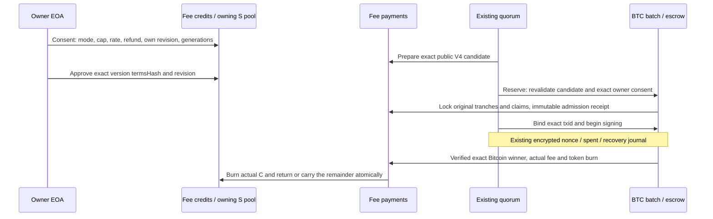

# Personal BTC / MP / S withdrawal fees

[Схемы: SVG/PNG и hashes текущих Mermaid-исходников](DIAGRAMS.md).

Status: **CODE_IMPLEMENTED_QUALIFICATION_PENDING; Ready=false**. The mainnet
guest is unchanged. The actual deposit and WITHDRAWAL_FEE derivation candidates
remain unqualified. Local crypto, SQLite, Solidity and gas checks do not qualify
a live Core/FROST/ZK/consumer contour or replace an independent review.

The [contour withdrawal/reconciliation adapters](ZKSPV_CONTOUR.md#reviewed-withdrawal-version-and-reconciliation)
resume one already prepared V4 version using the original owner/operator
journals. `build-payment` now exports its canonical `terms_hash` alongside the
candidate and typed request, so the owner can explicitly accept that exact
version before the runner resumes it. This output does not grant consent.
The later independent on-chain quote must recompute the same hash. BTC_SPEND
and fee EVM_AUTH bundles remain distinct; expired windows, new versions and
separate BTC refunds require explicit review.

## Money and consent

Principal P is fixed by the canonical withdrawal; **1 sat = 10^10 MP units**.
Fees never reduce P. A budget belongs to the request's authenticated EVM owner;
a Bitcoin recipient, allowance, transaction presenter or quorum is not consent.

| Mode | Lock at owner consent, cap B sats | Actual cost C sats | Return |
| --- | --- | --- | --- |
| BTC | External purpose-specific BTC credits, immutable request/owner/refund script | Debit selected named claims by C | External inline refund or named carry; separate refund may follow |
| MP | B × 10^10 underlying MP | Burn C × 10^10 MP | Return (B−C) × 10^10 MP to owner |
| S | B × 10^10 S and corresponding per-MP claim in a genuine admitted SimpleMultiPool | Burn C × 10^10 S and underlying MP | Restore original per-MP claim and return the same S |

S fee-only consent is voluntary and fee-neutral. The owning pool atomically
tracks pending shares, escrowed MP, userPoolBalances and totalDeposited. Its
ordinary principal fee, NFT discount, rounding and callback are preserved.
CS keeps its ordinary withdrawal path; it is not an S fee source.

For an MP total, reserve B×10^10 first; P=floor((total−B×10^10)/10^10).
For an S total, reserve the S fee tranche first and apply the existing ordinary
fee/NFT/rounding calculation to the remaining main tranche. Sub-satoshi rounding
is shown separately. The principal minimum still applies. `preview` reads the
actual configured fee manager. It does not create a withdrawal or change its P.

The owner explicitly approves **each exact version's termsHash**, after budget
consent and quorum preparation. This profile chooses direct per-version C_i
consent, rather than an opaque coordinator allocator. The commitment covers the
whole candidate, charges, selected credit debits/refunds/carry locations, treasury
grant, raw transaction, plan hash, generations and deadline. This adds an owner
transaction for each replacement. No automatic source switching or mixed source
fallback occurs: cancel an unsigned request, restore its assets and prepare a new
canonical withdrawal to change modes.

## Preparation, admission and signing

`WithdrawalFeeCredits` is installed once on escrow, after reserve binding and
before the first BTC batch. `WithdrawalFeePayments` and `WithdrawalFeeFunding`
are immutable graph components. The public plan is V4 with BASE / DERIVED /
WITHDRAWAL_FEE descriptors, all in the existing wallet and nonce namespace.



Current revisions/generations/windows are checked at admission and before fresh
or cached private exports. An unprivileged budget update changes only that
budget's revision. It cannot advance quorum nonces or revoke another request.
After admission, later free-budget revisions do not revoke the locked snapshot.
A previously signed old winner settles without new owner consent or today's
issuance fence, while canonical inclusion, Fresh, exact txid, request set and
burn remain mandatory. All callbacks and accounting revert together on failure.
Signing families never unlock on timeout. Only cancellation of a Reserved,
unsigned original family permits token return / reserve collateral release.

RBF preserves all inputs, principal and obligations, with at most 16 versions.
Each replacement needs exact owner consent. The confirmed winner's C is charged
once; every other version is excluded. The existing `btc-propose/execute` path
now selects reserveReplacement / bindReplacement for a V4 predecessor.

## BTC ingress, carry and refunds

The separate 504-byte WITHDRAWAL_FEE intent commits the normal wallet context
plus request, fixed external refund-script hash and fee-ledger scope, under a
separate purpose/binding domain. The native pinned FROST/rust-bitcoin tweak
implementation is reused. **FEE_QUALIFIED=false** is independent of deposit
qualification; arithmetic alone must never produce an offered Ready address.

A funding address is registered for a real Pending/Bound BTC-budget request.
An exchange or third party may pay it: no donor signature or ownership of inputs
is required, and the presenter never acquires the credit. Every input is first
classified using authenticated nominal prevout values and scripts. Known custody
families and internal custody inputs are rejected even before EVM recordSpend.
The external parser retains the canonical 100 kB stripped envelope and supports
more than 256 inputs/outputs. Classification advances at most 16 inputs per call;
unknown context remains protected, never free reserve or mintable MP.

Issuance requires exact canonical inclusion, ordinary depth max(6, policy depth),
and **101 for coinbase spendability**. Core gettxout includes mempool spends.
The shared value ledger computes F=sum(all nominal inputs)−sum(all outputs);
neither backingSats alone nor an RPC fee estimate substitutes for it. Selected
inputs must be fully classified as principal + treasury free + named BTC claims.
Protocol fee/vbytes/output minimums and rejection of unrelated consolidation
apply independently of owner consent. The allocation conserves F=sum(C_i)+T.
Miner rebate or collusion cannot be excluded by this equation alone.

```mermaid
flowchart LR
  E[External exchange or sender] --> A[Registered WITHDRAWAL_FEE script]
  A --> W[Durable purpose watch and bounded Core scan]
  W --> I[All-input ingress classification]
  I --> V[Canonical SPV and maturity]
  V --> C[Named owner and request claim]
  C --> P[Selected version debit C]
  P --> R[External immutable refund script]
  P --> N[Base change: principal + named carry + treasury free]
  N --> F[Separate owner refund obligation]
  F --> R
```



Claims keep stable IDs while locations move to base change. Rights remain named
and cannot become treasury donations or MP mint inputs. Late credits are separate
from the fixed selected set and survive both a signed winner and budget closure.
Settlement never scans those late credits or owner history. A separate refund
uses the original immutable external script and its own exact version consent.
Refund fee caps are cumulative (spent + committed); only the owner can raise the
original cap. Cancelling an unsigned refund closes its typed escrow obligation
and returns the committed cap. Dust remains an owner's named claim; it is not
silently burned or assigned to treasury. Historical exact credit recovery is
checked before current qualification or UTXO lookup, preventing double issuance.

Fee watch backup/restore retains descriptors and all observations; it never
resets the identity transaction lane, BTC spent journal, generation high-water
marks or a financial recovery pause. Reconciliation includes fee watches,
named BTC, MP/S locks and complete principal/supply checks. Auxiliary token-lock
statistics do not change the privileged reserve evidence hash.

## SDK / CLI and SPV service

Use `frost-signer bitcoin withdrawal-fee --help` and the private
`config/withdrawal-fee.example.json` V2 template. The identity is the actual
actor: owner for owner consent; board-permitted publisher for quorum proposal.
The latter may be the original operator or a bootstrap-delegated custodian.
The session creator is checked against the same confirmed board permission,
while quorum, owner consent, typed terms and qualification checks remain separate.

- `owner --method consent --file args.json`: direct BTC/MP budget consent. MP approves only the exact additional underlying units.
- `owner --method consentFee`: genuine owning SimpleMultiPool S entry. No independent CS fee route.
- `owner --method approveVersion`: `[batch,request,revision,termsHash]` for the exact prepared version.
- `quote --batch ... --request ...`: independently recomputes the whole terms commitment and shows fixed P, actual F, own C, treasury T, current budget revision/cap and same-asset return if this version wins. Owner approval rejects a substituted commitment or stale unadmitted candidate before sending.
- `owner --method refundTokens / createRefund / raiseRefundCap / cancelRefund`: exact ABI arguments in a PUBLIC JSON array.
- `funding-intent`: deterministic fee intent for an existing BTC budget and explicit service-policy hash.
- `prepare --method register`, `propose`, `execute`: existing enrolled DKG board / EVM_AUTH. Participants independently review native purpose and exact graph before private work.
- `import-watch`, `scan`, `address`, `credit`, `backup`: durable purpose-specific watch and bounded resumable credit admission. Scan starts at genesis, with retained reorg evidence.
- `build`: PUBLIC `{plan,withdrawal_fee}` template; resolves canonical input descriptors/generations and returns the V4 plan plus typed prepare request. Explicit charges / credits remain owner-reviewable.
- `prepare --method prepare`, `propose`, `execute`: typed payment preparation, not Bitcoin signing and not owner consent.
- Participant `btc-import-plan --plan-file plan.json`, then ordinary `btc-propose/execute --operation reserve`, `--operation bind`, publication / commit / sign / broadcast / settle. Import requires the prepared exact consent and the pinned BTC graph.
- `release-cancelled --request ROOT`: only a provably Cancelled unsigned family; never timeout recovery of a potentially signed transaction.

V4 metadata is `{version:"1", payments, previous, treasury, charges, credits}`.
`previous` / `treasury` are 32-byte lowercase hex without `0x`; charge rows are
`[0xrequest, revision, C_sats]`; credit rows are
`[0xcredit_id, 0xpayer_request_or_zero, fee_sats, refund_sats, carry_vout]`.
Numbers are canonical decimal strings. Requests are strictly sorted. All amounts
are integers. Normal plan fields remain as in the existing Bitcoin runbook.

Plans up to 64 KiB and public typed intents up to 128 KiB use resumable 8 KiB
parts. Partial bytes do not authorize signing. Final publication checks the full
approved plan hash. BTC staging is per participant, so another participant's
invalid stage cannot poison publication. Legacy limits remain unchanged.

`credit` returns `SPV_REQUIRED` with an authenticated `withdrawal_fee` need when
state coverage is missing. Optional `--spv-worker-config` or
`--spv-transport-config --federation ... --service ...` submits through the
existing inbox, encrypted request/ACK/status, archive, grouping and automatic
admission/quote/payment. Worker V6 and transport V4 explicitly pin
`withdrawal_fees: {version:"1", registries:{MINING_POOL: FEE_CREDITS}}`.
The MiningPool is the enrolled graph consumer; its canonical fee-funding component
must be in that same graph. Existing withdrawal refunds use the escrow consumer.
Already covered or completed work does not purchase a new proof. Voluntary
confederation funding remains permitted when project treasury funds are absent.
A service request conveys no authority to debit a fee credit or sign BTC.

## Bounds and activation

Monetary calls touch at most **16 inputs / 32 requests / 32 selected claims /
32 outputs / 16 versions**, at most 32 claims per location. Selection exceeding
capacity waits for an explicit compatible plan; it is not reported as Funded.
The short isolated-transaction checks assert gross execution plus intrinsic /
calldata margin below 15 million gas, including maximum request/output cases,
32 claims, public parts and settlement after 1000 budget revisions. These are
component bounds, not a target-chain throughput or latency qualification.

The reserve's helper is a fixed constructor-created component with an immutable
address and matching storage layout; no replaceable delegate target is exposed.
Native provenance proves its parent's exact constructor and CREATE nonce 1.
SimpleMultiPoolDeployer now creates two immutable STOP-prefixed creation-code
blobs, verifies their combined hash and still performs the canonical pool CREATE.
The first pool uses factory nonce 3. Both actual blob runtimes and encoded
constructors must meet ordinary EIP-170/EIP-3860 limits. No limit is raised.

This is a **new immutable bootstrap profile**. Existing deployed escrows, signed
obligations, fee balances and watchers require a reviewed migration inventory;
they are not retroactively upgraded. Activation still requires qualified actual
purpose verifiers, canonical production constructors, complete operational watch,
Core acceptance and the combined proof/signature/payment/recovery run, plus an
independent review. Evidence: `ops/artifacts/zkspv/withdrawal-subsidy-report.json`.

## Common bootstrap

The common bootstrap accepts an explicit `withdrawal_fee` V1 public policy.
`setup invite --withdrawal-fee-policy POLICY.json` commits that policy inside
the V6 invitation; every enrollment signs its fingerprint. Appending or changing
the policy after enrollment fails profile verification. Omitting it preserves
the existing bootstrap configuration.

Start from `config/withdrawal-fee-bootstrap.example.json`. Its zero provenance
hashes deliberately fail validation: supply the reviewed derivation source,
qualification evidence commitment and service policy commitment. A nonzero
commitment is not a qualification result; the installed candidate's `QUALIFIED`
and `FEE_QUALIFIED` flags remain false. No activation flag is enabled by this
recipe.

After ordinary batch/escrow/deposit binding, the main plan installs the address
registry before any base-script registration/issuance. After mining registration
it deploys and binds the signing board, BTC fee reserve and personal fee graph.
All binding operations use the existing enrolled FROST approval lane.
The reserve is installed before personal fees, and both precede the first batch.
The payments/funding/credits constructor cycle uses three consecutive EOA CREATE
transactions. Bootstrap computes their addresses from the reserved nonces,
checks ABI and encoded deployment sizes, signs all three, and atomically saves
all envelopes in the shared identity journal before broadcasting any. Explicit
bounded gas avoids estimating a constructor against a not-yet-deployed peer.
Outputs remain unavailable until all receipts and reciprocal bindings pass.
Recovery restores those exact envelopes; it never substitutes a fresh nonce or
recomputes a different credits address.

The deployment manifest includes `withdrawal_fee.bindings` and the public
`withdrawal_fees` maps for worker and transport configuration. Endpoint URLs,
owner identities, credentials, archive paths and spending limits remain local
configuration. A deployed manifest reports `ready=false`; it is not a production
qualification. Existing deployments need an explicit migration inventory.

## Owner withdrawal in both calculation modes

Use the owner identity and local settings in the V2 fee-service configuration.
The owner commands generate the necessary contract arguments themselves:

```bash
# Receive exactly 100000 sat; add a 2000 sat MP fee cap on top.
frost-signer bitcoin withdrawal prepare --config owner-fees.json \
  --calculation payout --asset MP --payout-sats 100000 \
  --fee-cap-sats 2000 --max-rate 100 --destination "$BTC_ADDRESS" \
  --out withdrawal-quote.json

# Withdraw from a total S budget, including the fee-only tranche.
frost-signer bitcoin withdrawal prepare --config owner-fees.json \
  --calculation total --asset S --pool "$SIMPLE_POOL" \
  --total-units 1020000000000000 --fee-cap-sats 2000 \
  --max-rate 100 --destination "$BTC_ADDRESS" --out shares-quote.json

# Explicitly accept the displayed quote_hash; the same command resumes it.
frost-signer bitcoin withdrawal submit --config owner-fees.json \
  --quote withdrawal-quote.json --accept "$QUOTE_HASH"

frost-signer bitcoin withdrawal status --config owner-fees.json \
  --operation-id "$OPERATION_ID"

# Review and authorize a specific prepared Bitcoin version, including each RBF.
frost-signer bitcoin withdrawal version-quote --config owner-fees.json \
  --operation-id "$OPERATION_ID" --batch "$BATCH_ID"
frost-signer bitcoin withdrawal approve-version --config owner-fees.json \
  --operation-id "$OPERATION_ID" --batch "$BATCH_ID" --accept "$TERMS_HASH"
```

Both calculations support MP and S. Fee mode defaults to the same asset; explicit
`--fee-mode BTC --refund-address ADDRESS --refund-fee-cap SATS` keeps the network
budget separate from token principal. Cross-asset token conversions are not
implicit. The BTC funding path retains its existing purpose qualification and
registration/watch/admission requirements; the quote exposes its qualification
blocker before consent. A third-party Bitcoin RPC cannot substitute the payout
script: rust-bitcoin parses the user address locally, verifies checksum/network
and admits only the escrow's P2WPKH/P2TR destination profiles.

The generated quote displays guaranteed P, service fee, rounding, cap in sat and
token units, token balance before/after lock, unused sub-satoshi MP, a Core fee
rate estimate and expiry, promised treasury coverage (zero for a new request),
BTC funding/refund costs and cancellation/RBF limitations. An unavailable fee
estimate stays unavailable; a token lock is never reported as funded BTC.

For exact-P S withdrawal, the client inverts the canonical fixed/dynamic service
fee and optional NFT discount to find the least ordinary S tranche yielding P.
It checks the actual per-MP available claim and NFT remaining volume. The new
`SimpleMultiPool.requestWithdrawalQuoted` entry point checks the exact ordinary
fee and payout in the locking transaction; a fee/NFT change reverts the entire
request, including NFT volume consumption. The transient quote guard is cleared
before returning, so another ordinary request in a multicall is unaffected.
The existing service fee, rounding and fee-only S accounting remain applicable.

Primary request and personal fee consent are separate owner transactions in the
existing durable transaction lane. A partial run records the primary request
before consent; `status` exposes it, and repeating `submit` continues with that
same request. A lost receipt write replays the original envelope. No retry lowers
P or silently creates a second withdrawal. Quote expiry prevents signing a new
primary request; explicit resume of an existing primary can finish the original
consent until its deadline, subject to unchanged generations and custody policy.
If a third party has already admitted a NONE-source version, consent can fail;
the primary remains visible and its payout remains unchanged. Owner cancellation
and refunds retain their existing signature-family checks. A cap consent does
not authorize a version automatically: each exact terms hash still needs the
owner's approval before signing admission.

Focused bootstrap, recovery, calculation and contract checks are component
evidence only. The real Core/proof/EVM/FROST/payment/consumer contour remains
deferred. Continuation evidence is recorded separately in
`ops/artifacts/zkspv/worker-integration/withdrawal-bootstrap-user-report.json`.
