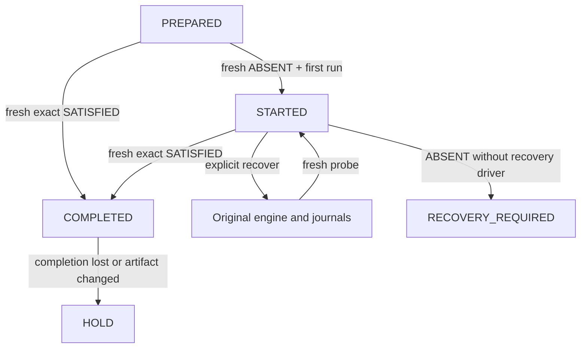
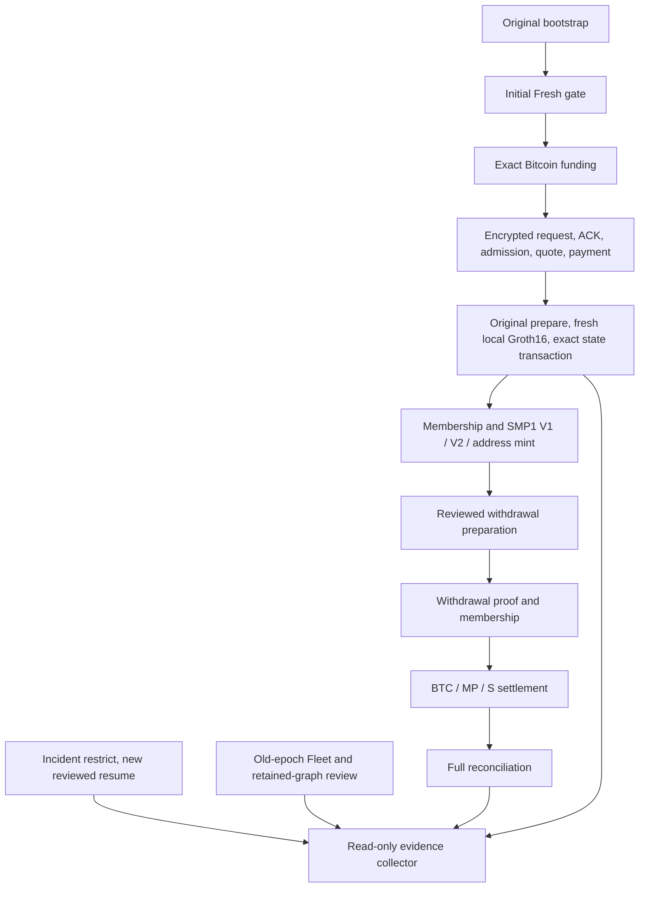
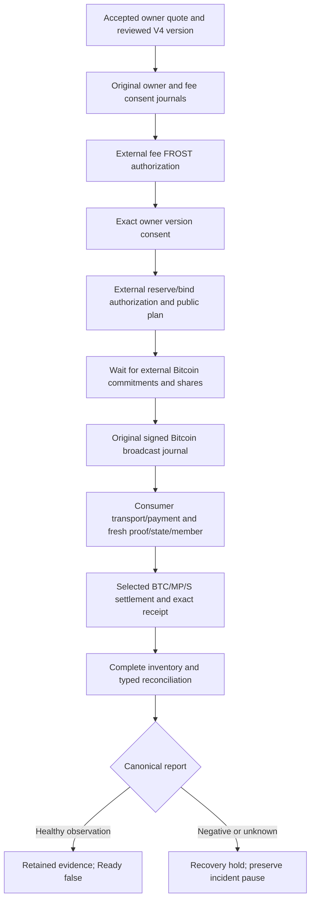
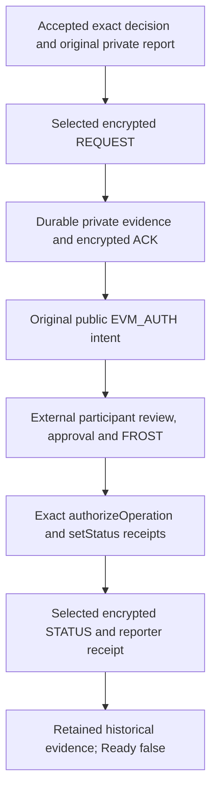
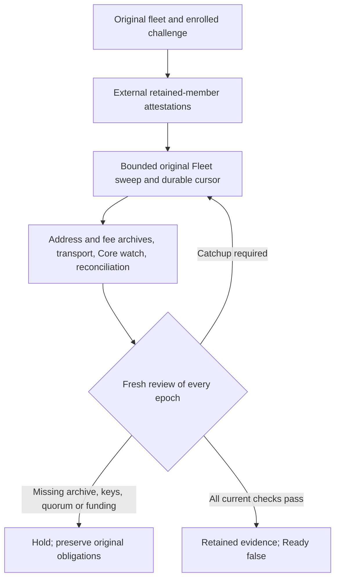

# Combined contour controller and retained-graph handover

[Схемы: SVG/PNG и hashes текущих Mermaid-исходников](DIAGRAMS.md).

The controller, multi-request DAG, typed scenario recipes and evidence collector
are implemented; the full combined monetary run is **pending**.
The [functional coverage audit](ZKSPV_FUNCTIONAL_COVERAGE.md) records the remaining
implemented C1/C2 policy, 43 workflow recipes and 195 mandatory observation slots.
Address lifecycle, explicit RBF old/new, per-owner batch, consent/cap/cancel/refund
adapters are available. Private case inputs and qualified execution are pending;
238 matrix entries do not certify complete specification acceptance. See the
[lifecycle/assertion runbook](ZKSPV_SCENARIO_BINDINGS.md).
It retains execution evidence from reviewed drivers. Process exit code 0, cached
proofs and component tests cannot grant acceptance. `combined_e2e_accepted`,
`fresh_proving_verified`, `ready` and `production_ready` stay false in its report.

## Plan and execution

Start from [zkspv-contour.example.json](../config/zkspv-contour.example.json).
Select a new random 32-byte `run_id` and private absolute `directory`. The example
deliberately has **null drivers**: absent integrations stay visible. Commands are
reviewed local configuration, not untrusted inbox data. The controller is not a
network sandbox; endpoints/network-write permissions remain the driver's
responsibility. Inspecting the plan performs no public launch.

Each command is an argument array with an absolute executable; no shell or
templating is used. Secrets belong in existing private files. Retain the same
participant homes, identity journals, FROST spent journals, worker archives and
transaction engines. Changing `run_id` or signing state is not recovery.

`source_paths` contains repository-relative files. Extend the example to include
**every** used driver, guest, verifier, contract, source lock, ABI and relevant
configuration before a real run. The controller also pins itself and command
executables. Changed sources/tools or a changed plan cannot reuse the journal.

```bash
export PYTHONDONTWRITEBYTECODE=1
export PYTHONPATH=signer-agent
python -m ops.zkspv.contour inspect --config "$CONTOUR_CONFIG"
# At most one new action/recovery per invocation, preceded by fresh probes:
python -m ops.zkspv.contour step --config "$CONTOUR_CONFIG"
```

Stages are ordered. Each subsequent stage receives hashes of the original
completed predecessor results. Every `step` freshly probes predecessors and
rehashes frozen artifacts. Lost completion or a changed artifact stops further
work. Probes must verify exact historical completion where appropriate; a
completed payment need not remain an unused UTXO or become newly authorized.

Twenty capabilities are required: bootstrap, Bitcoin funding, withdrawal preparation, consumer request,
encrypted transport, admission/payment, proof preparation, fresh proving, state update, membership, service status, SMP1 mint,
address mint, BTC/MP/S withdrawals, reconciliation, incident recovery, old-epoch
service and continuity. Missing capabilities stay explicit, even after a subset
finishes. Limits are 32 stages, 128 arguments/command, 1–14,400 seconds/invocation,
64 artifacts/response and a 1 MiB response. Large receipts are hashed as streams.
Logs and the FULL/WAL SQLite journal are private. Drivers inherit the owning lock
so another controller cannot start while an orphaned driver still holds it.
Drivers may not daemonize; remaining descendants are terminated after invocation.



`STARTED` commits before spawning an action. Failure, crash or timeout does not
reset it. `ABSENT` after interruption cannot prove no spend occurred. Only a fresh
exact result or explicit `recover` through the original operation/journals can
advance it. The controller creates no EOA transaction, owner consent, FROST
attempt or replacement itself and never deletes a nonce record.
An explicit action/recovery hold remains visible even when the subsequent
read-only probe can only report `ABSENT`; it is not displayed as ordinary progress.

## Driver contract

`SATOHSI_CONTOUR_CONTEXT` locates a private JSON file. At its top level are
`version`, `run_id`, `plan_sha256`, `stage`, `capability`, stable `attempt_id`, unique invocation
`challenge`, `action` and `predecessors`, plus `directory`, new `response_file`
and original retained `prior` result.

Return a new JSON at `response_file` with exactly `binding`, `status`, `artifacts`
and `observations`. Echo the nine binding fields exactly. Status is `SATISFIED`,
`ABSENT`, `WAITING` or `RECOVERY_REQUIRED`. SATISFIED requires at least one regular
artifact as `{run_relative_path: sha256}`; other states use an empty map. Paths
cannot escape the run or traverse symlinks. Re-probes of completed stages retain
their original artifact map after independently verifying current facts.

`probe` is read-only for monetary/consensus state and may write local observation
journals. `run` is invoked once. `recover` adopts/rebroadcasts the original
authorized operation through its existing engine or returns a hold. New funding,
payment, consent or signing attempts cannot be implicit recovery.

The canonical **handover review adapter** is connected:

```json
["/absolute/path/to/python", "-m", "ops.zkspv.contour_driver",
 "--fleet-config", "/private/fleet.json", "--plan-id", "64-hex-plan-id"]
```

Use it as the `continuity` stage's probe/run; both freshly review canonical
state. Setup adds bootstrap/funding; the service/worker pipeline below connects
seven further capabilities. Remaining null
stages still need connections to their original engines and exact receipts.
Historical deposit/worker tests remain separate fragments.

## Worker pipeline adapters

Build a private partial plan without RPC calls or transactions:

```bash
python -m ops.zkspv.contour_plan --worker-config "$WORKER_CONFIG" \
  --request-file "$EXACT_CONSUMER_NEED" --directory "$PRIVATE_CONTOUR_DIRECTORY" \
  --output "$PRIVATE_CONTOUR_PLAN" --worker-only --service-config "$CONTOUR_SERVICE_CONFIG" \
  --bootstrap-config "$CONTOUR_BOOTSTRAP_CONFIG" --funding-config "$CONTOUR_FUNDING_CONFIG" \
  --mint-config "$CONTOUR_MINT_CONFIG"
python -m ops.zkspv.contour inspect --config "$PRIVATE_CONTOUR_PLAN"
python -m ops.zkspv.contour step --config "$PRIVATE_CONTOUR_PLAN"
```

Omit `--worker-only` to retain the entire required stage list, including explicit
null integrations. `--worker-only` selects just the connected pipeline, including
optional setup stages. Without `--bootstrap-config`, the graph must already be
deployed/authenticated. Without `--funding-config`, Bitcoin funding remains
unconnected. Monetary consumers are not qualified by a partial plan.
Its final report continues to list all missing capabilities. The builder pins
the private config/request hashes in command arguments and includes repository
Python/Solidity/crypto/worker sources, ABI files and actual guest/tool manifests
in `source_paths`. Changing private inputs before the first request is rejected.
The normal worker configuration still validates network, runtime/CREATE
provenance, finality, mature inclusion, allowed consumers, funding and budgets.
The historical contour examples use mainnet `PROOF_ONLY_V1`. The bootstrap
adapter matches the worker-selected network, policy and EVM snapshot settings;
this is not a mainnet-only check. Testnet4 has its own guest/state/adapter
[setup](ZK_TESTNET4_SEPOLIA.md). A fresh testnet4 monetary contour still needs
its exact program/source/driver bindings and qualification; the historical
mainnet plan is not that evidence. Regtest/TEST_ONLY guests are not relabeled
as a public-network profile.

| Adapter capability | Actual boundary |
|---|---|
| `bootstrap` | Execute/adopt the original generated ZK graph matching the worker network/policy, one existing sequential/parallel/atomic CREATE unit per action, with structural binding and deferred freshness. |
| `bitcoin_funding` | Verify mature canonical inclusion of the exact funding outpoint; optionally sign/send an already accepted SMP1 quote through its original wallet journal. |
| `consumer_request` | Validate the exact consumer need and persist its original HPKE REQUEST; revision, ciphertext, nonce and service deadline survive restart. |
| `encrypted_transport` | Publish/decrypt the original REQUEST/ACK/STATUS, verify canonical packets and admit the original remote need. ACK is delivery evidence. |
| `admission_payment` | Use the original issuer/payer automation and canonical paid job, or explicitly select bounded confederation funding. |
| `proof_preparation` | Use the original native/fork/archive logic, stopping before proving or EVM publication. |
| `fresh_proof` | Enroll before any stage, bypass receipt-cache reuse, run at most one new local stage per invocation, then independently verify Groth16. |
| `state_update` | Verify the existing receipt and use the original budgeted transaction engine; never start proving. |
| `membership` | Retain the exact accepted archive, derive one native history witness and materialize its header through the worker's budget/nonce engine; no new proof or state update. |
| `service_status` | Re-observe the original need after state publication and deliver its encrypted STATUS; membership can still be `NEEDS_STATE`, and a halted state reports `HALTED`. |
| `smp1_mint` | Use an accepted SMP1 wallet quote and original admission/authorization journals, selecting the pool's V1 or custody-generation V2 method. |
| `address_mint` | Use the original registered intent/recipient and generation-bound address admission/authorization client. |

The private [service configuration](../config/zkspv-contour-service.example.json)
selects the requester transport configuration, federation, exact service identity,
stable request revision and `PAID` or `CONFEDERATION` funding. Worker, requester
and service must use the same authenticated graph, finality and address/fee
profiles, with three separate private directories. All three configurations are
hashed into the generated commands. Existing client/worker daemons retain their
default behavior. Without `--service-config`, the builder retains the older four
direct worker adapters and does not claim transport/payment coverage.

### Bootstrap and Bitcoin funding

The optional private [bootstrap configuration](../config/zkspv-contour-bootstrap.example.json)
references the original input profile, deployment SQLite journal, operator
identity and Core endpoint/cookie. Only `bootstrap_plan.build` generated mainnet
ZK profiles are supported; arbitrary explicit-step profiles are rejected. The
builder pins the compiled profile hash before any RPC/action. Original signed
enrollments, external-component provenance, DKG/approval waits, EVM finality and
shared identity nonce journal remain authoritative. Participant ceremonies and
transport key/actor enrollment still use their existing workflows.

Bootstrap advances one original unit per action. Parallel and atomic circular
CREATE groups retain their original barrier and limit of eight transactions.
All new envelopes must fit explicit gas, per-transaction and total reserved-cost
caps in the original deployment journal. A group that fails unsigned preflight
cannot spend a prefix. Typed unit enrollment precedes signing; unsigned ambiguous
recovery cannot allocate a new nonce. A partially reserved parallel group holds;
an atomic CREATE reservation can restore the complete original group. The setup
lock and fresh journal reads prevent a second contour from erasing these latches.
Changing run IDs does not reset costs or enrollment.

The expected state and consumer addresses are pinned by the worker/request.
Before their new direct CREATE signatures, the predicted address must match;
the completed manifest must match them as well. Prepare these addresses with
the original deployment/nonce plan, or adopt an existing graph. The builder
does not silently rewrite frozen worker/transport configurations after a new
deployment. Other operations using the same EOA may cause an expected-address
hold and require review.

A structural bootstrap uses `bitcoin_binding` to check state/adapter origin,
policy, Core network/checkpoint and canonical EVM snapshot. Freshness checks
remain `ZK_FRESHNESS_DEFERRED`; the result is
`GRAPH_CONFIGURED_FRESHNESS_PENDING`, never `VERIFIED` or Ready. This allows
consumer configuration before its first state proof. Normal bootstrap apply/
verify still performs its original live freshness checks, and every monetary
client retains those checks. In particular, a new SMP1 wallet signature/send
still requires the original fresh-state/generation guards; setup does not
authorize sending into an unready graph. Initial freshness may need the
independent original worker/heartbeat flow before a new wallet-funded deposit.

[Funding OBSERVE configuration](../config/zkspv-contour-funding.example.json)
is read-only for Bitcoin. It supports SMP1, registered address and fee-purpose
outpoints through the original consumer observer, native funding parser and
Bitcoin Merkle proof. Addresses/intents/generations retain their original checks.
Depth is derived from canonical height, including ordinary depth at least six,
coinbase mint depth 100 and fee-input coinbase depth at least 101. A wallet send,
claimed RPC confirmation count or EVM consumed marker alone cannot satisfy it.
The first header/raw/amount/script evidence is retained. Probes keep checking
that inclusion after mint/spend; loss or replacement by a re-mined header holds
the contour instead of silently replacing its completed predecessor.

The alternative [SMP1_QUOTE configuration](../config/zkspv-contour-smp1-funding.example.json)
requires an original prepared operation and its explicitly accepted quote hash.
Its txid/vout/pool must equal the frozen consumer need. The runner never prepares
a new quote or substitutes an address/recipient/amount. It uses the original
wallet locks, fee cap, non-custody input checks, PSBT parser, signing and exact-raw
broadcast recovery. A sign latch is durable before calling the wallet; an
ambiguous unsigned/signing result requires original recovery. Signed/partially
signed bytes may resume without a second signature. Lost send replies recover
the same txid/raw. External wallet funding for address mode remains an explicit
user action, followed by OBSERVE; no new address-wallet signer is claimed.

In `PAID`, requester payment and worker issuer automation must be enabled for the
same service registry. Original owner consent, tariff/generation checks, exact
job terms, budgets and nonce journals apply. Each action starts or recovers at
most one EVM operation. A typed substep is persisted before submission; an
interrupted unsigned operation requires recovery and cannot allocate a fresh
nonce. A subsequent distinct substep may start only after the prior operation is
canonically complete. Quotes use encrypted STATUS and the payer re-reads the
canonical job. Payment completion retains its transaction/block hashes and is
rechecked for finality/reorgs. A paid flag or covered state cannot replace a lost
pending payment receipt. Compatible needs reuse the original semantic job,
coverage and deadline without a second quote/payment.

In `CONFEDERATION`, the worker policy must explicitly allow own funding and the
requester payment automation must be disabled. Both `confederation` and
`paid_or_confederation` policies are supported; a paid-only policy is rejected.
Project treasury balance is not a prerequisite. The original publisher native
balance, global/per-job own-cost reservations and worker gas limits still apply.
Own expenditure creates no paid marker or reimbursement claim and does not
consume deposit/withdrawal principal. An already paid canonical job retains its
actual funding history after state coverage; it is not relabeled as own funding.

Before new preparation, proving or unsigned state publication, the pipeline
rechecks original delivery and current funding. Historical proof completion and
already signed publication recovery do not acquire a fresh funding requirement.
An orphaned completed predecessor stops the controller; explicit recovery must
use the original transport/transaction journals. Changing a run/plan cannot
justify a duplicate message or service payment. Normal selected-route actions
cannot admit or pay another pending request.

The pipeline enrollment is in the original worker SQLite journal and binds the
controller run/plan, immutable worker policy/request and exact native files.
Preparation cannot adopt another need's active attempt. Changed state or Bitcoin
tip before proving is a hold. Already sufficient state does not force another
proof or paid job; this scenario waits with `NO_NEW_STATE_PROOF_REQUIRED`.
Membership materialization is a separate connected stage; it cannot advance state.

Fresh proving refuses pre-existing stage artifacts without its original
enrollment. Existing receipt caches remain intact but cannot satisfy this stage.
The same enrollment resumes completed stages after interruption, respecting
existing retry/disk/service budgets. Each step computes at most one of composite,
succinct and Groth16, avoiding a three-stage process beyond the controller's
timeout. Configure the stage timeout with at least 600 seconds of controller
headroom (the plan builder checks this). The original worker lock is inherited
into the prover's new process group; a surviving prover prevents another worker
from starting. Missing/ambiguous completion retains the existing recovery hold.

State recovery requires the original signed envelope, exact chain/target/input/
nonce/value and budget checks, followed by canonical confirmed receipt checks.
An unrelated valid signature cannot be rebroadcast under this operation. A lost
local completion mark is recovered through the same engine. If no signed
envelope exists after an interrupted publication, recovery stops instead of
allocating a new nonce. Historical acceptance remains inspectable after later
state progress; it never asserts current Fresh or monetary readiness.

The proof's freshness is **local stage provenance** plus independent receipt
verification, not a hardware/remote attestation. The controller's acceptance
flags stay false. The suite collector below retains the proof lineage for
separate review and qualification.

## Multi-request suite and scenario matrix

All 25 capability types are connected across supported configurations, including
address request/registration/status, owner cancel and fixed scenario probes
described in [expanded bindings](ZKSPV_SCENARIO_BINDINGS.md):
setup/service/worker/member/mint, withdrawal preparation, BTC/MP/S settlement,
reconciliation, standalone incident/recovery, old-epoch service and retained-graph review. A single
monetary plan selects one exact consumer need and one mint or withdrawal mode.
The suite composes these original adapters into up to 512 dependency-linked
jobs. One `step` delegates at most one child action/recovery. Durable round-robin
scheduling lets unrelated jobs progress when another consumer waits or loses
evidence. Parent commitments are included in the child's immutable binding and
every invocation. Child drivers inherit both controller locks. A completed
parent losing its receipt or artifacts blocks its descendants.

The [suite recipe](../config/zkspv-contour-suite.example.json) includes concrete
typed driver recipes for every row below. Absolute private inputs are operator
supplied; example paths are not deployment evidence. It deliberately defers job
binding, so it can be built before later quotes, payments and retention claims
exist. Worker/identity/source pins apply immediately. `bind --job` requires
completed, freshly verified dependencies, compiles the existing SDK input files,
and durably freezes their hashes and commands once. Quotes, owner consent,
deadlines, FROST bundles and retention claims are never created or extended by
the binder. An expired input requires an explicit newly reviewed workflow.

```bash
export PYTHONDONTWRITEBYTECODE=1
export PYTHONPATH=signer-agent
python -m ops.zkspv.contour_suite_plan build --config "$SUITE_RECIPE" --output "$SUITE_PLAN"
python -m ops.zkspv.contour_suite inspect --config "$SUITE_PLAN"
python -m ops.zkspv.contour_suite bind --config "$SUITE_PLAN" --job bootstrap
python -m ops.zkspv.contour_suite step --config "$SUITE_PLAN"
# Bind subsequent jobs after their dependencies complete and inputs are reviewed.
python -m ops.zkspv.contour_suite collect --config "$SUITE_PLAN" --bundle-directory "$NEW_PRIVATE_BUNDLE"
```

`inspect` and `collect` only issue public read probes. They may update private
observation journals and write evidence, but cannot invoke run/recover, sign,
rebroadcast, pay, create consent or renew claims. `step` is intended for a
supervised loop. Its nonzero exit, waiting or recovery result requires inspection;
it must retain the same suite, SDK journals and participant homes.



The template links address mint to BTC/payout withdrawal and reconciliation.
Configure that withdrawal owner/graph to spend the minted MP. The other matrix
scenarios may use independently configured graphs and actors; add dependencies
when they spend an earlier mint. Bind
each later input only after its dependencies; no new owner consent is inferred
from a dependency. The compiler automatically inserts a Fresh gate before funding,
mint and withdrawal/refund preparation. Enable the original worker heartbeat
policy. Fresh activation uses original own-heartbeat preparation, staged local
proving without cache substitution, original budgets, exact publication and
archive promotion. Bounded catch-up chunks retain every proof/enrollment and
transaction. Each initial publication has a durable pre-sign latch; interruption
after that latch requires its original signed transaction. Historical completion
stays inspectable when Fresh ages during later proving. It does not grant
current issuance: each SDK rechecks its current Fresh/generation/terminal guards.
The consumer proof recipe also uses a bounded chunk cycle: ordinary/coinbase
depth may need several transitions when `max_headers_per_sync` is small. It
retains the first preparation predecessor unchanged, independently verifies
every retained proof/transaction, promotes each accepted archive and prepares
the next chunk through the original worker. The proof job completes only after
the requested depth and Fresh are sufficient. It never resets the original
attempt/self-funding budgets, renews an expired service obligation or starts a
new envelope after an ambiguous pre-sign interruption. Mint V1 history verifies
the original confirmed envelope and allocation even after the pool switches to
V2; new mint signatures still require the currently selected proof version.

| Matrix cases | Required linked jobs |
|---|---|
| bootstrap, initial_fresh, fresh_groth16 | Original structural deployment; canonical useful Fresh; independently enrolled fresh local proof |
| service_paid, service_confederation | Original HPKE request/ACK/status, admission and actual selected funding policy |
| smp1_v1, smp1_v2, address_mint | Exact funding → proof/membership → mint; on-chain mintProofVersion 1 or 2 enforced |
| withdrawal_btc/mp/s_payout/total (six cases) | Same reviewed request/version, preparation → proof → settlement → same reserve reconciliation |
| fee_funding | External fee ingress/classification → proof → exact admission receipt |
| refund_mp, refund_s | Original owner's exact refundTokens call and confirmed receipt |
| refund_btc | Original owner's createRefund → named-refund preparation → proof → BTC settlement |
| incident_suspend, incident_resume | Restriction; separately reviewed resume on the same registry/scope and next generation |
| reconciliation, old_epoch, continuity | Complete original inventory report; bounded retained-epoch service; original-graph handover review |

The catalog has 43 workflow recipes and 195 pinned mandatory assertion slots.
Workflow evidence is `VERIFIED`; fixed read-only assertions are separately
`OBSERVATIONS_VERIFIED`, always with `e2e_qualified=false`. A workflow passes only when exactly matching
typed roles, dependency edges, consumer need, graph, reserve and reviewed version
are joined and all original driver probes verify completion. Missing private
inputs remain `INPUT_REQUIRED`/`UNBOUND`; labels and process exit cannot fill a row.
Generic command plans are limited to `TEST_ONLY`, which never establish actual
monetary or production evidence.

The collector records the complete immutable suite binding, effective job plans,
input/source/executable hashes, original and current response hashes, parent
commitments, binary Groth16 receipts, native inputs/journals and all catch-up
stage reports. Proof archives include original signed state envelopes. Monetary
adapters include exact original EVM envelopes and canonical receipt anchors.
Context/log/response/process hashes are anchored in the private journal; failed
invocations and missing exit records remain visible. A new private bundle contains
the collected files plus `manifest.json`; identities and private signing-state
contents are represented by pins rather than copied. This is local retained
evidence, not a remote attestation. All acceptance/Ready/production flags stay
false pending the actual combined run and independent qualification.

### Fee credits and named BTC refunds

[Fee operation configuration](../config/zkspv-contour-fee.example.json) selects
`FUNDING`, `REFUND_MP`, `REFUND_S`, `CREATE_BTC_REFUND`, `RAISE_REFUND_CAP`,
`CANCEL_BTC_REFUND` or `CONSENT_BTC/MP/S`. Its exact reviewed
request is committed by `accepted_request_sha256`. Funding uses the original
registered withdrawal_fee need and ordinary 6 / coinbase 101 maturity. Token
refund inputs name the same `request_id` and `principal_request`, use
`refundTokens([request_id])` and `expected_nonce: null`.

BTC creation inputs use `createRefund` args `[id, original, payout, cap, rate,
deadline, cg, dg]`, original principal sats and the accepted contract refund nonce.
Before any new signature the adapter checks the canonical expected refund id
and blocks a pending owner nonce race. Confirmed recovery adopts the original
envelope without recalculating its pre-increment refund id.

After creation, obtain the read-only named-refund quote:

```bash
python -m ops.zkspv.contour_refund quote --owner-config "$OWNER_CONFIG" \
  --request-id "$REFUND_REQUEST_ID" --output "$REFUND_QUOTE"
```

The reviewed normal V4 withdrawal configuration then references that quote,
the named refund id, exact terms and original separate BTC_SPEND/EVM_AUTH bundles.
The refund adapter verifies `refundOrigin`, original owner/principal, zero-token
refund source, script and payout. It adopts the existing refund request and
uses the original per-version owner consent, signer, broadcast and settlement
path. It cannot create another token primary or reduce the original principal.

### Remaining implementation and qualification

[Canonical family/status](BITCOIN_KEY_FAMILY.md) is implemented for admitted graphs
on one independently pinned root. [V7 observations](ZKSPV_OBSERVATION_HISTORY.md)
implement durable history/outbox and local blocking under the user-selected
unchanged-mainnet-guest policy; global halt and unpublished completeness are not
guaranteed. Any live asset transfer remains separate conditional work. Private
mandatory-case bindings, long Core/FROST/proof/EVM execution, target parameters,
TCO, exact-profile qualification and independent review remain open.

## Materialization and mint

`--materialize` connects header materialization without mint. `--mint-config`
also connects materialization and exactly one of the two mint modes. The other
mint capability remains explicitly missing. The builder handles one exact need
per child pipeline; the suite above joins multiple such pipelines.

For an already deployed, authenticated and fresh graph, use a partial consumer
plan without starting another proof:

```bash
python -m ops.zkspv.contour_plan --worker-config "$WORKER_CONFIG" \
  --request-file "$EXACT_CONSUMER_NEED" --mint-config "$CONTOUR_MINT_CONFIG" \
  --directory "$PRIVATE_CONTOUR_DIRECTORY" --output "$PRIVATE_CONTOUR_PLAN" --consumer-only
```

This mode contains only membership and the selected mint. It cannot be combined
with setup/service options and does not claim fresh proving, bootstrap, funding
or combined acceptance. Full proof pipelines retain their fresh-proof requirement.

Materialization uses the original accepted archive and native host. A locally
prepared transition that is already accepted can retain/promote its exact pinned
archive without invoking proving/publication again. The header must match the
consumer's actual canonical Bitcoin inclusion, a fresh aligned state and a
covering height. The adapter also simulates the current-root verifier before a
new send. A changed root/ambiguous unsigned action holds; it never chooses a
second fee-bearing materialization implicitly. Canonical existing cache can be
adopted at an anchored confirmed snapshot. Signed completion is checked against
the exact envelope, final receipt and `HeaderMaterialized` event, including its
root/header/height. Historical completion does not assert current Fresh/cache
usability after state progress. Current usability is rechecked before new mint.
Materialization reuses a canonical paid job when present; otherwise original
bounded maintenance/own-funding policy applies, without another service payment.

The private [SMP1 mint configuration](../config/zkspv-contour-mint.example.json)
references its original accepted funding quote; [address mint configuration](../config/zkspv-contour-address-mint.example.json)
uses the registered intent from the frozen need. Both reference the original BTC
bundle, participant encrypted state/password file, caller identity, onboarding
board, admission and immutable deadline, plus explicit gas/job/total/attempt caps.
No private key/password is embedded in a plan or evidence. Bundle/funding/deposit
configuration hashes are pinned before RPC. Original graph trust must already be
enrolled; the runner does not auto-pin a graph or bypass qualification flags.

The runner opens/adopts the original typed admission, waits for external FROST
participants and then authorizes/executes the exact mint. It neither generates
FROST nonce/share material nor finalizes a session. At most one original EVM
operation advances per action. Each operation/profile is latched before signing
in the caller's original independent budget journal; exact signed recovery runs
before new Core/generation/funding checks. An ambiguous unsigned operation is a
hold. Existing signed data, EOA nonce, fee budget, claim deadline, participant
history and economics survive restart; no automatic admission retry or deadline
extension is performed. Manual recovery uses the original client/session.

SMP1 V1 retains its original method. V2 custody graphs now use `openCustodyMint`
and `mintFromProofV2`, binding the current custody generation while preserving
SMP1 allocation, ordinary/coinbase maturity and principal rules. Custody suspension
blocks new work; derived-address qualification is not relabeled as base custody
qualification. SMP1 accepted recipient choices are rechecked before new sends.
Address mode retains intent binding, generations, recipient, qualification,
FROST trust and funding review. Successful completion requires the original mint
receipt plus canonical allocation/consumed state; an ACK, paid flag or an address
mint marker cannot stand in for an SMP1 completion. These local adapters do not
declare the real derivation verifier qualified or enable production mint.

## First supported handover strategy

`RETAIN_ORIGINAL_GRAPHS_V1` keeps every source intent, recipient, script,
accounting domain, fee claim, authorization and signing journal in place. Source
custody must be DRAINING with closed issuance at confirmed/latest snapshots.
The target retains its own canonical graph and distinct known BTC parent. Known
canonical address/fee child keys are checked across both local catalogs. This
does not prove independence from every undisclosed public tweak.

```bash
frost-signer bitcoin continuity handover prepare --config "$EPOCH_CONFIG" \
  --source-context "$OLD_WALLET_CONTEXT" --target-context "$NEW_WALLET_CONTEXT" \
  --request-id "$KNOWN_OLD_REQUEST" --batch-id "$KNOWN_OLD_BATCH"

# Close old issuance via the existing EVM_AUTH status workflow, preserve old
# shares/boards/archives and obtain current epochs review/attest evidence.
frost-signer bitcoin continuity handover review --config "$EPOCH_CONFIG" \
  --plan-id "$PLAN_ID"

# Each participating EVM_AUTH signer enrolls its own existing state locally:
frost-signer bitcoin continuity handover enroll-signer --config "$EPOCH_CONFIG" \
  --plan-id "$PLAN_ID" --state "$EXISTING_SIGNER_STATE" --password-file "$PASSWORD_FILE"
```

Prepare reads authenticated canonical inventories and saves an immutable plan
in the original fleet identity journal and restrictive references in **both**
operator journals. It grants no permission. Exact retries retain the plan and
first snapshot; a partial/lost partner reference requires explicit re-preparation.
Exported JSON is not a plan authority. Signer enrollment persists in independent
spent storage and survives an older encrypted-state backup.

Before new registration authorization, enrolled clients/signers recheck both
identities, current generations/status, available fee inventory, source draining
state and the fleet's fresh threshold/watch/archive/qualification/funding review.
Retention statements keep their existing operational trust boundary. Saved green
reports cannot bypass expiry, incidents, reorgs or missing original journals.
Existing money recovery does not acquire a new issuance prerequisite.

`RETAINED_SERVICE_CHECKED` is local service evidence, not Ready, activation or
source backing transfer. The one-owning-pool-per-epoch limit remains. A separate
target cannot mint source deposits or inherit source claims/scripts. Same-key
registry enrollment must join the canonical family root and cannot reset its
status. Verifier replacement, live asset transfer and unknown history remain
unsupported by handover. §15.11 follows the explicit local-fence policy above.

## Reviewed withdrawal version and reconciliation

[Withdrawal configuration](../config/zkspv-contour-withdrawal.example.json) pins
the original owner and operator fee configurations, an accepted owner quote/hash,
the original `build-payment` output, its independently accepted `terms_hash`,
and one request ID. `bundle_file` is the original **BTC_SPEND** bundle;
`auth_bundle_file` is the enrolled confederation **EVM_AUTH** bundle used for
fee authorization. The Bitcoin manifest must match the graph's DKG/wallet ID.
Both actors retain their original identities, budget/transaction/nonce journals
and graph. The encrypted state/password refer to the original Bitcoin participant.

V1 resumes an initial reviewed V4 version. V2 pins `previous_config` and its
accepted SHA-256 for an explicit higher-fee replacement with the same family,
inputs and owner quotes. V3 adds individually pinned `additional_owners`; each
owner retains their own quote, request, principal, consent and EOA budget.
Proof and settlement bind the chosen old/new winner. See [exact configuration
and lineage rules](ZKSPV_SCENARIO_BINDINGS.md). Preparing a version uses original SDK prerequisites:
the owner request and required consent, selected UTXOs, an authenticated fresh
graph and a healthy reserve report. BTC fee mode additionally requires the
original fee-purpose deposit and registration. The adapter cannot select inputs,
fund a donor deposit, choose an unreviewed replacement or extend expired consent.
It cannot be combined with bootstrap, mint or funding adapters in the same plan.
Maintaining initial graph freshness before preparation is an independent worker
heartbeat prerequisite; this single withdrawal need becomes provable after its
Bitcoin broadcast/inclusion.

```bash
python -m ops.zkspv.contour_plan --worker-config "$WORKER_CONFIG" \
  --request-file "$EXACT_WITHDRAWAL_NEED" --withdrawal-config "$WITHDRAWAL_CONFIG" \
  --reconciliation-config "$RECONCILIATION_CONFIG" --service-config "$CONTOUR_SERVICE_CONFIG" \
  --directory "$PRIVATE_CONTOUR_DIRECTORY" --output "$PRIVATE_CONTOUR_PLAN" --worker-only
```

The frozen need is exactly `{kind:"withdrawal", consumer:ESCROW,
batch:BATCH_HEX, txid:DISPLAY_TXID}` derived from the native unsigned transaction.



Preparation resumes owner primary/fee consent through `withdrawal_user`, the
typed fee-payment authorization, exact owner version approval, V4 import,
reserve/bind authorization, and bounded public plan publication. It then waits
for external Bitcoin commitments/shares and invokes the original aggregate/
broadcast path. It never runs private `btc-commit`/`btc-sign`, finalizes FROST,
retries a session or invents an RBF version. Explicit reviewed replacements reuse
the original replacement reserve/bind and Bitcoin linkage. Owner and operator calls share each
identity's original nonce lane and retain original fee budgets. Bitcoin SDK
calls have an additional explicit operator gas/job/total/attempt budget. At most
one EVM operation or first Bitcoin broadcast is selected per adapter action.

The original Bitcoin worker stores signed bytes before RPC. A lost response is
recovered from those same bytes before new preparation/generation/funding
checks. A pre-broadcast latch without stored bytes holds for explicit recovery.
Unsigned EVM interruptions also hold; the runner cannot allocate another nonce.
Signed EVM recovery checks exact identity, chain, target, ABI arguments, nonce,
gas bounds and canonical final receipt before new SDK work.

After consumer/service/proof/member stages, only the selected `withdrawal_btc`,
`withdrawal_mp` or `withdrawal_s` settlement runs. The original SDK checks actual
Bitcoin inclusion, freshness, maturity and admitted winner. Canonical settlement
must match the frozen txid and owner's paid request, close its personal budget,
and retain the exact original EVM receipt. The underlying contracts preserve
principal, return unused MP/S fees in the same asset (including S pool claim
restoration), and keep BTC carry/refund rights named. A separate BTC refund
transaction remains an explicit owner workflow. A paid flag alone cannot replace
the original settlement receipt. `--settlement-only` builds just membership,
selected settlement and optional reconciliation for an existing signed family
on a fresh graph; it makes no fresh-proof claim.

[Reconciliation configuration](../config/zkspv-contour-reconciliation.example.json)
pins the existing fee configuration, enrolled EVM_AUTH bundle and original
Bitcoin participant state. Replace `deadline` with a reviewed current protocol
window and choose an explicit `report_id`. The adapter saves one full inventory
observation before preparing its original typed FROST report, then waits for
external participants and retains its exact publication receipt. Interruption
does not silently rescan or renew the report. A changed generation/expired
window needs an explicit new review. A negative/unknown report cannot pass the
stage: critical observations retain the original incident pause. Publishing a
later healthy report never clears that pause automatically. Historical report
completion is evidence of that observation, not perpetual reserve health.

## Standalone reviewed incident/recovery

[Incident contour configuration](../config/zkspv-contour-incident.example.json)
pins two existing incident client configurations, the enrolled EVM_AUTH bundle,
an original private report and an explicitly accepted exact decision. The
decision fixes the scope, expected state/generation/sequence, target state,
issuance closure, deadline and six evidence commitments. Generate it from the
reporter's existing private report before delivery:

```bash
frost-signer bitcoin incident status-preview --config "$REPORTER_INCIDENT_CONFIG" \
  --registration-board "$DKG_BOARD" --report-id "$REPORT_ID" \
  --next-state SUSPENDED --deadline "$REVIEWED_DEADLINE" --output "$PRIVATE_DECISION_FILE"
```

Review the decision and place its returned `confirmation_hash` in
`accepted_decision_sha256`. Preview creates no transport/session, local signer
approval or signature. Each signing participant still receives the private
evidence and explicitly performs the original adopt/review/approve and FROST
workflow. Transport keys must already be registered. The configured reporter
must be the report's original author; this initial adapter has two distinct
actors and one direct delivery/initial status attempt. Forwarding and further
delivery/status attempts remain explicit original workflows.

```bash
python -m ops.zkspv.contour_plan --worker-config "$WORKER_CONFIG" \
  --request-file "$SCOPED_CONSUMER_NEED" --incident-config "$CONTOUR_INCIDENT_CONFIG" \
  --directory "$PRIVATE_INCIDENT_CONTOUR_DIRECTORY" --output "$PRIVATE_INCIDENT_PLAN"
```

This always creates a **standalone partial plan** containing only
`incident_recovery`. It cannot be combined with monetary/service/proof options;
the builder uses the worker configuration for chain/policy/finality and the
allowlisted MiningPool graph. The request file supplies the existing builder's
consumer scope, but the stage does not scan/prove that transaction. Restrictive
status must not wait for ZK freshness, Core availability or a successful mint/
withdrawal. Runtime authenticates the graph's configured state/adapter origins
and policy without checking Fresh or invoking the derivation verifier.



Only the selected request/ACK/status route is transmitted or handled. Unrelated
outbox entries are not published by this adapter. Native HPKE envelopes remain
in their original private stores; the report, its salt and plaintext are absent
from public intents and contour completion artifacts. ACK/delivery cannot grant
status authority. Status execution waits for a completed original threshold
session, preserves exact intent/operation hashes and independently verifies its
canonical `setStatus` receipt. A latest-only receipt stays confirming.

Each action starts or recovers at most one EVM envelope in the actor's original
nonce lane and original address gas-cost ledger. Typed operation enrollment
persists outside inbox backup before signing. Signed recovery precedes new
SDK/generation/service guards; unsigned ambiguity holds without another nonce.
Changed generations, expired decisions, altered attempts, reorgs or missing
archives require explicit review. The runner does not retry/reanchor a status
attempt, extend a deadline or approve evidence on a signer's behalf.

Resume to ACTIVE/QUALIFIED rechecks both confirmed/latest state and the original
retained generation/terminal/closed observations. The existing
`recovery_service_config` must provide complete registered watch coverage and
applicable healthy reserve reconciliation against Core. These transitive service/
fee configurations are hash-pinned too. Missing service/qualification or a known
terminal incident blocks new authorization. Status recovery never clears a
Bitcoin signing/financial pause, fabricates backing, funds a reserve or revives
COMPROMISED/REVOKED/closed issuance. A later state change does not erase the
historical receipt, and its retained encrypted status is an observation rather
than perpetual issuance permission. Canonical family fencing remains active
through the independently pinned root; live asset migration is separate.

## Original old-epoch fleet in the runner

[Epoch contour configuration](../config/zkspv-contour-epoch.example.json) pins the
original [fleet configuration](../config/bitcoin-epochs.example.json), an already
enrolled retention challenge and external participants' attestation files. Use
the existing `bitcoin epochs review-start` and `attest` workflow in
[the epoch runbook](BITCOIN_EPOCH_SERVICE.md#retained-threshold-before-a-planned-departure).
The runner does not generate or sign claims, renew their expiry or enroll an
imported challenge as authority. Its exact body must exist in the original fleet
identity lane.

```bash
python -m ops.zkspv.contour_plan --worker-config "$WORKER_CONFIG" \
  --request-file "$SCOPED_CONSUMER_NEED" --epoch-config "$CONTOUR_EPOCH_CONFIG" \
  --directory "$PRIVATE_EPOCH_CONTOUR_DIRECTORY" --output "$PRIVATE_EPOCH_PLAN"
```

This is a standalone partial `old_epoch_service` plan, exclusive of monetary,
proof and incident options. At least one SERVICING epoch and a worker-allowlisted
MiningPool matching its chain/policy/finality are required. Other original
mainnet epochs retain their own pinned policies and graphs. Runtime authenticates
the selected graph's state/adapter origins without requiring Fresh. It pins all
fleet/address/fee configurations, retained transport file hashes, challenge and
packets before RPC. An explicit new review uses a distinct contour enrollment
in the same original journals; changing private inputs cannot reuse an old sweep.



Each action invokes one original `Fleet.run_once(schedule_spv=False)`, covering
the configured 1–8 epochs with bounded binding imports and address/fee watch scans.
It keeps the original round-robin cursor and independent archive witnesses.
A crash repeats idempotent observation. Transport failure does not skip scanning;
quarantined verification does not stop observation of existing scripts. The
observer sends no EVM transaction, BTC broadcast, private FROST work, issuance
or subsidy payment. Original SPV routes remain separate explicit workflows.

Positive probes run the original full-fleet retention review: exact completed
BTC_SPEND wallet/board, current transport key pair, DRAINING/closed old issuance,
qualification, complete registered watch coverage, archives, applicable healthy
BTC reserve, native gas balance and retained threshold excluding departures.
Attestations keep their original expiry and canonical anchors. A shared payer's
balance must cover the sum of epoch budgets. Unknown signed EVM obligations need
the exact original final receipt; inspection cannot resend or reset a nonce.
An IDLE empty watch is acceptable only when fresh canonical inventory review
confirms there are no missing obligations.

Core catchup requests another bounded sweep. Original archive loss requires
recovery; stale/forged claims, missing quorum, generations, funding, keys or
qualification cannot pass. No financial pause, principal, fee right or observed
orphan history is cleared. Completion artifacts contain small historical
summaries; detailed private observations remain in the original Fleet journal.
Fresh service/retention checks still govern later probes. Continuous observation
remains the original supervised Fleet service; losing prerequisites after stage
completion holds rather than granting future availability, rotation or migration.

## Verification boundary

Suite tests exercise real subprocess DAG recovery, inherited locks, input binding,
typed catalog joins, original fee/refund SDK/EOA/nonce paths, chunk retention and
binary evidence export. The current [local acceptance report](../ops/artifacts/zkspv/acceptance-20261102/local-acceptance-report.json)
records 3269 Python, 834 ordinary Solidity and 25 state/adapter tests, with all
three former native exclusions restored. [Reproduction and qualification boundaries](ZKSPV_LOCAL_ACCEPTANCE.md)
include explicit local test-program bindings for 195 rows across 55 modules.
The real contour is deferred by user decision for device disk capacity. Local
checks do not establish complete qualified matrix execution. The earlier
[C1–C3](../ops/artifacts/zkspv/worker-integration/c123-implementation-report.json) and
[1776-check](../ops/artifacts/zkspv/worker-integration/contour-suite-report.json) snapshots are preserved.

Controller tests use real subprocesses, locks, hashes and SQLite with explicit
non-monetary drivers. Worker tests exercise the real state machine, staged
prover control, ABI codec, signed envelopes and journals, with explicit
Core/EVM/native preparation/proof-verification fixtures. Service tests use real
native HPKE, client/worker transport, issuer/payer automation, typed request
preparation, budgets and SQLite. Their canonical board, Core, EVM execution and
proof boundaries are explicit fixtures; the CLI chain is dispatched in-process
and does not establish a live monetary run. Setup tests exercise original EOA
signatures, sequential/parallel/atomic CREATE recovery, nonce journals, native
PSBT/funding parsing and Merkle inclusion. Their graph origins, synthetic headers,
wallet signatures and EVM/Core execution are explicit fixtures; no actual PoW or
new deployment/value transfer is qualified. Mint checks use original admission/
authorization clients, typed ABI calls, real EOA envelopes and independent SQLite
recovery, with explicit graph/Core/FROST/recipient/EVM effects and synthetic
membership fixtures. CLI entry-point chains are dispatched in-process. No new
real Bitcoin inclusion, FROST authorization or MP transfer is claimed. Withdrawal
checks exercise original ABI/EOA/budget/nonce/SQLite engines, native Bitcoin
parsing and exact raw-broadcast recovery; their preparation/settlement chain
effects are fixtures. Reconciliation checks exercise the original full inventory
Inspector and typed request policies with explicit Core/FROST/EVM effects, plus
an in-process CLI/controller chain. They do not qualify actual principal, token
returns, Bitcoin acceptance or threshold approval on deployed contracts.
Incident checks use original report/status clients and policy, native HPKE,
ABI/EOA, original nonce/cost/observation journals, bounded selected transport and
an in-process CLI/controller chain. Resume tests exercise the original watch/
Core service guard with explicit providers, graph provenance, qualification,
threshold outcomes and EVM state effects. They do not apply an actual on-chain
incident or establish real threshold authorization/operational recovery.
Epoch checks run original Fleet phases, retention EOA signatures, native
block/watch/reorg parsing and SQLite journals. Late deposits, catchup and orphan
history preservation are exercised. Graph/binding origins, qualification,
reserve and Core/EVM providers are explicit fixtures; the in-process CLI chain
does not establish live old-key availability or a complete monetary/proving run.
Handover tests use real
curve keys and journals with explicit chain/provenance/inventory/retention
fixtures. No new proof, live DKG, Core node, value transfer, public deployment or
long combined run is established by these checks.
