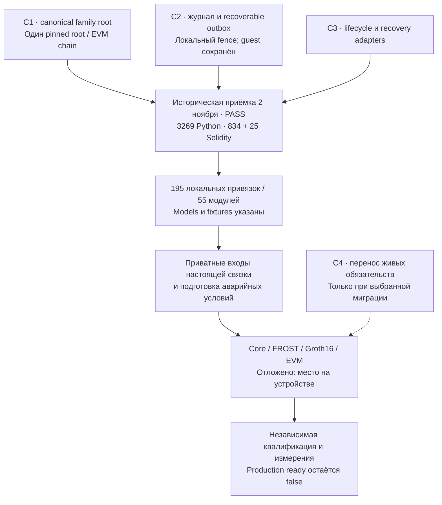

# Покрытие функционала ТЗ 2.16

[Схемы: SVG/PNG и hashes текущих Mermaid-исходников](DIAGRAMS.md).

[Документация](README.md) · [Архитектура](ZK_SPV_ARCHITECTURE.md) · Срез: **2 ноября 2026**.

Код C1, C2 и расширенных адаптеров C3 добавлен. Полное покрытие ТЗ и готовность
к production ещё не подтверждены: `functional_complete=false`, `production_ready=false`.
В suite теперь **43 рецепта**, **195 позиций обязательных проверок** и **238 записей
матрицы**, лимит — 512 jobs. Для тех же 195 случаев добавлены локальные привязки
к 55 исполняемым модулям; это не дополнительные случаи и не полный E2E PASS.
Для обязательных случаев нужны собственные приватные входы, точные assertions
и настоящее квалифицированное исполнение.

ТЗ — источник требований. Наличие требования, рецепта или имени теста само по
себе не доказывает прохождение сценария. Машинный план:
[zkspv-functional-coverage.json](../ops/zkspv-functional-coverage.json).
Результат сверки: [JSON](../ops/artifacts/zkspv/functional-coverage-report.json),
[инвентаризация CSV](../ops/artifacts/zkspv/functional-scenario-inventory.csv).

## Что изменилось в C1–C3

| Направление | Реализовано | Граница результата |
|---|---|---|
| C1: общая key family | `BitcoinKeyFamilyRegistry`, enrollment/bind через исходные FROST authority, независимый SDK pin, bootstrap первого root и подключение следующих графов. Поколения монотонны; terminal/closed состояния и известные child aliases сохраняются | Один независимо закреплённый canonical root в одной EVM chain. Квалификация root/SDK ещё нужна; другие roots/chains и перенос активов не охватываются |
| C2: обработанная история | V7 сохраняет detected tips до branch RPC, связанные пакеты headers с restart cursor, LCA/глубину, hash chain и независимую EOA-копию; atomic need/outbox сохраняет исходные сроки | Выбрана локальная блокировка с неизменным mainnet guest. Полнота неопубликованной истории и общий on-chain halt не гарантируются |
| C3: пользовательские варианты | Request→ACK→registration→watch/status для трёх получателей; reviewed RBF и old/new winner, batch с отдельными owners, consent/cap/cancel/refund; pinned assertion catalog для 195 строк | Адаптеры и позиции матрицы реализованы. Полного набора приватных case bindings и принятого исполнения всех 195 случаев пока нет |

Подробности: [canonical family root](BITCOIN_KEY_FAMILY.md),
[observation history и остаточный риск](ZKSPV_OBSERVATION_HISTORY.md),
[lifecycle и обязательные проверки](ZKSPV_SCENARIO_BINDINGS.md).

Выбор пользователя по §15.11: **сохранить mainnet guest, локальную блокировку,
восстановление журнала и явно описанное окно риска**.
Если worker видел A2000→B2001 с LCA1850, откат 150 блокирует его новую работу,
даже если другой submitter уже обновил EVM. Proof от старого EVM anchor1000 к B2001
может выглядеть append. Локальная история не заставляет чужого submitter
вызвать общий halt. Независимое наблюдение и его доступность остаются условиями
эксплуатации, а не свойством доказательства конечной ветки.



## Проверки и их границы

Исторический [локальный acceptance package от 2 ноября](ZKSPV_LOCAL_ACCEPTANCE.md) сохраняет полный
Python-набор `signer-agent/tests` и `tests/zkspv` (**3269 passed, без ошибок/пропусков**), 834 ordinary Solidity tests,
25 state/adapter tests и восстановленный native host. Три прежние native-проверки
возвращены в запуск. [Точные результаты и source hashes](../ops/artifacts/zkspv/acceptance-20261102/local-acceptance-report.json)
отделены от прежнего [C1–C3 snapshot](../ops/artifacts/zkspv/worker-integration/c123-implementation-report.json).
Четыре сохранённых Groth16 receipt перепроверены без сети; новый proof не генерируется.
Настоящий Core/FROST/Groth16/денежный контур отложен пользователем из-за места на устройстве.
Контрактные/SDK fixtures сохраняют свои границы; `QUALIFIED=false` и `FEE_QUALIFIED=false`.

Исторический результат **1776 passed** сохранён без переписывания snapshot:
[contour-suite-report.json](../ops/artifacts/zkspv/worker-integration/contour-suite-report.json).
Исторические исключения сохранены в старом отчёте; в новом локальном запуске они восстановлены.
Ранние mainnet receipts, retarget и TEST_ONLY regtest/fork/halt результаты сохраняют
собственные исходники и границы; они не становятся новым общим PASS.

Аудит документации сверяет текущие исполняемые исходники со свежим local acceptance snapshot,
ссылки и точные Mermaid/SVG/PNG hashes. Он сам не запускает протокол заново.

## Обязательная матрица

| Таблица | Строк | Дополнительные условия |
|---|---:|---|
| §11.9 | 29 | Idle 30/180 дней, heartbeat deadlines, outage, unpublished A→B, catch-up, coinbase |
| §11.10 | 44 | Конкурирующие submitters, relay/FROST, HPKE attacks, admission/quote/payment и budgets |
| §11.11 | 12 | Сохранение SMP1, allocation, rounding, treasury, nonce и обязательств |
| §11.12 | 28 | ADDR-01–28: полный address lifecycle, mixed-input spend и replay/reorg |
| §11.13 | 34 | ADDR-29–62: parser, parallel mint, reserve, incidents, epochs и continuity |
| §11.14 | 32 | SUB-01–32: три fee sources, principal, RBF, refunds, races и monetary E2E |
| §11.15 | 16 | SUB-33–48: callbacks, nonce, exact consent, ingress/carry и bounded settlement |
| **Всего** | **195** | Общие требования §11.1–11.8 и других разделов также действуют |

Каталог связан с SHA-256 ТЗ; безымянные строки имеют координаты `11.9/01` и т. п.
`scenario_check` принимает фиксированные read-only probes исходных SDK или typed
EVM calls. Успешный probe даёт `OBSERVATIONS_VERIFIED`, отдельно от workflow
`VERIFIED`; обе записи сохраняют `e2e_qualified=false`. Для каждого случая нужны
ожидаемый и фактический исход, source/input/graph hashes, anchors, REAL/MOCK/
SYNTHETIC границы и применимые proof/receipt/cost/nonce/spent записи. Процент
покрытия по числу slots или совпадению имён тестов не рассчитывается.

## Что остаётся до полной приёмки

1. **Case bindings C3 и Q2.** Заполнить приватные конфигурации для фактического
   профиля, подготовить условия аварийных случаев и выполнить обязательную
   матрицу на общем изолированном Core/FROST/prover/EVM контуре. Локальная Python/Solidity-регрессия и прежние три native-проверки выполнены
   отдельно; настоящий общий контур отложен по решению пользователя.
2. **Q1.** Независимо квалифицировать upstream corrections, mainnet fork/halt/
   negative checks, derivation, fee-purpose и новый canonical root. Переключение
   `QUALIFIED`/`FEE_QUALIFIED` не заменяет review и evidence. Synthetic fork и
   TEST_ONLY guests допустимы в своей границе, без подмены mainnet program ID.
3. **O1.** [Подготовительные профили и переносимый пакет review](PRODUCTION_PREPARATION.md)
   добавлены; сети и backend выбираются независимо. Зафиксировать конкретные
   target/checkpoint/authority, постоянные tool paths,
   capacity, observation availability, retention и измеренные latency/TCO/payback.
   При нехватке казны разрешено явное confederation own funding с исходными caps,
   nonce journal и проверенным балансом.
4. **C4, если есть миграция.** Реализовать и квалифицировать независимый custody/
   accounting transfer живых pending/signed/refund/backing/consumed обязательств.
   Пользователь выбрал новую связку: после доказательства пустого deployment
   можно явно принять N/A. Текущее отсутствие полного inventory не доказывает пустоту.
5. **A1.** Независимый review итогового snapshot и решение об активации.

Обычный депозит по умолчанию требует 6 подтверждений; более строгая consumer
policy сохраняется. Coinbase mint — 100, расходуемый coinbase и fee ingress —
применимый порог не ниже 101. Поколения, principal, исходные EOA/FROST/BTC journals
и право на lawful historical settlement сохраняются.

## Воспроизведение документационной сверки

[Mermaid/SVG/PNG и manifest](../ops/artifacts/documentation-diagrams-refresh-20261102/)
создаются из точных блоков документации. Схемы статические; связи подписаны,
цвет не является единственным носителем смысла. На узком экране открывайте SVG
с масштабированием; сопровождающий текст сохраняет границы доверия.

```bash
PYTHONPATH=signer-agent python -m ops.audit_zkspv_documentation \
  --spec "$SPECIFICATION_FILE" \
  --baseline ops/artifacts/zkspv/acceptance-20261102/local-acceptance-report.json \
  --diagrams ops/artifacts/documentation-diagrams-refresh-20261102/manifest.json
```
