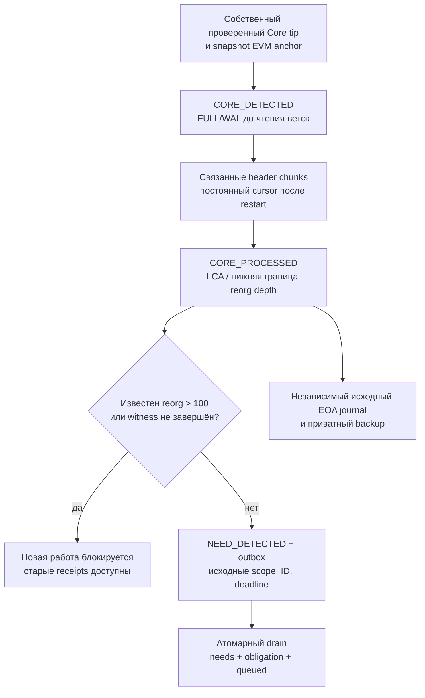

# Обработанные наблюдения Core и восстановление очереди

[Схемы: SVG/PNG и hashes текущих Mermaid-исходников](DIAGRAMS.md).

Для §15.11 выбран профиль `LOCAL_FENCE_RETAIN_MAINNET_GUEST_V1`: mainnet guest
сохраняется, известный глубокий reorg блокирует новую работу нашего self-hosted
worker, журнал восстанавливается, остаточное окно риска описано явно. Выбор
пользователя зафиксирован в [policy](../ops/zkspv-observation-policy.json).



Worker config V7 добавляет обязательный `observations`; пример:
[zkspv-observed-worker.example.json](../config/zkspv-observed-worker.example.json).
V1–V6 остаются legacy форматами. После enrollment V7 исходный EOA journal не
позволяет отключить observation policy новым каталогом или старым config.
Переход V6→V7 сохраняет scope, need IDs, reservations, funding и исходные deadlines.

Каждое событие имеет sequence, предыдущий digest и собственный SHA256. Событие
сначала фиксируется в worker SQLite, затем в исходном независимом EOA journal,
до разрешения новой работы. При restart проверяются обе цепочки и восстанавливается
недостающий согласованный suffix. Конфликт не разрешается выбором более удобной копии.
В backup нет signing shares, private keys или новых signed EVM envelopes.

Ветки читаются по hash связанного header, без положительного вывода по одному
`getblockhash(height)`. Длинный разрыв обрабатывается ограниченными пакетами;
каждый packet/cursor сохраняется до следующего. Неполная или недоступная ветка
не пропускается при переходе к следующей вершине. Сохраняется и A→B→A, и EVM
anchor A→B→A. Журнал не утверждает, что увидел события между опросами.

Известный depth 101+ блокирует proving/publication даже если EVM уже принимает B
или всё ещё хранит гораздо более старый anchor. Ограничение выводится также из
`CORE_PROCESSED`, поэтому crash перед отдельным `INCIDENT` marker его не снимает.
Нет автоматического clear/reset/rebase для такого события. Exact completed
receipts можно читать без повторного job, оплаты или новой подписи.

## Outbox, maintenance и recovery

Outbox восстанавливает тот же request и obligation одной SQLite-транзакцией.
Повтор не обновляет deadline, не меняет payment/source и не создаёт новый need ID.
Другой queue scope требует исходного профиля/recovery. Переполненная очередь
оставляет запрос pending; она не останавливает security maintenance. Private
requests ограничены отдельно и не занимают зарезервированную часть history.

При необходимости полезного update создаётся `maintenance:observation:<hash>` с
фиксированным deadline. Используются существующие confederation own-funding caps,
общий EOA nonce lane и проверка фактического native balance. Подготовка/ACK не
сдвигают heartbeat anchor; отсутствие новых headers не создаёт пустой transition.

```sh
PYTHONPATH=signer-agent python -m signer_agent.zk_worker observations --config /srv/private/worker-v7.json
PYTHONPATH=signer-agent python -m signer_agent.zk_worker observation-backup \
  --config /srv/private/worker-v7.json --archive-file /srv/private/observations.json
PYTHONPATH=signer-agent python -m signer_agent.zk_worker observation-restore \
  --config /srv/private/worker-v7.json --archive-file /srv/private/observations.json \
  --accepted-backup-sha256 REPLACE_WITH_RETAINED_SHA256
```

Backup создаётся новым приватным файлом. Restore проверяет domain, policy, всю
hash chain и согласованный prefix; старый backup не стирает более поздние события.
Он дополняет штатный header archive и резервные копии исходных EOA/FROST/spent
journals. Рост history ограничен policy; исчерпание лимита требует recovery и
не вызывает скрытого удаления истории или нового незакреплённого root.

## Остаточное окно риска

Локальная hash chain подтверждает сохранность обработанных наблюдений. Она не
доказывает полноту неопубликованной истории и не гарантирует общий on-chain halt.
Пример: наблюдатель видел A2000→B2001 с LCA1850, но EVM anchor ещё 1000. Proof
1000→B2001 может быть допустимым append; в нём нет свидетельства всей истории A.
Наш worker сохранит глубокий fork и остановится, однако независимый submitter или
consumer с уже достаточным Fresh state не наследует этот локальный запрет on chain.

Остаются события во время недоступности всех наблюдателей, интервалы между
наблюдениями, гонка с чужим submitter, потеря всех независимых копий/checkpoints и
неполученные branch witnesses. Добавлять доверенное FROST-свидетельство или менять
mainnet guest в этом профиле пользователь не разрешал. Это явно принятый профиль
остаточного риска, а не доказанная эквивалентность неизбежному глобальному halt.

Источники: [журнал](../signer-agent/signer_agent/zk_observations.py),
[worker](../signer-agent/signer_agent/zk_worker.py), [policy](../ops/zkspv-observation-policy.json).
