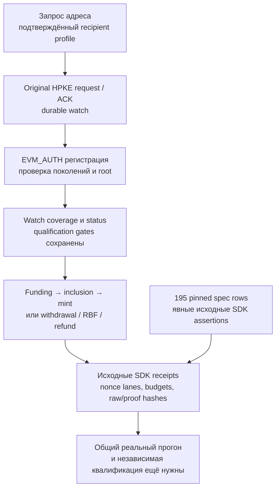

# Расширенные сценарии общего контура

[Схемы: SVG/PNG и hashes текущих Mermaid-исходников](DIAGRAMS.md).

Suite содержит **43 типизированных workflow-рецепта** и **195 отдельных слотов
наблюдений по строкам ТЗ §11.9–11.15**. Они различаются в collector: исполненный
workflow имеет `VERIFIED`, read-only assertions — `OBSERVATIONS_VERIFIED`.
Оба статуса сохраняют `e2e_qualified=false`; число слотов не является процентом
покрытия функционала или доказательством прохождения 195 интеграционных сценариев.

## Адрес и recipient

Адаптер [contour_address.py](../ops/zkspv/contour_address.py) использует прежние
`Client`, HPKE transport, `Driver` регистрации, recipient confirmation и watch.
Роли `address_request`, `address_registration`, `address_ready` имеют собственные
исходные EOA journals/budgets; одна итерация делегирует максимум одну новую
транзакцию. `probe` не создаёт request, не подписывает и не публикует.

Поддерживаются `ordinary`, `wallet-v1` и `advanced-contract`. Advanced flow требует
исходного явного confirmation; arbitrary contract не превращается в поддерживаемый
wallet. Request/ACK не открывает recipient choice публично до штатной регистрации.
Завершённая coverage сохраняется с EVM/Core anchors; последующее ageing не даёт
нового права mint. Текущие `QUALIFIED=false` / `FEE_QUALIFIED=false` и `ready=false`
сохранены. Поле `expected_status` позволяет проверять и такую честную блокировку.

## Withdrawal, replacement и несколько owners

`contour_withdrawal` V1 сохраняет начальную single-request версию. V2 добавляет
`previous_config` и `accepted_previous_sha256` для отдельного, явно рассмотренного
replacement. V3 добавляет `additional_owners` (до семи) и nullable previous-профиль
для общего V4 batch. Все quotes/configs/consents входят в input pins.

У каждого owner остаются собственные principal, accepted quote, primary receipt,
fee source и per-version consent. BTC/MP/S источники могут различаться в одном
batch; asset principal и asset fee не смешиваются. В частности, direct MP с S fee
проходит через прежний fee-only callback. Допустимость всех source/credit/change
и точная сумма miner fee остаются проверками исходных verifier/SDK/контрактов.

Replacement сохраняет полный input/key set, исходные refs, principal quotes и
семью; комиссия увеличивается только в новой явно принятой версии. Chain профилей
ограничена 16 версиями и не допускает циклов. Old/new winner имеют разные need/txid
и отдельный proof/settlement job. `previous` передаётся и в исходный Bitcoin journal
при broadcast/recovery. Новая cap revision не переписывает old-winner snapshot.

`fee_owner` использует исходный `Owner` для BTC/MP/S consent, token refunds,
`createRefund`, `raiseRefundCap`, `cancelRefund`. `withdrawal_cancel` вызывает
исходный owner exit только при Pending/доказанной Cancelled family. Signing,
expiry, abort и RPC outage не становятся доказательством безопасного refund.
BTC credits после отмены primary сохраняются как обязательства; dust не списывается.

## Привязки всех строк ТЗ

Дополнительно подготовлены [конкретные локальные test programs](ZKSPV_LOCAL_ACCEPTANCE.md):
195 строк явно связаны с 55 исполняемыми модулями, их setup/actions/assertions
и source pins. Их результаты сохраняют границы моделей и fixtures. Приватные
входы настоящей развёрнутой связки относятся к отложенному общему контуру.

[Каталог](../ops/zkspv-required-scenarios.json) закрепляет SHA256 ТЗ 2.16,
ID/clause/title и hash каждой из 195 строк. `scenario_check` принимает только
фиксированные операции исходных SDK: worker/Fresh/halt/observation fence,
address status, owner status, fee reconciliation status и typed `eth_call` к
проверенным компонентам того же графа. Включены DKG/FROST/authorization, canonical
root/recipient policy и проверенный service treasury/payment registry.

Нет shell, callback Python или JSON-файла «успешного результата». Условия задаются
точными путями/значениями либо фиксированным SDK error code. RPC failure не
принимается за EVM revert; revert требует точного hash возвращённых данных.
Исторические результаты сохраняются неизменно и повторно проверяют canonical
EVM anchors. Они не выдаются за remote attestation или проверку всех вариантов
одной длинной строки ТЗ.

Шаблон [suite config](../config/zkspv-contour-suite.example.json) содержит 317
deferred jobs до автоматических Fresh gates; лимит — 512. Это заготовка точных
private bindings. Для общего запуска оператор ещё должен предоставить реальные
deployment/identity/config/quote/plan/consent/need и checks-файлы для каждого случая.
Пустые checks, неправильный row hash, смешанные worker/need/version/recipient scopes
или отсутствующие dependency edges не получают PASS. Воспроизведение outage,
конкуренции и атак на реальной изолированной связке остаётся частью общего прогона.

Источники: [factory](../ops/zkspv/contour_suite_plan.py),
[матрица](../ops/zkspv/contour_matrix.py), [assertions](../ops/zkspv/contour_checks.py),
[withdrawal](../ops/zkspv/contour_withdrawal.py), [критерии покрытия](ZKSPV_FUNCTIONAL_COVERAGE.md).
