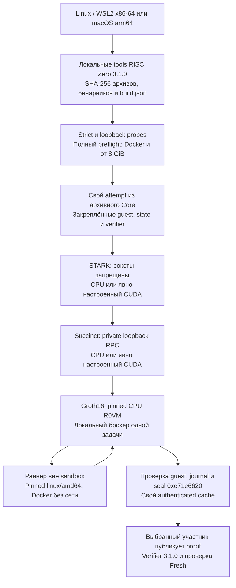

# ZK prover на Linux и Windows/WSL2

[Схемы: SVG/PNG и hashes текущих Mermaid-исходников](DIAGRAMS.md).

Реализован Linux backend основного worker: STARK → succinct → Groth16,
криптопроверка receipt, собственный cache и явная публикация. Код между
участниками одинаковый. Установка tools, Docker и личные конфиги выполняются
на каждом хосте; готовые proofs не входят в [поставку](DISTRIBUTION.md).

Рабочий SDK и verifier используют RISC Zero 3.1.0 с селектором `0xe71e6620`.
Linux x86-64 и Ubuntu WSL2 на x86-64 используют нативные CPU tools. macOS
ARM64 использует нативный R0VM и x86-64 контейнер для Groth16. Официальный
образ этой версии опубликован для linux/amd64. Для полного цикла на macOS
проверьте поддержку эмуляции в обновлённом Docker Desktop и время proving.
Доступность инструментов и preflight оставляют `qualified=false`,
`fee_qualified=false` и `production_ready=false`.

## Медленный CPU и экспериментальный CUDA backend

В приватном конфиге worker `headers_per_attempt` задаёт локальный размер
порции от `"1"` до `max_headers_per_sync` из согласованной Bitcoin policy.
Начните с замера полного цикла на меньшей порции. Меньшая порция может
потребовать больше транзакций для catch-up. `stage_timeout_seconds` допускает
до `"86400"`. Неудачная стадия сохраняется в `<stage>.failed-N` сразу, включая
последнюю попытку. Мониторинг считает успехом `status=VERIFIED` и проверенную
запись о завершении.

Для CUDA на Linux x86-64 соберите R0VM из официальных исходников 3.1.0.
Архив и его SHA-256 указаны в [профиле релиза](../config/zk-prover-3.1.0.json).
Существующий патч для применения `--po2` совместим с исходниками 3.1.0.
Из корня Satoshifi задайте `CUDA_SOURCE` как путь к проверенному распакованному
архиву. Нужны NVIDIA driver, CUDA toolkit и `nvcc`.

```bash
CUDA_PATCH="$PWD/ops/zkspv/r0vm-3.0.3-segment-limit.patch"
(cd "$CUDA_SOURCE" && git apply --check "$CUDA_PATCH" && git apply "$CUDA_PATCH")
(cd "$CUDA_SOURCE" && cargo build --locked --release \
  -p risc0-r0vm --features cuda,disable-dev-mode --target-dir "$CUDA_SOURCE/target")
sha256sum "$CUDA_SOURCE/target/release/r0vm"
```

Необязательный объект `cuda` содержит три строки `r0vm_binary` (абсолютный
путь), `r0vm_sha256` и `segment_limit_po2` (16–21). В журнале composite
должно быть подтверждение применения размера сегмента. Для 6 ГБ VRAM можно
начать замер с `"18"` и меньшей порции заголовков. Поддержку конкретной
карты и объём памяти подтверждает полный локальный прогон. Bwrap разрешает
CUDA-доступ к необходимым устройствам NVIDIA или `/dev/dxg` в WSL2 на этапах
composite и succinct. Groth16 запускает закреплённый CPU R0VM и обращается
к локальному брокеру одной задачи. Сам Docker-сокет доступен процессу раннера
вне sandbox. Проверки сети и receipt работают в отдельных процессах.
Хэши guest, входа, журнала и предыдущего receipt проверяются до
запуска. Проверки работают и с Python `-O`. Бинарник CUDA и результаты proving
каждый участник готовит сам. Границы полномочий закреплённого Groth16-процесса
описаны в [проверке безопасности](SECURITY_LOGIC_REVIEW_2026_11_03.md#повторная-проверка-12-ноября-2026).
[Исходники R0VM 3.1.0](https://github.com/risc0/risc0/blob/v3.1.0/risc0/r0vm/Cargo.toml).

## 1. Установка окружения

Сначала выполните [общую сборку](CROSS_PLATFORM_QUICKSTART.md): Python venv,
FROST, Solidity и ABI/runtime checks. На Windows все дальнейшие команды идут
в Ubuntu WSL2. Проект и worker directory должны находиться в Linux home,
не в `/mnt/c` или общей Windows-папке.

```sh
sudo apt-get update
sudo apt-get install -y bubblewrap libseccomp2
source .venv/bin/activate
```

Установите Docker Engine либо включите WSL integration в Docker Desktop.
Для Docker Desktop используйте выпуск с исправлением CVE-2025-9074, начиная
с 4.44.3. [Advisory Docker](https://docs.docker.com/security/security-announcements/#docker-desktop-4443-security-update-cve-2025-9074).
Нужны **Linux Docker CLI и доступный локальный Unix socket**. TCP/SSH Docker
endpoints не используются для локального proving. Автоматический поиск
учитывает `XDG_RUNTIME_DIR/docker.sock`, `~/.docker/run/docker.sock` и
`/var/run/docker.sock`; при необходимости задайте абсолютные локальные пути:

```sh
export SATOHSI_DOCKER=/usr/bin/docker
export SATOHSI_DOCKER_SOCKET=/var/run/docker.sock
```

Это только пример путей. В Docker Desktop/WSL или rootless Docker используйте
реальный Linux CLI/socket своей установки. Секретные RPC, signing keys и cookie
в эти переменные не помещаются.

Для холодной установки нужно не менее **8 GiB свободного места**, с запасом
на Cargo caches, builder image и Groth16 image. Фактическая вместимость proof
может быть больше минимального порога. Проверка `--full` и запуск STARK проверяют минимальное свободное место.

Если Groth16 завершается с `container_exit_code=137`, проверьте лимит RAM
Docker. На хосте с Docker Desktop около 8 GiB помог локальный режим
`export SATOSHIFI_GROTH16_LOW_MEMORY=1` перед запуском worker. Брокер задаёт
для этого контейнера `GOMAXPROCS=2`, `GOGC=35` и мягкий `GOMEMLIMIT=6GiB`.
Параметры Docker Desktop остаются прежними. Результат зависит от RAM и других
нагрузок на хосте. [Ограничение памяти Go runtime](https://go.dev/doc/gc-guide#Memory_limit).

## 2. Локальная воспроизводимая сборка tools

Задайте свой постоянный каталог `$LOCAL` с правами 0700. Выходной каталог
установки должен быть новым. Выберите архив своей платформы по ссылке
`platforms.<платформа>.archive_url` из [профиля 3.1.0](../config/zk-prover-3.1.0.json).
Сохраните путь к скачанному архиву в `RISC0_ARCHIVE`.

```sh
export LOCAL="$HOME/.local/share/satoshifi/zk"
mkdir -p "$LOCAL"
chmod 700 "$LOCAL"
rustup toolchain install 1.97.1 --profile minimal
cargo +1.97.1 fetch --locked --manifest-path rust/zkspv/risc0-release/Cargo.toml
export SATOHSI_RISC0_RELEASE_TOOLS="$LOCAL/prover-tools-3.1.0"
python -m ops.zkspv.risc0_release --archive "$RISC0_ARCHIVE" \
  --output "$SATOHSI_RISC0_RELEASE_TOOLS" --offline
```

Установка проверяет архив и бинарник R0VM по SHA-256, собирает bridge и wrapper
с Cargo.lock и записывает локальные хеши инструментов и исходников в `build.json`.
Сохраните весь каталог. Worker сверяет запись и файлы перед proving. Переменные
для старых tools 3.0.3 относятся к историческим проверкам.

Загрузите образ по закреплённому digest на локальном Docker:

```sh
python - <<'PY'
import subprocess
from signer_agent.zk_isolation import docker_endpoint
from signer_agent.zk_prover_platform import release_profile
binary, socket = docker_endpoint()
pin = release_profile()
subprocess.run([str(binary), '--host', 'unix://' + str(socket),
                'pull', '--platform', 'linux/amd64', pin['container_image']], check=True)
PY
python -m signer_agent.zk_prover_platform
python -m signer_agent.zk_prover_platform --full --directory "$LOCAL"
```

Обычный preflight проверяет инструменты и изоляцию. `--full` дополнительно
сверяет образ, архитектуру и свободное место. Перед денежными сценариями
прогоните свежий proof каждого участника от подготовки до проверки и
публикации в согласованном тестовом deployment.

## 3. Witness host и конфигурация участника

Соберите свой witness host через `ops.zkspv.participant_build` и
`ops.zkspv.worker_build` по [порядку подготовки sources](DISTRIBUTION.md#сборка-на-каждом-хосте).
Сохраняются прежние Citrea commit/archive pins, исправленный verifier и
неизменённый mainnet guest. Для [testnet4 + Sepolia](ZK_TESTNET4_SEPOLIA.md)
передайте `--bitcoin-network testnet4` в обе build-команды и выберите отдельный
testnet4 host/program. В worker JSON укажите локальные `host_binary` и
`host_sha256`, полную enrolled Bitcoin policy, свой Core/RPC, identity,
state contract, worker directory, consumer allowlist и бюджеты.

На всех хостах совпадают chain/state, guest image, policy и публичный claim.
Личные пути, ключи, inputs, receipts и caches остаются у владельца. Поля
`.example.json` — шаблоны; они не становятся рабочими binding автоматически.

## 4. Проверка всех рабочих стадий

После регистрации need или настройки initial heartbeat:

```sh
python -m signer_agent.zk_worker prepare --config "$WORKER_CONFIG"
python -m signer_agent.zk_worker prove --config "$WORKER_CONFIG"
# Повтор до публикации проверяет собственный authenticated cache.
python -m signer_agent.zk_worker prove --config "$WORKER_CONFIG"
# Только выбранный publisher:
python -m signer_agent.zk_worker publish --config "$WORKER_CONFIG"
```

У каждого свой prepared attempt и собственный расчёт. Чужая публикация уже
подготовленного перехода не заменяет собственный proof и не вызывает вторую
платную публикацию. `run` по умолчанию считает локально; service/transport loop
с транзакциями включается явно через `run --boundary all`.

Для полного bound contour используйте
[suite plan и durable runner](ZKSPV_CONTOUR.md), затем:

```sh
python -m ops.system_modes preflight --mode zk-fresh --suite-plan "$SUITE_PLAN"
python -m ops.zkspv.contour_suite inspect --config "$SUITE_PLAN"
python -m ops.zkspv.contour_suite step --config "$SUITE_PLAN"
```

`zk-fresh` в system runner проверяет готовность плана; actual proving выполняет
явный durable contour. Mainnet guest сохраняет Bitcoin mainnet; testnet4 использует отдельный
фиксированный guest. Network не выбирается заменой platform profile; regtest ZK
по-прежнему не поддерживается рабочим backend. Developer-слой `zk-cached` требует
отдельных исторических fixtures, которых нет в participant archive. Рабочий
собственный cache проверяется повтором `prove`, как показано выше.

## Изоляция и восстановление

Linux использует bubblewrap user/PID/network namespaces и read-only системные
файлы/tools. Из личных данных в sandbox виден только текущий attempt; worker
identity и `.local-proof-key` не монтируются. Из сетевых интерфейсов активен
только loopback. Ядро может создавать выключенные tunnel placeholders; они
не дают внешнего маршрута, а capabilities workload снимаются.

STARK и receipt inspection дополнительно запрещают socket/socketpair через
seccomp. Succinct допускает только внутренний loopback RPC. Groth16 получает
Unix-сокет брокера с одной командой запуска. Брокер копирует `input.json` и
`seal.r0` в свой каталог вне sandbox, проверяет тип и размер файлов и возвращает
только `proof.json`. Путь bind mount, образ, имя контейнера и параметры
`--network none`, `--pull never`, cap-drop задаёт раннер. Он сверяет
конфигурацию контейнера перед запуском. Подписант проверяет полученную
квитанцию отдельно. В macOS чтение данных ограничено текущим attempt,
разрешёнными инструментами и системными библиотеками. Запись ограничена
attempt, а для Groth16 — каталогом этапа.
Если namespace или seccomp недоступны, запуск останавливается.

Worker lock удерживается через bubblewrap `--sync-fd` до завершения sandbox.
Timeout завершает process group; отдельный Docker container убирается штатным
cleanup. Stage completion по-прежнему записывает local origin до атомарного
report. Исходные nonce/budget/signing journals и собственный cache сохраняются.
После обновления SDK подготовьте новый attempt, если исходники, записанные
в прежнем `preparation.json`, изменились. Старый attempt остаётся в истории.



Если bubblewrap блокируется политикой Ubuntu/AppArmor или вложенным Docker,
проверьте штатный профиль пакета и поддержку user namespaces. Не отключайте
глобальные защиты ради прохождения preflight. На WSL используйте актуальный
WSL2 kernel и Linux filesystem. Вложенные Docker tests требуют настройки
родительского test-контейнера; это не аргументы обычного запуска на Linux/WSL.

На macOS arm64 прошли проверка toolchain и пробы изоляции. Свежий прогон
дошёл до composite и был прерван при нехватке свободного места.
Полный рабочий Groth16 и полный цикл на физическом Linux/WSL2 остаются
пунктами приёмки. [Статус испытаний](LAUNCH_READINESS.md#статус-проверки) ·
[Исторический отчёт переноса](../ops/artifacts/zk-linux-port-20261103/validation.json).
