# ZK-SPV и адресные депозиты: архитектура кода

[Схемы: SVG/PNG и hashes текущих Mermaid-исходников](DIAGRAMS.md).

[Сквозной сценарий FROST и ZK](FROST_ZK_LIFECYCLE.md): отдельные DKG,
уравнения подписи и proof, nonce recovery, гонки публикаций и Bitcoin settlement.

[Математическое описание](LAUNCH_MATHEMATICS.md): единицы, точное округление,
границы выплат, UTC-учёт, APY и предпосылки безопасности.

[Оглавление документации](README.md) · Обновление схем: **5 ноября 2026**.

Это карта реализованных компонентов и их границ. **Полное ТЗ не завершено,
production_ready=false, Ready-адреса не выдаются.** На структурных схемах сплошные
стрелки показывают связи кода; пунктир показывает отдельно обозначенные
условные или незавершённые связи. Автоматы показывают переходы с условиями; связи заметок
со состояниями не являются переходами.
Код-кандидат и положительные проверки с fixtures не означают production-допуск.
Mermaid в этой странице — исходник схем; [актуальные SVG и manifest](DIAGRAMS.md)
создаются из точных исходных блоков.
Текущий порядок [поставки и независимого расчёта](DISTRIBUTION.md): у каждого
участника свой рабочий proof, Core, worker directory и локальные записи
происхождения. Публикация выполняется явно выбранным publisher. Готовые proofs,
рабочие inputs/journals и caches в participant archive не включаются.
Полная сверка функционала и кодового остатка:
[карта покрытия ТЗ](ZKSPV_FUNCTIONAL_COVERAGE.md). 43 workflow-рецепта и 195 observation slots
не заменяют квалифицированное исполнение строк таблиц §11.9–11.15.

## 1. Выбор backend не меняет денежные правила

Bootstrap выбирает backend из полной подписанной Bitcoin policy. Ethereum
mainnet/Sepolia/local выбираются независимо. Для ZK используются отдельные
фиксированные mainnet и testnet4 guests; regtest и fork/halt test-only guests
не подставляются в этот путь. [Testnet4 + Sepolia](ZK_TESTNET4_SEPOLIA.md).

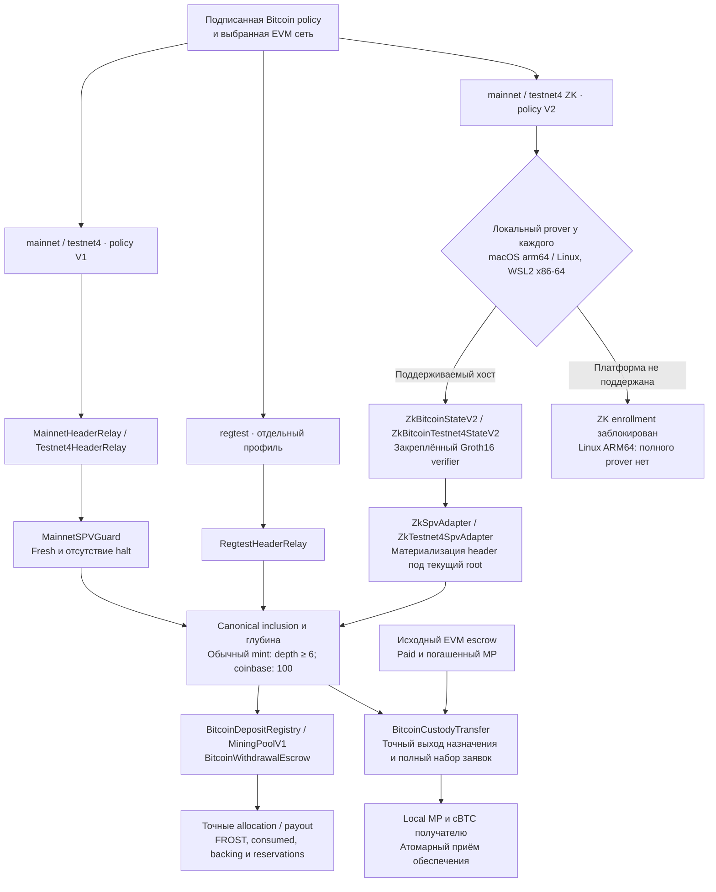

Custody-профиль использует тот же выбранный backend для
[передачи BTC между независимыми кошельками](BITCOIN_CUSTODY_TRANSFER.md).
SPV-проверка не заменяет исходную EVM-квитанцию `Paid` и burn MP. Gateway
проверяет обе стороны до выпуска cBTC. Для ZK каждый участник самостоятельно
обновляет рабочее доказательство состояния заголовков; consumers используют
обычные raw transaction и Merkle-ветку под каноническим состоянием. Новый
fresh ZK перенос этим обновлением схем не подтверждается.

ZK proof обновляет общее Bitcoin-состояние. Депозит и выплата по-прежнему
используют raw transaction и обычную Merkle-ветку; отдельный ZK proof для каждого
UTXO не создаётся. Fresh требует одновременно допустимого возраста принятого
полезного update и допустимого отставания времени tip, а также `!halted`.
Checkpoint сам по себе не Fresh. Смена root инвалидирует кэш header proofs.

Источники: [bootstrap](ZK_SPV_BOOTSTRAP.md), [state/adapter](../rust/zkspv/state-adapter/README.md),
[`zk_spv.py`](../signer-agent/signer_agent/zk_spv.py).

## 2. Consumer запрашивает подготовку, затем повторяет свои проверки

Локальная очередь и зашифрованный on-chain transport — два альтернативных входа
одного worker. Они не предоставляют права mint/settle. Чужой ACK/READY не заменяет
проверку canonical state, Core, inclusion, allocation и threshold authorization.

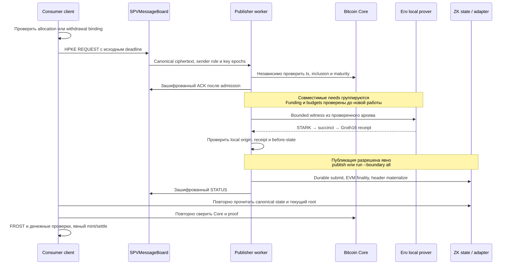

При `--zk-worker-config` request поступает прямо в приватный локальный inbox,
без `SPVMessageBoard`. Worker не запускает mint/settle за пользователя.
Секретные DKG shares и Bitcoin signing nonces не передаются prover.
Схема показывает publisher/service loop с `run --boundary all`. Обычный `run`
и `prove` считают локально без транзакций; они не опрашивают transport и не
отправляют ACK/STATUS. Остальные участники отдельно готовят свои needs/attempts
и считают proof, в том числе после чужой публикации уже подготовленного перехода.
Пошаговая [схема нескольких участников](DISTRIBUTION.md#рабочий-переход-у-каждого-участника)
сохраняет эту границу. Self-hosted runner реализован для macOS arm64 и
Linux/WSL2 x86-64. [Настройка Linux prover](ZK_PROVER_LINUX.md) включает
immutable tools и реальные namespace/seccomp probes; неподдерживаемые платформы
блокируются. Полный fresh-proof и физический WSL2 прогон ещё не подтверждены.

Источники: [worker](ZK_SPV_WORKER.md), [HPKE transport](SPV_ENCRYPTED_TRANSPORT.md),
[`zk_worker.py`](../signer-agent/signer_agent/zk_worker.py).

## 3. Оплата опциональна, конфедерация может работать за свои

Это реализованная кодовая ветвь с локальными проверками. Общий live
transport/payment/prover/consumer E2E ещё отложен. Автоплатёж включается отдельной
приватной policy; пример конфигурации по умолчанию не даёт права тратить средства.

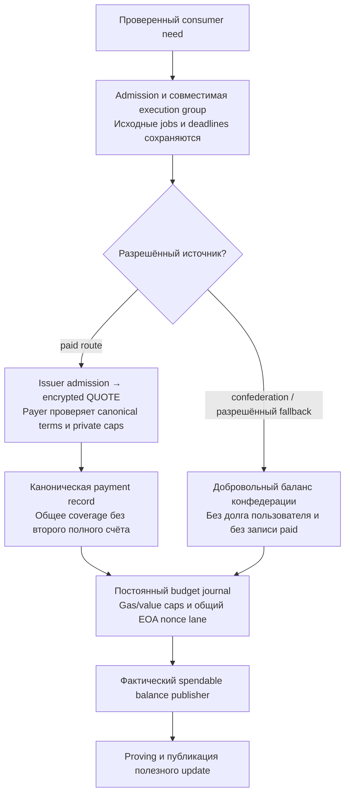

Пустая казна не запрещает явно разрешённую работу за свои. При этом будущий
claim, остаток treasury или paid marker не заменяет native balance отправителя.
Transport gas, payer budget и worker publication budget проверяются раздельно.
Новая директория или attempt не сбрасывает денежные лимиты. Объединение работ
не меняет original deadlines и не объединяет разрешения на денежные операции.

Источники: [automation/archive](SPV_AUTOMATION_ARCHIVE.md), [treasury](SPV_GAS_TREASURY.md),
[`spv_automation.py`](../signer-agent/signer_agent/spv_automation.py).

## 4. Архив восстанавливается по подтверждённому состоянию

V4 хранит сегменты принятых headers в постоянном SQLite/WAL архиве. Resident
native host переиспользует проверенное состояние при обычном продолжении;
холодный старт и restore сохраняют полную проверку соответствия canonical roots.
Лимит `archive.max_headers` задан отдельно: в примере 200 000, допустимый верхний
предел native cold replay — 2 000 000. Это не разрешение автоматически увеличивать
постоянный бюджет диска или RAM.

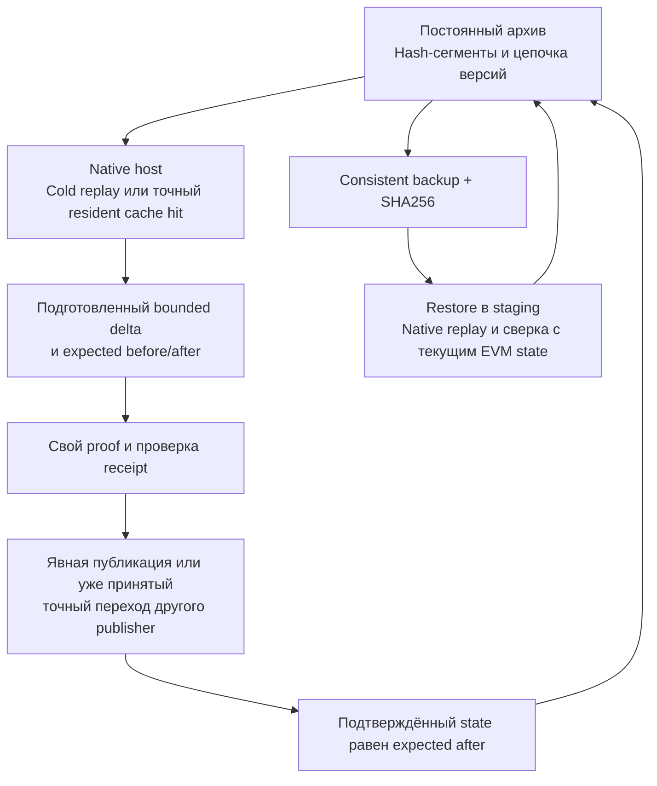

Архив headers **не является** резервной копией EOA nonce, signed-transaction,
budget, paid-job или FROST spent journals. Их откат не используется как restore.
Неизвестную историю ранее принятых fork headers нельзя восстановить только из tip.
[V7 observation journal](ZKSPV_OBSERVATION_HISTORY.md) отдельно сохраняет Core tips,
связанные branch packets и recoverable outbox в независимой EOA-копии. При >100
откате блокируется новая работа даже после чужого обновления EVM. По выбранной
пользователем policy mainnet guest сохранён: полнота неопубликованной истории
и общий on-chain halt не гарантируются. Доступность наблюдателя, bounds и
длительная эксплуатация остаются условиями квалификации.
Отдельно сохраняется весь личный worker directory с `.local-proof-key`,
authenticated completion records и своим `local-v1` cache. Перенос чужого
receipt не создаёт локальное происхождение; восстановление описано в
[порядке работы с кэшем](DISTRIBUTION.md#собственный-cache-и-восстановление).

## 5. Адресный mint — отдельный кандидат поверх общего учёта

Ни bootstrap, ни действующий клиент не включают адресный профиль автоматически.
Реальный `BitcoinDepositDerivation` имеет **`QUALIFIED=false`**; новый реестр
начинает DERIVATION scope в SUSPENDED. Положительные проверки адресного mint
используют явно тестовую qualification-обёртку и fixtures DKG/approval/SPV.

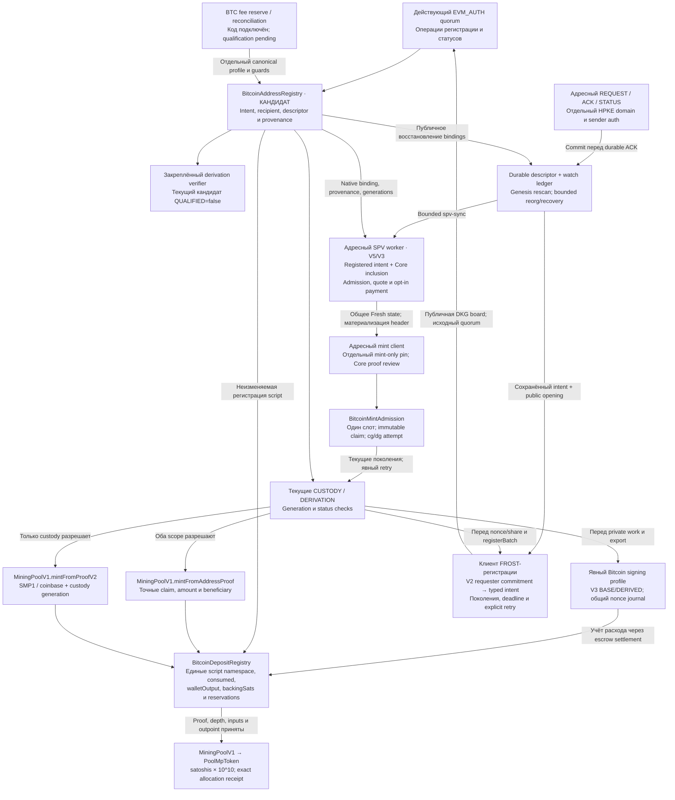

Новый common registry допускает привязку адресного реестра только до первой
base registration. Это не обновление уже развёрнутого immutable графа.
Batch содержит максимум 8 intents по 382 bytes; base и derived scripts имеют
единую уникальность. Recipient и validation provenance не переписываются.

Адресный путь использует `FUNDING_STRIPPED_100K_V1` и проверяет все funding inputs.
SMP1 сохраняет точный marker и предел 32 outputs. Режим выбирает script выхода:
SMP1 marker не переопределяет адресного beneficiary. Оба пути запрещают повторный
выпуск, wallet change и использование reserved wallet inputs как нового backing.
Любая ошибка атомарно откатывает authorization consumption, nonce, supply и учёт.

Для нового status-enabled графа legacy `mintFromProof` закрыт; SMP1 использует
`mintFromProofV2`. При отсутствии address registry остаётся прежняя конфигурация.
Legacy signer profile отказывается подключать новый граф. Явный V3/V4 profile
подключает его планы, input keys и общий journal; это не автоматическое обновление
старого signer или выдача qualification.

Источники: [реестр и ABI](ADDRESS_DEPOSIT_REGISTRY.md), [native derivation](DEPOSIT_DERIVATION_INPUTS.md),
[`BitcoinAddressRegistry.sol`](../web3/contracts/src/federation/BitcoinAddressRegistry.sol).

## 6. Приостановка не удаляет обязательства

Операции обоих scopes используют прежний EVM_AUTH quorum, отдельные status
sequences и проверку expected generation. Каждый новый переход, включая
повторное сообщение об инциденте в том же нетерминальном состоянии, увеличивает
generation. Точный старый receipt читается идемпотентно и не меняет текущий статус.

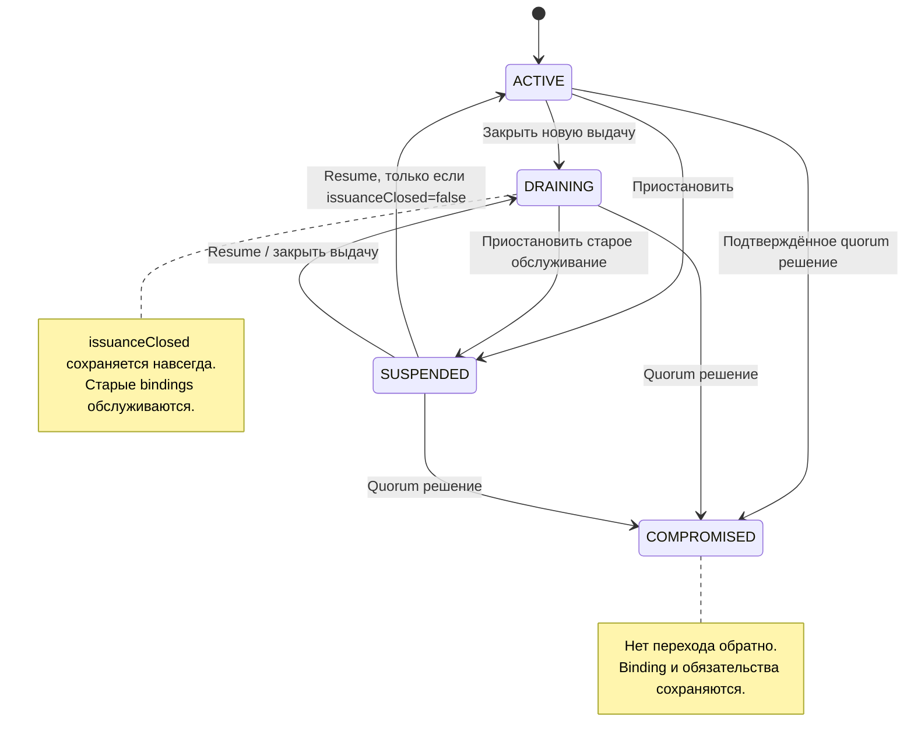

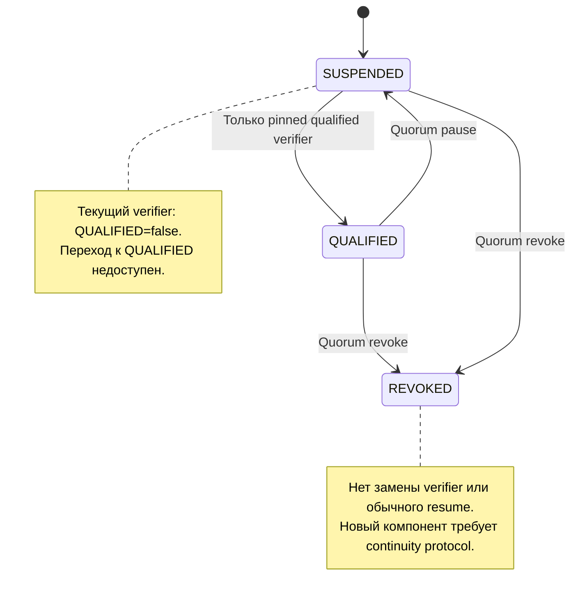

CUSTODY ограничивает весь новый выпуск данной связки, включая SMP1. DERIVATION
ограничивает адресный профиль. DRAINING разрешает законный mint старых bindings,
но закрывает новые адреса. Снятие SUSPENDED не оживляет approvals прежнего
поколения. Нехватка газа или недоступный RPC сами по себе не доказывают compromise.
Статус не перемещает BTC, не снимает reservations и не меняет получателя.
[Canonical family root](BITCOIN_KEY_FAMILY.md) синхронизирует монотонные поколения,
terminal/closed состояния и известные aliases между допущенными графами. Нужен
независимый pin одного root в одной EVM chain. Миграция живых активов отдельна.

## 7. Что проверено и что остаётся

Custody increment от 4 ноября отдельно проверен в
[native DKG/Core acceptance](../ops/artifacts/custody-transfer-20261104/README.md):
908 Solidity и 3344 разных SDK/ops-теста, actual regtest-передача и независимый
вывод, полный create/reuse. Исторический build inventory от 4 ноября —
[134 production contracts, минимальный margin 6 байт](../ops/artifacts/custody-completeness-20261104/contract-sizes.json).
Это не новый Groth16 proof и не qualification денежных ZK-сценариев.

Исторический [локальный acceptance package от 2 ноября](ZKSPV_LOCAL_ACCEPTANCE.md) проверен на
зафиксированном срезе из 696 файлов. [Основной отчёт](../ops/artifacts/zkspv/acceptance-20261102/local-acceptance-report.json)
сохраняет команду, XML/логи, source hashes и версии инструментов.

| Историческая проверка 2 ноября | Результат и граница |
|---|---|
| Полные локальные Python directories | 3269 passed, 0 failures/errors/skipped; `signer-agent/tests` и `tests/zkspv` |
| Ordinary Solidity | 834 Success; настоящие EVM executions с обозначенными DKG/SPV/qualification fixtures |
| State/adapter Solidity | 25 Success; отдельный профиль и собственные fixture boundaries |
| Восстановленный native host | Три прежние исключённые проверки возвращены; subset из 38 входит в 3269, без повторного сложения |
| Локальные программы по строкам ТЗ | 195 привязок к 55 модулям; оставшиеся части требований и реальный контур не объявляются пройденными |
| Сохранённые Groth16 receipts | Четыре повторные SDK-проверки с запрещённой сетью; без нового proof или нового consumer acceptance |
| Build limits | 129 production contracts; минимальный runtime margin — 66 bytes у `MultiPoolDeployer` |

Настоящий Core/FROST/Groth16/EVM-контур **отложен пользователем из-за места**.
Независимая квалификация не завершена; `QUALIFIED=false`, `FEE_QUALIFIED=false`,
`production_ready=false`. Выбранная policy локального fence §15.11 сохранена.
Старый FROST executable snapshot недоступен; это явно ограничивает воспроизводимость
прежнего deposit-прогона. 42 исторических source files сохранены по точным SHA-256.

[C1–C3 snapshot](../ops/artifacts/zkspv/worker-integration/c123-implementation-report.json),
1776-test baseline и следующие компонентные результаты сохраняют собственные
исходники и границы. Их числа не суммируются с текущими. Документационная сверка:
[аудит покрытия](../ops/artifacts/zkspv/functional-coverage-report.json).

| Компонент | Зафиксированная граница | Evidence |
| --- | --- | --- |
| Mainnet state/adapter и self-hosted proof | Настоящие локальные receipts; deployment/source-bound результаты сохраняют свой snapshot | [Сводный отчёт](../ops/artifacts/zkspv/regression-report.json) |
| Admission/payment/archive | 96 focused checks; native replay, но EVM/payment boundaries — mocks; общий E2E отложен | [Automation/archive](../ops/artifacts/zkspv/worker-integration/automation-archive-report.json) |
| Native BASE/DERIVED + EVM arithmetic | Bitcoin sighashes, реальные threshold signatures на synthetic keys, 16 EVM vectors; без Core acceptance | [Crypto report](../ops/artifacts/zkspv/worker-integration/address-input-code-report.json) |
| Address registry/mint/status | 84 Solidity и 245 Python; DKG completion, approval, SPV и qualification — явные fixtures | [Registry report](../ops/artifacts/zkspv/worker-integration/address-registry-code-report.json) |
| Address client/admission | Mint-only trust, независимый Core/proof review, generation races и точное восстановление receipt; положительные сетевые границы — fixtures | [Client report](../ops/artifacts/zkspv/worker-integration/address-mint-client-report.json) |
| Address Bitcoin signer | V3 mixed BASE/DERIVED, реальные native signatures, общий spent journal и crash/recovery checks; Core/EVM/qualification — fixtures | [Signing report](../ops/artifacts/zkspv/worker-integration/address-signing-client-report.json) |
| Address request/watch | Отдельный HPKE transport, durable ACK, native raw-block parsing, bounded rescan/reorg и public-binding recovery; сетевые границы — fixtures | [Watch report](../ops/artifacts/zkspv/worker-integration/address-watch-client-report.json) |
| Address FROST registration | V2 requester commitment, typed public batches, подтверждение сессии/поколений, bounded retry и exact-binding recovery; EVM/DKG/qualification — fixtures | [Registration report](../ops/artifacts/zkspv/worker-integration/address-registration-client-report.json) |
| Address SPV worker | Registered intent/UTXO, V5/V3 pins, watch/consumer hooks и admission/quote/payment; общий semantic job и проверка перед unsigned оплатой; Core/EVM/qualification — fixtures | [Worker report](../ops/artifacts/zkspv/worker-integration/address-spv-worker-report.json) |
| Multi-request suite | DAG/late binding, 43 workflow recipes, 195 observation slots и 195 локальных test-program bindings; до 512 jobs; реальный контур отложен | [Local case results](../ops/artifacts/zkspv/acceptance-20261102/local-case-results.json), [исторический suite](../ops/artifacts/zkspv/worker-integration/contour-suite-report.json) |
| Incident / old-epoch | Original HPKE/FROST status и Fleet/retention подключены к runner; текущие network/qualification boundaries — fixtures | [Incident](../ops/artifacts/zkspv/worker-integration/contour-incident-report.json), [epoch](../ops/artifacts/zkspv/worker-integration/contour-epoch-report.json) |
| Personal withdrawal / recipients | BTC/MP/S, payout/total, consent/refunds и recipient matrix реализованы; real monetary qualification pending | [Withdrawal](../ops/artifacts/zkspv/worker-integration/contour-withdrawal-report.json), [recipient](../ops/artifacts/zkspv/worker-integration/recipient-matrix-report.json) |

Эти числа не складываются в полный regression/E2E PASS. Для совпадения с текущим
кодом смотрите `source_snapshot` в сводном отчёте; старые proof receipts и code
reports не переименовываются в новую квалификацию.

C1/C2 и расширенные адаптеры C3 реализованы в указанных границах. До Ready/production
остаются приватные case bindings и qualified execution обязательной матрицы, independent
verifier/profile review, квалификация адресного request/watch/registration/SPV,
общего BTC signing, recipient и fee-purpose профилей, эксплуатационные проверки
[reserve/reconciliation](BTC_FEE_RESERVE.md) и старых epochs, настоящий общий контур.
Фактический переход живых обязательств C4 условен и не реализован.
Код [BTC/MP/S credits, consent и refunds](WITHDRAWAL_FEE_SUBSIDY.md)
реализован отдельным immutable профилем; его actual-purpose qualification,
live consumer/signing и независимая проверка остаются открытыми.
Долгий общий Core/proving/consumer E2E отложен пользователем из-за места на устройстве.

Канонический BTC fee reserve и reconciliation реализованы отдельным immutable
профилем до первого batch. `available = free - locked - unbound promises`;
principal и pending deposits не пополняют free. Mempool/RBF удерживает collateral,
подтверждённый spend ждёт settlement, неизвестная потеря останавливает общий
Bitcoin signing journal. Старый точный winner сохраняет settlement после pause.
Низкий резерв блокирует новые fee promises, а не допустимый mint; Ready по-прежнему
выключен. См. [runbook](BTC_FEE_RESERVE.md).

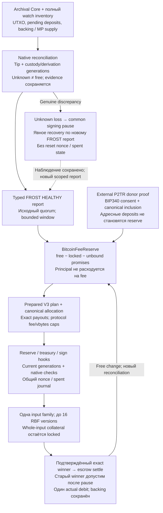

## 9. Multi-request suite связывает исходные SDK

Это схема кода, а не результат настоящего денежного запуска. Шаблон связывает
адресный mint с BTC/payout withdrawal и reconciliation; другие mint/fee modes
исполняются отдельными типизированными jobs. До `bind` нужны исходные проверенные
конфиги, quotes, owner consent и внешняя FROST-авторизация.

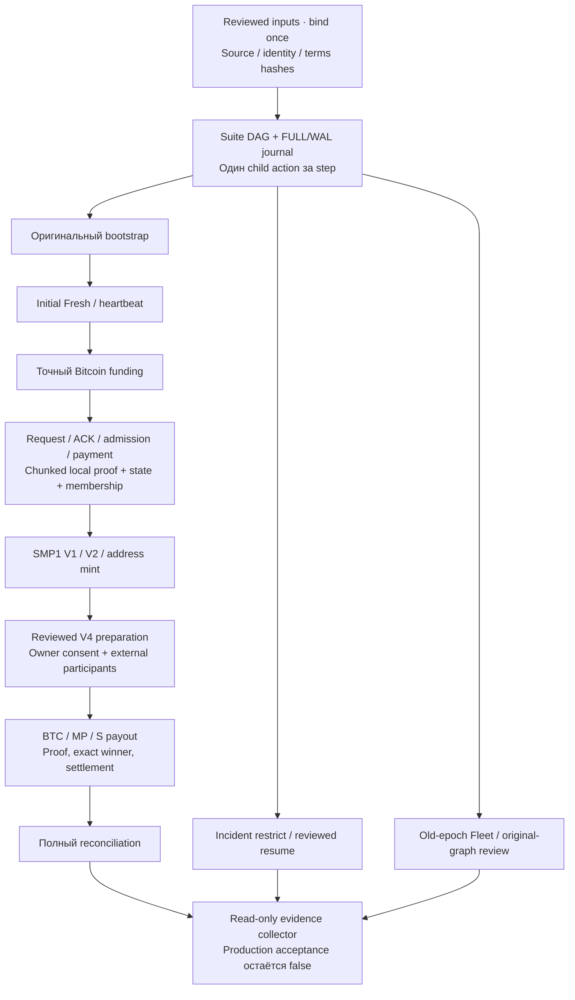

[Расширенные bindings](ZKSPV_SCENARIO_BINDINGS.md) добавляют address request→ACK→
registration→watch/status для трёх recipient modes, явные RBF old/new winners,
per-owner batch, consent/caps, safe cancel и refunds. 195 read-only assertion slots
имеют отдельный observation status; приватные настройки случаев и квалифицированное
исполнение остаются обязательными. Источники:
[`contour_suite.py`](../ops/zkspv/contour_suite.py),
[`contour_suite_plan.py`](../ops/zkspv/contour_suite_plan.py),
[матрица и runbook](ZKSPV_CONTOUR.md#multi-request-suite-and-scenario-matrix).

## 10. Принятый chunk сохраняется до следующей попытки

Один request может требовать несколько chunks. Часть catch-up с большим work
ещё не означает достаточную глубину/Fresh и не выдаёт mint permission.

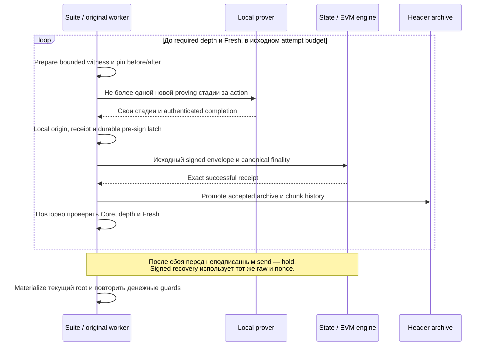

Binary receipts, native inputs/journals, stage reports, original state envelopes,
контексты/логи и process hashes сохраняются collector. Он только перепроверяет
read probes и не создаёт consent, payment, новую подпись или renewal claims.
Источник: [`contour_worker_cycle.py`](../ops/zkspv/contour_worker_cycle.py).
Это локальные материалы исполнения и collector, исключённые из поставки.
Готовый исторический receipt используется только в developer-проверках;
он не подменяет рабочий расчёт участника.

## Personal withdrawal fees and shared SPV

[Personal BTC/MP/S fee credits](WITHDRAWAL_FEE_SUBSIDY.md) preserve principal and require exact owner consent per version. BTC funding uses a separately qualified purpose and the complete nominal-value ledger; refunds retain named rights on base change. Worker V6 / transport V4 accept an explicitly pinned `withdrawal_fee` need, reuse the same state/archive/grouping/admission/quote/payment, and recognize exact historical completion before current issuance checks. The fee request itself grants no monetary authority. Existing escrow withdrawal coverage serves typed refunds. Long live proof/consumer qualification remains pending.

## Единая конфигурация и независимые денежные контуры

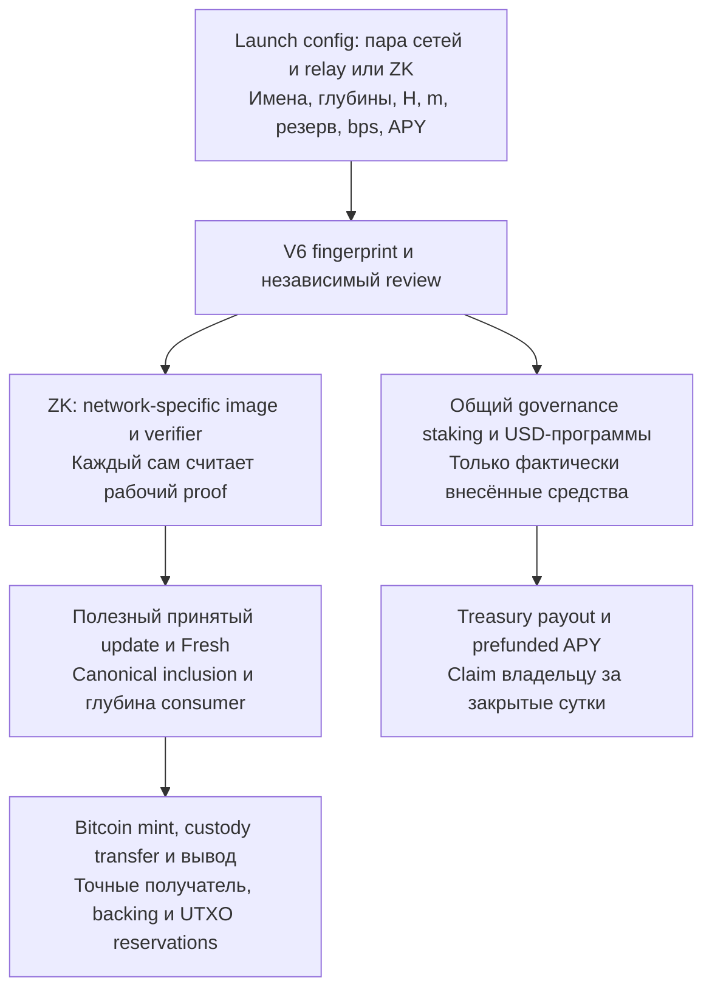

Fresh не заменяет maturity или независимое согласие кастодианов. Coinbase mint
требует 100; общий клиентский выбор coinbase inputs — 101; fee ingress — ещё
и согласованную глубину. Повышение обычной mint-глубины не повышает отдельный
coinbase-mint порог текущего registry. USD startup не требует Bitcoin proof
для своего payDay и не создаёт BTC-обеспечение. Формулы и точные границы
описаны в [математике запуска](LAUNCH_MATHEMATICS.md).
