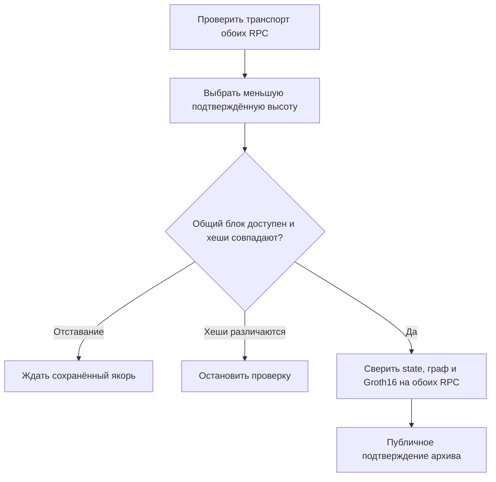
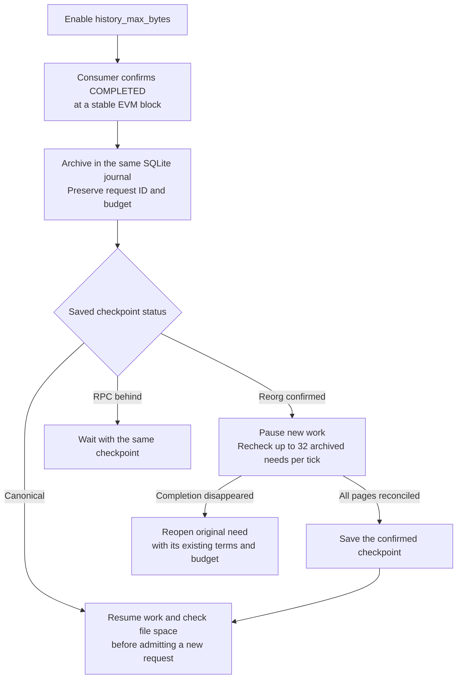

# Local consumer-driven self-hosted ZK worker

The optional worker connects ordinary participant deposit/withdrawal operations
to the mainnet and testnet4 ZK backends described in [bootstrap](ZK_SPV_BOOTSTRAP.md).
It builds witnesses with the selected fixed network kernel, runs the pinned local
STARK → succinct → Groth16 pipeline, verifies the receipt independently,
can explicitly submit the state transition, wait for configured EVM confirmations and
materializes the transaction's Bitcoin header against the current history root.

Select a worker mode for the task. A preparation service stops at the native
input and journal. A prover computes locally and can export a separate
public transition archive for another participant to verify. The verifier
uses it as read-only evidence, while publication uses an authenticated
result from the publisher's own worker. The [participant source distribution](DISTRIBUTION.md)
contains source and pins. Historical reports below retain their original snapshots.

The original same-machine inbox authenticates its caller through OS ownership
and private filesystem permissions. V3 adds the separate encrypted on-chain
request/ACK/status route; V4 adds optional issuer/payer automation and a permanent
archive. Heartbeat and paid-or-confederation funding are implemented code paths.
The combined live proving/payment/consumer E2E and unattended production
qualification remain pending. See the [current architecture diagrams](ZK_SPV_ARCHITECTURE.md).
Requests do not authorize mint, settlement or FROST signatures.

The [multi-request suite](ZKSPV_CONTOUR.md#multi-request-suite-and-scenario-matrix)
adds dependency scheduling, explicit late input binding, original initial Fresh
and consumer catch-up across multiple proof chunks. It retains each signed
publication and promotes its accepted archive before another need. The
[coverage audit](ZKSPV_FUNCTIONAL_COVERAGE.md) distinguishes these implemented
paths from actual long Core/FROST/Groth16/EVM qualification. V7 adds
[durable observation history/outbox](ZKSPV_OBSERVATION_HISTORY.md) and an
[example policy](../config/zkspv-observed-worker.example.json). The user selected
local blocking and journal recovery while retaining the mainnet guest. It does
not guarantee global on-chain halt or completeness of unpublished history.

## Retained local checks and tools

The [local acceptance report](../ops/artifacts/zkspv/acceptance-20261102/local-acceptance-report.json)
records the full local Python/contract runs. All three previously excluded native
checks now execute. Worker tests use `ops/.local-tools/zk-worker/satoshifi-zk-worker-host`
by default, or the explicit `SATOHSI_ZK_WORKER_HOST` test override;
`SATOHSI_REQUIRE_NATIVE=1` makes a missing binary fail instead of skip.
This is test configuration. A real worker still requires independently reviewed
`host_binary` and `host_sha256` in its own configuration. No environment variable
automatically authorizes a production host or installs a family root.

The binary remains after build/dependency cache cleanup. [Tool pins and build lineage](../ops/artifacts/zkspv/acceptance-20261102/tools.json)
and [native build manifest](../ops/artifacts/zkspv/acceptance-20261102/host-build.json)
retain the checked compiler/source identities. The real contour and new proving
are deferred by user decision for device disk capacity. [Reproduction and limits](ZKSPV_LOCAL_ACCEPTANCE.md).

## Configuration and prerequisites

Use the existing installed `signer-agent` Python environment from the repository.
The runner has macOS arm64 and Linux/WSL2 x86-64 backends, with exact
platform-specific executable hashes and a common unchanged guest.
Follow the [Linux setup and acceptance limits](ZK_PROVER_LINUX.md) for pinned
tool installation, Docker and real isolation probes. Linux ARM64 full proving
is unsupported. No cloud-prover fallback is selected. The three proving
stages use OS network restrictions; the pinned Groth16 Docker container uses
`network=none`. Full fresh proving and physical WSL2 testing remain pending.

Build the native witness helper against checksum-verified mainnet sources.
Prepare a new source tree with `ops.zkspv.participant_build` as described in
[cold-host setup](DISTRIBUTION.md). Then use your own persistent paths:

```sh
python -m ops.zkspv.worker_build \
  --prepared "$LOCAL/native-source" \
  --source-manifest "$LOCAL/native-source/prepared-source.json" \
  --cargo "$(rustup which --toolchain 1.89.0 cargo)" \
  --rustc "$(rustup which --toolchain 1.89.0 rustc)" \
  --cargo-home "$HOME/.cargo" --target "$LOCAL/native-target" \
  --report "$LOCAL/host-build.json"
```

This is an offline, locked build. It verifies prepared source hashes and external
dependency pins; it does not rebuild or change the mainnet guest. Retain the
prepared sources and qualified tools outside temporary storage for an operational
installation. Record the installed binary's SHA-256 as `host_sha256`.

Copy the matching configuration template for
[mainnet](../config/zkspv-worker.example.json) or
[testnet4](../config/zkspv-testnet4-worker.example.json). Replace every
placeholder and set mode `0600`.
`bitcoin_policy` must be the **complete exact V2 policy from the enrolled graph**,
not a new checkpoint or a partial policy. Set `zk_state` to `contracts.relay.address`
and add actual consumer checksum addresses to `allowed_consumers`.
Use the enrolled artifact names `MiningPoolV1` and `BitcoinWithdrawalEscrow`
for the legacy graph, or `ConfederationBitcoinReserve` and
`BitcoinWithdrawalEscrowV2` for V3. Each request checks runtime, creation
provenance, adapter binding and the actual Bitcoin transaction. Mainnet and
testnet4 have separate native hosts, guests and state contracts. EVM chain
1, 11155111 or 31337 is selected independently, with its existing finality rules.
[Testnet4 initial state](ZK_TESTNET4_SEPOLIA.md#4-initial-state-собственные-proofs-и-fresh-barrier).

Use a private `0700` worker directory and the existing identity file format.
The identity funds only state submission and header materialization, through the
existing shared nonce lane and transaction journal. Use explicit gas/cost limits;
treasury caller provisioning remains explicit. V4 may admit/quote and pay only
under separately enabled issuer/payer policies; it never treats a future claim
or paid marker as the publisher's spendable balance.
Bitcoin Core must satisfy the enrolled full-node policy and expose the
transactions/blocks needed for independent inclusion checking.

Before a new STARK, preflight requires the pinned tools, exact local image
and working strict/loopback isolation. The current release uses RISC Zero
3.1.0 and the pinned linux/amd64 Groth16 image on both prover platforms.
The worker requires preinstalled tools. A cached receipt still requires its
authenticated origin, the pinned inspector, guest program and strict isolation.
[Prover tools and image pins](ZK_PROVER_LINUX.md).

## Worker modes and transition archives

Both `run --boundary prepare` and `run --boundary export` need a deployed ZK
state visible at the worker's confirmed EVM block. They bind the native input
and journal to the actual chain, state address, checkpoint and predecessor.
Take `zk_state` from `manifest.contracts.relay.address` when bootstrap reports
`status=AWAITING_BITCOIN_RELAY` and `bitcoin.reason=AWAITING_ZK_PROOF`.
Take the complete policy from the enrolled invitation. The current worker
config requires at least one consumer in `allowed_consumers`, including
heartbeat mode. In a new CREATE, the ordinary bootstrap checks Fresh before
deploying consumers. Run the same deployment with `--defer-zk-freshness` to
get their actual addresses, then finish the Fresh check with an ordinary
`resume` and `verify`. If verified consumers already exist, use their
confirmed addresses. [Cold start with the state-first CREATE](COLD_START.md#zk-первый-state-и-собственный-proof).

| Mode | Work performed | Expected entry point |
| --- | --- | --- |
| Prepare only | Observe a queued request or heartbeat and prepare the native transition input and journal | `run --boundary prepare` |
| Local proof | Prepare and compute the worker's authenticated local result | `run` or `run --boundary prove` |
| Compute and export | Compute one local result and write a separate public ZIP for independent review | `run --boundary export --bundle-file FILE` |
| Publisher | Publish the worker's own result, or run the explicitly enabled full service loop | `publish` or `run --boundary all` |

```sh
frost-signer zk-worker run --config "$WORKER_CONFIG" --boundary prepare
frost-signer zk-worker run --config "$WORKER_CONFIG" --boundary export \
  --bundle-file "$PUBLIC_ARCHIVE"
frost-signer zk-worker status --config "$WORKER_CONFIG"
# Designated publisher only: permits transactions and their recovery.
frost-signer zk-worker run --config "$WORKER_CONFIG" --boundary all
```

Choose one service process per worker directory. Prepare-only uses the native
witness helper, local inbox or heartbeat, and enrolled chain/policy. It stops
before proving and before any EVM write. It may read the configured funding
policy. It leaves on-chain transport and payment automation to the publisher
loop. Prepare-only does not require the proving tools or Docker image.
If another publisher has already landed the exact prepared transition, the
loop retains the accepted archive locally. `AWAITING_EVM_RPC` or
`WAITING_BITCOIN_RPC` keeps the selected attempt while the node catches up.
The same anchor checks apply during local proving and publication.
If a stable observation invalidates an unsubmitted attempt, the loop returns
`REVALIDATE_STATE` or `REVALIDATE_BITCOIN` with `retired=true`. It retains
the attempt files and can prepare again on the next poll. A pending `SENDING`
attempt stays with the publisher's journal recovery.
The explicit publisher loop also advances confirmations and
materialization. `run --once` executes one step and returns exit code 2 on
`BLOCKED`; export mode is already one-shot. Give each export a new ZIP path.
If no attempt can proceed, it reports the blocking status without an archive.
JSON status is emitted after each step. Stage logs and completion reports are
in `directory/attempts/<id>`. Run the chosen command under your own supervisor
for continuous service.

Export a specific worker attempt again with `export-bundle --attempt ID`.
Use `--without-proof` to share a prepared transition for input review.
In the full archive the journal and seal are evidence for the exact
transition. `verify-bundle` reviews the enrolled graph and confirmed EVM
state without a prover, spending identity or Bitcoin RPC credentials.
For a single computation, designate the computing worker as publisher and
run its separate `publish` command. A publisher on another worker computes
its own local result. Bitcoin transaction inclusion, monetary policy and
ordinary FROST checks still apply. [Archive contents and distribution boundaries](DISTRIBUTION.md#публичный-архив-перехода).

### EVM transport and independent verification

Use `https://` for a remote EVM RPC. Plain HTTP is allowed for loopback.
Preflight and runtime both verify TLS certificates and disable redirects and
proxies configured through the environment. Keep authenticated URLs in the
private configuration for each machine.

Set the optional `evm_witness_rpc` in the private worker or ZIP review JSON
to an independently trusted endpoint for the same EVM chain. With both
providers, review uses the smaller confirmed height, compares the block hash,
checks the pinned state and performs the same verifier call on both for a seal.
RPC lag below a previously accepted worker anchor returns `AWAITING_EVM_RPC`.
A disagreement at the same confirmed anchor blocks acceptance. A successful
two-provider review reports `independent_rpc_confirmed: true`. A single RPC
configuration relies on that endpoint for its read-only review. The on-chain
verifier checks the proof itself when the publisher submits it.



## Running and requesting

Add `--zk-worker-config /absolute/private/worker.json` to the existing participant
`btc-mint-propose`/`btc-mint-execute`/`btc-mint-retry` or `btc-settle` operation. The participant verifies the
existing funding allocation or withdrawal binding before requesting work. If the
header/state is not ready, it returns `AWAITING_ZK_STATE` with a stable
`service_job_id`. Run/retry the original operation after the worker finishes;
all ordinary inclusion, Fresh, policy, SMP1, admission and FROST checks run again.
The worker does not automatically retry the monetary operation. Omitting this
option retains the prior manual ZK workflow and legacy backend behavior.

For a trusted local operator, the same inbox can receive an explicit JSON file:

```json
{"kind":"deposit","consumer":"<pool checksum address>","txid":"<64 lowercase display-order hex>","vout":"0"}
```

or:

```json
{"kind":"withdrawal","consumer":"<escrow checksum address>","txid":"<64 lowercase display-order hex>","batch":"<64 lowercase batch-id hex without 0x>"}
```

```sh
python -m signer_agent.zk_worker request \
  --config /absolute/private/worker.json --request /absolute/private/need.json
```

Direct inbox admission checks transaction bytes, payout/batch binding, Merkle
inclusion and maturity, but is not the participant's full financial authorization.
Keep this entry point private. Non-coinbase requests require the consumer depth
(at least six); coinbase deposits require 100 confirmations. Immature requests
remain waiting and are re-observed by the worker.

## Limits, recovery and state changes

* By default `max_pending` bounds all retained unique requests. An explicit
  `max_retained_needs` between `max_pending` and 4,096 sets a separate limit for
  all retained rows. With this option, only `COMPLETED` rows stop counting
  toward pending capacity. A `READY` need can still require work. Canonical
  re-observation may reopen an existing completed row, which counts as pending
  again. Deduplication, gas budgets and payment records stay in SQLite. The
  worker preserves the fail-closed retained limit without automatic rotation.
* Set `history_max_bytes` to a decimal string to enable indexed completion
  history in the current `worker.sqlite`. The example profiles use
  `"134217728"` (128 MiB). The allowed range is 8 MiB to 1 TiB.
  At a stable confirmed EVM block the worker archives
  only needs it has observed as `COMPLETED` through the consumer contract.
  Archived needs no longer count toward `max_pending` or `max_retained_needs`.
  The original need ID, request, status, deadlines, service links, proof attempts
  and reserved costs stay available in the same journal. Enabling this policy
  requires keeping the option on subsequent runs of that journal.
* The `status` response reports active needs and `need_history` with the row
  count, bytes, checkpoint and recheck cursor. RPC lag preserves the checkpoint.
  If the confirmed checkpoint leaves the canonical EVM chain, the worker pauses
  new work and rechecks at most 32 archived needs per tick. Recheck progress
  survives restart. A need whose completion has disappeared becomes active
  with its original terms and budget. If many old needs reopen at once, the
  active backlog may exceed the new-admission cap until it drains.
* The byte limit is a pre-admission check for the existing SQLite file plus WAL
  and SHM. Existing operations can still be reconciled at the limit, so keep
  free filesystem space for their writes. The header archive, signed transaction
  journals and optional observation history have their own storage policies.
  Keep these files together when taking a consistent backup, including a private
  copy of the necessary nonce and budget journals. A restored snapshot must
  match the current chain and keep the same identities and spending history.
  The need history increases with distinct completed obligations. Plan storage
  growth and preserve the existing financial journal.



* `max_attempts` bounds distinct proof inputs per request, including catch-up
  batches. A need that exhausts its budget enters
  `ATTEMPT_BUDGET_REVIEW_REQUIRED`. Its counters and paid obligations stay
  in the journal. Other eligible needs and funded heartbeat work can proceed.
  SPV transport reports the held need as `OBSERVATION_UNAVAILABLE` with the
  reason `ZK_WORKER_ATTEMPT_BUDGET`.
  `max_headers_per_sync` in the enrolled policy caps each batch at 1..64.
  `max_stage_retries` separately bounds retries after explicit failed-stage
  completion reports. `stage_timeout_seconds` is per proving stage (60..86400).
* `minimum_free_bytes` is checked before each new stage (at least 8 GiB).
  `max_tx_gas`, `max_transaction_cost_wei` and `max_total_cost_wei` are enforced
  before signing. The upper gas cost is reserved atomically and conservatively;
  completed/reverted transactions do not refund the local reservation. Repeated
  attempts at the same operation reserve only the larger upper bound.
* State, EVM confirmation block and Core canonicality are checked before and
  after proving. A stale proof cannot be used to advance a different state.
  Root changes invalidate materialized headers; the worker rebuilds their paths.
  Completed/ready needs are re-observed after reorgs. Consumer financial checks
  remain authoritative if the chain changes after an observation.
* A queued need with a temporarily unavailable Bitcoin observation returns
  `WAITING_BITCOIN_RPC`. The worker stores its next retry time, with a delay
  starting at `poll_seconds` and capped at one hour. Other needs and heartbeat
  can continue. An enrolled persistent observer reports `ZK_OBSERVATION_CORE_BEHIND`
  for lower chainwork or a different tip at equal chainwork and keeps its
  existing journal. [RPC lag and recovery](RECOVERY.md#5-отставание-rpc-участников).
* SQLite WAL/FULL, durable preparation files, the admitted-header archive and the
  existing signed-transaction journal support restart. A process lock prevents
  simultaneous worker steps. Cache hits are cryptographically verified each time;
  a cache filename is not evidence of receipt validity.
* `ZK_STAGE_RECOVERY_REQUIRED` means completion evidence is absent and a previous
  prover may still exist. Stop and inspect the process and stage logs before any
  operator recovery; do not delete the marker to bypass the check.
  `ZK_TRANSACTION_RECOVERY_REQUIRED` similarly requires resolving the existing
  signed transaction against the confirmed state. A `SENDING` attempt with
  an exact recorded transaction can use journal recovery for the same bytes.
  A receipt or a known Ethereum transaction can be observed through the signed
  journal. To rebroadcast a transaction that Ethereum RPC does not know, the
  owning worker rechecks the target hash with a sufficiently current Bitcoin
  node. RPC lag or inconsistent reads return `WAITING_BITCOIN_RPC`.
  A confirmed change of the Bitcoin target returns `REVALIDATE_BITCOIN`.
  The signed bytes and EVM nonce remain in the journal for reconciliation.
  New proving work uses provenance matching the current source and artifacts.
* `ZK_ARCHIVE_RECOVERY_REQUIRED` means a noninitial state has no matching local
  admitted-header history. Restore the worker's matching backup; a tip alone
  cannot reconstruct previously admitted fork history. V4 uses the permanent segmented archive
  and resident native session. `archive.max_headers` is explicitly configured
  (the example uses 200,000); the native cold-replay ceiling is 2,000,000.
  Cold recovery still replays the admitted history; native tree RAM and disk
  indexes need long-lived resource qualification. See [backup/restore](SPV_AUTOMATION_ARCHIVE.md).
  Unknown deep forks require review.
* A latest-observed halt stops work immediately. Once confirmed, its state and
  EVM block are durably recorded. The worker cannot clear a contract halt.
  No useful Bitcoin progress means `WAITING_USEFUL_PROGRESS`; it never produces
  an empty transition to pretend that a stale state is Fresh.

The inbox's chain, finality, policy, state and consumer allowlist are immutable for
that directory. Cost/polling limits can be adjusted explicitly; changing scope
requires a separately provisioned worker and reconciliation of old transactions
and budgets. Do not create new directories to evade an exhausted cost ledger.

The initial CREATE readiness barrier occurs after deployment of state, adapter
and verifier and before ordinary consumer deployment. V1 is consumer-driven.
V2 and later can prepare useful work from a heartbeat without a consumer
request, with a populated consumer allowlist. On a fresh graph use the explicit
structural bootstrap stage to deploy consumers before the first worker proof.
The resulting graph waits for Fresh. Consumers then request catch-up and header
materialization as needed. A state advanced externally also needs the matching
archive imported/recovered before this worker can build its next witness.

## Recorded evidence

This evidence predates the local-origin requirement. The current historical
worker E2E verifies that receipt but refuses to publish it as its own computation.
It no longer imports a ready receipt into the worker's own cache.

[Worker integration report](../ops/artifacts/zkspv/worker-integration/report.json)
records a real native witness and automatic local EVM update with a genuine
previously self-hosted mainnet Groth16 receipt. Its exact journal/input match the
qualified receipt, and the worker independently verifies it before sending.
The test checks restart, archive promotion, duplicate suppression and gas
reservation. State advances from height 32256 to 32257; it deliberately remains
not Fresh under the historical tip clock because this is partial catch-up.

The Core fixture and prevalidated consumer-inbox observation are simulated in
that integration test. Fresh STARK computation, live Core request admission,
complete catch-up/materialization/monetary mainnet execution and continuous
production operation are **not** claimed by this report. Unit tests separately
exercise genuine recorded transaction parsing/Merkle bytes with mocked graph/RPC,
materialization orchestration, limits, halt, state races and stage recovery.
Previous full test-only regtest deposit/mint proof evidence remains separately
source-bound; it is not promoted to mainnet production acceptance.

## Service funding and executable heartbeat: code update

V2 introduced `service` and `heartbeat`; V3 added transport, and the current
V4 example adds permanent `archive` and optional `automation`. The example
defaults to explicit **confederation funding**, with automation disabled. Existing V1 configurations
retain their private publisher identity and existing gas budget. V1 and V2 use
different immutable inbox scopes: do not migrate a live journal by editing its
scope or discarding signed transactions.

`service.mode` accepts:

* `confederation`: execute authorized local needs using the configured publisher's
  own native balance. An empty or unavailable treasury does not block this route.
* `paid_or_confederation`: use a matching canonical paid service job when present;
  otherwise voluntarily fund work from the configured publisher account.
* `paid`: wait for canonical payment for consumer needs. Explicit heartbeat and
  initial checkpoint work may still use the configured confederation budget.

`max_self_funded_cost_wei` and `max_self_funded_job_cost_wei` bound voluntary gas
spending, in addition to the global/per-transaction limits. Reservations, funding
source and need links are recorded atomically before signing. Own reservations
are not refunded/reclassified when a payment arrives later. Orphaned payment is
rechecked before signing new bytes. Already signed transactions keep the existing
nonce recovery path. These are conservative gas reservations, not proof of actual
expense or claims against the treasury. Proving resources remain bounded by
existing input, disk, timeout and attempt limits.

The publisher must hold spendable native funds (at least the configured maximum
transaction cost before new proving). A treasury balance, future claim, or `paid`
marker does not substitute for that balance. Confederation-funded operation never
writes `paid`, bills the user automatically, creates debt or converts BTC/MP/S.
Funding limits cannot silently reset across attempts or restarts.

For paid modes, `service.binding` contains the reviewed full gas binding manifest
plus the exact enrolled `bitcoin_policy`. A new read-only `ZkSPVServiceStateView`
binds the unchanged mainnet state/adapter, image, checkpoint, profile and Fresh
parameters; its snapshot exposes the authenticated commitment and monotonic state
version, initialization and halt. Funding a stale/initial checkpoint is allowed;
monetary consumer operations still require sufficient Fresh state. The client
checks exact runtime and constructor provenance and the confederation factory.
A JSON `production_ready` flag cannot replace these checks.

The ZK bootstrap now creates this view and an **inactive**
`SPVServicePaymentRegistry` before its Fresh barrier. Creating a registry does not
activate billing or choose a tariff/payee roster. Use the existing enrolled FROST
governance workflow for those decisions. Initial native liquidity is external;
the code does not assume future claims can finance startup.

To link paid work, first enqueue independently validated local needs. Their
`local_need_id` is also exposed under the legacy `service_job_id` response field;
it is distinct from the payment registry's `canonical_service_job_id`.

```sh
# needs.json: {"need_ids":["<local need id>"]}
python -m signer_agent.zk_worker service-key --config worker.json --request needs.json
```

The issuer's reviewed terms contain exactly `jobId`, `semanticKey`,
`federationIdHash`, `payer`, `budgetScope`, `serviceDeadline` (ABI hex/decimal
strings). `semanticKey` must match the output above. Use a stable unique `jobId`
for the logical job; reuse it across state/proving attempts. The issuer can
prepare and explicitly publish the permission through the existing nonce engine:

```sh
python -m signer_agent.gas_treasury --rpc "$RPC" --binding binding.json \
  prepare-admit --terms terms.json --accept-by "$ACCEPT_BY" > admission.json
python -m signer_agent.gas_treasury --rpc "$RPC" --binding binding.json \
  submit --request admission.json --identity-file issuer.json
# link.json: {"service_job_id":"<64 hex without 0x>","need_ids":["<local need id>"]}
python -m signer_agent.zk_worker attach-service --config worker.json --request link.json
```

The existing `prepare-fund`/`submit` workflow lets the exact payer make the reviewed
payment. Admission itself transfers no value. Permission renewal is explicit;
terms and original service deadline cannot be silently rewritten. Attaching or
paying does not complete a need. Group membership is immutable once attached;
new grouping/batching must not create another full charge for already covered
work. The V2 local path above predates V3 encrypted delivery and V4 optional
issuer/payer automation. See the corresponding release sections below.

With `heartbeat.enabled=true`, the worker can prepare the first useful update
before the first consumer request, after configuring a real consumer allowlist.
It then schedules work from its canonical activation/acceptance anchor.
Lead time permits proving ahead of the boundary;
heartbeat-only publication waits until the boundary. A mature consumer need can
make the same prepared work urgent. Partial catch-up, an ACK/status, a side-branch
update or failed proving does not advance the anchor. Canonical Fresh state that
covers the observed Core tip may advance it; EVM reorg restores a surviving
anchor. No Bitcoin progress produces no empty proof. `continuous_fresh` requires
compatible interval/grace/safety/Fresh bounds.

Missed/no-progress/error notices enter a bounded durable **local** status outbox
with backoff. That outbox is a local record. The separate V3 encrypted transport
has its own delivery and recovery path. The earlier calendar planner remains a
separate model. The executable heartbeat reads real state, Core and provenance.

This V2 stage originally had focused unit/ABI checks and Solidity compilation.
The 2 November local acceptance includes 3269 Python, 834 ordinary Solidity and
25 state/adapter tests; see its [historical report](ZKSPV_LOCAL_ACCEPTANCE.md).
The earlier cached-proof worker EVM report retains its historical source snapshot.
Combined E2E remains deferred and must cover the payment/view/bootstrap/heartbeat/
funding flow together with the later integrations below.

## V3 encrypted delivery and shared execution

The V3 configuration connects the worker to the on-chain encrypted
[SPV transport](SPV_ENCRYPTED_TRANSPORT.md), including private request validation,
ACK/status delivery, canonical cursor/reorg recovery and explicit delegates/key
epochs. Compatible ready needs share execution groups and retain each original
SLA and paid-job identity. This supersedes the earlier local-only transport
boundary above. The earlier V1/V2 evidence remains historical; combined new
transport/payment/prover/consumer E2E remains pending.

## V4 admission/payment and permanent archive

Worker V4 and transport V2 add opt-in automatic issuer admission, encrypted
canonical quotes and bounded payer execution. They also add a permanent segmented
archive, resident native preparation and native-verified backup/restore, preserving
V3 need IDs and financial journals. See [the runbook](SPV_AUTOMATION_ARCHIVE.md).
Combined real-chain payment/proving/consumer tests remain pending.


For Bitcoin testnet4 on Sepolia follow [the network-specific runbook](ZK_TESTNET4_SEPOLIA.md).
Use the testnet4 host and enrolled testnet4 policy throughout worker/transport/contour.
The mainnet build examples and historical evidence above retain their original scope.
