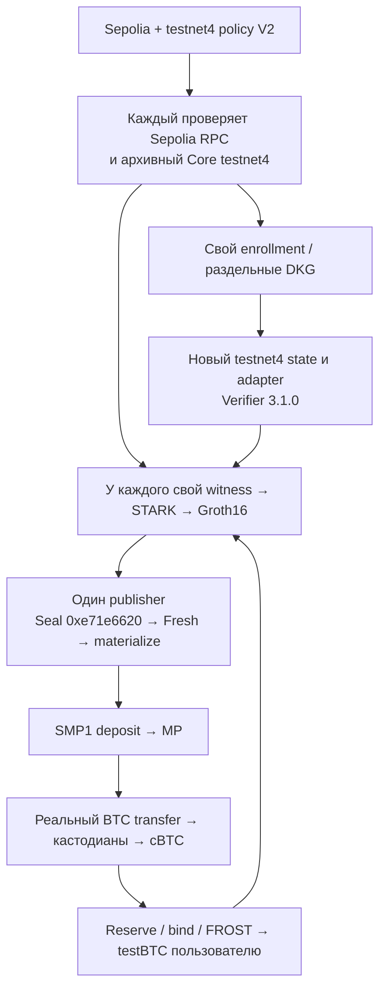

# Bitcoin testnet4 + ZK на Sepolia

[Схемы: SVG/PNG и hashes текущих Mermaid-исходников](DIAGRAMS.md).

[Холодный старт с нуля](COLD_START.md): единый порядок подготовки, ролей,
финансирования, DKG, relay/ZK, ручной рассылки и первого smoke.

[Сквозной сценарий FROST и ZK](FROST_ZK_LIFECYCLE.md): отдельные DKG,
уравнения подписи и proof, nonce recovery, гонки публикаций и Bitcoin settlement.

[Математическое описание](LAUNCH_MATHEMATICS.md): единицы, точное округление,
границы выплат, UTC-учёт, APY и предпосылки безопасности.

Этот профиль использует настоящие тестовые BTC сети **testnet4** и ETH Sepolia
(`11155111`). Relay и ZK выбираются до enrollment. Для ZK добавлены отдельный
фиксированный guest, native witness host, state и SPV adapter; mainnet guest
не принимает testnet4. Готовых рабочих proofs в поставке нет: каждый участник
сам вычисляет их из своего Core и локального archive.

Проверено локально: сборка guest с независимым совпадением image ID, native
проверка исторических заголовков через retarget, согласованность Rust/Solidity,
bootstrap create/reuse и native worker на EVM с chain ID Sepolia, отклонение
фиктивного proof и смешения сетей. Это не результат публичного Sepolia-прогона
или нового Groth16 proof. `qualified=false`, `fee_qualified=false` и
`production_ready=false` сохраняются. Address-derived deposits требуют отдельной
qualification; для денежных тестов используйте существующий SMP1-путь.

| Поле | Значение |
| --- | --- |
| Bitcoin network / Core chain | `testnet4` |
| Bitcoin genesis | `00000000da84f2bafbbc53dee25a72ae507ff4914b867c565be350b0da8bf043` |
| Ethereum chain ID | `11155111` |
| Backend / policy | `zk-state-v2` / `2` |
| Guest image ID | `a6d885a56488897d9b181b5d224652ad67e020d3868060a3e5aae20a4ae82ab8` |
| State / adapter | `ZkBitcoinTestnet4StateV2` / `ZkTestnet4SpvAdapter` |
| Reorg depth / transition ceiling | 100 / 64 headers |

Consensus сохраняет PoW, chainwork, MTP и testnet4 minimum-difficulty/retarget,
включая правило начала эпохи из [BIP94](https://github.com/bitcoin/bips/blob/master/bip-0094.mediawiki):
время первого блока не раньше предыдущего более чем на 600 секунд. Network,
checkpoint/anchor commitments и image связаны между собой; выбор сети через
witness или замена verifier в конфиге не допускаются.

## 1. Каждый участник устанавливает окружение

Используйте новую [поставку без proofs](DISTRIBUTION.md) и
[общую инструкцию](CROSS_PLATFORM_QUICKSTART.md) для Linux x86-64, macOS arm64
или Windows/WSL2 x86-64. В WSL2 храните проект и private state в Linux home.
Установите Python venv, Rust 1.89.0, pinned Foundry/solc и Bitcoin Core 30.3.
Соберите FROST и оба Solidity-проекта по общей инструкции:

```sh
python ops/bootstrap_host.py build
python ops/generate_abis.py --check --zk
```

Соберите **testnet4** host в отдельном новом каталоге. `LOCAL`, `CITREA_SOURCE`
и `CITREA_ARCHIVE` — абсолютные локальные пути. Получение архива и его точный
SHA256 описаны в [порядке подготовки sources](DISTRIBUTION.md#сборка-на-каждом-хосте).

```sh
python -m ops.zkspv.participant_build --bitcoin-network testnet4 \
  --source "$CITREA_SOURCE" --archive "$CITREA_ARCHIVE" \
  --output "$LOCAL/testnet4-native-source"
cargo +1.89.0 fetch --locked \
  --manifest-path "$LOCAL/testnet4-native-source/testnet4-worker-host/Cargo.toml"
python -m ops.zkspv.worker_build --bitcoin-network testnet4 \
  --prepared "$LOCAL/testnet4-native-source" \
  --source-manifest "$LOCAL/testnet4-native-source/prepared-source.json" \
  --cargo "$(rustup which --toolchain 1.89.0 cargo)" \
  --rustc "$(rustup which --toolchain 1.89.0 rustc)" --cargo-home "$HOME/.cargo" \
  --target "$LOCAL/testnet4-native-target" --report "$LOCAL/testnet4-host-build.json"
export SATOHSI_ZK_TESTNET4_WORKER_HOST="$LOCAL/testnet4-native-target/release/satoshifi-testnet4-zk-worker-host"
```

В worker укажите `binary` и `binary_sha256` **из собственной** сборки. Бинарник
macOS не передаётся Linux-участнику. R0BF в поставке — общий код программы,
не receipt; его пересборка для каждого proof не нужна. Локальные proving tools
R0VM 3.1.0, bridge, wrapper и pinned Groth16 Docker image устанавливаются по
[Linux/WSL2 prover](ZK_PROVER_LINUX.md) либо macOS-разделу [поставки](DISTRIBUTION.md).
Проверка `zk_prover_platform --full` обязательна до запуска proof. Нужны свободный
диск не менее 8 GiB и дополнительный запас на сборку, Docker, RAM и рабочие данные.

Локальный smoke без готового receipt:

```sh
python -m ops.system_modes preflight --mode zk-testnet4
python -m ops.system_modes run --mode zk-testnet4 --output "$LOCAL/testnet4-smoke"
```

Этот слой использует исторический Bitcoin fixture и локальный Anvil с chain ID
Sepolia; он проверяет native preparation и real-verifier rejection, не полный
публичный денежный цикл. Собственные live proofs проверяются следующими шагами.

## 2. Core и свежий checkpoint

Для локального варианта запустите полностью синхронизированный Core с txindex:

```sh
bitcoind -testnet4 -datadir="$BTC_DATA" -server -txindex=1
bitcoin-cli -testnet4 -datadir="$BTC_DATA" getblockchaininfo
bitcoin-cli -testnet4 -datadir="$BTC_DATA" getindexinfo txindex
```

Для локального варианта задайте `BITCOIN_RPC` (обычно `http://127.0.0.1:48332`)
и `BITCOIN_COOKIE` (`$BTC_DATA/testnet4/.cookie`). Без локальных нод выберите
`remote-sepolia-testnet4`, настройте HTTPS Core и Infura, затем задайте
`BITCOIN_RPC="$BTC_RPC"` и `BITCOIN_COOKIE="$BTC_COOKIE"` для команд этого раздела.
[Настройка и проверка удалённых RPC](LAUNCH_CONFIGURATOR.md#sepolia-и-bitcoin-testnet4-без-локальных-нод).

Нужны chain testnet4,
точный genesis, `initialblockdownload=false`, headers=blocks, pruned=false,
полностью synced txindex. Создайте кошелёк и получите testnet4 BTC из доступного
вам источника. Сети testnet3, signet и regtest сюда не подходят. Coinbase UTXO
для расходования и fee ingress требуют минимум 101 confirmation; обычные выплаты
сохраняют согласованную глубину, обычно 6.

Checkpoint выбирается на границе эпохи, минимум на 100 блоков позади tip:

```sh
export BITCOIN_RPC BITCOIN_COOKIE
TIP=$(python -c 'import os; from signer_agent.bitcoin_rpc import BitcoinRPC; print(BitcoinRPC(os.environ["BITCOIN_RPC"], os.environ["BITCOIN_COOKIE"], "testnet4").call("getblockcount"))')
CHECKPOINT=$(( (TIP - 100) / 2016 * 2016 ))
frost-signer bitcoin checkpoint --bitcoin-network testnet4 \
  --bitcoin-rpc "$BITCOIN_RPC" --bitcoin-cookie "$BITCOIN_COOKIE" \
  --checkpoint-height "$CHECKPOINT" --max-reorg-depth 100 \
  --max-tip-age-seconds 86400 --max-relay-lag-blocks 0 --max-headers-per-sync 64 \
  > "$LOCAL/testnet4-checkpoint-v1.json"
python -m signer_agent.zk_spv_cli policy \
  --source-policy "$LOCAL/testnet4-checkpoint-v1.json" --confederation-id "$CONFEDERATION_ID" \
  --max-state-age-seconds 3600 --max-tip-lag-seconds 7200 \
  --output "$LOCAL/testnet4-policy-v2.json"
export BITCOIN_POLICY="$LOCAL/testnet4-policy-v2.json"
```

Последняя команда работает offline, выбирает image строго по сети и отказывается
перезаписывать файл. Каждый проверяет весь policy против своего Core до подписи.
Файл [bitcoin-policy-zk-testnet4.example.json](../config/bitcoin-policy-zk-testnet4.example.json)
содержит **исторический** checkpoint 2016 только для структуры и тестов. Для
публичного старта нужен свежий policy, согласованный всеми участниками.

## 3. Конфигуратор, средства и DKG

В профиле `remote-sepolia-testnet4` выберите `zk-state-v2` и укажите
`$BITCOIN_POLICY` в `bitcoin_policy_file`. После `configure build` участники
проверяют свои подключения командой `configure check-rpc` по полученному
приглашению и переходят к публикации и enrollment.
[Удалённый профиль конфигуратора](LAUNCH_CONFIGURATOR.md#sepolia-и-bitcoin-testnet4-без-локальных-нод) ·
[Публикация и enrollment](COLD_START.md#5-публикация-независимый-review-и-enrollment).

Для ручной сборки `manual` выполните следующие шаги.
Продолжайте [общий bootstrap](CROSS_PLATFORM_QUICKSTART.md), сохраняя отдельные
ключи/каталоги каждого участника. Для `setup system` задайте ULR policy с
`bitcoin_backend=zk-state-v2`, свой token metadata, custody policy, fee-параметры
и публичные build commitments как в [ULR bootstrap](ULR_BOOTSTRAP.md).
[system-bootstrap-zk-testnet4.example.json](../config/system-bootstrap-zk-testnet4.example.json)
показывает форму результирующего bundle; поля commitments проверяйте по своей
сборке. Названия токенов задаются до invitation, выпуск governance — 10 млн.

В `setup invite` используйте `--ethereum-network sepolia --bitcoin-network testnet4`,
`--bitcoin-policy "$BITCOIN_POLICY"` и выбранный `--system-policy`. Согласуйте
один `CONFEDERATION_ID`, имена, roster, threshold, genesis/checkpoint, image,
Fresh bounds и внешние USD token/runtime/decimals. Каждому нужен Sepolia ETH
до enrollment/DKG; оператору дополнительно нужен ETH на deployments. Конвертер
заранее финансируется выбранным тестовым USD в указанных decimals. Казначейство
и staking платят этот единый USD, не BTC.

Включите имеющуюся `--pause-for-funding`, проверьте подтверждённые ETH-балансы,
затем снимите её `--funding-complete`. После выпуска governance bootstrap
отдельно останавливается для ручной рассылки ULR; снимайте эту паузу только
через подтверждённый `distribution.fingerprint` по общей инструкции.
Конфедерационный BTC DKG выполняют только кастодианы, отдельно от EVM DKG и
федерационного BTC DKG. Представитель федерации не получает veto в BTC-ключе
конфедерации. Все участники проверяют invite и канонические конструкторы до подписи.

## 4. Initial state, собственные proofs и Fresh barrier

Обычный `bootstrap resume` остановится на `AWAITING_BITCOIN_RELAY` /
`AWAITING_ZK_PROOF`: один checkpoint ещё не Fresh. Для конфигурации consumers и
heartbeat до первого proof доступен явный этап:

```sh
frost-signer bootstrap resume --deployment "$DEPLOYMENT_ID" --state "$BOOTSTRAP_STATE" \
  --identity-file "$IDENTITY" --bitcoin-rpc "$BITCOIN_RPC" \
  --bitcoin-cookie "$BITCOIN_COOKIE" --defer-zk-freshness
```

Повторяйте с тем же журналом по мере подтверждения транзакций и отдельных
funding/distribution пауз. Результат `GRAPH_CONFIGURED_FRESHNESS_PENDING`
не разрешает денежные операции и не означает VERIFIED. Отдельный `verify`
не принимает этот флаг. В manifest `relay` — новый testnet4 state,
`spv_guard` — его testnet4 adapter, `zk_verifier` — созданный state verifier.
Ручные подмены адресов/bytecode запрещены.

Каждый создаёт свой worker JSON на основе
[zkspv-testnet4-worker.example.json](../config/zkspv-testnet4-worker.example.json):
полный enrolled policy, chain `11155111`, RPC/confirmations, свой identity,
локальный binary/hash, state, consumer allowlist, бюджеты и private directory.
Все `REPLACE` поля требуют заполнения. Этот шаблон version 2 включает собственное
финансирование и initial/continuous heartbeat. Для durable transport/archive и
полного contour используйте расширенную схему [worker](ZK_SPV_WORKER.md), сохраняя
новый testnet4 policy/host. Не копируйте чьи-либо proof caches или приватные каталоги.
В конфедерационном service-режиме задайте явное собственное финансирование.

```sh
chmod 600 "$WORKER_CONFIG"
python -m signer_agent.zk_worker prepare --config "$WORKER_CONFIG"
python -m signer_agent.zk_worker prove --config "$WORKER_CONFIG"
# Повтор проверяет только собственный authenticated cache.
python -m signer_agent.zk_worker prove --config "$WORKER_CONFIG"
# Только выбранный publisher после своего расчёта:
python -m signer_agent.zk_worker publish --config "$WORKER_CONFIG"
```

Для catch-up нужны повторные переходы не более 64 headers. Между checkpoint и
tip может быть до 2115 блоков: это несколько собственных proofs, не один.
Повторяйте prepare/prove/publish, проверяя статус и Core, пока useful update не
догонит tip и не станет Fresh. Продолжайте heartbeat/worker во время денежных
тестов: при истечении age/tip bounds система закрывается. Не увеличивайте лимиты
ради обхода медленного proving. При конкурентной публикации worker перечитывает
state/Core и требует replay при изменении предыдущего состояния; один журнал
и nonce не переиспользуются для другой конфигурации.

После Fresh выполните обычные `bootstrap resume` и `verify` **без** defer-флага,
затем независимую проверку графа каждым участником. Полный bound contour и
планы/фингерпринты lifecycle оформляются по [contour runbook](ZKSPV_CONTOUR.md).
Название режима `MAINNET_CANDIDATE` — имя существующего строгого операционного
контроллера; оно не меняет `bitcoin_policy.network=testnet4` и chain `11155111`.

## 5. Полный денежный путь для тестирования

Применяйте [Bitcoin on-chain](BITCOIN_ONCHAIN_RUNBOOK.md),
[выводы](BITCOIN_WITHDRAWALS.md) и [custody transfer](BITCOIN_CUSTODY_TRANSFER.md)
с тем же testnet4 policy и Sepolia graph:

1. Получите подтверждённые testnet4 UTXO, сформируйте SMP1 deposit для собственного
   федерационного BTC-ключа, дождитесь глубины, вычислите свои ZK-переходы и
   materialize header. FROST-одобрение и SPV inclusion необходимы для mint MP.
2. Для MP → cBTC сначала выполните настоящий Bitcoin transfer из федерации на
   custodian-only BTC-ключ конфедерации. Дождитесь зрелости/глубины, SPV header и
   завершения неизменяемого custody-transfer binding. Только затем допускается
   выпуск cBTC получателю; одной EVM-записи недостаточно.
3. Проверьте cBTC на адресе получателя и backed balance в конфедерации.
   Создайте withdrawal, выполните reserve/bind, независимую проверку intent и
   Bitcoin FROST-подпись кастодианов; relay/ZK не заменяет эту подпись.
4. После broadcast и confirmations вычислите свои proofs, materialize header и
   выполните SPV settlement. Проверьте фактический testBTC output пользователя,
   отсутствие двойного расхода/settlement, fee reserve и изменения treasury.
5. Проверьте закрытие операций на stale state, повтор команд после рестарта,
   отказ cross-network/wrong-image/foreign-origin proof. Публичный reorg нельзя
   детерминированно вызвать: восстановление форка сначала проверяйте локальными
   Core regtest и native testnet4-векторами, затем наблюдайте live canonicality.

Минимумы outputs остаются 294 sats P2WPKH / 330 sats P2TR, 50 адресов на batch.
Каждый фиксирует txid и EVM receipts, высоты/подтверждения, pinned image/runtime,
локальный origin и итоговые балансы. Распространяйте только публичный отчёт:
keys, cookies, working inputs/journals и готовые receipts в поставку не входят.


