# SatoshiFi. Аудит безопасности и экономики

23 ноября 2026 · `ulr-new` · база `2630366` с локальными изменениями

[Отчёт в оформлении SmartState и приложение (PDF)](../../output/pdf/SatoshiFi_security_audit_2026-11-23.pdf)

## Резюме

Т‑02 сохраняет высокий приоритет для графов без настроенного холодного пути и при повторной потере кворума обычного кошелька-преемника. Для нового профиля с CLTV и подготовленным DKG преемника проверена первая ротация.

Повторная проверка ulr-new на базе 2630366 с локальными изменениями. Проверены исправления Т‑04, Т‑05, Т‑08, Т‑09 и Т‑11.

Проверены контракты, SDK и локальные Bitcoin-транзакции. Уровни доказательств relay, ZK-адаптера и производственного Groth16 отмечены отдельно.

Открытые замечания по приоритету. Высокий — 1, средний — 9, низкий — 0. Из них технических — 2, экономических — 8. Информационных записей отдельно — 2.

- [Открытые технические замечания](#открытые-технические-замечания)
- [Экономика, комиссии и проскальзывание](#экономика-комиссии-и-проскальзывание)
- [Информационные замечания](#информационные-замечания)
- [Как получить MP и обменять его на S](#как-получить-mp-и-обменять-его-на-s)
- [Другие маршруты с выплатой BTC](#другие-маршруты-с-выплатой-btc)
- [Проверка вывода BTC без NFT](#проверка-вывода-btc-без-nft)
- [Активы и денежные контуры](#активы-и-денежные-контуры)
- [Условия денежного пилота](#условия-денежного-пилота)
- [Проверка технических исправлений](#проверка-технических-исправлений)
- [Схемы проекта](#приложение-схемы-проекта)

## Открытые технические замечания

### Т‑02. Потеря кворума вне настроенного холодного восстановления

**Высокий приоритет**

Риск относится к графам без заранее настроенного независимого CLTV-кворума и совместимого DKG преемника. В проверенной новой конфигурации ротация однократная. После неё работает обычный Taproot key path преемника.

**Влияние** — Вне проверенного профиля потеря Bitcoin-кворума после Signing может удерживать S и UTXO. Ранее подписанная версия способна подтвердиться позже. У новой сборки условие возврата — канонический SPV переноса полного покрытия.

**Критерий закрытия** — До финансирования сверить профиль CLTV, независимый резервный кворум и DKG преемника. Для повторной потери кворума преемника нужен отдельный заранее проверенный путь восстановления.

Источники · [contracts/federation/BitcoinWithdrawalRecovery.sol:166](../../web3/contracts/src/federation/BitcoinWithdrawalRecovery.sol#L166) · [contracts/federation/BitcoinWithdrawalRecovery.sol:205](../../web3/contracts/src/federation/BitcoinWithdrawalRecovery.sol#L205) · [docs/BITCOIN_WITHDRAWAL_RECOVERY.md](../../docs/BITCOIN_WITHDRAWAL_RECOVERY.md)

### Т‑08. Откат обеих локальных копий без независимого якоря

**Средний приоритет**

Защита от синхронного отката требует активного HTTPS-якоря на отдельном хосте. Прежний режим с локальным журналом можно использовать со старой конфигурацией.

**Влияние** — Если включён только локальный журнал, общий откат хранилищ или независимые копии состояния остаются вне модели его защиты.

**Критерий закрытия** — Для денежного запуска provisionировать новый ключевой профиль с независимым сервером и подтвердить отказ после локального отката. Сам сервер исключается из откатываемого окружения.

Источники · [SDK/nonce_anchor.py](../../signer-agent/signer_agent/nonce_anchor.py) · [docs/SIGNING_PROTOCOL.md](../../docs/SIGNING_PROTOCOL.md)

## Экономика, комиссии и проскальзывание

### Э‑01. Тариф legacy без заданного минимума

**Средний приоритет**

Legacy MP → S и вывод S с NFT используют действующий тариф в ветках без обязательных minOut и дедлайна. На обычном депозите комиссия может сравняться с входным объёмом.

**Влияние** — Итоговое количество S может оказаться ниже ожидаемого, включая нулевой выход при крайнем тарифе. V3 S → BTC имеет собственные минимумы и лимиты.

**Критерий закрытия** — Обязать указывать minOut и дедлайн. Проверить откат после изменения тарифа при сохранении входного актива.

Источники · [contracts/federation/ConfederationMultiPool.sol:310](../../web3/contracts/src/federation/ConfederationMultiPool.sol#L310) · [contracts/federation/ConfederationMultiPool.sol:386](../../web3/contracts/src/federation/ConfederationMultiPool.sol#L386) · [contracts/federation/ConfederationMultiPool.sol:424](../../web3/contracts/src/federation/ConfederationMultiPool.sol#L424)

### Э‑02. Ликвидность UTXO и рост комиссии Bitcoin

**Средний приоритет**

V3 резервирует по совокупному остатку. Пакет ограничен 16 входами, а сдача должна проходить dust-порог. Минимум mempool проверяется до новой подписи, но может вырасти дальше. Для каждого RBF действуют минимум получателя, cap и бюджет версий.

**Влияние** — Резерв может быть достаточным в сумме при отсутствии исполнимого набора UTXO. После начала подписи рост miner fee задерживает выход. Для графов вне настроенного холодного пути остаётся риск Т‑02.

**Критерий закрытия** — Проверять пригодные UTXO и сдачу до резервирования, измерять фрагментацию и проверить консолидацию. В тесте учесть рост fee floor после Signing при неизменном minOut.

Источники · [contracts/federation/ConfederationPoolV2.sol:317](../../web3/contracts/src/federation/ConfederationPoolV2.sol#L317) · [SDK/bitcoin_onchain_payment.py:345](../../signer-agent/signer_agent/bitcoin_onchain_payment.py#L345) · [SDK/bitcoin_onchain_payment.py:552](../../signer-agent/signer_agent/bitcoin_onchain_payment.py#L552)

### Э‑03. Курс V3 возмещения и расходование дохода

**Средний приоритет**

SDK подписанта сверяет канонический receipt. Контракт принимает подписанные суммы и unitsPerEth. Независимая оценка курса, допустимое отклонение и экономический потолок расхода по дню отсутствуют в этой проверке.

**Влияние** — Завышенный или ошибочный курс повышает возмещение и уменьшает остаток стейкеров. При одинаковых 0,004 ETH гипотетические курсы 3 000 и 6 000 USD/ETH дают 12 и 24 USD соответственно.

**Критерий закрытия** — Задать источник, срок действия и диапазон курса. Ограничить суммарное покрытие и сверять отклонения отдельно по каждому активу.

Источники · [contracts/federation/ConfederationDAOIncome.sol:253](../../web3/contracts/src/federation/ConfederationDAOIncome.sol#L253) · [contracts/federation/ConfederationDAOIncome.sol:310](../../web3/contracts/src/federation/ConfederationDAOIncome.sol#L310) · [SDK/confederation_dao_report.py:96](../../signer-agent/signer_agent/confederation_dao_report.py#L96)

### Э‑04. Срок цены и ликвидность продажи комиссий

**Средний приоритет**

V3 FundedFeeSale пользуется точной заранее внесённой суммой. Отдельный срок действия цены продавца и штатный возврат непроданных S или MP при блокировке выбранного токена отсутствуют в текущем пути. В legacy фиксированный конвертер MP → USD использует общий баланс открытых сделок.

**Влияние** — V3 сохраняет точность сделки, но её рыночная стоимость может устареть. В legacy обычные сделки по старому курсу могут исчерпать доступный USD раньше казначейского маршрута.

**Критерий закрытия** — Добавить срок цены продавца, ограничение цены и право безопасного вывода незадействованного инвентаря. Для legacy резервировать USD под конкретный поток и проверить исчерпание ликвидности.

Источники · [contracts/federation/FundedFeeSale.sol:146](../../web3/contracts/src/federation/FundedFeeSale.sol#L146) · [contracts/federation/FundedFeeSale.sol:191](../../web3/contracts/src/federation/FundedFeeSale.sol#L191) · [contracts/federation/FundedFeeConverter.sol:11](../../web3/contracts/src/federation/FundedFeeConverter.sol#L11) · [docs/FEE_FLOW.md:96](../../docs/FEE_FLOW.md#L96)

### Э‑05. Остановка дневного расчёта DAO V3 из-за одного актива

**Средний приоритет**

V3 проверяет покрытие S и всех одобренных стейблкоинов на дневном расчёте. Отказ balanceOf или дефицит одного разрешённого актива может остановить новый день.

**Влияние** — Открытие дня и распределение остальных активов задерживаются. Отдельная блокировка transfer удерживает выплаты в самом затронутом токене.

**Критерий закрытия** — Утвердить проверяемый способ изоляции проблемного актива с сохранением его начисленных прав и фактического покрытия остальных.

Источники · [contracts/federation/ConfederationDAOIncome.sol:130](../../web3/contracts/src/federation/ConfederationDAOIncome.sol#L130) · [contracts/federation/ConfederationDAOIncome.sol:235](../../web3/contracts/src/federation/ConfederationDAOIncome.sol#L235) · [contracts/federation/ConfederationDAOIncome.sol:379](../../web3/contracts/src/federation/ConfederationDAOIncome.sol#L379)

### Э‑06. Стоимость снимка ULR и предел реестра

**Средний приоритет**

Полный снимок может содержать до 4 096 участников. Прежнее локальное измерение вызова дало 15 509 866 gas. С 30% запасом SDK это около 20,16 млн, выше применяемого потолка 16 777 216. В истории также есть 64 пожизненные активации казн.

**Влияние** — По мере роста состава публикация выплаты может остановиться с текущей политикой отправки. Числа показывают локальное измерение и расчёт бюджета для SDK.

**Критерий закрытия** — Проверить полный worst-case через реальную политику отправки, внедрить порционную фиксацию полного набора с доказательством его целостности и версионировать состав казн.

Источники · [security_execution_liveness_review_20261123.md](../../security_execution_liveness_review_20261123.md) · [contracts/staking/ULRCustodianSnapshots.sol:132](../../web3/contracts/src/staking/ULRCustodianSnapshots.sol#L132) · [docs/ULR_TREASURIES.md](../../docs/ULR_TREASURIES.md) · [EIP-7825](https://eips.ethereum.org/EIPS/eip-7825)

### Э‑07. Пропуск TWAP удерживает день в legacy Stable/LP

**Средний приоритет**

Последовательный дневной расчёт требует покрытия TWAP. Невосстановимый пропуск мешает продвигать nextSettlementDay. Поздний доход способен изменить исходные данные уже подписанного отчёта.

**Влияние** — Задерживаются расчёты и доступность распределяемых средств для LP и стейкеров.

**Критерий закрытия** — Утвердить отсечку дохода и проверяемую процедуру замены пропущенного TWAP либо закрытия периода. Испытать пропуск одного дня при наличии доходов следующих дней.

Источники · [security_execution_liveness_review_20261123.md:85](../../security_execution_liveness_review_20261123.md#L85) · [docs/CUSTODIAN_DAO.md:64](../../docs/CUSTODIAN_DAO.md#L64) · [contracts/federation/CustodianDAODailySettlement.sol:132](../../web3/contracts/src/federation/CustodianDAODailySettlement.sol#L132) · [contracts/federation/ChainlinkBTCDailyTWAP.sol:76](../../web3/contracts/src/federation/ChainlinkBTCDailyTWAP.sol#L76)

### Э‑08. SPV-взнос и V3 gas требуют общего учёта

**Средний приоритет**

Фиксированный ETH-тариф SPV поступает в распределяемую кассу по факту оплаты. Штатный возврат из неё при недоставленном proof отсутствует. V3 отдельно согласует возмещение расходов по каноническим квитанциям.

**Влияние** — При перекрывающихся бюджетах одна работа может получить финансирование дважды. Это риск политики и сверки, который требует согласованных решений FROST.

**Критерий закрытия** — Связать оплату SPV, proof и receipt с единым идентификатором услуги. Для совпадающей работы проверять max(0, фактический расход − уже оплачено). Утвердить политику для результата без proof.

Источники · [contracts/federation/SPVServicePaymentRegistry.sol:213](../../web3/contracts/src/federation/SPVServicePaymentRegistry.sol#L213) · [docs/SPV_GAS_TREASURY.md:36](../../docs/SPV_GAS_TREASURY.md#L36) · [contracts/federation/ConfederationDAOIncome.sol:253](../../web3/contracts/src/federation/ConfederationDAOIncome.sol#L253)

## Информационные замечания

По плану запуска до обновления нет оплаченных депозитов, неучтённых BTC-выходов и начатых custody-переносов. Для чистого старта оба сценария информационные. При появлении исторического платежа или обязательства до запуска нужно заново сверить UTXO, привязки и оценку риска.

### Т‑03. Ранее оплаченные выходы BTC → S вне поддерживаемой формы

**Информационный статус (Informational)**

Для зрелого неучтённого выхода с точным SMP1 есть отдельная котировка восстановления. Исторический выход, который не проходит текущую форму или привязку, остаётся вне штатного выпуска.

**Влияние** — Сценарий касается уже оплаченных выходов. При заявленном старте без прежних депозитов затронутых платежей нет.

**При обнаружении исторического обязательства** — Перед разбором обнаруженного исторического платежа подтвердить владельца и UTXO, проверить обеспечение и согласовать возврат либо другой способ расчёта.

Источники · [docs/CONFEDERATION_DAO_IN_KIND.md](../../docs/CONFEDERATION_DAO_IN_KIND.md) · [contracts/federation/ConfederationBitcoinReserve.sol:242](../../web3/contracts/src/federation/ConfederationBitcoinReserve.sol#L242) · [SDK/confederation_dao_cli.py:390](../../signer-agent/signer_agent/confederation_dao_cli.py#L390)

### Т‑12. Перенос BTC со старым реестром депозитов

**Информационный статус (Informational)**

Для возобновления прежнего custody-переноса SDK сверяет привязку gateway и точный runtime реестра депозитов. Старый исходный граф с несогласованным runtime может остановиться на этой проверке.

**Влияние** — Задержка относится к обязательствам прежней сборки. При чистом старте без прежних депозитов и начатых переносов таких обязательств нет.

**При обнаружении исторического обязательства** — При подключении прежнего графа подтвердить артефакт реестра, параметры конструктора, исходную FROST-привязку и успешное завершение зависимого переноса.

Источники · [SDK/custody_network.py:100](../../signer-agent/signer_agent/custody_network.py#L100) · [SDK/custody_transfer_cli.py:14](../../signer-agent/signer_agent/custody_transfer_cli.py#L14)

## Как получить MP и обменять его на S

До получения S проходят две Bitcoin-транзакции. Первый платёж делает пользователь, второй подписывает федерация из общего резерва. Для расчёта второго платежа обе стороны проверяют один Bitcoin-выход. Relay обновляет заголовки, ZK обновляет проверяемое состояние. Обоим профилям нужно доказательство включения.

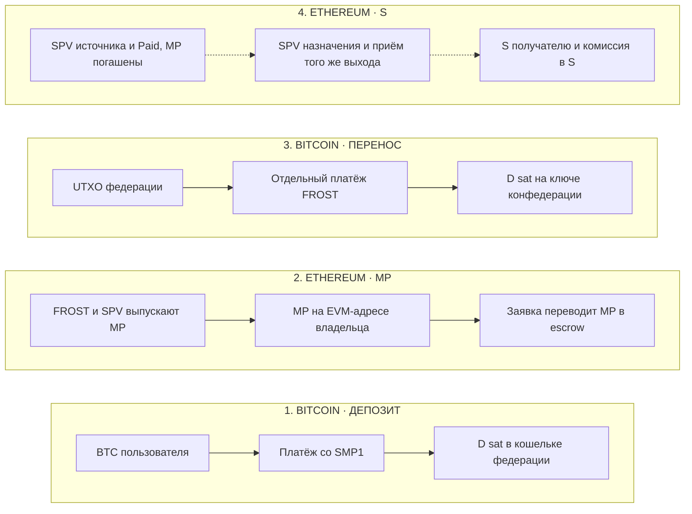

Источники · [docs/BITCOIN_MINT_AND_TREASURY.md:40](../../docs/BITCOIN_MINT_AND_TREASURY.md#L40) · [docs/BITCOIN_CUSTODY_TRANSFER.md:356](../../docs/BITCOIN_CUSTODY_TRANSFER.md#L356) · [docs/BITCOIN_WITHDRAWALS.md:78](../../docs/BITCOIN_WITHDRAWALS.md#L78) · [tests/e2e/test_custody_transfer.py:150](../../tests/e2e/test_custody_transfer.py#L150)

### Депозит BTC и выпуск MP федерации

Федерация выпускает MP под BTC в своём Bitcoin-кошельке. Для входа нужен принятый профиль федерации с MiningPoolV1 и собственным MP. Получатель MP указывает свой публичный EVM-адрес.

**01. Пользователь готовит первый Bitcoin-платёж**

В SDK это bitcoin deposit prepare. Проверьте сеть Bitcoin, скрипт кошелька федерации, сумму платёжного выхода и EVM-адрес. Нулевой выход SMP1 связывает получателя, EVM-сеть, MiningPoolV1, номер платёжного выхода и точную сумму выпуска MP.

**02. Пользователь подписывает и отправляет BTC**

Пользователь подписывает входы своего Bitcoin-кошелька через Core или внешний PSBT-подписант. В SDK это стадии sign и broadcast. Платёжный выход уходит на общий Bitcoin-ключ федерации. Комиссия майнерам оплачивается отправителем сверх суммы этого выхода. Сдача возвращается плательщику.

**03. Подписанты сверяют депозит, исполнитель выпускает MP**

Обычный депозит ждёт настроенной глубины bitcoin_confirmations, по умолчанию и минимум шесть. Проверяются канонический блок, доказательство включения транзакции, точные txid и vout, скрипт, сумма и SMP1. В публичном профиле подписанты FROST сверяют исходные данные через свои Core. После их EVM-авторизации исполнитель отправляет mint-транзакцию, контракт учитывает этот выход один раз и зачисляет MP на закреплённый EVM-адрес.

**Что увидит пользователь**

В Bitcoin сначала видно платёж и его глубину. MP виден после успешной EVM-квитанции выпуска. При 18 знаках после запятой 1 sat даёт 10¹⁰ минимальных единиц MP, поэтому выход 0,01 BTC соответствует 0,01 MP. Для coinbase действуют отдельные правила 100/101.

Источники · [docs/BITCOIN_MINT_AND_TREASURY.md:40](../../docs/BITCOIN_MINT_AND_TREASURY.md#L40) · [docs/BITCOIN_MINT_AND_TREASURY.md:130](../../docs/BITCOIN_MINT_AND_TREASURY.md#L130) · [docs/BITCOIN_MINT_ADMISSION.md:118](../../docs/BITCOIN_MINT_ADMISSION.md#L118) · [contracts/federation/BitcoinDepositRegistry.sol:206](../../web3/contracts/src/federation/BitcoinDepositRegistry.sol#L206) · [tests/e2e/test_custody_transfer.py:150](../../tests/e2e/test_custody_transfer.py#L150)

### Заявка MP → S и перевод BTC

Пользователь отправляет EVM-заявку на обмен MP исходной федерации в S выбранной конфедерации. Источник должен быть принят её шлюзом. Оба графа работают в одной Bitcoin-сети и одной EVM-сети. Relay и ZK на двух сторонах могут различаться.

**04. Владелец MP согласует обмен**

В SDK проверьте связку через custody-transfer inspect. Выберите исходный MP, количество D в sat, EVM-получателя и минимальный чистый S. Выполните approve на проверенный шлюз, затем request. В V3 доступны также dao in-kind approve-wrap и wrap. Обычный перевод MP на чужой EVM-адрес не создаёт заявку.

**05. Шлюз фиксирует сумму S и удерживает MP**

При включении request проверяются минимум и применимый тариф. Шлюз фиксирует net_shares и protocol_fee_s, переводит MP владельца в escrow федерации и связывает transfer_id с source_request. S появится после перевода и приёмки BTC. При отсутствии скидочной программы действует обычный тариф. Владелец оплачивает газ своих EVM-вызовов.

**06. Федерация подписывает второй Bitcoin-платёж**

Её подписанты проверяют заявку, точный скрипт назначения, сумму, входы, сдачу и расход майнерам. FROST подписывает новую транзакцию из UTXO общего кошелька федерации. Выход D sat отправляется на отдельный Bitcoin-ключ конфедерации. Сдача остаётся у федерации, комиссия переноса покрывается её свободными BTC. Для выплаты могут использоваться другие UTXO этого резерва.

**До и после подписи**

До возможного начала Bitcoin-подписания владелец может вернуть MP, когда состояние escrow допускает отмену. После начала подписи истечение срока само по себе возврата не даёт. Сохраните transfer_id и source_request, чтобы продолжить ту же операцию.

Источники · [docs/BITCOIN_CUSTODY_TRANSFER.md:5](../../docs/BITCOIN_CUSTODY_TRANSFER.md#L5) · [docs/BITCOIN_CUSTODY_TRANSFER.md:356](../../docs/BITCOIN_CUSTODY_TRANSFER.md#L356) · [docs/BITCOIN_CUSTODY_TRANSFER.md:419](../../docs/BITCOIN_CUSTODY_TRANSFER.md#L419) · [contracts/federation/BitcoinCustodyTransferV2.sol:102](../../web3/contracts/src/federation/BitcoinCustodyTransferV2.sol#L102) · [contracts/federation/ConfederationPoolV2.sol:175](../../web3/contracts/src/federation/ConfederationPoolV2.sol#L175)

### Погашение MP и зачисление S

Обе стороны проверяют транзакцию переноса. Глубину считают от одного Bitcoin-блока, поэтому при одинаковых порогах она может быть достигнута одновременно.

**07. Федерация погашает MP после btc-settle**

Исходный escrow ждёт канонического SPV-доказательства подписанного txid с глубиной своего профиля, минимум шесть. Расчёт подтверждает зарезервированные входы и выплату, записывает сдачу, уменьшает обеспечение MP и сжигает заблокированные MP. Исходная квитанция получает Paid. BTC-выход уже под ключом конфедерации, её резерв пока ждёт приёмку.

**08. Конфедерация принимает тот же выход через finalize**

Любой исполнитель может представить квитанцию Paid фактически подтверждённой версии, тот же txid, нужный vout и SPV-доказательство назначения. Контракт проверяет скрипт, точный номинал всех заявок этого выхода, каноничность и глубину своего профиля, минимум шесть. Переданный выход учитывается один раз. Резерв прибавляет D sat и контракт атомарно выпускает чистый S получателю и комиссию в S по политике DAO.

**09. Получатель проверяет EVM-квитанцию и баланс S**

Успешный finalize меняет статус на COMPLETED, после чего получатель распоряжается зачисленным S. Для Ethereum используется отдельная политика подтверждений. SDK на Ethereum mainnet требует минимум 12 и проверяет finalized. Если SPV назначения отстаёт, исходный Paid сохраняется. После синхронизации повторяют finalize по той же заявке и тому же выходу. При RBF используют фактически подтверждённую версию.

**Проверенный локальный пример без NFT**

Выход 0,01 BTC выпустил 0,01 MP. Федерация перевела все 1 000 000 sat и отдельно оплатила 1 000 sat майнерам. После погашения MP тот же выход обеспечил выпуск 0,009983 S пользователю и 0,000017 S в комиссии DAO. Эти суммы относятся к тестовому тарифу.

Источники · [contracts/federation/BitcoinWithdrawalEscrow.sol:338](../../web3/contracts/src/federation/BitcoinWithdrawalEscrow.sol#L338) · [contracts/federation/BitcoinCustodyTransferV2.sol:149](../../web3/contracts/src/federation/BitcoinCustodyTransferV2.sol#L149) · [contracts/federation/BitcoinDepositRegistry.sol:235](../../web3/contracts/src/federation/BitcoinDepositRegistry.sol#L235) · [docs/LAUNCH_CONFIGURATOR.md:246](../../docs/LAUNCH_CONFIGURATOR.md#L246) · [tests/e2e/test_custody_transfer.py:207](../../tests/e2e/test_custody_transfer.py#L207)

### Как держатель S получает BTC

В V3 держатель S погашает токен из Bitcoin-резерва своей конфедерации. Это одна и та же операция для S, выпущенного после переноса MP, купленного или полученного по прямому BTC-депозиту. Bitcoin-платёж подписывают кастодианы конфедерации.

**01. Держатель выбирает сумму и Bitcoin-адрес**

В dao in-kind withdraw-quote укажите сумму S и скрипт получателя. Сверьте протокольную комиссию в S, минимум чистой выплаты в sat и предел своей доли комиссии майнерам. Для P2WPKH и P2TR базовые минимумы 294 и 330 sat соответственно. В withdraw задайте минимум и срок включения. После принятия заявки S и нужная часть резерва блокируются.

**02. Конфедерация одобряет и подписывает выплату**

FROST и требуемые одобрения кастодианов связывают заявки, UTXO, точный txid и параметры комиссии. Bitcoin FROST конфедерации подписывает платёж на указанный получателем скрипт. Сдача остаётся её резерву. При RBF для каждой заявки сохраняются минимум BTC и лимит комиссии.

**03. Канонический SPV закрывает требование**

После нужной глубины proof подтверждает фактически исполненную версию. Сумма выплаты плюс доля miner fee вычитаются из BTC-резерва и погашаются в соответствующем количестве S. Протокольная комиссия с округлением остаётся обеспеченной в S и маршрутизируется по политике DAO. По принятой заявке расчёт происходит один раз.

**Сверка суммы в тесте без скидки**

В локальной ветке native-s после передачи 1 000 000 sat пользователь получил при погашении 995 003 sat. Майнеры получили 1 000 sat за вывод. Оставшиеся 3 997 sat продолжили обеспечивать S комиссий. Комиссия предыдущего перевода между кошельками учитывалась отдельно.

Источники · [docs/CONFEDERATION_DAO_IN_KIND.md:190](../../docs/CONFEDERATION_DAO_IN_KIND.md#L190) · [docs/CONFEDERATION_DAO_IN_KIND.md:250](../../docs/CONFEDERATION_DAO_IN_KIND.md#L250) · [docs/BITCOIN_CUSTODY_TRANSFER.md:106](../../docs/BITCOIN_CUSTODY_TRANSFER.md#L106) · [contracts/federation/BitcoinWithdrawalEscrowV2.sol:337](../../web3/contracts/src/federation/BitcoinWithdrawalEscrowV2.sol#L337) · [tests/e2e/test_custody_transfer.py](../../tests/e2e/test_custody_transfer.py)

### Другие маршруты с выплатой BTC

Маршрут определяется токеном, профилем выпуска и текущим Bitcoin-ключом резерва.

**A. BTC → MP → BTC напрямую у федерации**

Держатель блокирует MP в escrow с суммой в целых sat и скриптом выплаты. Bitcoin-группа зарегистрированного кошелька источника подписывает платёж. После SPV escrow сжигает MP. Получатель получает согласованный номинал, обычная комиссия майнерам оплачивается из свободного BTC источника.

**B. BTC → S → BTC через прямой резерв V3**

Получатель фиксирует котировку по точному Bitcoin-выходу и SMP1. Плательщик переводит BTC сразу в конфедерацию и платит комиссию майнерам. После нужной глубины, SPV и FROST выпускается S. При выводе S → BTC комиссия майнерам вычитается из валовых sat заявки.

**C. BTC → MP → FS или CS → BTC через legacy-пул**

FS и CS/cBTC привязаны к MP пула и непереводимы. Депозит местного MP меняет учёт EVM. Для внешнего MP в независимом профиле CS сначала передаётся BTC и погашается MP источника. При выводе FROST кошелька пула подписывает BTC-платёж. После SPV сжигаются доли и соответствующий MP. Комиссию майнерам покрывает BTC-казна или подключённый резерв.

**Подтверждение выплаты**

Для расчёта через relay и ZK требуются канонический блок, нужная глубина и доказательство включения. NFT-квота применяется при выбранной скидке. Персональная оплата комиссии V4 проходит отдельную квалификацию.

Источники · [docs/BITCOIN_WITHDRAWALS.md:78](../../docs/BITCOIN_WITHDRAWALS.md#L78) · [docs/CONFEDERATION_DAO_IN_KIND.md:527](../../docs/CONFEDERATION_DAO_IN_KIND.md#L527) · [docs/BITCOIN_CUSTODY_TRANSFER.md:128](../../docs/BITCOIN_CUSTODY_TRANSFER.md#L128) · [docs/TOKENS.md:125](../../docs/TOKENS.md#L125) · [docs/WITHDRAWAL_FEE_SUBSIDY.md:5](../../docs/WITHDRAWAL_FEE_SUBSIDY.md#L5)

## Проверка вывода BTC без NFT

Сквозной результат означает подписанный и отправленный Bitcoin-платёж, его включение в блоки Core и успешный SPV-расчёт в Ethereum с проверкой выплаты и учёта. Шесть сквозных relay-тестов прошли на снимке предыдущей проверки. Компонентный тест или структурный запуск проверяет отдельную стадию.

| Маршрут | Relay | ZK |
| --- | --- | --- |
| MP → BTC напрямую | Сквозной, предыдущий regtest · заявка MP в пакете FS + MP, P2TR | Сквозной результат не подтверждён |
| Legacy FS → BTC | Сквозной, предыдущий regtest · P2WPKH и P2TR | Сквозной результат не подтверждён |
| Legacy CS → BTC | Сквозной, предыдущий regtest · P2WPKH и P2TR | Сквозной результат не подтверждён |
| MP → CS → BTC | Сквозной, предыдущий regtest · перенос между двумя кошельками, P2TR | Сквозной результат не подтверждён |
| MP → S V3 → BTC | Сквозной, предыдущий regtest · P2TR, без NFT | Сквозной результат не подтверждён |
| BTC → S V3 → BTC | Сквозной, предыдущий regtest · P2WPKH, без NFT | Сквозной результат не подтверждён |
| Вывод свободных BTC казны | Сквозной, предыдущий regtest · P2WPKH, без эмиссии MP | Сквозной результат не подтверждён |
| Отдельный резерв комиссий BTC | Компоненты, без сквозного платежа | Сквозной результат не подтверждён |
| Персональная комиссия V4 | Компоненты, FEE_QUALIFIED=false | Сквозной результат не подтверждён |

**Контур** — Текущие сквозные relay-платежи используют Bitcoin Core 30.3 regtest, Anvil и тестовые ключи FROST. Публичная выплата на Testnet4 или mainnet требует отдельной приёмки.

**Уровень проверки ZK** — Локальная EVM с chain ID Sepolia и исторические заголовки Testnet4 подтвердили CREATE/reuse, DKG, привязку потребителей и подготовку ZIP. Закреплённый verifier отклонил недействительный seal. Выплата BTC и смешанный перенос relay ↔ ZK ждут сквозной приёмки.

Источники · [tests/e2e/test_bitcoin_processes.py](../../tests/e2e/test_bitcoin_processes.py) · [tests/e2e/test_bitcoin_onchain.py](../../tests/e2e/test_bitcoin_onchain.py) · [tests/e2e/test_custody_transfer.py](../../tests/e2e/test_custody_transfer.py) · [tests/e2e/test_bitcoin_treasury_onchain.py](../../tests/e2e/test_bitcoin_treasury_onchain.py) · [tests/e2e/test_zk_testnet4_e2e.py:77](../../tests/e2e/test_zk_testnet4_e2e.py#L77) · [docs/ZK_SPV_BOOTSTRAP.md:210](../../docs/ZK_SPV_BOOTSTRAP.md#L210) · [ops/artifacts/zkspv/worker-integration/contour-withdrawal-report.json](../../ops/artifacts/zkspv/worker-integration/contour-withdrawal-report.json) · [ops/system_modes.py:117](../../ops/system_modes.py#L117) · [web3/test/BitcoinFeeReserve.t.sol:125](../../web3/test/BitcoinFeeReserve.t.sol#L125) · [signer-agent/tests/test_withdrawal_fee.py](../../signer-agent/tests/test_withdrawal_fee.py) · [signer-agent/tests/test_withdrawal_fee_spv.py](../../signer-agent/tests/test_withdrawal_fee_spv.py)

### Подтверждения и комиссии

**Bitcoin-подтверждения**

При расчёте обе версии escrow сверяют точный связанный txid, включение в канонический блок, порядок зарезервированных входов и глубину из bitcoin_confirmations, минимум шесть. В SDK выбор обычного входа требует хотя бы одного подтверждения, а coinbase-входа — 101. Это правила выбора UTXO. Для EVM действуют свои подтверждения, на Ethereum mainnet минимум 12 и finalized.

Источники · [contracts/federation/BitcoinWithdrawalEscrow.sol:338](../../web3/contracts/src/federation/BitcoinWithdrawalEscrow.sol#L338) · [contracts/federation/BitcoinWithdrawalEscrowV2.sol:385](../../web3/contracts/src/federation/BitcoinWithdrawalEscrowV2.sol#L385) · [SDK/bitcoin_onchain_payment.py:91](../../signer-agent/signer_agent/bitcoin_onchain_payment.py#L91) · [docs/LAUNCH_CONFIGURATOR.md:246](../../docs/LAUNCH_CONFIGURATOR.md#L246)

**Relay и ZK**

Оба профиля подтверждают включение Bitcoin-транзакции, а SDK независимо сверяет Core. Для relay нужен актуальный канонический заголовок, для ZK — Fresh и материализация заголовка под текущим корнем. При отставании расчёт ждёт. В MP → S обе стороны проверяют глубину одного выхода своими SPV, в том числе при разрешённых разных backend одной Bitcoin-сети. Штатные ZK-профили используют Bitcoin mainnet или Testnet4.

Источники · [SDK/bitcoin_onchain_payment.py:895](../../signer-agent/signer_agent/bitcoin_onchain_payment.py#L895) · [SDK/bitcoin_onchain_payment.py:975](../../signer-agent/signer_agent/bitcoin_onchain_payment.py#L975) · [rust/zkspv/state-adapter/contracts/ZkSpvAdapter.sol:31](../../rust/zkspv/state-adapter/contracts/ZkSpvAdapter.sol#L31) · [SDK/custody_network.py:68](../../signer-agent/signer_agent/custody_network.py#L68) · [docs/LAUNCH_CONFIGURATOR.md:145](../../docs/LAUNCH_CONFIGURATOR.md#L145)

**Кто платит майнерам**

При прямом MP получатель получает согласованные sat, комиссия расходуется из свободного BTC источника или подключённого резерва. Legacy FS/CS сначала удерживает протокольный тариф в MP и округляет номинал до sat. Майнерская комиссия оплачивается отдельно. Формула BTC-комиссий общая для relay и ZK. Казначейский вывод расходует свободный BTC и сохраняет обеспечение MP. Перенос MP → S оплачивает федерация отдельно от выходного номинала.

Источники · [docs/BITCOIN_WITHDRAWALS.md:78](../../docs/BITCOIN_WITHDRAWALS.md#L78) · [docs/BITCOIN_MINT_AND_TREASURY.md:163](../../docs/BITCOIN_MINT_AND_TREASURY.md#L163) · [contracts/federation/BitcoinWithdrawalEscrow.sol:241](../../web3/contracts/src/federation/BitcoinWithdrawalEscrow.sol#L241) · [docs/BITCOIN_CUSTODY_TRANSFER.md:106](../../docs/BITCOIN_CUSTODY_TRANSFER.md#L106)

**Комиссия V3 и газ Ethereum**

При погашении S валовой номинал G = ⌊(S − F)/10¹⁰⌋ sat, где F — протокольный тариф в минимальных единицах S. Чистая выплата равна G минус доля miner fee. Фактическая комиссия Bitcoin равна сумме входов за вычетом выходов. Погашается G × 10¹⁰ единиц S и уменьшается резерв на G sat. Минимум 294 sat для P2WPKH и 330 sat для P2TR может быть увеличен в настройках. Газ EVM платит отправитель транзакции. Его расход подтверждает gasUsed × effectiveGasPrice.

Источники · [docs/CONFEDERATION_DAO_IN_KIND.md:250](../../docs/CONFEDERATION_DAO_IN_KIND.md#L250) · [contracts/federation/BitcoinWithdrawalEscrowV2.sol:311](../../web3/contracts/src/federation/BitcoinWithdrawalEscrowV2.sol#L311) · [contracts/federation/ConfederationPoolV2.sol:361](../../web3/contracts/src/federation/ConfederationPoolV2.sol#L361) · [tests/e2e/test_custody_transfer.py:295](../../tests/e2e/test_custody_transfer.py#L295)

### Суммы и свидетельства тестов

**Прямой MP и legacy FS**

P2TR получил 700 000 sat по сумме заявок FS 600 000 и прямой MP 100 000. Комиссия майнерам составила 1 000 sat, сдача 302 000 sat. Отдельный P2WPKH получил 600 000 sat из FS. В подтверждённой RBF-версии комиссия составила 1 500 sat, сдача 401 500 sat.

Источники · [tests/e2e/test_bitcoin_processes.py:394](../../tests/e2e/test_bitcoin_processes.py#L394) · [tests/e2e/test_bitcoin_processes.py:668](../../tests/e2e/test_bitcoin_processes.py#L668) · [ops/artifacts/operations-final-20261026.e2e-07.xml](../../ops/artifacts/operations-final-20261026.e2e-07.xml)

**Legacy CS без NFT**

Обычный CS выплатил по 598 620 sat на P2WPKH и P2TR. Тариф и округление составили 1 380 sat-эквивалента и 123 минимальных единицы. Комиссия майнерам 1 000 sat, сдача 403 380 sat. Из внешнего MP после переноса 1 000 000 sat пользователь CS получил 996 003 sat. Каждый из двух Bitcoin-платежей заплатил по 1 000 sat из свободных средств соответствующего кошелька.

Источники · [tests/e2e/test_bitcoin_onchain.py:441](../../tests/e2e/test_bitcoin_onchain.py#L441) · [tests/e2e/test_bitcoin_onchain.py:577](../../tests/e2e/test_bitcoin_onchain.py#L577) · [tests/e2e/test_custody_transfer.py:308](../../tests/e2e/test_custody_transfer.py#L308) · [ops/artifacts/custody-completeness-20261104/e2e.xml](../../ops/artifacts/custody-completeness-20261104/e2e.xml) · [ops/artifacts/operations-final-20261026.e2e-01.xml](../../ops/artifacts/operations-final-20261026.e2e-01.xml)

**MP → S → BTC без NFT, текущий regtest**

Федерация передала 1 000 000 sat и отдельно заплатила 1 000 sat майнерам. Конфедерация выплатила 995 003 sat, 1 000 sat ушло майнерам за вывод, 3 997 sat остались обеспечением S комиссий. Выпуск удержал 1 700 sat-эквивалента, погашение — 2 297. EVM-заявка стоила 786 366 006 290 928 wei по квитанции. Тот же пакет завершился после возобновления частичной подписи.

Источники · [tests/e2e/test_custody_transfer.py:234](../../tests/e2e/test_custody_transfer.py#L234) · [tests/e2e/test_custody_transfer.py:295](../../tests/e2e/test_custody_transfer.py#L295) · [tests/e2e/test_custody_transfer.py:316](../../tests/e2e/test_custody_transfer.py#L316)

**Прямой BTC → S → BTC без NFT**

Из депозита 1 000 000 sat подтверждённая котировка удержала 1 700 sat-эквивалента S. Первую комиссию 464 sat оплатил внешний плательщик. Вывод после шести блоков дал 995 003 sat пользователю, 1 000 sat майнерам и 3 997 sat сдачи.

Источники · [tests/e2e/test_direct_btc_s_exit.py](../../tests/e2e/test_direct_btc_s_exit.py) · [docs/CONFEDERATION_DAO_IN_KIND.md:527](../../docs/CONFEDERATION_DAO_IN_KIND.md#L527)

**Вывод свободных BTC казны**

Из 600 свободных sat выплачены 400 sat, 200 sat ушло майнерам, объём MP остался нулевым.

Источники · [tests/e2e/test_bitcoin_treasury_onchain.py:74](../../tests/e2e/test_bitcoin_treasury_onchain.py#L74)

**Повторные проверки** — Прошли 10 контрактных тестов на solc 0.8.39 и 80 ZK/SDK-тестов, включая один структурный запуск Testnet4. Адаптер ZK отдельно прошёл 35 тестов. Для резерва комиссий прошли 3 контрактных теста. Для источников BTC-комиссий прошли 98 тестов SDK. Сквозная ZK-выплата остаётся открытой.

**Свежий Groth16** — На машине около 1 ГиБ свободного места при требовании 8 ГиБ для сценария подготовки zk-fresh. Исторически принят proof перехода state, а проверенный TEST_ONLY regtest выпускал MP при шести подтверждениях. Эти результаты относятся к другим этапам.

## Активы и денежные контуры

| Актив | Среда | Назначение |
| --- | --- | --- |
| BTC | Bitcoin | Резервы федераций и конфедераций под разными ключами FROST, внешние выплаты, сдача и комиссии майнеров. |
| MP | Ethereum | Переводимый токен федерации, выпуск и погашение связаны с BTC-резервом этой федерации. |
| S | Ethereum / V3 | Переводимый токен конфедерации. Погашается её BTC. S из комиссий и покупки NFT поступает в DAO или на продажу. |
| FS / CS | Ethereum / legacy | Непереводимые пуловые записи. CS/cBTC сохраняет связь с MP конкретного пула. |
| ULR | Ethereum | Тело стейка и токен управления. В общий выпуск входит 10 млн ULR. Общий стейк получает доход в отдельном стейблкоине. Локальный стейк V3 даёт право на доход конкретного DAO. |
| Стейблкоины | Ethereum | Фактический ERC-20 от покупателя, внешнего плательщика, маршрутизатора или внесённого бюджета. |
| ETH | Ethereum | Баланс EOA на транзакции. Отдельно оплачиваемые SPV-заявки и счета DAO по расходам на gas. |
| NFT | Ethereum | Тариф, скидка и квота владельца. В V3 может покупаться за S. BTC-обеспечение остаётся в резерве. |

Сплошная стрелка показывает актив или учёт его движения. Пунктир показывает подпись, проверку или порядок выполнения. Разветвление означает распределение по указанным получателям.

### 01. Холодный старт и полномочия

Сеть, профиль relay/ZK, высоты отсчёта, токены, maturity, пороги и тарифы входят в конфигурацию и согласованный граф.

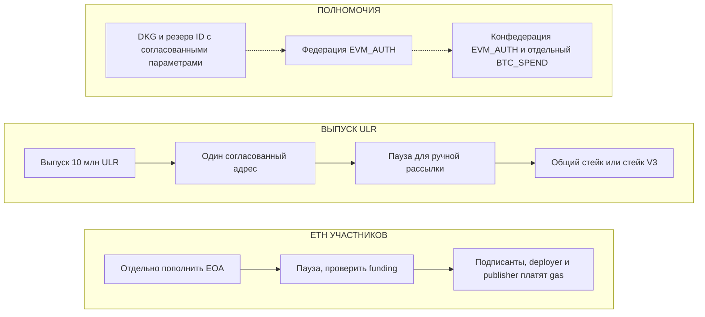

Представитель федерации может входить в EVM-группу федерации. В Bitcoin-группе V3 конфедерации только её кастодианы. Для ряда решений V3 DAO после FROST требуется отдельное одобрение ≥⌈2N/3⌉.

Отставание RPC при высоте ниже якоря оставляет процесс в ожидании. Достаточная высота с другим каноническим хешем переводит его в сверку и остановку денежного перехода.

Источники · [docs/COLD_START.md:59](../../docs/COLD_START.md#L59) · [docs/ARCHITECTURE.md:197](../../docs/ARCHITECTURE.md#L197) · [docs/RECOVERY.md](../../docs/RECOVERY.md)

### 02. Депозит BTC и токен MP федерации

Реестр депозитов учитывает BTC-обеспечение и использованные выходы. В публичном профиле отдельное разрешение управляет очередью выпуска MP.

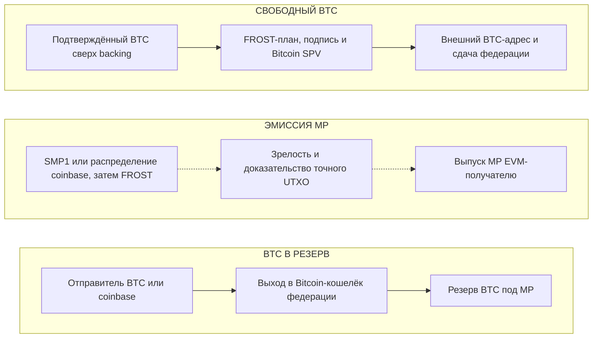

Для coinbase по умолчанию пороги 100 подтверждений для выпуска и 101 для расходования. Комиссию BTC при пополнении платит отправитель. При казначейском выводе сумма и комиссия уходят из свободного BTC, а защита backing и ожидающих SMP1-платежей сохраняется.

Условная ветка производного адреса связывает назначение с уникальным Bitcoin script перед проверкой UTXO. Профиль остаётся QUALIFIED=false. В новой версии просроченный слот можно освободить. Для прежнего графа требуется сверить совместимость.

Окно попытки до 7 суток. Вывод устаревшего разрешения из обращения фиксируется повышением nonce. Повтор сохраняет выход, распределение и общий лимит в 8 попыток.

Источники · [docs/BITCOIN_MINT_AND_TREASURY.md:40](../../docs/BITCOIN_MINT_AND_TREASURY.md#L40) · [contracts/federation/BitcoinMintAdmission.sol:259](../../web3/contracts/src/federation/BitcoinMintAdmission.sol#L259) · [docs/ADDRESS_DEPOSIT_REGISTRY.md:312](../../docs/ADDRESS_DEPOSIT_REGISTRY.md#L312)

### 03. MP → S через перенос BTC

Федерация выпускает MP. Конфедерация выпускает S. S выпускается после фактического перехода BTC в кошелёк конфедерации.

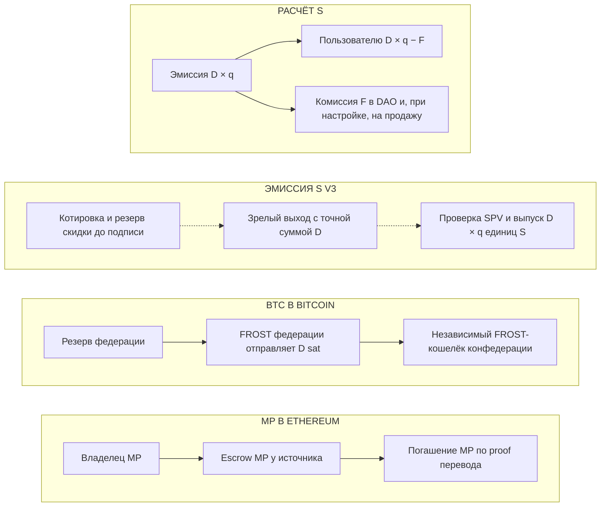

q = 10¹⁰ минимальных единиц S на 1 sat. Источник погашает D × q единиц MP. Bitcoin miner fee переноса расходует свободный BTC источника, D sat остаются обеспечением выпуска S.

После расчёта источника D sat уже контролирует конфедерация. Её резерв признаёт сумму при отдельной финализации. Несостоявшийся перенос можно отменять в разрешённой фазе. После разрешённого возврата разблокируются escrow MP и зарезервированная квота NFT.

Источники · [docs/CONFEDERATION_DAO_IN_KIND.md:250](../../docs/CONFEDERATION_DAO_IN_KIND.md#L250) · [docs/BITCOIN_CUSTODY_TRANSFER.md](../../docs/BITCOIN_CUSTODY_TRANSFER.md) · [contracts/federation/ConfederationBitcoinReserve.sol](../../web3/contracts/src/federation/ConfederationBitcoinReserve.sol)

### 04. Прямой депозит BTC → S

Размер S и протокольная комиссия фиксируются по точному выходу до Bitcoin-платежа.

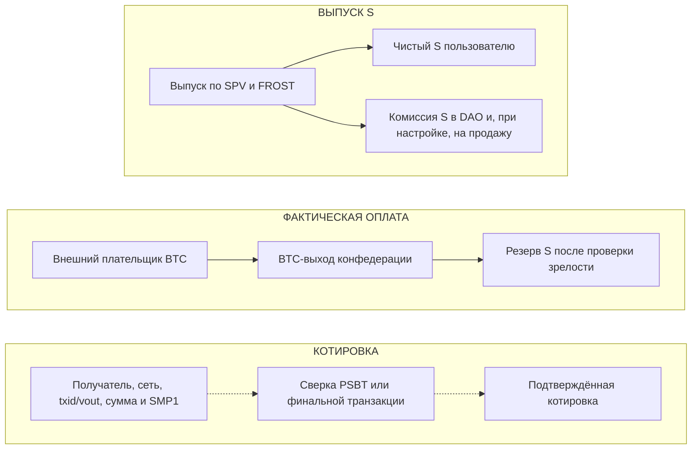

BTC miner fee исходной транзакции оплачивает BTC-плательщик из её входов. EVM-транзакции оплачивает соответствующий EOA в ETH.

Исторический выход без принятой котировки разобран в информационном замечании Т‑03.

Источники · [docs/CONFEDERATION_DAO_IN_KIND.md:527](../../docs/CONFEDERATION_DAO_IN_KIND.md#L527) · [contracts/federation/ConfederationBitcoinReserve.sol:242](../../web3/contracts/src/federation/ConfederationBitcoinReserve.sol#L242) · [SDK/confederation_dao_cli.py:216](../../signer-agent/signer_agent/confederation_dao_cli.py#L216)

### 05. Прямое погашение S → BTC

Держатель переводимого S погашает его из BTC-резерва той же конфедерации. Запрос фиксирует чистый минимум, лимит miner fee и дедлайн.

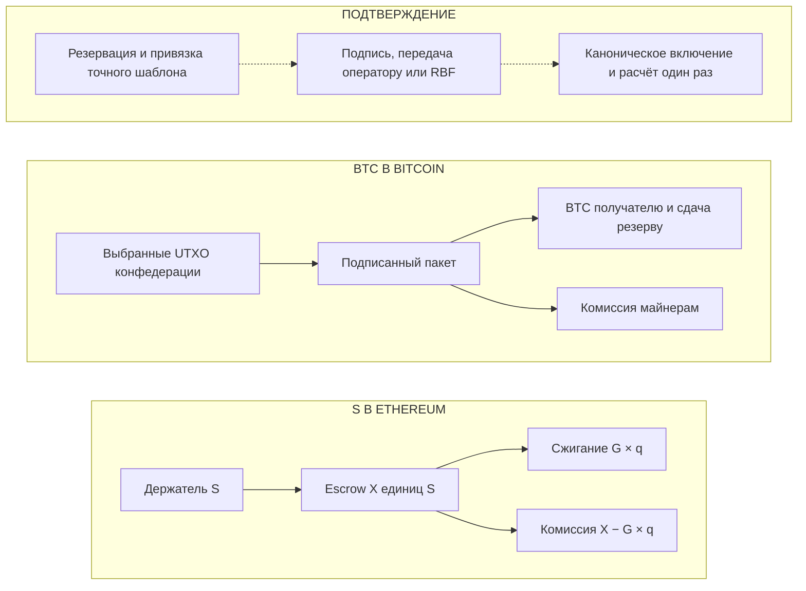

G = ⌊(X − F)/q⌋ sat. Для заявки чистый BTC равен G − m, где m — её доля фактической комиссии майнеров. По пакету Σ(net) + M = Σ(G). Сумма X − G × q включает F и округление вниз.

Базовый минимум P2WPKH составляет 294 sat, P2TR — 330 sat. При CPFP получатель платит отдельно. Расчёт escrow опирается на исходный Bitcoin-выход.

Локальный пример со скидкой по NFT после переноса 1 000 000 sat. Выдано 995 153 sat, расход майнерам 1 000 sat, в резерве осталось 3 847 sat. Комиссия самого переноса учтена отдельно.

Источники · [docs/CONFEDERATION_DAO_IN_KIND.md:294](../../docs/CONFEDERATION_DAO_IN_KIND.md#L294) · [docs/BITCOIN_WITHDRAWALS.md](../../docs/BITCOIN_WITHDRAWALS.md) · [contracts/federation/BitcoinWithdrawalEscrowV2.sol:337](../../web3/contracts/src/federation/BitcoinWithdrawalEscrowV2.sol#L337) · [tests/e2e/test_custody_transfer.py](../../tests/e2e/test_custody_transfer.py) · [security_repository_recheck_20261123.md:224](../../security_repository_recheck_20261123.md#L224) · [SDK/bitcoin_payout_package.py:46](../../signer-agent/signer_agent/bitcoin_payout_package.py#L46)

### 06. Пулы и вывод в legacy-профиле

В legacy FS и CS/cBTC связаны с MP и конкретным пулом. Ветка с перенесённым обеспечением требует доказать Bitcoin custody.

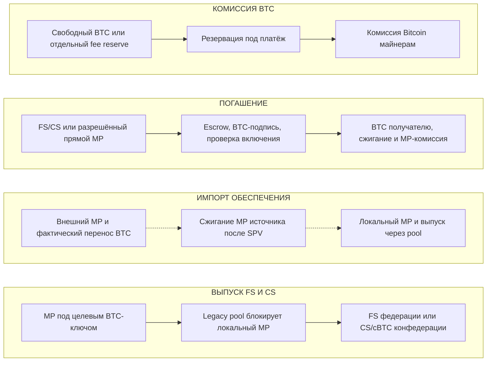

При локальном депозите MP уже обеспечен BTC под целевым ключом, поэтому внесение в пул само по себе не перемещает BTC. Legacy-тарифы рассмотрены в Э‑01. Персональное пополнение miner fee показано отдельно в схеме 12 как условный профиль.

Источники · [docs/TOKENS.md:125](../../docs/TOKENS.md#L125) · [docs/BITCOIN_CUSTODY_TRANSFER.md:188](../../docs/BITCOIN_CUSTODY_TRANSFER.md#L188) · [docs/BITCOIN_WITHDRAWALS.md:78](../../docs/BITCOIN_WITHDRAWALS.md#L78)

### 07. Продажа собранных комиссий

В течение продажи меняются владельцы реально собранных S или MP и уже внесённых стейблкоинов. BTC остаётся в соответствующем резерве до погашения токена.

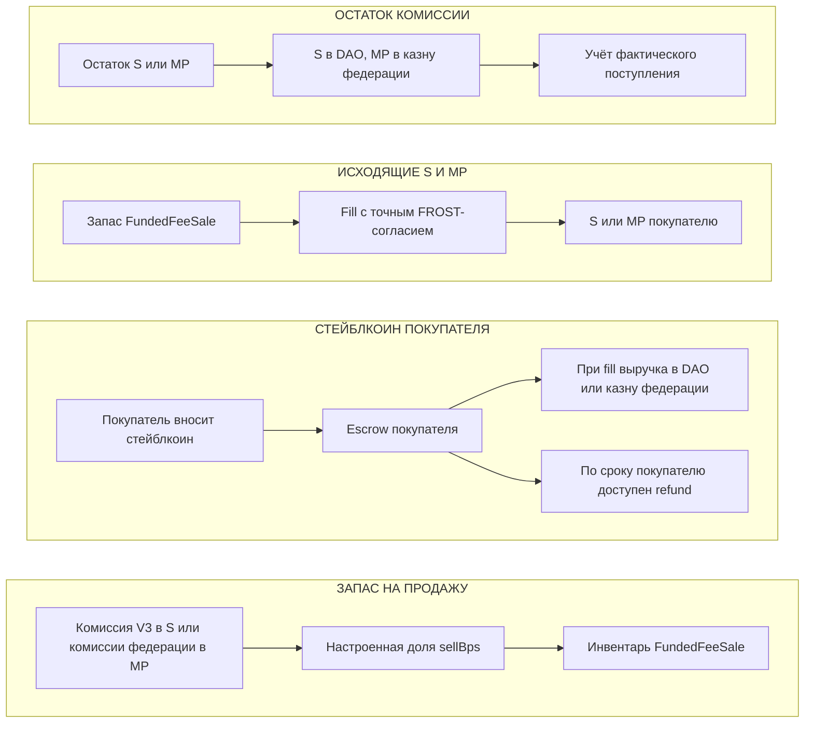

Fill фиксирует покупателя, объём, цену, nonce и срок. Для продажи S после FROST нужно ≥⌈2N/3⌉. Оплата NFT и прямые поступления S идут в DAO. В legacy пополненный конвертер MP → USD может направлять стейблкоины через fee router. Его цена и запас ликвидности рассмотрены в Э‑04.

Источники · [docs/FEE_FLOW.md](../../docs/FEE_FLOW.md) · [contracts/federation/FundedFeeSale.sol:146](../../web3/contracts/src/federation/FundedFeeSale.sol#L146) · [contracts/federation/FundedFeeConverter.sol](../../web3/contracts/src/federation/FundedFeeConverter.sol)

### 08. NFT и протокольные скидки

Операция расходует квоту своего владельца. Квота меняет протокольную комиссию на допустимом маршруте.

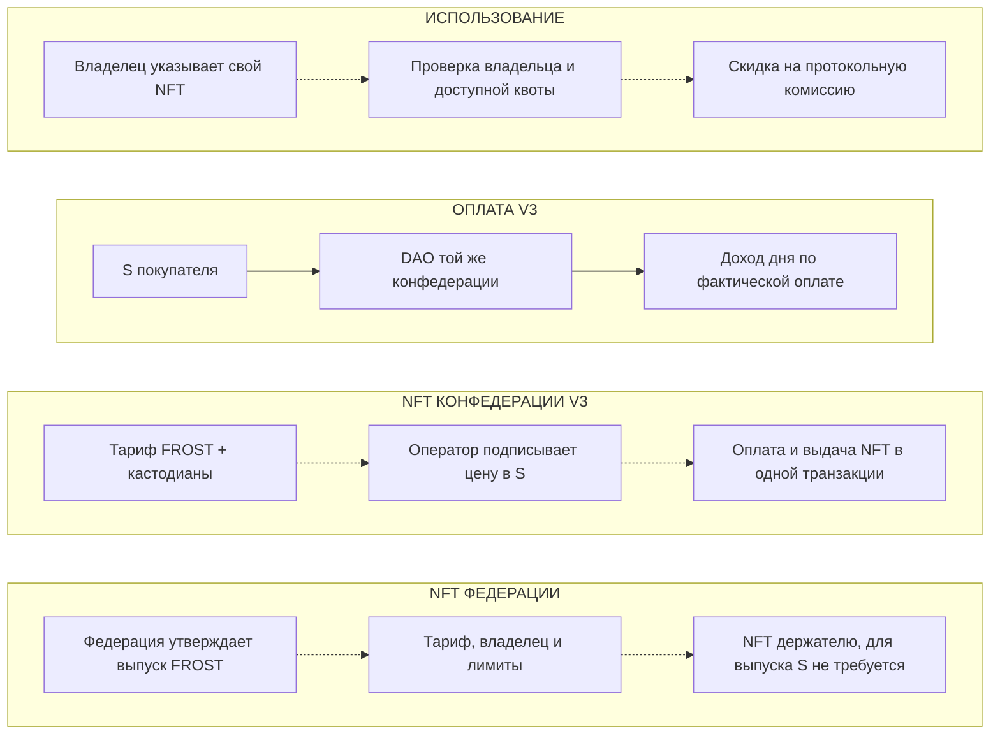

Выпуск NFT федерации сам по себе не списывает MP. Bitcoin miner fee и Ethereum gas учитываются отдельно. Для MP → S квота резервируется, для S → BTC расходуется при создании заявки. Скидочная программа факультативна. Без неё федерация и конфедерация работают по применимому базовому тарифу.

Источники · [docs/NFT_CONFIGURATION.md](../../docs/NFT_CONFIGURATION.md) · [docs/CONFEDERATION_DAO_IN_KIND.md:184](../../docs/CONFEDERATION_DAO_IN_KIND.md#L184)

### 09. Доход DAO конфедерации V3

Дневной расчёт идёт по UTC. Право на остаток дохода имеют стейкеры конкретной конфедерации за полные сутки.

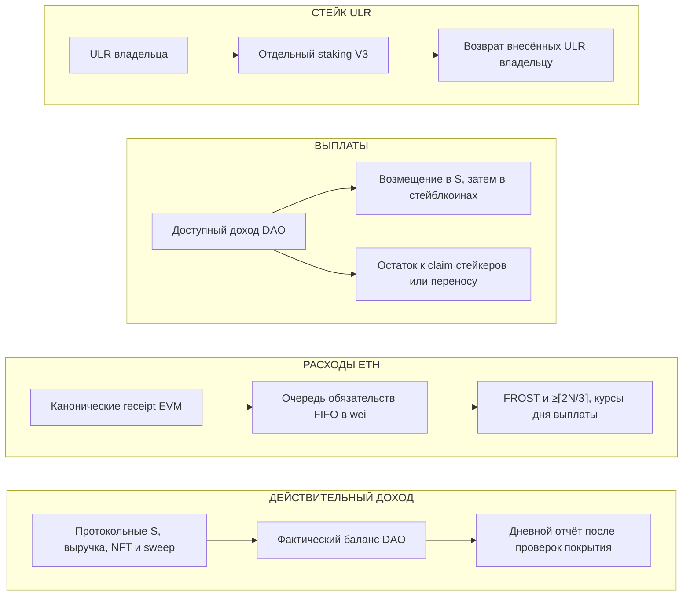

Разрешённые активы и порядок стейблкоинов задаются заранее. Непогашенный долг остаётся в wei. Пока он сохраняется, новый остаток стейкерам не распределяется. Дневной разделённый учёт снижает риск смешения возмещений с доходом. Риски курсов и токенов перечислены в Э‑03 и Э‑05. Порядок закрытия новой конфедерации проверен в Т‑04.

Источники · [docs/CONFEDERATION_DAO_IN_KIND.md:86](../../docs/CONFEDERATION_DAO_IN_KIND.md#L86) · [contracts/federation/ConfederationDAOIncome.sol:235](../../web3/contracts/src/federation/ConfederationDAOIncome.sol#L235)

### 10. Общий стейк ULR и доход в стейблкоине

Поступления в обычные ULR-казны учитываются в заданном, фактически внесённом стейблкоине.

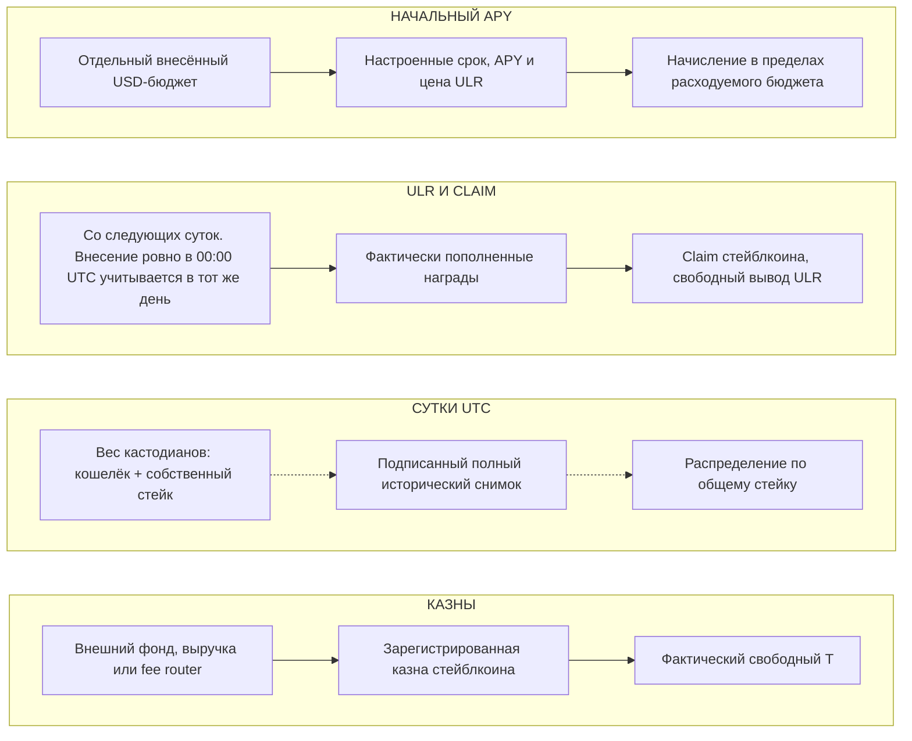

При стандартных настройках распределение = max(T − 1 000 USD, 0) × 90% × C/G, где C — вес кастодианов конфедерации, G — общий системный вес. Расчёт один раз округляется вниз до минимальной единицы токена. При C = 0, G = 0 или отсутствии подходящего стейка платёж нулевой. Порог кандидата обычно 200 000 ULR. У действующего кастодиана учитывается фактический остаток даже ниже порога. Делегирование голосов действующему кастодиану сохраняет право владельца стейка на награду.

Внешний плательщик может отдельно пополнить награды завершённого дня при подходящем стейке. После деактивации вывод остатка казны сохраняет начисленные обязательства. Покрытие наград сверяется по отдельному стейблкоину. Остаточный риск масштаба описан в Э‑06.

Источники · [docs/ULR_TREASURIES.md](../../docs/ULR_TREASURIES.md) · [docs/ULR_STAKING.md](../../docs/ULR_STAKING.md) · [contracts/staking/ULRStaking.sol:204](../../web3/contracts/src/staking/ULRStaking.sol#L204)

### 11. Дополнительные treasury и LP-маршруты

Legacy Custodian DAO со Stable/LP и проектные deploy fee образуют самостоятельные денежные профили.

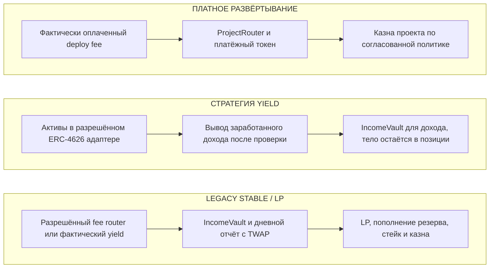

Результат распределения зависит от состава получателей, выбранной политики резерва и существующей ликвидности. Возврат principal из ERC‑4626 отдельно согласуется FROST и зависит от ликвидности. DAOTestUSD применяется в тестовых профилях Anvil и Sepolia. Пропуск TWAP и поздние поступления рассмотрены в Э‑07.

Источники · [docs/CUSTODIAN_DAO.md:64](../../docs/CUSTODIAN_DAO.md#L64) · [docs/FEE_FLOW.md:155](../../docs/FEE_FLOW.md#L155) · [docs/FEES.md](../../docs/FEES.md) · [docs/TOKENS.md:272](../../docs/TOKENS.md#L272)

### 12. Слои комиссий Bitcoin и Ethereum

Комиссия Bitcoin, фактически уплаченный gas EVM, SPV-взнос и протокольный тариф учитываются отдельно.

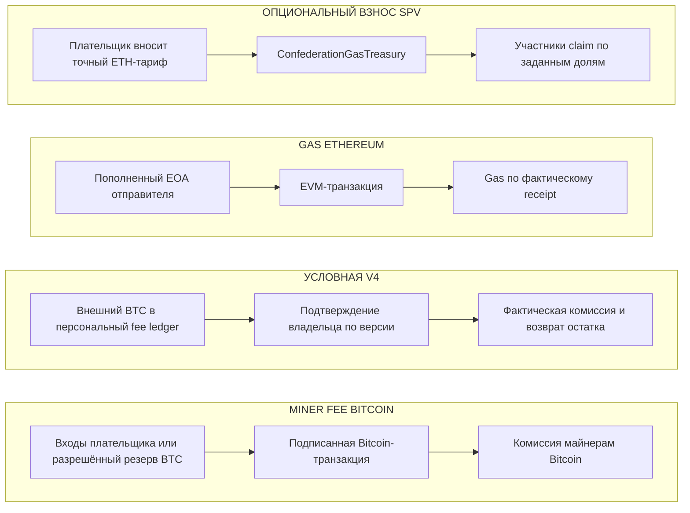

Общий fee reserve формируется проверенными добровольными переводами BTC. V4 экспериментальна и не допущена к работе с реальными средствами. Условная ветка MP/FS блокирует лимит, сжигает фактическую стоимость и возвращает остаток. Опциональный SPV-взнос фиксирован, статус готовности proof проверяется отдельно.

Публикацию relay или ZK оплачивает EOA оператора. Опционально конфедерация спонсирует публикацию из своего ETH с лимитами и журналом. Внешние взносы и последующее V3-возмещение требуют единой атрибуции расходов. Э‑08.

Источники · [docs/BTC_FEE_RESERVE.md](../../docs/BTC_FEE_RESERVE.md) · [docs/WITHDRAWAL_FEE_SUBSIDY.md](../../docs/WITHDRAWAL_FEE_SUBSIDY.md) · [docs/SPV_GAS_TREASURY.md:36](../../docs/SPV_GAS_TREASURY.md#L36) · [docs/RELAY_KEEPER_AND_GAS.md:5](../../docs/RELAY_KEEPER_AND_GAS.md#L5)

### 13. Relay, ZK и завершение расчёта

Публикация заголовков или proof меняет проверяемое состояние. Денежный переход исполняет consumer после проверки точной операции.

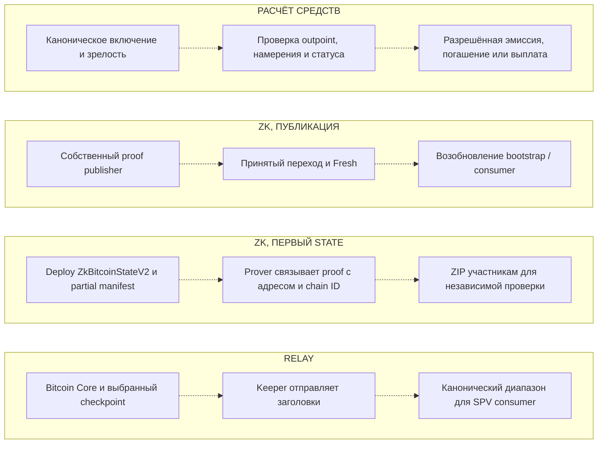

Готовые доказательства не входят в поставку исходников. Участники могут проверять публичный ZIP из рабочего контура по своим RPC. Отстающие RPC ждут нужной высоты. При подтверждённом расхождении хеша расчёт переходит в сверку.

При подтверждённом EVM-откате custody finalize сверяет текущий корень закреплённого ZK-адаптера. Повтор сохраняет Bitcoin-выход и исходные условия.

Источники · [docs/DISTRIBUTION.md](../../docs/DISTRIBUTION.md) · [docs/ZK_SPV_ARCHITECTURE.md:130](../../docs/ZK_SPV_ARCHITECTURE.md#L130) · [docs/SIGNING_PROTOCOL.md](../../docs/SIGNING_PROTOCOL.md) · [docs/RECOVERY.md](../../docs/RECOVERY.md)

### 14. Дополнительная комиссия CPFP после S → BTC

После агрегации всех необходимых подписей получатель может ускорить свой BTC-платёж через отдельную транзакцию.

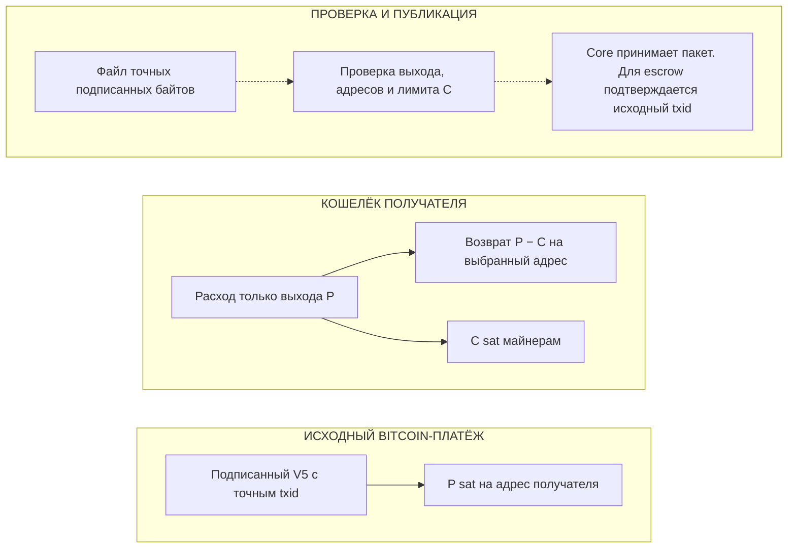

C — добровольная отдельная комиссия из BTC получателя. Обеспечение S учитывается по исходному платёжному пакету. Например, из P = 1 000 000 sat получатель возвращает себе 998 000 sat, а C = 2 000 sat получает майнер.

Нужна полностью подписанная исходная выплата. Результат mempool зависит от политики узла и не гарантирует включение.

Источники · [SDK/bitcoin_payout_package.py:46](../../signer-agent/signer_agent/bitcoin_payout_package.py#L46) · [docs/BITCOIN_WITHDRAWALS.md:223](../../docs/BITCOIN_WITHDRAWALS.md#L223) · [tests/e2e/test_bitcoin_payout_package.py](../../tests/e2e/test_bitcoin_payout_package.py)

## Условия денежного пилота

### Публичная приёмка

Подписанный запуск на реальных Ethereum и Bitcoin RPC со свежим производственным Groth16 остаётся неподтверждённым. Локальные прогоны relay, адаптера ZK, V3 и NFT дают разные уровни доказательств. Для приёмки нужны фактические квитанции bootstrap, операций, выплат и восстановления для обоих профилей.

Источники · [docs/LAUNCH_READINESS.md](../../docs/LAUNCH_READINESS.md) · [docs/ZK_TESTNET4_SEPOLIA.md](../../docs/ZK_TESTNET4_SEPOLIA.md) · [security_mainnet_review_20261122.md](../../security_mainnet_review_20261122.md)

### Ключи, раскрытые прежде

Для двух старых EVM-ключей задокументировано раскрытие. Подтверждение ротации и снятия ролей отсутствует в проверенном снимке. Риск высокий, если старые адреса ещё контролируют средства или полномочия. Критерий закрытия — доказанная миграция ролей и остатков в используемых развертываниях.

Источники · [security_best_practices_report.md:49](../../security_best_practices_report.md#L49) · [docs/SECURITY_LOGIC_REVIEW_2026_11_03.md:240](../../docs/SECURITY_LOGIC_REVIEW_2026_11_03.md#L240)

### Профили под валидацией

Автосоздание Bitcoin-адресов отмечено QUALIFIED=false. Персональная комиссия Bitcoin V4 отмечена FEE_QUALIFIED=false. Для независимой приёмки потребуются подтверждённые сценарии пополнения, выплаты, RBF и возврата. Они показаны на схемах как условные ветки.

Источники · [security_repository_recheck_20261123.md:113](../../security_repository_recheck_20261123.md#L113) · [docs/WITHDRAWAL_FEE_SUBSIDY.md](../../docs/WITHDRAWAL_FEE_SUBSIDY.md) · [docs/BTC_FEE_RESERVE.md](../../docs/BTC_FEE_RESERVE.md)

### Локальные доказательства

Последний отчёт EL фиксирует 4 146 тестов SDK и инструментов, 1 011 Solidity-тестов, 35 тестов ZK-адаптера и регрессию подписанной Bitcoin-транзакции в regtest. Эти результаты взяты из существующего отчёта.

Источники · [security_execution_liveness_review_20261123.md:40](../../security_execution_liveness_review_20261123.md#L40) · [security_repository_recheck_20261123.md](../../security_repository_recheck_20261123.md)

## Проверка технических исправлений

После объединения изменений прошли 736 проверок SDK и поставки.

### Т‑04 · Завершение расчётов DAO

Фабрика фиксирует день деактивации по UTC. До этой даты включительно можно открыть накопившиеся отчёты. Поздние поступления погашают FIFO-долг по утверждённому снимку курсов дня выплаты. Остаток относится к последнему снимку стейка. Прошли 75 проверок Solidity и 209 SDK.

Источники · [contracts/federation/ConfederationDAOIncome.sol](../../web3/contracts/src/federation/ConfederationDAOIncome.sol) · [web3/test/ConfederationDAOIncome.t.sol](../../web3/test/ConfederationDAOIncome.t.sol) · [docs/CONFEDERATION_DAO_IN_KIND.md](../../docs/CONFEDERATION_DAO_IN_KIND.md)

### Т‑05 · История ZK и SPV

Завершённые строки архивируются в SQLite и освобождают активную очередь. Идентификаторы, платежи, nonce и накопленные бюджеты сохраняются. Реорг запускает ограниченную постраничную перепроверку с сохранением позиции. Новые примеры содержат порог допуска 128 МиБ. Повтор подтверждён после перезапуска и реорга.

Источники · [SDK/spv_history.py](../../signer-agent/signer_agent/spv_history.py) · [docs/ZK_SPV_WORKER.md](../../docs/ZK_SPV_WORKER.md) · [docs/SPV_ENCRYPTED_TRANSPORT.md](../../docs/SPV_ENCRYPTED_TRANSPORT.md)

### Т‑08 · Независимый якорь расходов nonce

При включённом HTTPS-якоре отдельный хост атомарно фиксирует хеш транскрипта до отправки доли. Свежий подписант хранит привязку сервера. Повтор разрешён только для уже сохранённой доли того же транскрипта. В тесте с HTTPS проверены двойной откат, две копии подписанта и потеря ответа после записи.

Источники · [SDK/secure_state.py](../../signer-agent/signer_agent/secure_state.py) · [SDK/nonce_anchor.py](../../signer-agent/signer_agent/nonce_anchor.py) · [docs/SIGNING_PROTOCOL.md](../../docs/SIGNING_PROTOCOL.md)

### Т‑09 · Происхождение сборки подписанта

Колёса Python закреплены SHA-256, а установщик проверяет их при установке. FROST собирается в свежем каталоге Cargo. SDK проверяет пин перед IPC на mainnet. Проверено разрешение колёс CPython 3.11 для macOS arm64 и Linux/WSL2 x86-64.

Источники · [signer-agent/requirements.lock](../../signer-agent/requirements.lock) · [ops/bootstrap_host.py](../../ops/bootstrap_host.py) · [signer-agent/tests/test_crypto_integrity.py](../../signer-agent/tests/test_crypto_integrity.py)

### Т‑11 · Замена комиссии API-операции

Локальная команда меняет только лимиты комиссии EIP-1559. Перед подписью она проверяет актуальные полномочия, контракт, исходный calldata, nonce и потолок общей стоимости. Обе попытки остаются в одном журнале. Прошли 67 проверок API и восстановления.

Источники · [SDK/operation_worker.py](../../signer-agent/signer_agent/operation_worker.py) · [tests/e2e/test_operational_api.py](../../tests/e2e/test_operational_api.py) · [docs/OPERATIONAL_API.md](../../docs/OPERATIONAL_API.md)

## Приложение. Схемы проекта

50 действующих экспортов из [индекса проекта](../DIAGRAMS.md). Все схемы встроены в PDF.

| № | Схема | Экспорт |
| --: | --- | --- |
| 01 | CLTV, Bitcoin DKG и привязка модуля | [SVG](../../ops/artifacts/bitcoin-recovery-cltv-20261123/diagrams/docs_BITCOIN_WITHDRAWAL_RECOVERY_md_1.svg) · [PNG](../../ops/artifacts/bitcoin-recovery-cltv-20261123/diagrams/png/docs_BITCOIN_WITHDRAWAL_RECOVERY_md_1.png) |
| 02 | Расчёт выплаты или перенос покрытия и возврат S | [SVG](../../ops/artifacts/bitcoin-recovery-cltv-20261123/diagrams/docs_BITCOIN_WITHDRAWAL_RECOVERY_md_2.svg) · [PNG](../../ops/artifacts/bitcoin-recovery-cltv-20261123/diagrams/png/docs_BITCOIN_WITHDRAWAL_RECOVERY_md_2.png) |
| 03 | Ротация кошелька и возобновление вывода | [SVG](../../ops/artifacts/bitcoin-recovery-cltv-20261123/diagrams/docs_BITCOIN_WITHDRAWAL_RECOVERY_md_3.svg) · [PNG](../../ops/artifacts/bitcoin-recovery-cltv-20261123/diagrams/png/docs_BITCOIN_WITHDRAWAL_RECOVERY_md_3.png) |
| 04 | Исходная поставка и подготовка хоста по роли | [SVG](../../ops/artifacts/zk-worker-modes-20261121/diagrams/docs_DISTRIBUTION_md_1.svg) · [PNG](../../ops/artifacts/zk-worker-modes-20261121/diagrams/png/docs_DISTRIBUTION_md_1.png) |
| 05 | CREATE state, proving и публичный ZIP перехода | [SVG](../../ops/artifacts/zk-state-first-20261122/diagrams/docs_DISTRIBUTION_md_3.svg) · [PNG](../../ops/artifacts/zk-state-first-20261122/diagrams/png/docs_DISTRIBUTION_md_3.png) |
| 06 | Собственный cache, origin и отдельная публикация | [SVG](../../ops/artifacts/zk-worker-modes-20261121/diagrams/docs_DISTRIBUTION_md_4.svg) · [PNG](../../ops/artifacts/zk-worker-modes-20261121/diagrams/png/docs_DISTRIBUTION_md_4.png) |
| 07 | Архитектурный маршрут ZK и проверка ZIP | [SVG](../../ops/artifacts/zk-worker-modes-20261121/diagrams/docs_ARCHITECTURE_md_2.svg) · [PNG](../../ops/artifacts/zk-worker-modes-20261121/diagrams/png/docs_ARCHITECTURE_md_2.png) |
| 08 | Consumer, расчёт, публикация и денежные проверки | [SVG](../../ops/artifacts/zk-state-first-20261122/diagrams/docs_ZK_SPV_ARCHITECTURE_md_2.svg) · [PNG](../../ops/artifacts/zk-state-first-20261122/diagrams/png/docs_ZK_SPV_ARCHITECTURE_md_2.png) |
| 09 | Публикация по частям и сохранение принятого архива | [SVG](../../ops/artifacts/zk-state-first-20261122/diagrams/docs_ZK_SPV_ARCHITECTURE_md_10.svg) · [PNG](../../ops/artifacts/zk-state-first-20261122/diagrams/png/docs_ZK_SPV_ARCHITECTURE_md_10.png) |
| 10 | Согласование параметров, CREATE и разные контуры | [SVG](../../ops/artifacts/zk-state-first-20261122/diagrams/docs_ZK_SPV_ARCHITECTURE_md_11.svg) · [PNG](../../ops/artifacts/zk-state-first-20261122/diagrams/png/docs_ZK_SPV_ARCHITECTURE_md_11.png) |
| 11 | Доля комиссии, финансирование заявки, расчёт и возврат | [SVG](../../ops/artifacts/security-sf04-11-20261122/diagrams/docs_FEE_FLOW_md_4.svg) · [PNG](../../ops/artifacts/security-sf04-11-20261122/diagrams/png/docs_FEE_FLOW_md_4.png) |
| 12 | Гонка финализации и привязка исторического nonce | [SVG](../../ops/artifacts/sdk-recovery-20261121/diagrams/docs_RECOVERY_md_1.svg) · [PNG](../../ops/artifacts/sdk-recovery-20261121/diagrams/png/docs_RECOVERY_md_1.png) |
| 13 | Проверка и восстановление Bitcoin-платежа | [SVG](../../ops/artifacts/rpc-lag-20261121/diagrams/docs_RECOVERY_md_2.svg) · [PNG](../../ops/artifacts/rpc-lag-20261121/diagrams/png/docs_RECOVERY_md_2.png) |
| 14 | Повтор исполненного intent, включая ULR | [SVG](../../ops/artifacts/sdk-recovery-20261121/diagrams/docs_RECOVERY_md_3.svg) · [PNG](../../ops/artifacts/sdk-recovery-20261121/diagrams/png/docs_RECOVERY_md_3.png) |
| 15 | Замена EIP-1559 и повтор отправки | [SVG](../../ops/artifacts/sdk-recovery-20261121/diagrams/docs_RECOVERY_md_4.svg) · [PNG](../../ops/artifacts/sdk-recovery-20261121/diagrams/png/docs_RECOVERY_md_4.png) |
| 16 | Отставание EVM и Bitcoin RPC у участников | [SVG](../../ops/artifacts/rpc-lag-20261121/diagrams/docs_RECOVERY_md_5.svg) · [PNG](../../ops/artifacts/rpc-lag-20261121/diagrams/png/docs_RECOVERY_md_5.png) |
| 17 | Выходы после деактивации и смена RPC | [SVG](../../ops/artifacts/security-sf04-11-20261122/diagrams/docs_RECOVERY_md_6.svg) · [PNG](../../ops/artifacts/security-sf04-11-20261122/diagrams/png/docs_RECOVERY_md_6.png) |
| 18 | Восстановление S → BTC после частичной подписи | [SVG](../../ops/artifacts/mainnet-blockers-20261122/diagrams/docs_RECOVERY_md_7.svg) · [PNG](../../ops/artifacts/mainnet-blockers-20261122/diagrams/png/docs_RECOVERY_md_7.png) |
| 19 | Перенос резервации ID после остановки DKG | [SVG](../../ops/artifacts/security-rr-20261123/diagrams/docs_RECOVERY_md_8.svg) · [PNG](../../ops/artifacts/security-rr-20261123/diagrams/png/docs_RECOVERY_md_8.png) |
| 20 | Bitcoin-watch, отставание Core и сверка хеша | [SVG](../../ops/artifacts/rpc-lag-20261121/diagrams/docs_ADDRESS_REQUESTS_WATCH_md_1.svg) · [PNG](../../ops/artifacts/rpc-lag-20261121/diagrams/png/docs_ADDRESS_REQUESTS_WATCH_md_1.png) |
| 21 | Этапы ZK-контура и ожидание receipt | [SVG](../../ops/artifacts/rpc-lag-20261121/diagrams/docs_ZKSPV_CONTOUR_md_1.svg) · [PNG](../../ops/artifacts/rpc-lag-20261121/diagrams/png/docs_ZKSPV_CONTOUR_md_1.png) |
| 22 | Два независимых EVM RPC для проверки ZK ZIP | [SVG](../../ops/artifacts/security-sf04-11-20261122/diagrams/docs_ZK_SPV_WORKER_md_1.svg) · [PNG](../../ops/artifacts/security-sf04-11-20261122/diagrams/png/docs_ZK_SPV_WORKER_md_1.png) |
| 23 | Независимый журнал nonce подписанта | [SVG](../../ops/artifacts/mainnet-blockers-20261122/diagrams/docs_SIGNING_PROTOCOL_md_1.svg) · [PNG](../../ops/artifacts/mainnet-blockers-20261122/diagrams/png/docs_SIGNING_PROTOCOL_md_1.png) |
| 24 | Пополнение персональной комиссии с порогом coinbase | [SVG](../../ops/artifacts/security-sf04-11-20261122/diagrams/docs_WITHDRAWAL_FEE_SUBSIDY_md_2.svg) · [PNG](../../ops/artifacts/security-sf04-11-20261122/diagrams/png/docs_WITHDRAWAL_FEE_SUBSIDY_md_2.png) |
| 25 | Рабочий API и восстановление операции | [SVG](../../ops/artifacts/audit-remediations-20261123/diagrams/docs_OPERATIONAL_API_md_2.svg) · [PNG](../../ops/artifacts/audit-remediations-20261123/diagrams/png/docs_OPERATIONAL_API_md_2.png) |
| 26 | Дневной снимок ULR и исторический состав казн | [SVG](../../ops/artifacts/ulr-roster-20261121/diagrams/docs_ULR_TREASURIES_md_1.svg) · [PNG](../../ops/artifacts/ulr-roster-20261121/diagrams/png/docs_ULR_TREASURIES_md_1.png) |
| 27 | Вывод остатка после деактивации казны ULR | [SVG](../../ops/artifacts/security-sf01-03-20261122/diagrams/docs_ULR_TREASURIES_md_2.svg) · [PNG](../../ops/artifacts/security-sf01-03-20261122/diagrams/png/docs_ULR_TREASURIES_md_2.png) |
| 28 | Проверка регистрации перед пополнением ULR-казны | [SVG](../../ops/artifacts/mainnet-blockers-20261122/diagrams/docs_ULR_TREASURIES_md_3.svg) · [PNG](../../ops/artifacts/mainnet-blockers-20261122/diagrams/png/docs_ULR_TREASURIES_md_3.png) |
| 29 | TLS удалённого Bitcoin RPC | [SVG](../../ops/artifacts/api-ulr-tls-20261121/diagrams/docs_PEER_TESTING_md_2.svg) · [PNG](../../ops/artifacts/api-ulr-tls-20261121/diagrams/png/docs_PEER_TESTING_md_2.png) |
| 30 | Перенос MP, закреплённая комиссия S и погашение с минимумом BTC | [SVG](../../ops/artifacts/mainnet-mn04-20261123/diagrams/docs_BITCOIN_CUSTODY_TRANSFER_md_1.svg) · [PNG](../../ops/artifacts/mainnet-mn04-20261123/diagrams/png/docs_BITCOIN_CUSTODY_TRANSFER_md_1.png) |
| 31 | Доход DAO, покрытие активов, возмещение газа и claim | [SVG](../../ops/artifacts/security-rr-20261123/diagrams/docs_CONFEDERATION_DAO_IN_KIND_md_1.svg) · [PNG](../../ops/artifacts/security-rr-20261123/diagrams/png/docs_CONFEDERATION_DAO_IN_KIND_md_1.png) |
| 32 | V3 NFT: тариф FROST, смена ключа и квота по операциям | [SVG](../../ops/artifacts/security-sf04-11-20261122/diagrams/docs_CONFEDERATION_DAO_IN_KIND_md_3.svg) · [PNG](../../ops/artifacts/security-sf04-11-20261122/diagrams/png/docs_CONFEDERATION_DAO_IN_KIND_md_3.png) |
| 33 | Минимум BTC при погашении S, расчёт комиссии и RBF | [SVG](../../ops/artifacts/security-rr-20261123/diagrams/docs_CONFEDERATION_DAO_IN_KIND_md_2.svg) · [PNG](../../ops/artifacts/security-rr-20261123/diagrams/png/docs_CONFEDERATION_DAO_IN_KIND_md_2.png) |
| 34 | Фиксация комиссии прямого BTC → S | [SVG](../../ops/artifacts/audit-remediations-20261123/diagrams/docs_CONFEDERATION_DAO_IN_KIND_md_5.svg) · [PNG](../../ops/artifacts/audit-remediations-20261123/diagrams/png/docs_CONFEDERATION_DAO_IN_KIND_md_5.png) |
| 35 | Маршрут проверки V3 на Sepolia и testnet4 | [SVG](../../ops/artifacts/zk-state-first-20261122/diagrams/docs_ZK_TESTNET4_SEPOLIA_md_1.svg) · [PNG](../../ops/artifacts/zk-state-first-20261122/diagrams/png/docs_ZK_TESTNET4_SEPOLIA_md_1.png) |
| 36 | Локальные инструменты ZK и проверка prover | [SVG](../../ops/artifacts/mp-s-btc-20261121/diagrams/docs_ZK_PROVER_LINUX_md_1.svg) · [PNG](../../ops/artifacts/mp-s-btc-20261121/diagrams/png/docs_ZK_PROVER_LINUX_md_1.png) |
| 37 | Подготовка нового стенда и режимы ZK | [SVG](../../ops/artifacts/zk-state-first-20261122/diagrams/docs_LAUNCH_READINESS_md_1.svg) · [PNG](../../ops/artifacts/zk-state-first-20261122/diagrams/png/docs_LAUNCH_READINESS_md_1.png) |
| 38 | FROST, независимая проверка ZIP и публикация | [SVG](../../ops/artifacts/zk-state-first-20261122/diagrams/docs_FROST_ZK_LIFECYCLE_md_3.svg) · [PNG](../../ops/artifacts/zk-state-first-20261122/diagrams/png/docs_FROST_ZK_LIFECYCLE_md_3.png) |
| 39 | Bitcoin-платёж, ZK и подтверждение включения | [SVG](../../ops/artifacts/zk-worker-modes-20261121/diagrams/docs_FROST_ZK_LIFECYCLE_md_4.svg) · [PNG](../../ops/artifacts/zk-worker-modes-20261121/diagrams/png/docs_FROST_ZK_LIFECYCLE_md_4.png) |
| 40 | Холодный старт: ETH funding, ULR и источники выплат | [SVG](../../ops/artifacts/cold-start-local-20261121/diagrams/docs_COLD_START_md_1.svg) · [PNG](../../ops/artifacts/cold-start-local-20261121/diagrams/png/docs_COLD_START_md_1.png) |
| 41 | Выпуск NFT прежнего профиля: отдельные create и mint | [SVG](../../ops/artifacts/cold-start-local-20261121/diagrams/docs_COLD_START_md_2.svg) · [PNG](../../ops/artifacts/cold-start-local-20261121/diagrams/png/docs_COLD_START_md_2.png) |
| 42 | Холодный старт V3, relay и ZK | [SVG](../../ops/artifacts/zk-state-first-20261122/diagrams/docs_COLD_START_md_3.svg) · [PNG](../../ops/artifacts/zk-state-first-20261122/diagrams/png/docs_COLD_START_md_3.png) |
| 43 | Расчёт DAO после деактивации по курсам дня выплаты | [SVG](../../ops/artifacts/audit-remediations-20261123/diagrams/docs_CONFEDERATION_DAO_IN_KIND_md_4.svg) · [PNG](../../ops/artifacts/audit-remediations-20261123/diagrams/png/docs_CONFEDERATION_DAO_IN_KIND_md_4.png) |
| 44 | Архив ZK-заявок и перепроверка после реорга | [SVG](../../ops/artifacts/audit-remediations-20261123/diagrams/docs_ZK_SPV_WORKER_md_2.svg) · [PNG](../../ops/artifacts/audit-remediations-20261123/diagrams/png/docs_ZK_SPV_WORKER_md_2.png) |
| 45 | Независимый HTTPS-якорь расхода FROST nonce | [SVG](../../ops/artifacts/audit-remediations-20261123/diagrams/docs_SIGNING_PROTOCOL_md_2.svg) · [PNG](../../ops/artifacts/audit-remediations-20261123/diagrams/png/docs_SIGNING_PROTOCOL_md_2.png) |
| 46 | Проверка целостности FROST и Python-поставки | [SVG](../../ops/artifacts/audit-remediations-20261123/diagrams/docs_CROSS_PLATFORM_QUICKSTART_md_2.svg) · [PNG](../../ops/artifacts/audit-remediations-20261123/diagrams/png/docs_CROSS_PLATFORM_QUICKSTART_md_2.png) |
| 47 | Замена EIP-1559 комиссии операции API | [SVG](../../ops/artifacts/audit-remediations-20261123/diagrams/docs_OPERATIONAL_API_md_1.svg) · [PNG](../../ops/artifacts/audit-remediations-20261123/diagrams/png/docs_OPERATIONAL_API_md_1.png) |
| 48 | Формирование федерации и конфедерации | [SVG](../../ops/artifacts/mainnet-mn06-20261123/diagrams/docs_ARCHITECTURE_md_1.svg) · [PNG](../../ops/artifacts/mainnet-mn06-20261123/diagrams/png/docs_ARCHITECTURE_md_1.png) |
| 49 | Платный deploy и проверка условий | [SVG](../../ops/artifacts/mainnet-mn06-20261123/diagrams/docs_ARCHITECTURE_md_3.svg) · [PNG](../../ops/artifacts/mainnet-mn06-20261123/diagrams/png/docs_ARCHITECTURE_md_3.png) |
| 50 | Конфигуратор, приглашение и резервации | [SVG](../../ops/artifacts/mainnet-mn06-20261123/diagrams/docs_LAUNCH_CONFIGURATOR_md_1.svg) · [PNG](../../ops/artifacts/mainnet-mn06-20261123/diagrams/png/docs_LAUNCH_CONFIGURATOR_md_1.png) |
