# SatoshiFi. Security and Economics Audit

23 November 2026 · `ulr-new` · base `2630366` with local changes

[SmartState report and appendix (PDF)](../../output/pdf/SatoshiFi_security_audit_2026-11-23_EN.pdf) · [Russian edition](SatoshiFi_security_audit_2026-11-23.md)

## Summary

T-02 remains High for deployments without a configured cold recovery path and for a second quorum loss on the ordinary successor wallet. The first rotation was verified on a new profile with CLTV and a prepared successor DKG.

Follow-up review of ulr-new at 2630366 with local changes. Remediations T-04, T-05, T-08, T-09, and T-11 were checked.

The review covered contracts, the SDK, and local Bitcoin transactions. The report distinguishes relay, ZK adapter, and production Groth16 evidence.

Open findings by severity. High 1, Medium 9, Low 0. 2 technical and 8 economic findings. 2 separate informational entries.

- [Open technical findings](#open-technical-findings)
- [Economics, fees, and slippage](#economics-fees-and-slippage)
- [Informational findings](#informational-findings)
- [How to receive MP and exchange it for S](#how-to-receive-mp-and-exchange-it-for-s)
- [Other BTC payout routes](#other-btc-payout-routes)
- [Verification of BTC withdrawals without NFT](#verification-of-btc-withdrawals-without-nft)
- [Assets and financial flows](#assets-and-financial-flows)
- [Pilot requirements for live funds](#pilot-requirements-for-live-funds)
- [Verification of technical remediations](#verification-of-technical-remediations)
- [Project diagrams](#appendix-project-diagrams)

## Open technical findings

### T-02. Quorum loss outside configured cold recovery

**High severity**

The risk applies to deployments without a preconfigured independent CLTV quorum and compatible successor DKG. The verified new configuration permits one rotation. The successor then uses its ordinary Taproot key path.

**Impact** — Outside the verified profile, loss of the Bitcoin quorum after Signing can lock S and UTXOs. A previously signed version may still confirm. On the new deployment, refunds require canonical SPV confirmation of the transfer of all backing BTC.

**Closure criterion** — Before funding, verify the CLTV profile, independent backup quorum, and successor DKG. A second quorum loss on the successor requires its own recovery path verified in advance.

Sources · [contracts/federation/BitcoinWithdrawalRecovery.sol:166](../../web3/contracts/src/federation/BitcoinWithdrawalRecovery.sol#L166) · [contracts/federation/BitcoinWithdrawalRecovery.sol:205](../../web3/contracts/src/federation/BitcoinWithdrawalRecovery.sol#L205) · [docs/BITCOIN_WITHDRAWAL_RECOVERY.md](../../docs/BITCOIN_WITHDRAWAL_RECOVERY.md)

### T-08. Rollback of both local copies without an independent anchor

**Medium severity**

Protection from simultaneous rollback requires an active HTTPS anchor on a separate host. Existing configurations can still run with a local journal.

**Impact** — With the local journal alone, a joint rollback of the storage or divergent copies of signer state fall outside its protection.

**Closure criterion** — For a launch with funds, provision a new key profile with an independent server and verify rejection after local rollback. Keep the server outside the environment that can be rolled back.

Sources · [SDK/nonce_anchor.py](../../signer-agent/signer_agent/nonce_anchor.py) · [docs/SIGNING_PROTOCOL.md](../../docs/SIGNING_PROTOCOL.md)

## Economics, fees, and slippage

### E-01. Legacy fees without a minimum output

**Medium severity**

Legacy MP → S and S withdrawals using an NFT use the current fee in paths without a required minOut or deadline. For a regular deposit, the fee can reach the full input amount.

**Impact** — The final S amount can be lower than expected, including a zero output with an extreme fee. The V3 S → BTC path has its own minimums and limits.

**Closure criterion** — Require minOut and a deadline. Verify that a fee change reverts the transaction and leaves the input asset with the user.

Sources · [contracts/federation/ConfederationMultiPool.sol:310](../../web3/contracts/src/federation/ConfederationMultiPool.sol#L310) · [contracts/federation/ConfederationMultiPool.sol:386](../../web3/contracts/src/federation/ConfederationMultiPool.sol#L386) · [contracts/federation/ConfederationMultiPool.sol:424](../../web3/contracts/src/federation/ConfederationMultiPool.sol#L424)

### E-02. UTXO liquidity and increases in Bitcoin fees

**Medium severity**

V3 reserves against the aggregate balance. A batch has at most 16 inputs, and change must clear the dust threshold. The mempool fee floor is checked before new signing and can rise later. Each RBF replacement must meet the recipient minimum, fee cap, and replacement budget.

**Impact** — Aggregate reserves can be sufficient even when no eligible UTXO set can fund a payment. Fee increases after Signing can delay withdrawals. Deployments outside configured cold recovery also remain exposed to T-02.

**Closure criterion** — Check eligible UTXOs and change before reserving an amount. Measure fragmentation and test consolidation. Include a fee-floor increase after Signing with an unchanged minOut.

Sources · [contracts/federation/ConfederationPoolV2.sol:317](../../web3/contracts/src/federation/ConfederationPoolV2.sol#L317) · [SDK/bitcoin_onchain_payment.py:345](../../signer-agent/signer_agent/bitcoin_onchain_payment.py#L345) · [SDK/bitcoin_onchain_payment.py:552](../../signer-agent/signer_agent/bitcoin_onchain_payment.py#L552)

### E-03. V3 reimbursement rates and use of income

**Medium severity**

The signer SDK checks the canonical receipt. The contract accepts signed amounts and unitsPerEth. The check has no independent rate estimate, acceptable deviation, or daily economic spending cap.

**Impact** — An inflated or incorrect rate increases reimbursements and reduces the remainder for stakers. For the same 0.004 ETH expense, hypothetical rates of USD 3,000 and USD 6,000 per ETH result in USD 12 and USD 24, respectively.

**Closure criterion** — Set the rate source, validity period, and allowed range. Cap aggregate reimbursements and reconcile deviations for each asset.

Sources · [contracts/federation/ConfederationDAOIncome.sol:253](../../web3/contracts/src/federation/ConfederationDAOIncome.sol#L253) · [contracts/federation/ConfederationDAOIncome.sol:310](../../web3/contracts/src/federation/ConfederationDAOIncome.sol#L310) · [SDK/confederation_dao_report.py:96](../../signer-agent/signer_agent/confederation_dao_report.py#L96)

### E-04. Quote expiry and liquidity in fee sales

**Medium severity**

V3 FundedFeeSale uses an exact prefunded amount. The current path has no separate seller quote expiry or standard mechanism to recover unsold S or MP if the selected token is blocked. The legacy fixed-price MP → USD converter shares its balance across open orders.

**Impact** — V3 preserves the exact quoted amount, although its market value can go stale. In legacy deployments, standard trades at an old rate can consume available USD before the treasury sale.

**Closure criterion** — Add a seller quote expiry, price bounds, and a safe way to withdraw unused inventory. Reserve legacy USD by flow and test liquidity exhaustion.

Sources · [contracts/federation/FundedFeeSale.sol:146](../../web3/contracts/src/federation/FundedFeeSale.sol#L146) · [contracts/federation/FundedFeeSale.sol:191](../../web3/contracts/src/federation/FundedFeeSale.sol#L191) · [contracts/federation/FundedFeeConverter.sol:11](../../web3/contracts/src/federation/FundedFeeConverter.sol#L11) · [docs/FEE_FLOW.md:96](../../docs/FEE_FLOW.md#L96)

### E-05. One asset can stop V3 DAO daily settlement

**Medium severity**

V3 checks the backing of S and each approved stablecoin during daily settlement. A reverting balanceOf or a shortfall in one approved asset can prevent opening a new day.

**Impact** — Opening the day and distributing unaffected assets are delayed. A separate transfer restriction traps payouts in the affected asset itself.

**Closure criterion** — Approve a verifiable way to isolate the affected asset while retaining accrued claims and the actual backing of the other assets.

Sources · [contracts/federation/ConfederationDAOIncome.sol:130](../../web3/contracts/src/federation/ConfederationDAOIncome.sol#L130) · [contracts/federation/ConfederationDAOIncome.sol:235](../../web3/contracts/src/federation/ConfederationDAOIncome.sol#L235) · [contracts/federation/ConfederationDAOIncome.sol:379](../../web3/contracts/src/federation/ConfederationDAOIncome.sol#L379)

### E-06. ULR snapshot gas cost and registry limit

**Medium severity**

A full snapshot can include up to 4,096 participants. A prior local call used 15,509,866 gas. With the SDK’s 30% margin, the budget reaches about 20.16 million gas, above the 16,777,216 cap. The registry also has a lifetime cap of 64 treasury activations.

**Impact** — A growing participant set can block payout publication under the current submission policy. These figures combine a local measurement and the SDK’s budget calculation.

**Closure criterion** — Test the maximum-size case under the actual submission policy, commit the full set in chunks with an integrity proof, and version the treasury set.

Sources · [security_execution_liveness_review_20261123.md](../../security_execution_liveness_review_20261123.md) · [contracts/staking/ULRCustodianSnapshots.sol:132](../../web3/contracts/src/staking/ULRCustodianSnapshots.sol#L132) · [docs/ULR_TREASURIES.md](../../docs/ULR_TREASURIES.md) · [EIP-7825](https://eips.ethereum.org/EIPS/eip-7825)

### E-07. A TWAP gap blocks the legacy Stable/LP day

**Medium severity**

Sequential daily settlement requires TWAP coverage. An irrecoverable gap stops nextSettlementDay from advancing. Late income can change the inputs to a report that has already been signed.

**Impact** — Settlement is delayed and LPs and stakers cannot access the funds awaiting distribution.

**Closure criterion** — Approve an income cutoff and a verifiable procedure for replacing a missing TWAP or closing a period. Test one missing day when the following days have income.

Sources · [security_execution_liveness_review_20261123.md:85](../../security_execution_liveness_review_20261123.md#L85) · [docs/CUSTODIAN_DAO.md:64](../../docs/CUSTODIAN_DAO.md#L64) · [contracts/federation/CustodianDAODailySettlement.sol:132](../../web3/contracts/src/federation/CustodianDAODailySettlement.sol#L132) · [contracts/federation/ChainlinkBTCDailyTWAP.sol:76](../../web3/contracts/src/federation/ChainlinkBTCDailyTWAP.sol#L76)

### E-08. SPV charges and V3 gas need shared accounting

**Medium severity**

The flat SPV fee goes into the distributable ETH treasury when paid. The treasury has no standard refund for an undelivered proof. V3 approves expense reimbursement separately against canonical receipts.

**Impact** — Overlapping budgets can pay twice for the same work. This is an accounting and policy risk that requires coordinated FROST decisions.

**Closure criterion** — Tie the SPV payment, proof, and receipt to a single service ID. For overlapping work, use max(0, actual expense − amount already paid). Approve a policy for requests that yield no proof.

Sources · [contracts/federation/SPVServicePaymentRegistry.sol:213](../../web3/contracts/src/federation/SPVServicePaymentRegistry.sol#L213) · [docs/SPV_GAS_TREASURY.md:36](../../docs/SPV_GAS_TREASURY.md#L36) · [contracts/federation/ConfederationDAOIncome.sol:253](../../web3/contracts/src/federation/ConfederationDAOIncome.sol#L253)

## Informational findings

The launch plan assumes no paid deposits, uncredited BTC outputs, or in-progress custody transfers before the upgrade. Both findings are Informational for a clean start. If any historical payment or obligation surfaces before launch, review its UTXO, bindings, and risk classification.

### T-03. Previously paid BTC → S outputs outside the supported format

**Informational**

A dedicated recovery quote is available for a mature, uncredited output with an exact SMP1 commitment. A historical output that fails the current format or binding is outside standard issuance.

**Impact** — This scenario concerns outputs that have already been paid. The planned launch begins without prior deposits, so there are no affected payments under that assumption.

**If a historical obligation surfaces** — Before handling any historical payment, confirm the owner and UTXO, verify backing, and agree on a refund or another form of settlement.

Sources · [docs/CONFEDERATION_DAO_IN_KIND.md](../../docs/CONFEDERATION_DAO_IN_KIND.md) · [contracts/federation/ConfederationBitcoinReserve.sol:242](../../web3/contracts/src/federation/ConfederationBitcoinReserve.sol#L242) · [SDK/confederation_dao_cli.py:390](../../signer-agent/signer_agent/confederation_dao_cli.py#L390)

### T-12. BTC transfer from a legacy deposit registry

**Informational**

When resuming a legacy custody transfer, the SDK checks the gateway binding and exact deposit registry runtime. An older source deployment with a mismatched runtime may stop at this check.

**Impact** — The delay applies to obligations from an older build. A clean launch with no prior deposits or started transfers has no such obligations.

**If a historical obligation surfaces** — When connecting a legacy deployment, confirm the registry artifact, constructor parameters, original FROST binding, and successful completion of the dependent transfer.

Sources · [SDK/custody_network.py:100](../../signer-agent/signer_agent/custody_network.py#L100) · [SDK/custody_transfer_cli.py:14](../../signer-agent/signer_agent/custody_transfer_cli.py#L14)

## How to receive MP and exchange it for S

Two Bitcoin transactions occur before S is credited. The user makes the first payment. The federation signs the second from the shared reserve. Both sides verify the same Bitcoin output for settlement. Relay advances headers and ZK updates verifiable state. Both profiles require proof of inclusion.

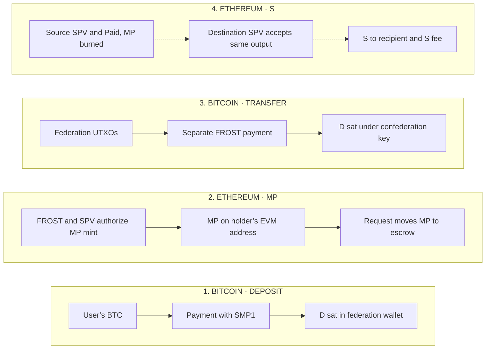

Sources · [docs/BITCOIN_MINT_AND_TREASURY.md:40](../../docs/BITCOIN_MINT_AND_TREASURY.md#L40) · [docs/BITCOIN_CUSTODY_TRANSFER.md:356](../../docs/BITCOIN_CUSTODY_TRANSFER.md#L356) · [docs/BITCOIN_WITHDRAWALS.md:78](../../docs/BITCOIN_WITHDRAWALS.md#L78) · [tests/e2e/test_custody_transfer.py:150](../../tests/e2e/test_custody_transfer.py#L150)

### Deposit BTC and mint federation MP

A federation issues MP against BTC in its Bitcoin wallet. The federation needs an accepted profile with MiningPoolV1 and its own MP. The MP recipient provides their public EVM address.

**01. Prepare the first Bitcoin payment**

In the SDK use bitcoin deposit prepare. Check the Bitcoin network, federation wallet script, payment output amount, and EVM address. The zero-value SMP1 output binds the recipient, EVM network, MiningPoolV1, payment output index, and exact MP mint amount.

**02. Sign and broadcast the BTC payment**

Sign the Bitcoin wallet inputs with Core or an external PSBT signer. In the SDK these are the sign and broadcast steps. The payment output goes to the federation’s shared Bitcoin key. The sender pays the miner fee on top of the output amount and receives any change.

**03. Verify the deposit and issue MP**

A regular deposit waits for the configured bitcoin_confirmations, with six as both the default and minimum. The canonical block, transaction inclusion proof, exact txid and vout, script, amount, and SMP1 are checked. In the public profile, FROST signers check their own Core nodes. After their EVM authorization, an executor submits the mint. The contract credits this output once and sends MP to the bound EVM address.

**What the user sees**

The Bitcoin payment and its depth appear first. MP appears after a successful EVM mint receipt. With 18 decimals, 1 sat maps to 10¹⁰ MP base units, so a 0.01 BTC output maps to 0.01 MP. Coinbase outputs follow separate 100/101 maturity rules.

Sources · [docs/BITCOIN_MINT_AND_TREASURY.md:40](../../docs/BITCOIN_MINT_AND_TREASURY.md#L40) · [docs/BITCOIN_MINT_AND_TREASURY.md:130](../../docs/BITCOIN_MINT_AND_TREASURY.md#L130) · [docs/BITCOIN_MINT_ADMISSION.md:118](../../docs/BITCOIN_MINT_ADMISSION.md#L118) · [contracts/federation/BitcoinDepositRegistry.sol:206](../../web3/contracts/src/federation/BitcoinDepositRegistry.sol#L206) · [tests/e2e/test_custody_transfer.py:150](../../tests/e2e/test_custody_transfer.py#L150)

### Request MP → S and transfer the BTC

The user submits an EVM request to exchange the source federation’s MP for the selected confederation’s S. Its gateway must admit the source. Both deployments use the same Bitcoin and EVM networks. Their relay and ZK backends can differ.

**04. The MP holder approves the exchange**

Check the binding with custody-transfer inspect. Select the source MP, amount D in sat, EVM recipient, and minimum net S. Run approve against the verified gateway, then request. V3 also supports dao in-kind approve-wrap and wrap. A regular MP transfer to another EVM address creates no request.

**05. The gateway locks the S amount and holds MP**

When request is included, the minimum and applicable fee are checked. The gateway fixes net_shares and protocol_fee_s, moves the holder’s MP into federation escrow, and binds transfer_id to source_request. S is issued once BTC is transferred and accepted. The regular fee applies without a discount program. The holder pays gas for their EVM calls.

**06. The federation signs the second Bitcoin payment**

Its signers check the request, exact destination script, amount, inputs, change, and miner fee. FROST signs a new transaction spending UTXOs from the shared federation wallet. The D sat output goes to the confederation’s distinct Bitcoin key. Change stays with the federation, which pays the transfer fee from unencumbered BTC. Other UTXOs in that reserve can fund the transfer.

**Before and after signing**

Before Bitcoin signing can begin, the holder can recover MP if the escrow state permits cancellation. The timeout alone cannot refund MP after signing begins. Keep transfer_id and source_request to resume the same operation.

Sources · [docs/BITCOIN_CUSTODY_TRANSFER.md:5](../../docs/BITCOIN_CUSTODY_TRANSFER.md#L5) · [docs/BITCOIN_CUSTODY_TRANSFER.md:356](../../docs/BITCOIN_CUSTODY_TRANSFER.md#L356) · [docs/BITCOIN_CUSTODY_TRANSFER.md:419](../../docs/BITCOIN_CUSTODY_TRANSFER.md#L419) · [contracts/federation/BitcoinCustodyTransferV2.sol:102](../../web3/contracts/src/federation/BitcoinCustodyTransferV2.sol#L102) · [contracts/federation/ConfederationPoolV2.sol:175](../../web3/contracts/src/federation/ConfederationPoolV2.sol#L175)

### Burn MP and credit S

Both sides verify the transfer. Depth is measured from the same Bitcoin block, so equal thresholds can be reached together.

**07. The federation burns MP after btc-settle**

The source escrow waits for a canonical SPV proof of the signed txid at the profile’s depth, with a minimum of six. Settlement verifies the reserved inputs and payout, records change, reduces MP backing, and burns the locked MP. The source receipt becomes Paid. The BTC output is already under the confederation’s key and its reserve still awaits acceptance.

**08. The confederation accepts the same output with finalize**

Any executor can submit the Paid receipt for the confirmed version, its exact txid, required vout, and destination SPV proof. The contract checks the script, exact aggregate amount of requests tied to the output, canonicality, and its own confirmation depth, at least six. The output is credited once. The reserve gains D sat and the contract atomically mints net S to the recipient and the S fee under DAO policy.

**09. The recipient checks the EVM receipt and S balance**

After a successful finalize the request is COMPLETED and the recipient can use S. Ethereum has a separate confirmation policy. The SDK requires at least 12 confirmations and checks finalized on Ethereum mainnet. If destination SPV is behind, the source stays Paid. After synchronization, retry finalize with the same request and output. If RBF was used, submit the version that confirmed.

**Verified local example without NFT**

A 0.01 BTC output minted 0.01 MP. The federation transferred all 1,000,000 sat and paid a separate 1,000 sat miner fee. After MP was burned, the same output backed 0.009983 S to the user and 0.000017 S in DAO fees. These amounts use the test fee schedule.

Sources · [contracts/federation/BitcoinWithdrawalEscrow.sol:338](../../web3/contracts/src/federation/BitcoinWithdrawalEscrow.sol#L338) · [contracts/federation/BitcoinCustodyTransferV2.sol:149](../../web3/contracts/src/federation/BitcoinCustodyTransferV2.sol#L149) · [contracts/federation/BitcoinDepositRegistry.sol:235](../../web3/contracts/src/federation/BitcoinDepositRegistry.sol#L235) · [docs/LAUNCH_CONFIGURATOR.md:246](../../docs/LAUNCH_CONFIGURATOR.md#L246) · [tests/e2e/test_custody_transfer.py:207](../../tests/e2e/test_custody_transfer.py#L207)

### How an S holder receives BTC

In V3, holders redeem S from their confederation’s Bitcoin reserve. The route is the same for S issued after an MP transfer, purchased, or received from a direct BTC deposit. The confederation’s custodians sign the Bitcoin payment.

**01. Choose the amount and Bitcoin address**

Enter the S amount and recipient script in dao in-kind withdraw-quote. Check the protocol fee in S, minimum net payout in sat, and limit on your share of miner fees. The base minimums are 294 sat for P2WPKH and 330 sat for P2TR. In withdraw, set the minimum and inclusion deadline. Once accepted, the request locks S and the necessary BTC reserve.

**02. The confederation approves and signs the payout**

FROST and required custodian approvals bind requests, UTXOs, the exact txid, and fee parameters. The confederation’s Bitcoin FROST signs a payment to the recipient script. Change stays in its reserve. An RBF replacement preserves each request’s minimum BTC payout and fee limit.

**03. Canonical SPV settles the claim**

At the required depth, the proof confirms the version actually paid. The payout plus the miner fee share are deducted from the reserve and the matching amount of S is burned. The rounded protocol fee remains backed as S and is routed under DAO policy. An accepted request settles once.

**Amounts verified in the standard-fee test**

In the local native-s path, the user received 995,003 sat on redemption after the 1,000,000 sat transfer. Miners received 1,000 sat for the withdrawal. The remaining 3,997 sat backed fee S. The fee for the earlier wallet-to-wallet transfer was accounted for separately.

Sources · [docs/CONFEDERATION_DAO_IN_KIND.md:190](../../docs/CONFEDERATION_DAO_IN_KIND.md#L190) · [docs/CONFEDERATION_DAO_IN_KIND.md:250](../../docs/CONFEDERATION_DAO_IN_KIND.md#L250) · [docs/BITCOIN_CUSTODY_TRANSFER.md:106](../../docs/BITCOIN_CUSTODY_TRANSFER.md#L106) · [contracts/federation/BitcoinWithdrawalEscrowV2.sol:337](../../web3/contracts/src/federation/BitcoinWithdrawalEscrowV2.sol#L337) · [tests/e2e/test_custody_transfer.py](../../tests/e2e/test_custody_transfer.py)

### Other BTC payout routes

The route depends on the token, issuance profile, and the reserve’s current Bitcoin key.

**A. BTC → MP → BTC directly through the federation**

The holder locks MP in escrow with an amount in whole sat and a payout script. The Bitcoin group for the registered source wallet signs the payout. After SPV, the escrow burns MP. The recipient gets the agreed amount and unencumbered source BTC covers the ordinary miner fee.

**B. BTC → S → BTC through the direct V3 reserve**

The recipient locks a quote against the exact Bitcoin output and SMP1. The payer sends BTC directly to the confederation and pays the miner fee. S is issued after the required depth, SPV, and FROST checks. On S → BTC redemption, the miner fee comes out of the request’s gross sat amount.

**C. BTC → MP → FS or CS → BTC through a legacy pool**

FS and CS/cBTC are nontransferable and tied to the pool’s MP. Depositing local MP changes EVM accounting. In the independent CS profile, external MP requires BTC to move and source MP to be burned first. For withdrawal, the pool wallet’s FROST group signs the BTC payment. SPV settlement burns shares and the corresponding MP. The BTC treasury or connected fee reserve pays miners.

**Payout confirmation**

Relay and ZK settlement both require a canonical block, sufficient depth, and an inclusion proof. The NFT quota applies when a discount is selected. The V4 personal fee path has separate qualification.

Sources · [docs/BITCOIN_WITHDRAWALS.md:78](../../docs/BITCOIN_WITHDRAWALS.md#L78) · [docs/CONFEDERATION_DAO_IN_KIND.md:527](../../docs/CONFEDERATION_DAO_IN_KIND.md#L527) · [docs/BITCOIN_CUSTODY_TRANSFER.md:128](../../docs/BITCOIN_CUSTODY_TRANSFER.md#L128) · [docs/TOKENS.md:125](../../docs/TOKENS.md#L125) · [docs/WITHDRAWAL_FEE_SUBSIDY.md:5](../../docs/WITHDRAWAL_FEE_SUBSIDY.md#L5)

## Verification of BTC withdrawals without NFT

End-to-end evidence includes signing and broadcasting a Bitcoin payment, inclusion in Core blocks, and successful Ethereum SPV settlement with payout and accounting checks. Six end-to-end relay tests passed on the previous review snapshot. Component tests and structural runs verify individual stages.

| Route | Relay | ZK |
| --- | --- | --- |
| Direct MP → BTC | Prior end-to-end regtest, P2TR MP request batched with FS | End-to-end payout unverified |
| Legacy FS → BTC | Prior end-to-end regtest, P2WPKH and P2TR | End-to-end payout unverified |
| Legacy CS → BTC | Prior end-to-end regtest, P2WPKH and P2TR | End-to-end payout unverified |
| MP → CS → BTC | Prior end-to-end regtest, transfer between two wallets, P2TR | End-to-end payout unverified |
| MP → V3 S → BTC | Prior end-to-end regtest, P2TR, without NFT | End-to-end payout unverified |
| BTC → V3 S → BTC | Prior end-to-end regtest, P2WPKH, without NFT | End-to-end payout unverified |
| Unencumbered treasury BTC withdrawal | Prior end-to-end regtest, P2WPKH, no MP mint | End-to-end payout unverified |
| Separate BTC fee reserve | Component evidence only | End-to-end payout unverified |
| V4 personal fee | Component evidence, FEE_QUALIFIED=false | End-to-end payout unverified |

**Test environment** — The end-to-end relay payouts use Bitcoin Core 30.3 regtest, Anvil, and test FROST keys. Public Testnet4 or mainnet payouts require separate acceptance.

**ZK evidence** — A local EVM with the Sepolia chain ID and historical Testnet4 headers verified CREATE/reuse, DKG, consumer binding, and ZIP preparation. The pinned verifier rejected an invalid seal. BTC payouts and mixed relay ↔ ZK transfers still need end-to-end acceptance.

Sources · [tests/e2e/test_bitcoin_processes.py](../../tests/e2e/test_bitcoin_processes.py) · [tests/e2e/test_bitcoin_onchain.py](../../tests/e2e/test_bitcoin_onchain.py) · [tests/e2e/test_custody_transfer.py](../../tests/e2e/test_custody_transfer.py) · [tests/e2e/test_bitcoin_treasury_onchain.py](../../tests/e2e/test_bitcoin_treasury_onchain.py) · [tests/e2e/test_zk_testnet4_e2e.py:77](../../tests/e2e/test_zk_testnet4_e2e.py#L77) · [docs/ZK_SPV_BOOTSTRAP.md:210](../../docs/ZK_SPV_BOOTSTRAP.md#L210) · [ops/artifacts/zkspv/worker-integration/contour-withdrawal-report.json](../../ops/artifacts/zkspv/worker-integration/contour-withdrawal-report.json) · [ops/system_modes.py:117](../../ops/system_modes.py#L117) · [web3/test/BitcoinFeeReserve.t.sol:125](../../web3/test/BitcoinFeeReserve.t.sol#L125) · [signer-agent/tests/test_withdrawal_fee.py](../../signer-agent/tests/test_withdrawal_fee.py) · [signer-agent/tests/test_withdrawal_fee_spv.py](../../signer-agent/tests/test_withdrawal_fee_spv.py)

### Confirmations and fees

**Bitcoin confirmations**

During settlement, both escrow versions check the exact bound txid, inclusion in a canonical block, the order of reserved inputs, and depth from bitcoin_confirmations, at least six. The SDK requires at least one confirmation when choosing a regular input and 101 for a coinbase input. These are UTXO selection rules. EVM confirmations are separate. On Ethereum mainnet, the SDK requires at least 12 and checks finalized.

Sources · [contracts/federation/BitcoinWithdrawalEscrow.sol:338](../../web3/contracts/src/federation/BitcoinWithdrawalEscrow.sol#L338) · [contracts/federation/BitcoinWithdrawalEscrowV2.sol:385](../../web3/contracts/src/federation/BitcoinWithdrawalEscrowV2.sol#L385) · [SDK/bitcoin_onchain_payment.py:91](../../signer-agent/signer_agent/bitcoin_onchain_payment.py#L91) · [docs/LAUNCH_CONFIGURATOR.md:246](../../docs/LAUNCH_CONFIGURATOR.md#L246)

**Relay and ZK**

Both profiles verify Bitcoin transaction inclusion and the SDK independently checks Core. Relay requires a current canonical header. ZK requires Fresh status and a header materialized under the current root. Settlement waits while the verifier lags. In MP → S, each side checks the depth of the same output using its own SPV, including permitted mixed backends on one Bitcoin network. The supported ZK profiles use Bitcoin mainnet or Testnet4.

Sources · [SDK/bitcoin_onchain_payment.py:895](../../signer-agent/signer_agent/bitcoin_onchain_payment.py#L895) · [SDK/bitcoin_onchain_payment.py:975](../../signer-agent/signer_agent/bitcoin_onchain_payment.py#L975) · [rust/zkspv/state-adapter/contracts/ZkSpvAdapter.sol:31](../../rust/zkspv/state-adapter/contracts/ZkSpvAdapter.sol#L31) · [SDK/custody_network.py:68](../../signer-agent/signer_agent/custody_network.py#L68) · [docs/LAUNCH_CONFIGURATOR.md:145](../../docs/LAUNCH_CONFIGURATOR.md#L145)

**Who pays miners**

For direct MP redemption the recipient gets the agreed sat. Unencumbered source BTC or a connected reserve pays the fee. Legacy FS/CS first deducts the protocol fee in MP and rounds the amount to sat. The miner fee is paid separately. Relay and ZK use the same fee formula. Treasury withdrawals spend unencumbered BTC and preserve MP backing. The federation pays for MP → S custody transfers separately from the output amount.

Sources · [docs/BITCOIN_WITHDRAWALS.md:78](../../docs/BITCOIN_WITHDRAWALS.md#L78) · [docs/BITCOIN_MINT_AND_TREASURY.md:163](../../docs/BITCOIN_MINT_AND_TREASURY.md#L163) · [contracts/federation/BitcoinWithdrawalEscrow.sol:241](../../web3/contracts/src/federation/BitcoinWithdrawalEscrow.sol#L241) · [docs/BITCOIN_CUSTODY_TRANSFER.md:106](../../docs/BITCOIN_CUSTODY_TRANSFER.md#L106)

**V3 fees and Ethereum gas**

On S redemption, gross G = ⌊(S − F)/10¹⁰⌋ sat, where F is the protocol fee in S base units. Net payout equals G less the request’s miner fee share. The actual Bitcoin miner fee is inputs minus outputs. Settlement burns G × 10¹⁰ units of S and debits G sat from the reserve. Configuration can raise the 294 sat P2WPKH and 330 sat P2TR minima. The EVM sender pays gas, measured from the receipt as gasUsed × effectiveGasPrice.

Sources · [docs/CONFEDERATION_DAO_IN_KIND.md:250](../../docs/CONFEDERATION_DAO_IN_KIND.md#L250) · [contracts/federation/BitcoinWithdrawalEscrowV2.sol:311](../../web3/contracts/src/federation/BitcoinWithdrawalEscrowV2.sol#L311) · [contracts/federation/ConfederationPoolV2.sol:361](../../web3/contracts/src/federation/ConfederationPoolV2.sol#L361) · [tests/e2e/test_custody_transfer.py:295](../../tests/e2e/test_custody_transfer.py#L295)

### Amounts and test evidence

**Direct MP and legacy FS**

A P2TR output paid 700,000 sat from 600,000 sat of FS and 100,000 sat of direct MP. The miner fee was 1,000 sat and change was 302,000 sat. A separate P2WPKH output received 600,000 sat from FS. The confirmed RBF version paid 1,500 sat in fees and returned 401,500 sat in change.

Sources · [tests/e2e/test_bitcoin_processes.py:394](../../tests/e2e/test_bitcoin_processes.py#L394) · [tests/e2e/test_bitcoin_processes.py:668](../../tests/e2e/test_bitcoin_processes.py#L668) · [ops/artifacts/operations-final-20261026.e2e-07.xml](../../ops/artifacts/operations-final-20261026.e2e-07.xml)

**Legacy CS without NFT**

Regular CS paid 598,620 sat each to P2WPKH and P2TR. The protocol fee and rounding were 1,380 sat equivalent and 123 base units. The miner fee was 1,000 sat and change was 403,380 sat. After a 1,000,000 sat transfer backing external MP, the CS user got 996,003 sat. Each of the two Bitcoin payments paid 1,000 sat from the respective wallet’s unencumbered funds.

Sources · [tests/e2e/test_bitcoin_onchain.py:441](../../tests/e2e/test_bitcoin_onchain.py#L441) · [tests/e2e/test_bitcoin_onchain.py:577](../../tests/e2e/test_bitcoin_onchain.py#L577) · [tests/e2e/test_custody_transfer.py:308](../../tests/e2e/test_custody_transfer.py#L308) · [ops/artifacts/custody-completeness-20261104/e2e.xml](../../ops/artifacts/custody-completeness-20261104/e2e.xml) · [ops/artifacts/operations-final-20261026.e2e-01.xml](../../ops/artifacts/operations-final-20261026.e2e-01.xml)

**MP → S → BTC without NFT, local regtest**

The federation transferred 1,000,000 sat and paid miners a separate 1,000 sat. The confederation paid the recipient 995,003 sat, paid miners 1,000 sat at withdrawal, and retained 3,997 sat backing fee S. Issuance retained 1,700 sat equivalent and redemption retained 2,297. The EVM request receipt recorded 786,366,006,290,928 wei. The same batch settled after resuming a partial signature.

Sources · [tests/e2e/test_custody_transfer.py:234](../../tests/e2e/test_custody_transfer.py#L234) · [tests/e2e/test_custody_transfer.py:295](../../tests/e2e/test_custody_transfer.py#L295) · [tests/e2e/test_custody_transfer.py:316](../../tests/e2e/test_custody_transfer.py#L316)

**Direct BTC → S → BTC without NFT**

The confirmed quote for a 1,000,000 sat deposit withheld 1,700 sat equivalent in S. The external payer covered the initial 464 sat miner fee. After six blocks, withdrawal paid 995,003 sat to the user and 1,000 sat to miners, with 3,997 sat in change.

Sources · [tests/e2e/test_direct_btc_s_exit.py](../../tests/e2e/test_direct_btc_s_exit.py) · [docs/CONFEDERATION_DAO_IN_KIND.md:527](../../docs/CONFEDERATION_DAO_IN_KIND.md#L527)

**Unencumbered treasury BTC withdrawal**

Of 600 free sat, 400 sat went to the recipient and 200 sat to miners. MP supply stayed at zero.

Sources · [tests/e2e/test_bitcoin_treasury_onchain.py:74](../../tests/e2e/test_bitcoin_treasury_onchain.py#L74)

**Follow-up checks** — 10 contract tests on solc 0.8.39 and 80 ZK/SDK tests passed, including a structural Testnet4 run. The ZK adapter passed 35 separate tests. The fee reserve passed 3 contract tests and BTC fee sources passed 98 SDK tests. End-to-end ZK payout remains open.

**Fresh Groth16** — The test machine had about 1 GiB free against the 8 GiB requirement for preparing zk-fresh. A prior state transition proof was accepted and a TEST_ONLY regtest minted MP at six confirmations. These results cover different stages.

## Assets and financial flows

| Asset | Network | Purpose |
| --- | --- | --- |
| BTC | Bitcoin | Federation and confederation reserves held under distinct FROST keys, external payouts, change, and miner fees. |
| MP | Ethereum | Transferable federation token. Minting and burning are tied to that federation’s BTC reserve. |
| S | Ethereum / V3 | Transferable confederation token, redeemable against its BTC. S from fees and NFT purchases flows to the DAO or fee sale. |
| FS / CS | Ethereum / legacy | Nontransferable pool balances. CS/cBTC remains linked to the MP of its specific pool. |
| ULR | Ethereum | Governance and staking supply of 10 million. The shared program and local V3 staking have distinct funding and rights. |
| Stablecoins | Ethereum | Actual ERC-20 assets received from a buyer, external payer, router, or prefunded budget. |
| ETH | Ethereum | EOA balances that pay for transactions. SPV requests and DAO gas expense claims are paid separately. |
| NFT | Ethereum | A fee schedule, discount, and owner-specific quota. In V3, an NFT can be purchased with S. The backing BTC stays in reserve. |

Solid arrows show assets or changes in accounting. Dashed arrows show approvals, checks, or sequencing. Branches show allocations to the indicated recipients.

### 01. Cold start and authority

The network, relay or ZK profile, starting heights, tokens, maturity, thresholds, and fees are bound to the agreed deployment.

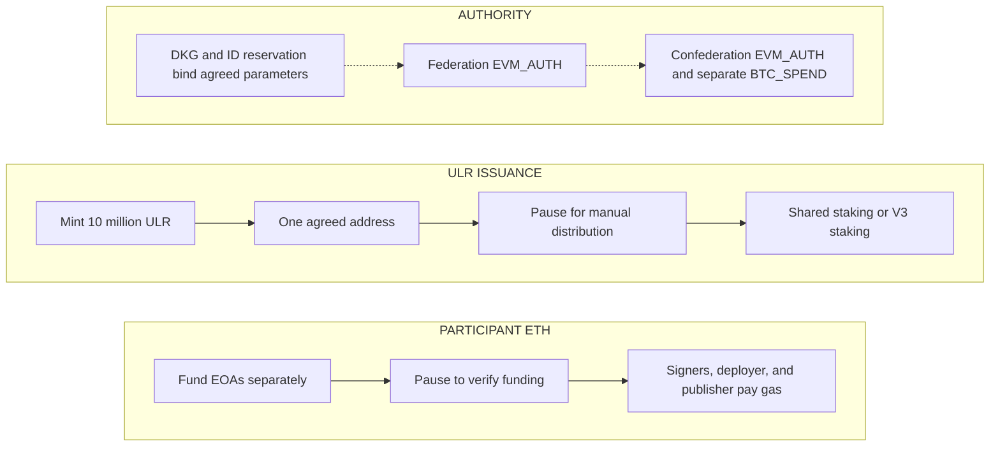

A federation representative can join the federation EVM group. The V3 confederation Bitcoin group consists of its own custodians. Some V3 DAO decisions require separate ≥⌈2N/3⌉ approval after FROST.

An RPC height below the anchor keeps the operation waiting. A sufficient height with a different canonical hash triggers reconciliation and pauses the financial transition.

Sources · [docs/COLD_START.md:59](../../docs/COLD_START.md#L59) · [docs/ARCHITECTURE.md:197](../../docs/ARCHITECTURE.md#L197) · [docs/RECOVERY.md](../../docs/RECOVERY.md)

### 02. BTC deposits and federation MP

The deposit registry tracks BTC backing and used outputs. A separate approval controls the MP mint queue in the public profile.

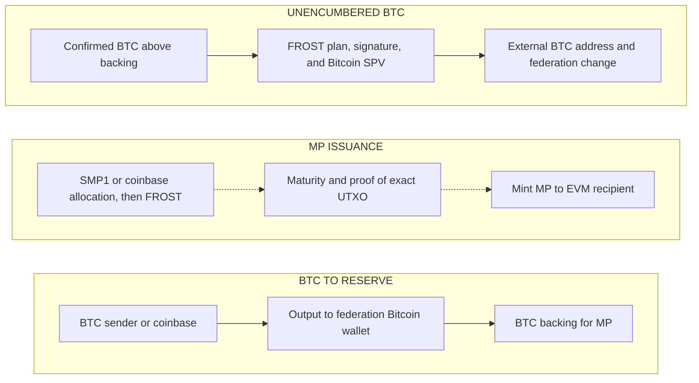

Default coinbase thresholds are 100 confirmations for issuance and 101 for spending. The sender pays the BTC deposit fee. Treasury withdrawals use unencumbered BTC for both payout and miner fee, preserving backing and pending SMP1 payments.

The conditional derived-address path binds the allocation to a unique Bitcoin script before checking the UTXO. The profile remains QUALIFIED=false. The new build can release an expired mint slot. Older deployments require a compatibility check.

A mint attempt lasts at most seven days. A nonce increase retires stale approval. A retry keeps the output, allocation, and eight-attempt limit for the request.

Sources · [docs/BITCOIN_MINT_AND_TREASURY.md:40](../../docs/BITCOIN_MINT_AND_TREASURY.md#L40) · [contracts/federation/BitcoinMintAdmission.sol:259](../../web3/contracts/src/federation/BitcoinMintAdmission.sol#L259) · [docs/ADDRESS_DEPOSIT_REGISTRY.md:312](../../docs/ADDRESS_DEPOSIT_REGISTRY.md#L312)

### 03. MP → S by transferring BTC

The federation issues MP. The confederation issues S after BTC moves to its Bitcoin wallet.

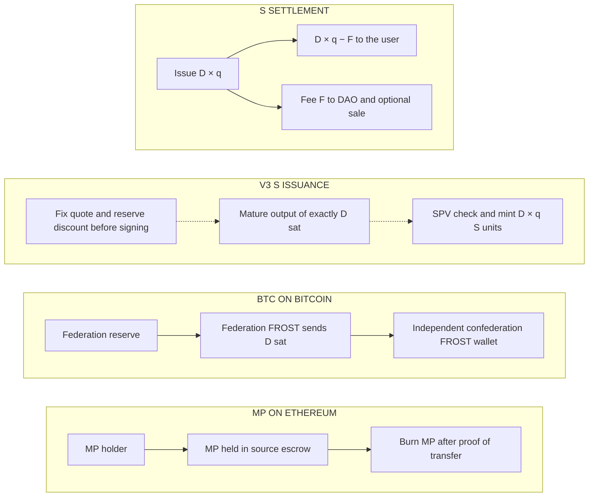

q = 10¹⁰ S base units per sat. The source burns D × q MP units. The transfer’s Bitcoin miner fee spends unencumbered source BTC. The full D sat backs the S issuance.

After source settlement the confederation controls D sat. Its reserve recognizes that amount at separate finalization. An incomplete transfer can be cancelled in the permitted phase. An approved refund releases escrow MP and the reserved NFT quota.

Sources · [docs/CONFEDERATION_DAO_IN_KIND.md:250](../../docs/CONFEDERATION_DAO_IN_KIND.md#L250) · [docs/BITCOIN_CUSTODY_TRANSFER.md](../../docs/BITCOIN_CUSTODY_TRANSFER.md) · [contracts/federation/ConfederationBitcoinReserve.sol](../../web3/contracts/src/federation/ConfederationBitcoinReserve.sol)

### 04. Direct BTC → S deposit

The S amount and protocol fee are bound to the exact output before the Bitcoin payment.

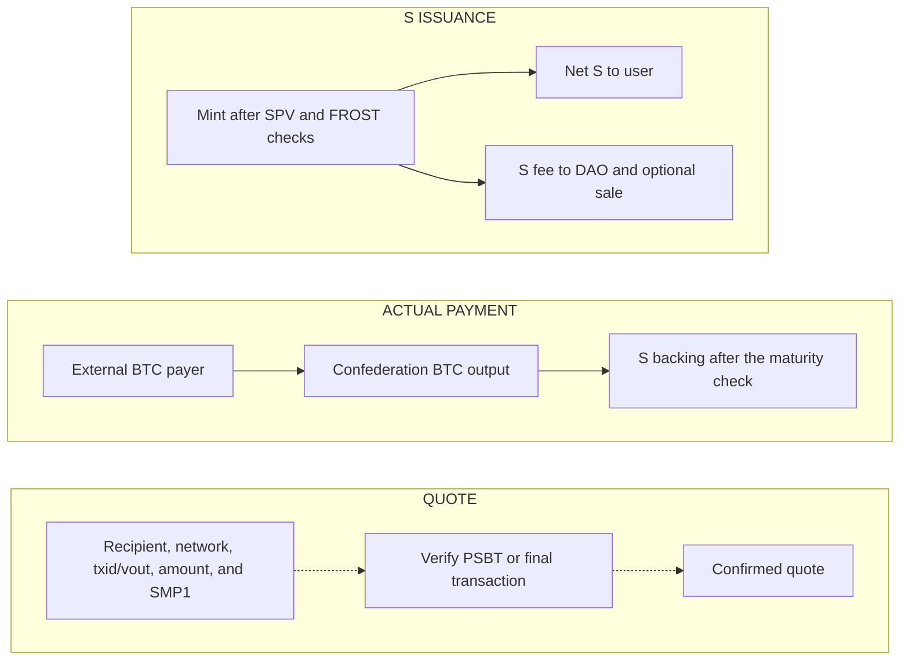

The BTC payer covers the source transaction’s miner fee from its inputs. The corresponding EOA pays for its EVM transactions in ETH.

Informational finding T-03 covers historical outputs without an accepted quote.

Sources · [docs/CONFEDERATION_DAO_IN_KIND.md:527](../../docs/CONFEDERATION_DAO_IN_KIND.md#L527) · [contracts/federation/ConfederationBitcoinReserve.sol:242](../../web3/contracts/src/federation/ConfederationBitcoinReserve.sol#L242) · [SDK/confederation_dao_cli.py:216](../../signer-agent/signer_agent/confederation_dao_cli.py#L216)

### 05. Direct S → BTC redemption

An S holder redeems transferable S from that confederation’s BTC reserve. The request fixes the net minimum, miner fee cap, and deadline.

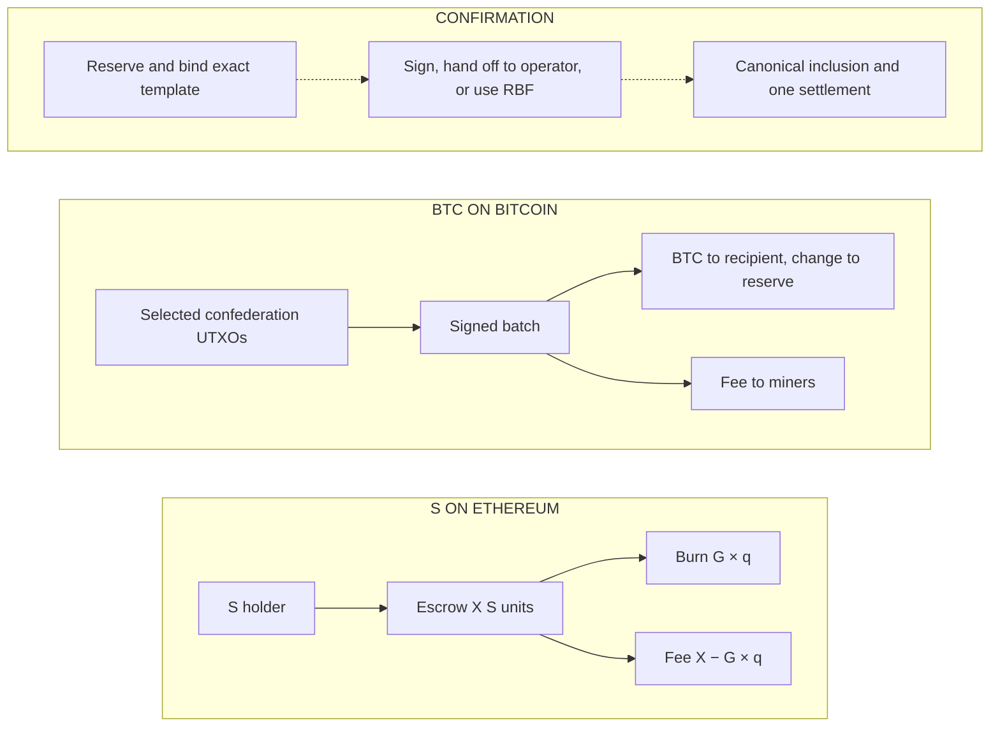

G = ⌊(X − F)/q⌋ sat. Net BTC per request is G − m, where m is its share of the actual miner fee. For a batch, Σ(net) + M = Σ(G). X − G × q includes F and rounding down.

Base minimums are 294 sat for P2WPKH and 330 sat for P2TR. The recipient pays CPFP separately. Escrow settles against the original Bitcoin output.

Local example with an NFT discount after a 1,000,000 sat transfer. The recipient received 995,153 sat, miners received 1,000 sat, and the reserve retained 3,847 sat. The transfer fee was accounted for separately.

Sources · [docs/CONFEDERATION_DAO_IN_KIND.md:294](../../docs/CONFEDERATION_DAO_IN_KIND.md#L294) · [docs/BITCOIN_WITHDRAWALS.md](../../docs/BITCOIN_WITHDRAWALS.md) · [contracts/federation/BitcoinWithdrawalEscrowV2.sol:337](../../web3/contracts/src/federation/BitcoinWithdrawalEscrowV2.sol#L337) · [tests/e2e/test_custody_transfer.py](../../tests/e2e/test_custody_transfer.py) · [security_repository_recheck_20261123.md:224](../../security_repository_recheck_20261123.md#L224) · [SDK/bitcoin_payout_package.py:46](../../signer-agent/signer_agent/bitcoin_payout_package.py#L46)

### 06. Legacy pools and withdrawals

Legacy FS and CS/cBTC are tied to MP and a specific pool. An imported backing path requires proof of Bitcoin custody.

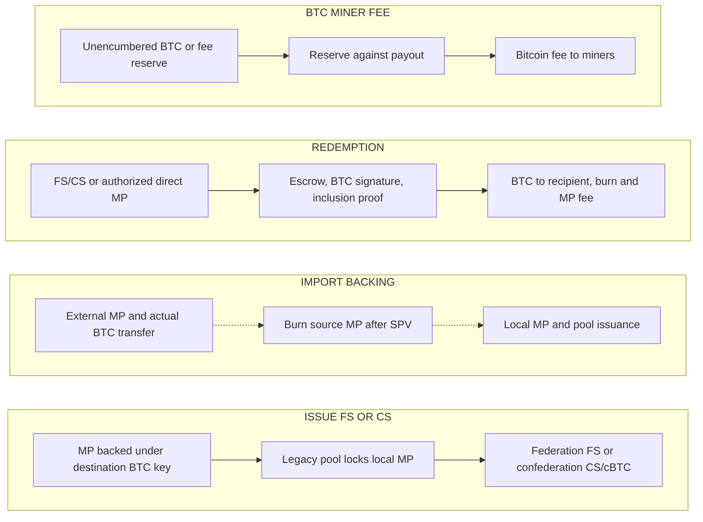

In a local deposit, MP already has BTC backing under the destination key. Depositing it into the pool does not move BTC. E-01 covers legacy fees. Diagram 12 shows personal miner fee funding as a conditional profile.

Sources · [docs/TOKENS.md:125](../../docs/TOKENS.md#L125) · [docs/BITCOIN_CUSTODY_TRANSFER.md:188](../../docs/BITCOIN_CUSTODY_TRANSFER.md#L188) · [docs/BITCOIN_WITHDRAWALS.md:78](../../docs/BITCOIN_WITHDRAWALS.md#L78)

### 07. Sale of collected fees

Actual S or MP fees and prefunded stablecoins change owners. BTC stays in its respective reserve until redemption.

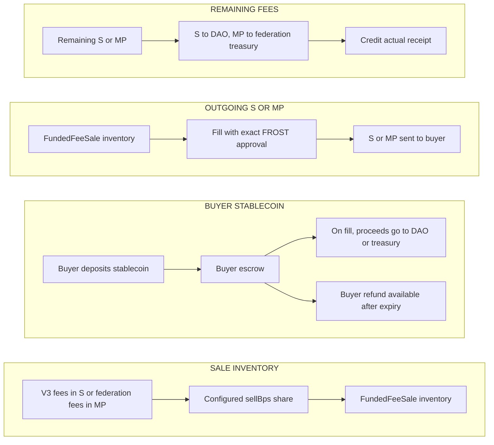

A fill binds buyer, size, price, nonce, and deadline. S sales require ≥⌈2N/3⌉ approval after FROST. NFT payments and direct S receipts go to the DAO. A funded legacy MP → USD converter can route stablecoins through the fee router. E-04 covers its price and available liquidity.

Sources · [docs/FEE_FLOW.md](../../docs/FEE_FLOW.md) · [contracts/federation/FundedFeeSale.sol:146](../../web3/contracts/src/federation/FundedFeeSale.sol#L146) · [contracts/federation/FundedFeeConverter.sol](../../web3/contracts/src/federation/FundedFeeConverter.sol)

### 08. NFTs and protocol discounts

An operation consumes the owner’s own quota. The quota changes the protocol fee on eligible routes.

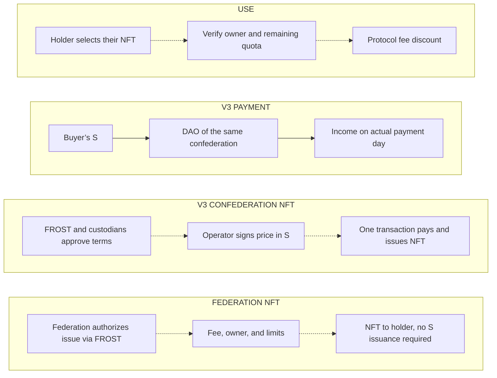

A federation NFT issue does not itself spend MP. Bitcoin miner fees and Ethereum gas are accounted for separately. MP → S reserves quota. S → BTC consumes it when the request is created. Discounts are optional. Both entities operate at the applicable base fee without them.

Sources · [docs/NFT_CONFIGURATION.md](../../docs/NFT_CONFIGURATION.md) · [docs/CONFEDERATION_DAO_IN_KIND.md:184](../../docs/CONFEDERATION_DAO_IN_KIND.md#L184)

### 09. V3 confederation DAO income

Daily settlement uses UTC. Only stakers of the same confederation for a full day share remaining income.

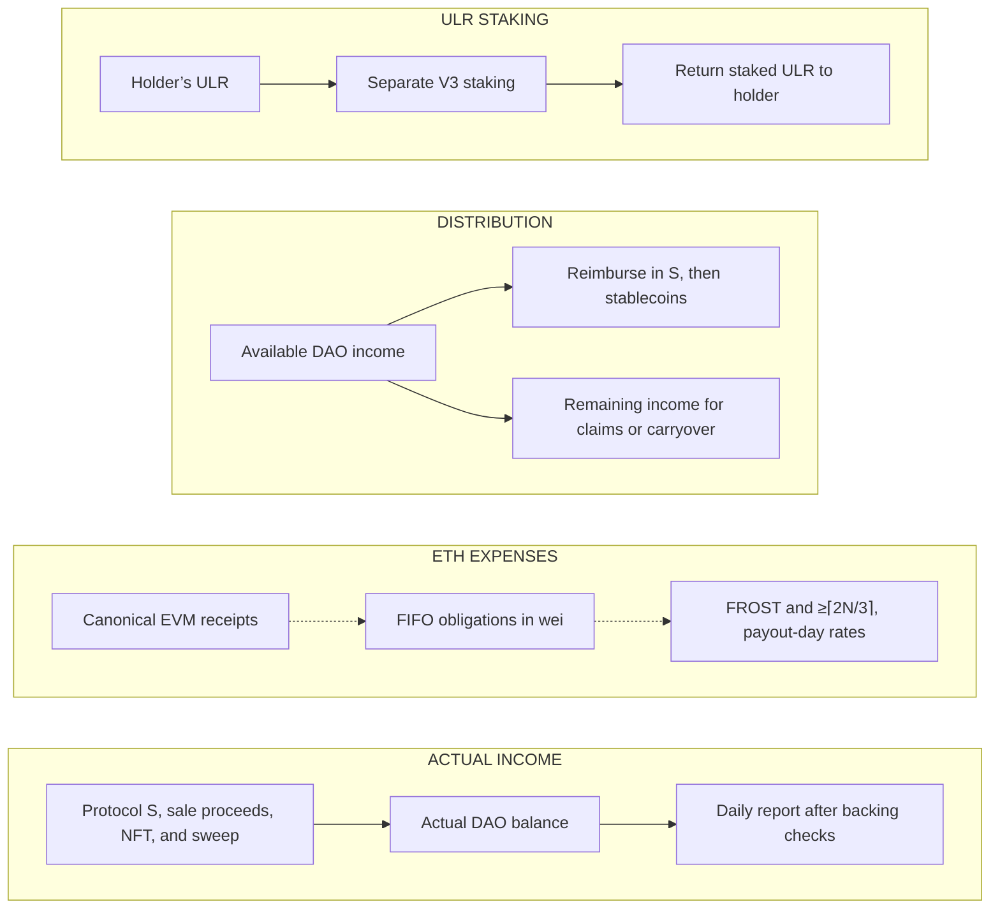

Eligible assets and stablecoin order are set in advance. Unpaid debt remains denominated in wei. Stakers receive no new remainder while it persists. Daily accounting separates expense reimbursement from staker income. E-03 and E-05 cover exchange-rate and token risks. T-04 verifies closing for a new confederation.

Sources · [docs/CONFEDERATION_DAO_IN_KIND.md:86](../../docs/CONFEDERATION_DAO_IN_KIND.md#L86) · [contracts/federation/ConfederationDAOIncome.sol:235](../../web3/contracts/src/federation/ConfederationDAOIncome.sol#L235)

### 10. Shared ULR staking and stablecoin income

Standard ULR treasuries count deposits of the configured stablecoin actually received.

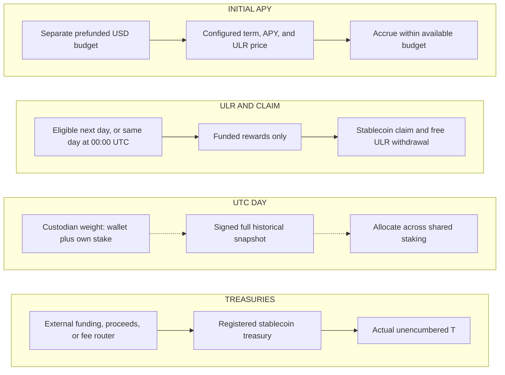

With standard settings, distribution = max(T − USD 1,000, 0) × 90% × C/G. C is confederation custodian weight and G is total system custodian weight. Round down once to the token’s base unit. Payout is zero if C or G is zero or there is no eligible stake. The usual candidate threshold is 200,000 ULR. Active custodians retain their actual weight below the threshold. Delegation to an active custodian preserves the staker’s claim.

External payers may fund eligible rewards for a completed day. After deactivation, withdrawal of the treasury remainder preserves accrued obligations. Each stablecoin is checked for reward backing. E-06 covers scale.

Sources · [docs/ULR_TREASURIES.md](../../docs/ULR_TREASURIES.md) · [docs/ULR_STAKING.md](../../docs/ULR_STAKING.md) · [contracts/staking/ULRStaking.sol:204](../../web3/contracts/src/staking/ULRStaking.sol#L204)

### 11. Additional treasury and LP routes

Legacy Custodian DAO with Stable/LP and project deployment fees are separate financial profiles.

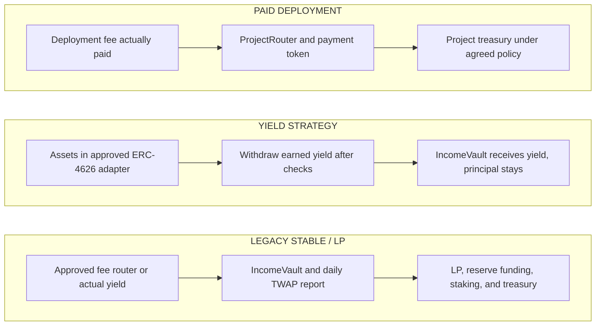

Distribution depends on recipients, reserve policy, and liquidity. ERC-4626 principal withdrawals require separate FROST approval and depend on liquidity. DAOTestUSD is used in Anvil and Sepolia test profiles. E-07 covers missing TWAP and late income.

Sources · [docs/CUSTODIAN_DAO.md:64](../../docs/CUSTODIAN_DAO.md#L64) · [docs/FEE_FLOW.md:155](../../docs/FEE_FLOW.md#L155) · [docs/FEES.md](../../docs/FEES.md) · [docs/TOKENS.md:272](../../docs/TOKENS.md#L272)

### 12. Bitcoin and Ethereum fee layers

Bitcoin fees, actual EVM gas, the SPV charge, and protocol fees are accounted for separately.

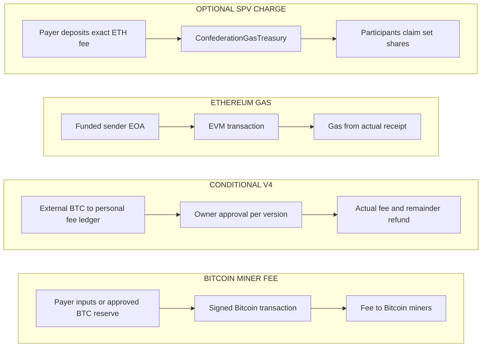

Verified voluntary BTC transfers fund the shared fee reserve. V4 is experimental and unqualified for real funds. The conditional MP/FS path locks a cap, burns actual cost, and returns the rest. The optional SPV charge is fixed, with separate proof readiness checks.

The operator EOA pays to publish relay or ZK updates. The confederation can sponsor publication from its ETH with limits and a journal. External charges and later V3 reimbursement require common attribution under E-08.

Sources · [docs/BTC_FEE_RESERVE.md](../../docs/BTC_FEE_RESERVE.md) · [docs/WITHDRAWAL_FEE_SUBSIDY.md](../../docs/WITHDRAWAL_FEE_SUBSIDY.md) · [docs/SPV_GAS_TREASURY.md:36](../../docs/SPV_GAS_TREASURY.md#L36) · [docs/RELAY_KEEPER_AND_GAS.md:5](../../docs/RELAY_KEEPER_AND_GAS.md#L5)

### 13. Relay, ZK, and settlement

Submitting headers or a proof updates verifiable state. The consumer moves funds after checking the exact operation.

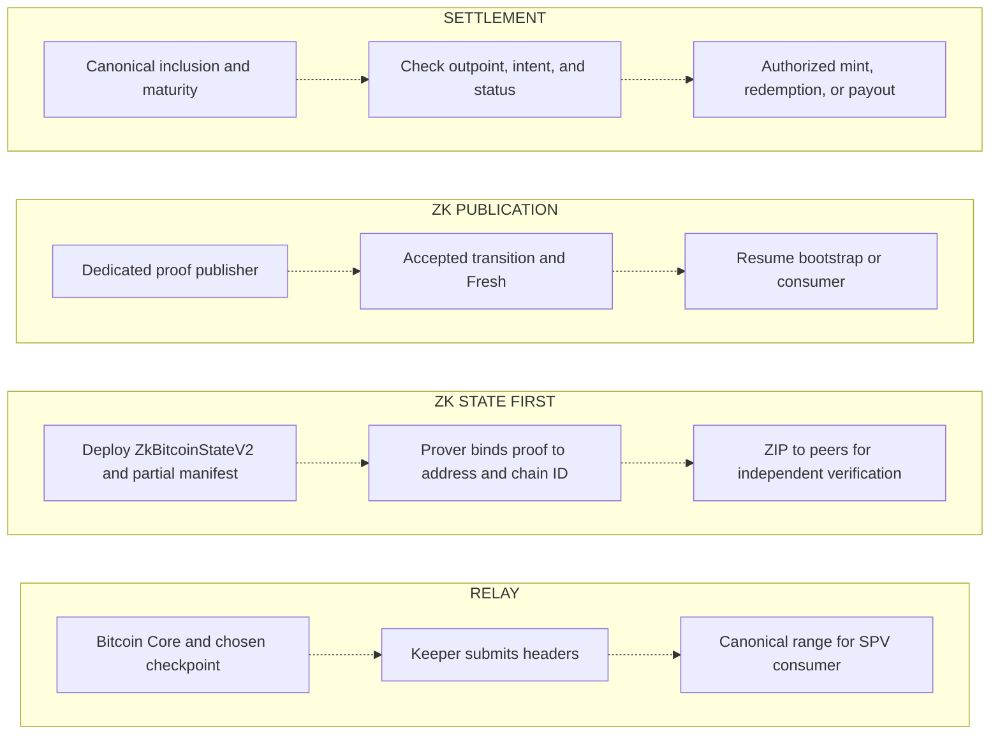

The source distribution excludes ready-made proofs. Participants can verify a public ZIP from the running deployment on their own RPCs. RPCs that lag wait for the required height. A confirmed hash mismatch triggers reconciliation.

After a confirmed EVM reorg, custody finalize checks the current root of the pinned ZK adapter. A retry retains the same Bitcoin output and original terms.

Sources · [docs/DISTRIBUTION.md](../../docs/DISTRIBUTION.md) · [docs/ZK_SPV_ARCHITECTURE.md:130](../../docs/ZK_SPV_ARCHITECTURE.md#L130) · [docs/SIGNING_PROTOCOL.md](../../docs/SIGNING_PROTOCOL.md) · [docs/RECOVERY.md](../../docs/RECOVERY.md)

### 14. Additional CPFP fee after S → BTC

After all required signatures are assembled, the recipient can accelerate the BTC payout with a separate transaction.

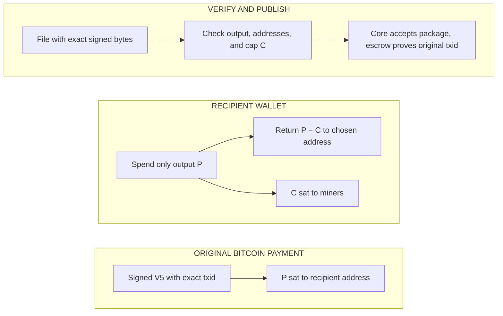

C is a separate voluntary fee paid from the recipient’s BTC. S backing is accounted against the original batch. For P = 1,000,000 sat, the recipient returns 998,000 sat to themselves and miners receive C = 2,000 sat.

The original payout must be fully signed. Mempool acceptance depends on node policy and does not guarantee inclusion.

Sources · [SDK/bitcoin_payout_package.py:46](../../signer-agent/signer_agent/bitcoin_payout_package.py#L46) · [docs/BITCOIN_WITHDRAWALS.md:223](../../docs/BITCOIN_WITHDRAWALS.md#L223) · [tests/e2e/test_bitcoin_payout_package.py](../../tests/e2e/test_bitcoin_payout_package.py)

## Pilot requirements for live funds

### Public-network acceptance

A signed launch on live Ethereum and Bitcoin RPCs with a fresh production Groth16 proof remains unverified. Local relay, ZK adapter, V3, and NFT runs provide different levels of evidence. Acceptance requires actual receipts for bootstrap, operations, payouts, and recovery in both profiles.

Sources · [docs/LAUNCH_READINESS.md](../../docs/LAUNCH_READINESS.md) · [docs/ZK_TESTNET4_SEPOLIA.md](../../docs/ZK_TESTNET4_SEPOLIA.md) · [security_mainnet_review_20261122.md](../../security_mainnet_review_20261122.md)

### Previously exposed keys

Disclosure of two old EVM keys is documented. The reviewed snapshot does not establish rotation or role removal. Risk is high if the old addresses still control funds or privileges. Closure requires evidence of migrating roles and balances in the deployments in use.

Sources · [security_best_practices_report.md:49](../../security_best_practices_report.md#L49) · [docs/SECURITY_LOGIC_REVIEW_2026_11_03.md:240](../../docs/SECURITY_LOGIC_REVIEW_2026_11_03.md#L240)

### Profiles under validation

Automatic Bitcoin address creation is marked QUALIFIED=false. The dedicated Bitcoin V4 fee path is marked FEE_QUALIFIED=false. Independent acceptance requires confirmed funding, payout, RBF, and refund scenarios. The diagrams show these as conditional branches.

Sources · [security_repository_recheck_20261123.md:113](../../security_repository_recheck_20261123.md#L113) · [docs/WITHDRAWAL_FEE_SUBSIDY.md](../../docs/WITHDRAWAL_FEE_SUBSIDY.md) · [docs/BTC_FEE_RESERVE.md](../../docs/BTC_FEE_RESERVE.md)

### Local evidence

The most recent execution-liveness report records 4,146 SDK and tool tests, 1,011 Solidity tests, 35 ZK adapter tests, and a regtest regression for a signed Bitcoin transaction. These figures come from an existing report.

Sources · [security_execution_liveness_review_20261123.md:40](../../security_execution_liveness_review_20261123.md#L40) · [security_repository_recheck_20261123.md](../../security_repository_recheck_20261123.md)

## Verification of technical remediations

The combined changes passed 736 SDK and distribution checks.

### T-04 · Closing DAO settlements

The factory records the UTC day of deactivation. Outstanding reports can be opened up to and including that day. Late income repays FIFO debt using the approved rate snapshot for the payout day. Any remainder is allocated by the final stake snapshot. 75 Solidity and 209 SDK checks passed.

Sources · [contracts/federation/ConfederationDAOIncome.sol](../../web3/contracts/src/federation/ConfederationDAOIncome.sol) · [web3/test/ConfederationDAOIncome.t.sol](../../web3/test/ConfederationDAOIncome.t.sol) · [docs/CONFEDERATION_DAO_IN_KIND.md](../../docs/CONFEDERATION_DAO_IN_KIND.md)

### T-05 · ZK and SPV history

Completed SQLite records are archived and free up the active queue. IDs, payments, nonces, and cumulative budgets are preserved. A reorg triggers bounded, cursor-based revalidation. New examples set a 128 MiB admission threshold. Retry was verified after restart and reorg.

Sources · [SDK/spv_history.py](../../signer-agent/signer_agent/spv_history.py) · [docs/ZK_SPV_WORKER.md](../../docs/ZK_SPV_WORKER.md) · [docs/SPV_ENCRYPTED_TRANSPORT.md](../../docs/SPV_ENCRYPTED_TRANSPORT.md)

### T-08 · Independent nonce-spend anchor

With the HTTPS anchor enabled, a separate host records the transcript hash atomically before a share leaves the signer. New signer profiles retain the server binding. Retries are limited to a saved share of the same transcript. HTTPS tests covered dual rollback, two signer copies, and a lost acknowledgement after a durable write.

Sources · [SDK/secure_state.py](../../signer-agent/signer_agent/secure_state.py) · [SDK/nonce_anchor.py](../../signer-agent/signer_agent/nonce_anchor.py) · [docs/SIGNING_PROTOCOL.md](../../docs/SIGNING_PROTOCOL.md)

### T-09 · Signer build provenance

Python wheels are pinned by SHA-256 and checked during installation. FROST builds in a fresh Cargo target directory. The SDK verifies the hash pin before mainnet IPC. CPython 3.11 wheel resolution was verified for macOS arm64 and Linux/WSL2 x86-64.

Sources · [signer-agent/requirements.lock](../../signer-agent/requirements.lock) · [ops/bootstrap_host.py](../../ops/bootstrap_host.py) · [signer-agent/tests/test_crypto_integrity.py](../../signer-agent/tests/test_crypto_integrity.py)

### T-11 · API operation fee replacement

The local command changes only EIP-1559 fee caps. Before signing, it checks current authority, contract, original calldata, nonce, and total cost limit. Both attempts stay in one journal. 67 API and recovery checks passed.

Sources · [SDK/operation_worker.py](../../signer-agent/signer_agent/operation_worker.py) · [tests/e2e/test_operational_api.py](../../tests/e2e/test_operational_api.py) · [docs/OPERATIONAL_API.md](../../docs/OPERATIONAL_API.md)

## Appendix. Project diagrams

50 canonical exports from the [project index](../DIAGRAMS.md). The PDF includes the original exhibits and their source-language labels.

| No. | Diagram | Export |
| --: | --- | --- |
| 01 | CLTV, Bitcoin DKG, and recovery module binding | [SVG](../../ops/artifacts/bitcoin-recovery-cltv-20261123/diagrams/docs_BITCOIN_WITHDRAWAL_RECOVERY_md_1.svg) · [PNG](../../ops/artifacts/bitcoin-recovery-cltv-20261123/diagrams/png/docs_BITCOIN_WITHDRAWAL_RECOVERY_md_1.png) |
| 02 | Payout settlement or backing transfer and S refund | [SVG](../../ops/artifacts/bitcoin-recovery-cltv-20261123/diagrams/docs_BITCOIN_WITHDRAWAL_RECOVERY_md_2.svg) · [PNG](../../ops/artifacts/bitcoin-recovery-cltv-20261123/diagrams/png/docs_BITCOIN_WITHDRAWAL_RECOVERY_md_2.png) |
| 03 | Wallet rotation and resuming withdrawals | [SVG](../../ops/artifacts/bitcoin-recovery-cltv-20261123/diagrams/docs_BITCOIN_WITHDRAWAL_RECOVERY_md_3.svg) · [PNG](../../ops/artifacts/bitcoin-recovery-cltv-20261123/diagrams/png/docs_BITCOIN_WITHDRAWAL_RECOVERY_md_3.png) |
| 04 | Source distribution and host preparation by role | [SVG](../../ops/artifacts/zk-worker-modes-20261121/diagrams/docs_DISTRIBUTION_md_1.svg) · [PNG](../../ops/artifacts/zk-worker-modes-20261121/diagrams/png/docs_DISTRIBUTION_md_1.png) |
| 05 | CREATE state, proving, and public transition ZIP | [SVG](../../ops/artifacts/zk-state-first-20261122/diagrams/docs_DISTRIBUTION_md_3.svg) · [PNG](../../ops/artifacts/zk-state-first-20261122/diagrams/png/docs_DISTRIBUTION_md_3.png) |
| 06 | Local cache, origin, and separate publication | [SVG](../../ops/artifacts/zk-worker-modes-20261121/diagrams/docs_DISTRIBUTION_md_4.svg) · [PNG](../../ops/artifacts/zk-worker-modes-20261121/diagrams/png/docs_DISTRIBUTION_md_4.png) |
| 07 | ZK architecture and ZIP verification | [SVG](../../ops/artifacts/zk-worker-modes-20261121/diagrams/docs_ARCHITECTURE_md_2.svg) · [PNG](../../ops/artifacts/zk-worker-modes-20261121/diagrams/png/docs_ARCHITECTURE_md_2.png) |
| 08 | Consumer, settlement, publication, and payment checks | [SVG](../../ops/artifacts/zk-state-first-20261122/diagrams/docs_ZK_SPV_ARCHITECTURE_md_2.svg) · [PNG](../../ops/artifacts/zk-state-first-20261122/diagrams/png/docs_ZK_SPV_ARCHITECTURE_md_2.png) |
| 09 | Paginated publication and storage of the accepted archive | [SVG](../../ops/artifacts/zk-state-first-20261122/diagrams/docs_ZK_SPV_ARCHITECTURE_md_10.svg) · [PNG](../../ops/artifacts/zk-state-first-20261122/diagrams/png/docs_ZK_SPV_ARCHITECTURE_md_10.png) |
| 10 | Parameter agreement, CREATE, and separate contours | [SVG](../../ops/artifacts/zk-state-first-20261122/diagrams/docs_ZK_SPV_ARCHITECTURE_md_11.svg) · [PNG](../../ops/artifacts/zk-state-first-20261122/diagrams/png/docs_ZK_SPV_ARCHITECTURE_md_11.png) |
| 11 | Fee share, order funding, settlement, and refund | [SVG](../../ops/artifacts/security-sf04-11-20261122/diagrams/docs_FEE_FLOW_md_4.svg) · [PNG](../../ops/artifacts/security-sf04-11-20261122/diagrams/png/docs_FEE_FLOW_md_4.png) |
| 12 | Finalization race and historical nonce binding | [SVG](../../ops/artifacts/sdk-recovery-20261121/diagrams/docs_RECOVERY_md_1.svg) · [PNG](../../ops/artifacts/sdk-recovery-20261121/diagrams/png/docs_RECOVERY_md_1.png) |
| 13 | Bitcoin payment verification and recovery | [SVG](../../ops/artifacts/rpc-lag-20261121/diagrams/docs_RECOVERY_md_2.svg) · [PNG](../../ops/artifacts/rpc-lag-20261121/diagrams/png/docs_RECOVERY_md_2.png) |
| 14 | Retrying completed intents, including ULR | [SVG](../../ops/artifacts/sdk-recovery-20261121/diagrams/docs_RECOVERY_md_3.svg) · [PNG](../../ops/artifacts/sdk-recovery-20261121/diagrams/png/docs_RECOVERY_md_3.png) |
| 15 | EIP-1559 replacement and rebroadcast | [SVG](../../ops/artifacts/sdk-recovery-20261121/diagrams/docs_RECOVERY_md_4.svg) · [PNG](../../ops/artifacts/sdk-recovery-20261121/diagrams/png/docs_RECOVERY_md_4.png) |
| 16 | Lagging participant EVM and Bitcoin RPCs | [SVG](../../ops/artifacts/rpc-lag-20261121/diagrams/docs_RECOVERY_md_5.svg) · [PNG](../../ops/artifacts/rpc-lag-20261121/diagrams/png/docs_RECOVERY_md_5.png) |
| 17 | Exits after deactivation and RPC replacement | [SVG](../../ops/artifacts/security-sf04-11-20261122/diagrams/docs_RECOVERY_md_6.svg) · [PNG](../../ops/artifacts/security-sf04-11-20261122/diagrams/png/docs_RECOVERY_md_6.png) |
| 18 | Recovery of S → BTC after partial signing | [SVG](../../ops/artifacts/mainnet-blockers-20261122/diagrams/docs_RECOVERY_md_7.svg) · [PNG](../../ops/artifacts/mainnet-blockers-20261122/diagrams/png/docs_RECOVERY_md_7.png) |
| 19 | Transferring an ID reservation after DKG stops | [SVG](../../ops/artifacts/security-rr-20261123/diagrams/docs_RECOVERY_md_8.svg) · [PNG](../../ops/artifacts/security-rr-20261123/diagrams/png/docs_RECOVERY_md_8.png) |
| 20 | Bitcoin watch, Core lag, and hash reconciliation | [SVG](../../ops/artifacts/rpc-lag-20261121/diagrams/docs_ADDRESS_REQUESTS_WATCH_md_1.svg) · [PNG](../../ops/artifacts/rpc-lag-20261121/diagrams/png/docs_ADDRESS_REQUESTS_WATCH_md_1.png) |
| 21 | ZK stages and receipt polling | [SVG](../../ops/artifacts/rpc-lag-20261121/diagrams/docs_ZKSPV_CONTOUR_md_1.svg) · [PNG](../../ops/artifacts/rpc-lag-20261121/diagrams/png/docs_ZKSPV_CONTOUR_md_1.png) |
| 22 | Two independent EVM RPCs for ZK ZIP verification | [SVG](../../ops/artifacts/security-sf04-11-20261122/diagrams/docs_ZK_SPV_WORKER_md_1.svg) · [PNG](../../ops/artifacts/security-sf04-11-20261122/diagrams/png/docs_ZK_SPV_WORKER_md_1.png) |
| 23 | Independent signer nonce journal | [SVG](../../ops/artifacts/mainnet-blockers-20261122/diagrams/docs_SIGNING_PROTOCOL_md_1.svg) · [PNG](../../ops/artifacts/mainnet-blockers-20261122/diagrams/png/docs_SIGNING_PROTOCOL_md_1.png) |
| 24 | Personal fee funding and coinbase threshold | [SVG](../../ops/artifacts/security-sf04-11-20261122/diagrams/docs_WITHDRAWAL_FEE_SUBSIDY_md_2.svg) · [PNG](../../ops/artifacts/security-sf04-11-20261122/diagrams/png/docs_WITHDRAWAL_FEE_SUBSIDY_md_2.png) |
| 25 | Operational API and operation recovery | [SVG](../../ops/artifacts/audit-remediations-20261123/diagrams/docs_OPERATIONAL_API_md_2.svg) · [PNG](../../ops/artifacts/audit-remediations-20261123/diagrams/png/docs_OPERATIONAL_API_md_2.png) |
| 26 | Daily ULR snapshot and historical treasury roster | [SVG](../../ops/artifacts/ulr-roster-20261121/diagrams/docs_ULR_TREASURIES_md_1.svg) · [PNG](../../ops/artifacts/ulr-roster-20261121/diagrams/png/docs_ULR_TREASURIES_md_1.png) |
| 27 | Withdrawal of surplus after ULR treasury deactivation | [SVG](../../ops/artifacts/security-sf01-03-20261122/diagrams/docs_ULR_TREASURIES_md_2.svg) · [PNG](../../ops/artifacts/security-sf01-03-20261122/diagrams/png/docs_ULR_TREASURIES_md_2.png) |
| 28 | Verify registration before funding a ULR treasury | [SVG](../../ops/artifacts/mainnet-blockers-20261122/diagrams/docs_ULR_TREASURIES_md_3.svg) · [PNG](../../ops/artifacts/mainnet-blockers-20261122/diagrams/png/docs_ULR_TREASURIES_md_3.png) |
| 29 | Remote Bitcoin RPC TLS | [SVG](../../ops/artifacts/api-ulr-tls-20261121/diagrams/docs_PEER_TESTING_md_2.svg) · [PNG](../../ops/artifacts/api-ulr-tls-20261121/diagrams/png/docs_PEER_TESTING_md_2.png) |
| 30 | MP transfer, locked S fee, and minimum BTC redemption | [SVG](../../ops/artifacts/mainnet-mn04-20261123/diagrams/docs_BITCOIN_CUSTODY_TRANSFER_md_1.svg) · [PNG](../../ops/artifacts/mainnet-mn04-20261123/diagrams/png/docs_BITCOIN_CUSTODY_TRANSFER_md_1.png) |
| 31 | DAO income, asset backing, gas reimbursements, and claims | [SVG](../../ops/artifacts/security-rr-20261123/diagrams/docs_CONFEDERATION_DAO_IN_KIND_md_1.svg) · [PNG](../../ops/artifacts/security-rr-20261123/diagrams/png/docs_CONFEDERATION_DAO_IN_KIND_md_1.png) |
| 32 | V3 NFT fee authorization, key rotation, and quotas | [SVG](../../ops/artifacts/security-sf04-11-20261122/diagrams/docs_CONFEDERATION_DAO_IN_KIND_md_3.svg) · [PNG](../../ops/artifacts/security-sf04-11-20261122/diagrams/png/docs_CONFEDERATION_DAO_IN_KIND_md_3.png) |
| 33 | Minimum BTC on S redemption, fee settlement, and RBF | [SVG](../../ops/artifacts/security-rr-20261123/diagrams/docs_CONFEDERATION_DAO_IN_KIND_md_2.svg) · [PNG](../../ops/artifacts/security-rr-20261123/diagrams/png/docs_CONFEDERATION_DAO_IN_KIND_md_2.png) |
| 34 | Locking the fee for direct BTC → S | [SVG](../../ops/artifacts/audit-remediations-20261123/diagrams/docs_CONFEDERATION_DAO_IN_KIND_md_5.svg) · [PNG](../../ops/artifacts/audit-remediations-20261123/diagrams/png/docs_CONFEDERATION_DAO_IN_KIND_md_5.png) |
| 35 | V3 QA route on Sepolia and Testnet4 | [SVG](../../ops/artifacts/zk-state-first-20261122/diagrams/docs_ZK_TESTNET4_SEPOLIA_md_1.svg) · [PNG](../../ops/artifacts/zk-state-first-20261122/diagrams/png/docs_ZK_TESTNET4_SEPOLIA_md_1.png) |
| 36 | Local ZK tools and prover verification | [SVG](../../ops/artifacts/mp-s-btc-20261121/diagrams/docs_ZK_PROVER_LINUX_md_1.svg) · [PNG](../../ops/artifacts/mp-s-btc-20261121/diagrams/png/docs_ZK_PROVER_LINUX_md_1.png) |
| 37 | Preparing a fresh environment and selecting ZK modes | [SVG](../../ops/artifacts/zk-state-first-20261122/diagrams/docs_LAUNCH_READINESS_md_1.svg) · [PNG](../../ops/artifacts/zk-state-first-20261122/diagrams/png/docs_LAUNCH_READINESS_md_1.png) |
| 38 | FROST, independent ZIP verification, and publication | [SVG](../../ops/artifacts/zk-state-first-20261122/diagrams/docs_FROST_ZK_LIFECYCLE_md_3.svg) · [PNG](../../ops/artifacts/zk-state-first-20261122/diagrams/png/docs_FROST_ZK_LIFECYCLE_md_3.png) |
| 39 | Bitcoin payment, ZK, and proof of inclusion | [SVG](../../ops/artifacts/zk-worker-modes-20261121/diagrams/docs_FROST_ZK_LIFECYCLE_md_4.svg) · [PNG](../../ops/artifacts/zk-worker-modes-20261121/diagrams/png/docs_FROST_ZK_LIFECYCLE_md_4.png) |
| 40 | Cold start, ETH funding, ULR, and payout funding sources | [SVG](../../ops/artifacts/cold-start-local-20261121/diagrams/docs_COLD_START_md_1.svg) · [PNG](../../ops/artifacts/cold-start-local-20261121/diagrams/png/docs_COLD_START_md_1.png) |
| 41 | Legacy NFT issuance with separate create and mint calls | [SVG](../../ops/artifacts/cold-start-local-20261121/diagrams/docs_COLD_START_md_2.svg) · [PNG](../../ops/artifacts/cold-start-local-20261121/diagrams/png/docs_COLD_START_md_2.png) |
| 42 | V3 cold start with relay and ZK | [SVG](../../ops/artifacts/zk-state-first-20261122/diagrams/docs_COLD_START_md_3.svg) · [PNG](../../ops/artifacts/zk-state-first-20261122/diagrams/png/docs_COLD_START_md_3.png) |
| 43 | DAO settlement after deactivation at payout-day rates | [SVG](../../ops/artifacts/audit-remediations-20261123/diagrams/docs_CONFEDERATION_DAO_IN_KIND_md_4.svg) · [PNG](../../ops/artifacts/audit-remediations-20261123/diagrams/png/docs_CONFEDERATION_DAO_IN_KIND_md_4.png) |
| 44 | ZK request archive and revalidation after a reorg | [SVG](../../ops/artifacts/audit-remediations-20261123/diagrams/docs_ZK_SPV_WORKER_md_2.svg) · [PNG](../../ops/artifacts/audit-remediations-20261123/diagrams/png/docs_ZK_SPV_WORKER_md_2.png) |
| 45 | Off-host HTTPS anchor for spent FROST nonces | [SVG](../../ops/artifacts/audit-remediations-20261123/diagrams/docs_SIGNING_PROTOCOL_md_2.svg) · [PNG](../../ops/artifacts/audit-remediations-20261123/diagrams/png/docs_SIGNING_PROTOCOL_md_2.png) |
| 46 | FROST binary and Python package integrity | [SVG](../../ops/artifacts/audit-remediations-20261123/diagrams/docs_CROSS_PLATFORM_QUICKSTART_md_2.svg) · [PNG](../../ops/artifacts/audit-remediations-20261123/diagrams/png/docs_CROSS_PLATFORM_QUICKSTART_md_2.png) |
| 47 | EIP-1559 fee replacement for an API operation | [SVG](../../ops/artifacts/audit-remediations-20261123/diagrams/docs_OPERATIONAL_API_md_1.svg) · [PNG](../../ops/artifacts/audit-remediations-20261123/diagrams/png/docs_OPERATIONAL_API_md_1.png) |
| 48 | Federation and confederation formation | [SVG](../../ops/artifacts/mainnet-mn06-20261123/diagrams/docs_ARCHITECTURE_md_1.svg) · [PNG](../../ops/artifacts/mainnet-mn06-20261123/diagrams/png/docs_ARCHITECTURE_md_1.png) |
| 49 | Paid deployment and terms verification | [SVG](../../ops/artifacts/mainnet-mn06-20261123/diagrams/docs_ARCHITECTURE_md_3.svg) · [PNG](../../ops/artifacts/mainnet-mn06-20261123/diagrams/png/docs_ARCHITECTURE_md_3.png) |
| 50 | Configurator, invitation, and reservations | [SVG](../../ops/artifacts/mainnet-mn06-20261123/diagrams/docs_LAUNCH_CONFIGURATOR_md_1.svg) · [PNG](../../ops/artifacts/mainnet-mn06-20261123/diagrams/png/docs_LAUNCH_CONFIGURATOR_md_1.png) |
