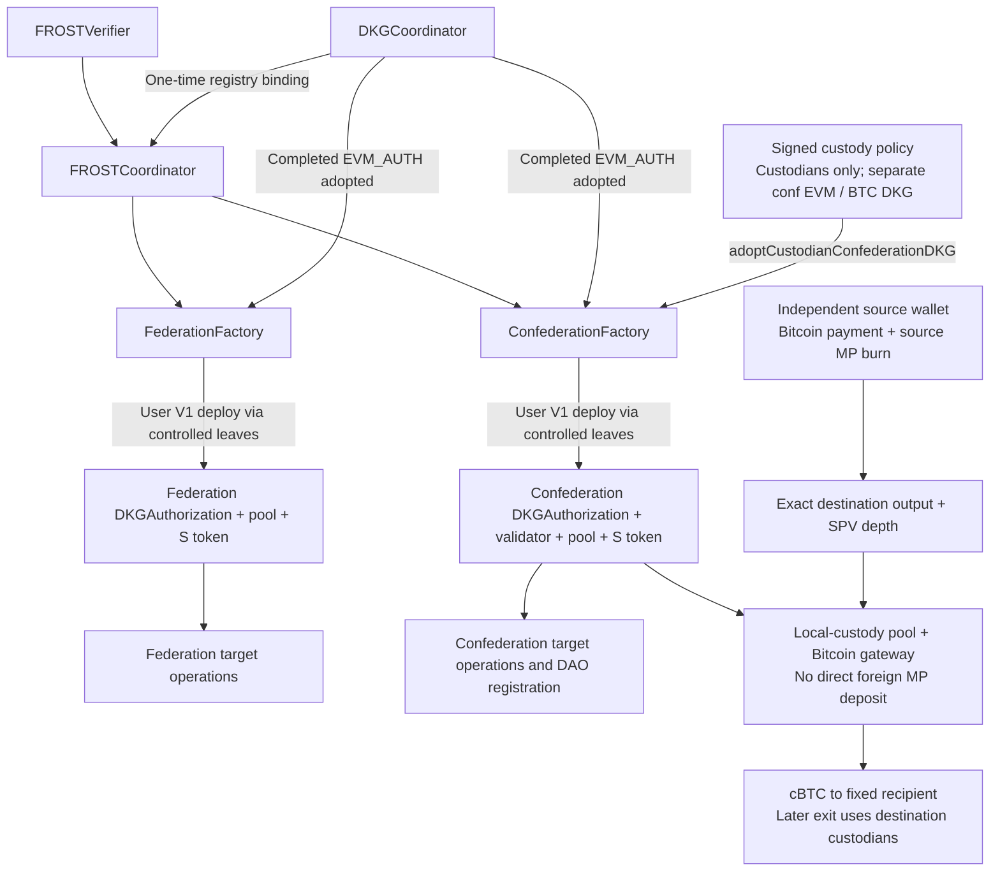

# Web3 Contracts

Foundry project for Bitcoin SPV, mining pool wrappers, federation/confederation pools, FROST authorization and fee accounting.

[Token map](../docs/TOKENS.md): where MP, FS, CS, DAO governance tokens,
reward tokens and discount NFTs come from, and the symbols used by bootstrap.

## Commands

```bash
# From the repository root, using the installed signer-agent environment:
forge build --root web3
forge build --root web3 --sizes
python ops/check_contract_sizes.py
python -c 'from ops.local_acceptance import run_solidity_suites; run_solidity_suites("ops/artifacts/solidity-suites.json")'
```

For a `forge script` network simulation, add `--rpc-url "$RPC_URL"` and the
required stage parameters. Add `--broadcast` only after the simulation and size
gate pass; these transaction flags do not apply to `forge build`.

The infrastructure dispatcher requires an explicit `DEPLOYMENT_STAGE` and the
parameters in [the staged deployment runbook](../docs/STAGED_DEPLOYMENT.md).
The base stage accepts explicit project wallets and creates no fee router or
factory fee configuration. `ops/deployment_stages.py` records confirmed progress
and reuses matching addresses across separate invocations. Foundry tests with
environment dependencies run in isolated processes because `vm.setEnv` shares
process state even with one worker; other suites run once per suite. Use the
runner above for complete coverage.

For the complete system, start with [first DKG on-chain](../docs/FIRST_DKG_ONCHAIN.md)
for regtest, or the [V6 public-Bitcoin runbook](../docs/BITCOIN_MAINNET_RUNBOOK.md).
The Foundry infrastructure script alone creates neither pools nor the Bitcoin/DAO graph.
See [contract sizes and deployment verification](../docs/CONTRACT_SIZE_AND_DEPLOYMENT.md)
for current evidence, limits and the purpose of each deployment entry point.

Current ZK state/consumer/worker and candidate address registry/status boundaries
are mapped in [the architecture diagrams](../docs/ZK_SPV_ARCHITECTURE.md).
The ordinary build contains `BitcoinAddressRegistry` and the unqualified
`BitcoinDepositDerivation` candidate; bootstrap does not activate address mode.
The pinned Groth16 state/verifier/adapter remain in their isolated build.

## Layout

```text
contracts/src/
  FROSTCoordinator.sol       signing-session registry and share verification
  FROSTVerifier.sol          aggregate BIP-340/ECDSA verifier
  FROSTAuthorization.sol     federation authorization boundary
  core/                      Bitcoin transaction parsing
  demo/                      SPV and mining/MultiPool implementations
  federation/                DKG, factories, governance, fees and deployers
  libs/                      Bitcoin script, sighash and proof helpers
  tokens/                    MP, S and discount-NFT tokens
  vendor/cryptography/       secp256k1/FROST arithmetic
script/DeployFederation.s.sol
script/DeployDeploymentFeeRouter.s.sol
script/DeployMainnetHeaderRelay.s.sol
script/DeployBitcoinSigningBoard.s.sol
script/DeployCustodianDAO.s.sol
script/DeployCustodianDAOIncomeAdapter.s.sol
test/CriticalTests.t.sol
test/CustodianDAO.t.sol
```

## Federation Deployment

The `base` and `factories` stages of `DeployFederation.s.sol` prepare infrastructure.
Separate completed DKG ceremonies and adoption/deploy calls create the V1 user
authorization instances and pools:



Factories expose one final deployment method each. V1 uses `DKGAuthorization`
bound to the completed result; legacy initiation/deployment is limited to
31337/11155111. The coordinator and verifier cannot be selected by a federation
deployment caller. `FROSTAuthorizationDeployer` and the other leaf deployers keep
embedded creation bytecode below EIP-170. Paid factory deployment additionally
requires the separate project router and sequential payer approvals in
[STAGED_DEPLOYMENT.md](../docs/STAGED_DEPLOYMENT.md); that router sends the whole
deployment charge to project treasury. See [the full architecture](../docs/ARCHITECTURE.md)
for the DKG, Bitcoin and fee boundaries.

The 4 November static ordinary-build inventory contains 134 deployable project
contracts/libraries within runtime and creation-object gates. It excludes
constructor arguments and the isolated ZK build. Separate
[native custody E2E](../ops/artifacts/custody-transfer-20261104/README.md)
verifies actual BTC transfer and exit without source participants or a federation
representative. Ethereum mainnet retains positive factory
fees and finalized receipt validation; see the
[Ethereum runbook](../docs/ETHEREUM_MAINNET_RUNBOOK.md).
`MultiPoolDeployer` has 24,570 bytes runtime, only 6 spare;
`BitcoinWithdrawalEscrow` has 24,349 bytes, 227 spare. Full sizes are in
[the current inventory](../ops/artifacts/custody-completeness-20261104/contract-sizes.json);
older reports retain their own snapshots.
Bootstrap additionally checks the complete initcode, including constructor arguments,
before signing. The compiler target is pinned to Solidity 0.8.30 / Osaka, via-IR,
optimizer enabled with one run. Re-run the gates when these settings or code change.

See the [documentation index](../docs/README.md) for architecture, API, FROST operation and audit status.

The [V6 acceptance](../docs/PARALLEL_NETWORKS_ACCEPTANCE.md) records current local
validation status and residual risks. The [18 October review](../docs/UPGRADE_REVIEW_2026_10_18.md)
and [5 October review](../docs/STRICT_REVIEW_2026_10_05.md) are historical.
Public Sepolia paid-deployment acceptance and an independent
external audit have not been completed.

After a confederation exists, `DeployCustodianDAO.s.sol` deploys the token,
full-day staking, custodian controller, non-executing decision board, price oracle,
income vault and settlement. Complete its printed registration operation through
FROST and custodian approval; `getCustodianDAO` exposes the seven canonical
addresses. Income/fee sources and their adapters are configured separately.

Pools expose accrued MP fees through approved `claimFees`. `PoolFeePipeline`
converts the actual tokens and forwards reward-token income to the DAO router,
which distinguishes Wrap, Unwrap and Deploy streams. This is separate from the
project router that receives factory-deployment fees. See [fee flow](../docs/FEE_FLOW.md)
and [Custodian DAO](../docs/CUSTODIAN_DAO.md).

The local acceptance exercises DAO deployment and registration with completed
DKG and repeated discovery. For a new setup follow [first DKG](../docs/FIRST_DKG_ONCHAIN.md)
and [staged deployment](../docs/STAGED_DEPLOYMENT.md); the older
[readiness analysis](../docs/DEPLOYMENT_READINESS.md) and
[review matrix](../docs/CUSTODIAN_DAO_REVIEW.md) retain historical findings.

Personal withdrawal fee contracts and new immutable bootstrap profile: [WITHDRAWAL_FEE_SUBSIDY.md](../docs/WITHDRAWAL_FEE_SUBSIDY.md). Actual purpose qualification remains false; short monetary/gas checks use explicit cryptographic-boundary fixtures.
