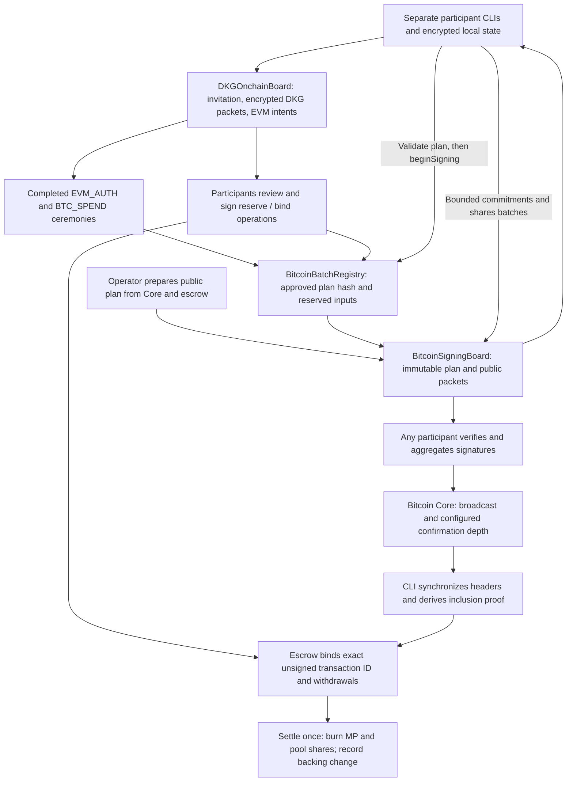

# Bitcoin signing board and CLI

`BitcoinSigningBoard` carries the public plan, FROST nonce commitments and
signature shares for a Bitcoin payment. The CLI now reads and publishes these
materials on chain, assembles the witness, broadcasts through each operator's
Bitcoin Core connection and submits the confirmation proof to escrow. Friends
exchange neither plan files nor signature-package files. Their encrypted private
state, identity and Bitcoin RPC cookie stay on their own machines.

`--board` identifies the original `DKGOnchainBoard`; `--signing-board` identifies
this Bitcoin board. The first board supplies the invitation, HPKE-encrypted DKG
shares and typed EVM approval intents. The second supplies **public, unencrypted**
Bitcoin plans and signing packets. Transaction amounts, scripts, participant
addresses and timing are public. Secret DKG shares, private signing shares,
`KeyPackage` objects and secret nonces must never be published.

V6 independently chooses Ethereum mainnet/Sepolia/local and Bitcoin
mainnet/testnet4/regtest. The [network matrix and automation](../../docs/NETWORKS_AND_AUTOMATION.md)
explains public-Core policy, chain-1 finality and paid factories. See
[the first-DKG guide](../../docs/FIRST_DKG_ONCHAIN.md) for addresses-only discovery.
`flow payment` continues one explicit signing-board/batch after reviewed reserve/bind
approval; it never approves a new financial intent automatically.



## Immutable scope and API

The unchanged constructor is `(address registry, uint256 maximumPacketBytes)`.
It fixes the batch registry, DKG contract, `walletId`, `walletResult` and packet
limit. The registry must expose a completed `BTC_SPEND` ceremony with that
result. There is no administrator, upgrade, deletion, reset or attempt counter.

```solidity
uint256 public constant MAX_PLAN_BYTES = 16384;
bytes32 public constant PLAN_DOMAIN = keccak256("SATOHSI_BTC_ONCHAIN_PLAN_V1");
enum PacketKind { Commitment, SignatureShare }

function getPlanHash(bytes32 batchId, bytes calldata payload)
    public view returns (bytes32);
function publishPlan(bytes32 batchId, bytes calldata payload) external;
function plan(bytes32 batchId) external view returns (bytes memory);

function publish(bytes32 batchId, uint32 inputIndex, PacketKind kind,
    bytes calldata payload) external;
function publishBatch(bytes32 batchId, PacketKind kind, bytes[] calldata payloads) external;
function packet(bytes32 batchId, uint32 inputIndex, PacketKind kind,
    address sender) external view returns (bytes memory);
function packetKey(bytes32 batchId, uint32 inputIndex, PacketKind kind,
    address sender) public pure returns (bytes32);

event PlanPublished(bytes32 indexed batchId, address indexed publisher, bytes32 planHash);
event PacketPublished(bytes32 indexed batchId, uint32 indexed inputIndex,
    address indexed sender, PacketKind kind, bytes32 payloadHash);
```

`publishBatch` publishes all inputs of one sender/kind atomically. It requires
1..16 payloads, exactly the registered input count, and at most 16384 total payload
bytes; each packet also respects `maxPacketBytes`. Indices are the canonical input
order. Existing identical bytes are accepted without replacement, including after
the batch changes state; a conflicting packet reverts the entire transaction.
Clients persist all commitments/shares before sending and retain the complete
original batch on retry. Secret nonces remain local.

The reserved plan hash is exactly:

```solidity
keccak256(abi.encode(
    PLAN_DOMAIN, block.chainid, address(this), walletResult,
    batchId, keccak256(payload)
))
```

This commits the exact canonical JSON bytes, including the immutable signer
subset, to one chain, board, wallet result and batch. `publishPlan` accepts a
nonempty payload of at most **16,384 bytes**, only from a BTC-wallet participant,
and only while the batch is `Reserved` or `Signing`. Its hash must equal the
already approved `BitcoinBatchRegistry.batches(batchId).planHash`.
The board does not parse JSON; the client validates the strict version-2 schema.

Plan fields are `version`, `network`, `batch_registry`, `batch_id`,
`signing_board`, `wallet_result`, `wallet_script`, `deadline`, `inputs`, `outputs`,
`fee`, `max_fee`, `withdrawal_refs` and `signers`. Numbers are canonical decimal
strings; hex strings have fixed lengths where applicable. Unknown fields and
noncanonical serialization are rejected. Plans contain 1–16 inputs, 1–32 outputs,
1–32 distinct withdrawal references and an ordered subset of exactly the wallet
threshold. The Bitcoin transaction's BIP341 sighash remains unchanged by board,
batch or packet metadata.

The packet key remains
`keccak256(abi.encode(batchId, inputIndex, kind, sender))`.
For a first packet write, the actual caller must be a wallet participant, the
batch must be `Signing`, the input index must exist, and payload length must be
between one byte and `maxPacketBytes`. The CLI's board deployment command
requires an explicit packet limit from **512 to 4096 bytes**. The contract itself
retains its compatible constructor requirement that this limit is positive.

The CLI publishes canonical JSON with exactly these keys:

```json
{"version":"1","batch":"<32-byte hex>","input":"0","kind":"commitment","signer":"1","plan_hash":"<32-byte hex>","value":"<public FROST packet hex>"}
```

`kind` is `commitment` or `share`; contract enum values are 0 and 1 respectively.
The Rust helper parses and reserializes the public FROST type before publication.
Readers verify the exact schema, canonical encoding, plan hash, input, selected
signer and actual on-chain sender. Unknown or substituted packets fail closed.
Only public commitments and the public share of this particular signature
(`z_i`) enter `value`.

An unused plan or packet getter returns empty bytes. Events identify publications;
clients fetch and verify the stored bytes rather than treating an event as the
signing package.

## Delivery retries and nonce safety

Identical publication retries succeed without another event, including after a
batch state change. Different bytes for an occupied key revert with
`ConflictingRetry`. A plan retry still requires a wallet participant; packet
keys already include the caller. The CLI checks stored bytes before submitting
so ordinary identical retries need no additional EVM transaction.

Before disclosing a commitment, the signer checks the trusted deployment graph,
board creation proof, exact approved plan, current UTXOs, escrow obligations and
principal backing. It then crosses the registry's irreversible `beginSigning`
boundary. Secret nonces are saved in encrypted local state before publication;
the independent spent-nonce journal is persisted before exposing a signature
share, and secret nonces are removed from that state row. Retries reuse the saved
public material. Missing commitments fail before a nonce is consumed.

The signer subset and complete commitment transcript cannot change within a
batch. This interface has no new-attempt, reset or automatic subset replacement
command. A failed signing attempt keeps the existing reservations locked; an
operator cannot recover by deleting state, copying another participant's state
or generating fresh nonces for an occupied packet key. Preserve the encrypted
state and its nonce journal together. The software cannot protect a compromised
host or make arbitrary rollback of private state safe.

## Payment sequence

First each friend independently runs `inspect-bitcoin-registry`, reviews the
fingerprint and pins it with `trust-bitcoin-registry`. Deploy the signing board
once using `btc-deploy-board --max-packet-bytes 4096`, or the Forge script below.
The local files referenced here are each participant's own identity, password
and encrypted state; none is transferred to another participant.

A convenient local wrapper supplies the common options:

```sh
btc() {
  frost-signer dkg "$@" \
    --board "$DKG_BOARD" --role btc_ceremony --rpc "$EVM_RPC" \
    --identity-file "$IDENTITY" --state "$BTC_STATE" \
    --password-file "$PASSWORD_FILE" \
    --bitcoin-rpc "$BITCOIN_RPC" --bitcoin-cookie "$BITCOIN_COOKIE"
}
```

1. The operator uses an already approved escrow withdrawal and explicit inputs,
   fee budget, deadline and signer indices. `btc-prepare` reads recipient scripts
   and amounts from escrow, reads UTXOs from Core, checks maturity and backing,
   and computes change. It saves the canonical plan in encrypted local state.
   Miner fees cannot consume token principal; insufficient funds or change below
   the configured P2TR minimum are rejected.

   ```sh
   btc btc-prepare --signing-board "$SIGNING_BOARD" --batch "$BATCH" \
     --input "$TXID:$VOUT" --input "$FEE_TXID:$FEE_VOUT" \
     --withdrawal "$WITHDRAWAL_KEY" --fee 1000 --max-fee 2000 \
     --deadline "$DEADLINE" --signers 1 2
   btc btc-propose --signing-board "$SIGNING_BOARD" --batch "$BATCH" --operation reserve
   ```

2. `btc-propose` publishes the strict public plan and typed operation to the
   original DKG board. In custody mode its custodian epoch is also allowed to
   publish public intents after bootstrap delegation. The example uses two
   custodians with BTC indices 1/2; an older 3-of-3 wallet needs its own original
   roster and `--signers 1 2 3`. Friends
   discover the proposal using `btc-pending` or `setup pending`, review it, and
   each run the existing `sign-evm` command with their **EVM_AUTH** ceremony and
   the displayed session. They repeat signing once commitments are complete.
   The CLI checks that the displayed Bitcoin plan produces the exact reserve
   hash, or the exact transaction ID and withdrawal references for binding.

3. Execute the approved reservation, publish the immutable plan and propose the
   escrow binding. Friends authorize the second EVM session in the same way.

   ```sh
   btc btc-execute --signing-board "$SIGNING_BOARD" --batch "$BATCH" --operation reserve
   btc btc-publish-plan --signing-board "$SIGNING_BOARD" --batch "$BATCH"
   btc btc-propose --signing-board "$SIGNING_BOARD" --batch "$BATCH" --operation bind
   # Each EVM_AUTH participant now signs the new binding session.
   btc btc-execute --signing-board "$SIGNING_BOARD" --batch "$BATCH" --operation bind
   ```

4. Each selected BTC participant reads the same plan and publishes commitments.
   Once all selected commitments exist, each publishes signature shares. The
   board and batch can be discovered from the latest on-chain payment intent;
   supply explicit selectors when several payments are pending.

   ```sh
   btc btc-status --signing-board "$SIGNING_BOARD" --batch "$BATCH"
   btc btc-commit --signing-board "$SIGNING_BOARD" --batch "$BATCH"
   btc btc-sign --signing-board "$SIGNING_BOARD" --batch "$BATCH"
   ```

5. Any participant aggregates and verifies all selected shares, broadcasts the
   Bitcoin transaction, and settles after the configured confirmation depth.
   Settlement synchronizes new headers and derives the Merkle proof from Core.
   Repeating broadcast or settlement is idempotent. Insufficient depth, an
   inconsistent plan, a changed proposal anchor or a diverged relay fail closed.

   ```sh
   btc btc-broadcast --signing-board "$SIGNING_BOARD" --batch "$BATCH"
   btc btc-settle --signing-board "$SIGNING_BOARD" --batch "$BATCH"
   ```

Neither plan preparation nor EVM reservation/binding creates BTC signing nonces.
MP and pool-share burning occurs only after successful Bitcoin proof settlement.

## Deployment and replacing the older immutable board

`DeployBitcoinSigningBoard.s.sol:DeployBitcoinSigningBoard` still requires these
explicit environment variables:

| Variable | Meaning |
| --- | --- |
| `EXPECTED_CHAIN_ID` | Connected EVM chain must match |
| `BITCOIN_BATCH_REGISTRY` | Existing trusted immutable wallet registry |
| `MAX_PACKET_BYTES` | Use 512–4096 for the current CLI packet format |
| `PRIVATE_KEY` | Local deployment identity; never include it in an invitation |

From `web3/`:

```sh
forge script script/DeployBitcoinSigningBoard.s.sol:DeployBitcoinSigningBoard \
  --rpc-url "$RPC_URL" --broadcast
```

The script prints the board address and immutable bindings. The deployment does
not create a DKG or reserve a payment. The CLI verifies runtime bytes and canonical
CREATE inputs before accepting the board.

An older board with only the packet API **cannot be upgraded in place**. Deploy
this version against the same trusted batch registry; existing DKG shares and
registry bindings remain usable. Prepare a **new batch ID** on the new board so
its reservation commits the new board address and version-2 plan hash. Friends
discover that address through the new typed on-chain payment intent and verify
its provenance independently.

Do not copy old packets to a new board or re-sign an old batch under a new board
address. An old `Reserved` batch can only be cancelled/refunded through the
existing authorized cancellation path before signing begins; resolve it before
reusing its inputs. An old `Signing` batch must retain its original attempt,
nonce journal and reservations. This change supplies no timeout refund or safe
reset for that irreversible state.

## Size, gas and tests

With pinned Solidity 0.8.30, via-IR, one optimizer run and Osaka, board runtime is
**3963 bytes**, creation bytecode **5038 bytes**, and complete constructor input
**5102 bytes**. The two-argument constructor is unchanged.

The maximum 16,384-byte plan test fills every storage word with nonzero bytes:
`publishPlan` uses **11,698,716 gas** in that test. Adding a conservative intrinsic
and calldata allowance gives **11,983,460**, below the Osaka transaction gas cap
of 16,777,216. The test asserts this bound. The earlier proposed 32 KiB maximum
was reduced because full nonzero storage would exceed that transaction budget.
Real publication still requires gas estimation on the intended chain.

`test/BitcoinSigningBoard.t.sol` preserves 15 existing packet, deployment and
escrow-boundary tests. `test/BitcoinSigningBoardPlan.t.sol` adds 10 tests for an
independent Python ABI/hash vector, chain/board/wallet/batch/payload separation,
plan length, participants, states, retries, event hashes and unchanged registry
reservations/authorizations. The focused **25-test suite passes**.

The end-to-end scenario in
[`tests/e2e/test_bitcoin_onchain.py`](../../tests/e2e/test_bitcoin_onchain.py)
uses separate participant directories, real DKG, EVM approvals and Bitcoin Core
payments to both P2WPKH and P2TR recipients. It exercises missing packets,
conflicting retries, premature settlement, exact MP/S burns and a scan of public
packets and CLI diagnostics for test-local secret values. The full-run evidence
is recorded separately; passing tests do not establish secrecy on a compromised
participant machine or constitute an external cryptographic audit.


## Bitcoin mainnet

V6 public-Bitcoin profiles use this same on-chain signing transport with `network=mainnet` or `network=testnet4` in the approved
public plan. The CLI binds it to the invitation, Bitcoin Core, `MainnetHeaderRelay`
and `MainnetSPVGuard`, and reads approvals/escrow at the enrolled EVM confirmation
depth. Both first signing and cached packet publication stop on stale/halted relay
state. The guard also blocks permissionless stale deposit proofs.

See [mainnet setup](../../docs/BITCOIN_MAINNET_RUNBOOK.md) and
[the security review](../../docs/BITCOIN_MAINNET_SECURITY_REVIEW.md). A fresh DKG is
required; renaming a regtest wallet is unsupported. V6 independently selects the EVM network; [Ethereum mainnet bootstrap](../../docs/ETHEREUM_MAINNET_RUNBOOK.md) supports
Ethereum mainnet with positive factory fees and finalized receipts.
